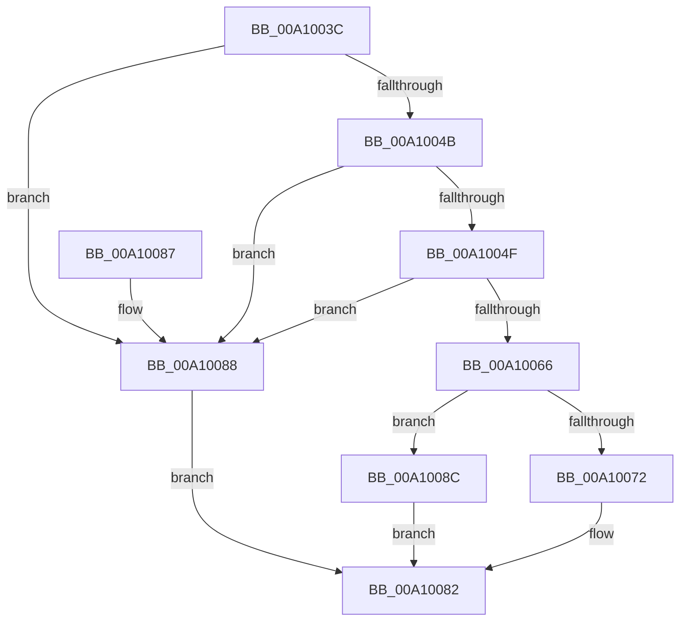

# PsTestProtectedProcessIncompatibility

- RVA: `0x00A1003C`–`0x00A10090` (길이 `84` bytes)
- VA: `0x0000000140A1003C`
- 실행 섹션: `PAGE`
- PDB 이름 있음: `예`; PDB Function 태그: `아니요`
- unwind 정보 RVA: `0x0009654C`
- 디코드: `27`개 명령, `84/84` bytes 표시
- 미해석 바이트: `0` (있으면 어셈블리에 `.byte`로 보존)

> 이 문서는 커널 이미지의 기계어와 PDB 기호를 분석해 생성했습니다. 4번과 5번은 함수 원형과 자료형을 바이너리 사용 방식에서 추정한 C 해석이며 원본 소스 복구 결과는 아닙니다.

## 1. Dependencies

- 직접 호출 지점: **2**; 고유 호출 대상: **2**
- 직접 호출자로 확인된 함수: **7**
- RIP 상대 이미지 참조: **1**

### Outgoing calls
- `0x00A1005D` → [RtlTestProtectedAccess](RtlTestProtectedAccess_function_00A100C8.md) (function, `0x00A100C8`)
- `0x00A10078` → [guard_dispatch_icall](../../text/6B/guard_dispatch_icall_function_006BAAD0.md) (function, `0x006BAAD0`)

### Direct callers
- [DbgkpSendErrorMessage](../92/DbgkpSendErrorMessage_function_009210A8.md) at `0x009213BC`
- [DbgkCopyProcessDebugPort](../94/DbgkCopyProcessDebugPort_function_00947BE8.md) at `0x00947C70`
- [NtRemoveProcessDebug](../A0/NtRemoveProcessDebug_function_00A0FAF0.md) at `0x00A0FB7F`
- [NtDebugActiveProcess](../A0/NtDebugActiveProcess_function_00A0FC60.md) at `0x00A0FD0F`
- [PspProcessOpen](../AE/PspProcessOpen_function_00AE3620.md) at `0x00AE3689`
- [NtCreateUserProcess](../AE/NtCreateUserProcess_function_00AEA680.md) at `0x00AEB4B6`
- [sub_00B439C4](../B4/Unknown_function_00B439C4.md) at `0x00B439EF`

### Static image references
- `0x00A10066` → RVA `0x00F04EF8` (`.data`; read)

## 2. Other-region calls and transfers

- 다른 실행 섹션으로 향하는 call: **1**
  - `0x00A10078` → [guard_dispatch_icall](../../text/6B/guard_dispatch_icall_function_006BAAD0.md) (`PAGE` → `.text`)
- 별도 외부 분기/꼬리 이동을 확인하지 못했습니다.

## 3. Assembly (complete function range)

```asm
00A1003C  48 83 EC 28                     sub rsp, 0x28
00A10040  4D 8B C8                        mov r9, r8
00A10043  4C 8B D2                        mov r10, rdx
00A10046  49 3B D0                        cmp rdx, r8
00A10049  74 3D                           je 0x140a10088
00A1004B  84 C9                           test cl, cl
00A1004D  74 39                           je 0x140a10088
00A1004F  41 8A 90 FA 05 00 00            mov dl, byte ptr [r8 + 0x5fa]
00A10056  41 8A 8A FA 05 00 00            mov cl, byte ptr [r10 + 0x5fa]
00A1005D  E8 66 00 00 00                  call 0x140a100c8
00A10062  84 C0                           test al, al
00A10064  75 22                           jne 0x140a10088
00A10066  48 8B 05 8B 4E 4F 00            mov rax, qword ptr [rip + 0x4f4e8b]
00A1006D  48 85 C0                        test rax, rax
00A10070  74 1A                           je 0x140a1008c
00A10072  49 8B D1                        mov rdx, r9
00A10075  49 8B CA                        mov rcx, r10
00A10078  E8 53 AA CA FF                  call 0x1406baad0
00A1007D  84 C0                           test al, al
00A1007F  0F 94 C0                        sete al
00A10082  48 83 C4 28                     add rsp, 0x28
00A10086  C3                              ret
00A10087  CC                              int3
00A10088  32 C0                           xor al, al
00A1008A  EB F6                           jmp 0x140a10082
00A1008C  B0 01                           mov al, 1
00A1008E  EB F2                           jmp 0x140a10082
```

## 4. C-style interpretation (structured pseudocode)

```c
__int64 __fastcall PsTestProtectedProcessIncompatibility(unsigned __int8 a1, __int64 a2, __int64 a3)
{
    __int64 result;
    __int64 v_rsp;

    v_rsp = (v_rsp) - (40);
    if (a2 == a3) goto loc_00A10088;
    if (a1 == 0) goto loc_00A10088;
    result = RtlTestProtectedAccess(*(unsigned __int8 *)(a2 + 1530), *(unsigned __int8 *)(a3 + 1530), a3, a3);
    if ((unsigned __int8)(result) != 0) goto loc_00A10088;
    if (*(unsigned __int64 *)(v_rip + 5197451) == 0) goto loc_00A1008C;
    result = guard_dispatch_icall(a2, a3, a3, a3);
    result = ((unsigned __int8)(result) == 0) ? 1 : 0;
loc_00A10082:
    v_rsp = (v_rsp) + (40);
    return result;
loc_00A10088:
    result = 0;
    goto loc_00A10082;
loc_00A1008C:
    goto loc_00A10082;
}
```

## 5. (Beta) C Style

```c
int64_t PsTestProtectedProcessIncompatibility(uint8_t Arg1, void *Arg2, void *Arg3)
{
    uint8_t *arg2 = (uint8_t *)Arg2;
    uint8_t *arg3 = (uint8_t *)Arg3;

    int64_t result;
    int64_t local_rsp;

    local_rsp = (local_rsp) - (40);
    if (Arg2 == Arg3) goto loc_00A10088;
    if (Arg1 == 0) goto loc_00A10088;
    result = RtlTestProtectedAccess(*(uint8_t *)(arg2 + 0x5FA), *(uint8_t *)(arg3 + 0x5FA), Arg3, Arg3);
    if ((uint8_t)(result) != 0) goto loc_00A10088;
    if (*(uint64_t *)(v_rip + 0x4F4E8B) == 0) goto loc_00A1008C;
    result = guard_dispatch_icall(Arg2, Arg3, Arg3, Arg3);
    result = ((uint8_t)(result) == 0) ? 1 : 0;
loc_00A10082:
    local_rsp = (local_rsp) + (40);
    return result;
loc_00A10088:
    result = 0;
    goto loc_00A10082;
loc_00A1008C:
    goto loc_00A10082;
}
```

### 관측된 메모리 오프셋

구조체 형식이 확인되지 않은 접근은 인자 기준의 오프셋으로만 기록했습니다.

| 기준 인자 | 오프셋 표현 | 폭 (bit) | 접근 |
|---|---:|---:|---|
| `Arg2` | `+ 0x5FA` | `8` | `R` |
| `Arg3` | `+ 0x5FA` | `8` | `R` |

## 6. Execution-region graph

[열기: 2D/3D 그래프와 함수 탐색 컨트롤 패널](../../../control-panel.html?section=page&rva=0x00A1003C&view=graph)

- 2D 그래프는 위에서 아래로 흐르고, 3D 그래프는 빈 공간을 드래그해 회전합니다. Shift+드래그는 이동, 휠은 확대·축소, 함수 노드 선택은 대상 보고서 이동입니다.

### Static fallback


