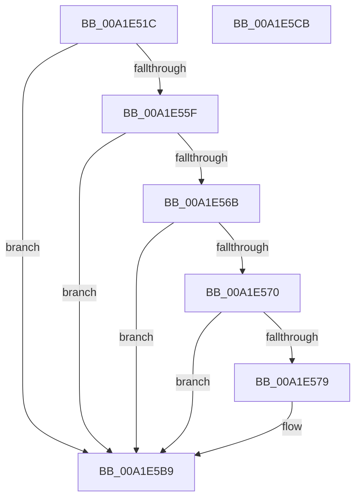

# PspCreateObjectHandle

- RVA: `0x00A1E51C`–`0x00A1E5CC` (길이 `176` bytes)
- VA: `0x0000000140A1E51C`
- 실행 섹션: `PAGE`
- PDB 이름 있음: `예`; PDB Function 태그: `아니요`
- unwind 정보 RVA: `0x0007F83C`
- 디코드: `48`개 명령, `176/176` bytes 표시
- 미해석 바이트: `0` (있으면 어셈블리에 `.byte`로 보존)

> 이 문서는 커널 이미지의 기계어와 PDB 기호를 분석해 생성했습니다. 4번과 5번은 함수 원형과 자료형을 바이너리 사용 방식에서 추정한 C 해석이며 원본 소스 복구 결과는 아닙니다.

## 1. Dependencies

- 직접 호출 지점: **2**; 고유 호출 대상: **2**
- 직접 호출자로 확인된 함수: **4**
- RIP 상대 이미지 참조: **1**

### Outgoing calls
- `0x00A1E554` → [ObOpenObjectByPointer](../8B/ObOpenObjectByPointer_function_008B7420.md) (function, `0x008B7420`)
- `0x00A1E5B4` → [SepAdtPrivilegeObjectAuditAlarm](../86/SepAdtPrivilegeObjectAuditAlarm_function_0086E3F0.md) (function, `0x0086E3F0`)

### Direct callers
- [PsCreateMinimalProcess](../78/PsCreateMinimalProcess_function_00786D14.md) at `0x00787056`
- [PspInsertThread](../9F/PspInsertThread_function_009F0314.md) at `0x009F0BAF`
- [PspCreateProcess](PspCreateProcess_function_00A12758.md) at `0x00A12C8B`
- [NtCreateUserProcess](../AE/NtCreateUserProcess_function_00AEA680.md) at `0x00AEB6D6`

### Static image references
- `0x00A1E57C` → RVA `0x000013A8` (`.rdata`; read)

## 2. Other-region calls and transfers

- 다른 실행 섹션으로 향하는 call: **0**
- 별도 외부 분기/꼬리 이동을 확인하지 못했습니다.

## 3. Assembly (complete function range)

```asm
00A1E51C  4C 8B DC                        mov r11, rsp
00A1E51F  49 89 5B 08                     mov qword ptr [r11 + 8], rbx
00A1E523  49 89 73 10                     mov qword ptr [r11 + 0x10], rsi
00A1E527  57                              push rdi
00A1E528  48 83 EC 50                     sub rsp, 0x50
00A1E52C  8A 82 84 01 00 00               mov al, byte ptr [rdx + 0x184]
00A1E532  48 8D B2 88 01 00 00            lea rsi, [rdx + 0x188]
00A1E539  49 89 73 D8                     mov qword ptr [r11 - 0x28], rsi
00A1E53D  48 8B DA                        mov rbx, rdx
00A1E540  88 44 24 28                     mov byte ptr [rsp + 0x28], al
00A1E544  45 33 C9                        xor r9d, r9d
00A1E547  4D 89 43 C8                     mov qword ptr [r11 - 0x38], r8
00A1E54B  4C 8B C2                        mov r8, rdx
00A1E54E  8B 92 80 01 00 00               mov edx, dword ptr [rdx + 0x180]
00A1E554  E8 C7 8E E9 FF                  call 0x1408b7420
00A1E559  8B F8                           mov edi, eax
00A1E55B  85 C0                           test eax, eax
00A1E55D  78 5A                           js 0x140a1e5b9
00A1E55F  48 8B 4B 48                     mov rcx, qword ptr [rbx + 0x48]
00A1E563  48 8B 11                        mov rdx, qword ptr [rcx]
00A1E566  48 85 D2                        test rdx, rdx
00A1E569  74 4E                           je 0x140a1e5b9
00A1E56B  83 3A 00                        cmp dword ptr [rdx], 0
00A1E56E  76 49                           jbe 0x140a1e5b9
00A1E570  80 BB 84 01 00 00 00            cmp byte ptr [rbx + 0x184], 0
00A1E577  74 40                           je 0x140a1e5b9
00A1E579  8B 43 14                        mov eax, dword ptr [rbx + 0x14]
00A1E57C  48 8D 0D 25 2E 5E FF            lea rcx, [rip - 0xa1d1db]
00A1E583  4C 8B 0E                        mov r9, qword ptr [rsi]
00A1E586  45 33 C0                        xor r8d, r8d
00A1E589  C6 44 24 48 01                  mov byte ptr [rsp + 0x48], 1
00A1E58E  48 89 54 24 40                  mov qword ptr [rsp + 0x40], rdx
00A1E593  33 D2                           xor edx, edx
00A1E595  89 44 24 38                     mov dword ptr [rsp + 0x38], eax
00A1E599  48 8B 43 38                     mov rax, qword ptr [rbx + 0x38]
00A1E59D  48 89 44 24 30                  mov qword ptr [rsp + 0x30], rax
00A1E5A2  48 8B 43 30                     mov rax, qword ptr [rbx + 0x30]
00A1E5A6  48 89 44 24 28                  mov qword ptr [rsp + 0x28], rax
00A1E5AB  48 8B 43 20                     mov rax, qword ptr [rbx + 0x20]
00A1E5AF  48 89 44 24 20                  mov qword ptr [rsp + 0x20], rax
00A1E5B4  E8 37 FE E4 FF                  call 0x14086e3f0
00A1E5B9  48 8B 5C 24 60                  mov rbx, qword ptr [rsp + 0x60]
00A1E5BE  8B C7                           mov eax, edi
00A1E5C0  48 8B 74 24 68                  mov rsi, qword ptr [rsp + 0x68]
00A1E5C5  48 83 C4 50                     add rsp, 0x50
00A1E5C9  5F                              pop rdi
00A1E5CA  C3                              ret
00A1E5CB  CC                              int3
```

## 4. C-style interpretation (structured pseudocode)

```c
__int64 __fastcall PspCreateObjectHandle(__int64 a1, __int64 a2, __int64 a3, int a4)
{
    __int64 result;
    __int64 v_rsp;
    unsigned __int8 v_stack_m10;
    unsigned __int64 v_stack_m18;
    unsigned int v_stack_m20;
    unsigned __int64 v_stack_m28;
    unsigned __int8 v_stack_m30;
    unsigned __int64 v_stack_m38;
    unsigned __int64 v_stack_p10;
    unsigned __int64 v_stack_p8;

    *(unsigned __int64 *)(v_rsp + 8) = v_rbx;
    *(unsigned __int64 *)(v_rsp + 16) = v_rsi;
    v_rsp = (v_rsp) - (80);
    *(unsigned __int64 *)(v_rsp - 40) = a2 + 392;
    v_stack_m30 = (unsigned __int8)(*(unsigned __int8 *)(a2 + 388));
    a4 = 0;
    *(unsigned __int64 *)(v_rsp - 56) = a3;
    result = ObOpenObjectByPointer(a1, (unsigned int)(*(unsigned int *)(a2 + 384)), a2, a4);
    if (sign_flag) goto loc_00A1E5B9;
    if (*(unsigned __int64 *)(*(unsigned __int64 *)(a2 + 72)) == 0) goto loc_00A1E5B9;
    if ((*(unsigned int *)(*(unsigned __int64 *)(*(unsigned __int64 *)(a2 + 72)))) <= 0) goto loc_00A1E5B9;
    if ((*(unsigned __int8 *)(a2 + 388)) != 0) {
        result = *(unsigned int *)(a2 + 20);
        a1 = v_rip - 10605019;
        a4 = *(unsigned __int64 *)(a2 + 392);
        a3 = 0;
        v_stack_m10 = 1;
        v_stack_m18 = *(unsigned __int64 *)(*(unsigned __int64 *)(a2 + 72));
        a2 = 0;
        v_stack_m20 = (unsigned int)(result);
        result = *(unsigned __int64 *)(a2 + 56);
        v_stack_m28 = result;
        result = *(unsigned __int64 *)(a2 + 48);
        v_stack_m30 = result;
        result = *(unsigned __int64 *)(a2 + 32);
        v_stack_m38 = result;
        result = SepAdtPrivilegeObjectAuditAlarm(a1, a2, a3, a4);
    }
    v_rsp = (v_rsp) + (80);
    return (unsigned int)((unsigned int)((unsigned int)((unsigned int)(result))));
}
```

## 5. (Beta) C Style

```c
int64_t PspCreateObjectHandle(int64_t Arg1, void *Arg2, int64_t Arg3, int32_t Arg4)
{
    uint8_t *arg2 = (uint8_t *)Arg2;

    int64_t result;
    int64_t local_rsp;
    uint8_t v_stack_m10;
    uint64_t v_stack_m18;
    uint32_t v_stack_m20;
    uint64_t v_stack_m28;
    uint8_t v_stack_m30;
    uint64_t v_stack_m38;
    uint64_t v_stack_p10;
    uint64_t v_stack_p8;

    *(uint64_t *)(local_rsp + 0x8) = local_rbx;
    *(uint64_t *)(local_rsp + 0x10) = local_rsi;
    local_rsp = (local_rsp) - (80);
    *(void **)(local_rsp - 0x28) = Arg2 + 392;
    v_stack_m30 = (uint8_t)(*(uint8_t *)(arg2 + 0x184));
    Arg4 = 0;
    *(uint64_t *)(local_rsp - 0x38) = Arg3;
    result = ObOpenObjectByPointer(Arg1, (uint32_t)(*(uint32_t *)(arg2 + 0x180)), Arg2, Arg4);
    if (sign_flag) goto loc_00A1E5B9;
    if (*(uint64_t *)(*(uint64_t *)(arg2 + 0x48)) == 0) goto loc_00A1E5B9;
    if ((*(uint32_t *)(*(uint64_t *)(*(uint64_t *)(arg2 + 0x48)))) <= 0) goto loc_00A1E5B9;
    if ((*(uint8_t *)(arg2 + 0x184)) != 0) {
        result = *(uint32_t *)(arg2 + 0x14);
        Arg1 = v_rip - 10605019;
        Arg4 = *(uint64_t *)(arg2 + 0x188);
        Arg3 = 0;
        v_stack_m10 = 1;
        v_stack_m18 = *(uint64_t *)(*(uint64_t *)(arg2 + 0x48));
        Arg2 = 0;
        v_stack_m20 = (uint32_t)(result);
        result = *(uint64_t *)(arg2 + 0x38);
        v_stack_m28 = result;
        result = *(uint64_t *)(arg2 + 0x30);
        v_stack_m30 = result;
        result = *(uint64_t *)(arg2 + 0x20);
        v_stack_m38 = result;
        result = SepAdtPrivilegeObjectAuditAlarm(Arg1, Arg2, Arg3, Arg4);
    }
    local_rsp = (local_rsp) + (80);
    return (uint32_t)((uint32_t)((uint32_t)((uint32_t)(result))));
}
```

### 관측된 메모리 오프셋

구조체 형식이 확인되지 않은 접근은 인자 기준의 오프셋으로만 기록했습니다.

| 기준 인자 | 오프셋 표현 | 폭 (bit) | 접근 |
|---|---:|---:|---|
| `Arg2` | `+ 0x0` | `64` | `R` |
| `Arg2` | `+ 0x14` | `32` | `R` |
| `Arg2` | `+ 0x20` | `64` | `R` |
| `Arg2` | `+ 0x30` | `64` | `R` |
| `Arg2` | `+ 0x38` | `64` | `R` |
| `Arg2` | `+ 0x48` | `64` | `R` |
| `Arg2` | `+ 0x180` | `32` | `R` |
| `Arg2` | `+ 0x184` | `8` | `R` |
| `Arg2` | `+ 0x188` | `64` | `R` |

## 6. Execution-region graph

[열기: 2D/3D 그래프와 함수 탐색 컨트롤 패널](../../../control-panel.html?section=page&rva=0x00A1E51C&view=graph)

- 2D 그래프는 위에서 아래로 흐르고, 3D 그래프는 빈 공간을 드래그해 회전합니다. Shift+드래그는 이동, 휠은 확대·축소, 함수 노드 선택은 대상 보고서 이동입니다.

### Static fallback


