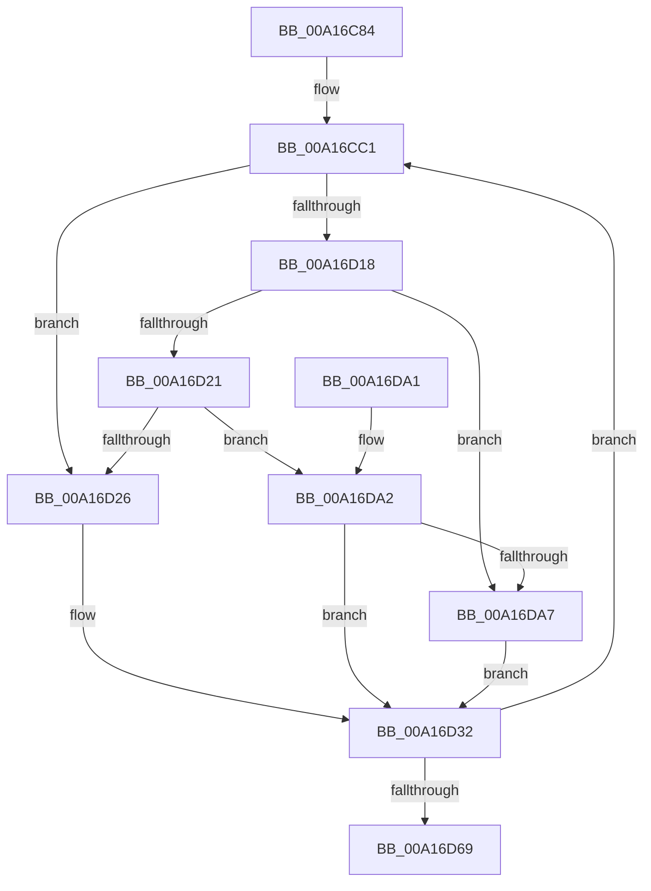

# PspInheritMitigationAuditOptions

- RVA: `0x00A16C84`–`0x00A16DB0` (길이 `300` bytes)
- VA: `0x0000000140A16C84`
- 실행 섹션: `PAGE`
- PDB 이름 있음: `예`; PDB Function 태그: `아니요`
- unwind 정보 RVA: `0x000A9D8C`
- 디코드: `83`개 명령, `300/300` bytes 표시
- 미해석 바이트: `0` (있으면 어셈블리에 `.byte`로 보존)

> 이 문서는 커널 이미지의 기계어와 PDB 기호를 분석해 생성했습니다. 4번과 5번은 함수 원형과 자료형을 바이너리 사용 방식에서 추정한 C 해석이며 원본 소스 복구 결과는 아닙니다.

## 1. Dependencies

- 직접 호출 지점: **1**; 고유 호출 대상: **1**
- 직접 호출자로 확인된 함수: **1**
- RIP 상대 이미지 참조: **1**

### Outgoing calls
- `0x00A16D86` → [_security_check_cookie](../../text/6A/_security_check_cookie_function_006AC640.md) (function, `0x006AC640`)

### Direct callers
- [PspAllocateProcess](PspAllocateProcess_function_00A13B3C.md) at `0x00A156A0`
- [PspAllocateProcess](PspAllocateProcess_function_00A13B3C.md) at `0x00A15798`

### Static image references
- `0x00A16C98` → RVA `0x00E0A740` (`.data`; read)

## 2. Other-region calls and transfers

- 다른 실행 섹션으로 향하는 call: **1**
  - `0x00A16D86` → [_security_check_cookie](../../text/6A/_security_check_cookie_function_006AC640.md) (`PAGE` → `.text`)
- 별도 외부 분기/꼬리 이동을 확인하지 못했습니다.

## 3. Assembly (complete function range)

```asm
00A16C84  4C 8B DC                        mov r11, rsp
00A16C87  49 89 5B 08                     mov qword ptr [r11 + 8], rbx
00A16C8B  49 89 6B 10                     mov qword ptr [r11 + 0x10], rbp
00A16C8F  49 89 73 20                     mov qword ptr [r11 + 0x20], rsi
00A16C93  57                              push rdi
00A16C94  48 83 EC 60                     sub rsp, 0x60
00A16C98  48 8B 05 A1 3A 3F 00            mov rax, qword ptr [rip + 0x3f3aa1]
00A16C9F  48 33 C4                        xor rax, rsp
00A16CA2  48 89 44 24 58                  mov qword ptr [rsp + 0x58], rax
00A16CA7  33 C0                           xor eax, eax
00A16CA9  0F 57 C0                        xorps xmm0, xmm0
00A16CAC  0F 11 44 24 40                  movups xmmword ptr [rsp + 0x40], xmm0
00A16CB1  49 89 43 E8                     mov qword ptr [r11 - 0x18], rax
00A16CB5  4D 8B C8                        mov r9, r8
00A16CB8  45 33 DB                        xor r11d, r11d
00A16CBB  48 8B F2                        mov rsi, rdx
00A16CBE  48 8B E9                        mov rbp, rcx
00A16CC1  0F 28 45 00                     movaps xmm0, xmmword ptr [rbp]
00A16CC5  42 8D 1C 9D 00 00 00 00         lea ebx, [r11*4]
00A16CCD  F2 0F 10 4D 10                  movsd xmm1, qword ptr [rbp + 0x10]
00A16CD2  B2 01                           mov dl, 1
00A16CD4  8B FB                           mov edi, ebx
00A16CD6  83 E3 3F                        and ebx, 0x3f
00A16CD9  48 C1 EF 06                     shr rdi, 6
00A16CDD  8B CB                           mov ecx, ebx
00A16CDF  0F 29 44 24 20                  movaps xmmword ptr [rsp + 0x20], xmm0
00A16CE4  0F 28 06                        movaps xmm0, xmmword ptr [rsi]
00A16CE7  F2 0F 11 4C 24 30               movsd qword ptr [rsp + 0x30], xmm1
00A16CED  F2 0F 10 4E 10                  movsd xmm1, qword ptr [rsi + 0x10]
00A16CF2  4C 8B 54 FC 20                  mov r10, qword ptr [rsp + rdi*8 + 0x20]
00A16CF7  49 D3 EA                        shr r10, cl
00A16CFA  0F 29 04 24                     movaps xmmword ptr [rsp], xmm0
00A16CFE  F2 0F 11 4C 24 10               movsd qword ptr [rsp + 0x10], xmm1
00A16D04  4C 8B 04 FC                     mov r8, qword ptr [rsp + rdi*8]
00A16D08  49 D3 E8                        shr r8, cl
00A16D0B  41 80 E0 03                     and r8b, 3
00A16D0F  41 83 E2 03                     and r10d, 3
00A16D13  41 8B CA                        mov ecx, r10d
00A16D16  74 0E                           je 0x140a16d26
00A16D18  83 E9 01                        sub ecx, 1
00A16D1B  0F 84 86 00 00 00               je 0x140a16da7
00A16D21  83 E9 01                        sub ecx, 1
00A16D24  75 7C                           jne 0x140a16da2
00A16D26  41 8D 40 FF                     lea eax, [r8 - 1]
00A16D2A  24 FD                           and al, 0xfd
00A16D2C  F6 D8                           neg al
00A16D2E  1A C0                           sbb al, al
00A16D30  22 D0                           and dl, al
00A16D32  84 D2                           test dl, dl
00A16D34  41 0F B6 C0                     movzx eax, r8b
00A16D38  8B CB                           mov ecx, ebx
00A16D3A  44 0F 44 D0                     cmove r10d, eax
00A16D3E  B8 0F 00 00 00                  mov eax, 0xf
00A16D43  48 D3 E0                        shl rax, cl
00A16D46  41 FF C3                        inc r11d
00A16D49  48 F7 D0                        not rax
00A16D4C  41 8B D2                        mov edx, r10d
00A16D4F  48 23 44 FC 40                  and rax, qword ptr [rsp + rdi*8 + 0x40]
00A16D54  48 D3 E2                        shl rdx, cl
00A16D57  48 0B D0                        or rdx, rax
00A16D5A  48 89 54 FC 40                  mov qword ptr [rsp + rdi*8 + 0x40], rdx
00A16D5F  41 83 FB 28                     cmp r11d, 0x28
00A16D63  0F 8C 58 FF FF FF               jl 0x140a16cc1
00A16D69  0F 10 44 24 40                  movups xmm0, xmmword ptr [rsp + 0x40]
00A16D6E  F2 0F 10 4C 24 50               movsd xmm1, qword ptr [rsp + 0x50]
00A16D74  41 0F 11 01                     movups xmmword ptr [r9], xmm0
00A16D78  F2 41 0F 11 49 10               movsd qword ptr [r9 + 0x10], xmm1
00A16D7E  48 8B 4C 24 58                  mov rcx, qword ptr [rsp + 0x58]
00A16D83  48 33 CC                        xor rcx, rsp
00A16D86  E8 B5 58 C9 FF                  call 0x1406ac640
00A16D8B  4C 8D 5C 24 60                  lea r11, [rsp + 0x60]
00A16D90  49 8B 5B 10                     mov rbx, qword ptr [r11 + 0x10]
00A16D94  49 8B 6B 18                     mov rbp, qword ptr [r11 + 0x18]
00A16D98  49 8B 73 28                     mov rsi, qword ptr [r11 + 0x28]
00A16D9C  49 8B E3                        mov rsp, r11
00A16D9F  5F                              pop rdi
00A16DA0  C3                              ret
00A16DA1  CC                              int3
00A16DA2  83 F9 01                        cmp ecx, 1
00A16DA5  75 8B                           jne 0x140a16d32
00A16DA7  41 80 F8 02                     cmp r8b, 2
00A16DAB  0F 95 C2                        setne dl
00A16DAE  EB 82                           jmp 0x140a16d32
```

## 4. C-style interpretation (structured pseudocode)

```c
__int64 __fastcall PspInheritMitigationAuditOptions(__int64 a1, __int64 a2, __int64 a3)
{
    __int64 result;
    __int64 v_r10;
    __int64 v_r11;
    __int64 v_rbx;
    __int64 v_rdi;
    __int64 v_rsp;
    unsigned __int64 v_stack_m10;
    unsigned __int64 v_stack_m18;
    unsigned __int64 v_stack_m28;
    unsigned __int64 v_stack_m38;
    unsigned __int64 v_stack_m48;
    unsigned __int64 v_stack_m58;
    unsigned __int64 v_stack_m68;
    unsigned __int64 v_stack_m8;

    *(unsigned __int64 *)(v_rsp + 8) = v_rbx;
    *(unsigned __int64 *)(v_rsp + 16) = v_rbp;
    *(unsigned __int64 *)(v_rsp + 32) = v_rsi;
    v_rsp = (v_rsp) - (96);
    result = (*(unsigned __int64 *)(v_rip + 4143777)) ^ (v_rsp);
    v_stack_m10 = result;
    result = 0;
    v_stack_m28 = v_xmm0;
    *(unsigned __int64 *)(v_rsp - 24) = 0;
    v_r11 = 0;
loc_00A16CC1:
    v_rbx = (unsigned int)((v_r11 * 4) & (63));
    v_rdi = ((unsigned int)((unsigned int)(v_r11 * 4))) >> (6);
    v_stack_m48 = v_xmm0;
    v_stack_m38 = v_xmm1;
    v_r10 = (*(unsigned __int64 *)(v_rsp + v_rdi * 8 + 32)) >> ((unsigned __int8)((unsigned int)((unsigned int)(v_rbx))));
    v_stack_m68 = v_xmm0;
    v_stack_m58 = v_xmm1;
    a3 = (*(unsigned __int64 *)(v_rsp + v_rdi * 8)) >> ((unsigned __int8)((unsigned int)((unsigned int)(v_rbx))));
    a3 = (unsigned __int8)((a3) & (3));
    v_r10 = (unsigned int)((v_r10) & (3));
    if (condition_is_equal) goto loc_00A16D26;
    a1 = (unsigned int)(((unsigned int)((unsigned int)(v_r10))) - (1));
    if (condition_is_equal) goto loc_00A16DA7;
    a1 = (unsigned int)((a1) - (1));
    if (condition_is_not_equal) goto loc_00A16DA2;
loc_00A16D26:
    result = (unsigned __int8)((a3 - 1) & (253));
    result = (unsigned __int8)(-(result));
    a2 = (unsigned __int8)((1) & ((unsigned __int8)(result)));
loc_00A16D32:
    if ((unsigned __int8)(a2) == 0) { v_r10 = (unsigned int)((unsigned __int8)(a3)); }
    result = (15) << ((unsigned __int8)((unsigned int)((unsigned int)(v_rbx))));
    v_r11 = (unsigned int)((v_r11) + 1);
    result = ~(result);
    result = (result) & (*(unsigned __int64 *)(v_rsp + v_rdi * 8 + 64));
    a2 = ((unsigned int)((unsigned int)(v_r10))) << ((unsigned __int8)((unsigned int)((unsigned int)(v_rbx))));
    a2 = (a2) | (result);
    *(unsigned __int64 *)(v_rsp + v_rdi * 8 + 64) = a2;
    if (((unsigned int)(v_r11)) < 40) goto loc_00A16CC1;
    *(unsigned __int64 *)(a3) = v_xmm0;
    *(unsigned __int64 *)(a3 + 16) = v_xmm1;
    a1 = (v_stack_m10) ^ (v_rsp);
    result = _security_check_cookie(a1, a2, a3, a3);
    return result;
loc_00A16DA2:
    if (((unsigned int)(a1)) != 1) goto loc_00A16D32;
loc_00A16DA7:
    a2 = (((unsigned __int8)(a3)) != 2) ? 1 : 0;
    goto loc_00A16D32;
}
```

## 5. (Beta) C Style

```c
int64_t PspInheritMitigationAuditOptions(void *Arg1, void *Arg2, void *Arg3)
{
    uint8_t *arg1 = (uint8_t *)Arg1;
    uint8_t *arg2 = (uint8_t *)Arg2;
    uint8_t *arg3 = (uint8_t *)Arg3;

    int64_t result;
    int64_t local_r10;
    int64_t local_r11;
    int64_t local_rbx;
    int64_t local_rdi;
    int64_t local_rsp;
    uint64_t v_stack_m10;
    uint64_t v_stack_m18;
    uint64_t v_stack_m28;
    uint64_t v_stack_m38;
    uint64_t v_stack_m48;
    uint64_t v_stack_m58;
    uint64_t v_stack_m68;
    uint64_t v_stack_m8;

    *(uint64_t *)(local_rsp + 0x8) = local_rbx;
    *(uint64_t *)(local_rsp + 0x10) = local_rbp;
    *(uint64_t *)(local_rsp + 0x20) = local_rsi;
    local_rsp = (local_rsp) - (96);
    result = (*(uint64_t *)(v_rip + 0x3F3AA1)) ^ (local_rsp);
    v_stack_m10 = result;
    result = 0;
    v_stack_m28 = v_xmm0;
    *(uint64_t *)(local_rsp - 0x18) = 0;
    local_r11 = 0;
loc_00A16CC1:
    local_rbx = (uint32_t)((local_r11 * 4) & (63));
    local_rdi = ((uint32_t)((uint32_t)(local_r11 * 4))) >> (6);
    v_stack_m48 = v_xmm0;
    v_stack_m38 = v_xmm1;
    local_r10 = (*(uint64_t *)(local_rsp + local_rdi * 8 + 0x20)) >> ((uint8_t)((uint32_t)((uint32_t)(local_rbx))));
    v_stack_m68 = v_xmm0;
    v_stack_m58 = v_xmm1;
    Arg3 = (*(uint64_t *)(local_rsp + local_rdi * 8)) >> ((uint8_t)((uint32_t)((uint32_t)(local_rbx))));
    Arg3 = (uint8_t)((Arg3) & (3));
    local_r10 = (uint32_t)((local_r10) & (3));
    if (condition_is_equal) goto loc_00A16D26;
    Arg1 = (uint32_t)(((uint32_t)((uint32_t)(local_r10))) - (1));
    if (condition_is_equal) goto loc_00A16DA7;
    Arg1 = (uint32_t)((Arg1) - (1));
    if (condition_is_not_equal) goto loc_00A16DA2;
loc_00A16D26:
    result = (uint8_t)((Arg3 - 1) & (253));
    result = (uint8_t)(-(result));
    Arg2 = (uint8_t)((1) & ((uint8_t)(result)));
loc_00A16D32:
    if ((uint8_t)(Arg2) == 0) { local_r10 = (uint32_t)((uint8_t)(Arg3)); }
    result = (15) << ((uint8_t)((uint32_t)((uint32_t)(local_rbx))));
    local_r11 = (uint32_t)((local_r11) + 1);
    result = ~(result);
    result = (result) & (*(uint64_t *)(local_rsp + local_rdi * 8 + 0x40));
    Arg2 = ((uint32_t)((uint32_t)(local_r10))) << ((uint8_t)((uint32_t)((uint32_t)(local_rbx))));
    Arg2 = (Arg2) | (result);
    *(void **)(local_rsp + local_rdi * 8 + 0x40) = Arg2;
    if (((uint32_t)(local_r11)) < 40) goto loc_00A16CC1;
    *(uint64_t *)(arg3) = v_xmm0;
    *(uint64_t *)(arg3 + 0x10) = v_xmm1;
    Arg1 = (v_stack_m10) ^ (local_rsp);
    result = _security_check_cookie(Arg1, Arg2, Arg3, Arg3);
    return result;
loc_00A16DA2:
    if (((uint32_t)(Arg1)) != 1) goto loc_00A16D32;
loc_00A16DA7:
    Arg2 = (((uint8_t)(Arg3)) != 2) ? 1 : 0;
    goto loc_00A16D32;
}
```

### 관측된 메모리 오프셋

구조체 형식이 확인되지 않은 접근은 인자 기준의 오프셋으로만 기록했습니다.

| 기준 인자 | 오프셋 표현 | 폭 (bit) | 접근 |
|---|---:|---:|---|
| `Arg1` | `+ 0x0` | `128` | `R` |
| `Arg1` | `+ 0x10` | `64` | `R` |
| `Arg2` | `+ 0x0` | `128` | `R` |
| `Arg2` | `+ 0x10` | `64` | `R` |
| `Arg3` | `+ 0x0` | `128` | `R` |
| `Arg3` | `+ 0x10` | `64` | `W` |

## 6. Execution-region graph

[열기: 2D/3D 그래프와 함수 탐색 컨트롤 패널](../../../control-panel.html?section=page&rva=0x00A16C84&view=graph)

- 2D 그래프는 위에서 아래로 흐르고, 3D 그래프는 빈 공간을 드래그해 회전합니다. Shift+드래그는 이동, 휠은 확대·축소, 함수 노드 선택은 대상 보고서 이동입니다.

### Static fallback


