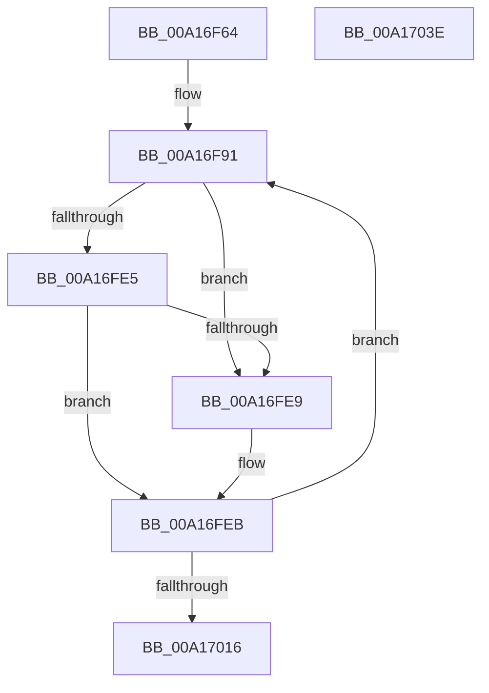

# PspInheritMitigationOptions

- RVA: `0x00A16F64`–`0x00A1703F` (길이 `219` bytes)
- VA: `0x0000000140A16F64`
- 실행 섹션: `PAGE`
- PDB 이름 있음: `예`; PDB Function 태그: `아니요`
- unwind 정보 RVA: `0x0009EA50`
- 디코드: `58`개 명령, `219/219` bytes 표시
- 미해석 바이트: `0` (있으면 어셈블리에 `.byte`로 보존)

> 이 문서는 커널 이미지의 기계어와 PDB 기호를 분석해 생성했습니다. 4번과 5번은 함수 원형과 자료형을 바이너리 사용 방식에서 추정한 C 해석이며 원본 소스 복구 결과는 아닙니다.

## 1. Dependencies

- 직접 호출 지점: **1**; 고유 호출 대상: **1**
- 직접 호출자로 확인된 함수: **1**
- RIP 상대 이미지 참조: **1**

### Outgoing calls
- `0x00A17033` → [_security_check_cookie](../../text/6A/_security_check_cookie_function_006AC640.md) (function, `0x006AC640`)

### Direct callers
- [PspAllocateProcess](PspAllocateProcess_function_00A13B3C.md) at `0x00A15631`
- [PspAllocateProcess](PspAllocateProcess_function_00A13B3C.md) at `0x00A15727`

### Static image references
- `0x00A16F6A` → RVA `0x00E0A740` (`.data`; read)

## 2. Other-region calls and transfers

- 다른 실행 섹션으로 향하는 call: **1**
  - `0x00A17033` → [_security_check_cookie](../../text/6A/_security_check_cookie_function_006AC640.md) (`PAGE` → `.text`)
- 별도 외부 분기/꼬리 이동을 확인하지 못했습니다.

## 3. Assembly (complete function range)

```asm
00A16F64  40 53                           push rbx
00A16F66  48 83 EC 60                     sub rsp, 0x60
00A16F6A  48 8B 05 CF 37 3F 00            mov rax, qword ptr [rip + 0x3f37cf]
00A16F71  48 33 C4                        xor rax, rsp
00A16F74  48 89 44 24 58                  mov qword ptr [rsp + 0x58], rax
00A16F79  33 C0                           xor eax, eax
00A16F7B  0F 57 C0                        xorps xmm0, xmm0
00A16F7E  0F 11 44 24 40                  movups xmmword ptr [rsp + 0x40], xmm0
00A16F83  48 89 44 24 50                  mov qword ptr [rsp + 0x50], rax
00A16F88  45 33 C9                        xor r9d, r9d
00A16F8B  4C 8B DA                        mov r11, rdx
00A16F8E  48 8B D9                        mov rbx, rcx
00A16F91  0F 28 03                        movaps xmm0, xmmword ptr [rbx]
00A16F94  42 8D 04 8D 00 00 00 00         lea eax, [r9*4]
00A16F9C  F2 0F 10 4B 10                  movsd xmm1, qword ptr [rbx + 0x10]
00A16FA1  8B C8                           mov ecx, eax
00A16FA3  44 8B D0                        mov r10d, eax
00A16FA6  83 E1 3F                        and ecx, 0x3f
00A16FA9  49 C1 EA 06                     shr r10, 6
00A16FAD  0F 29 04 24                     movaps xmmword ptr [rsp], xmm0
00A16FB1  41 0F 28 03                     movaps xmm0, xmmword ptr [r11]
00A16FB5  F2 0F 11 4C 24 10               movsd qword ptr [rsp + 0x10], xmm1
00A16FBB  F2 41 0F 10 4B 10               movsd xmm1, qword ptr [r11 + 0x10]
00A16FC1  4A 8B 14 D4                     mov rdx, qword ptr [rsp + r10*8]
00A16FC5  48 D3 EA                        shr rdx, cl
00A16FC8  0F 29 44 24 20                  movaps xmmword ptr [rsp + 0x20], xmm0
00A16FCD  80 E2 0F                        and dl, 0xf
00A16FD0  F2 0F 11 4C 24 30               movsd qword ptr [rsp + 0x30], xmm1
00A16FD6  4A 8B 44 D4 20                  mov rax, qword ptr [rsp + r10*8 + 0x20]
00A16FDB  48 D3 E8                        shr rax, cl
00A16FDE  24 0F                           and al, 0xf
00A16FE0  F6 C2 04                        test dl, 4
00A16FE3  75 04                           jne 0x140a16fe9
00A16FE5  A8 03                           test al, 3
00A16FE7  75 02                           jne 0x140a16feb
00A16FE9  8A C2                           mov al, dl
00A16FEB  BA 0F 00 00 00                  mov edx, 0xf
00A16FF0  0F B6 C0                        movzx eax, al
00A16FF3  48 D3 E2                        shl rdx, cl
00A16FF6  41 FF C1                        inc r9d
00A16FF9  48 F7 D2                        not rdx
00A16FFC  48 D3 E0                        shl rax, cl
00A16FFF  4A 23 54 D4 40                  and rdx, qword ptr [rsp + r10*8 + 0x40]
00A17004  48 0B D0                        or rdx, rax
00A17007  4A 89 54 D4 40                  mov qword ptr [rsp + r10*8 + 0x40], rdx
00A1700C  41 83 F9 28                     cmp r9d, 0x28
00A17010  0F 8C 7B FF FF FF               jl 0x140a16f91
00A17016  0F 10 44 24 40                  movups xmm0, xmmword ptr [rsp + 0x40]
00A1701B  F2 0F 10 4C 24 50               movsd xmm1, qword ptr [rsp + 0x50]
00A17021  41 0F 11 00                     movups xmmword ptr [r8], xmm0
00A17025  F2 41 0F 11 48 10               movsd qword ptr [r8 + 0x10], xmm1
00A1702B  48 8B 4C 24 58                  mov rcx, qword ptr [rsp + 0x58]
00A17030  48 33 CC                        xor rcx, rsp
00A17033  E8 08 56 C9 FF                  call 0x1406ac640
00A17038  48 83 C4 60                     add rsp, 0x60
00A1703C  5B                              pop rbx
00A1703D  C3                              ret
00A1703E  CC                              int3
```

## 4. C-style interpretation (structured pseudocode)

```c
__int64 __fastcall PspInheritMitigationOptions(__int64 a1, __int64 a2, __int64 a3, int a4)
{
    __int64 result;
    __int64 v_r10;
    __int64 v_rsp;
    unsigned __int64 v_stack_m10;
    unsigned __int64 v_stack_m18;
    unsigned __int64 v_stack_m28;
    unsigned __int64 v_stack_m38;
    unsigned __int64 v_stack_m48;
    unsigned __int64 v_stack_m58;
    unsigned __int64 v_stack_m68;

    v_rsp = (v_rsp) - (96);
    result = (*(unsigned __int64 *)(v_rip + 4143055)) ^ (v_rsp);
    v_stack_m10 = result;
    result = 0;
    v_stack_m28 = v_xmm0;
    v_stack_m18 = 0;
    a4 = 0;
loc_00A16F91:
    a1 = (unsigned int)(((unsigned int)((unsigned int)(a4 * 4))) & (63));
    v_r10 = ((unsigned int)((unsigned int)(a4 * 4))) >> (6);
    v_stack_m68 = v_xmm0;
    v_stack_m58 = v_xmm1;
    a2 = (*(unsigned __int64 *)(v_rsp + v_r10 * 8)) >> ((unsigned __int8)(a1));
    v_stack_m48 = v_xmm0;
    a2 = (unsigned __int8)((a2) & (15));
    v_stack_m38 = v_xmm1;
    result = (*(unsigned __int64 *)(v_rsp + v_r10 * 8 + 32)) >> ((unsigned __int8)(a1));
    result = (unsigned __int8)((result) & (15));
    if ((((unsigned __int8)(a2)) & (4)) != 0) goto loc_00A16FE9;
    if ((((unsigned __int8)(result)) & (3)) == 0) {
        result = (unsigned __int8)(a2);
    }
    a2 = (15) << ((unsigned __int8)(a1));
    a4 = (unsigned int)((a4) + 1);
    a2 = ~(a2);
    result = ((unsigned __int8)(result)) << ((unsigned __int8)(a1));
    a2 = (a2) & (*(unsigned __int64 *)(v_rsp + v_r10 * 8 + 64));
    a2 = (a2) | (result);
    *(unsigned __int64 *)(v_rsp + v_r10 * 8 + 64) = a2;
    if (a4 < 40) goto loc_00A16F91;
    *(unsigned __int64 *)(a3) = v_xmm0;
    *(unsigned __int64 *)(a3 + 16) = v_xmm1;
    a1 = (v_stack_m10) ^ (v_rsp);
    result = _security_check_cookie(a1, a2, a3, a4);
    v_rsp = (v_rsp) + (96);
    return result;
}
```

## 5. (Beta) C Style

```c
int64_t PspInheritMitigationOptions(void *Arg1, void *Arg2, void *Arg3, int32_t Arg4)
{
    uint8_t *arg1 = (uint8_t *)Arg1;
    uint8_t *arg2 = (uint8_t *)Arg2;
    uint8_t *arg3 = (uint8_t *)Arg3;

    int64_t result;
    int64_t local_r10;
    int64_t local_rsp;
    uint64_t v_stack_m10;
    uint64_t v_stack_m18;
    uint64_t v_stack_m28;
    uint64_t v_stack_m38;
    uint64_t v_stack_m48;
    uint64_t v_stack_m58;
    uint64_t v_stack_m68;

    local_rsp = (local_rsp) - (96);
    result = (*(uint64_t *)(v_rip + 0x3F37CF)) ^ (local_rsp);
    v_stack_m10 = result;
    result = 0;
    v_stack_m28 = v_xmm0;
    v_stack_m18 = 0;
    Arg4 = 0;
loc_00A16F91:
    Arg1 = (uint32_t)(((uint32_t)((uint32_t)(Arg4 * 4))) & (63));
    local_r10 = ((uint32_t)((uint32_t)(Arg4 * 4))) >> (6);
    v_stack_m68 = v_xmm0;
    v_stack_m58 = v_xmm1;
    Arg2 = (*(uint64_t *)(local_rsp + local_r10 * 8)) >> ((uint8_t)(Arg1));
    v_stack_m48 = v_xmm0;
    Arg2 = (uint8_t)((Arg2) & (15));
    v_stack_m38 = v_xmm1;
    result = (*(uint64_t *)(local_rsp + local_r10 * 8 + 0x20)) >> ((uint8_t)(Arg1));
    result = (uint8_t)((result) & (15));
    if ((((uint8_t)(Arg2)) & (4)) != 0) goto loc_00A16FE9;
    if ((((uint8_t)(result)) & (3)) == 0) {
        result = (uint8_t)(Arg2);
    }
    Arg2 = (15) << ((uint8_t)(Arg1));
    Arg4 = (uint32_t)((Arg4) + 1);
    Arg2 = ~(Arg2);
    result = ((uint8_t)(result)) << ((uint8_t)(Arg1));
    Arg2 = (Arg2) & (*(uint64_t *)(local_rsp + local_r10 * 8 + 0x40));
    Arg2 = (Arg2) | (result);
    *(void **)(local_rsp + local_r10 * 8 + 0x40) = Arg2;
    if (Arg4 < 40) goto loc_00A16F91;
    *(uint64_t *)(arg3) = v_xmm0;
    *(uint64_t *)(arg3 + 0x10) = v_xmm1;
    Arg1 = (v_stack_m10) ^ (local_rsp);
    result = _security_check_cookie(Arg1, Arg2, Arg3, Arg4);
    local_rsp = (local_rsp) + (96);
    return result;
}
```

### 관측된 메모리 오프셋

구조체 형식이 확인되지 않은 접근은 인자 기준의 오프셋으로만 기록했습니다.

| 기준 인자 | 오프셋 표현 | 폭 (bit) | 접근 |
|---|---:|---:|---|
| `Arg1` | `+ 0x0` | `128` | `R` |
| `Arg1` | `+ 0x10` | `64` | `R` |
| `Arg2` | `+ 0x0` | `128` | `R` |
| `Arg2` | `+ 0x10` | `64` | `R` |
| `Arg3` | `+ 0x0` | `128` | `R` |
| `Arg3` | `+ 0x10` | `64` | `W` |

## 6. Execution-region graph

[열기: 2D/3D 그래프와 함수 탐색 컨트롤 패널](../../../control-panel.html?section=page&rva=0x00A16F64&view=graph)

- 2D 그래프는 위에서 아래로 흐르고, 3D 그래프는 빈 공간을 드래그해 회전합니다. Shift+드래그는 이동, 휠은 확대·축소, 함수 노드 선택은 대상 보고서 이동입니다.

### Static fallback


