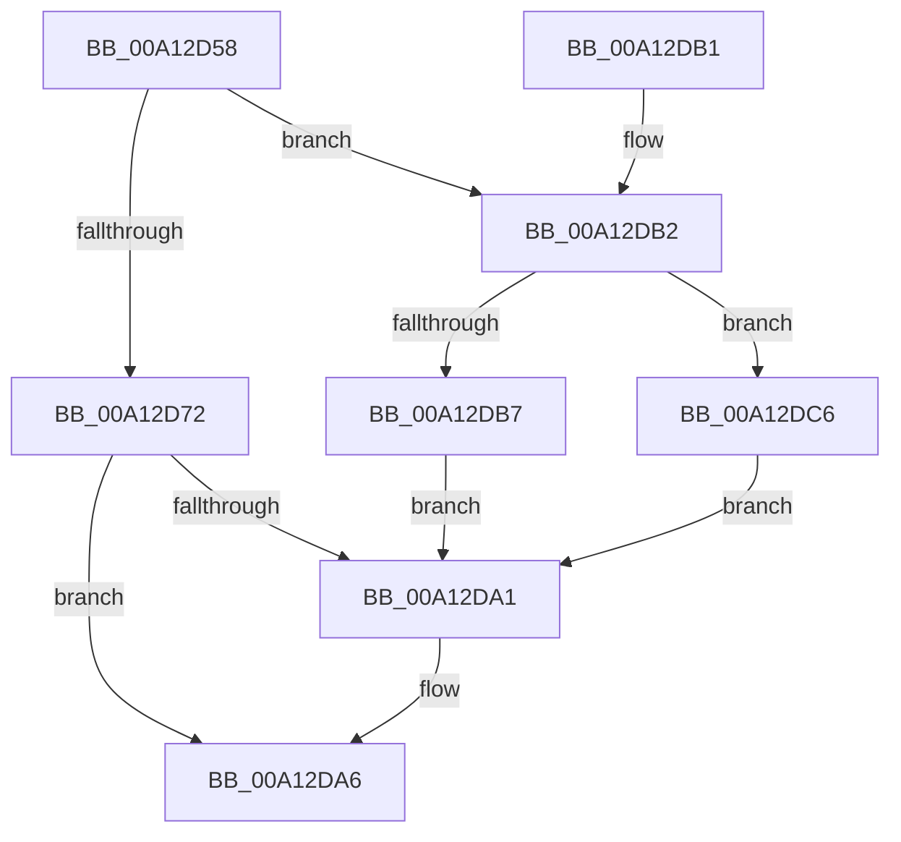

# PspReferenceTokenForNewProcess

- RVA: `0x00A12D58`–`0x00A12DD7` (길이 `127` bytes)
- VA: `0x0000000140A12D58`
- 실행 섹션: `PAGE`
- PDB 이름 있음: `예`; PDB Function 태그: `아니요`
- unwind 정보 RVA: `0x000A996C`
- 디코드: `37`개 명령, `127/127` bytes 표시
- 미해석 바이트: `0` (있으면 어셈블리에 `.byte`로 보존)

> 이 문서는 커널 이미지의 기계어와 PDB 기호를 분석해 생성했습니다. 4번과 5번은 함수 원형과 자료형을 바이너리 사용 방식에서 추정한 C 해석이며 원본 소스 복구 결과는 아닙니다.

## 1. Dependencies

- 직접 호출 지점: **3**; 고유 호출 대상: **3**
- 직접 호출자로 확인된 함수: **2**
- RIP 상대 이미지 참조: **2**

### Outgoing calls
- `0x00A12D93` → [ObReferenceObjectByHandle](../86/ObReferenceObjectByHandle_function_00868DB0.md) (function, `0x00868DB0`)
- `0x00A12DBC` → [PsReferencePrimaryTokenWithTag](../../text/20/PsReferencePrimaryTokenWithTag_function_0020FF80.md) (function, `0x0020FF80`)
- `0x00A12DD0` → [ObfReferenceObject](../../text/20/ObfReferenceObject_function_0020FA20.md) (function, `0x0020FA20`)

### Direct callers
- [PspCreateProcess](PspCreateProcess_function_00A12758.md) at `0x00A12A1F`
- [NtCreateUserProcess](../AE/NtCreateUserProcess_function_00AEA680.md) at `0x00AEAA52`

### Static image references
- `0x00A12D7B` → RVA `0x00FD8020` (`PAGEDATA`; read)
- `0x00A12DC6` → RVA `0x01008728` (`INITDATA`; read)

## 2. Other-region calls and transfers

- 다른 실행 섹션으로 향하는 call: **2**
  - `0x00A12DBC` → [PsReferencePrimaryTokenWithTag](../../text/20/PsReferencePrimaryTokenWithTag_function_0020FF80.md) (`PAGE` → `.text`)
  - `0x00A12DD0` → [ObfReferenceObject](../../text/20/ObfReferenceObject_function_0020FA20.md) (`PAGE` → `.text`)
- 별도 외부 분기/꼬리 이동을 확인하지 못했습니다.

## 3. Assembly (complete function range)

```asm
00A12D58  4C 8B DC                        mov r11, rsp
00A12D5B  49 89 5B 08                     mov qword ptr [r11 + 8], rbx
00A12D5F  57                              push rdi
00A12D60  48 83 EC 30                     sub rsp, 0x30
00A12D64  49 8B F9                        mov rdi, r9
00A12D67  45 8A C8                        mov r9b, r8b
00A12D6A  48 8B C2                        mov rax, rdx
00A12D6D  48 85 D2                        test rdx, rdx
00A12D70  74 40                           je 0x140a12db2
00A12D72  49 83 63 F0 00                  and qword ptr [r11 - 0x10], 0
00A12D77  49 8D 4B 10                     lea rcx, [r11 + 0x10]
00A12D7B  4C 8B 05 9E 52 5C 00            mov r8, qword ptr [rip + 0x5c529e]
00A12D82  BA 01 00 00 00                  mov edx, 1
00A12D87  49 83 63 10 00                  and qword ptr [r11 + 0x10], 0
00A12D8C  49 89 4B E8                     mov qword ptr [r11 - 0x18], rcx
00A12D90  48 8B C8                        mov rcx, rax
00A12D93  E8 18 60 E5 FF                  call 0x140868db0
00A12D98  48 8B 5C 24 48                  mov rbx, qword ptr [rsp + 0x48]
00A12D9D  85 C0                           test eax, eax
00A12D9F  78 05                           js 0x140a12da6
00A12DA1  48 89 1F                        mov qword ptr [rdi], rbx
00A12DA4  33 C0                           xor eax, eax
00A12DA6  48 8B 5C 24 40                  mov rbx, qword ptr [rsp + 0x40]
00A12DAB  48 83 C4 30                     add rsp, 0x30
00A12DAF  5F                              pop rdi
00A12DB0  C3                              ret
00A12DB1  CC                              int3
00A12DB2  48 85 C9                        test rcx, rcx
00A12DB5  74 0F                           je 0x140a12dc6
00A12DB7  BA 44 66 6C 74                  mov edx, 0x746c6644
00A12DBC  E8 BF D1 7F FF                  call 0x14020ff80
00A12DC1  48 8B D8                        mov rbx, rax
00A12DC4  EB DB                           jmp 0x140a12da1
00A12DC6  48 8B 1D 5B 59 5F 00            mov rbx, qword ptr [rip + 0x5f595b]
00A12DCD  48 8B CB                        mov rcx, rbx
00A12DD0  E8 4B CC 7F FF                  call 0x14020fa20
00A12DD5  EB CA                           jmp 0x140a12da1
```

## 4. C-style interpretation (structured pseudocode)

```c
__int64 __fastcall PspReferenceTokenForNewProcess(__int64 a1, __int64 a2, unsigned __int8 a3, __int64 a4)
{
    __int64 result;
    __int64 v_rsp;
    unsigned __int64 v_stack_p10;
    unsigned __int64 v_stack_p8;

    *(unsigned __int64 *)(v_rsp + 8) = v_rbx;
    v_rsp = (v_rsp) - (48);
    if (a2 == 0) goto loc_00A12DB2;
    *(unsigned __int64 *)(v_rsp - 24) = v_rsp + 16;
    result = ObReferenceObjectByHandle(a2, 1, *(unsigned __int64 *)(v_rip + 6050462), a3);
    if (!(sign_flag)) {
        *(unsigned __int64 *)(a4) = v_stack_p10;
        result = 0;
    }
    v_rsp = (v_rsp) + (48);
    return result;
loc_00A12DB2:
    if (a2 == 0) goto loc_00A12DC6;
    result = PsReferencePrimaryTokenWithTag(a2, (unsigned int)(0x746C6644ULL), *(unsigned __int64 *)(v_rip + 6050462), a3);
    goto loc_00A12DA1;
loc_00A12DC6:
    result = ObfReferenceObject(*(unsigned __int64 *)(v_rip + 6248795), (unsigned int)(0x746C6644ULL), *(unsigned __int64 *)(v_rip + 6050462), a3);
    goto loc_00A12DA1;
}
```

## 5. (Beta) C Style

```c
int64_t PspReferenceTokenForNewProcess(int64_t Arg1, int64_t Arg2, uint8_t Arg3, void *Arg4)
{
    uint8_t *arg4 = (uint8_t *)Arg4;

    int64_t result;
    int64_t local_rsp;
    uint64_t v_stack_p10;
    uint64_t v_stack_p8;

    *(uint64_t *)(local_rsp + 0x8) = local_rbx;
    local_rsp = (local_rsp) - (48);
    if (Arg2 == 0) goto loc_00A12DB2;
    *(uint64_t *)(local_rsp - 0x18) = local_rsp + 16;
    result = ObReferenceObjectByHandle(Arg2, 1, *(uint64_t *)(v_rip + 0x5C529E), Arg3);
    if (!(sign_flag)) {
        *(uint64_t *)(arg4) = v_stack_p10;
        result = 0;
    }
    local_rsp = (local_rsp) + (48);
    return result;
loc_00A12DB2:
    if (Arg2 == 0) goto loc_00A12DC6;
    result = PsReferencePrimaryTokenWithTag(Arg2, (uint32_t)(0x746C6644ULL), *(uint64_t *)(v_rip + 0x5C529E), Arg3);
    goto loc_00A12DA1;
loc_00A12DC6:
    result = ObfReferenceObject(*(uint64_t *)(v_rip + 0x5F595B), (uint32_t)(0x746C6644ULL), *(uint64_t *)(v_rip + 0x5C529E), Arg3);
    goto loc_00A12DA1;
}
```

### 관측된 메모리 오프셋

구조체 형식이 확인되지 않은 접근은 인자 기준의 오프셋으로만 기록했습니다.

| 기준 인자 | 오프셋 표현 | 폭 (bit) | 접근 |
|---|---:|---:|---|
| `Arg4` | `+ 0x0` | `64` | `W` |

## 6. Execution-region graph

[열기: 2D/3D 그래프와 함수 탐색 컨트롤 패널](../../../control-panel.html?section=page&rva=0x00A12D58&view=graph)

- 2D 그래프는 위에서 아래로 흐르고, 3D 그래프는 빈 공간을 드래그해 회전합니다. Shift+드래그는 이동, 휠은 확대·축소, 함수 노드 선택은 대상 보고서 이동입니다.

### Static fallback


