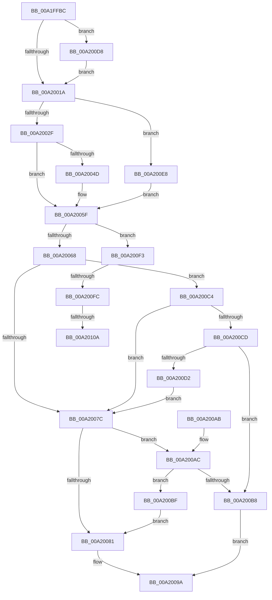

# PspSelectMachineForProcess

- RVA: `0x00A1FFBC`–`0x00A20111` (길이 `341` bytes)
- VA: `0x0000000140A1FFBC`
- 실행 섹션: `PAGE`
- PDB 이름 있음: `예`; PDB Function 태그: `예`
- unwind 정보 RVA: `0x000AAC9C`
- 디코드: `98`개 명령, `341/341` bytes 표시
- 미해석 바이트: `0` (있으면 어셈블리에 `.byte`로 보존)

> 이 문서는 커널 이미지의 기계어와 PDB 기호를 분석해 생성했습니다. 4번과 5번은 함수 원형과 자료형을 바이너리 사용 방식에서 추정한 C 해석이며 원본 소스 복구 결과는 아닙니다.

## 1. Dependencies

- 직접 호출 지점: **3**; 고유 호출 대상: **3**
- 직접 호출자로 확인된 함수: **1**
- RIP 상대 이미지 참조: **0**

### Outgoing calls
- `0x00A20032` → [PsGetProcessMachine](../A2/PsGetProcessMachine_function_00A20120.md) (function, `0x00A20120`)
- `0x00A200AF` → [PsWow64IsMachineSupported](../8D/PsWow64IsMachineSupported_function_008D20A0.md) (function, `0x008D20A0`)
- `0x00A200C4` → [HalAdjustResourceList](../../text/48/HalAdjustResourceList_function_0048FDC0.md) (function, `0x0048FDC0`)

### Direct callers
- [PspAllocateProcess](PspAllocateProcess_function_00A13B3C.md) at `0x00A145CE`

### Static image references
- 디코드된 RIP-relative 메모리 참조가 없습니다.

## 2. Other-region calls and transfers

- 다른 실행 섹션으로 향하는 call: **1**
  - `0x00A200C4` → [HalAdjustResourceList](../../text/48/HalAdjustResourceList_function_0048FDC0.md) (`PAGE` → `.text`)
- call이 아닌 외부 분기/꼬리 이동: **3**
  - `0x00A200F6` → [sub_00B37422 + 0x3](../B3/Unknown_function_00B37422.md) (`tail-transfer`)
  - `0x00A20104` → [sub_00B37422](../B3/Unknown_function_00B37422.md) (`tail-transfer`)
  - `0x00A2010C` → [sub_00B37422 + 0x3](../B3/Unknown_function_00B37422.md) (`tail-transfer`)

## 3. Assembly (complete function range)

```asm
00A1FFBC  4C 89 44 24 18                  mov qword ptr [rsp + 0x18], r8
00A1FFC1  53                              push rbx
00A1FFC2  55                              push rbp
00A1FFC3  56                              push rsi
00A1FFC4  57                              push rdi
00A1FFC5  41 54                           push r12
00A1FFC7  41 55                           push r13
00A1FFC9  41 56                           push r14
00A1FFCB  41 57                           push r15
00A1FFCD  48 83 EC 28                     sub rsp, 0x28
00A1FFD1  44 0F B7 7A 68                  movzx r15d, word ptr [rdx + 0x68]
00A1FFD6  4C 8B E9                        mov r13, rcx
00A1FFD9  33 C9                           xor ecx, ecx
00A1FFDB  41 B9 4C 01 00 00               mov r9d, 0x14c
00A1FFE1  44 0F B6 F1                     movzx r14d, cl
00A1FFE5  48 8B EA                        mov rbp, rdx
00A1FFE8  88 4C 24 70                     mov byte ptr [rsp + 0x70], cl
00A1FFEC  44 8B E1                        mov r12d, ecx
00A1FFEF  41 0F B7 85 EC 06 00 00         movzx eax, word ptr [r13 + 0x6ec]
00A1FFF7  40 8A F9                        mov dil, cl
00A1FFFA  66 89 84 24 88 00 00 00         mov word ptr [rsp + 0x88], ax
00A20002  0F B7 D9                        movzx ebx, cx
00A20005  88 4C 24 78                     mov byte ptr [rsp + 0x78], cl
00A20009  40 8A F1                        mov sil, cl
00A2000C  44 8D 41 01                     lea r8d, [rcx + 1]
00A20010  66 45 3B F9                     cmp r15w, r9w
00A20014  0F 84 BE 00 00 00               je 0x140a200d8
00A2001A  0F B7 82 A8 00 00 00            movzx eax, word ptr [rdx + 0xa8]
00A20021  BA 64 86 00 00                  mov edx, 0x8664
00A20026  66 85 C0                        test ax, ax
00A20029  0F 85 B9 00 00 00               jne 0x140a200e8
00A2002F  49 8B CD                        mov rcx, r13
00A20032  E8 E9 00 00 00                  call 0x140a20120
00A20037  BA 64 86 00 00                  mov edx, 0x8664
00A2003C  41 B8 01 00 00 00               mov r8d, 1
00A20042  41 B9 4C 01 00 00               mov r9d, 0x14c
00A20048  66 3B C2                        cmp ax, dx
00A2004B  74 12                           je 0x140a2005f
00A2004D  33 C9                           xor ecx, ecx
00A2004F  49 39 8D 10 03 00 00            cmp qword ptr [r13 + 0x310], rcx
00A20056  66 0F 44 9C 24 88 00 00 00      cmove bx, word ptr [rsp + 0x88]
00A2005F  45 84 F6                        test r14b, r14b
00A20062  0F 85 8B 00 00 00               jne 0x140a200f3
00A20068  66 85 DB                        test bx, bx
00A2006B  41 0F B7 C7                     movzx eax, r15w
00A2006F  66 0F 45 C3                     cmovne ax, bx
00A20073  0F B7 D8                        movzx ebx, ax
00A20076  66 41 3B C7                     cmp ax, r15w
00A2007A  75 48                           jne 0x140a200c4
00A2007C  66 3B DA                        cmp bx, dx
00A2007F  75 2B                           jne 0x140a200ac
00A20081  48 8B 84 24 80 00 00 00         mov rax, qword ptr [rsp + 0x80]
00A20089  8A 4C 24 78                     mov cl, byte ptr [rsp + 0x78]
00A2008D  66 89 18                        mov word ptr [rax], bx
00A20090  40 88 78 02                     mov byte ptr [rax + 2], dil
00A20094  88 48 03                        mov byte ptr [rax + 3], cl
00A20097  41 8B C4                        mov eax, r12d
00A2009A  48 83 C4 28                     add rsp, 0x28
00A2009E  41 5F                           pop r15
00A200A0  41 5E                           pop r14
00A200A2  41 5D                           pop r13
00A200A4  41 5C                           pop r12
00A200A6  5F                              pop rdi
00A200A7  5E                              pop rsi
00A200A8  5D                              pop rbp
00A200A9  5B                              pop rbx
00A200AA  C3                              ret
00A200AB  CC                              int3
00A200AC  0F B7 CB                        movzx ecx, bx
00A200AF  E8 EC 1F EB FF                  call 0x1408d20a0
00A200B4  85 C0                           test eax, eax
00A200B6  75 07                           jne 0x140a200bf
00A200B8  B8 7B 00 00 C0                  mov eax, 0xc000007b
00A200BD  EB DB                           jmp 0x140a2009a
00A200BF  40 B7 01                        mov dil, 1
00A200C2  EB BD                           jmp 0x140a20081
00A200C4  E8 F7 FC A6 FF                  call 0x14048fdc0
00A200C9  85 C0                           test eax, eax
00A200CB  75 AF                           jne 0x140a2007c
00A200CD  40 84 F6                        test sil, sil
00A200D0  75 E6                           jne 0x140a200b8
00A200D2  41 0F B7 DF                     movzx ebx, r15w
00A200D6  EB A4                           jmp 0x140a2007c
00A200D8  8A 42 6B                        mov al, byte ptr [rdx + 0x6b]
00A200DB  24 03                           and al, 3
00A200DD  3C 03                           cmp al, 3
00A200DF  45 0F 44 F0                     cmove r14d, r8d
00A200E3  E9 32 FF FF FF                  jmp 0x140a2001a
00A200E8  0F B7 D8                        movzx ebx, ax
00A200EB  41 8A F0                        mov sil, r8b
00A200EE  E9 6C FF FF FF                  jmp 0x140a2005f
00A200F3  66 85 DB                        test bx, bx
00A200F6  0F 85 29 73 11 00               jne 0x140b37425
00A200FC  8B 85 E8 01 00 00               mov eax, dword ptr [rbp + 0x1e8]
00A20102  A8 02                           test al, 2
00A20104  0F 84 18 73 11 00               je 0x140b37422
00A2010A  8B DA                           mov ebx, edx
00A2010C  E9 14 73 11 00                  jmp 0x140b37425
```

## 4. C-style interpretation (structured pseudocode)

```c
__int64 __fastcall PspSelectMachineForProcess(__int64 a1, __int64 a2, __int64 a3)
{
    __int64 result;
    __int64 v_r14;
    __int64 v_rbx;
    __int64 v_rsp;
    unsigned __int8 v_stack_p10;
    unsigned __int64 v_stack_p18;
    unsigned __int16 v_stack_p20;
    unsigned __int8 v_stack_p8;

    v_stack_p18 = a3;
    v_rsp = (v_rsp) - (40);
    a1 = 0;
    v_stack_p8 = 0;
    v_stack_p20 = (unsigned __int16)(*(unsigned __int16 *)(a1 + 1772));
    v_stack_p10 = 0;
    if (((unsigned __int16)(*(unsigned __int16 *)(a2 + 104))) == 332) goto loc_00A200D8;
loc_00A2001A:
    if ((unsigned __int16)(*(unsigned __int16 *)(a2 + 168)) != 0) goto loc_00A200E8;
    result = PsGetProcessMachine(0, (unsigned int)(0x8664ULL), a1 + 1, 332);
    v_rbx = 0;
    if (((unsigned __int16)(result)) != ((unsigned __int16)((unsigned int)(0x8664ULL)))) {
        a1 = 0;
        v_rbx = 0;
        if ((*(unsigned __int64 *)(a1 + 784)) == 0) { v_rbx = v_stack_p20; }
    }
    if (0 != 0) goto loc_00A200F3;
    result = (unsigned __int16)(*(unsigned __int16 *)(a2 + 104));
    if ((unsigned __int16)(v_rbx) != 0) { result = (unsigned __int16)(v_rbx); }
    if (((unsigned __int16)(result)) != ((unsigned __int16)(*(unsigned __int16 *)(a2 + 104)))) goto loc_00A200C4;
loc_00A2007C:
    if (((unsigned __int16)((unsigned __int16)(result))) != ((unsigned __int16)((unsigned int)(0x8664ULL)))) goto loc_00A200AC;
loc_00A20081:
    *(unsigned __int16 *)(v_stack_p18) = (unsigned __int16)((unsigned __int16)(result));
    *(unsigned __int8 *)(v_stack_p18 + 2) = 0;
    *(unsigned __int8 *)(v_stack_p18 + 3) = (unsigned __int8)(v_stack_p10);
loc_00A2009A:
    v_rsp = (v_rsp) + (40);
    return 0;
loc_00A200AC:
    result = PsWow64IsMachineSupported((unsigned __int16)((unsigned __int16)(result)), (unsigned int)(0x8664ULL), 1, 332);
    if ((unsigned int)(result) != 0) goto loc_00A200BF;
loc_00A200B8:
    goto loc_00A2009A;
loc_00A200BF:
    goto loc_00A20081;
loc_00A200C4:
    result = HalAdjustResourceList((unsigned __int16)((unsigned __int16)(result)), (unsigned int)(0x8664ULL), 1, 332);
    if ((unsigned int)(result) != 0) goto loc_00A2007C;
    if (0 != 0) goto loc_00A200B8;
    goto loc_00A2007C;
loc_00A200D8:
    result = (unsigned __int8)((*(unsigned __int8 *)((unsigned int)(0x8664ULL) + 107)) & (3));
    v_r14 = 0;
    if (((unsigned __int8)(result)) == 3) { v_r14 = 1; }
    goto loc_00A2001A;
loc_00A200E8:
    goto loc_00A2005F;
loc_00A200F3:
}
```

## 5. (Beta) C Style

```c
int64_t PspSelectMachineForProcess(void *Arg1, void *Arg2, int64_t Arg3)
{
    uint8_t *arg1 = (uint8_t *)Arg1;
    uint8_t *arg2 = (uint8_t *)Arg2;

    int64_t result;
    int64_t local_r14;
    int64_t local_rbx;
    int64_t local_rsp;
    uint8_t v_stack_p10;
    uint64_t v_stack_p18;
    uint16_t v_stack_p20;
    uint8_t v_stack_p8;

    v_stack_p18 = Arg3;
    local_rsp = (local_rsp) - (40);
    Arg1 = 0;
    v_stack_p8 = 0;
    v_stack_p20 = (uint16_t)(*(uint16_t *)(arg1 + 0x6EC));
    v_stack_p10 = 0;
    if (((uint16_t)(*(uint16_t *)(arg2 + 0x68))) == 332) goto loc_00A200D8;
loc_00A2001A:
    if ((uint16_t)(*(uint16_t *)(arg2 + 0xA8)) != 0) goto loc_00A200E8;
    result = PsGetProcessMachine(0, (uint32_t)(0x8664ULL), Arg1 + 1, 332);
    local_rbx = 0;
    if (((uint16_t)(result)) != ((uint16_t)((uint32_t)(0x8664ULL)))) {
        Arg1 = 0;
        local_rbx = 0;
        if ((*(uint64_t *)(arg1 + 0x310)) == 0) { local_rbx = v_stack_p20; }
    }
    if (0 != 0) goto loc_00A200F3;
    result = (uint16_t)(*(uint16_t *)(arg2 + 0x68));
    if ((uint16_t)(local_rbx) != 0) { result = (uint16_t)(local_rbx); }
    if (((uint16_t)(result)) != ((uint16_t)(*(uint16_t *)(arg2 + 0x68)))) goto loc_00A200C4;
loc_00A2007C:
    if (((uint16_t)((uint16_t)(result))) != ((uint16_t)((uint32_t)(0x8664ULL)))) goto loc_00A200AC;
loc_00A20081:
    *(uint16_t *)(v_stack_p18) = (uint16_t)((uint16_t)(result));
    *(uint8_t *)(v_stack_p18 + 0x2) = 0;
    *(uint8_t *)(v_stack_p18 + 0x3) = (uint8_t)(v_stack_p10);
loc_00A2009A:
    local_rsp = (local_rsp) + (40);
    return 0;
loc_00A200AC:
    result = PsWow64IsMachineSupported((uint16_t)((uint16_t)(result)), (uint32_t)(0x8664ULL), 1, 332);
    if ((uint32_t)(result) != 0) goto loc_00A200BF;
loc_00A200B8:
    goto loc_00A2009A;
loc_00A200BF:
    goto loc_00A20081;
loc_00A200C4:
    result = HalAdjustResourceList((uint16_t)((uint16_t)(result)), (uint32_t)(0x8664ULL), 1, 332);
    if ((uint32_t)(result) != 0) goto loc_00A2007C;
    if (0 != 0) goto loc_00A200B8;
    goto loc_00A2007C;
loc_00A200D8:
    result = (uint8_t)((*(uint8_t *)((uint32_t)(0x8664ULL) + 0x6B)) & (3));
    local_r14 = 0;
    if (((uint8_t)(result)) == 3) { local_r14 = 1; }
    goto loc_00A2001A;
loc_00A200E8:
    goto loc_00A2005F;
loc_00A200F3:
}
```

### 관측된 메모리 오프셋

구조체 형식이 확인되지 않은 접근은 인자 기준의 오프셋으로만 기록했습니다.

| 기준 인자 | 오프셋 표현 | 폭 (bit) | 접근 |
|---|---:|---:|---|
| `Arg1` | `+ 0x310` | `64` | `R` |
| `Arg1` | `+ 0x6EC` | `16` | `R` |
| `Arg2` | `+ 0x68` | `16` | `R` |
| `Arg2` | `+ 0x6B` | `8` | `R` |
| `Arg2` | `+ 0xA8` | `16` | `R` |
| `Arg2` | `+ 0x1E8` | `32` | `R` |

## 6. Execution-region graph

[열기: 2D/3D 그래프와 함수 탐색 컨트롤 패널](../../../control-panel.html?section=page&rva=0x00A1FFBC&view=graph)

- 2D 그래프는 위에서 아래로 흐르고, 3D 그래프는 빈 공간을 드래그해 회전합니다. Shift+드래그는 이동, 휠은 확대·축소, 함수 노드 선택은 대상 보고서 이동입니다.

### Static fallback


