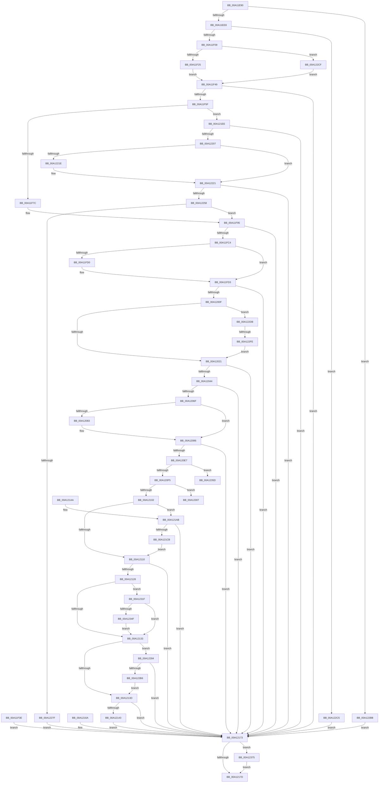

# PspWow64GetContextThread

- RVA: `0x00A11E90`–`0x00A1238D` (길이 `1,277` bytes)
- VA: `0x0000000140A11E90`
- 실행 섹션: `PAGE`
- PDB 이름 있음: `예`; PDB Function 태그: `예`
- unwind 정보 RVA: `0x000A987C`
- 디코드: `325`개 명령, `1,277/1,277` bytes 표시
- 미해석 바이트: `0` (있으면 어셈블리에 `.byte`로 보존)

> 이 문서는 커널 이미지의 기계어와 PDB 기호를 분석해 생성했습니다. 4번과 5번은 함수 원형과 자료형을 바이너리 사용 방식에서 추정한 C 해석이며 원본 소스 복구 결과는 아닙니다.

## 1. Dependencies

- 직접 호출 지점: **28**; 고유 호출 대상: **17**
- 직접 호출자로 확인된 함수: **3**
- RIP 상대 이미지 참조: **1**

### Outgoing calls
- `0x00A11EF6` → [PsWow64GetProcessMachine](../8D/PsWow64GetProcessMachine_function_008D2130.md) (function, `0x008D2130`)
- `0x00A11F14` → [RtlWow64GetCpuAreaEnabledFeatures](../8C/RtlWow64GetCpuAreaEnabledFeatures_function_008CDFB4.md) (function, `0x008CDFB4`)
- `0x00A11F50` → [RtlpWow64SanitizeContextFlags](../8C/RtlpWow64SanitizeContextFlags_function_008CDF00.md) (function, `0x008CDF00`)
- `0x00A11FB5` → [RtlGetExtendedContextLength2](../../text/49/RtlGetExtendedContextLength2_function_00493FE0.md) (function, `0x00493FE0`)
- `0x00A11FDA` → [_chkstk](../../text/6B/_chkstk_function_006BA960.md) (function, `0x006BA960`)
- `0x00A12000` → [RtlInitializeExtendedContext2](../../text/2F/RtlInitializeExtendedContext2_function_002F5D40.md) (function, `0x002F5D40`)
- `0x00A12035` → [PspGetContextThreadInternal](../8D/PspGetContextThreadInternal_function_008D4770.md) (function, `0x008D4770`)
- `0x00A12060` → [RtlGetExtendedContextLength2](../../text/49/RtlGetExtendedContextLength2_function_00493FE0.md) (function, `0x00493FE0`)
- `0x00A1208D` → [_chkstk](../../text/6B/_chkstk_function_006BA960.md) (function, `0x006BA960`)
- `0x00A1209E` → [RtlWow64GetCpuAreaEnabledFeatures](../8C/RtlWow64GetCpuAreaEnabledFeatures_function_008CDFB4.md) (function, `0x008CDFB4`)
- `0x00A120B0` → [RtlInitializeExtendedContext2](../../text/2F/RtlInitializeExtendedContext2_function_002F5D40.md) (function, `0x002F5D40`)
- `0x00A120D8` → [PspWow64ReadOrWriteThreadCpuArea](../8C/PspWow64ReadOrWriteThreadCpuArea_function_008CD404.md) (function, `0x008CD404`)
- `0x00A1211D` → [RtlCopyContext](../8D/RtlCopyContext_function_008D5940.md) (function, `0x008D5940`)
- `0x00A1215E` → [RtlpWriteExtendedContext](../8D/RtlpWriteExtendedContext_function_008D4A5C.md) (function, `0x008D4A5C`)
- `0x00A12186` → [_security_check_cookie](../../text/6A/_security_check_cookie_function_006AC640.md) (function, `0x006AC640`)
- `0x00A121C0` → [RtlpWow64CtxFromAmd64](RtlpWow64CtxFromAmd64_function_00A12394.md) (function, `0x00A12394`)
- `0x00A121D8` → [memset](../../text/6C/memset_function_006C6C40.md) (function, `0x006C6C40`)
- `0x00A121F8` → [RtlGetExtendedContextLength2](../../text/49/RtlGetExtendedContextLength2_function_00493FE0.md) (function, `0x00493FE0`)
- `0x00A12225` → [_chkstk](../../text/6B/_chkstk_function_006BA960.md) (function, `0x006BA960`)
- `0x00A12237` → [memset](../../text/6C/memset_function_006C6C40.md) (function, `0x006C6C40`)
- `0x00A12249` → [RtlInitializeExtendedContext2](../../text/2F/RtlInitializeExtendedContext2_function_002F5D40.md) (function, `0x002F5D40`)
- `0x00A12270` → [RtlpReadExtendedContext](../8D/RtlpReadExtendedContext_function_008D61D0.md) (function, `0x008D61D0`)
- `0x00A122A7` → [PspWow64ReadOrWriteThreadCpuArea](../8C/PspWow64ReadOrWriteThreadCpuArea_function_008CD404.md) (function, `0x008CD404`)
- `0x00A122F1` → [PsSuspendThread](PsSuspendThread_function_00A110D0.md) (function, `0x00A110D0`)
- `0x00A12314` → [RtlpWow64CtxFromAmd64](RtlpWow64CtxFromAmd64_function_00A12394.md) (function, `0x00A12394`)
- `0x00A1236A` → [RtlCopyContext](../8D/RtlCopyContext_function_008D5940.md) (function, `0x008D5940`)
- `0x00A1237E` → [PsMultiResumeThread](../../text/20/PsMultiResumeThread_function_002027C4.md) (function, `0x002027C4`)
- `0x00A12383` → [KeLeaveCriticalRegion](../../text/25/KeLeaveCriticalRegion_function_0025D8B0.md) (function, `0x0025D8B0`)

### Direct callers
- [WbGetWowTrapFrame](../81/WbGetWowTrapFrame_function_00811DF0.md) at `0x00811E6C`
- [WbSetWowTrapFrame](../8D/WbSetWowTrapFrame_function_008D57EC.md) at `0x008D589C`
- [NtQueryInformationThread](../AE/NtQueryInformationThread_function_00AE3760.md) at `0x00AE4699`

### Static image references
- `0x00A11EB4` → RVA `0x00E0A740` (`.data`; read)

## 2. Other-region calls and transfers

- 다른 실행 섹션으로 향하는 call: **14**
  - `0x00A11FB5` → [RtlGetExtendedContextLength2](../../text/49/RtlGetExtendedContextLength2_function_00493FE0.md) (`PAGE` → `.text`)
  - `0x00A11FDA` → [_chkstk](../../text/6B/_chkstk_function_006BA960.md) (`PAGE` → `.text`)
  - `0x00A12000` → [RtlInitializeExtendedContext2](../../text/2F/RtlInitializeExtendedContext2_function_002F5D40.md) (`PAGE` → `.text`)
  - `0x00A12060` → [RtlGetExtendedContextLength2](../../text/49/RtlGetExtendedContextLength2_function_00493FE0.md) (`PAGE` → `.text`)
  - `0x00A1208D` → [_chkstk](../../text/6B/_chkstk_function_006BA960.md) (`PAGE` → `.text`)
  - `0x00A120B0` → [RtlInitializeExtendedContext2](../../text/2F/RtlInitializeExtendedContext2_function_002F5D40.md) (`PAGE` → `.text`)
  - `0x00A12186` → [_security_check_cookie](../../text/6A/_security_check_cookie_function_006AC640.md) (`PAGE` → `.text`)
  - `0x00A121D8` → [memset](../../text/6C/memset_function_006C6C40.md) (`PAGE` → `.text`)
  - `0x00A121F8` → [RtlGetExtendedContextLength2](../../text/49/RtlGetExtendedContextLength2_function_00493FE0.md) (`PAGE` → `.text`)
  - `0x00A12225` → [_chkstk](../../text/6B/_chkstk_function_006BA960.md) (`PAGE` → `.text`)
  - `0x00A12237` → [memset](../../text/6C/memset_function_006C6C40.md) (`PAGE` → `.text`)
  - `0x00A12249` → [RtlInitializeExtendedContext2](../../text/2F/RtlInitializeExtendedContext2_function_002F5D40.md) (`PAGE` → `.text`)
  - `0x00A1237E` → [PsMultiResumeThread](../../text/20/PsMultiResumeThread_function_002027C4.md) (`PAGE` → `.text`)
  - `0x00A12383` → [KeLeaveCriticalRegion](../../text/25/KeLeaveCriticalRegion_function_0025D8B0.md) (`PAGE` → `.text`)
- call이 아닌 외부 분기/꼬리 이동: **3**
  - `0x00A122F8` → [sub_00B36D5C](../B3/Unknown_function_00B36D5C.md) (`tail-transfer`)
  - `0x00A1231A` → [sub_00B36D5C + 0xB](../B3/Unknown_function_00B36D5C.md) (`tail-transfer`)
  - `0x00A12370` → [sub_00B36D5C + 0xB](../B3/Unknown_function_00B36D5C.md) (`tail-transfer`)

## 3. Assembly (complete function range)

```asm
00A11E90  40 55                           push rbp
00A11E92  41 54                           push r12
00A11E94  41 55                           push r13
00A11E96  41 56                           push r14
00A11E98  41 57                           push r15
00A11E9A  48 81 EC D0 00 00 00            sub rsp, 0xd0
00A11EA1  48 8D 6C 24 50                  lea rbp, [rsp + 0x50]
00A11EA6  48 89 9D C0 00 00 00            mov qword ptr [rbp + 0xc0], rbx
00A11EAD  48 89 B5 C8 00 00 00            mov qword ptr [rbp + 0xc8], rsi
00A11EB4  48 8B 05 85 88 3F 00            mov rax, qword ptr [rip + 0x3f8885]
00A11EBB  48 33 C5                        xor rax, rbp
00A11EBE  48 89 45 78                     mov qword ptr [rbp + 0x78], rax
00A11EC2  45 8A F9                        mov r15b, r9b
00A11EC5  44 88 4D 0C                     mov byte ptr [rbp + 0xc], r9b
00A11EC9  4C 8B E2                        mov r12, rdx
00A11ECC  48 89 55 48                     mov qword ptr [rbp + 0x48], rdx
00A11ED0  48 8B F1                        mov rsi, rcx
00A11ED3  48 89 4D 40                     mov qword ptr [rbp + 0x40], rcx
00A11ED7  C6 45 02 00                     mov byte ptr [rbp + 2], 0
00A11EDB  41 81 F8 CC 02 00 00            cmp r8d, 0x2cc
00A11EE2  0F 85 D3 03 00 00               jne 0x140a122bb
00A11EE8  48 8B 81 20 02 00 00            mov rax, qword ptr [rcx + 0x220]
00A11EEF  48 89 45 38                     mov qword ptr [rbp + 0x38], rax
00A11EF3  48 8B C8                        mov rcx, rax
00A11EF6  E8 35 02 EC FF                  call 0x1408d2130
00A11EFB  B9 4C 01 00 00                  mov ecx, 0x14c
00A11F00  66 3B C1                        cmp ax, cx
00A11F03  0F 85 BC 03 00 00               jne 0x140a122c5
00A11F09  C7 45 04 00 00 01 00            mov dword ptr [rbp + 4], 0x10000
00A11F10  48 8D 4D 04                     lea rcx, [rbp + 4]
00A11F14  E8 9B C0 EB FF                  call 0x1408cdfb4
00A11F19  4C 8B F0                        mov r14, rax
00A11F1C  45 84 FF                        test r15b, r15b
00A11F1F  0F 84 AA 03 00 00               je 0x140a122cf
00A11F25  48 B8 00 00 FF FF FF 7F 00 00   movabs rax, 0x7fffffff0000
00A11F2F  4C 3B E0                        cmp r12, rax
00A11F32  49 0F 42 C4                     cmovb rax, r12
00A11F36  90                              nop
00A11F37  8B 00                           mov eax, dword ptr [rax]
00A11F39  89 45 04                        mov dword ptr [rbp + 4], eax
00A11F3C  EB 0B                           jmp 0x140a11f49
00A11F3E  8B D8                           mov ebx, eax
00A11F40  48 8B 75 40                     mov rsi, qword ptr [rbp + 0x40]
00A11F44  E9 2A 02 00 00                  jmp 0x140a12173
00A11F49  41 8A D7                        mov dl, r15b
00A11F4C  48 8D 4D 04                     lea rcx, [rbp + 4]
00A11F50  E8 AB BF EB FF                  call 0x1408cdf00
00A11F55  8B D8                           mov ebx, eax
00A11F57  85 C0                           test eax, eax
00A11F59  0F 88 14 02 00 00               js 0x140a12173
00A11F5F  83 65 08 00                     and dword ptr [rbp + 8], 0
00A11F63  48 83 65 18 00                  and qword ptr [rbp + 0x18], 0
00A11F68  0F 57 C0                        xorps xmm0, xmm0
00A11F6B  0F 11 45 58                     movups xmmword ptr [rbp + 0x58], xmm0
00A11F6F  0F 11 45 68                     movups xmmword ptr [rbp + 0x68], xmm0
00A11F73  45 84 FF                        test r15b, r15b
00A11F76  0F 85 72 02 00 00               jne 0x140a121ee
00A11F7C  4D 8B FC                        mov r15, r12
00A11F7F  49 8D 84 24 CC 02 00 00         lea rax, [r12 + 0x2cc]
00A11F87  48 89 45 18                     mov qword ptr [rbp + 0x18], rax
00A11F8B  49 BD F0 FF FF FF FF FF FF 0F   movabs r13, 0xffffffffffffff0
00A11F95  49 8B C6                        mov rax, r14
00A11F98  48 F7 D8                        neg rax
00A11F9B  45 1B E4                        sbb r12d, r12d
00A11F9E  41 83 E4 40                     and r12d, 0x40
00A11FA2  83 65 08 00                     and dword ptr [rbp + 8], 0
00A11FA6  4D 8B C6                        mov r8, r14
00A11FA9  48 8D 55 08                     lea rdx, [rbp + 8]
00A11FAD  41 8D 8C 24 1F 00 10 40         lea ecx, [r12 + 0x4010001f]
00A11FB5  E8 26 20 A8 FF                  call 0x140493fe0
00A11FBA  8B D8                           mov ebx, eax
00A11FBC  85 C0                           test eax, eax
00A11FBE  0F 88 AF 01 00 00               js 0x140a12173
00A11FC4  8B 45 08                        mov eax, dword ptr [rbp + 8]
00A11FC7  48 8D 48 0F                     lea rcx, [rax + 0xf]
00A11FCB  48 3B C8                        cmp rcx, rax
00A11FCE  77 03                           ja 0x140a11fd3
00A11FD0  49 8B CD                        mov rcx, r13
00A11FD3  48 83 E1 F0                     and rcx, 0xfffffffffffffff0
00A11FD7  48 8B C1                        mov rax, rcx
00A11FDA  E8 81 89 CA FF                  call 0x1406ba960
00A11FDF  48 2B E1                        sub rsp, rcx
00A11FE2  48 8D 44 24 50                  lea rax, [rsp + 0x50]
00A11FE7  48 89 45 30                     mov qword ptr [rbp + 0x30], rax
00A11FEB  4D 8B CE                        mov r9, r14
00A11FEE  4C 8D 45 20                     lea r8, [rbp + 0x20]
00A11FF2  41 8D 94 24 1F 00 10 40         lea edx, [r12 + 0x4010001f]
00A11FFA  4C 8B E0                        mov r12, rax
00A11FFD  48 8B C8                        mov rcx, rax
00A12000  E8 3B 3D 8E FF                  call 0x1402f5d40
00A12005  8B D8                           mov ebx, eax
00A12007  85 C0                           test eax, eax
00A12009  0F 88 64 01 00 00               js 0x140a12173
00A1200F  65 48 8B 04 25 88 01 00 00      mov rax, qword ptr gs:[0x188]
00A12018  48 3B F0                        cmp rsi, rax
00A1201B  0F 85 BA 02 00 00               jne 0x140a122db
00A12021  C7 44 24 20 01 00 00 00         mov dword ptr [rsp + 0x20], 1
00A12029  41 B1 01                        mov r9b, 1
00A1202C  45 33 C0                        xor r8d, r8d
00A1202F  49 8B D4                        mov rdx, r12
00A12032  48 8B CE                        mov rcx, rsi
00A12035  E8 36 27 EC FF                  call 0x1408d4770
00A1203A  8B D8                           mov ebx, eax
00A1203C  85 C0                           test eax, eax
00A1203E  0F 88 2F 01 00 00               js 0x140a12173
00A12044  B9 3F 00 01 00                  mov ecx, 0x1003f
00A12049  8D 41 40                        lea eax, [rcx + 0x40]
00A1204C  4D 85 F6                        test r14, r14
00A1204F  0F 45 C8                        cmovne ecx, eax
00A12052  89 4D 20                        mov dword ptr [rbp + 0x20], ecx
00A12055  83 65 08 00                     and dword ptr [rbp + 8], 0
00A12059  4D 8B C6                        mov r8, r14
00A1205C  48 8D 55 08                     lea rdx, [rbp + 8]
00A12060  E8 7B 1F A8 FF                  call 0x140493fe0
00A12065  8B D8                           mov ebx, eax
00A12067  85 C0                           test eax, eax
00A12069  0F 88 04 01 00 00               js 0x140a12173
00A1206F  C6 45 00 00                     mov byte ptr [rbp], 0
00A12073  83 65 10 00                     and dword ptr [rbp + 0x10], 0
00A12077  8B 5D 08                        mov ebx, dword ptr [rbp + 8]
00A1207A  48 8D 4B 0F                     lea rcx, [rbx + 0xf]
00A1207E  48 3B CB                        cmp rcx, rbx
00A12081  77 03                           ja 0x140a12086
00A12083  49 8B CD                        mov rcx, r13
00A12086  48 83 E1 F0                     and rcx, 0xfffffffffffffff0
00A1208A  48 8B C1                        mov rax, rcx
00A1208D  E8 CE 88 CA FF                  call 0x1406ba960
00A12092  48 2B E1                        sub rsp, rcx
00A12095  4C 8D 6C 24 50                  lea r13, [rsp + 0x50]
00A1209A  48 8D 4D 20                     lea rcx, [rbp + 0x20]
00A1209E  E8 11 BF EB FF                  call 0x1408cdfb4
00A120A3  4C 8B C8                        mov r9, rax
00A120A6  4C 8D 45 50                     lea r8, [rbp + 0x50]
00A120AA  8B 55 20                        mov edx, dword ptr [rbp + 0x20]
00A120AD  49 8B CD                        mov rcx, r13
00A120B0  E8 8B 3C 8E FF                  call 0x1402f5d40
00A120B5  48 8D 45 00                     lea rax, [rbp]
00A120B9  48 89 44 24 38                  mov qword ptr [rsp + 0x38], rax
00A120BE  48 8D 45 10                     lea rax, [rbp + 0x10]
00A120C2  48 89 44 24 30                  mov qword ptr [rsp + 0x30], rax
00A120C7  89 5C 24 20                     mov dword ptr [rsp + 0x20], ebx
00A120CB  4D 8B CD                        mov r9, r13
00A120CE  41 B0 01                        mov r8b, 1
00A120D1  48 8B D6                        mov rdx, rsi
00A120D4  48 8B 4D 38                     mov rcx, qword ptr [rbp + 0x38]
00A120D8  E8 27 B3 EB FF                  call 0x1408cd404
00A120DD  8B D8                           mov ebx, eax
00A120DF  85 C0                           test eax, eax
00A120E1  0F 88 8C 00 00 00               js 0x140a12173
00A120E7  C6 45 01 00                     mov byte ptr [rbp + 1], 0
00A120EB  80 7D 00 00                     cmp byte ptr [rbp], 0
00A120EF  0F 85 68 02 00 00               jne 0x140a1235d
00A120F5  66 41 83 7C 24 38 23            cmp word ptr [r12 + 0x38], 0x23
00A120FC  0F 84 05 02 00 00               je 0x140a12307
00A12102  44 8B 65 10                     mov r12d, dword ptr [rbp + 0x10]
00A12106  41 F6 C4 01                     test r12b, 1
00A1210A  0F 84 9B 00 00 00               je 0x140a121ab
00A12110  4D 8B C5                        mov r8, r13
00A12113  44 8B 75 04                     mov r14d, dword ptr [rbp + 4]
00A12117  41 8B D6                        mov edx, r14d
00A1211A  49 8B CF                        mov rcx, r15
00A1211D  E8 1E 38 EC FF                  call 0x1408d5940
00A12122  8B D8                           mov ebx, eax
00A12124  85 C0                           test eax, eax
00A12126  78 4B                           js 0x140a12173
00A12128  41 0F BA E6 1E                  bt r14d, 0x1e
00A1212D  0F 82 EC 01 00 00               jb 0x140a1231f
00A12133  80 7D 01 00                     cmp byte ptr [rbp + 1], 0
00A12137  0F 85 47 01 00 00               jne 0x140a12284
00A1213D  80 7D 0C 00                     cmp byte ptr [rbp + 0xc], 0
00A12141  74 30                           je 0x140a12173
00A12143  48 8B 55 48                     mov rdx, qword ptr [rbp + 0x48]
00A12147  48 81 C2 CC 02 00 00            add rdx, 0x2cc
00A1214E  48 8B 45 18                     mov rax, qword ptr [rbp + 0x18]
00A12152  48 89 44 24 20                  mov qword ptr [rsp + 0x20], rax
00A12157  45 8B CE                        mov r9d, r14d
00A1215A  4C 8D 45 58                     lea r8, [rbp + 0x58]
00A1215E  E8 F9 28 EC FF                  call 0x1408d4a5c
00A12163  8B D8                           mov ebx, eax
00A12165  89 45 28                        mov dword ptr [rbp + 0x28], eax
00A12168  EB 09                           jmp 0x140a12173
00A1216A  8B D8                           mov ebx, eax
00A1216C  89 45 28                        mov dword ptr [rbp + 0x28], eax
00A1216F  48 8B 75 40                     mov rsi, qword ptr [rbp + 0x40]
00A12173  80 7D 02 00                     cmp byte ptr [rbp + 2], 0
00A12177  0F 85 F8 01 00 00               jne 0x140a12375
00A1217D  8B C3                           mov eax, ebx
00A1217F  48 8B 4D 78                     mov rcx, qword ptr [rbp + 0x78]
00A12183  48 33 CD                        xor rcx, rbp
00A12186  E8 B5 A4 C9 FF                  call 0x1406ac640
00A1218B  48 8B 9D C0 00 00 00            mov rbx, qword ptr [rbp + 0xc0]
00A12192  48 8B B5 C8 00 00 00            mov rsi, qword ptr [rbp + 0xc8]
00A12199  48 8D A5 80 00 00 00            lea rsp, [rbp + 0x80]
00A121A0  41 5F                           pop r15
00A121A2  41 5E                           pop r14
00A121A4  41 5D                           pop r13
00A121A6  41 5C                           pop r12
00A121A8  5D                              pop rbp
00A121A9  C3                              ret
00A121AA  CC                              int3
00A121AB  49 F7 DE                        neg r14
00A121AE  1B C9                           sbb ecx, ecx
00A121B0  83 E1 40                        and ecx, 0x40
00A121B3  81 C1 38 00 01 00               add ecx, 0x10038
00A121B9  4D 8B C5                        mov r8, r13
00A121BC  48 8B 55 30                     mov rdx, qword ptr [rbp + 0x30]
00A121C0  E8 CF 01 00 00                  call 0x140a12394
00A121C5  8B D8                           mov ebx, eax
00A121C7  85 C0                           test eax, eax
00A121C9  78 A8                           js 0x140a12173
00A121CB  49 8D 8D 6C 01 00 00            lea rcx, [r13 + 0x16c]
00A121D2  33 D2                           xor edx, edx
00A121D4  44 8D 42 60                     lea r8d, [rdx + 0x60]
00A121D8  E8 63 4A CB FF                  call 0x1406c6c40
00A121DD  41 83 CC 01                     or r12d, 1
00A121E1  44 89 65 10                     mov dword ptr [rbp + 0x10], r12d
00A121E5  C6 45 01 01                     mov byte ptr [rbp + 1], 1
00A121E9  E9 22 FF FF FF                  jmp 0x140a12110
00A121EE  4D 8B C6                        mov r8, r14
00A121F1  48 8D 55 08                     lea rdx, [rbp + 8]
00A121F5  8B 4D 04                        mov ecx, dword ptr [rbp + 4]
00A121F8  E8 E3 1D A8 FF                  call 0x140493fe0
00A121FD  8B D8                           mov ebx, eax
00A121FF  85 C0                           test eax, eax
00A12201  0F 88 6C FF FF FF               js 0x140a12173
00A12207  44 8B 45 08                     mov r8d, dword ptr [rbp + 8]
00A1220B  49 8D 40 0F                     lea rax, [r8 + 0xf]
00A1220F  49 BD F0 FF FF FF FF FF FF 0F   movabs r13, 0xffffffffffffff0
00A12219  49 3B C0                        cmp rax, r8
00A1221C  77 03                           ja 0x140a12221
00A1221E  49 8B C5                        mov rax, r13
00A12221  48 83 E0 F0                     and rax, 0xfffffffffffffff0
00A12225  E8 36 87 CA FF                  call 0x1406ba960
00A1222A  48 2B E0                        sub rsp, rax
00A1222D  4C 8D 7C 24 50                  lea r15, [rsp + 0x50]
00A12232  33 D2                           xor edx, edx
00A12234  49 8B CF                        mov rcx, r15
00A12237  E8 04 4A CB FF                  call 0x1406c6c40
00A1223C  4D 8B CE                        mov r9, r14
00A1223F  4C 8D 45 18                     lea r8, [rbp + 0x18]
00A12243  8B 55 04                        mov edx, dword ptr [rbp + 4]
00A12246  49 8B CF                        mov rcx, r15
00A12249  E8 F2 3A 8E FF                  call 0x1402f5d40
00A1224E  8B D8                           mov ebx, eax
00A12250  85 C0                           test eax, eax
00A12252  0F 88 1B FF FF FF               js 0x140a12173
00A12258  48 8D 45 58                     lea rax, [rbp + 0x58]
00A1225C  48 89 44 24 28                  mov qword ptr [rsp + 0x28], rax
00A12261  4C 89 64 24 20                  mov qword ptr [rsp + 0x20], r12
00A12266  44 8B 4D 04                     mov r9d, dword ptr [rbp + 4]
00A1226A  4C 8B 45 18                     mov r8, qword ptr [rbp + 0x18]
00A1226E  33 D2                           xor edx, edx
00A12270  E8 5B 3F EC FF                  call 0x1408d61d0
00A12275  8B D8                           mov ebx, eax
00A12277  85 C0                           test eax, eax
00A12279  0F 89 16 FD FF FF               jns 0x140a11f95
00A1227F  E9 EF FE FF FF                  jmp 0x140a12173
00A12284  48 83 64 24 38 00               and qword ptr [rsp + 0x38], 0
00A1228A  48 8D 45 10                     lea rax, [rbp + 0x10]
00A1228E  48 89 44 24 30                  mov qword ptr [rsp + 0x30], rax
00A12293  8B 45 08                        mov eax, dword ptr [rbp + 8]
00A12296  89 44 24 20                     mov dword ptr [rsp + 0x20], eax
00A1229A  4D 8B CD                        mov r9, r13
00A1229D  45 33 C0                        xor r8d, r8d
00A122A0  48 8B D6                        mov rdx, rsi
00A122A3  48 8B 4D 38                     mov rcx, qword ptr [rbp + 0x38]
00A122A7  E8 58 B1 EB FF                  call 0x1408cd404
00A122AC  8B D8                           mov ebx, eax
00A122AE  85 C0                           test eax, eax
00A122B0  0F 88 BD FE FF FF               js 0x140a12173
00A122B6  E9 82 FE FF FF                  jmp 0x140a1213d
00A122BB  BB 04 00 00 C0                  mov ebx, 0xc0000004
00A122C0  E9 AE FE FF FF                  jmp 0x140a12173
00A122C5  BB 0D 00 00 C0                  mov ebx, 0xc000000d
00A122CA  E9 A4 FE FF FF                  jmp 0x140a12173
00A122CF  41 8B 04 24                     mov eax, dword ptr [r12]
00A122D3  89 45 04                        mov dword ptr [rbp + 4], eax
00A122D6  E9 6E FC FF FF                  jmp 0x140a11f49
00A122DB  65 48 8B 04 25 88 01 00 00      mov rax, qword ptr gs:[0x188]
00A122E4  66 FF 88 E4 01 00 00            dec word ptr [rax + 0x1e4]
00A122EB  90                              nop
00A122EC  33 D2                           xor edx, edx
00A122EE  48 8B CE                        mov rcx, rsi
00A122F1  E8 DA ED FF FF                  call 0x140a110d0
00A122F6  85 C0                           test eax, eax
00A122F8  0F 88 5E 4A 12 00               js 0x140b36d5c
00A122FE  C6 45 02 01                     mov byte ptr [rbp + 2], 1
00A12302  E9 1A FD FF FF                  jmp 0x140a12021
00A12307  4D 8B C7                        mov r8, r15
00A1230A  49 8B D4                        mov rdx, r12
00A1230D  44 8B 75 04                     mov r14d, dword ptr [rbp + 4]
00A12311  41 8B CE                        mov ecx, r14d
00A12314  E8 7B 00 00 00                  call 0x140a12394
00A12319  90                              nop
00A1231A  E9 48 4A 12 00                  jmp 0x140b36d67
00A1231F  41 8B 0F                        mov ecx, dword ptr [r15]
00A12322  8B C1                           mov eax, ecx
00A12324  41 B8 FF FF FF 67               mov r8d, 0x67ffffff
00A1232A  41 23 C0                        and eax, r8d
00A1232D  41 89 07                        mov dword ptr [r15], eax
00A12330  48 8B 45 30                     mov rax, qword ptr [rbp + 0x30]
00A12334  8B 40 30                        mov eax, dword ptr [rax + 0x30]
00A12337  8B D0                           mov edx, eax
00A12339  33 D1                           xor edx, ecx
00A1233B  41 23 D0                        and edx, r8d
00A1233E  33 D0                           xor edx, eax
00A12340  41 89 17                        mov dword ptr [r15], edx
00A12343  F7 C2 00 00 00 18               test edx, 0x18000000
00A12349  0F 85 E4 FD FF FF               jne 0x140a12133
00A1234F  81 CA 00 00 00 88               or edx, 0x88000000
00A12355  41 89 17                        mov dword ptr [r15], edx
00A12358  E9 D6 FD FF FF                  jmp 0x140a12133
00A1235D  4D 8B C5                        mov r8, r13
00A12360  44 8B 75 04                     mov r14d, dword ptr [rbp + 4]
00A12364  41 8B D6                        mov edx, r14d
00A12367  49 8B CF                        mov rcx, r15
00A1236A  E8 D1 35 EC FF                  call 0x1408d5940
00A1236F  90                              nop
00A12370  E9 F2 49 12 00                  jmp 0x140b36d67
00A12375  33 D2                           xor edx, edx
00A12377  44 8D 42 01                     lea r8d, [rdx + 1]
00A1237B  48 8B CE                        mov rcx, rsi
00A1237E  E8 41 04 7F FF                  call 0x1402027c4
00A12383  E8 28 B5 84 FF                  call 0x14025d8b0
00A12388  E9 F0 FD FF FF                  jmp 0x140a1217d
```

## 4. C-style interpretation (structured pseudocode)

```c
__int64 __fastcall PspWow64GetContextThread(__int64 a1, __int64 a2, int a3, unsigned __int8 a4)
{
    __int64 result;
    __int64 v_r12;
    __int64 v_r14;
    __int64 v_rsp;
    unsigned __int64 v_stack_m28;
    unsigned __int64 v_stack_m30;
    unsigned __int64 v_stack_m40;
    unsigned __int64 v_stack_m50;
    unsigned __int64 v_stack_m58;
    unsigned __int64 v_stack_m60;
    unsigned __int64 v_stack_m68;
    unsigned __int64 v_stack_m70;
    unsigned __int64 v_stack_m78;
    unsigned int v_stack_m80;
    unsigned __int64 v_stack_m88;
    unsigned __int64 v_stack_m90;
    unsigned int v_stack_m98;
    unsigned __int8 v_stack_m9C;
    unsigned int v_stack_mA0;
    unsigned int v_stack_mA4;
    unsigned __int8 v_stack_mA6;
    unsigned __int8 v_stack_mA7;
    unsigned __int64 v_stack_mA8;
    unsigned __int64 v_stack_mC0;
    unsigned __int64 v_stack_mC8;
    unsigned int v_stack_mD8;
    unsigned __int64 v_stack_p18;
    unsigned __int64 v_stack_p20;
    unsigned __int64 v_stack_p28;
    unsigned __int64 v_stack_p30;
    unsigned __int64 v_stack_p38;
    unsigned __int64 v_stack_p50;

    v_rsp = (v_rsp) - (208);
    v_stack_p18 = v_rbx;
    v_stack_p20 = v_rsi;
    result = (*(unsigned __int64 *)(v_rip + 4163717)) ^ (v_stack_mA8);
    v_stack_m30 = result;
    v_stack_m9C = a4;
    v_stack_m60 = a2;
    v_stack_m68 = a1;
    v_stack_mA6 = 0;
    if (a3 != 716) goto loc_00A122BB;
    v_stack_m70 = *(unsigned __int64 *)(a1 + 544);
    result = PsWow64GetProcessMachine(*(unsigned __int64 *)(a1 + 544), a2, a3, a4);
    if (((unsigned __int16)(result)) != 332) goto loc_00A122C5;
    v_stack_mA4 = 0x10000ULL;
    result = RtlWow64GetCpuAreaEnabledFeatures(v_stack_mA4, a2, a3, a4);
    if (a4 == 0) goto loc_00A122CF;
    if (a2 < result) { result = a2; }
    v_stack_mA4 = (unsigned int)((unsigned int)(*(unsigned int *)(result)));
    goto loc_00A11F49;
loc_00A11F49:
    result = RtlpWow64SanitizeContextFlags(v_stack_mA4, a4, a3, a4);
    if (sign_flag) goto loc_00A12173;
    v_stack_m50 = v_xmm0;
    v_stack_m40 = v_xmm0;
    if (a4 != 0) goto loc_00A121EE;
    v_stack_m90 = a2 + 716;
loc_00A11F95:
    result = -(result);
    v_r12 = (unsigned int)((a2) & (64));
    result = RtlGetExtendedContextLength2(v_r12 + 1074790431, v_stack_mA0, result, a4);
    if (sign_flag) goto loc_00A12173;
    if (((unsigned int)(v_stack_mA0) + 15) <= ((unsigned int)(v_stack_mA0))) {
        a1 = v_r13;
    }
    a1 = (a1) & (-16);
    result = _chkstk(a1, v_stack_mA0, result, a4);
    v_rsp = (v_rsp) - (a1);
    v_stack_m78 = v_stack_mA8;
    result = RtlInitializeExtendedContext2(v_stack_mA8, v_r12 + 1074790431, v_stack_m88, result);
    if (sign_flag) goto loc_00A12173;
    if (a1 != (*(unsigned __int64 *)(gs_base + (0 + 392)))) goto loc_00A122DB;
loc_00A12021:
    v_stack_mD8 = 1;
    a3 = 0;
    result = PspGetContextThreadInternal(a1, v_stack_mA8, a3, 1);
    if (sign_flag) goto loc_00A12173;
    a1 = (unsigned int)(0x1003FULL);
    if (result != 0) { a1 = (unsigned int)((unsigned int)(0x1003FULL) + 64); }
    v_stack_m88 = (unsigned int)(a1);
    result = RtlGetExtendedContextLength2(a1, v_stack_mA0, result, 1);
    if (sign_flag) goto loc_00A12173;
    v_stack_mA8 = 0;
    if (((unsigned int)(v_stack_mA0) + 15) <= ((unsigned int)(v_stack_mA0))) {
        a1 = v_r13;
    }
    a1 = (a1) & (-16);
    result = _chkstk(a1, v_stack_mA0, result, 1);
    v_rsp = (v_rsp) - (a1);
    result = RtlWow64GetCpuAreaEnabledFeatures(v_stack_m88, v_stack_mA0, result, 1);
    result = RtlInitializeExtendedContext2(v_stack_mA8, (unsigned int)(v_stack_m88), v_stack_m58, result);
    v_stack_mC0 = v_stack_mA8;
    v_stack_mC8 = v_stack_m98;
    v_stack_mD8 = (unsigned int)((unsigned int)(v_stack_mA0));
    result = PspWow64ReadOrWriteThreadCpuArea(v_stack_m70, a1, 1, v_stack_mA8);
    if (sign_flag) goto loc_00A12173;
    v_stack_mA7 = 0;
    if (v_stack_mA8 != 0) goto loc_00A1235D;
    if ((*(unsigned __int16 *)(v_stack_mA8 + 56)) == 35) goto loc_00A12307;
    if ((((unsigned __int8)((unsigned int)(v_stack_m98))) & (1)) == 0) goto loc_00A121AB;
loc_00A12110:
    result = RtlCopyContext(a2, (unsigned int)((unsigned int)((unsigned int)(v_stack_mA4))), v_stack_mA8, v_stack_mA8);
    if (sign_flag) goto loc_00A12173;
    if (condition_is_below) goto loc_00A1231F;
loc_00A12133:
    if (v_stack_mA7 != 0) goto loc_00A12284;
loc_00A1213D:
    if (v_stack_m9C == 0) goto loc_00A12173;
    a2 = (v_stack_m60) + (716);
    v_stack_mD8 = v_stack_m90;
    result = RtlpWriteExtendedContext(a2, a2, v_stack_m50, (unsigned int)((unsigned int)((unsigned int)(v_stack_mA4))));
    v_stack_m80 = (unsigned int)(result);
    goto loc_00A12173;
loc_00A12173:
    if (v_stack_mA6 != 0) goto loc_00A12375;
loc_00A1217D:
    a1 = (v_stack_m30) ^ (v_stack_mA8);
    result = _security_check_cookie(a1, a2, v_stack_m50, (unsigned int)((unsigned int)((unsigned int)(v_stack_mA4))));
    return result;
loc_00A121AB:
    v_r14 = -((unsigned int)(v_stack_mA4));
    a1 = (unsigned int)((a1) & (64));
    a1 = (unsigned int)((a1) + (0x10038ULL));
    result = RtlpWow64CtxFromAmd64(a1, v_stack_m78, v_stack_mA8, (unsigned int)((unsigned int)((unsigned int)(v_stack_mA4))));
    if (sign_flag) goto loc_00A12173;
    a2 = 0;
    result = memset(v_stack_mA8 + 364, a2, a2 + 96, (unsigned int)((unsigned int)((unsigned int)(v_stack_mA4))));
    v_r12 = (unsigned int)(((unsigned int)(v_stack_m98)) | (1));
    v_stack_m98 = (unsigned int)(v_r12);
    v_stack_mA7 = 1;
    goto loc_00A12110;
loc_00A121EE:
    result = RtlGetExtendedContextLength2((unsigned int)(v_stack_mA4), v_stack_mA0, v_r14, (unsigned int)((unsigned int)((unsigned int)(v_stack_mA4))));
    if (sign_flag) goto loc_00A12173;
    result = (unsigned int)(v_stack_mA0) + 15;
    if (((unsigned int)(v_stack_mA0) + 15) <= ((unsigned int)(v_stack_mA0))) {
        result = v_stack_mA8;
    }
    result = (result) & (-16);
    result = _chkstk((unsigned int)(v_stack_mA4), v_stack_mA0, (unsigned int)(v_stack_mA0), (unsigned int)((unsigned int)((unsigned int)(v_stack_mA4))));
    v_rsp = (v_stack_m28) - (result);
    a2 = 0;
    result = memset(v_stack_p50, a2, (unsigned int)(v_stack_mA0), (unsigned int)((unsigned int)((unsigned int)(v_stack_mA4))));
    result = RtlInitializeExtendedContext2(v_stack_p50, (unsigned int)(v_stack_mA4), v_stack_m90, v_r14);
    if (sign_flag) goto loc_00A12173;
    v_stack_p28 = v_stack_m50;
    v_stack_p20 = v_r12;
    a2 = 0;
    result = RtlpReadExtendedContext(v_stack_p50, a2, v_stack_m90, (unsigned int)(v_stack_mA4));
    if (!sign_flag) goto loc_00A11F95;
    goto loc_00A12173;
loc_00A12284:
    v_stack_p30 = v_stack_m98;
    v_stack_p20 = (unsigned int)((unsigned int)(v_stack_mA0));
    a3 = 0;
    result = PspWow64ReadOrWriteThreadCpuArea(v_stack_m70, v_stack_p20, a3, v_stack_mA8);
    if (sign_flag) goto loc_00A12173;
    goto loc_00A1213D;
loc_00A122BB:
    goto loc_00A12173;
loc_00A122C5:
    goto loc_00A12173;
loc_00A122CF:
    v_stack_mA4 = (unsigned int)((unsigned int)(*(unsigned int *)(v_r12)));
    goto loc_00A11F49;
loc_00A122DB:
    a2 = 0;
    result = PsSuspendThread(v_stack_p20, a2, a3, v_stack_mA8);
    v_stack_mA6 = 1;
    goto loc_00A12021;
loc_00A12307:
    result = RtlpWow64CtxFromAmd64((unsigned int)((unsigned int)((unsigned int)(v_stack_mA4))), v_r12, v_stack_p50, v_stack_mA8);
loc_00A1231F:
    result = (unsigned int)(((unsigned int)((unsigned int)((unsigned int)(*(unsigned int *)(v_stack_p50))))) & ((unsigned int)((unsigned int)(0x67FFFFFFULL))));
    *(unsigned int *)(v_stack_p50) = (unsigned int)(result);
    a2 = (unsigned int)(((unsigned int)((unsigned int)((unsigned int)(*(unsigned int *)(v_stack_m78 + 48))))) ^ ((unsigned int)((unsigned int)(*(unsigned int *)(v_stack_p50)))));
    a2 = (unsigned int)((a2) & ((unsigned int)((unsigned int)(0x67FFFFFFULL))));
    a2 = (unsigned int)((a2) ^ ((unsigned int)((unsigned int)(*(unsigned int *)(v_stack_m78 + 48)))));
    *(unsigned int *)(v_stack_p50) = (unsigned int)(a2);
    if ((((unsigned int)(a2)) & (0x18000000ULL)) != 0) goto loc_00A12133;
    a2 = (unsigned int)((a2) | (0x88000000ULL));
    *(unsigned int *)(v_stack_p50) = (unsigned int)(a2);
    goto loc_00A12133;
loc_00A1235D:
    result = RtlCopyContext(v_stack_p50, (unsigned int)((unsigned int)((unsigned int)(v_stack_mA4))), v_stack_mA8, v_stack_mA8);
loc_00A12375:
    a2 = 0;
    result = PsMultiResumeThread(v_stack_p20, a2, a2 + 1, v_stack_mA8);
    result = KeLeaveCriticalRegion(v_stack_p20, a2, a2 + 1, v_stack_mA8);
    goto loc_00A1217D;
}
```

## 5. (Beta) C Style

```c
int64_t PspWow64GetContextThread(void *Arg1, void *Arg2, int32_t Arg3, uint8_t Arg4)
{
    uint8_t *arg1 = (uint8_t *)Arg1;
    uint8_t *arg2 = (uint8_t *)Arg2;

    int64_t result;
    int64_t local_r12;
    int64_t local_r14;
    int64_t local_rsp;
    uint64_t v_stack_m28;
    uint64_t v_stack_m30;
    uint64_t v_stack_m40;
    uint64_t v_stack_m50;
    uint64_t v_stack_m58;
    uint64_t v_stack_m60;
    uint64_t v_stack_m68;
    uint64_t v_stack_m70;
    uint64_t v_stack_m78;
    uint32_t v_stack_m80;
    uint64_t v_stack_m88;
    uint64_t v_stack_m90;
    uint32_t v_stack_m98;
    uint8_t v_stack_m9C;
    uint32_t v_stack_mA0;
    uint32_t v_stack_mA4;
    uint8_t v_stack_mA6;
    uint8_t v_stack_mA7;
    uint64_t v_stack_mA8;
    uint64_t v_stack_mC0;
    uint64_t v_stack_mC8;
    uint32_t v_stack_mD8;
    uint64_t v_stack_p18;
    uint64_t v_stack_p20;
    uint64_t v_stack_p28;
    uint64_t v_stack_p30;
    uint64_t v_stack_p38;
    uint64_t v_stack_p50;

    local_rsp = (local_rsp) - (208);
    v_stack_p18 = local_rbx;
    v_stack_p20 = local_rsi;
    result = (*(uint64_t *)(v_rip + 0x3F8885)) ^ (v_stack_mA8);
    v_stack_m30 = result;
    v_stack_m9C = Arg4;
    v_stack_m60 = Arg2;
    v_stack_m68 = Arg1;
    v_stack_mA6 = 0;
    if (Arg3 != 716) goto loc_00A122BB;
    v_stack_m70 = *(uint64_t *)(arg1 + 0x220);
    result = PsWow64GetProcessMachine(*(uint64_t *)(arg1 + 0x220), Arg2, Arg3, Arg4);
    if (((uint16_t)(result)) != 332) goto loc_00A122C5;
    v_stack_mA4 = 0x10000ULL;
    result = RtlWow64GetCpuAreaEnabledFeatures(v_stack_mA4, Arg2, Arg3, Arg4);
    if (Arg4 == 0) goto loc_00A122CF;
    if (Arg2 < result) { result = Arg2; }
    v_stack_mA4 = (uint32_t)((uint32_t)(*(uint32_t *)(result)));
    goto loc_00A11F49;
loc_00A11F49:
    result = RtlpWow64SanitizeContextFlags(v_stack_mA4, Arg4, Arg3, Arg4);
    if (sign_flag) goto loc_00A12173;
    v_stack_m50 = v_xmm0;
    v_stack_m40 = v_xmm0;
    if (Arg4 != 0) goto loc_00A121EE;
    v_stack_m90 = Arg2 + 716;
loc_00A11F95:
    result = -(result);
    local_r12 = (uint32_t)((Arg2) & (64));
    result = RtlGetExtendedContextLength2(local_r12 + 1074790431, v_stack_mA0, result, Arg4);
    if (sign_flag) goto loc_00A12173;
    if (((uint32_t)(v_stack_mA0) + 15) <= ((uint32_t)(v_stack_mA0))) {
        Arg1 = local_r13;
    }
    Arg1 = (Arg1) & (-16);
    result = _chkstk(Arg1, v_stack_mA0, result, Arg4);
    local_rsp = (local_rsp) - (Arg1);
    v_stack_m78 = v_stack_mA8;
    result = RtlInitializeExtendedContext2(v_stack_mA8, local_r12 + 1074790431, v_stack_m88, result);
    if (sign_flag) goto loc_00A12173;
    if (Arg1 != (*(uint64_t *)(gs_base + (0 + 0x188)))) goto loc_00A122DB;
loc_00A12021:
    v_stack_mD8 = 1;
    Arg3 = 0;
    result = PspGetContextThreadInternal(Arg1, v_stack_mA8, Arg3, 1);
    if (sign_flag) goto loc_00A12173;
    Arg1 = (uint32_t)(0x1003FULL);
    if (result != 0) { Arg1 = (uint32_t)((uint32_t)(0x1003FULL) + 64); }
    v_stack_m88 = (uint32_t)(Arg1);
    result = RtlGetExtendedContextLength2(Arg1, v_stack_mA0, result, 1);
    if (sign_flag) goto loc_00A12173;
    v_stack_mA8 = 0;
    if (((uint32_t)(v_stack_mA0) + 15) <= ((uint32_t)(v_stack_mA0))) {
        Arg1 = local_r13;
    }
    Arg1 = (Arg1) & (-16);
    result = _chkstk(Arg1, v_stack_mA0, result, 1);
    local_rsp = (local_rsp) - (Arg1);
    result = RtlWow64GetCpuAreaEnabledFeatures(v_stack_m88, v_stack_mA0, result, 1);
    result = RtlInitializeExtendedContext2(v_stack_mA8, (uint32_t)(v_stack_m88), v_stack_m58, result);
    v_stack_mC0 = v_stack_mA8;
    v_stack_mC8 = v_stack_m98;
    v_stack_mD8 = (uint32_t)((uint32_t)(v_stack_mA0));
    result = PspWow64ReadOrWriteThreadCpuArea(v_stack_m70, Arg1, 1, v_stack_mA8);
    if (sign_flag) goto loc_00A12173;
    v_stack_mA7 = 0;
    if (v_stack_mA8 != 0) goto loc_00A1235D;
    if ((*(uint16_t *)(v_stack_mA8 + 0x38)) == 35) goto loc_00A12307;
    if ((((uint8_t)((uint32_t)(v_stack_m98))) & (1)) == 0) goto loc_00A121AB;
loc_00A12110:
    result = RtlCopyContext(Arg2, (uint32_t)((uint32_t)((uint32_t)(v_stack_mA4))), v_stack_mA8, v_stack_mA8);
    if (sign_flag) goto loc_00A12173;
    if (condition_is_below) goto loc_00A1231F;
loc_00A12133:
    if (v_stack_mA7 != 0) goto loc_00A12284;
loc_00A1213D:
    if (v_stack_m9C == 0) goto loc_00A12173;
    Arg2 = (v_stack_m60) + (716);
    v_stack_mD8 = v_stack_m90;
    result = RtlpWriteExtendedContext(Arg2, Arg2, v_stack_m50, (uint32_t)((uint32_t)((uint32_t)(v_stack_mA4))));
    v_stack_m80 = (uint32_t)(result);
    goto loc_00A12173;
loc_00A12173:
    if (v_stack_mA6 != 0) goto loc_00A12375;
loc_00A1217D:
    Arg1 = (v_stack_m30) ^ (v_stack_mA8);
    result = _security_check_cookie(Arg1, Arg2, v_stack_m50, (uint32_t)((uint32_t)((uint32_t)(v_stack_mA4))));
    return result;
loc_00A121AB:
    local_r14 = -((uint32_t)(v_stack_mA4));
    Arg1 = (uint32_t)((Arg1) & (64));
    Arg1 = (uint32_t)((Arg1) + (0x10038ULL));
    result = RtlpWow64CtxFromAmd64(Arg1, v_stack_m78, v_stack_mA8, (uint32_t)((uint32_t)((uint32_t)(v_stack_mA4))));
    if (sign_flag) goto loc_00A12173;
    Arg2 = 0;
    result = memset(v_stack_mA8 + 364, Arg2, Arg2 + 96, (uint32_t)((uint32_t)((uint32_t)(v_stack_mA4))));
    local_r12 = (uint32_t)(((uint32_t)(v_stack_m98)) | (1));
    v_stack_m98 = (uint32_t)(local_r12);
    v_stack_mA7 = 1;
    goto loc_00A12110;
loc_00A121EE:
    result = RtlGetExtendedContextLength2((uint32_t)(v_stack_mA4), v_stack_mA0, local_r14, (uint32_t)((uint32_t)((uint32_t)(v_stack_mA4))));
    if (sign_flag) goto loc_00A12173;
    result = (uint32_t)(v_stack_mA0) + 15;
    if (((uint32_t)(v_stack_mA0) + 15) <= ((uint32_t)(v_stack_mA0))) {
        result = v_stack_mA8;
    }
    result = (result) & (-16);
    result = _chkstk((uint32_t)(v_stack_mA4), v_stack_mA0, (uint32_t)(v_stack_mA0), (uint32_t)((uint32_t)((uint32_t)(v_stack_mA4))));
    local_rsp = (v_stack_m28) - (result);
    Arg2 = 0;
    result = memset(v_stack_p50, Arg2, (uint32_t)(v_stack_mA0), (uint32_t)((uint32_t)((uint32_t)(v_stack_mA4))));
    result = RtlInitializeExtendedContext2(v_stack_p50, (uint32_t)(v_stack_mA4), v_stack_m90, local_r14);
    if (sign_flag) goto loc_00A12173;
    v_stack_p28 = v_stack_m50;
    v_stack_p20 = local_r12;
    Arg2 = 0;
    result = RtlpReadExtendedContext(v_stack_p50, Arg2, v_stack_m90, (uint32_t)(v_stack_mA4));
    if (!sign_flag) goto loc_00A11F95;
    goto loc_00A12173;
loc_00A12284:
    v_stack_p30 = v_stack_m98;
    v_stack_p20 = (uint32_t)((uint32_t)(v_stack_mA0));
    Arg3 = 0;
    result = PspWow64ReadOrWriteThreadCpuArea(v_stack_m70, v_stack_p20, Arg3, v_stack_mA8);
    if (sign_flag) goto loc_00A12173;
    goto loc_00A1213D;
loc_00A122BB:
    goto loc_00A12173;
loc_00A122C5:
    goto loc_00A12173;
loc_00A122CF:
    v_stack_mA4 = (uint32_t)((uint32_t)(*(uint32_t *)(local_r12)));
    goto loc_00A11F49;
loc_00A122DB:
    Arg2 = 0;
    result = PsSuspendThread(v_stack_p20, Arg2, Arg3, v_stack_mA8);
    v_stack_mA6 = 1;
    goto loc_00A12021;
loc_00A12307:
    result = RtlpWow64CtxFromAmd64((uint32_t)((uint32_t)((uint32_t)(v_stack_mA4))), local_r12, v_stack_p50, v_stack_mA8);
loc_00A1231F:
    result = (uint32_t)(((uint32_t)((uint32_t)((uint32_t)(*(uint32_t *)(v_stack_p50))))) & ((uint32_t)((uint32_t)(0x67FFFFFFULL))));
    *(uint32_t *)(v_stack_p50) = (uint32_t)(result);
    Arg2 = (uint32_t)(((uint32_t)((uint32_t)((uint32_t)(*(uint32_t *)(v_stack_m78 + 0x30))))) ^ ((uint32_t)((uint32_t)(*(uint32_t *)(v_stack_p50)))));
    Arg2 = (uint32_t)((Arg2) & ((uint32_t)((uint32_t)(0x67FFFFFFULL))));
    Arg2 = (uint32_t)((Arg2) ^ ((uint32_t)((uint32_t)(*(uint32_t *)(v_stack_m78 + 0x30)))));
    *(uint32_t *)(v_stack_p50) = (uint32_t)(Arg2);
    if ((((uint32_t)(Arg2)) & (0x18000000ULL)) != 0) goto loc_00A12133;
    Arg2 = (uint32_t)((Arg2) | (0x88000000ULL));
    *(uint32_t *)(v_stack_p50) = (uint32_t)(Arg2);
    goto loc_00A12133;
loc_00A1235D:
    result = RtlCopyContext(v_stack_p50, (uint32_t)((uint32_t)((uint32_t)(v_stack_mA4))), v_stack_mA8, v_stack_mA8);
loc_00A12375:
    Arg2 = 0;
    result = PsMultiResumeThread(v_stack_p20, Arg2, Arg2 + 1, v_stack_mA8);
    result = KeLeaveCriticalRegion(v_stack_p20, Arg2, Arg2 + 1, v_stack_mA8);
    goto loc_00A1217D;
}
```

### 관측된 메모리 오프셋

구조체 형식이 확인되지 않은 접근은 인자 기준의 오프셋으로만 기록했습니다.

| 기준 인자 | 오프셋 표현 | 폭 (bit) | 접근 |
|---|---:|---:|---|
| `Arg1` | `+ 0x220` | `64` | `R` |
| `Arg2` | `+ 0x0` | `32` | `R` |

## 6. Execution-region graph

[열기: 2D/3D 그래프와 함수 탐색 컨트롤 패널](../../../control-panel.html?section=page&rva=0x00A11E90&view=graph)

- 2D 그래프는 위에서 아래로 흐르고, 3D 그래프는 빈 공간을 드래그해 회전합니다. Shift+드래그는 이동, 휠은 확대·축소, 함수 노드 선택은 대상 보고서 이동입니다.

### Static fallback


