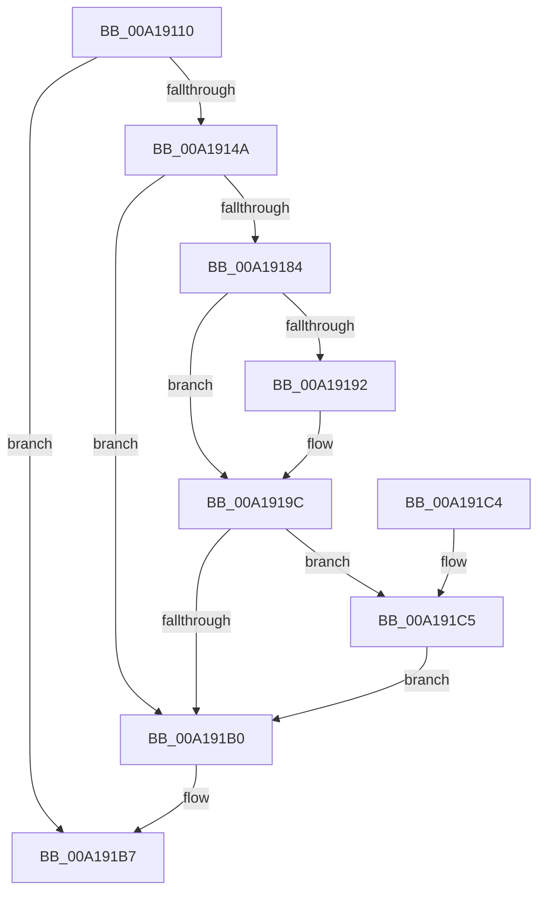

# RtlGetVersion

- RVA: `0x00A19110`–`0x00A191D7` (길이 `199` bytes)
- VA: `0x0000000140A19110`
- 실행 섹션: `PAGE`
- PDB 이름 있음: `예`; PDB Function 태그: `아니요`
- unwind 정보 RVA: `0x000AA260`
- 디코드: `45`개 명령, `199/199` bytes 표시
- 미해석 바이트: `0` (있으면 어셈블리에 `.byte`로 보존)

> 이 문서는 커널 이미지의 기계어와 PDB 기호를 분석해 생성했습니다. 4번과 5번은 함수 원형과 자료형을 바이너리 사용 방식에서 추정한 C 해석이며 원본 소스 복구 결과는 아닙니다.

## 1. Dependencies

- 직접 호출 지점: **3**; 고유 호출 대상: **2**
- 직접 호출자로 확인된 함수: **9**
- RIP 상대 이미지 참조: **4**

### Outgoing calls
- `0x00A19189` → [RtlGetNtProductType](../../text/43/RtlGetNtProductType_function_00436270.md) (function, `0x00436270`)
- `0x00A1919C` → [RtlGetSuiteMask](RtlGetSuiteMask_function_00A191E0.md) (function, `0x00A191E0`)
- `0x00A191C5` → [RtlGetSuiteMask](RtlGetSuiteMask_function_00A191E0.md) (function, `0x00A191E0`)

### Direct callers
- [RtlVerifyVersionInfo](../../text/45/RtlVerifyVersionInfo_function_00457670.md) at `0x004576D1`
- [SymCryptInitEnvWindowsKernelmodeWin8_1nLater](../../text/51/SymCryptInitEnvWindowsKernelmodeWin8_1nLater_function_0051C948.md) at `0x0051C97C`
- [Win7RtlGetVersion](../74/Win7RtlGetVersion_function_0074BAF0.md) at `0x0074BAF9`
- [Win81RtlGetVersion](../74/Win81RtlGetVersion_function_0074BBD0.md) at `0x0074BBD9`
- [Win8RtlGetVersion](../74/Win8RtlGetVersion_function_0074BCB0.md) at `0x0074BCB9`
- [SysCtxOpenMachine](../83/SysCtxOpenMachine_function_00831D24.md) at `0x00831E4A`
- [SdbpMatchOsVersion](SdbpMatchOsVersion_function_00A18FC0.md) at `0x00A1900A`
- [PopEtInit](../../init/C4/PopEtInit_function_00C43018.md) at `0x00C430C4`
- [EtwpTraceSystemInitialization](../../init/C4/EtwpTraceSystemInitialization_function_00C4E720.md) at `0x00C4E786`

### Static image references
- `0x00A19124` → RVA `0x00E0A74C` (`.data`; read)
- `0x00A1914A` → RVA `0x00FC41C1` (`.data`; read)
- `0x00A1915D` → RVA `0x00FC41C0` (`.data`; read)
- `0x00A1916E` → RVA `0x00FC41A0` (`.data`; read)

## 2. Other-region calls and transfers

- 다른 실행 섹션으로 향하는 call: **1**
  - `0x00A19189` → [RtlGetNtProductType](../../text/43/RtlGetNtProductType_function_00436270.md) (`PAGE` → `.text`)
- 별도 외부 분기/꼬리 이동을 확인하지 못했습니다.

## 3. Assembly (complete function range)

```asm
00A19110  48 89 5C 24 10                  mov qword ptr [rsp + 0x10], rbx
00A19115  57                              push rdi
00A19116  48 83 EC 20                     sub rsp, 0x20
00A1911A  33 FF                           xor edi, edi
00A1911C  48 C7 41 04 0A 00 00 00         mov qword ptr [rcx + 4], 0xa
00A19124  0F B7 05 21 16 3F 00            movzx eax, word ptr [rip + 0x3f1621]
00A1912B  48 8B D9                        mov rbx, rcx
00A1912E  89 41 0C                        mov dword ptr [rcx + 0xc], eax
00A19131  8B 01                           mov eax, dword ptr [rcx]
00A19133  2D 1C 01 00 00                  sub eax, 0x11c
00A19138  89 7C 24 30                     mov dword ptr [rsp + 0x30], edi
00A1913C  C7 41 10 02 00 00 00            mov dword ptr [rcx + 0x10], 2
00A19143  A9 F7 FF FF FF                  test eax, 0xfffffff7
00A19148  75 6D                           jne 0x140a191b7
00A1914A  0F B6 05 70 B0 5A 00            movzx eax, byte ptr [rip + 0x5ab070]
00A19151  66 89 81 14 01 00 00            mov word ptr [rcx + 0x114], ax
00A19158  B9 FF 00 00 00                  mov ecx, 0xff
00A1915D  0F B7 05 5C B0 5A 00            movzx eax, word ptr [rip + 0x5ab05c]
00A19164  66 23 C1                        and ax, cx
00A19167  66 89 BB 18 01 00 00            mov word ptr [rbx + 0x118], di
00A1916E  39 3D 2C B0 5A 00               cmp dword ptr [rip + 0x5ab02c], edi
00A19174  66 89 83 16 01 00 00            mov word ptr [rbx + 0x116], ax
00A1917B  40 88 BB 1A 01 00 00            mov byte ptr [rbx + 0x11a], dil
00A19182  76 2C                           jbe 0x140a191b0
00A19184  48 8D 4C 24 30                  lea rcx, [rsp + 0x30]
00A19189  E8 E2 D0 A1 FF                  call 0x140436270
00A1918E  84 C0                           test al, al
00A19190  74 0A                           je 0x140a1919c
00A19192  8A 44 24 30                     mov al, byte ptr [rsp + 0x30]
00A19196  88 83 1A 01 00 00               mov byte ptr [rbx + 0x11a], al
00A1919C  E8 3F 00 00 00                  call 0x140a191e0
00A191A1  81 3B 24 01 00 00               cmp dword ptr [rbx], 0x124
00A191A7  66 89 83 18 01 00 00            mov word ptr [rbx + 0x118], ax
00A191AE  74 15                           je 0x140a191c5
00A191B0  40 88 BB 1B 01 00 00            mov byte ptr [rbx + 0x11b], dil
00A191B7  48 8B 5C 24 38                  mov rbx, qword ptr [rsp + 0x38]
00A191BC  33 C0                           xor eax, eax
00A191BE  48 83 C4 20                     add rsp, 0x20
00A191C2  5F                              pop rdi
00A191C3  C3                              ret
00A191C4  CC                              int3
00A191C5  E8 16 00 00 00                  call 0x140a191e0
00A191CA  25 FF FF 01 00                  and eax, 0x1ffff
00A191CF  89 83 1C 01 00 00               mov dword ptr [rbx + 0x11c], eax
00A191D5  EB D9                           jmp 0x140a191b0
```

## 4. C-style interpretation (structured pseudocode)

```c
__int64 __fastcall RtlGetVersion(__int64 a1)
{
    __int64 result;
    __int64 v_rdi;
    __int64 v_rsp;
    unsigned __int64 v_stack_p10;
    unsigned int v_stack_p8;

    v_stack_p10 = v_rbx;
    v_rsp = (v_rsp) - (32);
    v_rdi = 0;
    *(unsigned __int64 *)(a1 + 4) = 10;
    *(unsigned int *)(a1 + 12) = (unsigned int)(*(unsigned __int16 *)(v_rip + 4134433));
    result = (unsigned int)(((unsigned int)(*(unsigned int *)(a1))) - (284));
    v_stack_p8 = 0;
    *(unsigned int *)(a1 + 16) = 2;
    if ((((unsigned int)(result)) & (0xFFFFFFF7ULL)) != 0) goto loc_00A191B7;
    *(unsigned __int16 *)(a1 + 276) = (unsigned __int16)(*(unsigned __int8 *)(v_rip + 5943408));
    result = (unsigned __int16)((*(unsigned __int16 *)(v_rip + 5943388)) & (255));
    *(unsigned __int16 *)(a1 + 280) = 0;
    *(unsigned __int16 *)(a1 + 278) = (unsigned __int16)(result);
    *(unsigned __int8 *)(a1 + 282) = 0;
    if ((*(unsigned int *)(v_rip + 5943340)) <= 0) goto loc_00A191B0;
    result = RtlGetNtProductType(v_stack_p8, a2, a3, a4);
    if ((unsigned __int8)(result) != 0) {
        result = v_stack_p8;
        *(unsigned __int8 *)(a1 + 282) = (unsigned __int8)(result);
    }
    result = RtlGetSuiteMask(v_stack_p8, a2, a3, a4);
    *(unsigned __int16 *)(a1 + 280) = (unsigned __int16)(result);
    if ((*(unsigned int *)(a1)) == 292) goto loc_00A191C5;
loc_00A191B0:
    *(unsigned __int8 *)(a1 + 283) = 0;
loc_00A191B7:
    result = 0;
    v_rsp = (v_rsp) + (32);
    return result;
loc_00A191C5:
    result = RtlGetSuiteMask(v_stack_p8, a2, a3, a4);
    result = (unsigned int)((result) & (0x1FFFFULL));
    *(unsigned int *)(v_stack_p10 + 284) = (unsigned int)(result);
    goto loc_00A191B0;
}
```

## 5. (Beta) C Style

```c
int64_t RtlGetVersion(void *Arg1)
{
    uint8_t *arg1 = (uint8_t *)Arg1;

    int64_t result;
    int64_t local_rdi;
    int64_t local_rsp;
    uint64_t v_stack_p10;
    uint32_t v_stack_p8;

    v_stack_p10 = local_rbx;
    local_rsp = (local_rsp) - (32);
    local_rdi = 0;
    *(uint64_t *)(arg1 + 0x4) = 10;
    *(uint32_t *)(arg1 + 0xC) = (uint32_t)(*(uint16_t *)(v_rip + 0x3F1621));
    result = (uint32_t)(((uint32_t)(*(uint32_t *)(arg1))) - (284));
    v_stack_p8 = 0;
    *(uint32_t *)(arg1 + 0x10) = 2;
    if ((((uint32_t)(result)) & (0xFFFFFFF7ULL)) != 0) goto loc_00A191B7;
    *(uint16_t *)(arg1 + 0x114) = (uint16_t)(*(uint8_t *)(v_rip + 0x5AB070));
    result = (uint16_t)((*(uint16_t *)(v_rip + 0x5AB05C)) & (255));
    *(uint16_t *)(arg1 + 0x118) = 0;
    *(uint16_t *)(arg1 + 0x116) = (uint16_t)(result);
    *(uint8_t *)(arg1 + 0x11A) = 0;
    if ((*(uint32_t *)(v_rip + 0x5AB02C)) <= 0) goto loc_00A191B0;
    result = RtlGetNtProductType(v_stack_p8, a2, a3, a4);
    if ((uint8_t)(result) != 0) {
        result = v_stack_p8;
        *(uint8_t *)(arg1 + 0x11A) = (uint8_t)(result);
    }
    result = RtlGetSuiteMask(v_stack_p8, a2, a3, a4);
    *(uint16_t *)(arg1 + 0x118) = (uint16_t)(result);
    if ((*(uint32_t *)(arg1)) == 292) goto loc_00A191C5;
loc_00A191B0:
    *(uint8_t *)(arg1 + 0x11B) = 0;
loc_00A191B7:
    result = 0;
    local_rsp = (local_rsp) + (32);
    return result;
loc_00A191C5:
    result = RtlGetSuiteMask(v_stack_p8, a2, a3, a4);
    result = (uint32_t)((result) & (0x1FFFFULL));
    *(uint32_t *)(v_stack_p10 + 0x11C) = (uint32_t)(result);
    goto loc_00A191B0;
}
```

### 관측된 메모리 오프셋

구조체 형식이 확인되지 않은 접근은 인자 기준의 오프셋으로만 기록했습니다.

| 기준 인자 | 오프셋 표현 | 폭 (bit) | 접근 |
|---|---:|---:|---|
| `Arg1` | `+ 0x0` | `32` | `R` |
| `Arg1` | `+ 0x4` | `64` | `W` |
| `Arg1` | `+ 0xC` | `32` | `W` |
| `Arg1` | `+ 0x10` | `32` | `W` |
| `Arg1` | `+ 0x114` | `16` | `W` |
| `Arg1` | `+ 0x116` | `16` | `W` |
| `Arg1` | `+ 0x118` | `16` | `W` |
| `Arg1` | `+ 0x11A` | `8` | `W` |
| `Arg1` | `+ 0x11B` | `8` | `W` |
| `Arg1` | `+ 0x11C` | `32` | `W` |

## 6. Execution-region graph

[열기: 2D/3D 그래프와 함수 탐색 컨트롤 패널](../../../control-panel.html?section=page&rva=0x00A19110&view=graph)

- 2D 그래프는 위에서 아래로 흐르고, 3D 그래프는 빈 공간을 드래그해 회전합니다. Shift+드래그는 이동, 휠은 확대·축소, 함수 노드 선택은 대상 보고서 이동입니다.

### Static fallback


