# RtlMakeSelfRelativeSD

- RVA: `0x00A119D4`–`0x00A11C0F` (길이 `571` bytes)
- VA: `0x0000000140A119D4`
- 실행 섹션: `PAGE`
- PDB 이름 있음: `예`; PDB Function 태그: `아니요`
- unwind 정보 RVA: `0x000A95A4`
- 디코드: `169`개 명령, `571/571` bytes 표시
- 미해석 바이트: `0` (있으면 어셈블리에 `.byte`로 보존)

> 이 문서는 커널 이미지의 기계어와 PDB 기호를 분석해 생성했습니다. 4번과 5번은 함수 원형과 자료형을 바이너리 사용 방식에서 추정한 C 해석이며 원본 소스 복구 결과는 아닙니다.

## 1. Dependencies

- 직접 호출 지점: **5**; 고유 호출 대상: **2**
- 직접 호출자로 확인된 함수: **3**
- RIP 상대 이미지 참조: **0**

### Outgoing calls
- `0x00A11AD0` → [memset](../../text/6C/memset_function_006C6C40.md) (function, `0x006C6C40`)
- `0x00A11AF2` → [memcpy](../../text/6C/memcpy_function_006C6840.md) (function, `0x006C6840`)
- `0x00A11B18` → [memcpy](../../text/6C/memcpy_function_006C6840.md) (function, `0x006C6840`)
- `0x00A11B3A` → [memcpy](../../text/6C/memcpy_function_006C6840.md) (function, `0x006C6840`)
- `0x00A11B5C` → [memcpy](../../text/6C/memcpy_function_006C6840.md) (function, `0x006C6840`)

### Direct callers
- [RtlpSysVolCheckOwnerAndSecurity](../79/RtlpSysVolCheckOwnerAndSecurity_function_00791324.md) at `0x007915AB`
- [RtlpSysVolCheckOwnerAndSecurity](../79/RtlpSysVolCheckOwnerAndSecurity_function_00791324.md) at `0x007915E4`
- [LocalConvertStringSDToSD_Rev1](../92/LocalConvertStringSDToSD_Rev1_function_0092656C.md) at `0x00926ACF`
- [LocalConvertStringSDToSD_Rev1](../92/LocalConvertStringSDToSD_Rev1_function_0092656C.md) at `0x00926B02`
- [RtlAbsoluteToSelfRelativeSD](RtlAbsoluteToSelfRelativeSD_function_00A119B0.md) at `0x00A119BB`

### Static image references
- 디코드된 RIP-relative 메모리 참조가 없습니다.

## 2. Other-region calls and transfers

- 다른 실행 섹션으로 향하는 call: **5**
  - `0x00A11AD0` → [memset](../../text/6C/memset_function_006C6C40.md) (`PAGE` → `.text`)
  - `0x00A11AF2` → [memcpy](../../text/6C/memcpy_function_006C6840.md) (`PAGE` → `.text`)
  - `0x00A11B18` → [memcpy](../../text/6C/memcpy_function_006C6840.md) (`PAGE` → `.text`)
  - `0x00A11B3A` → [memcpy](../../text/6C/memcpy_function_006C6840.md) (`PAGE` → `.text`)
  - `0x00A11B5C` → [memcpy](../../text/6C/memcpy_function_006C6840.md) (`PAGE` → `.text`)
- 별도 외부 분기/꼬리 이동을 확인하지 못했습니다.

## 3. Assembly (complete function range)

```asm
00A119D4  48 89 5C 24 20                  mov qword ptr [rsp + 0x20], rbx
00A119D9  55                              push rbp
00A119DA  56                              push rsi
00A119DB  57                              push rdi
00A119DC  41 54                           push r12
00A119DE  41 55                           push r13
00A119E0  41 56                           push r14
00A119E2  41 57                           push r15
00A119E4  48 83 EC 20                     sub rsp, 0x20
00A119E8  48 8B D9                        mov rbx, rcx
00A119EB  45 33 C9                        xor r9d, r9d
00A119EE  0F B7 49 02                     movzx ecx, word ptr [rcx + 2]
00A119F2  48 8B F2                        mov rsi, rdx
00A119F5  41 BA FC FF FF FF               mov r10d, 0xfffffffc
00A119FB  66 85 C9                        test cx, cx
00A119FE  0F 88 83 01 00 00               js 0x140a11b87
00A11A04  4C 8B 63 08                     mov r12, qword ptr [rbx + 8]
00A11A08  4D 85 E4                        test r12, r12
00A11A0B  0F 85 CB 01 00 00               jne 0x140a11bdc
00A11A11  41 8B D1                        mov edx, r9d
00A11A14  89 54 24 60                     mov dword ptr [rsp + 0x60], edx
00A11A18  F6 C1 04                        test cl, 4
00A11A1B  75 08                           jne 0x140a11a25
00A11A1D  4D 8B F9                        mov r15, r9
00A11A20  45 8B E9                        mov r13d, r9d
00A11A23  EB 1E                           jmp 0x140a11a43
00A11A25  66 85 C9                        test cx, cx
00A11A28  0F 88 82 01 00 00               js 0x140a11bb0
00A11A2E  4C 8B 7B 20                     mov r15, qword ptr [rbx + 0x20]
00A11A32  4D 85 FF                        test r15, r15
00A11A35  74 E9                           je 0x140a11a20
00A11A37  45 0F B7 6F 02                  movzx r13d, word ptr [r15 + 2]
00A11A3C  41 83 C5 03                     add r13d, 3
00A11A40  45 23 EA                        and r13d, r10d
00A11A43  66 85 C9                        test cx, cx
00A11A46  0F 88 2A 01 00 00               js 0x140a11b76
00A11A4C  48 8B 43 10                     mov rax, qword ptr [rbx + 0x10]
00A11A50  48 89 44 24 70                  mov qword ptr [rsp + 0x70], rax
00A11A55  48 85 C0                        test rax, rax
00A11A58  0F 85 38 01 00 00               jne 0x140a11b96
00A11A5E  41 8B C1                        mov eax, r9d
00A11A61  89 44 24 68                     mov dword ptr [rsp + 0x68], eax
00A11A65  F6 C1 10                        test cl, 0x10
00A11A68  75 08                           jne 0x140a11a72
00A11A6A  49 8B E9                        mov rbp, r9
00A11A6D  45 8B F1                        mov r14d, r9d
00A11A70  EB 1E                           jmp 0x140a11a90
00A11A72  66 85 C9                        test cx, cx
00A11A75  0F 88 76 01 00 00               js 0x140a11bf1
00A11A7B  48 8B 6B 18                     mov rbp, qword ptr [rbx + 0x18]
00A11A7F  48 85 ED                        test rbp, rbp
00A11A82  74 E9                           je 0x140a11a6d
00A11A84  44 0F B7 75 02                  movzx r14d, word ptr [rbp + 2]
00A11A89  41 83 C6 03                     add r14d, 3
00A11A8D  45 23 F2                        and r14d, r10d
00A11A90  8D 0C 02                        lea ecx, [rdx + rax]
00A11A93  83 C1 14                        add ecx, 0x14
00A11A96  41 03 CE                        add ecx, r14d
00A11A99  41 03 CD                        add ecx, r13d
00A11A9C  41 3B 08                        cmp ecx, dword ptr [r8]
00A11A9F  76 1E                           jbe 0x140a11abf
00A11AA1  41 89 08                        mov dword ptr [r8], ecx
00A11AA4  B8 23 00 00 C0                  mov eax, 0xc0000023
00A11AA9  48 8B 5C 24 78                  mov rbx, qword ptr [rsp + 0x78]
00A11AAE  48 83 C4 20                     add rsp, 0x20
00A11AB2  41 5F                           pop r15
00A11AB4  41 5E                           pop r14
00A11AB6  41 5D                           pop r13
00A11AB8  41 5C                           pop r12
00A11ABA  5F                              pop rdi
00A11ABB  5E                              pop rsi
00A11ABC  5D                              pop rbp
00A11ABD  C3                              ret
00A11ABE  CC                              int3
00A11ABF  48 85 F6                        test rsi, rsi
00A11AC2  0F 84 3D 01 00 00               je 0x140a11c05
00A11AC8  44 8B C1                        mov r8d, ecx
00A11ACB  33 D2                           xor edx, edx
00A11ACD  48 8B CE                        mov rcx, rsi
00A11AD0  E8 6B 51 CB FF                  call 0x1406c6c40
00A11AD5  8B 03                           mov eax, dword ptr [rbx]
00A11AD7  48 8D 7E 14                     lea rdi, [rsi + 0x14]
00A11ADB  89 06                           mov dword ptr [rsi], eax
00A11ADD  45 85 F6                        test r14d, r14d
00A11AE0  0F 84 C3 00 00 00               je 0x140a11ba9
00A11AE6  45 8B C6                        mov r8d, r14d
00A11AE9  48 8B D5                        mov rdx, rbp
00A11AEC  48 8B CF                        mov rcx, rdi
00A11AEF  41 8B DE                        mov ebx, r14d
00A11AF2  E8 49 4D CB FF                  call 0x1406c6840
00A11AF7  8B C7                           mov eax, edi
00A11AF9  48 03 FB                        add rdi, rbx
00A11AFC  2B C6                           sub eax, esi
00A11AFE  89 46 0C                        mov dword ptr [rsi + 0xc], eax
00A11B01  8B EE                           mov ebp, esi
00A11B03  45 85 ED                        test r13d, r13d
00A11B06  0F 84 C9 00 00 00               je 0x140a11bd5
00A11B0C  45 8B C5                        mov r8d, r13d
00A11B0F  49 8B D7                        mov rdx, r15
00A11B12  48 8B CF                        mov rcx, rdi
00A11B15  41 8B DD                        mov ebx, r13d
00A11B18  E8 23 4D CB FF                  call 0x1406c6840
00A11B1D  8B C7                           mov eax, edi
00A11B1F  48 03 FB                        add rdi, rbx
00A11B22  2B C6                           sub eax, esi
00A11B24  89 46 10                        mov dword ptr [rsi + 0x10], eax
00A11B27  8B 44 24 60                     mov eax, dword ptr [rsp + 0x60]
00A11B2B  85 C0                           test eax, eax
00A11B2D  74 1A                           je 0x140a11b49
00A11B2F  44 8B C0                        mov r8d, eax
00A11B32  49 8B D4                        mov rdx, r12
00A11B35  48 8B CF                        mov rcx, rdi
00A11B38  8B D8                           mov ebx, eax
00A11B3A  E8 01 4D CB FF                  call 0x1406c6840
00A11B3F  8B C7                           mov eax, edi
00A11B41  2B C5                           sub eax, ebp
00A11B43  89 46 04                        mov dword ptr [rsi + 4], eax
00A11B46  48 03 FB                        add rdi, rbx
00A11B49  8B 44 24 68                     mov eax, dword ptr [rsp + 0x68]
00A11B4D  85 C0                           test eax, eax
00A11B4F  74 15                           je 0x140a11b66
00A11B51  48 8B 54 24 70                  mov rdx, qword ptr [rsp + 0x70]
00A11B56  44 8B C0                        mov r8d, eax
00A11B59  48 8B CF                        mov rcx, rdi
00A11B5C  E8 DF 4C CB FF                  call 0x1406c6840
00A11B61  2B FD                           sub edi, ebp
00A11B63  89 7E 08                        mov dword ptr [rsi + 8], edi
00A11B66  B8 00 80 00 00                  mov eax, 0x8000
00A11B6B  66 09 46 02                     or word ptr [rsi + 2], ax
00A11B6F  33 C0                           xor eax, eax
00A11B71  E9 33 FF FF FF                  jmp 0x140a11aa9
00A11B76  8B 43 08                        mov eax, dword ptr [rbx + 8]
00A11B79  85 C0                           test eax, eax
00A11B7B  75 47                           jne 0x140a11bc4
00A11B7D  4C 89 4C 24 70                  mov qword ptr [rsp + 0x70], r9
00A11B82  E9 D7 FE FF FF                  jmp 0x140a11a5e
00A11B87  8B 43 04                        mov eax, dword ptr [rbx + 4]
00A11B8A  85 C0                           test eax, eax
00A11B8C  75 3E                           jne 0x140a11bcc
00A11B8E  4D 8B E1                        mov r12, r9
00A11B91  E9 7B FE FF FF                  jmp 0x140a11a11
00A11B96  0F B6 40 01                     movzx eax, byte ptr [rax + 1]
00A11B9A  8D 04 85 0B 00 00 00            lea eax, [rax*4 + 0xb]
00A11BA1  41 23 C2                        and eax, r10d
00A11BA4  E9 B8 FE FF FF                  jmp 0x140a11a61
00A11BA9  33 C0                           xor eax, eax
00A11BAB  E9 4E FF FF FF                  jmp 0x140a11afe
00A11BB0  8B 43 10                        mov eax, dword ptr [rbx + 0x10]
00A11BB3  85 C0                           test eax, eax
00A11BB5  0F 84 62 FE FF FF               je 0x140a11a1d
00A11BBB  4C 8D 3C 03                     lea r15, [rbx + rax]
00A11BBF  E9 6E FE FF FF                  jmp 0x140a11a32
00A11BC4  48 03 C3                        add rax, rbx
00A11BC7  E9 84 FE FF FF                  jmp 0x140a11a50
00A11BCC  4C 8D 24 03                     lea r12, [rbx + rax]
00A11BD0  E9 33 FE FF FF                  jmp 0x140a11a08
00A11BD5  33 C0                           xor eax, eax
00A11BD7  E9 48 FF FF FF                  jmp 0x140a11b24
00A11BDC  41 0F B6 44 24 01               movzx eax, byte ptr [r12 + 1]
00A11BE2  8D 14 85 0B 00 00 00            lea edx, [rax*4 + 0xb]
00A11BE9  41 23 D2                        and edx, r10d
00A11BEC  E9 23 FE FF FF                  jmp 0x140a11a14
00A11BF1  8B 4B 0C                        mov ecx, dword ptr [rbx + 0xc]
00A11BF4  85 C9                           test ecx, ecx
00A11BF6  0F 84 6E FE FF FF               je 0x140a11a6a
00A11BFC  48 8D 2C 0B                     lea rbp, [rbx + rcx]
00A11C00  E9 7A FE FF FF                  jmp 0x140a11a7f
00A11C05  B8 0D 00 00 C0                  mov eax, 0xc000000d
00A11C0A  E9 9A FE FF FF                  jmp 0x140a11aa9
```

## 4. C-style interpretation (structured pseudocode)

```c
__int64 __fastcall RtlMakeSelfRelativeSD(__int64 a1, __int64 a2, __int64 a3, int a4)
{
    __int64 result;
    __int64 v_r13;
    __int64 v_r14;
    __int64 v_rbx;
    __int64 v_rdi;
    __int64 v_rsp;
    unsigned int v_stack_p10;
    unsigned __int64 v_stack_p18;
    unsigned __int64 v_stack_p20;
    unsigned int v_stack_p60;
    unsigned int v_stack_p68;
    unsigned __int64 v_stack_p70;
    unsigned int v_stack_p8;

    v_stack_p20 = v_rbx;
    v_rsp = (v_rsp) - (32);
    a4 = 0;
    if (sign_flag) goto loc_00A11B87;
loc_00A11A08:
    if (*(unsigned __int64 *)(a1 + 8) != 0) goto loc_00A11BDC;
loc_00A11A11:
loc_00A11A14:
    v_stack_p8 = 0;
    if ((((unsigned __int8)(*(unsigned __int16 *)(a1 + 2))) & (4)) != 0) goto loc_00A11A25;
loc_00A11A1D:
loc_00A11A20:
    goto loc_00A11A43;
loc_00A11A25:
    if (sign_flag) goto loc_00A11BB0;
loc_00A11A32:
    if (*(unsigned __int64 *)(a1 + 32) == 0) goto loc_00A11A20;
    v_r13 = (unsigned int)((*(unsigned __int16 *)(*(unsigned __int64 *)(a1 + 32) + 2)) + (3));
    v_r13 = (unsigned int)((v_r13) & ((unsigned int)((unsigned int)(0xFFFFFFFCULL))));
loc_00A11A43:
    if (sign_flag) goto loc_00A11B76;
loc_00A11A50:
    v_stack_p18 = *(unsigned __int64 *)(a1 + 16);
    if (*(unsigned __int64 *)(a1 + 16) != 0) goto loc_00A11B96;
loc_00A11A5E:
loc_00A11A61:
    v_stack_p10 = 0;
    if ((((unsigned __int8)(*(unsigned __int16 *)(a1 + 2))) & (16)) != 0) goto loc_00A11A72;
loc_00A11A6A:
loc_00A11A6D:
    goto loc_00A11A90;
loc_00A11A72:
    if (sign_flag) goto loc_00A11BF1;
loc_00A11A7F:
    if (*(unsigned __int64 *)(a1 + 24) == 0) goto loc_00A11A6D;
    v_r14 = (unsigned int)((*(unsigned __int16 *)(*(unsigned __int64 *)(a1 + 24) + 2)) + (3));
    v_r14 = (unsigned int)((v_r14) & ((unsigned int)((unsigned int)(0xFFFFFFFCULL))));
loc_00A11A90:
    a1 = (unsigned int)((0 + 0 * 1) + (20));
    a1 = (unsigned int)((a1) + ((unsigned int)(v_r14)));
    a1 = (unsigned int)((a1) + ((unsigned int)(v_r13)));
    if (((unsigned int)(a1)) <= (*(unsigned int *)(a3))) goto loc_00A11ABF;
    *(unsigned int *)(a3) = (unsigned int)(a1);
loc_00A11AA9:
    v_rsp = (v_rsp) + (32);
    return (unsigned int)(0xC0000023ULL);
loc_00A11ABF:
    if (a2 == 0) goto loc_00A11C05;
    a2 = 0;
    result = memset(0, a2, (unsigned int)((unsigned int)(a1)), a4);
    *(unsigned int *)(a2) = (unsigned int)((unsigned int)(*(unsigned int *)(v_stack_p20)));
    if ((unsigned int)(v_r14) == 0) goto loc_00A11BA9;
    result = memcpy(a2 + 20, *(unsigned __int64 *)(a1 + 24), (unsigned int)((unsigned int)(v_r14)), a4);
    v_rdi = (a2 + 20) + ((unsigned int)((unsigned int)(v_r14)));
    result = (unsigned int)(((unsigned int)((unsigned int)(a2 + 20))) - (0));
loc_00A11AFE:
    *(unsigned int *)(a2 + 12) = (unsigned int)(result);
    if ((unsigned int)(v_r13) == 0) goto loc_00A11BD5;
    result = memcpy(v_rdi, *(unsigned __int64 *)(a1 + 32), (unsigned int)((unsigned int)(v_r13)), a4);
    v_rdi = (v_rdi) + ((unsigned int)((unsigned int)(v_r13)));
    result = (unsigned int)(((unsigned int)((unsigned int)(v_rdi))) - (0));
loc_00A11B24:
    *(unsigned int *)(a2 + 16) = (unsigned int)(result);
    result = (unsigned int)(v_stack_p60);
    v_rbx = (unsigned int)((unsigned int)(v_r13));
    if ((unsigned int)((unsigned int)(v_stack_p60)) != 0) {
        a3 = (unsigned int)((unsigned int)(v_stack_p60));
        a2 = *(unsigned __int64 *)(a1 + 8);
        a1 = v_rdi;
        v_rbx = (unsigned int)((unsigned int)(v_stack_p60));
        result = memcpy(a1, a2, a3, a4);
        result = (unsigned int)(v_rdi);
        result = (unsigned int)((result) - (0));
        *(unsigned int *)(a2 + 4) = (unsigned int)(result);
        v_rdi = (v_rdi) + (v_rbx);
    }
    result = (unsigned int)(v_stack_p68);
    if ((unsigned int)((unsigned int)(v_stack_p68)) != 0) {
        a2 = v_stack_p70;
        a3 = (unsigned int)((unsigned int)(v_stack_p68));
        a1 = v_rdi;
        result = memcpy(a1, a2, a3, a4);
        v_rdi = (unsigned int)((v_rdi) - (0));
        *(unsigned int *)(a2 + 8) = (unsigned int)(v_rdi);
    }
    result = 0;
    goto loc_00A11AA9;
loc_00A11B76:
    if ((unsigned int)((unsigned int)(*(unsigned int *)(v_rbx + 8))) != 0) goto loc_00A11BC4;
    v_stack_p70 = 0;
    goto loc_00A11A5E;
loc_00A11B87:
    if ((unsigned int)((unsigned int)(*(unsigned int *)(v_rbx + 4))) != 0) goto loc_00A11BCC;
    goto loc_00A11A11;
loc_00A11B96:
    result = (unsigned int)((*(unsigned __int8 *)((unsigned int)(*(unsigned int *)(v_rbx + 4)) + 1) * 4 + 11) & ((unsigned int)((unsigned int)(0xFFFFFFFCULL))));
    goto loc_00A11A61;
loc_00A11BA9:
    result = 0;
    goto loc_00A11AFE;
loc_00A11BB0:
    if ((unsigned int)((unsigned int)(*(unsigned int *)(v_rbx + 16))) == 0) goto loc_00A11A1D;
    goto loc_00A11A32;
loc_00A11BC4:
    result = ((unsigned int)(*(unsigned int *)(v_rbx + 16))) + (v_rbx);
    goto loc_00A11A50;
loc_00A11BCC:
    goto loc_00A11A08;
loc_00A11BD5:
    result = 0;
    goto loc_00A11B24;
loc_00A11BDC:
    a2 = (unsigned int)((*(unsigned __int8 *)(v_rbx + result * 1 + 1) * 4 + 11) & ((unsigned int)((unsigned int)(0xFFFFFFFCULL))));
    goto loc_00A11A14;
loc_00A11BF1:
    if ((unsigned int)((unsigned int)(*(unsigned int *)(v_rbx + 12))) == 0) goto loc_00A11A6A;
    goto loc_00A11A7F;
loc_00A11C05:
    goto loc_00A11AA9;
}
```

## 5. (Beta) C Style

```c
int64_t RtlMakeSelfRelativeSD(void *Arg1, int64_t Arg2, void *Arg3, int32_t Arg4)
{
    uint8_t *arg1 = (uint8_t *)Arg1;
    uint8_t *arg3 = (uint8_t *)Arg3;

    int64_t result;
    int64_t local_r13;
    int64_t local_r14;
    int64_t local_rbx;
    int64_t local_rdi;
    int64_t local_rsp;
    uint32_t v_stack_p10;
    uint64_t v_stack_p18;
    uint64_t v_stack_p20;
    uint32_t v_stack_p60;
    uint32_t v_stack_p68;
    uint64_t v_stack_p70;
    uint32_t v_stack_p8;

    v_stack_p20 = local_rbx;
    local_rsp = (local_rsp) - (32);
    Arg4 = 0;
    if (sign_flag) goto loc_00A11B87;
loc_00A11A08:
    if (*(uint64_t *)(arg1 + 0x8) != 0) goto loc_00A11BDC;
loc_00A11A11:
loc_00A11A14:
    v_stack_p8 = 0;
    if ((((uint8_t)(*(uint16_t *)(arg1 + 0x2))) & (4)) != 0) goto loc_00A11A25;
loc_00A11A1D:
loc_00A11A20:
    goto loc_00A11A43;
loc_00A11A25:
    if (sign_flag) goto loc_00A11BB0;
loc_00A11A32:
    if (*(uint64_t *)(arg1 + 0x20) == 0) goto loc_00A11A20;
    local_r13 = (uint32_t)((*(uint16_t *)(*(uint64_t *)(arg1 + 0x20) + 0x2)) + (3));
    local_r13 = (uint32_t)((local_r13) & ((uint32_t)((uint32_t)(0xFFFFFFFCULL))));
loc_00A11A43:
    if (sign_flag) goto loc_00A11B76;
loc_00A11A50:
    v_stack_p18 = *(uint64_t *)(arg1 + 0x10);
    if (*(uint64_t *)(arg1 + 0x10) != 0) goto loc_00A11B96;
loc_00A11A5E:
loc_00A11A61:
    v_stack_p10 = 0;
    if ((((uint8_t)(*(uint16_t *)(arg1 + 0x2))) & (16)) != 0) goto loc_00A11A72;
loc_00A11A6A:
loc_00A11A6D:
    goto loc_00A11A90;
loc_00A11A72:
    if (sign_flag) goto loc_00A11BF1;
loc_00A11A7F:
    if (*(uint64_t *)(arg1 + 0x18) == 0) goto loc_00A11A6D;
    local_r14 = (uint32_t)((*(uint16_t *)(*(uint64_t *)(arg1 + 0x18) + 0x2)) + (3));
    local_r14 = (uint32_t)((local_r14) & ((uint32_t)((uint32_t)(0xFFFFFFFCULL))));
loc_00A11A90:
    Arg1 = (uint32_t)((0 + 0 * 1) + (20));
    Arg1 = (uint32_t)((Arg1) + ((uint32_t)(local_r14)));
    Arg1 = (uint32_t)((Arg1) + ((uint32_t)(local_r13)));
    if (((uint32_t)(Arg1)) <= (*(uint32_t *)(arg3))) goto loc_00A11ABF;
    *(uint32_t *)(arg3) = (uint32_t)(Arg1);
loc_00A11AA9:
    local_rsp = (local_rsp) + (32);
    return (uint32_t)(0xC0000023ULL);
loc_00A11ABF:
    if (Arg2 == 0) goto loc_00A11C05;
    Arg2 = 0;
    result = memset(0, Arg2, (uint32_t)((uint32_t)(Arg1)), Arg4);
    *(uint32_t *)(Arg2) = (uint32_t)((uint32_t)(*(uint32_t *)(v_stack_p20)));
    if ((uint32_t)(local_r14) == 0) goto loc_00A11BA9;
    result = memcpy(Arg2 + 20, *(uint64_t *)(arg1 + 0x18), (uint32_t)((uint32_t)(local_r14)), Arg4);
    local_rdi = (Arg2 + 20) + ((uint32_t)((uint32_t)(local_r14)));
    result = (uint32_t)(((uint32_t)((uint32_t)(Arg2 + 20))) - (0));
loc_00A11AFE:
    *(uint32_t *)(Arg2 + 0xC) = (uint32_t)(result);
    if ((uint32_t)(local_r13) == 0) goto loc_00A11BD5;
    result = memcpy(local_rdi, *(uint64_t *)(arg1 + 0x20), (uint32_t)((uint32_t)(local_r13)), Arg4);
    local_rdi = (local_rdi) + ((uint32_t)((uint32_t)(local_r13)));
    result = (uint32_t)(((uint32_t)((uint32_t)(local_rdi))) - (0));
loc_00A11B24:
    *(uint32_t *)(Arg2 + 0x10) = (uint32_t)(result);
    result = (uint32_t)(v_stack_p60);
    local_rbx = (uint32_t)((uint32_t)(local_r13));
    if ((uint32_t)((uint32_t)(v_stack_p60)) != 0) {
        Arg3 = (uint32_t)((uint32_t)(v_stack_p60));
        Arg2 = *(uint64_t *)(arg1 + 0x8);
        Arg1 = local_rdi;
        local_rbx = (uint32_t)((uint32_t)(v_stack_p60));
        result = memcpy(Arg1, Arg2, Arg3, Arg4);
        result = (uint32_t)(local_rdi);
        result = (uint32_t)((result) - (0));
        *(uint32_t *)(Arg2 + 0x4) = (uint32_t)(result);
        local_rdi = (local_rdi) + (local_rbx);
    }
    result = (uint32_t)(v_stack_p68);
    if ((uint32_t)((uint32_t)(v_stack_p68)) != 0) {
        Arg2 = v_stack_p70;
        Arg3 = (uint32_t)((uint32_t)(v_stack_p68));
        Arg1 = local_rdi;
        result = memcpy(Arg1, Arg2, Arg3, Arg4);
        local_rdi = (uint32_t)((local_rdi) - (0));
        *(uint32_t *)(Arg2 + 0x8) = (uint32_t)(local_rdi);
    }
    result = 0;
    goto loc_00A11AA9;
loc_00A11B76:
    if ((uint32_t)((uint32_t)(*(uint32_t *)(local_rbx + 0x8))) != 0) goto loc_00A11BC4;
    v_stack_p70 = 0;
    goto loc_00A11A5E;
loc_00A11B87:
    if ((uint32_t)((uint32_t)(*(uint32_t *)(local_rbx + 0x4))) != 0) goto loc_00A11BCC;
    goto loc_00A11A11;
loc_00A11B96:
    result = (uint32_t)((*(uint8_t *)((uint32_t)(*(uint32_t *)(local_rbx + 0x4)) + 0x1) * 4 + 11) & ((uint32_t)((uint32_t)(0xFFFFFFFCULL))));
    goto loc_00A11A61;
loc_00A11BA9:
    result = 0;
    goto loc_00A11AFE;
loc_00A11BB0:
    if ((uint32_t)((uint32_t)(*(uint32_t *)(local_rbx + 0x10))) == 0) goto loc_00A11A1D;
    goto loc_00A11A32;
loc_00A11BC4:
    result = ((uint32_t)(*(uint32_t *)(local_rbx + 0x10))) + (local_rbx);
    goto loc_00A11A50;
loc_00A11BCC:
    goto loc_00A11A08;
loc_00A11BD5:
    result = 0;
    goto loc_00A11B24;
loc_00A11BDC:
    Arg2 = (uint32_t)((*(uint8_t *)(local_rbx + result * 1 + 0x1) * 4 + 11) & ((uint32_t)((uint32_t)(0xFFFFFFFCULL))));
    goto loc_00A11A14;
loc_00A11BF1:
    if ((uint32_t)((uint32_t)(*(uint32_t *)(local_rbx + 0xC))) == 0) goto loc_00A11A6A;
    goto loc_00A11A7F;
loc_00A11C05:
    goto loc_00A11AA9;
}
```

### 관측된 메모리 오프셋

구조체 형식이 확인되지 않은 접근은 인자 기준의 오프셋으로만 기록했습니다.

| 기준 인자 | 오프셋 표현 | 폭 (bit) | 접근 |
|---|---:|---:|---|
| `Arg1` | `+ 0x0` | `32` | `R` |
| `Arg1` | `+ 0x0 + rax*1` | `64` | `R` |
| `Arg1` | `+ 0x0 + rcx*1` | `64` | `R` |
| `Arg1` | `+ 0x2` | `16` | `R` |
| `Arg1` | `+ 0x4` | `32` | `R` |
| `Arg1` | `+ 0x8` | `32` | `R` |
| `Arg1` | `+ 0x8` | `64` | `R` |
| `Arg1` | `+ 0xC` | `32` | `R` |
| `Arg1` | `+ 0x10` | `32` | `R` |
| `Arg1` | `+ 0x10` | `64` | `R` |
| `Arg1` | `+ 0x18` | `64` | `R` |
| `Arg1` | `+ 0x20` | `64` | `R` |
| `Arg3` | `+ 0x0` | `32` | `R` |
| `Arg3` | `+ 0x0` | `32` | `W` |

## 6. Execution-region graph

[열기: 2D/3D 그래프와 함수 탐색 컨트롤 패널](../../../control-panel.html?section=page&rva=0x00A119D4&view=graph)

- 2D 그래프는 위에서 아래로 흐르고, 3D 그래프는 빈 공간을 드래그해 회전합니다. Shift+드래그는 이동, 휠은 확대·축소, 함수 노드 선택은 대상 보고서 이동입니다.

### Static fallback

```mermaid
flowchart TD
  bb_00A119D4[BB_00A119D4]
  bb_00A11A04[BB_00A11A04]
  bb_00A11A08[BB_00A11A08]
  bb_00A11A11[BB_00A11A11]
  bb_00A11A14[BB_00A11A14]
  bb_00A11A1D[BB_00A11A1D]
  bb_00A11A20[BB_00A11A20]
  bb_00A11A25[BB_00A11A25]
  bb_00A11A2E[BB_00A11A2E]
  bb_00A11A32[BB_00A11A32]
  bb_00A11A37[BB_00A11A37]
  bb_00A11A43[BB_00A11A43]
  bb_00A11A4C[BB_00A11A4C]
  bb_00A11A50[BB_00A11A50]
  bb_00A11A5E[BB_00A11A5E]
  bb_00A11A61[BB_00A11A61]
  bb_00A11A6A[BB_00A11A6A]
  bb_00A11A6D[BB_00A11A6D]
  bb_00A11A72[BB_00A11A72]
  bb_00A11A7B[BB_00A11A7B]
  bb_00A11A7F[BB_00A11A7F]
  bb_00A11A84[BB_00A11A84]
  bb_00A11A90[BB_00A11A90]
  bb_00A11AA1[BB_00A11AA1]
  bb_00A11AA9[BB_00A11AA9]
  bb_00A11ABE[BB_00A11ABE]
  bb_00A11ABF[BB_00A11ABF]
  bb_00A11AC8[BB_00A11AC8]
  bb_00A11AE6[BB_00A11AE6]
  bb_00A11AFE[BB_00A11AFE]
  bb_00A11B0C[BB_00A11B0C]
  bb_00A11B24[BB_00A11B24]
  bb_00A11B2F[BB_00A11B2F]
  bb_00A11B49[BB_00A11B49]
  bb_00A11B51[BB_00A11B51]
  bb_00A11B66[BB_00A11B66]
  bb_00A11B76[BB_00A11B76]
  bb_00A11B7D[BB_00A11B7D]
  bb_00A11B87[BB_00A11B87]
  bb_00A11B8E[BB_00A11B8E]
  bb_00A11B96[BB_00A11B96]
  bb_00A11BA9[BB_00A11BA9]
  bb_00A11BB0[BB_00A11BB0]
  bb_00A11BBB[BB_00A11BBB]
  bb_00A11BC4[BB_00A11BC4]
  bb_00A11BCC[BB_00A11BCC]
  bb_00A11BD5[BB_00A11BD5]
  bb_00A11BDC[BB_00A11BDC]
  bb_00A11BF1[BB_00A11BF1]
  bb_00A11BFC[BB_00A11BFC]
  bb_00A11C05[BB_00A11C05]
  bb_00A119D4 -->|branch| bb_00A11B87
  bb_00A119D4 -->|fallthrough| bb_00A11A04
  bb_00A11A04 -->|flow| bb_00A11A08
  bb_00A11A08 -->|branch| bb_00A11BDC
  bb_00A11A08 -->|fallthrough| bb_00A11A11
  bb_00A11A11 -->|flow| bb_00A11A14
  bb_00A11A14 -->|branch| bb_00A11A25
  bb_00A11A14 -->|fallthrough| bb_00A11A1D
  bb_00A11A1D -->|flow| bb_00A11A20
  bb_00A11A20 -->|branch| bb_00A11A43
  bb_00A11A25 -->|branch| bb_00A11BB0
  bb_00A11A25 -->|fallthrough| bb_00A11A2E
  bb_00A11A2E -->|flow| bb_00A11A32
  bb_00A11A32 -->|branch| bb_00A11A20
  bb_00A11A32 -->|fallthrough| bb_00A11A37
  bb_00A11A37 -->|flow| bb_00A11A43
  bb_00A11A43 -->|branch| bb_00A11B76
  bb_00A11A43 -->|fallthrough| bb_00A11A4C
  bb_00A11A4C -->|flow| bb_00A11A50
  bb_00A11A50 -->|branch| bb_00A11B96
  bb_00A11A50 -->|fallthrough| bb_00A11A5E
  bb_00A11A5E -->|flow| bb_00A11A61
  bb_00A11A61 -->|branch| bb_00A11A72
  bb_00A11A61 -->|fallthrough| bb_00A11A6A
  bb_00A11A6A -->|flow| bb_00A11A6D
  bb_00A11A6D -->|branch| bb_00A11A90
  bb_00A11A72 -->|branch| bb_00A11BF1
  bb_00A11A72 -->|fallthrough| bb_00A11A7B
  bb_00A11A7B -->|flow| bb_00A11A7F
  bb_00A11A7F -->|branch| bb_00A11A6D
  bb_00A11A7F -->|fallthrough| bb_00A11A84
  bb_00A11A84 -->|flow| bb_00A11A90
  bb_00A11A90 -->|branch| bb_00A11ABF
  bb_00A11A90 -->|fallthrough| bb_00A11AA1
  bb_00A11AA1 -->|flow| bb_00A11AA9
  bb_00A11ABE -->|flow| bb_00A11ABF
  bb_00A11ABF -->|branch| bb_00A11C05
  bb_00A11ABF -->|fallthrough| bb_00A11AC8
  bb_00A11AC8 -->|branch| bb_00A11BA9
  bb_00A11AC8 -->|fallthrough| bb_00A11AE6
  bb_00A11AE6 -->|flow| bb_00A11AFE
  bb_00A11AFE -->|branch| bb_00A11BD5
  bb_00A11AFE -->|fallthrough| bb_00A11B0C
  bb_00A11B0C -->|flow| bb_00A11B24
  bb_00A11B24 -->|branch| bb_00A11B49
  bb_00A11B24 -->|fallthrough| bb_00A11B2F
  bb_00A11B2F -->|flow| bb_00A11B49
  bb_00A11B49 -->|branch| bb_00A11B66
  bb_00A11B49 -->|fallthrough| bb_00A11B51
  bb_00A11B51 -->|flow| bb_00A11B66
  bb_00A11B66 -->|branch| bb_00A11AA9
  bb_00A11B76 -->|branch| bb_00A11BC4
  bb_00A11B76 -->|fallthrough| bb_00A11B7D
  bb_00A11B7D -->|branch| bb_00A11A5E
  bb_00A11B87 -->|branch| bb_00A11BCC
  bb_00A11B87 -->|fallthrough| bb_00A11B8E
  bb_00A11B8E -->|branch| bb_00A11A11
  bb_00A11B96 -->|branch| bb_00A11A61
  bb_00A11BA9 -->|branch| bb_00A11AFE
  bb_00A11BB0 -->|branch| bb_00A11A1D
  bb_00A11BB0 -->|fallthrough| bb_00A11BBB
  bb_00A11BBB -->|branch| bb_00A11A32
  bb_00A11BC4 -->|branch| bb_00A11A50
  bb_00A11BCC -->|branch| bb_00A11A08
  bb_00A11BD5 -->|branch| bb_00A11B24
  bb_00A11BDC -->|branch| bb_00A11A14
  bb_00A11BF1 -->|branch| bb_00A11A6A
  bb_00A11BF1 -->|fallthrough| bb_00A11BFC
  bb_00A11BFC -->|branch| bb_00A11A7F
  bb_00A11C05 -->|branch| bb_00A11AA9
```


