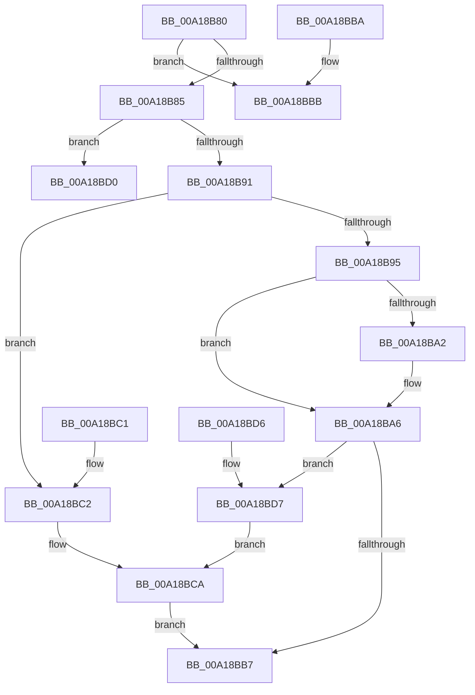

# RtlSetSaclSecurityDescriptor

- RVA: `0x00A18B80`–`0x00A18BDD` (길이 `93` bytes)
- VA: `0x0000000140A18B80`
- 실행 섹션: `PAGE`
- PDB 이름 있음: `예`; PDB Function 태그: `아니요`
- unwind 정보 RVA: `0x000DB714`
- 디코드: `33`개 명령, `93/93` bytes 표시
- 미해석 바이트: `0` (있으면 어셈블리에 `.byte`로 보존)

> 이 문서는 커널 이미지의 기계어와 PDB 기호를 분석해 생성했습니다. 4번과 5번은 함수 원형과 자료형을 바이너리 사용 방식에서 추정한 C 해석이며 원본 소스 복구 결과는 아닙니다.

## 1. Dependencies

- 직접 호출 지점: **0**; 고유 호출 대상: **0**
- 직접 호출자로 확인된 함수: **12**
- RIP 상대 이미지 참조: **0**

### Outgoing calls
- 직접 디코드된 call 명령이 없습니다.

### Direct callers
- [sub_00400840](../../text/40/Unknown_function_00400840.md) at `0x0040090D`
- [SepBuildCapeSecurityDescriptor](../../text/4D/SepBuildCapeSecurityDescriptor_function_004D9E38.md) at `0x004D9EB8`
- [SepInitProcessAuditSd](../../text/60/SepInitProcessAuditSd_function_00606230.md) at `0x0060633F`
- [SeAdjustAntiTamperCreatorAccess](../../text/60/SeAdjustAntiTamperCreatorAccess_function_00607590.md) at `0x0060763D`
- [CmpCopySaclToVirtualKey](../7E/CmpCopySaclToVirtualKey_function_007ECA6C.md) at `0x007ECB8E`
- [CmpGenerateAppHiveSecurityDescriptor](../7E/CmpGenerateAppHiveSecurityDescriptor_function_007ECEAC.md) at `0x007ED06A`
- [IopCreateSecurityDescriptorPerType](../AD/IopCreateSecurityDescriptorPerType_function_00ADCC6C.md) at `0x00ADCD84`
- [sub_00B3E006](../B3/Unknown_function_00B3E006.md) at `0x00B3E06F`
- [SepInitSystemDacls](../../init/C4/SepInitSystemDacls_function_00C478DC.md) at `0x00C482A9`
- [SeMakeSystemToken](../../init/C4/SeMakeSystemToken_function_00C4ADBC.md) at `0x00C4B232`
- [ExpKeyedEventInitialization](../../init/C5/ExpKeyedEventInitialization_function_00C5460C.md) at `0x00C54873`
- [ObInitSystem](../../init/C7/ObInitSystem_function_00C71C7C.md) at `0x00C72190`

### Static image references
- 디코드된 RIP-relative 메모리 참조가 없습니다.

## 2. Other-region calls and transfers

- 다른 실행 섹션으로 향하는 call: **0**
- 별도 외부 분기/꼬리 이동을 확인하지 못했습니다.

## 3. Assembly (complete function range)

```asm
00A18B80  80 39 01                        cmp byte ptr [rcx], 1
00A18B83  75 36                           jne 0x140a18bbb
00A18B85  0F B7 41 02                     movzx eax, word ptr [rcx + 2]
00A18B89  45 33 D2                        xor r10d, r10d
00A18B8C  66 85 C0                        test ax, ax
00A18B8F  78 3F                           js 0x140a18bd0
00A18B91  84 D2                           test dl, dl
00A18B93  74 2D                           je 0x140a18bc2
00A18B95  66 83 C8 10                     or ax, 0x10
00A18B99  4C 89 51 18                     mov qword ptr [rcx + 0x18], r10
00A18B9D  4D 85 C0                        test r8, r8
00A18BA0  74 04                           je 0x140a18ba6
00A18BA2  4C 89 41 18                     mov qword ptr [rcx + 0x18], r8
00A18BA6  BA DF FF 00 00                  mov edx, 0xffdf
00A18BAB  66 23 C2                        and ax, dx
00A18BAE  66 89 41 02                     mov word ptr [rcx + 2], ax
00A18BB2  45 84 C9                        test r9b, r9b
00A18BB5  75 20                           jne 0x140a18bd7
00A18BB7  33 C0                           xor eax, eax
00A18BB9  C3                              ret
00A18BBA  CC                              int3
00A18BBB  B8 58 00 00 C0                  mov eax, 0xc0000058
00A18BC0  C3                              ret
00A18BC1  CC                              int3
00A18BC2  BA EF FF 00 00                  mov edx, 0xffef
00A18BC7  66 23 C2                        and ax, dx
00A18BCA  66 89 41 02                     mov word ptr [rcx + 2], ax
00A18BCE  EB E7                           jmp 0x140a18bb7
00A18BD0  B8 79 00 00 C0                  mov eax, 0xc0000079
00A18BD5  C3                              ret
00A18BD6  CC                              int3
00A18BD7  66 83 C8 20                     or ax, 0x20
00A18BDB  EB ED                           jmp 0x140a18bca
```

## 4. C-style interpretation (structured pseudocode)

```c
__int64 __fastcall RtlSetSaclSecurityDescriptor(__int64 a1, unsigned __int8 a2, __int64 a3, unsigned __int8 a4)
{
    __int64 result;
    __int64 v_r10;

    if ((*(unsigned __int8 *)(a1)) != 1) goto loc_00A18BBB;
    v_r10 = 0;
    if (sign_flag) goto loc_00A18BD0;
    if (a2 == 0) goto loc_00A18BC2;
    result = (unsigned __int16)((*(unsigned __int16 *)(a1 + 2)) | (16));
    *(unsigned __int64 *)(a1 + 24) = 0;
    if (a3 != 0) {
        *(unsigned __int64 *)(a1 + 24) = a3;
    }
    result = (unsigned __int16)((result) & ((unsigned __int16)((unsigned int)(0xFFDFULL))));
    *(unsigned __int16 *)(a1 + 2) = (unsigned __int16)(result);
    if (a4 != 0) goto loc_00A18BD7;
loc_00A18BB7:
    result = 0;
    return result;
loc_00A18BBB:
    return (unsigned int)(0xC0000058ULL);
loc_00A18BC2:
    result = (unsigned __int16)(((unsigned int)(0xC0000058ULL)) & ((unsigned __int16)((unsigned int)(0xFFEFULL))));
loc_00A18BCA:
    *(unsigned __int16 *)(a1 + 2) = (unsigned __int16)(result);
    goto loc_00A18BB7;
loc_00A18BD0:
    return (unsigned int)(0xC0000079ULL);
loc_00A18BD7:
    result = (unsigned __int16)(((unsigned int)(0xC0000079ULL)) | (32));
    goto loc_00A18BCA;
}
```

## 5. (Beta) C Style

```c
int64_t RtlSetSaclSecurityDescriptor(void *Arg1, uint8_t Arg2, int64_t Arg3, uint8_t Arg4)
{
    uint8_t *arg1 = (uint8_t *)Arg1;

    int64_t result;
    int64_t local_r10;

    if ((*(uint8_t *)(arg1)) != 1) goto loc_00A18BBB;
    local_r10 = 0;
    if (sign_flag) goto loc_00A18BD0;
    if (Arg2 == 0) goto loc_00A18BC2;
    result = (uint16_t)((*(uint16_t *)(arg1 + 0x2)) | (16));
    *(uint64_t *)(arg1 + 0x18) = 0;
    if (Arg3 != 0) {
        *(uint64_t *)(arg1 + 0x18) = Arg3;
    }
    result = (uint16_t)((result) & ((uint16_t)((uint32_t)(0xFFDFULL))));
    *(uint16_t *)(arg1 + 0x2) = (uint16_t)(result);
    if (Arg4 != 0) goto loc_00A18BD7;
loc_00A18BB7:
    result = 0;
    return result;
loc_00A18BBB:
    return (uint32_t)(0xC0000058ULL);
loc_00A18BC2:
    result = (uint16_t)(((uint32_t)(0xC0000058ULL)) & ((uint16_t)((uint32_t)(0xFFEFULL))));
loc_00A18BCA:
    *(uint16_t *)(arg1 + 0x2) = (uint16_t)(result);
    goto loc_00A18BB7;
loc_00A18BD0:
    return (uint32_t)(0xC0000079ULL);
loc_00A18BD7:
    result = (uint16_t)(((uint32_t)(0xC0000079ULL)) | (32));
    goto loc_00A18BCA;
}
```

### 관측된 메모리 오프셋

구조체 형식이 확인되지 않은 접근은 인자 기준의 오프셋으로만 기록했습니다.

| 기준 인자 | 오프셋 표현 | 폭 (bit) | 접근 |
|---|---:|---:|---|
| `Arg1` | `+ 0x0` | `8` | `R` |
| `Arg1` | `+ 0x2` | `16` | `R` |
| `Arg1` | `+ 0x2` | `16` | `W` |
| `Arg1` | `+ 0x18` | `64` | `W` |

## 6. Execution-region graph

[열기: 2D/3D 그래프와 함수 탐색 컨트롤 패널](../../../control-panel.html?section=page&rva=0x00A18B80&view=graph)

- 2D 그래프는 위에서 아래로 흐르고, 3D 그래프는 빈 공간을 드래그해 회전합니다. Shift+드래그는 이동, 휠은 확대·축소, 함수 노드 선택은 대상 보고서 이동입니다.

### Static fallback


