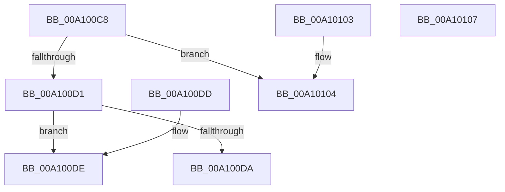

# RtlTestProtectedAccess

- RVA: `0x00A100C8`–`0x00A10108` (길이 `64` bytes)
- VA: `0x0000000140A100C8`
- 실행 섹션: `PAGE`
- PDB 이름 있음: `예`; PDB Function 태그: `아니요`
- unwind 정보 RVA: `0x000DB714`
- 디코드: `25`개 명령, `64/64` bytes 표시
- 미해석 바이트: `0` (있으면 어셈블리에 `.byte`로 보존)

> 이 문서는 커널 이미지의 기계어와 PDB 기호를 분석해 생성했습니다. 4번과 5번은 함수 원형과 자료형을 바이너리 사용 방식에서 추정한 C 해석이며 원본 소스 복구 결과는 아닙니다.

## 1. Dependencies

- 직접 호출 지점: **0**; 고유 호출 대상: **0**
- 직접 호출자로 확인된 함수: **8**
- RIP 상대 이미지 참조: **1**

### Outgoing calls
- 직접 디코드된 call 명령이 없습니다.

### Direct callers
- [NtSetInformationThread](../8C/NtSetInformationThread_function_008C9F60.md) at `0x008CB83F`
- [EtwCheckSecurityLoggerAccess](../A0/EtwCheckSecurityLoggerAccess_function_00A0FE94.md) at `0x00A0FEAC`
- [PsTestProtectedProcessIncompatibility](PsTestProtectedProcessIncompatibility_function_00A1003C.md) at `0x00A1005D`
- [PspCheckForInvalidAccessByProtection](PspCheckForInvalidAccessByProtection_function_00A10098.md) at `0x00A100AA`
- [PopBlackBoxUpdate](../A2/PopBlackBoxUpdate_function_00A26078.md) at `0x00A26220`
- [PspGetProcessProtectionRequirementsFromImage](../A6/PspGetProcessProtectionRequirementsFromImage_function_00A6DCF4.md) at `0x00A6DD36`
- [PspValidateCreateProcessProtection](../AA/PspValidateCreateProcessProtection_function_00AA2AD8.md) at `0x00AA2B42`
- [NtSetInformationProcess](../AE/NtSetInformationProcess_function_00AE5370.md) at `0x00AE957E`

### Static image references
- `0x00A100EA` → RVA `0x00B4C0A0` (`RtlProtectedAccess`; read)

## 2. Other-region calls and transfers

- 다른 실행 섹션으로 향하는 call: **0**
- 별도 외부 분기/꼬리 이동을 확인하지 못했습니다.

## 3. Assembly (complete function range)

```asm
00A100C8  44 8A C2                        mov r8b, dl
00A100CB  41 80 E0 07                     and r8b, 7
00A100CF  74 33                           je 0x140a10104
00A100D1  8A C1                           mov al, cl
00A100D3  24 07                           and al, 7
00A100D5  41 3A C0                        cmp al, r8b
00A100D8  73 04                           jae 0x140a100de
00A100DA  32 C0                           xor al, al
00A100DC  C3                              ret
00A100DD  CC                              int3
00A100DE  0F B6 C2                        movzx eax, dl
00A100E1  C1 E8 04                        shr eax, 4
00A100E4  0F B6 D0                        movzx edx, al
00A100E7  0F B6 C1                        movzx eax, cl
00A100EA  48 8D 0D AF BF 13 00            lea rcx, [rip + 0x13bfaf]
00A100F1  48 C1 E8 04                     shr rax, 4
00A100F5  48 8D 04 40                     lea rax, [rax + rax*2]
00A100F9  8B 04 81                        mov eax, dword ptr [rcx + rax*4]
00A100FC  0F A3 D0                        bt eax, edx
00A100FF  0F 92 C0                        setb al
00A10102  C3                              ret
00A10103  CC                              int3
00A10104  B0 01                           mov al, 1
00A10106  C3                              ret
00A10107  CC                              int3
```

## 4. C-style interpretation (structured pseudocode)

```c
__int64 __fastcall RtlTestProtectedAccess(unsigned __int8 a1, unsigned __int8 a2)
{
    __int64 result;

    a3 = (unsigned __int8)((a2) & (7));
    if (condition_is_equal) goto loc_00A10104;
    result = (unsigned __int8)((a1) & (7));
    if (((unsigned __int8)(result)) >= ((unsigned __int8)(a3))) goto loc_00A100DE;
    result = 0;
    return result;
loc_00A100DE:
    result = (unsigned int)((a2) >> (4));
    result = (a1) >> (4);
    result = (condition_is_below) ? 1 : 0;
    return result;
loc_00A10104:
    return 1;
}
```

## 5. (Beta) C Style

```c
int64_t RtlTestProtectedAccess(uint8_t Arg1, uint8_t Arg2)
{
    int64_t result;

    a3 = (uint8_t)((Arg2) & (7));
    if (condition_is_equal) goto loc_00A10104;
    result = (uint8_t)((Arg1) & (7));
    if (((uint8_t)(result)) >= ((uint8_t)(a3))) goto loc_00A100DE;
    result = 0;
    return result;
loc_00A100DE:
    result = (uint32_t)((Arg2) >> (4));
    result = (Arg1) >> (4);
    result = (condition_is_below) ? 1 : 0;
    return result;
loc_00A10104:
    return 1;
}
```

## 6. Execution-region graph

[열기: 2D/3D 그래프와 함수 탐색 컨트롤 패널](../../../control-panel.html?section=page&rva=0x00A100C8&view=graph)

- 2D 그래프는 위에서 아래로 흐르고, 3D 그래프는 빈 공간을 드래그해 회전합니다. Shift+드래그는 이동, 휠은 확대·축소, 함수 노드 선택은 대상 보고서 이동입니다.

### Static fallback


