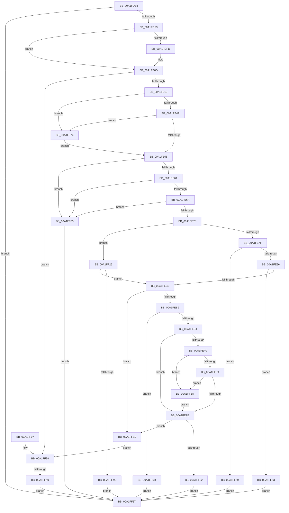

# RtlVerifyUserUnwindTarget

- RVA: `0x00A1FDB8`–`0x00A1FFB5` (길이 `509` bytes)
- VA: `0x0000000140A1FDB8`
- 실행 섹션: `PAGE`
- PDB 이름 있음: `예`; PDB Function 태그: `예`
- unwind 정보 RVA: `0x000AAC24`
- 디코드: `128`개 명령, `509/509` bytes 표시
- 미해석 바이트: `0` (있으면 어셈블리에 `.byte`로 보존)

> 이 문서는 커널 이미지의 기계어와 PDB 기호를 분석해 생성했습니다. 4번과 5번은 함수 원형과 자료형을 바이너리 사용 방식에서 추정한 C 해석이며 원본 소스 복구 결과는 아닙니다.

## 1. Dependencies

- 직접 호출 지점: **3**; 고유 호출 대상: **3**
- 직접 호출자로 확인된 함수: **1**
- RIP 상대 이미지 참조: **1**

### Outgoing calls
- `0x00A1FDE6` → [RtlGetImageBaseAndLoadConfig](../../text/46/RtlGetImageBaseAndLoadConfig_function_0046C3A4.md) (function, `0x0046C3A4`)
- `0x00A1FF18` → [bsearch_s](../../text/50/bsearch_s_function_00500540.md) (function, `0x00500540`)
- `0x00A1FFA3` → [RtlpFindDynamicEHContinuationTarget](../A3/RtlpFindDynamicEHContinuationTarget_function_00A3ABA0.md) (function, `0x00A3ABA0`)

### Direct callers
- [KiVerifyContextIpForUserCet](../../text/40/KiVerifyContextIpForUserCet_function_0040C028.md) at `0x0040C0F1`
- [KiVerifyContextIpForUserCet](../../text/40/KiVerifyContextIpForUserCet_function_0040C028.md) at `0x0040C192`

### Static image references
- `0x00A1FF04` → RVA `0x00463790` (`RtlpTargetCompare`; read)

## 2. Other-region calls and transfers

- 다른 실행 섹션으로 향하는 call: **2**
  - `0x00A1FDE6` → [RtlGetImageBaseAndLoadConfig](../../text/46/RtlGetImageBaseAndLoadConfig_function_0046C3A4.md) (`PAGE` → `.text`)
  - `0x00A1FF18` → [bsearch_s](../../text/50/bsearch_s_function_00500540.md) (`PAGE` → `.text`)
- call이 아닌 외부 분기/꼬리 이동: **1**
  - `0x00A1FF9A` → [sub_00B37418](../B3/Unknown_function_00B37418.md) (`tail-transfer`)

## 3. Assembly (complete function range)

```asm
00A1FDB8  48 8B C4                        mov rax, rsp
00A1FDBB  48 89 58 08                     mov qword ptr [rax + 8], rbx
00A1FDBF  48 89 70 10                     mov qword ptr [rax + 0x10], rsi
00A1FDC3  57                              push rdi
00A1FDC4  48 83 EC 50                     sub rsp, 0x50
00A1FDC8  49 8B D8                        mov rbx, r8
00A1FDCB  8B FA                           mov edi, edx
00A1FDCD  48 8B F1                        mov rsi, rcx
00A1FDD0  48 83 60 E0 00                  and qword ptr [rax - 0x20], 0
00A1FDD5  48 83 60 D8 00                  and qword ptr [rax - 0x28], 0
00A1FDDA  83 60 20 00                     and dword ptr [rax + 0x20], 0
00A1FDDE  4C 8D 40 E0                     lea r8, [rax - 0x20]
00A1FDE2  48 8D 50 D8                     lea rdx, [rax - 0x28]
00A1FDE6  E8 B9 C5 A4 FF                  call 0x14046c3a4
00A1FDEB  85 C0                           test eax, eax
00A1FDED  0F 88 94 01 00 00               js 0x140a1ff87
00A1FDF3  48 8B 4C 24 38                  mov rcx, qword ptr [rsp + 0x38]
00A1FDF8  48 85 DB                        test rbx, rbx
00A1FDFB  74 10                           je 0x140a1fe0d
00A1FDFD  C6 43 10 01                     mov byte ptr [rbx + 0x10], 1
00A1FE01  48 8B 44 24 30                  mov rax, qword ptr [rsp + 0x30]
00A1FE06  48 89 03                        mov qword ptr [rbx], rax
00A1FE09  48 89 4B 08                     mov qword ptr [rbx + 8], rcx
00A1FE0D  48 83 7C 24 30 00               cmp qword ptr [rsp + 0x30], 0
00A1FE13  0F 84 7F 01 00 00               je 0x140a1ff98
00A1FE19  BA 00 00 01 00                  mov edx, 0x10000
00A1FE1E  B8 00 00 40 00                  mov eax, 0x400000
00A1FE23  83 FF 02                        cmp edi, 2
00A1FE26  0F 45 D0                        cmovne edx, eax
00A1FE29  B8 C0 00 00 00                  mov eax, 0xc0
00A1FE2E  44 8D 40 58                     lea r8d, [rax + 0x58]
00A1FE32  41 0F 45 C0                     cmovne eax, r8d
00A1FE36  44 8B C0                        mov r8d, eax
00A1FE39  48 03 C1                        add rax, rcx
00A1FE3C  49 BB 00 00 FF FF FF 7F 00 00   movabs r11, 0x7fffffff0000
00A1FE46  49 3B C3                        cmp rax, r11
00A1FE49  0F 87 25 01 00 00               ja 0x140a1ff74
00A1FE4F  48 3B C1                        cmp rax, rcx
00A1FE52  0F 82 1C 01 00 00               jb 0x140a1ff74
00A1FE58  48 85 C9                        test rcx, rcx
00A1FE5B  0F 84 22 01 00 00               je 0x140a1ff83
00A1FE61  44 39 01                        cmp dword ptr [rcx], r8d
00A1FE64  0F 82 19 01 00 00               jb 0x140a1ff83
00A1FE6A  85 91 90 00 00 00               test dword ptr [rcx + 0x90], edx
00A1FE70  0F 84 0D 01 00 00               je 0x140a1ff83
00A1FE76  83 FF 02                        cmp edi, 2
00A1FE79  0F 84 A7 00 00 00               je 0x140a1ff26
00A1FE7F  4C 8B 91 08 01 00 00            mov r10, qword ptr [rcx + 0x108]
00A1FE86  4C 89 54 24 38                  mov qword ptr [rsp + 0x38], r10
00A1FE8B  4C 3B 54 24 30                  cmp r10, qword ptr [rsp + 0x30]
00A1FE90  0F 86 D3 00 00 00               jbe 0x140a1ff69
00A1FE96  4C 8B 81 10 01 00 00            mov r8, qword ptr [rcx + 0x110]
00A1FE9D  4C 89 44 24 40                  mov qword ptr [rsp + 0x40], r8
00A1FEA2  B8 FF FF FF FF                  mov eax, 0xffffffff
00A1FEA7  4C 3B C0                        cmp r8, rax
00A1FEAA  0F 83 A3 00 00 00               jae 0x140a1ff53
00A1FEB0  4D 85 C0                        test r8, r8
00A1FEB3  0F 84 C8 00 00 00               je 0x140a1ff81
00A1FEB9  8B C6                           mov eax, esi
00A1FEBB  2B 44 24 30                     sub eax, dword ptr [rsp + 0x30]
00A1FEBF  89 44 24 78                     mov dword ptr [rsp + 0x78], eax
00A1FEC3  44 8B 89 90 00 00 00            mov r9d, dword ptr [rcx + 0x90]
00A1FECA  41 C1 E9 1C                     shr r9d, 0x1c
00A1FECE  41 83 C1 04                     add r9d, 4
00A1FED2  33 D2                           xor edx, edx
00A1FED4  48 83 C8 FF                     or rax, 0xffffffffffffffff
00A1FED8  49 F7 F1                        div r9
00A1FEDB  4C 3B C0                        cmp r8, rax
00A1FEDE  0F 87 89 00 00 00               ja 0x140a1ff6d
00A1FEE4  41 8B C1                        mov eax, r9d
00A1FEE7  49 0F AF C0                     imul rax, r8
00A1FEEB  48 85 C0                        test rax, rax
00A1FEEE  74 0E                           je 0x140a1fefe
00A1FEF0  4A 8D 0C 10                     lea rcx, [rax + r10]
00A1FEF4  49 3B CB                        cmp rcx, r11
00A1FEF7  77 61                           ja 0x140a1ff5a
00A1FEF9  49 3B CA                        cmp rcx, r10
00A1FEFC  72 5C                           jb 0x140a1ff5a
00A1FEFE  48 83 64 24 28 00               and qword ptr [rsp + 0x28], 0
00A1FF04  48 8D 05 85 38 A4 FF            lea rax, [rip - 0x5bc77b]
00A1FF0B  48 89 44 24 20                  mov qword ptr [rsp + 0x20], rax
00A1FF10  49 8B D2                        mov rdx, r10
00A1FF13  48 8D 4C 24 78                  lea rcx, [rsp + 0x78]
00A1FF18  E8 23 06 AE FF                  call 0x140500540
00A1FF1D  48 85 C0                        test rax, rax
00A1FF20  74 5F                           je 0x140a1ff81
00A1FF22  33 C0                           xor eax, eax
00A1FF24  EB 61                           jmp 0x140a1ff87
00A1FF26  4C 8B 91 B0 00 00 00            mov r10, qword ptr [rcx + 0xb0]
00A1FF2D  4C 89 54 24 38                  mov qword ptr [rsp + 0x38], r10
00A1FF32  4C 8B 81 B8 00 00 00            mov r8, qword ptr [rcx + 0xb8]
00A1FF39  4C 89 44 24 40                  mov qword ptr [rsp + 0x40], r8
00A1FF3E  B8 FF FF FF FF                  mov eax, 0xffffffff
00A1FF43  4C 3B C0                        cmp r8, rax
00A1FF46  0F 82 64 FF FF FF               jb 0x140a1feb0
00A1FF4C  B8 95 00 00 C0                  mov eax, 0xc0000095
00A1FF51  EB 34                           jmp 0x140a1ff87
00A1FF53  B8 95 00 00 C0                  mov eax, 0xc0000095
00A1FF58  EB 2D                           jmp 0x140a1ff87
00A1FF5A  41 8A 03                        mov al, byte ptr [r11]
00A1FF5D  4C 8B 54 24 38                  mov r10, qword ptr [rsp + 0x38]
00A1FF62  4C 8B 44 24 40                  mov r8, qword ptr [rsp + 0x40]
00A1FF67  EB 95                           jmp 0x140a1fefe
00A1FF69  33 C0                           xor eax, eax
00A1FF6B  EB 1A                           jmp 0x140a1ff87
00A1FF6D  B8 95 00 00 C0                  mov eax, 0xc0000095
00A1FF72  EB 13                           jmp 0x140a1ff87
00A1FF74  41 8A 03                        mov al, byte ptr [r11]
00A1FF77  48 8B 4C 24 38                  mov rcx, qword ptr [rsp + 0x38]
00A1FF7C  E9 D7 FE FF FF                  jmp 0x140a1fe58
00A1FF81  EB 15                           jmp 0x140a1ff98
00A1FF83  33 C0                           xor eax, eax
00A1FF85  EB 00                           jmp 0x140a1ff87
00A1FF87  48 8B 5C 24 60                  mov rbx, qword ptr [rsp + 0x60]
00A1FF8C  48 8B 74 24 68                  mov rsi, qword ptr [rsp + 0x68]
00A1FF91  48 83 C4 50                     add rsp, 0x50
00A1FF95  5F                              pop rdi
00A1FF96  C3                              ret
00A1FF97  CC                              int3
00A1FF98  85 FF                           test edi, edi
00A1FF9A  0F 85 78 74 11 00               jne 0x140b37418
00A1FFA0  48 8B CE                        mov rcx, rsi
00A1FFA3  E8 F8 AB 01 00                  call 0x140a3aba0
00A1FFA8  F6 D8                           neg al
00A1FFAA  1B C0                           sbb eax, eax
00A1FFAC  F7 D0                           not eax
00A1FFAE  25 0A 06 00 C0                  and eax, 0xc000060a
00A1FFB3  EB D2                           jmp 0x140a1ff87
```

## 4. C-style interpretation (structured pseudocode)

```c
__int64 __fastcall RtlVerifyUserUnwindTarget(__int64 a1, int a2, __int64 a3)
{
    __int64 result;
    __int64 v_rsp;
    unsigned __int64 v_stack_m18;
    unsigned __int64 v_stack_m20;
    unsigned __int64 v_stack_m28;
    unsigned __int64 v_stack_m30;
    unsigned __int64 v_stack_m38;
    unsigned __int64 v_stack_p10;
    unsigned int v_stack_p20;
    unsigned __int64 v_stack_p8;

    *(unsigned __int64 *)(v_rsp + 8) = v_rbx;
    *(unsigned __int64 *)(v_rsp + 16) = v_rsi;
    v_rsp = (v_rsp) - (80);
    result = RtlGetImageBaseAndLoadConfig(a1, v_rsp - 40, v_rsp - 32, a4);
    if (sign_flag) goto loc_00A1FF87;
    if (a3 != 0) {
        *(unsigned __int8 *)(a3 + 16) = 1;
        result = v_stack_m28;
        *(unsigned __int64 *)(a3) = result;
        *(unsigned __int64 *)(a3 + 8) = v_stack_m20;
    }
    if (v_stack_m28 == 0) goto loc_00A1FF98;
    a2 = (unsigned int)(0x10000ULL);
    if (((unsigned int)((unsigned int)(a2))) != 2) { a2 = (unsigned int)((unsigned int)(0x400000ULL)); }
    result = 192;
    if (((unsigned int)((unsigned int)(a2))) != 2) { result = (unsigned int)(192 + 88); }
    result = (result) + (v_stack_m20);
    if (result > v_r11) goto loc_00A1FF74;
    if (result < v_stack_m20) goto loc_00A1FF74;
loc_00A1FE58:
    if (v_stack_m20 == 0) goto loc_00A1FF83;
    if ((*(unsigned int *)(v_stack_m20)) < ((unsigned int)((unsigned int)((unsigned int)(result))))) goto loc_00A1FF83;
    if (((*(unsigned int *)(v_stack_m20 + 144)) & (a2)) == 0) goto loc_00A1FF83;
    if (((unsigned int)((unsigned int)(a2))) == 2) goto loc_00A1FF26;
    v_stack_m20 = *(unsigned __int64 *)(v_stack_m20 + 264);
    if ((*(unsigned __int64 *)(v_stack_m20 + 264)) <= v_stack_m28) goto loc_00A1FF69;
    v_stack_m18 = *(unsigned __int64 *)(v_stack_m20 + 272);
    if ((*(unsigned __int64 *)(v_stack_m20 + 272)) >= ((unsigned int)(0xFFFFFFFFULL))) goto loc_00A1FF53;
loc_00A1FEB0:
    if (*(unsigned __int64 *)(v_stack_m20 + 272) == 0) goto loc_00A1FF81;
    result = (unsigned int)(((unsigned int)((unsigned int)(a1))) - (v_stack_m28));
    v_stack_p20 = (unsigned int)(result);
    a4 = (unsigned int)(((unsigned int)(*(unsigned int *)(v_stack_m20 + 144))) >> (28));
    a4 = (unsigned int)((a4) + (4));
    a2 = 0;
    result = (result) | (-1);
    if ((*(unsigned __int64 *)(v_stack_m20 + 272)) > result) goto loc_00A1FF6D;
    result = ((unsigned int)((unsigned int)(a4))) * (*(unsigned __int64 *)(v_stack_m20 + 272));
    if (result == 0) goto loc_00A1FEFE;
    if ((result + *(unsigned __int64 *)(v_stack_m20 + 264) * 1) > v_r11) goto loc_00A1FF5A;
    if ((result + *(unsigned __int64 *)(v_stack_m20 + 264) * 1) < (*(unsigned __int64 *)(v_stack_m20 + 264))) goto loc_00A1FF5A;
loc_00A1FEFE:
    v_stack_m38 = v_rip - 6014843;
    result = bsearch_s(v_stack_p20, *(unsigned __int64 *)(v_stack_m20 + 264), *(unsigned __int64 *)(v_stack_m20 + 272), a4);
    if (result == 0) goto loc_00A1FF81;
    result = 0;
    goto loc_00A1FF87;
loc_00A1FF26:
    v_stack_m20 = *(unsigned __int64 *)(v_stack_p20 + 176);
    v_stack_m18 = *(unsigned __int64 *)(v_stack_p20 + 184);
    if ((*(unsigned __int64 *)(v_stack_p20 + 184)) < ((unsigned int)(0xFFFFFFFFULL))) goto loc_00A1FEB0;
    goto loc_00A1FF87;
loc_00A1FF53:
    goto loc_00A1FF87;
loc_00A1FF5A:
    goto loc_00A1FEFE;
loc_00A1FF69:
    result = 0;
    goto loc_00A1FF87;
loc_00A1FF6D:
    goto loc_00A1FF87;
loc_00A1FF74:
    goto loc_00A1FE58;
loc_00A1FF81:
    goto loc_00A1FF98;
loc_00A1FF83:
    result = 0;
    goto loc_00A1FF87;
loc_00A1FF87:
    v_rsp = (v_rsp) + (80);
    return result;
loc_00A1FF98:
    result = RtlpFindDynamicEHContinuationTarget(v_stack_p10, *(unsigned __int64 *)(v_stack_m20 + 264), v_stack_m18, a4);
    result = (unsigned __int8)(-(result));
    result = (unsigned int)(~(result));
    result = (unsigned int)((result) & (0xC000060AULL));
    goto loc_00A1FF87;
}
```

## 5. (Beta) C Style

```c
int64_t RtlVerifyUserUnwindTarget(int64_t Arg1, int32_t Arg2, int64_t Arg3)
{
    int64_t result;
    int64_t local_rsp;
    uint64_t v_stack_m18;
    uint64_t v_stack_m20;
    uint64_t v_stack_m28;
    uint64_t v_stack_m30;
    uint64_t v_stack_m38;
    uint64_t v_stack_p10;
    uint32_t v_stack_p20;
    uint64_t v_stack_p8;

    *(uint64_t *)(local_rsp + 0x8) = local_rbx;
    *(uint64_t *)(local_rsp + 0x10) = local_rsi;
    local_rsp = (local_rsp) - (80);
    result = RtlGetImageBaseAndLoadConfig(Arg1, local_rsp - 40, local_rsp - 32, a4);
    if (sign_flag) goto loc_00A1FF87;
    if (Arg3 != 0) {
        *(uint8_t *)(Arg3 + 0x10) = 1;
        result = v_stack_m28;
        *(uint64_t *)(Arg3) = result;
        *(uint64_t *)(Arg3 + 0x8) = v_stack_m20;
    }
    if (v_stack_m28 == 0) goto loc_00A1FF98;
    Arg2 = (uint32_t)(0x10000ULL);
    if (((uint32_t)((uint32_t)(Arg2))) != 2) { Arg2 = (uint32_t)((uint32_t)(0x400000ULL)); }
    result = 192;
    if (((uint32_t)((uint32_t)(Arg2))) != 2) { result = (uint32_t)(192 + 88); }
    result = (result) + (v_stack_m20);
    if (result > local_r11) goto loc_00A1FF74;
    if (result < v_stack_m20) goto loc_00A1FF74;
loc_00A1FE58:
    if (v_stack_m20 == 0) goto loc_00A1FF83;
    if ((*(uint32_t *)(v_stack_m20)) < ((uint32_t)((uint32_t)((uint32_t)(result))))) goto loc_00A1FF83;
    if (((*(uint32_t *)(v_stack_m20 + 0x90)) & (Arg2)) == 0) goto loc_00A1FF83;
    if (((uint32_t)((uint32_t)(Arg2))) == 2) goto loc_00A1FF26;
    v_stack_m20 = *(uint64_t *)(v_stack_m20 + 0x108);
    if ((*(uint64_t *)(v_stack_m20 + 0x108)) <= v_stack_m28) goto loc_00A1FF69;
    v_stack_m18 = *(uint64_t *)(v_stack_m20 + 0x110);
    if ((*(uint64_t *)(v_stack_m20 + 0x110)) >= ((uint32_t)(0xFFFFFFFFULL))) goto loc_00A1FF53;
loc_00A1FEB0:
    if (*(uint64_t *)(v_stack_m20 + 0x110) == 0) goto loc_00A1FF81;
    result = (uint32_t)(((uint32_t)((uint32_t)(Arg1))) - (v_stack_m28));
    v_stack_p20 = (uint32_t)(result);
    a4 = (uint32_t)(((uint32_t)(*(uint32_t *)(v_stack_m20 + 0x90))) >> (28));
    a4 = (uint32_t)((a4) + (4));
    Arg2 = 0;
    result = (result) | (-1);
    if ((*(uint64_t *)(v_stack_m20 + 0x110)) > result) goto loc_00A1FF6D;
    result = ((uint32_t)((uint32_t)(a4))) * (*(uint64_t *)(v_stack_m20 + 0x110));
    if (result == 0) goto loc_00A1FEFE;
    if ((result + *(uint64_t *)(v_stack_m20 + 0x108) * 1) > local_r11) goto loc_00A1FF5A;
    if ((result + *(uint64_t *)(v_stack_m20 + 0x108) * 1) < (*(uint64_t *)(v_stack_m20 + 0x108))) goto loc_00A1FF5A;
loc_00A1FEFE:
    v_stack_m38 = v_rip - 6014843;
    result = bsearch_s(v_stack_p20, *(uint64_t *)(v_stack_m20 + 0x108), *(uint64_t *)(v_stack_m20 + 0x110), a4);
    if (result == 0) goto loc_00A1FF81;
    result = 0;
    goto loc_00A1FF87;
loc_00A1FF26:
    v_stack_m20 = *(uint64_t *)(v_stack_p20 + 0xB0);
    v_stack_m18 = *(uint64_t *)(v_stack_p20 + 0xB8);
    if ((*(uint64_t *)(v_stack_p20 + 0xB8)) < ((uint32_t)(0xFFFFFFFFULL))) goto loc_00A1FEB0;
    goto loc_00A1FF87;
loc_00A1FF53:
    goto loc_00A1FF87;
loc_00A1FF5A:
    goto loc_00A1FEFE;
loc_00A1FF69:
    result = 0;
    goto loc_00A1FF87;
loc_00A1FF6D:
    goto loc_00A1FF87;
loc_00A1FF74:
    goto loc_00A1FE58;
loc_00A1FF81:
    goto loc_00A1FF98;
loc_00A1FF83:
    result = 0;
    goto loc_00A1FF87;
loc_00A1FF87:
    local_rsp = (local_rsp) + (80);
    return result;
loc_00A1FF98:
    result = RtlpFindDynamicEHContinuationTarget(v_stack_p10, *(uint64_t *)(v_stack_m20 + 0x108), v_stack_m18, a4);
    result = (uint8_t)(-(result));
    result = (uint32_t)(~(result));
    result = (uint32_t)((result) & (0xC000060AULL));
    goto loc_00A1FF87;
}
```

## 6. Execution-region graph

[열기: 2D/3D 그래프와 함수 탐색 컨트롤 패널](../../../control-panel.html?section=page&rva=0x00A1FDB8&view=graph)

- 2D 그래프는 위에서 아래로 흐르고, 3D 그래프는 빈 공간을 드래그해 회전합니다. Shift+드래그는 이동, 휠은 확대·축소, 함수 노드 선택은 대상 보고서 이동입니다.

### Static fallback


