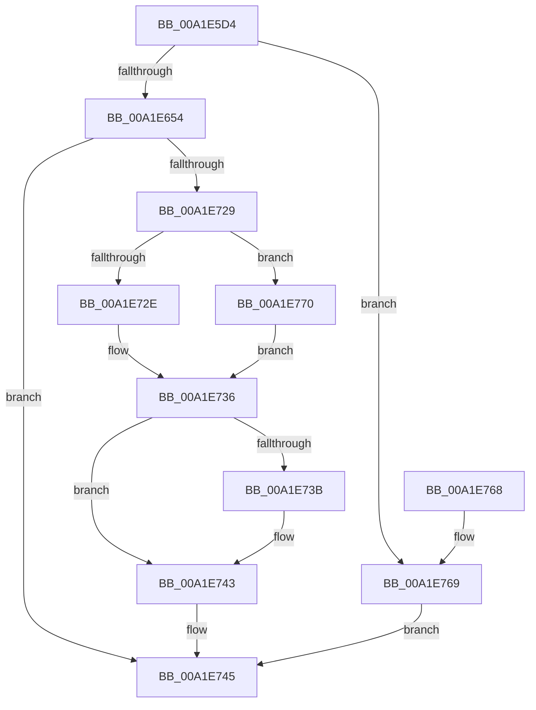

# RtlpCreateUserThreadEx

- RVA: `0x00A1E5D4`–`0x00A1E77C` (길이 `424` bytes)
- VA: `0x0000000140A1E5D4`
- 실행 섹션: `PAGE`
- PDB 이름 있음: `예`; PDB Function 태그: `아니요`
- unwind 정보 RVA: `0x000AA9FC`
- 디코드: `108`개 명령, `424/424` bytes 표시
- 미해석 바이트: `0` (있으면 어셈블리에 `.byte`로 보존)

> 이 문서는 커널 이미지의 기계어와 PDB 기호를 분석해 생성했습니다. 4번과 5번은 함수 원형과 자료형을 바이너리 사용 방식에서 추정한 C 해석이며 원본 소스 복구 결과는 아닙니다.

## 1. Dependencies

- 직접 호출 지점: **3**; 고유 호출 대상: **3**
- 직접 호출자로 확인된 함수: **2**
- RIP 상대 이미지 참조: **1**

### Outgoing calls
- `0x00A1E720` → [ZwCreateThreadEx](../../text/6A/ZwCreateThreadEx_function_006AE9F0.md) (function, `0x006AE9F0`)
- `0x00A1E74C` → [_security_check_cookie](../../text/6A/_security_check_cookie_function_006AC640.md) (function, `0x006AC640`)
- `0x00A1E775` → [ZwClose](../../text/6A/ZwClose_function_006AD2B0.md) (function, `0x006AD2B0`)

### Direct callers
- [ExpWorkerFactoryCreateThread](../../text/34/ExpWorkerFactoryCreateThread_function_0034B620.md) at `0x0034B705`
- [RtlCreateUserThread](../78/RtlCreateUserThread_function_0078B020.md) at `0x0078B07D`

### Static image references
- `0x00A1E5EC` → RVA `0x00E0A740` (`.data`; read)

## 2. Other-region calls and transfers

- 다른 실행 섹션으로 향하는 call: **3**
  - `0x00A1E720` → [ZwCreateThreadEx](../../text/6A/ZwCreateThreadEx_function_006AE9F0.md) (`PAGE` → `.text`)
  - `0x00A1E74C` → [_security_check_cookie](../../text/6A/_security_check_cookie_function_006AC640.md) (`PAGE` → `.text`)
  - `0x00A1E775` → [ZwClose](../../text/6A/ZwClose_function_006AD2B0.md) (`PAGE` → `.text`)
- 별도 외부 분기/꼬리 이동을 확인하지 못했습니다.

## 3. Assembly (complete function range)

```asm
00A1E5D4  48 89 5C 24 18                  mov qword ptr [rsp + 0x18], rbx
00A1E5D9  55                              push rbp
00A1E5DA  56                              push rsi
00A1E5DB  57                              push rdi
00A1E5DC  41 56                           push r14
00A1E5DE  41 57                           push r15
00A1E5E0  48 8D 6C 24 F0                  lea rbp, [rsp - 0x10]
00A1E5E5  48 81 EC 10 01 00 00            sub rsp, 0x110
00A1E5EC  48 8B 05 4D C1 3E 00            mov rax, qword ptr [rip + 0x3ec14d]
00A1E5F3  48 33 C4                        xor rax, rsp
00A1E5F6  48 89 45 00                     mov qword ptr [rbp], rax
00A1E5FA  48 83 65 D8 00                  and qword ptr [rbp - 0x28], 0
00A1E5FF  33 C0                           xor eax, eax
00A1E601  48 83 65 F0 00                  and qword ptr [rbp - 0x10], 0
00A1E606  0F 57 C0                        xorps xmm0, xmm0
00A1E609  21 45 84                        and dword ptr [rbp - 0x7c], eax
00A1E60C  4C 8B DA                        mov r11, rdx
00A1E60F  48 21 44 24 60                  and qword ptr [rsp + 0x60], rax
00A1E614  4C 8B D1                        mov r10, rcx
00A1E617  4C 8B 75 78                     mov r14, qword ptr [rbp + 0x78]
00A1E61B  4C 8B BD 80 00 00 00            mov r15, qword ptr [rbp + 0x80]
00A1E622  48 8B BD 88 00 00 00            mov rdi, qword ptr [rbp + 0x88]
00A1E629  48 8B 9D 90 00 00 00            mov rbx, qword ptr [rbp + 0x90]
00A1E630  89 44 24 6C                     mov dword ptr [rsp + 0x6c], eax
00A1E634  21 44 24 6C                     and dword ptr [rsp + 0x6c], eax
00A1E638  41 8B F1                        mov esi, r9d
00A1E63B  45 8B C8                        mov r9d, r8d
00A1E63E  66 0F 7F 45 E0                  movdqa xmmword ptr [rbp - 0x20], xmm0
00A1E643  0F 11 45 98                     movups xmmword ptr [rbp - 0x68], xmm0
00A1E647  41 F7 C0 88 FF FF FF            test r8d, 0xffffff88
00A1E64E  0F 85 15 01 00 00               jne 0x140a1e769
00A1E654  41 8B C8                        mov ecx, r8d
00A1E657  C7 44 24 68 30 00 00 00         mov dword ptr [rsp + 0x68], 0x30
00A1E65F  83 E1 01                        and ecx, 1
00A1E662  C7 45 80 00 02 00 00            mov dword ptr [rbp - 0x80], 0x200
00A1E669  8B D1                           mov edx, ecx
00A1E66B  4C 89 5D 88                     mov qword ptr [rbp - 0x78], r11
00A1E66F  83 CA 02                        or edx, 2
00A1E672  48 C7 45 B8 03 00 01 00         mov qword ptr [rbp - 0x48], 0x10003
00A1E67A  41 F6 C1 02                     test r9b, 2
00A1E67E  48 C7 45 C0 10 00 00 00         mov qword ptr [rbp - 0x40], 0x10
00A1E686  48 C7 45 B0 28 00 00 00         mov qword ptr [rbp - 0x50], 0x28
00A1E68E  0F 44 D1                        cmove edx, ecx
00A1E691  8B CA                           mov ecx, edx
00A1E693  83 C9 04                        or ecx, 4
00A1E696  41 F6 C1 04                     test r9b, 4
00A1E69A  0F 44 CA                        cmove ecx, edx
00A1E69D  8B D1                           mov edx, ecx
00A1E69F  83 CA 10                        or edx, 0x10
00A1E6A2  41 F6 C1 10                     test r9b, 0x10
00A1E6A6  0F 44 D1                        cmove edx, ecx
00A1E6A9  44 8B C2                        mov r8d, edx
00A1E6AC  41 83 C8 20                     or r8d, 0x20
00A1E6B0  41 F6 C1 20                     test r9b, 0x20
00A1E6B4  44 0F 44 C2                     cmove r8d, edx
00A1E6B8  48 21 44 24 70                  and qword ptr [rsp + 0x70], rax
00A1E6BD  48 21 44 24 78                  and qword ptr [rsp + 0x78], rax
00A1E6C2  41 8B C8                        mov ecx, r8d
00A1E6C5  48 21 45 90                     and qword ptr [rbp - 0x70], rax
00A1E6C9  83 C9 40                        or ecx, 0x40
00A1E6CC  48 21 45 D0                     and qword ptr [rbp - 0x30], rax
00A1E6D0  BA FF FF 1F 00                  mov edx, 0x1fffff
00A1E6D5  41 F6 C1 40                     test r9b, 0x40
00A1E6D9  48 8D 45 98                     lea rax, [rbp - 0x68]
00A1E6DD  48 89 45 C8                     mov qword ptr [rbp - 0x38], rax
00A1E6E1  4D 8B CA                        mov r9, r10
00A1E6E4  41 0F 44 C8                     cmove ecx, r8d
00A1E6E8  48 8D 45 B0                     lea rax, [rbp - 0x50]
00A1E6EC  48 89 44 24 50                  mov qword ptr [rsp + 0x50], rax
00A1E6F1  4C 8D 44 24 68                  lea r8, [rsp + 0x68]
00A1E6F6  48 8B 45 60                     mov rax, qword ptr [rbp + 0x60]
00A1E6FA  48 89 44 24 48                  mov qword ptr [rsp + 0x48], rax
00A1E6FF  48 8B 45 68                     mov rax, qword ptr [rbp + 0x68]
00A1E703  48 89 44 24 40                  mov qword ptr [rsp + 0x40], rax
00A1E708  48 89 74 24 38                  mov qword ptr [rsp + 0x38], rsi
00A1E70D  89 4C 24 30                     mov dword ptr [rsp + 0x30], ecx
00A1E711  48 8D 4C 24 60                  lea rcx, [rsp + 0x60]
00A1E716  4C 89 7C 24 28                  mov qword ptr [rsp + 0x28], r15
00A1E71B  4C 89 74 24 20                  mov qword ptr [rsp + 0x20], r14
00A1E720  E8 CB 02 C9 FF                  call 0x1406ae9f0
00A1E725  85 C0                           test eax, eax
00A1E727  78 1C                           js 0x140a1e745
00A1E729  48 85 FF                        test rdi, rdi
00A1E72C  74 42                           je 0x140a1e770
00A1E72E  48 8B 44 24 60                  mov rax, qword ptr [rsp + 0x60]
00A1E733  48 89 07                        mov qword ptr [rdi], rax
00A1E736  48 85 DB                        test rbx, rbx
00A1E739  74 08                           je 0x140a1e743
00A1E73B  0F 10 45 98                     movups xmm0, xmmword ptr [rbp - 0x68]
00A1E73F  F3 0F 7F 03                     movdqu xmmword ptr [rbx], xmm0
00A1E743  33 C0                           xor eax, eax
00A1E745  48 8B 4D 00                     mov rcx, qword ptr [rbp]
00A1E749  48 33 CC                        xor rcx, rsp
00A1E74C  E8 EF DE C8 FF                  call 0x1406ac640
00A1E751  48 8B 9C 24 50 01 00 00         mov rbx, qword ptr [rsp + 0x150]
00A1E759  48 81 C4 10 01 00 00            add rsp, 0x110
00A1E760  41 5F                           pop r15
00A1E762  41 5E                           pop r14
00A1E764  5F                              pop rdi
00A1E765  5E                              pop rsi
00A1E766  5D                              pop rbp
00A1E767  C3                              ret
00A1E768  CC                              int3
00A1E769  B8 0D 00 00 C0                  mov eax, 0xc000000d
00A1E76E  EB D5                           jmp 0x140a1e745
00A1E770  48 8B 4C 24 60                  mov rcx, qword ptr [rsp + 0x60]
00A1E775  E8 36 EB C8 FF                  call 0x1406ad2b0
00A1E77A  EB BA                           jmp 0x140a1e736
```

## 4. C-style interpretation (structured pseudocode)

```c
__int64 __fastcall RtlpCreateUserThreadEx(__int64 a1, __int64 a2, int a3, int a4, __int64 a5, __int64 a6, __int64 a7, __int64 a8, __int64 a9, __int64 a10, __int64 a11)
{
    __int64 result;
    __int64 v_rsp;
    unsigned __int64 v_stack_m100;
    unsigned int v_stack_m108;
    unsigned __int64 v_stack_m110;
    unsigned __int64 v_stack_m118;
    unsigned __int64 v_stack_m38;
    unsigned __int64 v_stack_m48;
    unsigned __int64 v_stack_m58;
    unsigned __int64 v_stack_m60;
    unsigned __int64 v_stack_m68;
    unsigned __int64 v_stack_m70;
    unsigned __int64 v_stack_m78;
    unsigned __int64 v_stack_m80;
    unsigned __int64 v_stack_m88;
    unsigned __int64 v_stack_mA0;
    unsigned __int64 v_stack_mA8;
    unsigned __int64 v_stack_mB0;
    unsigned int v_stack_mB4;
    unsigned int v_stack_mB8;
    unsigned __int64 v_stack_mC0;
    unsigned __int64 v_stack_mC8;
    unsigned int v_stack_mCC;
    unsigned int v_stack_mD0;
    unsigned __int64 v_stack_mD8;
    unsigned __int64 v_stack_mE8;
    unsigned __int64 v_stack_mF0;
    unsigned __int64 v_stack_mF8;
    unsigned __int64 v_stack_p18;
    unsigned __int64 v_stack_p60;

    v_stack_p18 = v_rbx;
    v_rsp = (v_rsp) - (272);
    result = (*(unsigned __int64 *)(v_rip + 4112717)) ^ (v_rsp);
    v_stack_m38 = result;
    result = 0;
    v_stack_mCC = 0;
    v_stack_m58 = v_xmm0;
    v_stack_mA0 = v_xmm0;
    if (((a3) & (0xFFFFFF88ULL)) != 0) goto loc_00A1E769;
    v_stack_mD0 = 48;
    a1 = (unsigned int)(((unsigned int)(a3)) & (1));
    v_stack_mB8 = 512;
    v_stack_mB0 = a2;
    a2 = (unsigned int)(((unsigned int)((unsigned int)(a1))) | (2));
    v_stack_m80 = 0x10003ULL;
    v_stack_m78 = 16;
    v_stack_m88 = 40;
    if ((((unsigned __int8)((unsigned int)(a3))) & (2)) == 0) { a2 = (unsigned int)(a1); }
    a1 = (unsigned int)(((unsigned int)((unsigned int)(a2))) | (4));
    if ((((unsigned __int8)((unsigned int)(a3))) & (4)) == 0) { a1 = (unsigned int)(a2); }
    a2 = (unsigned int)(((unsigned int)((unsigned int)(a1))) | (16));
    if ((((unsigned __int8)((unsigned int)(a3))) & (16)) == 0) { a2 = (unsigned int)(a1); }
    a3 = (unsigned int)(((unsigned int)((unsigned int)(a2))) | (32));
    if ((((unsigned __int8)((unsigned int)(a3))) & (32)) == 0) { a3 = (unsigned int)(a2); }
    a1 = (unsigned int)(((unsigned int)(a3)) | (64));
    v_stack_m70 = v_stack_mA0;
    if ((((unsigned __int8)((unsigned int)(a3))) & (64)) == 0) { a1 = a3; }
    v_stack_mE8 = v_stack_m88;
    v_stack_mF0 = a5;
    v_stack_mF8 = a6;
    v_stack_m100 = (unsigned int)(a4);
    v_stack_m108 = (unsigned int)(a1);
    v_stack_m110 = a9;
    v_stack_m118 = a8;
    result = ZwCreateThreadEx(v_stack_mD8, (unsigned int)(0x1FFFFFULL), v_stack_mD0, a1);
    if (sign_flag) goto loc_00A1E745;
    if (a10 == 0) goto loc_00A1E770;
    *(unsigned __int64 *)(a10) = v_stack_mD8;
loc_00A1E736:
    if (a11 != 0) {
        *(unsigned __int64 *)(a11) = v_xmm0;
    }
    result = 0;
loc_00A1E745:
    a1 = (v_stack_m38) ^ (v_rsp);
    result = _security_check_cookie(a1, (unsigned int)(0x1FFFFFULL), v_stack_mD0, a1);
    v_rsp = (v_rsp) + (272);
    return result;
loc_00A1E769:
    goto loc_00A1E745;
loc_00A1E770:
    result = ZwClose(v_stack_p60, (unsigned int)(0x1FFFFFULL), v_stack_mD0, a1);
    goto loc_00A1E736;
}
```

## 5. (Beta) C Style

```c
int64_t RtlpCreateUserThreadEx(int64_t Arg1, int64_t Arg2, int32_t Arg3, int32_t Arg4, int64_t Arg5, int64_t Arg6, uint64_t Arg7, int64_t Arg8, int64_t Arg9, int64_t Arg10, int64_t Arg11)
{
    int64_t result;
    int64_t local_rsp;
    uint64_t v_stack_m100;
    uint32_t v_stack_m108;
    uint64_t v_stack_m110;
    uint64_t v_stack_m118;
    uint64_t v_stack_m38;
    uint64_t v_stack_m48;
    uint64_t v_stack_m58;
    uint64_t v_stack_m60;
    uint64_t v_stack_m68;
    uint64_t v_stack_m70;
    uint64_t v_stack_m78;
    uint64_t v_stack_m80;
    uint64_t v_stack_m88;
    uint64_t v_stack_mA0;
    uint64_t v_stack_mA8;
    uint64_t v_stack_mB0;
    uint32_t v_stack_mB4;
    uint32_t v_stack_mB8;
    uint64_t v_stack_mC0;
    uint64_t v_stack_mC8;
    uint32_t v_stack_mCC;
    uint32_t v_stack_mD0;
    uint64_t v_stack_mD8;
    uint64_t v_stack_mE8;
    uint64_t v_stack_mF0;
    uint64_t v_stack_mF8;
    uint64_t v_stack_p18;
    uint64_t v_stack_p60;

    v_stack_p18 = local_rbx;
    local_rsp = (local_rsp) - (272);
    result = (*(uint64_t *)(v_rip + 0x3EC14D)) ^ (local_rsp);
    v_stack_m38 = result;
    result = 0;
    v_stack_mCC = 0;
    v_stack_m58 = v_xmm0;
    v_stack_mA0 = v_xmm0;
    if (((Arg3) & (0xFFFFFF88ULL)) != 0) goto loc_00A1E769;
    v_stack_mD0 = 48;
    Arg1 = (uint32_t)(((uint32_t)(Arg3)) & (1));
    v_stack_mB8 = 512;
    v_stack_mB0 = Arg2;
    Arg2 = (uint32_t)(((uint32_t)((uint32_t)(Arg1))) | (2));
    v_stack_m80 = 0x10003ULL;
    v_stack_m78 = 16;
    v_stack_m88 = 40;
    if ((((uint8_t)((uint32_t)(Arg3))) & (2)) == 0) { Arg2 = (uint32_t)(Arg1); }
    Arg1 = (uint32_t)(((uint32_t)((uint32_t)(Arg2))) | (4));
    if ((((uint8_t)((uint32_t)(Arg3))) & (4)) == 0) { Arg1 = (uint32_t)(Arg2); }
    Arg2 = (uint32_t)(((uint32_t)((uint32_t)(Arg1))) | (16));
    if ((((uint8_t)((uint32_t)(Arg3))) & (16)) == 0) { Arg2 = (uint32_t)(Arg1); }
    Arg3 = (uint32_t)(((uint32_t)((uint32_t)(Arg2))) | (32));
    if ((((uint8_t)((uint32_t)(Arg3))) & (32)) == 0) { Arg3 = (uint32_t)(Arg2); }
    Arg1 = (uint32_t)(((uint32_t)(Arg3)) | (64));
    v_stack_m70 = v_stack_mA0;
    if ((((uint8_t)((uint32_t)(Arg3))) & (64)) == 0) { Arg1 = Arg3; }
    v_stack_mE8 = v_stack_m88;
    v_stack_mF0 = Arg5;
    v_stack_mF8 = Arg6;
    v_stack_m100 = (uint32_t)(Arg4);
    v_stack_m108 = (uint32_t)(Arg1);
    v_stack_m110 = Arg9;
    v_stack_m118 = Arg8;
    result = ZwCreateThreadEx(v_stack_mD8, (uint32_t)(0x1FFFFFULL), v_stack_mD0, Arg1);
    if (sign_flag) goto loc_00A1E745;
    if (Arg10 == 0) goto loc_00A1E770;
    *(uint64_t *)(Arg10) = v_stack_mD8;
loc_00A1E736:
    if (Arg11 != 0) {
        *(uint64_t *)(Arg11) = v_xmm0;
    }
    result = 0;
loc_00A1E745:
    Arg1 = (v_stack_m38) ^ (local_rsp);
    result = _security_check_cookie(Arg1, (uint32_t)(0x1FFFFFULL), v_stack_mD0, Arg1);
    local_rsp = (local_rsp) + (272);
    return result;
loc_00A1E769:
    goto loc_00A1E745;
loc_00A1E770:
    result = ZwClose(v_stack_p60, (uint32_t)(0x1FFFFFULL), v_stack_mD0, Arg1);
    goto loc_00A1E736;
}
```

## 6. Execution-region graph

[열기: 2D/3D 그래프와 함수 탐색 컨트롤 패널](../../../control-panel.html?section=page&rva=0x00A1E5D4&view=graph)

- 2D 그래프는 위에서 아래로 흐르고, 3D 그래프는 빈 공간을 드래그해 회전합니다. Shift+드래그는 이동, 휠은 확대·축소, 함수 노드 선택은 대상 보고서 이동입니다.

### Static fallback


