# RtlpFlsDataCleanup

- RVA: `0x00A1D998`–`0x00A1DBB4` (길이 `540` bytes)
- VA: `0x0000000140A1D998`
- 실행 섹션: `PAGE`
- PDB 이름 있음: `예`; PDB Function 태그: `아니요`
- unwind 정보 RVA: `0x000AA728`
- 디코드: `161`개 명령, `540/540` bytes 표시
- 미해석 바이트: `0` (있으면 어셈블리에 `.byte`로 보존)

> 이 문서는 커널 이미지의 기계어와 PDB 기호를 분석해 생성했습니다. 4번과 5번은 함수 원형과 자료형을 바이너리 사용 방식에서 추정한 C 해석이며 원본 소스 복구 결과는 아닙니다.

## 1. Dependencies

- 직접 호출 지점: **12**; 고유 호출 대상: **9**
- 직접 호출자로 확인된 함수: **1**
- RIP 상대 이미지 참조: **2**

### Outgoing calls
- `0x00A1DA18` → [RtlpFlsHeapFree](RtlpFlsHeapFree_function_00A1DBBC.md) (function, `0x00A1DBBC`)
- `0x00A1DA32` → [ExFreePoolWithTag](../../poolcode/B8/ExFreePoolWithTag_function_00B82870.md) (function, `0x00B82870`)
- `0x00A1DA8D` → [KeAbPreAcquire](../../text/21/KeAbPreAcquire_function_00210230.md) (function, `0x00210230`)
- `0x00A1DAAC` → [ExfAcquirePushLockSharedEx](../../text/21/ExfAcquirePushLockSharedEx_function_0021044C.md) (function, `0x0021044C`)
- `0x00A1DAE5` → [guard_dispatch_icall](../../text/6B/guard_dispatch_icall_function_006BAAD0.md) (function, `0x006BAAD0`)
- `0x00A1DB05` → [ExfReleasePushLockShared](../../text/26/ExfReleasePushLockShared_function_00263440.md) (function, `0x00263440`)
- `0x00A1DB0D` → [KeAbPostRelease](../../text/2E/KeAbPostRelease_function_002E1600.md) (function, `0x002E1600`)
- `0x00A1DB1A` → [KeAbPreAcquire](../../text/21/KeAbPreAcquire_function_00210230.md) (function, `0x00210230`)
- `0x00A1DB33` → [ExfAcquirePushLockExclusiveEx](../../text/20/ExfAcquirePushLockExclusiveEx_function_0020FC90.md) (function, `0x0020FC90`)
- `0x00A1DB73` → [guard_dispatch_icall](../../text/6B/guard_dispatch_icall_function_006BAAD0.md) (function, `0x006BAAD0`)
- `0x00A1DB9D` → [KeAbPostRelease](../../text/2E/KeAbPostRelease_function_002E1600.md) (function, `0x002E1600`)
- `0x00A1DBAD` → [ExfTryToWakePushLock](../../text/26/ExfTryToWakePushLock_function_00265DD0.md) (function, `0x00265DD0`)

### Direct callers
- [PspExitThread](../90/PspExitThread_function_00905F60.md) at `0x00906296`
- [PspExitThread](../90/PspExitThread_function_00905F60.md) at `0x0090656A`

### Static image references
- `0x00A1D9C0` → RVA `0x00E281F0` (`.data`; read)
- `0x00A1DA55` → RVA `0x00E281D0` (`.data`; read)

## 2. Other-region calls and transfers

- 다른 실행 섹션으로 향하는 call: **11**
  - `0x00A1DA32` → [ExFreePoolWithTag](../../poolcode/B8/ExFreePoolWithTag_function_00B82870.md) (`PAGE` → `POOLCODE`)
  - `0x00A1DA8D` → [KeAbPreAcquire](../../text/21/KeAbPreAcquire_function_00210230.md) (`PAGE` → `.text`)
  - `0x00A1DAAC` → [ExfAcquirePushLockSharedEx](../../text/21/ExfAcquirePushLockSharedEx_function_0021044C.md) (`PAGE` → `.text`)
  - `0x00A1DAE5` → [guard_dispatch_icall](../../text/6B/guard_dispatch_icall_function_006BAAD0.md) (`PAGE` → `.text`)
  - `0x00A1DB05` → [ExfReleasePushLockShared](../../text/26/ExfReleasePushLockShared_function_00263440.md) (`PAGE` → `.text`)
  - `0x00A1DB0D` → [KeAbPostRelease](../../text/2E/KeAbPostRelease_function_002E1600.md) (`PAGE` → `.text`)
  - `0x00A1DB1A` → [KeAbPreAcquire](../../text/21/KeAbPreAcquire_function_00210230.md) (`PAGE` → `.text`)
  - `0x00A1DB33` → [ExfAcquirePushLockExclusiveEx](../../text/20/ExfAcquirePushLockExclusiveEx_function_0020FC90.md) (`PAGE` → `.text`)
  - `0x00A1DB73` → [guard_dispatch_icall](../../text/6B/guard_dispatch_icall_function_006BAAD0.md) (`PAGE` → `.text`)
  - `0x00A1DB9D` → [KeAbPostRelease](../../text/2E/KeAbPostRelease_function_002E1600.md) (`PAGE` → `.text`)
  - `0x00A1DBAD` → [ExfTryToWakePushLock](../../text/26/ExfTryToWakePushLock_function_00265DD0.md) (`PAGE` → `.text`)
- 별도 외부 분기/꼬리 이동을 확인하지 못했습니다.

## 3. Assembly (complete function range)

```asm
00A1D998  48 89 5C 24 10                  mov qword ptr [rsp + 0x10], rbx
00A1D99D  48 89 4C 24 08                  mov qword ptr [rsp + 8], rcx
00A1D9A2  55                              push rbp
00A1D9A3  56                              push rsi
00A1D9A4  57                              push rdi
00A1D9A5  41 54                           push r12
00A1D9A7  41 55                           push r13
00A1D9A9  41 56                           push r14
00A1D9AB  41 57                           push r15
00A1D9AD  48 83 EC 20                     sub rsp, 0x20
00A1D9B1  45 33 C9                        xor r9d, r9d
00A1D9B4  45 8B E8                        mov r13d, r8d
00A1D9B7  48 8B F2                        mov rsi, rdx
00A1D9BA  41 F6 C0 01                     test r8b, 1
00A1D9BE  74 42                           je 0x140a1da02
00A1D9C0  44 8B 25 29 A8 40 00            mov r12d, dword ptr [rip + 0x40a829]
00A1D9C7  41 83 FC 01                     cmp r12d, 1
00A1D9CB  72 35                           jb 0x140a1da02
00A1D9CD  41 8D 69 11                     lea ebp, [r9 + 0x11]
00A1D9D1  0F BD CD                        bsr ecx, ebp
00A1D9D4  BA 01 00 00 00                  mov edx, 1
00A1D9D9  D3 E2                           shl edx, cl
00A1D9DB  83 C1 FC                        add ecx, -4
00A1D9DE  33 D5                           xor edx, ebp
00A1D9E0  89 4C 24 70                     mov dword ptr [rsp + 0x70], ecx
00A1D9E4  4C 8B 34 CE                     mov r14, qword ptr [rsi + rcx*8]
00A1D9E8  4D 85 F6                        test r14, r14
00A1D9EB  74 0B                           je 0x140a1d9f8
00A1D9ED  4C 8D 3C 52                     lea r15, [rdx + rdx*2]
00A1D9F1  4F 39 4C FE 08                  cmp qword ptr [r14 + r15*8 + 8], r9
00A1D9F6  75 55                           jne 0x140a1da4d
00A1D9F8  FF C5                           inc ebp
00A1D9FA  8D 45 F0                        lea eax, [rbp - 0x10]
00A1D9FD  41 3B C4                        cmp eax, r12d
00A1DA00  76 CF                           jbe 0x140a1d9d1
00A1DA02  41 F6 C5 02                     test r13b, 2
00A1DA06  74 2F                           je 0x140a1da37
00A1DA08  48 8B DE                        mov rbx, rsi
00A1DA0B  BF 04 00 00 00                  mov edi, 4
00A1DA10  48 8B 0B                        mov rcx, qword ptr [rbx]
00A1DA13  48 85 C9                        test rcx, rcx
00A1DA16  74 08                           je 0x140a1da20
00A1DA18  E8 9F 01 00 00                  call 0x140a1dbbc
00A1DA1D  45 33 C9                        xor r9d, r9d
00A1DA20  48 83 C3 08                     add rbx, 8
00A1DA24  48 83 EF 01                     sub rdi, 1
00A1DA28  75 E6                           jne 0x140a1da10
00A1DA2A  BA 46 4C 53 6B                  mov edx, 0x6b534c46
00A1DA2F  48 8B CE                        mov rcx, rsi
00A1DA32  E8 39 4E 16 00                  call 0x140b82870
00A1DA37  48 8B 5C 24 68                  mov rbx, qword ptr [rsp + 0x68]
00A1DA3C  48 83 C4 20                     add rsp, 0x20
00A1DA40  41 5F                           pop r15
00A1DA42  41 5E                           pop r14
00A1DA44  41 5D                           pop r13
00A1DA46  41 5C                           pop r12
00A1DA48  5F                              pop rdi
00A1DA49  5E                              pop rsi
00A1DA4A  5D                              pop rbp
00A1DA4B  C3                              ret
00A1DA4C  CC                              int3
00A1DA4D  0F BD CD                        bsr ecx, ebp
00A1DA50  BA 01 00 00 00                  mov edx, 1
00A1DA55  4C 8D 05 74 A7 40 00            lea r8, [rip + 0x40a774]
00A1DA5C  D3 E2                           shl edx, cl
00A1DA5E  83 C1 FC                        add ecx, -4
00A1DA61  33 D5                           xor edx, ebp
00A1DA63  89 4C 24 60                     mov dword ptr [rsp + 0x60], ecx
00A1DA67  4D 8B 04 C8                     mov r8, qword ptr [r8 + rcx*8]
00A1DA6B  4D 85 C0                        test r8, r8
00A1DA6E  0F 84 F4 00 00 00               je 0x140a1db68
00A1DA74  8B C2                           mov eax, edx
00A1DA76  48 8D 1C 95 01 00 00 00         lea rbx, [rdx*4 + 1]
00A1DA7E  48 03 D8                        add rbx, rax
00A1DA81  49 8D 1C D8                     lea rbx, [r8 + rbx*8]
00A1DA85  45 33 C0                        xor r8d, r8d
00A1DA88  33 D2                           xor edx, edx
00A1DA8A  48 8B CB                        mov rcx, rbx
00A1DA8D  E8 9E 27 7F FF                  call 0x140210230
00A1DA92  48 8B F8                        mov rdi, rax
00A1DA95  33 C0                           xor eax, eax
00A1DA97  8D 48 11                        lea ecx, [rax + 0x11]
00A1DA9A  F0 48 0F B1 0B                  lock cmpxchg qword ptr [rbx], rcx
00A1DA9F  74 10                           je 0x140a1dab1
00A1DAA1  4C 8B CB                        mov r9, rbx
00A1DAA4  4C 8B C7                        mov r8, rdi
00A1DAA7  33 D2                           xor edx, edx
00A1DAA9  48 8B CB                        mov rcx, rbx
00A1DAAC  E8 9B 29 7F FF                  call 0x14021044c
00A1DAB1  45 33 C9                        xor r9d, r9d
00A1DAB4  48 85 FF                        test rdi, rdi
00A1DAB7  74 04                           je 0x140a1dabd
00A1DAB9  C6 47 0A 01                     mov byte ptr [rdi + 0xa], 1
00A1DABD  48 8B 43 08                     mov rax, qword ptr [rbx + 8]
00A1DAC1  4C 8B 43 10                     mov r8, qword ptr [rbx + 0x10]
00A1DAC5  4B 8B 54 FE 08                  mov rdx, qword ptr [r14 + r15*8 + 8]
00A1DACA  48 8D 48 FF                     lea rcx, [rax - 1]
00A1DACE  48 83 F9 FD                     cmp rcx, -3
00A1DAD2  77 22                           ja 0x140a1daf6
00A1DAD4  48 85 D2                        test rdx, rdx
00A1DAD7  74 1D                           je 0x140a1daf6
00A1DAD9  4D 85 C0                        test r8, r8
00A1DADC  0F 85 8E 00 00 00               jne 0x140a1db70
00A1DAE2  48 8B CA                        mov rcx, rdx
00A1DAE5  E8 E6 CF C9 FF                  call 0x1406baad0
00A1DAEA  45 33 C9                        xor r9d, r9d
00A1DAED  4F 89 4C FE 08                  mov qword ptr [r14 + r15*8 + 8], r9
00A1DAF2  83 66 20 FE                     and dword ptr [rsi + 0x20], 0xfffffffe
00A1DAF6  B8 11 00 00 00                  mov eax, 0x11
00A1DAFB  F0 4C 0F B1 0B                  lock cmpxchg qword ptr [rbx], r9
00A1DB00  74 08                           je 0x140a1db0a
00A1DB02  48 8B CB                        mov rcx, rbx
00A1DB05  E8 36 59 84 FF                  call 0x140263440
00A1DB0A  48 8B CB                        mov rcx, rbx
00A1DB0D  E8 EE 3A 8C FF                  call 0x1402e1600
00A1DB12  45 33 C0                        xor r8d, r8d
00A1DB15  33 D2                           xor edx, edx
00A1DB17  48 8B CB                        mov rcx, rbx
00A1DB1A  E8 11 27 7F FF                  call 0x140210230
00A1DB1F  F0 48 0F BA 2B 00               lock bts qword ptr [rbx], 0
00A1DB25  48 8B F8                        mov rdi, rax
00A1DB28  73 0E                           jae 0x140a1db38
00A1DB2A  4C 8B C3                        mov r8, rbx
00A1DB2D  48 8B D0                        mov rdx, rax
00A1DB30  48 8B CB                        mov rcx, rbx
00A1DB33  E8 58 21 7F FF                  call 0x14020fc90
00A1DB38  48 85 FF                        test rdi, rdi
00A1DB3B  74 04                           je 0x140a1db41
00A1DB3D  C6 47 0A 01                     mov byte ptr [rdi + 0xa], 1
00A1DB41  4B 83 64 FE 08 00               and qword ptr [r14 + r15*8 + 8], 0
00A1DB47  49 8D 47 02                     lea rax, [r15 + 2]
00A1DB4B  49 8D 04 C6                     lea rax, [r14 + rax*8]
00A1DB4F  48 8B 10                        mov rdx, qword ptr [rax]
00A1DB52  48 8B 48 08                     mov rcx, qword ptr [rax + 8]
00A1DB56  48 39 42 08                     cmp qword ptr [rdx + 8], rax
00A1DB5A  75 05                           jne 0x140a1db61
00A1DB5C  48 39 01                        cmp qword ptr [rcx], rax
00A1DB5F  74 1C                           je 0x140a1db7d
00A1DB61  B9 03 00 00 00                  mov ecx, 3
00A1DB66  CD 29                           int 0x29
00A1DB68  49 8B D9                        mov rbx, r9
00A1DB6B  E9 15 FF FF FF                  jmp 0x140a1da85
00A1DB70  49 8B C8                        mov rcx, r8
00A1DB73  E8 58 CF C9 FF                  call 0x1406baad0
00A1DB78  E9 6D FF FF FF                  jmp 0x140a1daea
00A1DB7D  48 89 11                        mov qword ptr [rcx], rdx
00A1DB80  48 89 4A 08                     mov qword ptr [rdx + 8], rcx
00A1DB84  48 89 40 08                     mov qword ptr [rax + 8], rax
00A1DB88  48 89 00                        mov qword ptr [rax], rax
00A1DB8B  48 83 C8 FF                     or rax, 0xffffffffffffffff
00A1DB8F  F0 48 0F C1 03                  lock xadd qword ptr [rbx], rax
00A1DB94  24 06                           and al, 6
00A1DB96  3C 02                           cmp al, 2
00A1DB98  74 10                           je 0x140a1dbaa
00A1DB9A  48 8B CB                        mov rcx, rbx
00A1DB9D  E8 5E 3A 8C FF                  call 0x1402e1600
00A1DBA2  45 33 C9                        xor r9d, r9d
00A1DBA5  E9 4E FE FF FF                  jmp 0x140a1d9f8
00A1DBAA  48 8B CB                        mov rcx, rbx
00A1DBAD  E8 1E 82 84 FF                  call 0x140265dd0
00A1DBB2  EB E6                           jmp 0x140a1db9a
```

## 4. C-style interpretation (structured pseudocode)

```c
__int64 __fastcall RtlpFlsDataCleanup(__int64 a1, __int64 a2, int a3, int a4)
{
    __int64 result;
    __int64 v_rbp;
    __int64 v_rbx;
    __int64 v_rdi;
    __int64 v_rsp;
    unsigned __int64 v_stack_p10;
    unsigned int v_stack_p18;
    unsigned int v_stack_p60;
    unsigned __int64 v_stack_p8;

    v_stack_p10 = v_rbx;
    v_stack_p8 = a1;
    v_rsp = (v_rsp) - (32);
    a4 = 0;
    if ((((unsigned __int8)(a3)) & (1)) == 0) goto loc_00A1DA02;
    if (((unsigned int)((unsigned int)(*(unsigned int *)(v_rip + 4237353)))) < 1) goto loc_00A1DA02;
loc_00A1D9D1:
    a2 = (unsigned int)((1) << ((unsigned __int8)(a1)));
    a1 = (unsigned int)((a1) + (-4));
    a2 = (unsigned int)((a2) ^ ((unsigned int)(a4 + 17)));
    v_stack_p18 = (unsigned int)(a1);
    if (*(unsigned __int64 *)(a2 + a1 * 8) == 0) goto loc_00A1D9F8;
    if ((*(unsigned __int64 *)(*(unsigned __int64 *)(a2 + a1 * 8) + a2 + a2 * 2 * 8 + 8)) != 0) goto loc_00A1DA4D;
loc_00A1D9F8:
    v_rbp = (unsigned int)((a4 + 17) + 1);
    if (((unsigned int)(v_rbp - 16)) <= ((unsigned int)((unsigned int)(*(unsigned int *)(v_rip + 4237353))))) goto loc_00A1D9D1;
loc_00A1DA02:
    if ((((unsigned __int8)((unsigned int)(a3))) & (2)) == 0) goto loc_00A1DA37;
loc_00A1DA10:
    result = v_rbp - 16;
    if (*(unsigned __int64 *)(a2) != 0) {
        result = RtlpFlsHeapFree(*(unsigned __int64 *)(a2), a2, a3, a4);
        a4 = 0;
    }
    v_rbx = (a2) + (8);
    v_rdi = (4) - (1);
    if (condition_is_not_equal) goto loc_00A1DA10;
    result = ExFreePoolWithTag(a2, (unsigned int)(0x6B534C46ULL), a3, a4);
loc_00A1DA37:
    v_rsp = (v_rsp) + (32);
    return result;
loc_00A1DA4D:
    a2 = (unsigned int)((1) << ((unsigned __int8)(a2)));
    a1 = (unsigned int)((a2) + (-4));
    a2 = (unsigned int)((a2) ^ ((unsigned int)(v_rbp)));
    v_stack_p60 = (unsigned int)(a1);
    if (*(unsigned __int64 *)(v_rip + 4237172 + a1 * 8) == 0) goto loc_00A1DB68;
    v_rbx = (a2 * 4 + 1) + ((unsigned int)((unsigned int)(a2)));
loc_00A1DA85:
    a3 = 0;
    a2 = 0;
    result = KeAbPreAcquire(*(unsigned __int64 *)(v_rip + 4237172 + a1 * 8) + v_rbx * 8, a2, a3, a4);
    result = 0;
    if (!(condition_is_equal)) {
        a4 = *(unsigned __int64 *)(v_rip + 4237172 + a1 * 8) + v_rbx * 8;
        a3 = 0;
        a2 = 0;
        a1 = *(unsigned __int64 *)(v_rip + 4237172 + a1 * 8) + v_rbx * 8;
        result = ExfAcquirePushLockSharedEx(a1, a2, a3, a4);
    }
    a4 = 0;
    if (result != 0) {
        *(unsigned __int8 *)(result + 10) = 1;
    }
    if ((*(unsigned __int64 *)(*(unsigned __int64 *)(v_rip + 4237172 + a1 * 8) + v_rbx * 8 + 8) - 1) > -3) goto loc_00A1DAF6;
    if (*(unsigned __int64 *)(*(unsigned __int64 *)(a2 + a1 * 8) + a2 + a2 * 2 * 8 + 8) == 0) goto loc_00A1DAF6;
    if (*(unsigned __int64 *)(*(unsigned __int64 *)(v_rip + 4237172 + a1 * 8) + v_rbx * 8 + 16) != 0) goto loc_00A1DB70;
    result = guard_dispatch_icall(*(unsigned __int64 *)(*(unsigned __int64 *)(a2 + a1 * 8) + a2 + a2 * 2 * 8 + 8), *(unsigned __int64 *)(*(unsigned __int64 *)(a2 + a1 * 8) + a2 + a2 * 2 * 8 + 8), *(unsigned __int64 *)(*(unsigned __int64 *)(v_rip + 4237172 + a1 * 8) + v_rbx * 8 + 16), a4);
loc_00A1DAEA:
    a4 = 0;
    *(unsigned __int64 *)(*(unsigned __int64 *)(a2 + a1 * 8) + a2 + a2 * 2 * 8 + 8) = 0;
loc_00A1DAF6:
    result = 17;
    if (!(condition_is_equal)) {
        a1 = *(unsigned __int64 *)(v_rip + 4237172 + a1 * 8) + v_rbx * 8;
        result = ExfReleasePushLockShared(a1, *(unsigned __int64 *)(*(unsigned __int64 *)(a2 + a1 * 8) + a2 + a2 * 2 * 8 + 8), *(unsigned __int64 *)(*(unsigned __int64 *)(v_rip + 4237172 + a1 * 8) + v_rbx * 8 + 16), a4);
    }
    result = KeAbPostRelease(*(unsigned __int64 *)(v_rip + 4237172 + a1 * 8) + v_rbx * 8, *(unsigned __int64 *)(*(unsigned __int64 *)(a2 + a1 * 8) + a2 + a2 * 2 * 8 + 8), *(unsigned __int64 *)(*(unsigned __int64 *)(v_rip + 4237172 + a1 * 8) + v_rbx * 8 + 16), a4);
    a3 = 0;
    a2 = 0;
    result = KeAbPreAcquire(*(unsigned __int64 *)(v_rip + 4237172 + a1 * 8) + v_rbx * 8, a2, a3, a4);
    if (!(condition_is_above_or_equal)) {
        a3 = *(unsigned __int64 *)(v_rip + 4237172 + a1 * 8) + v_rbx * 8;
        a2 = result;
        a1 = *(unsigned __int64 *)(v_rip + 4237172 + a1 * 8) + v_rbx * 8;
        result = ExfAcquirePushLockExclusiveEx(a1, a2, a3, a4);
    }
    if (result != 0) {
        *(unsigned __int8 *)(result + 10) = 1;
    }
    if ((*(unsigned __int64 *)(*(unsigned __int64 *)(*(unsigned __int64 *)(a2 + a1 * 8) + a2 + a2 * 2 + 2 * 8) + 8)) != (*(unsigned __int64 *)(a2 + a1 * 8) + a2 + a2 * 2 + 2 * 8)) goto loc_00A1DB61;
    if ((*(unsigned __int64 *)(*(unsigned __int64 *)(*(unsigned __int64 *)(a2 + a1 * 8) + a2 + a2 * 2 + 2 * 8 + 8))) == (*(unsigned __int64 *)(a2 + a1 * 8) + a2 + a2 * 2 + 2 * 8)) goto loc_00A1DB7D;
loc_00A1DB61:
loc_00A1DB68:
    goto loc_00A1DA85;
loc_00A1DB70:
    result = guard_dispatch_icall(a3, *(unsigned __int64 *)(*(unsigned __int64 *)(a2 + a1 * 8) + a2 + a2 * 2 + 2 * 8), a3, a4);
    goto loc_00A1DAEA;
loc_00A1DB7D:
    *(unsigned __int64 *)(a3) = *(unsigned __int64 *)(*(unsigned __int64 *)(a2 + a1 * 8) + a2 + a2 * 2 + 2 * 8);
    *(unsigned __int64 *)(*(unsigned __int64 *)(*(unsigned __int64 *)(a2 + a1 * 8) + a2 + a2 * 2 + 2 * 8) + 8) = a3;
    *(unsigned __int64 *)(result + 8) = result;
    *(unsigned __int64 *)(result) = result;
    result = (result) | (-1);
    result = (unsigned __int8)((result) & (6));
    if (((unsigned __int8)(result)) == 2) goto loc_00A1DBAA;
loc_00A1DB9A:
    result = KeAbPostRelease(0, *(unsigned __int64 *)(*(unsigned __int64 *)(a2 + a1 * 8) + a2 + a2 * 2 + 2 * 8), a3, a4);
    a4 = 0;
    goto loc_00A1D9F8;
loc_00A1DBAA:
    result = ExfTryToWakePushLock(0, *(unsigned __int64 *)(*(unsigned __int64 *)(a2 + a1 * 8) + a2 + a2 * 2 + 2 * 8), a3, a4);
    goto loc_00A1DB9A;
}
```

## 5. (Beta) C Style

```c
int64_t RtlpFlsDataCleanup(int64_t Arg1, void *Arg2, int32_t Arg3, int32_t Arg4)
{
    uint8_t *arg2 = (uint8_t *)Arg2;

    int64_t result;
    int64_t local_rbp;
    int64_t local_rbx;
    int64_t local_rdi;
    int64_t local_rsp;
    uint64_t v_stack_p10;
    uint32_t v_stack_p18;
    uint32_t v_stack_p60;
    uint64_t v_stack_p8;

    v_stack_p10 = local_rbx;
    v_stack_p8 = Arg1;
    local_rsp = (local_rsp) - (32);
    Arg4 = 0;
    if ((((uint8_t)(Arg3)) & (1)) == 0) goto loc_00A1DA02;
    if (((uint32_t)((uint32_t)(*(uint32_t *)(v_rip + 0x40A829)))) < 1) goto loc_00A1DA02;
loc_00A1D9D1:
    Arg2 = (uint32_t)((1) << ((uint8_t)(Arg1)));
    Arg1 = (uint32_t)((Arg1) + (-4));
    Arg2 = (uint32_t)((Arg2) ^ ((uint32_t)(Arg4 + 17)));
    v_stack_p18 = (uint32_t)(Arg1);
    if (*(uint64_t *)(arg2 + Arg1 * 8) == 0) goto loc_00A1D9F8;
    if ((*(uint64_t *)(*(uint64_t *)(arg2 + Arg1 * 8) + arg2 + arg2 * 2 * 8 + 0x8)) != 0) goto loc_00A1DA4D;
loc_00A1D9F8:
    local_rbp = (uint32_t)((Arg4 + 17) + 1);
    if (((uint32_t)(local_rbp - 16)) <= ((uint32_t)((uint32_t)(*(uint32_t *)(v_rip + 0x40A829))))) goto loc_00A1D9D1;
loc_00A1DA02:
    if ((((uint8_t)((uint32_t)(Arg3))) & (2)) == 0) goto loc_00A1DA37;
loc_00A1DA10:
    result = local_rbp - 16;
    if (*(uint64_t *)(arg2) != 0) {
        result = RtlpFlsHeapFree(*(uint64_t *)(arg2), Arg2, Arg3, Arg4);
        Arg4 = 0;
    }
    local_rbx = (Arg2) + (8);
    local_rdi = (4) - (1);
    if (condition_is_not_equal) goto loc_00A1DA10;
    result = ExFreePoolWithTag(Arg2, (uint32_t)(0x6B534C46ULL), Arg3, Arg4);
loc_00A1DA37:
    local_rsp = (local_rsp) + (32);
    return result;
loc_00A1DA4D:
    Arg2 = (uint32_t)((1) << ((uint8_t)(Arg2)));
    Arg1 = (uint32_t)((Arg2) + (-4));
    Arg2 = (uint32_t)((Arg2) ^ ((uint32_t)(local_rbp)));
    v_stack_p60 = (uint32_t)(Arg1);
    if (*(uint64_t *)(v_rip + 0x40A774 + Arg1 * 8) == 0) goto loc_00A1DB68;
    local_rbx = (Arg2 * 4 + 1) + ((uint32_t)((uint32_t)(Arg2)));
loc_00A1DA85:
    Arg3 = 0;
    Arg2 = 0;
    result = KeAbPreAcquire(*(uint64_t *)(v_rip + 0x40A774 + Arg1 * 8) + local_rbx * 8, Arg2, Arg3, Arg4);
    result = 0;
    if (!(condition_is_equal)) {
        Arg4 = *(uint64_t *)(v_rip + 0x40A774 + Arg1 * 8) + local_rbx * 8;
        Arg3 = 0;
        Arg2 = 0;
        Arg1 = *(uint64_t *)(v_rip + 0x40A774 + Arg1 * 8) + local_rbx * 8;
        result = ExfAcquirePushLockSharedEx(Arg1, Arg2, Arg3, Arg4);
    }
    Arg4 = 0;
    if (result != 0) {
        *(uint8_t *)(result + 0xA) = 1;
    }
    if ((*(uint64_t *)(*(uint64_t *)(v_rip + 0x40A774 + Arg1 * 8) + local_rbx * 8 + 0x8) - 1) > -3) goto loc_00A1DAF6;
    if (*(uint64_t *)(*(uint64_t *)(arg2 + Arg1 * 8) + arg2 + arg2 * 2 * 8 + 0x8) == 0) goto loc_00A1DAF6;
    if (*(uint64_t *)(*(uint64_t *)(v_rip + 0x40A774 + Arg1 * 8) + local_rbx * 8 + 0x10) != 0) goto loc_00A1DB70;
    result = guard_dispatch_icall(*(uint64_t *)(*(uint64_t *)(arg2 + Arg1 * 8) + arg2 + arg2 * 2 * 8 + 0x8), *(uint64_t *)(*(uint64_t *)(arg2 + Arg1 * 8) + arg2 + arg2 * 2 * 8 + 0x8), *(uint64_t *)(*(uint64_t *)(v_rip + 0x40A774 + Arg1 * 8) + local_rbx * 8 + 0x10), Arg4);
loc_00A1DAEA:
    Arg4 = 0;
    *(uint64_t *)(*(uint64_t *)(arg2 + Arg1 * 8) + arg2 + arg2 * 2 * 8 + 0x8) = 0;
loc_00A1DAF6:
    result = 17;
    if (!(condition_is_equal)) {
        Arg1 = *(uint64_t *)(v_rip + 0x40A774 + Arg1 * 8) + local_rbx * 8;
        result = ExfReleasePushLockShared(Arg1, *(uint64_t *)(*(uint64_t *)(arg2 + Arg1 * 8) + arg2 + arg2 * 2 * 8 + 0x8), *(uint64_t *)(*(uint64_t *)(v_rip + 0x40A774 + Arg1 * 8) + local_rbx * 8 + 0x10), Arg4);
    }
    result = KeAbPostRelease(*(uint64_t *)(v_rip + 0x40A774 + Arg1 * 8) + local_rbx * 8, *(uint64_t *)(*(uint64_t *)(arg2 + Arg1 * 8) + arg2 + arg2 * 2 * 8 + 0x8), *(uint64_t *)(*(uint64_t *)(v_rip + 0x40A774 + Arg1 * 8) + local_rbx * 8 + 0x10), Arg4);
    Arg3 = 0;
    Arg2 = 0;
    result = KeAbPreAcquire(*(uint64_t *)(v_rip + 0x40A774 + Arg1 * 8) + local_rbx * 8, Arg2, Arg3, Arg4);
    if (!(condition_is_above_or_equal)) {
        Arg3 = *(uint64_t *)(v_rip + 0x40A774 + Arg1 * 8) + local_rbx * 8;
        Arg2 = result;
        Arg1 = *(uint64_t *)(v_rip + 0x40A774 + Arg1 * 8) + local_rbx * 8;
        result = ExfAcquirePushLockExclusiveEx(Arg1, Arg2, Arg3, Arg4);
    }
    if (result != 0) {
        *(uint8_t *)(result + 0xA) = 1;
    }
    if ((*(uint64_t *)(*(uint64_t *)(*(uint64_t *)(arg2 + Arg1 * 8) + arg2 + arg2 * 2 + 0x2 * 8) + 0x8)) != (*(uint64_t *)(arg2 + Arg1 * 8) + Arg2 + Arg2 * 2 + 2 * 8)) goto loc_00A1DB61;
    if ((*(uint64_t *)(*(uint64_t *)(*(uint64_t *)(arg2 + Arg1 * 8) + arg2 + arg2 * 2 + 0x2 * 8 + 0x8))) == (*(uint64_t *)(arg2 + Arg1 * 8) + Arg2 + Arg2 * 2 + 2 * 8)) goto loc_00A1DB7D;
loc_00A1DB61:
loc_00A1DB68:
    goto loc_00A1DA85;
loc_00A1DB70:
    result = guard_dispatch_icall(Arg3, *(uint64_t *)(*(uint64_t *)(arg2 + Arg1 * 8) + arg2 + arg2 * 2 + 0x2 * 8), Arg3, Arg4);
    goto loc_00A1DAEA;
loc_00A1DB7D:
    *(uint64_t *)(Arg3) = *(uint64_t *)(*(uint64_t *)(arg2 + Arg1 * 8) + arg2 + arg2 * 2 + 0x2 * 8);
    *(uint64_t *)(*(uint64_t *)(*(uint64_t *)(arg2 + Arg1 * 8) + arg2 + arg2 * 2 + 0x2 * 8) + 0x8) = Arg3;
    *(uint64_t *)(result + 0x8) = result;
    *(uint64_t *)(result) = result;
    result = (result) | (-1);
    result = (uint8_t)((result) & (6));
    if (((uint8_t)(result)) == 2) goto loc_00A1DBAA;
loc_00A1DB9A:
    result = KeAbPostRelease(0, *(uint64_t *)(*(uint64_t *)(arg2 + Arg1 * 8) + arg2 + arg2 * 2 + 0x2 * 8), Arg3, Arg4);
    Arg4 = 0;
    goto loc_00A1D9F8;
loc_00A1DBAA:
    result = ExfTryToWakePushLock(0, *(uint64_t *)(*(uint64_t *)(arg2 + Arg1 * 8) + arg2 + arg2 * 2 + 0x2 * 8), Arg3, Arg4);
    goto loc_00A1DB9A;
}
```

### 관측된 메모리 오프셋

구조체 형식이 확인되지 않은 접근은 인자 기준의 오프셋으로만 기록했습니다.

| 기준 인자 | 오프셋 표현 | 폭 (bit) | 접근 |
|---|---:|---:|---|
| `Arg2` | `+ 0x0` | `64` | `R` |
| `Arg2` | `+ 0x0 + rcx*8` | `64` | `R` |
| `Arg2` | `+ 0x20` | `32` | `R/W` |

## 6. Execution-region graph

[열기: 2D/3D 그래프와 함수 탐색 컨트롤 패널](../../../control-panel.html?section=page&rva=0x00A1D998&view=graph)

- 2D 그래프는 위에서 아래로 흐르고, 3D 그래프는 빈 공간을 드래그해 회전합니다. Shift+드래그는 이동, 휠은 확대·축소, 함수 노드 선택은 대상 보고서 이동입니다.

### Static fallback

```mermaid
flowchart TD
  bb_00A1D998[BB_00A1D998]
  bb_00A1D9C0[BB_00A1D9C0]
  bb_00A1D9CD[BB_00A1D9CD]
  bb_00A1D9D1[BB_00A1D9D1]
  bb_00A1D9ED[BB_00A1D9ED]
  bb_00A1D9F8[BB_00A1D9F8]
  bb_00A1DA02[BB_00A1DA02]
  bb_00A1DA08[BB_00A1DA08]
  bb_00A1DA10[BB_00A1DA10]
  bb_00A1DA18[BB_00A1DA18]
  bb_00A1DA20[BB_00A1DA20]
  bb_00A1DA2A[BB_00A1DA2A]
  bb_00A1DA37[BB_00A1DA37]
  bb_00A1DA4C[BB_00A1DA4C]
  bb_00A1DA4D[BB_00A1DA4D]
  bb_00A1DA74[BB_00A1DA74]
  bb_00A1DA85[BB_00A1DA85]
  bb_00A1DAA1[BB_00A1DAA1]
  bb_00A1DAB1[BB_00A1DAB1]
  bb_00A1DAB9[BB_00A1DAB9]
  bb_00A1DABD[BB_00A1DABD]
  bb_00A1DAD4[BB_00A1DAD4]
  bb_00A1DAD9[BB_00A1DAD9]
  bb_00A1DAE2[BB_00A1DAE2]
  bb_00A1DAEA[BB_00A1DAEA]
  bb_00A1DAF6[BB_00A1DAF6]
  bb_00A1DB02[BB_00A1DB02]
  bb_00A1DB0A[BB_00A1DB0A]
  bb_00A1DB2A[BB_00A1DB2A]
  bb_00A1DB38[BB_00A1DB38]
  bb_00A1DB3D[BB_00A1DB3D]
  bb_00A1DB41[BB_00A1DB41]
  bb_00A1DB5C[BB_00A1DB5C]
  bb_00A1DB61[BB_00A1DB61]
  bb_00A1DB68[BB_00A1DB68]
  bb_00A1DB70[BB_00A1DB70]
  bb_00A1DB7D[BB_00A1DB7D]
  bb_00A1DB9A[BB_00A1DB9A]
  bb_00A1DBAA[BB_00A1DBAA]
  bb_00A1D998 -->|branch| bb_00A1DA02
  bb_00A1D998 -->|fallthrough| bb_00A1D9C0
  bb_00A1D9C0 -->|branch| bb_00A1DA02
  bb_00A1D9C0 -->|fallthrough| bb_00A1D9CD
  bb_00A1D9CD -->|flow| bb_00A1D9D1
  bb_00A1D9D1 -->|branch| bb_00A1D9F8
  bb_00A1D9D1 -->|fallthrough| bb_00A1D9ED
  bb_00A1D9ED -->|branch| bb_00A1DA4D
  bb_00A1D9ED -->|fallthrough| bb_00A1D9F8
  bb_00A1D9F8 -->|branch| bb_00A1D9D1
  bb_00A1D9F8 -->|fallthrough| bb_00A1DA02
  bb_00A1DA02 -->|branch| bb_00A1DA37
  bb_00A1DA02 -->|fallthrough| bb_00A1DA08
  bb_00A1DA08 -->|flow| bb_00A1DA10
  bb_00A1DA10 -->|branch| bb_00A1DA20
  bb_00A1DA10 -->|fallthrough| bb_00A1DA18
  bb_00A1DA18 -->|flow| bb_00A1DA20
  bb_00A1DA20 -->|branch| bb_00A1DA10
  bb_00A1DA20 -->|fallthrough| bb_00A1DA2A
  bb_00A1DA2A -->|flow| bb_00A1DA37
  bb_00A1DA4C -->|flow| bb_00A1DA4D
  bb_00A1DA4D -->|branch| bb_00A1DB68
  bb_00A1DA4D -->|fallthrough| bb_00A1DA74
  bb_00A1DA74 -->|flow| bb_00A1DA85
  bb_00A1DA85 -->|branch| bb_00A1DAB1
  bb_00A1DA85 -->|fallthrough| bb_00A1DAA1
  bb_00A1DAA1 -->|flow| bb_00A1DAB1
  bb_00A1DAB1 -->|branch| bb_00A1DABD
  bb_00A1DAB1 -->|fallthrough| bb_00A1DAB9
  bb_00A1DAB9 -->|flow| bb_00A1DABD
  bb_00A1DABD -->|branch| bb_00A1DAF6
  bb_00A1DABD -->|fallthrough| bb_00A1DAD4
  bb_00A1DAD4 -->|branch| bb_00A1DAF6
  bb_00A1DAD4 -->|fallthrough| bb_00A1DAD9
  bb_00A1DAD9 -->|branch| bb_00A1DB70
  bb_00A1DAD9 -->|fallthrough| bb_00A1DAE2
  bb_00A1DAE2 -->|flow| bb_00A1DAEA
  bb_00A1DAEA -->|flow| bb_00A1DAF6
  bb_00A1DAF6 -->|branch| bb_00A1DB0A
  bb_00A1DAF6 -->|fallthrough| bb_00A1DB02
  bb_00A1DB02 -->|flow| bb_00A1DB0A
  bb_00A1DB0A -->|branch| bb_00A1DB38
  bb_00A1DB0A -->|fallthrough| bb_00A1DB2A
  bb_00A1DB2A -->|flow| bb_00A1DB38
  bb_00A1DB38 -->|branch| bb_00A1DB41
  bb_00A1DB38 -->|fallthrough| bb_00A1DB3D
  bb_00A1DB3D -->|flow| bb_00A1DB41
  bb_00A1DB41 -->|branch| bb_00A1DB61
  bb_00A1DB41 -->|fallthrough| bb_00A1DB5C
  bb_00A1DB5C -->|branch| bb_00A1DB7D
  bb_00A1DB5C -->|fallthrough| bb_00A1DB61
  bb_00A1DB61 -->|flow| bb_00A1DB68
  bb_00A1DB68 -->|branch| bb_00A1DA85
  bb_00A1DB70 -->|branch| bb_00A1DAEA
  bb_00A1DB7D -->|branch| bb_00A1DBAA
  bb_00A1DB7D -->|fallthrough| bb_00A1DB9A
  bb_00A1DB9A -->|branch| bb_00A1D9F8
  bb_00A1DBAA -->|branch| bb_00A1DB9A
```


