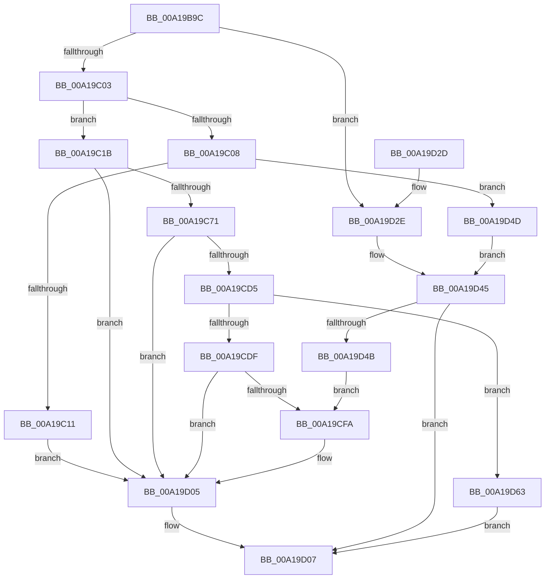

# RtlpInitNlsFileName

- RVA: `0x00A19B9C`–`0x00A19D6A` (길이 `462` bytes)
- VA: `0x0000000140A19B9C`
- 실행 섹션: `PAGE`
- PDB 이름 있음: `예`; PDB Function 태그: `아니요`
- unwind 정보 RVA: `0x000AA378`
- 디코드: `112`개 명령, `462/462` bytes 표시
- 미해석 바이트: `0` (있으면 어셈블리에 `.byte`로 보존)

> 이 문서는 커널 이미지의 기계어와 PDB 기호를 분석해 생성했습니다. 4번과 5번은 함수 원형과 자료형을 바이너리 사용 방식에서 추정한 C 해석이며 원본 소스 복구 결과는 아닙니다.

## 1. Dependencies

- 직접 호출 지점: **10**; 고유 호출 대상: **8**
- 직접 호출자로 확인된 함수: **1**
- RIP 상대 이미지 참조: **5**

### Outgoing calls
- `0x00A19C26` → [RtlInitUnicodeString](../../text/42/RtlInitUnicodeString_function_0042A780.md) (function, `0x0042A780`)
- `0x00A19C62` → [ZwOpenKey](../../text/6A/ZwOpenKey_function_006AD310.md) (function, `0x006AD310`)
- `0x00A19C97` → [RtlIntegerToUnicodeString](../91/RtlIntegerToUnicodeString_function_0091D3E0.md) (function, `0x0091D3E0`)
- `0x00A19CC0` → [ZwQueryValueKey](../../text/6A/ZwQueryValueKey_function_006AD3B0.md) (function, `0x006AD3B0`)
- `0x00A19CCC` → [ZwClose](../../text/6A/ZwClose_function_006AD2B0.md) (function, `0x006AD2B0`)
- `0x00A19CEF` → [RtlStringCchPrintfW](../../text/48/RtlStringCchPrintfW_function_00482D5C.md) (function, `0x00482D5C`)
- `0x00A19D00` → [RtlInitUnicodeString](../../text/42/RtlInitUnicodeString_function_0042A780.md) (function, `0x0042A780`)
- `0x00A19D11` → [_security_check_cookie](../../text/6A/_security_check_cookie_function_006AC640.md) (function, `0x006AC640`)
- `0x00A19D40` → [RtlStringCchPrintfW](../../text/48/RtlStringCchPrintfW_function_00482D5C.md) (function, `0x00482D5C`)
- `0x00A19D5C` → [RtlStringCchCopyW](../../text/26/RtlStringCchCopyW_function_0026E9A4.md) (function, `0x0026E9A4`)

### Direct callers
- [NtGetNlsSectionPtr](NtGetNlsSectionPtr_function_00A195B0.md) at `0x00A1995C`

### Static image references
- `0x00A19BB7` → RVA `0x00E0A740` (`.data`; read)
- `0x00A19C1B` → RVA `0x00B051C0` (` ?? ::NNGAKEGL::`string'`; read)
- `0x00A19CE5` → RVA `0x00B05330` (` ?? ::NNGAKEGL::`string'`; read)
- `0x00A19D31` → RVA `0x00B05250` (` ?? ::NNGAKEGL::`string'`; read)
- `0x00A19D4D` → RVA `0x00B052F0` (` ?? ::NNGAKEGL::`string'`; read)

## 2. Other-region calls and transfers

- 다른 실행 섹션으로 향하는 call: **9**
  - `0x00A19C26` → [RtlInitUnicodeString](../../text/42/RtlInitUnicodeString_function_0042A780.md) (`PAGE` → `.text`)
  - `0x00A19C62` → [ZwOpenKey](../../text/6A/ZwOpenKey_function_006AD310.md) (`PAGE` → `.text`)
  - `0x00A19CC0` → [ZwQueryValueKey](../../text/6A/ZwQueryValueKey_function_006AD3B0.md) (`PAGE` → `.text`)
  - `0x00A19CCC` → [ZwClose](../../text/6A/ZwClose_function_006AD2B0.md) (`PAGE` → `.text`)
  - `0x00A19CEF` → [RtlStringCchPrintfW](../../text/48/RtlStringCchPrintfW_function_00482D5C.md) (`PAGE` → `.text`)
  - `0x00A19D00` → [RtlInitUnicodeString](../../text/42/RtlInitUnicodeString_function_0042A780.md) (`PAGE` → `.text`)
  - `0x00A19D11` → [_security_check_cookie](../../text/6A/_security_check_cookie_function_006AC640.md) (`PAGE` → `.text`)
  - `0x00A19D40` → [RtlStringCchPrintfW](../../text/48/RtlStringCchPrintfW_function_00482D5C.md) (`PAGE` → `.text`)
  - `0x00A19D5C` → [RtlStringCchCopyW](../../text/26/RtlStringCchCopyW_function_0026E9A4.md) (`PAGE` → `.text`)
- 별도 외부 분기/꼬리 이동을 확인하지 못했습니다.

## 3. Assembly (complete function range)

```asm
00A19B9C  48 89 5C 24 08                  mov qword ptr [rsp + 8], rbx
00A19BA1  55                              push rbp
00A19BA2  56                              push rsi
00A19BA3  57                              push rdi
00A19BA4  41 56                           push r14
00A19BA6  41 57                           push r15
00A19BA8  48 8D AC 24 00 FF FF FF         lea rbp, [rsp - 0x100]
00A19BB0  48 81 EC 00 02 00 00            sub rsp, 0x200
00A19BB7  48 8B 05 82 0B 3F 00            mov rax, qword ptr [rip + 0x3f0b82]
00A19BBE  48 33 C4                        xor rax, rsp
00A19BC1  48 89 85 F0 00 00 00            mov qword ptr [rbp + 0xf0], rax
00A19BC8  4C 8B BD 50 01 00 00            mov r15, qword ptr [rbp + 0x150]
00A19BCF  33 C0                           xor eax, eax
00A19BD1  21 44 24 30                     and dword ptr [rsp + 0x30], eax
00A19BD5  0F 57 C0                        xorps xmm0, xmm0
00A19BD8  48 21 44 24 38                  and qword ptr [rsp + 0x38], rax
00A19BDD  49 8B F0                        mov rsi, r8
00A19BE0  48 89 44 24 70                  mov qword ptr [rsp + 0x70], rax
00A19BE5  44 8B F2                        mov r14d, edx
00A19BE8  89 44 24 78                     mov dword ptr [rsp + 0x78], eax
00A19BEC  0F 11 45 80                     movups xmmword ptr [rbp - 0x80], xmm0
00A19BF0  0F 11 44 24 50                  movups xmmword ptr [rsp + 0x50], xmm0
00A19BF5  0F 11 44 24 60                  movups xmmword ptr [rsp + 0x60], xmm0
00A19BFA  83 E9 0B                        sub ecx, 0xb
00A19BFD  0F 84 2B 01 00 00               je 0x140a19d2e
00A19C03  83 E9 01                        sub ecx, 1
00A19C06  74 13                           je 0x140a19c1b
00A19C08  83 F9 02                        cmp ecx, 2
00A19C0B  0F 84 3C 01 00 00               je 0x140a19d4d
00A19C11  BB EF 00 00 C0                  mov ebx, 0xc00000ef
00A19C16  E9 EA 00 00 00                  jmp 0x140a19d05
00A19C1B  48 8D 15 9E B5 0E 00            lea rdx, [rip + 0xeb59e]
00A19C22  48 8D 4D 80                     lea rcx, [rbp - 0x80]
00A19C26  E8 55 0B A1 FF                  call 0x14042a780
00A19C2B  48 83 64 24 58 00               and qword ptr [rsp + 0x58], 0
00A19C31  48 8D 45 80                     lea rax, [rbp - 0x80]
00A19C35  0F 57 C0                        xorps xmm0, xmm0
00A19C38  48 89 44 24 60                  mov qword ptr [rsp + 0x60], rax
00A19C3D  4C 8D 44 24 50                  lea r8, [rsp + 0x50]
00A19C42  C7 44 24 50 30 00 00 00         mov dword ptr [rsp + 0x50], 0x30
00A19C4A  BA 00 00 00 80                  mov edx, 0x80000000
00A19C4F  C7 44 24 68 40 02 00 00         mov dword ptr [rsp + 0x68], 0x240
00A19C57  48 8D 4C 24 38                  lea rcx, [rsp + 0x38]
00A19C5C  F3 0F 7F 44 24 70               movdqu xmmword ptr [rsp + 0x70], xmm0
00A19C62  E8 A9 36 C9 FF                  call 0x1406ad310
00A19C67  8B D8                           mov ebx, eax
00A19C69  85 C0                           test eax, eax
00A19C6B  0F 88 94 00 00 00               js 0x140a19d05
00A19C71  83 64 24 44 00                  and dword ptr [rsp + 0x44], 0
00A19C76  48 8D 45 90                     lea rax, [rbp - 0x70]
00A19C7A  BF 40 00 00 00                  mov edi, 0x40
00A19C7F  C7 44 24 40 40 00 40 00         mov dword ptr [rsp + 0x40], 0x400040
00A19C87  4C 8D 44 24 40                  lea r8, [rsp + 0x40]
00A19C8C  48 89 44 24 48                  mov qword ptr [rsp + 0x48], rax
00A19C91  41 8B CE                        mov ecx, r14d
00A19C94  8D 57 D0                        lea edx, [rdi - 0x30]
00A19C97  E8 44 37 F0 FF                  call 0x14091d3e0
00A19C9C  48 8B 4C 24 38                  mov rcx, qword ptr [rsp + 0x38]
00A19CA1  48 8D 44 24 30                  lea rax, [rsp + 0x30]
00A19CA6  48 89 44 24 28                  mov qword ptr [rsp + 0x28], rax
00A19CAB  4C 8D 4D D0                     lea r9, [rbp - 0x30]
00A19CAF  44 8D 47 C2                     lea r8d, [rdi - 0x3e]
00A19CB3  C7 44 24 20 20 01 00 00         mov dword ptr [rsp + 0x20], 0x120
00A19CBB  48 8D 54 24 40                  lea rdx, [rsp + 0x40]
00A19CC0  E8 EB 36 C9 FF                  call 0x1406ad3b0
00A19CC5  48 8B 4C 24 38                  mov rcx, qword ptr [rsp + 0x38]
00A19CCA  8B D8                           mov ebx, eax
00A19CCC  E8 DF 35 C9 FF                  call 0x1406ad2b0
00A19CD1  85 DB                           test ebx, ebx
00A19CD3  78 30                           js 0x140a19d05
00A19CD5  83 7D D4 01                     cmp dword ptr [rbp - 0x2c], 1
00A19CD9  0F 85 84 00 00 00               jne 0x140a19d63
00A19CDF  4C 8D 4D DC                     lea r9, [rbp - 0x24]
00A19CE3  8B D7                           mov edx, edi
00A19CE5  4C 8D 05 44 B6 0E 00            lea r8, [rip + 0xeb644]
00A19CEC  48 8B CE                        mov rcx, rsi
00A19CEF  E8 68 90 A6 FF                  call 0x140482d5c
00A19CF4  8B D8                           mov ebx, eax
00A19CF6  85 C0                           test eax, eax
00A19CF8  78 0B                           js 0x140a19d05
00A19CFA  48 8B D6                        mov rdx, rsi
00A19CFD  49 8B CF                        mov rcx, r15
00A19D00  E8 7B 0A A1 FF                  call 0x14042a780
00A19D05  8B C3                           mov eax, ebx
00A19D07  48 8B 8D F0 00 00 00            mov rcx, qword ptr [rbp + 0xf0]
00A19D0E  48 33 CC                        xor rcx, rsp
00A19D11  E8 2A 29 C9 FF                  call 0x1406ac640
00A19D16  48 8B 9C 24 30 02 00 00         mov rbx, qword ptr [rsp + 0x230]
00A19D1E  48 81 C4 00 02 00 00            add rsp, 0x200
00A19D25  41 5F                           pop r15
00A19D27  41 5E                           pop r14
00A19D29  5F                              pop rdi
00A19D2A  5E                              pop rsi
00A19D2B  5D                              pop rbp
00A19D2C  C3                              ret
00A19D2D  CC                              int3
00A19D2E  45 8B CE                        mov r9d, r14d
00A19D31  4C 8D 05 18 B5 0E 00            lea r8, [rip + 0xeb518]
00A19D38  BA 40 00 00 00                  mov edx, 0x40
00A19D3D  48 8B CE                        mov rcx, rsi
00A19D40  E8 17 90 A6 FF                  call 0x140482d5c
00A19D45  8B D8                           mov ebx, eax
00A19D47  85 C0                           test eax, eax
00A19D49  78 BC                           js 0x140a19d07
00A19D4B  EB AD                           jmp 0x140a19cfa
00A19D4D  4C 8D 05 9C B5 0E 00            lea r8, [rip + 0xeb59c]
00A19D54  BA 40 00 00 00                  mov edx, 0x40
00A19D59  48 8B CE                        mov rcx, rsi
00A19D5C  E8 43 4C 85 FF                  call 0x14026e9a4
00A19D61  EB E2                           jmp 0x140a19d45
00A19D63  B8 01 00 00 C0                  mov eax, 0xc0000001
00A19D68  EB 9D                           jmp 0x140a19d07
```

## 4. C-style interpretation (structured pseudocode)

```c
__int64 __fastcall RtlpInitNlsFileName(int a1, int a2, __int64 a3, __int64 a4, __int64 a5)
{
    __int64 result;
    __int64 v_rsp;
    unsigned __int64 v_stack_m128;
    unsigned __int64 v_stack_m14C;
    unsigned int v_stack_m154;
    unsigned __int64 v_stack_m158;
    unsigned __int64 v_stack_m198;
    unsigned __int64 v_stack_m1A8;
    unsigned int v_stack_m1B0;
    unsigned __int64 v_stack_m1B8;
    unsigned int v_stack_m1C0;
    unsigned __int64 v_stack_m1C8;
    unsigned __int64 v_stack_m1D0;
    unsigned __int64 v_stack_m1D8;
    unsigned __int64 v_stack_m1E0;
    unsigned int v_stack_m1E4;
    unsigned int v_stack_m1E8;
    unsigned __int64 v_stack_m1F0;
    unsigned int v_stack_m1F8;
    unsigned __int64 v_stack_m200;
    unsigned int v_stack_m208;
    unsigned __int64 v_stack_m38;
    unsigned __int64 v_stack_p8;

    v_stack_p8 = v_rbx;
    v_rsp = (v_rsp) - (512);
    result = (*(unsigned __int64 *)(v_rip + 4131714)) ^ (v_rsp);
    v_stack_m38 = result;
    result = 0;
    v_stack_m1B8 = 0;
    v_stack_m1B0 = 0;
    v_stack_m1A8 = v_xmm0;
    v_stack_m1D8 = v_xmm0;
    v_stack_m1C8 = v_xmm0;
    a1 = (unsigned int)((a1) - (11));
    if (condition_is_equal) goto loc_00A19D2E;
    a1 = (unsigned int)((a1) - (1));
    if (condition_is_equal) goto loc_00A19C1B;
    if (a1 == 2) goto loc_00A19D4D;
    goto loc_00A19D05;
loc_00A19C1B:
    result = RtlInitUnicodeString(v_stack_m1A8, v_rip + 963998, a3, a4);
    v_stack_m1C8 = v_stack_m1A8;
    v_stack_m1D8 = 48;
    v_stack_m1C0 = 576;
    v_stack_m1B8 = v_xmm0;
    result = ZwOpenKey(v_stack_m1F0, (unsigned int)(0x80000000ULL), v_stack_m1D8, a4);
    if (sign_flag) goto loc_00A19D05;
    v_stack_m1E8 = 0x400040ULL;
    v_stack_m1E0 = v_stack_m198;
    result = RtlIntegerToUnicodeString((unsigned int)((unsigned int)((unsigned int)(a2))), 64 - 48, v_stack_m1E8, a4);
    v_stack_m200 = v_stack_m1F8;
    v_stack_m208 = 288;
    result = ZwQueryValueKey(v_stack_m1F0, v_stack_m1E8, 64 - 62, v_stack_m158);
    result = ZwClose(v_stack_m1F0, v_stack_m1E8, 64 - 62, v_stack_m158);
    if (sign_flag) goto loc_00A19D05;
    if (v_stack_m154 != 1) goto loc_00A19D63;
    result = RtlStringCchPrintfW(a3, 64, v_rip + 964164, v_stack_m14C);
    if (!(sign_flag)) {
        a2 = a3;
        a1 = a5;
        result = RtlInitUnicodeString(a1, a2, v_rip + 964164, v_stack_m14C);
    }
loc_00A19D07:
    a1 = (v_stack_m38) ^ (v_rsp);
    result = _security_check_cookie(a1, a2, v_rip + 964164, v_stack_m14C);
    v_rsp = (v_rsp) + (512);
    return result;
loc_00A19D2E:
    result = RtlStringCchPrintfW(a3, 64, v_rip + 963864, (unsigned int)((unsigned int)((unsigned int)(a2))));
loc_00A19D45:
    if (sign_flag) goto loc_00A19D07;
    goto loc_00A19CFA;
loc_00A19D4D:
    result = RtlStringCchCopyW(a3, 64, v_rip + 963996, (unsigned int)((unsigned int)((unsigned int)(a2))));
    goto loc_00A19D45;
loc_00A19D63:
    goto loc_00A19D07;
}
```

## 5. (Beta) C Style

```c
int64_t RtlpInitNlsFileName(int32_t Arg1, int32_t Arg2, int64_t Arg3, int64_t Arg4, int64_t Arg5)
{
    int64_t result;
    int64_t local_rsp;
    uint64_t v_stack_m128;
    uint64_t v_stack_m14C;
    uint32_t v_stack_m154;
    uint64_t v_stack_m158;
    uint64_t v_stack_m198;
    uint64_t v_stack_m1A8;
    uint32_t v_stack_m1B0;
    uint64_t v_stack_m1B8;
    uint32_t v_stack_m1C0;
    uint64_t v_stack_m1C8;
    uint64_t v_stack_m1D0;
    uint64_t v_stack_m1D8;
    uint64_t v_stack_m1E0;
    uint32_t v_stack_m1E4;
    uint32_t v_stack_m1E8;
    uint64_t v_stack_m1F0;
    uint32_t v_stack_m1F8;
    uint64_t v_stack_m200;
    uint32_t v_stack_m208;
    uint64_t v_stack_m38;
    uint64_t v_stack_p8;

    v_stack_p8 = local_rbx;
    local_rsp = (local_rsp) - (512);
    result = (*(uint64_t *)(v_rip + 0x3F0B82)) ^ (local_rsp);
    v_stack_m38 = result;
    result = 0;
    v_stack_m1B8 = 0;
    v_stack_m1B0 = 0;
    v_stack_m1A8 = v_xmm0;
    v_stack_m1D8 = v_xmm0;
    v_stack_m1C8 = v_xmm0;
    Arg1 = (uint32_t)((Arg1) - (11));
    if (condition_is_equal) goto loc_00A19D2E;
    Arg1 = (uint32_t)((Arg1) - (1));
    if (condition_is_equal) goto loc_00A19C1B;
    if (Arg1 == 2) goto loc_00A19D4D;
    goto loc_00A19D05;
loc_00A19C1B:
    result = RtlInitUnicodeString(v_stack_m1A8, v_rip + 963998, Arg3, Arg4);
    v_stack_m1C8 = v_stack_m1A8;
    v_stack_m1D8 = 48;
    v_stack_m1C0 = 576;
    v_stack_m1B8 = v_xmm0;
    result = ZwOpenKey(v_stack_m1F0, (uint32_t)(0x80000000ULL), v_stack_m1D8, Arg4);
    if (sign_flag) goto loc_00A19D05;
    v_stack_m1E8 = 0x400040ULL;
    v_stack_m1E0 = v_stack_m198;
    result = RtlIntegerToUnicodeString((uint32_t)((uint32_t)((uint32_t)(Arg2))), 64 - 48, v_stack_m1E8, Arg4);
    v_stack_m200 = v_stack_m1F8;
    v_stack_m208 = 288;
    result = ZwQueryValueKey(v_stack_m1F0, v_stack_m1E8, 64 - 62, v_stack_m158);
    result = ZwClose(v_stack_m1F0, v_stack_m1E8, 64 - 62, v_stack_m158);
    if (sign_flag) goto loc_00A19D05;
    if (v_stack_m154 != 1) goto loc_00A19D63;
    result = RtlStringCchPrintfW(Arg3, 64, v_rip + 964164, v_stack_m14C);
    if (!(sign_flag)) {
        Arg2 = Arg3;
        Arg1 = Arg5;
        result = RtlInitUnicodeString(Arg1, Arg2, v_rip + 964164, v_stack_m14C);
    }
loc_00A19D07:
    Arg1 = (v_stack_m38) ^ (local_rsp);
    result = _security_check_cookie(Arg1, Arg2, v_rip + 964164, v_stack_m14C);
    local_rsp = (local_rsp) + (512);
    return result;
loc_00A19D2E:
    result = RtlStringCchPrintfW(Arg3, 64, v_rip + 963864, (uint32_t)((uint32_t)((uint32_t)(Arg2))));
loc_00A19D45:
    if (sign_flag) goto loc_00A19D07;
    goto loc_00A19CFA;
loc_00A19D4D:
    result = RtlStringCchCopyW(Arg3, 64, v_rip + 963996, (uint32_t)((uint32_t)((uint32_t)(Arg2))));
    goto loc_00A19D45;
loc_00A19D63:
    goto loc_00A19D07;
}
```

## 6. Execution-region graph

[열기: 2D/3D 그래프와 함수 탐색 컨트롤 패널](../../../control-panel.html?section=page&rva=0x00A19B9C&view=graph)

- 2D 그래프는 위에서 아래로 흐르고, 3D 그래프는 빈 공간을 드래그해 회전합니다. Shift+드래그는 이동, 휠은 확대·축소, 함수 노드 선택은 대상 보고서 이동입니다.

### Static fallback


