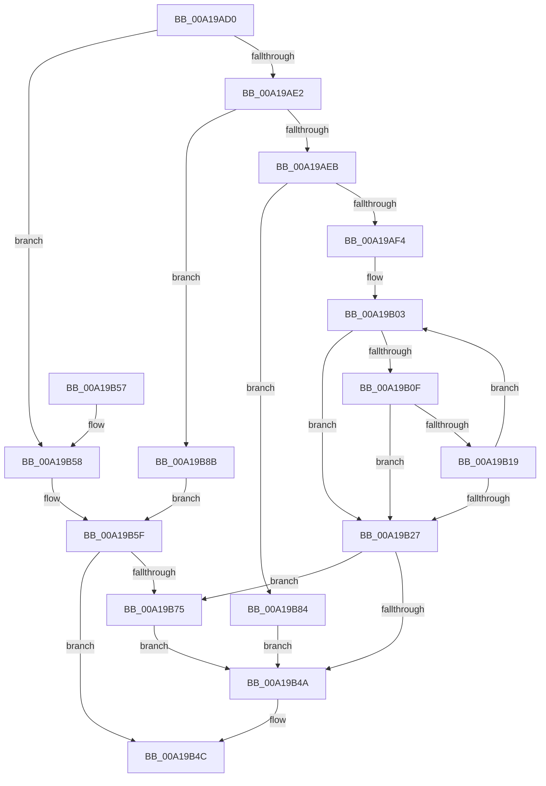

# RtlpInitNlsSectionName

- RVA: `0x00A19AD0`–`0x00A19B94` (길이 `196` bytes)
- VA: `0x0000000140A19AD0`
- 실행 섹션: `PAGE`
- PDB 이름 있음: `예`; PDB Function 태그: `아니요`
- unwind 정보 RVA: `0x00080918`
- 디코드: `57`개 명령, `196/196` bytes 표시
- 미해석 바이트: `0` (있으면 어셈블리에 `.byte`로 보존)

> 이 문서는 커널 이미지의 기계어와 PDB 기호를 분석해 생성했습니다. 4번과 5번은 함수 원형과 자료형을 바이너리 사용 방식에서 추정한 C 해석이며 원본 소스 복구 결과는 아닙니다.

## 1. Dependencies

- 직접 호출 지점: **2**; 고유 호출 대상: **2**
- 직접 호출자로 확인된 함수: **1**
- RIP 상대 이미지 참조: **3**

### Outgoing calls
- `0x00A19B6A` → [RtlStringCchPrintfW](../../text/48/RtlStringCchPrintfW_function_00482D5C.md) (function, `0x00482D5C`)
- `0x00A19B7D` → [RtlInitUnicodeString](../../text/42/RtlInitUnicodeString_function_0042A780.md) (function, `0x0042A780`)

### Direct callers
- [NtGetNlsSectionPtr](NtGetNlsSectionPtr_function_00A195B0.md) at `0x00A196AD`

### Static image references
- `0x00A19AF4` → RVA `0x00B05290` (` ?? ::NNGAKEGL::`string'`; read)
- `0x00A19B58` → RVA `0x00B05190` (` ?? ::NNGAKEGL::`string'`; read)
- `0x00A19B8B` → RVA `0x00B052C0` (` ?? ::NNGAKEGL::`string'`; read)

## 2. Other-region calls and transfers

- 다른 실행 섹션으로 향하는 call: **2**
  - `0x00A19B6A` → [RtlStringCchPrintfW](../../text/48/RtlStringCchPrintfW_function_00482D5C.md) (`PAGE` → `.text`)
  - `0x00A19B7D` → [RtlInitUnicodeString](../../text/42/RtlInitUnicodeString_function_0042A780.md) (`PAGE` → `.text`)
- 별도 외부 분기/꼬리 이동을 확인하지 못했습니다.

## 3. Assembly (complete function range)

```asm
00A19AD0  48 89 5C 24 08                  mov qword ptr [rsp + 8], rbx
00A19AD5  57                              push rdi
00A19AD6  48 83 EC 20                     sub rsp, 0x20
00A19ADA  49 8B F8                        mov rdi, r8
00A19ADD  83 E9 0B                        sub ecx, 0xb
00A19AE0  74 76                           je 0x140a19b58
00A19AE2  83 E9 01                        sub ecx, 1
00A19AE5  0F 84 A0 00 00 00               je 0x140a19b8b
00A19AEB  83 F9 02                        cmp ecx, 2
00A19AEE  0F 85 90 00 00 00               jne 0x140a19b84
00A19AF4  4C 8D 0D 95 B7 0E 00            lea r9, [rip + 0xeb795]
00A19AFB  4D 2B C8                        sub r9, r8
00A19AFE  8D 51 3E                        lea edx, [rcx + 0x3e]
00A19B01  33 C9                           xor ecx, ecx
00A19B03  48 8D 82 BE FF FF 7F            lea rax, [rdx + 0x7fffffbe]
00A19B0A  48 85 C0                        test rax, rax
00A19B0D  74 18                           je 0x140a19b27
00A19B0F  43 0F B7 04 01                  movzx eax, word ptr [r9 + r8]
00A19B14  66 85 C0                        test ax, ax
00A19B17  74 0E                           je 0x140a19b27
00A19B19  66 41 89 00                     mov word ptr [r8], ax
00A19B1D  49 83 C0 02                     add r8, 2
00A19B21  48 83 EA 01                     sub rdx, 1
00A19B25  75 DC                           jne 0x140a19b03
00A19B27  48 85 D2                        test rdx, rdx
00A19B2A  49 8D 40 FE                     lea rax, [r8 - 2]
00A19B2E  49 0F 45 C0                     cmovne rax, r8
00A19B32  66 89 08                        mov word ptr [rax], cx
00A19B35  48 8B C2                        mov rax, rdx
00A19B38  48 F7 D8                        neg rax
00A19B3B  1B DB                           sbb ebx, ebx
00A19B3D  F7 D3                           not ebx
00A19B3F  81 E3 05 00 00 80               and ebx, 0x80000005
00A19B45  48 85 D2                        test rdx, rdx
00A19B48  75 2B                           jne 0x140a19b75
00A19B4A  8B C3                           mov eax, ebx
00A19B4C  48 8B 5C 24 30                  mov rbx, qword ptr [rsp + 0x30]
00A19B51  48 83 C4 20                     add rsp, 0x20
00A19B55  5F                              pop rdi
00A19B56  C3                              ret
00A19B57  CC                              int3
00A19B58  4C 8D 05 31 B6 0E 00            lea r8, [rip + 0xeb631]
00A19B5F  44 8B CA                        mov r9d, edx
00A19B62  48 8B CF                        mov rcx, rdi
00A19B65  BA 40 00 00 00                  mov edx, 0x40
00A19B6A  E8 ED 91 A6 FF                  call 0x140482d5c
00A19B6F  8B D8                           mov ebx, eax
00A19B71  85 C0                           test eax, eax
00A19B73  78 D7                           js 0x140a19b4c
00A19B75  48 8B 4C 24 50                  mov rcx, qword ptr [rsp + 0x50]
00A19B7A  48 8B D7                        mov rdx, rdi
00A19B7D  E8 FE 0B A1 FF                  call 0x14042a780
00A19B82  EB C6                           jmp 0x140a19b4a
00A19B84  BB EF 00 00 C0                  mov ebx, 0xc00000ef
00A19B89  EB BF                           jmp 0x140a19b4a
00A19B8B  4C 8D 05 2E B7 0E 00            lea r8, [rip + 0xeb72e]
00A19B92  EB CB                           jmp 0x140a19b5f
```

## 4. C-style interpretation (structured pseudocode)

```c
__int64 __fastcall RtlpInitNlsSectionName(int a1, __int64 a2, __int64 a3, __int64 a4, __int64 a5)
{
    __int64 result;
    __int64 v_rbx;
    __int64 v_rsp;
    unsigned __int64 v_stack_p8;

    v_stack_p8 = v_rbx;
    v_rsp = (v_rsp) - (32);
    a1 = (unsigned int)((a1) - (11));
    if (condition_is_equal) goto loc_00A19B58;
    a1 = (unsigned int)((a1) - (1));
    if (condition_is_equal) goto loc_00A19B8B;
    if (a1 != 2) goto loc_00A19B84;
    a4 = (v_rip + 964501) - (a3);
    a1 = 0;
loc_00A19B03:
    if (a1 + 62 + 2147483582 == 0) goto loc_00A19B27;
    if ((unsigned __int16)(*(unsigned __int16 *)(a4 + a3 * 1)) == 0) goto loc_00A19B27;
    *(unsigned __int16 *)(a3) = (unsigned __int16)(*(unsigned __int16 *)(a4 + a3 * 1));
    a3 = (a3) + (2);
    a2 = (a1 + 62) - (1);
    if (condition_is_not_equal) goto loc_00A19B03;
loc_00A19B27:
    result = a3 - 2;
    if (a2 != 0) { result = a3; }
    *(unsigned __int16 *)(result) = 0;
    result = -(a2);
    v_rbx = (unsigned int)(~(v_rbx));
    v_rbx = (unsigned int)((v_rbx) & (0x80000005ULL));
    if (a2 != 0) goto loc_00A19B75;
loc_00A19B4A:
loc_00A19B4C:
    v_rsp = (v_rsp) + (32);
    return (unsigned int)((unsigned int)(v_rbx));
loc_00A19B58:
loc_00A19B5F:
    result = RtlStringCchPrintfW(a3, 64, v_rip + 964145, (unsigned int)((unsigned int)(a2)));
    if (sign_flag) goto loc_00A19B4C;
loc_00A19B75:
    result = RtlInitUnicodeString(a5, a3, v_rip + 964145, (unsigned int)((unsigned int)(a2)));
    goto loc_00A19B4A;
loc_00A19B84:
    goto loc_00A19B4A;
loc_00A19B8B:
    goto loc_00A19B5F;
}
```

## 5. (Beta) C Style

```c
int64_t RtlpInitNlsSectionName(int32_t Arg1, int64_t Arg2, void *Arg3, int64_t Arg4, int64_t Arg5)
{
    uint8_t *arg3 = (uint8_t *)Arg3;

    int64_t result;
    int64_t local_rbx;
    int64_t local_rsp;
    uint64_t v_stack_p8;

    v_stack_p8 = local_rbx;
    local_rsp = (local_rsp) - (32);
    Arg1 = (uint32_t)((Arg1) - (11));
    if (condition_is_equal) goto loc_00A19B58;
    Arg1 = (uint32_t)((Arg1) - (1));
    if (condition_is_equal) goto loc_00A19B8B;
    if (Arg1 != 2) goto loc_00A19B84;
    Arg4 = (v_rip + 964501) - (Arg3);
    Arg1 = 0;
loc_00A19B03:
    if (Arg1 + 62 + 2147483582 == 0) goto loc_00A19B27;
    if ((uint16_t)(*(uint16_t *)(Arg4 + arg3 * 1)) == 0) goto loc_00A19B27;
    *(uint16_t *)(arg3) = (uint16_t)(*(uint16_t *)(Arg4 + arg3 * 1));
    Arg3 = (Arg3) + (2);
    Arg2 = (Arg1 + 62) - (1);
    if (condition_is_not_equal) goto loc_00A19B03;
loc_00A19B27:
    result = Arg3 - 2;
    if (Arg2 != 0) { result = Arg3; }
    *(uint16_t *)(result) = 0;
    result = -(Arg2);
    local_rbx = (uint32_t)(~(local_rbx));
    local_rbx = (uint32_t)((local_rbx) & (0x80000005ULL));
    if (Arg2 != 0) goto loc_00A19B75;
loc_00A19B4A:
loc_00A19B4C:
    local_rsp = (local_rsp) + (32);
    return (uint32_t)((uint32_t)(local_rbx));
loc_00A19B58:
loc_00A19B5F:
    result = RtlStringCchPrintfW(Arg3, 64, v_rip + 964145, (uint32_t)((uint32_t)(Arg2)));
    if (sign_flag) goto loc_00A19B4C;
loc_00A19B75:
    result = RtlInitUnicodeString(Arg5, Arg3, v_rip + 964145, (uint32_t)((uint32_t)(Arg2)));
    goto loc_00A19B4A;
loc_00A19B84:
    goto loc_00A19B4A;
loc_00A19B8B:
    goto loc_00A19B5F;
}
```

### 관측된 메모리 오프셋

구조체 형식이 확인되지 않은 접근은 인자 기준의 오프셋으로만 기록했습니다.

| 기준 인자 | 오프셋 표현 | 폭 (bit) | 접근 |
|---|---:|---:|---|
| `Arg3` | `- 0x2` | `64` | `R` |
| `Arg3` | `+ 0x0` | `16` | `W` |

## 6. Execution-region graph

[열기: 2D/3D 그래프와 함수 탐색 컨트롤 패널](../../../control-panel.html?section=page&rva=0x00A19AD0&view=graph)

- 2D 그래프는 위에서 아래로 흐르고, 3D 그래프는 빈 공간을 드래그해 회전합니다. Shift+드래그는 이동, 휠은 확대·축소, 함수 노드 선택은 대상 보고서 이동입니다.

### Static fallback


