# RtlpQuerySecurityDescriptor

- RVA: `0x00A1E3D0`–`0x00A1E513` (길이 `323` bytes)
- VA: `0x0000000140A1E3D0`
- 실행 섹션: `PAGE`
- PDB 이름 있음: `예`; PDB Function 태그: `아니요`
- unwind 정보 RVA: `0x000AA91C`
- 디코드: `92`개 명령, `323/323` bytes 표시
- 미해석 바이트: `0` (있으면 어셈블리에 `.byte`로 보존)

> 이 문서는 커널 이미지의 기계어와 PDB 기호를 분석해 생성했습니다. 4번과 5번은 함수 원형과 자료형을 바이너리 사용 방식에서 추정한 C 해석이며 원본 소스 복구 결과는 아닙니다.

## 1. Dependencies

- 직접 호출 지점: **0**; 고유 호출 대상: **0**
- 직접 호출자로 확인된 함수: **1**
- RIP 상대 이미지 참조: **0**

### Outgoing calls
- 직접 디코드된 call 명령이 없습니다.

### Direct callers
- [RtlSelfRelativeToAbsoluteSD2](../78/RtlSelfRelativeToAbsoluteSD2_function_0078CF80.md) at `0x0078D039`

### Static image references
- 디코드된 RIP-relative 메모리 참조가 없습니다.

## 2. Other-region calls and transfers

- 다른 실행 섹션으로 향하는 call: **0**
- 별도 외부 분기/꼬리 이동을 확인하지 못했습니다.

## 3. Assembly (complete function range)

```asm
00A1E3D0  48 89 5C 24 08                  mov qword ptr [rsp + 8], rbx
00A1E3D5  48 89 7C 24 10                  mov qword ptr [rsp + 0x10], rdi
00A1E3DA  48 8B 5C 24 30                  mov rbx, qword ptr [rsp + 0x30]
00A1E3DF  45 33 D2                        xor r10d, r10d
00A1E3E2  BF FC FF FF FF                  mov edi, 0xfffffffc
00A1E3E7  4C 8B 5C 24 40                  mov r11, qword ptr [rsp + 0x40]
00A1E3EC  66 44 39 51 02                  cmp word ptr [rcx + 2], r10w
00A1E3F1  0F 8C B6 00 00 00               jl 0x140a1e4ad
00A1E3F7  48 8B 41 08                     mov rax, qword ptr [rcx + 8]
00A1E3FB  48 89 02                        mov qword ptr [rdx], rax
00A1E3FE  48 85 C0                        test rax, rax
00A1E401  0F 85 E7 00 00 00               jne 0x140a1e4ee
00A1E407  41 8B C2                        mov eax, r10d
00A1E40A  41 89 00                        mov dword ptr [r8], eax
00A1E40D  0F B7 41 02                     movzx eax, word ptr [rcx + 2]
00A1E411  A8 04                           test al, 4
00A1E413  75 08                           jne 0x140a1e41d
00A1E415  4C 89 13                        mov qword ptr [rbx], r10
00A1E418  41 8B D2                        mov edx, r10d
00A1E41B  EB 1E                           jmp 0x140a1e43b
00A1E41D  66 85 C0                        test ax, ax
00A1E420  0F 88 A5 00 00 00               js 0x140a1e4cb
00A1E426  48 8B 41 20                     mov rax, qword ptr [rcx + 0x20]
00A1E42A  48 89 03                        mov qword ptr [rbx], rax
00A1E42D  48 85 C0                        test rax, rax
00A1E430  74 E6                           je 0x140a1e418
00A1E432  0F B7 50 02                     movzx edx, word ptr [rax + 2]
00A1E436  83 C2 03                        add edx, 3
00A1E439  23 D7                           and edx, edi
00A1E43B  48 8B 44 24 38                  mov rax, qword ptr [rsp + 0x38]
00A1E440  89 10                           mov dword ptr [rax], edx
00A1E442  66 44 39 51 02                  cmp word ptr [rcx + 2], r10w
00A1E447  7C 58                           jl 0x140a1e4a1
00A1E449  48 8B 41 10                     mov rax, qword ptr [rcx + 0x10]
00A1E44D  49 89 01                        mov qword ptr [r9], rax
00A1E450  48 85 C0                        test rax, rax
00A1E453  75 67                           jne 0x140a1e4bc
00A1E455  41 8B D2                        mov edx, r10d
00A1E458  48 8B 44 24 28                  mov rax, qword ptr [rsp + 0x28]
00A1E45D  89 10                           mov dword ptr [rax], edx
00A1E45F  0F B7 41 02                     movzx eax, word ptr [rcx + 2]
00A1E463  A8 10                           test al, 0x10
00A1E465  75 05                           jne 0x140a1e46c
00A1E467  4D 89 13                        mov qword ptr [r11], r10
00A1E46A  EB 21                           jmp 0x140a1e48d
00A1E46C  66 85 C0                        test ax, ax
00A1E46F  0F 88 8B 00 00 00               js 0x140a1e500
00A1E475  48 8B 41 18                     mov rax, qword ptr [rcx + 0x18]
00A1E479  49 89 03                        mov qword ptr [r11], rax
00A1E47C  48 85 C0                        test rax, rax
00A1E47F  74 0C                           je 0x140a1e48d
00A1E481  44 0F B7 50 02                  movzx r10d, word ptr [rax + 2]
00A1E486  41 83 C2 03                     add r10d, 3
00A1E48A  44 23 D7                        and r10d, edi
00A1E48D  48 8B 44 24 48                  mov rax, qword ptr [rsp + 0x48]
00A1E492  44 89 10                        mov dword ptr [rax], r10d
00A1E495  48 8B 5C 24 08                  mov rbx, qword ptr [rsp + 8]
00A1E49A  48 8B 7C 24 10                  mov rdi, qword ptr [rsp + 0x10]
00A1E49F  C3                              ret
00A1E4A0  CC                              int3
00A1E4A1  8B 41 08                        mov eax, dword ptr [rcx + 8]
00A1E4A4  85 C0                           test eax, eax
00A1E4A6  75 36                           jne 0x140a1e4de
00A1E4A8  4D 89 11                        mov qword ptr [r9], r10
00A1E4AB  EB A8                           jmp 0x140a1e455
00A1E4AD  8B 41 04                        mov eax, dword ptr [rcx + 4]
00A1E4B0  85 C0                           test eax, eax
00A1E4B2  75 32                           jne 0x140a1e4e6
00A1E4B4  4C 89 12                        mov qword ptr [rdx], r10
00A1E4B7  E9 4B FF FF FF                  jmp 0x140a1e407
00A1E4BC  0F B6 40 01                     movzx eax, byte ptr [rax + 1]
00A1E4C0  8D 14 85 0B 00 00 00            lea edx, [rax*4 + 0xb]
00A1E4C7  23 D7                           and edx, edi
00A1E4C9  EB 8D                           jmp 0x140a1e458
00A1E4CB  8B 41 10                        mov eax, dword ptr [rcx + 0x10]
00A1E4CE  85 C0                           test eax, eax
00A1E4D0  0F 84 3F FF FF FF               je 0x140a1e415
00A1E4D6  48 03 C1                        add rax, rcx
00A1E4D9  E9 4C FF FF FF                  jmp 0x140a1e42a
00A1E4DE  48 03 C1                        add rax, rcx
00A1E4E1  E9 67 FF FF FF                  jmp 0x140a1e44d
00A1E4E6  48 03 C1                        add rax, rcx
00A1E4E9  E9 0D FF FF FF                  jmp 0x140a1e3fb
00A1E4EE  0F B6 40 01                     movzx eax, byte ptr [rax + 1]
00A1E4F2  8D 04 85 0B 00 00 00            lea eax, [rax*4 + 0xb]
00A1E4F9  23 C7                           and eax, edi
00A1E4FB  E9 0A FF FF FF                  jmp 0x140a1e40a
00A1E500  8B 41 0C                        mov eax, dword ptr [rcx + 0xc]
00A1E503  85 C0                           test eax, eax
00A1E505  0F 84 5C FF FF FF               je 0x140a1e467
00A1E50B  48 03 C1                        add rax, rcx
00A1E50E  E9 66 FF FF FF                  jmp 0x140a1e479
```

## 4. C-style interpretation (structured pseudocode)

```c
__int64 __fastcall RtlpQuerySecurityDescriptor(__int64 a1, __int64 a2, __int64 a3, __int64 a4, __int64 a5, __int64 a6, __int64 a7, __int64 a8, __int64 a9)
{
    __int64 result;
    __int64 v_r10;
    unsigned __int64 v_stack_p10;
    unsigned __int64 v_stack_p8;

    v_stack_p8 = v_rbx;
    v_stack_p10 = v_rdi;
    v_r10 = 0;
    if ((*(unsigned __int16 *)(a1 + 2)) < 0) goto loc_00A1E4AD;
loc_00A1E3FB:
    *(unsigned __int64 *)(a2) = *(unsigned __int64 *)(a1 + 8);
    if (*(unsigned __int64 *)(a1 + 8) != 0) goto loc_00A1E4EE;
loc_00A1E407:
loc_00A1E40A:
    *(unsigned int *)(a3) = 0;
    if ((((unsigned __int8)(*(unsigned __int16 *)(a1 + 2))) & (4)) != 0) goto loc_00A1E41D;
loc_00A1E415:
    *(unsigned __int64 *)(a6) = 0;
loc_00A1E418:
    goto loc_00A1E43B;
loc_00A1E41D:
    if (sign_flag) goto loc_00A1E4CB;
loc_00A1E42A:
    *(unsigned __int64 *)(a6) = *(unsigned __int64 *)(a1 + 32);
    if (*(unsigned __int64 *)(a1 + 32) == 0) goto loc_00A1E418;
    a2 = (unsigned int)((*(unsigned __int16 *)(*(unsigned __int64 *)(a1 + 32) + 2)) + (3));
    a2 = (unsigned int)((a2) & ((unsigned int)((unsigned int)(0xFFFFFFFCULL))));
loc_00A1E43B:
    *(unsigned int *)(a7) = (unsigned int)(a2);
    if ((*(unsigned __int16 *)(a1 + 2)) < 0) goto loc_00A1E4A1;
loc_00A1E44D:
    *(unsigned __int64 *)(a4) = *(unsigned __int64 *)(a1 + 16);
    if (*(unsigned __int64 *)(a1 + 16) != 0) goto loc_00A1E4BC;
loc_00A1E455:
loc_00A1E458:
    *(unsigned int *)(a5) = 0;
    if ((((unsigned __int8)(*(unsigned __int16 *)(a1 + 2))) & (16)) != 0) goto loc_00A1E46C;
loc_00A1E467:
    *(unsigned __int64 *)(a8) = 0;
    goto loc_00A1E48D;
loc_00A1E46C:
    if (sign_flag) goto loc_00A1E500;
loc_00A1E479:
    *(unsigned __int64 *)(a8) = *(unsigned __int64 *)(a1 + 24);
    if (*(unsigned __int64 *)(a1 + 24) != 0) {
        v_r10 = *(unsigned __int16 *)(*(unsigned __int64 *)(a1 + 24) + 2);
        v_r10 = (unsigned int)((v_r10) + (3));
        v_r10 = (unsigned int)((v_r10) & ((unsigned int)((unsigned int)(0xFFFFFFFCULL))));
    }
    *(unsigned int *)(a9) = (unsigned int)(v_r10);
    return a9;
loc_00A1E4A1:
    if ((unsigned int)((unsigned int)(*(unsigned int *)(a1 + 8))) != 0) goto loc_00A1E4DE;
    *(unsigned __int64 *)(a4) = v_r10;
    goto loc_00A1E455;
loc_00A1E4AD:
    if ((unsigned int)((unsigned int)(*(unsigned int *)(a1 + 4))) != 0) goto loc_00A1E4E6;
    *(unsigned __int64 *)(0) = v_r10;
    goto loc_00A1E407;
loc_00A1E4BC:
    a2 = (unsigned int)((*(unsigned __int8 *)((unsigned int)(*(unsigned int *)(a1 + 4)) + 1) * 4 + 11) & ((unsigned int)(v_stack_p10)));
    goto loc_00A1E458;
loc_00A1E4CB:
    if ((unsigned int)((unsigned int)(*(unsigned int *)(a1 + 16))) == 0) goto loc_00A1E415;
    result = ((unsigned int)(*(unsigned int *)(a1 + 16))) + (a1);
    goto loc_00A1E42A;
loc_00A1E4DE:
    result = (result) + (a1);
    goto loc_00A1E44D;
loc_00A1E4E6:
    result = (result) + (a1);
    goto loc_00A1E3FB;
loc_00A1E4EE:
    result = (unsigned int)((*(unsigned __int8 *)(result + 1) * 4 + 11) & ((unsigned int)(v_stack_p10)));
    goto loc_00A1E40A;
loc_00A1E500:
    if ((unsigned int)((unsigned int)(*(unsigned int *)(a1 + 12))) == 0) goto loc_00A1E467;
    result = ((unsigned int)(*(unsigned int *)(a1 + 12))) + (a1);
    goto loc_00A1E479;
}
```

## 5. (Beta) C Style

```c
void *RtlpQuerySecurityDescriptor(void *Arg1, void *Arg2, void *Arg3, void *Arg4, void *Arg5, void *Arg6, void *Arg7, void *Arg8, void *Arg9)
{
    uint8_t *arg1 = (uint8_t *)Arg1;
    uint8_t *arg2 = (uint8_t *)Arg2;
    uint8_t *arg3 = (uint8_t *)Arg3;
    uint8_t *arg4 = (uint8_t *)Arg4;
    uint8_t *arg5 = (uint8_t *)Arg5;
    uint8_t *arg6 = (uint8_t *)Arg6;
    uint8_t *arg7 = (uint8_t *)Arg7;
    uint8_t *arg8 = (uint8_t *)Arg8;
    uint8_t *arg9 = (uint8_t *)Arg9;

    int64_t result;
    int64_t local_r10;
    uint64_t v_stack_p10;
    uint64_t v_stack_p8;

    v_stack_p8 = local_rbx;
    v_stack_p10 = local_rdi;
    local_r10 = 0;
    if ((*(uint16_t *)(arg1 + 0x2)) < 0) goto loc_00A1E4AD;
loc_00A1E3FB:
    *(uint64_t *)(arg2) = *(uint64_t *)(arg1 + 0x8);
    if (*(uint64_t *)(arg1 + 0x8) != 0) goto loc_00A1E4EE;
loc_00A1E407:
loc_00A1E40A:
    *(uint32_t *)(arg3) = 0;
    if ((((uint8_t)(*(uint16_t *)(arg1 + 0x2))) & (4)) != 0) goto loc_00A1E41D;
loc_00A1E415:
    *(uint64_t *)(arg6) = 0;
loc_00A1E418:
    goto loc_00A1E43B;
loc_00A1E41D:
    if (sign_flag) goto loc_00A1E4CB;
loc_00A1E42A:
    *(uint64_t *)(arg6) = *(uint64_t *)(arg1 + 0x20);
    if (*(uint64_t *)(arg1 + 0x20) == 0) goto loc_00A1E418;
    Arg2 = (uint32_t)((*(uint16_t *)(*(uint64_t *)(arg1 + 0x20) + 0x2)) + (3));
    Arg2 = (uint32_t)((Arg2) & ((uint32_t)((uint32_t)(0xFFFFFFFCULL))));
loc_00A1E43B:
    *(uint32_t *)(arg7) = (uint32_t)(Arg2);
    if ((*(uint16_t *)(arg1 + 0x2)) < 0) goto loc_00A1E4A1;
loc_00A1E44D:
    *(uint64_t *)(arg4) = *(uint64_t *)(arg1 + 0x10);
    if (*(uint64_t *)(arg1 + 0x10) != 0) goto loc_00A1E4BC;
loc_00A1E455:
loc_00A1E458:
    *(uint32_t *)(arg5) = 0;
    if ((((uint8_t)(*(uint16_t *)(arg1 + 0x2))) & (16)) != 0) goto loc_00A1E46C;
loc_00A1E467:
    *(uint64_t *)(arg8) = 0;
    goto loc_00A1E48D;
loc_00A1E46C:
    if (sign_flag) goto loc_00A1E500;
loc_00A1E479:
    *(uint64_t *)(arg8) = *(uint64_t *)(arg1 + 0x18);
    if (*(uint64_t *)(arg1 + 0x18) != 0) {
        local_r10 = *(uint16_t *)(*(uint64_t *)(arg1 + 0x18) + 0x2);
        local_r10 = (uint32_t)((local_r10) + (3));
        local_r10 = (uint32_t)((local_r10) & ((uint32_t)((uint32_t)(0xFFFFFFFCULL))));
    }
    *(uint32_t *)(arg9) = (uint32_t)(local_r10);
    return Arg9;
loc_00A1E4A1:
    if ((uint32_t)((uint32_t)(*(uint32_t *)(arg1 + 0x8))) != 0) goto loc_00A1E4DE;
    *(uint64_t *)(arg4) = local_r10;
    goto loc_00A1E455;
loc_00A1E4AD:
    if ((uint32_t)((uint32_t)(*(uint32_t *)(arg1 + 0x4))) != 0) goto loc_00A1E4E6;
    *(uint64_t *)(0) = local_r10;
    goto loc_00A1E407;
loc_00A1E4BC:
    Arg2 = (uint32_t)((*(uint8_t *)((uint32_t)(*(uint32_t *)(arg1 + 0x4)) + 0x1) * 4 + 11) & ((uint32_t)(v_stack_p10)));
    goto loc_00A1E458;
loc_00A1E4CB:
    if ((uint32_t)((uint32_t)(*(uint32_t *)(arg1 + 0x10))) == 0) goto loc_00A1E415;
    result = ((uint32_t)(*(uint32_t *)(arg1 + 0x10))) + (Arg1);
    goto loc_00A1E42A;
loc_00A1E4DE:
    result = (result) + (Arg1);
    goto loc_00A1E44D;
loc_00A1E4E6:
    result = (result) + (Arg1);
    goto loc_00A1E3FB;
loc_00A1E4EE:
    result = (uint32_t)((*(uint8_t *)(result + 0x1) * 4 + 11) & ((uint32_t)(v_stack_p10)));
    goto loc_00A1E40A;
loc_00A1E500:
    if ((uint32_t)((uint32_t)(*(uint32_t *)(arg1 + 0xC))) == 0) goto loc_00A1E467;
    result = ((uint32_t)(*(uint32_t *)(arg1 + 0xC))) + (Arg1);
    goto loc_00A1E479;
}
```

### 관측된 메모리 오프셋

구조체 형식이 확인되지 않은 접근은 인자 기준의 오프셋으로만 기록했습니다.

| 기준 인자 | 오프셋 표현 | 폭 (bit) | 접근 |
|---|---:|---:|---|
| `Arg1` | `+ 0x2` | `16` | `R` |
| `Arg1` | `+ 0x4` | `32` | `R` |
| `Arg1` | `+ 0x8` | `32` | `R` |
| `Arg1` | `+ 0x8` | `64` | `R` |
| `Arg1` | `+ 0xC` | `32` | `R` |
| `Arg1` | `+ 0x10` | `32` | `R` |
| `Arg1` | `+ 0x10` | `64` | `R` |
| `Arg1` | `+ 0x18` | `64` | `R` |
| `Arg1` | `+ 0x20` | `64` | `R` |
| `Arg2` | `+ 0x0` | `64` | `W` |
| `Arg3` | `+ 0x0` | `32` | `W` |
| `Arg4` | `+ 0x0` | `64` | `W` |
| `Arg5` | `+ 0x0` | `32` | `W` |
| `Arg6` | `+ 0x0` | `64` | `W` |
| `Arg7` | `+ 0x0` | `32` | `W` |
| `Arg8` | `+ 0x0` | `64` | `W` |
| `Arg9` | `+ 0x0` | `32` | `W` |

## 6. Execution-region graph

[열기: 2D/3D 그래프와 함수 탐색 컨트롤 패널](../../../control-panel.html?section=page&rva=0x00A1E3D0&view=graph)

- 2D 그래프는 위에서 아래로 흐르고, 3D 그래프는 빈 공간을 드래그해 회전합니다. Shift+드래그는 이동, 휠은 확대·축소, 함수 노드 선택은 대상 보고서 이동입니다.

### Static fallback

```mermaid
flowchart TD
  bb_00A1E3D0[BB_00A1E3D0]
  bb_00A1E3F7[BB_00A1E3F7]
  bb_00A1E3FB[BB_00A1E3FB]
  bb_00A1E407[BB_00A1E407]
  bb_00A1E40A[BB_00A1E40A]
  bb_00A1E415[BB_00A1E415]
  bb_00A1E418[BB_00A1E418]
  bb_00A1E41D[BB_00A1E41D]
  bb_00A1E426[BB_00A1E426]
  bb_00A1E42A[BB_00A1E42A]
  bb_00A1E432[BB_00A1E432]
  bb_00A1E43B[BB_00A1E43B]
  bb_00A1E449[BB_00A1E449]
  bb_00A1E44D[BB_00A1E44D]
  bb_00A1E455[BB_00A1E455]
  bb_00A1E458[BB_00A1E458]
  bb_00A1E467[BB_00A1E467]
  bb_00A1E46C[BB_00A1E46C]
  bb_00A1E475[BB_00A1E475]
  bb_00A1E479[BB_00A1E479]
  bb_00A1E481[BB_00A1E481]
  bb_00A1E48D[BB_00A1E48D]
  bb_00A1E4A0[BB_00A1E4A0]
  bb_00A1E4A1[BB_00A1E4A1]
  bb_00A1E4A8[BB_00A1E4A8]
  bb_00A1E4AD[BB_00A1E4AD]
  bb_00A1E4B4[BB_00A1E4B4]
  bb_00A1E4BC[BB_00A1E4BC]
  bb_00A1E4CB[BB_00A1E4CB]
  bb_00A1E4D6[BB_00A1E4D6]
  bb_00A1E4DE[BB_00A1E4DE]
  bb_00A1E4E6[BB_00A1E4E6]
  bb_00A1E4EE[BB_00A1E4EE]
  bb_00A1E500[BB_00A1E500]
  bb_00A1E50B[BB_00A1E50B]
  bb_00A1E3D0 -->|branch| bb_00A1E4AD
  bb_00A1E3D0 -->|fallthrough| bb_00A1E3F7
  bb_00A1E3F7 -->|flow| bb_00A1E3FB
  bb_00A1E3FB -->|branch| bb_00A1E4EE
  bb_00A1E3FB -->|fallthrough| bb_00A1E407
  bb_00A1E407 -->|flow| bb_00A1E40A
  bb_00A1E40A -->|branch| bb_00A1E41D
  bb_00A1E40A -->|fallthrough| bb_00A1E415
  bb_00A1E415 -->|flow| bb_00A1E418
  bb_00A1E418 -->|branch| bb_00A1E43B
  bb_00A1E41D -->|branch| bb_00A1E4CB
  bb_00A1E41D -->|fallthrough| bb_00A1E426
  bb_00A1E426 -->|flow| bb_00A1E42A
  bb_00A1E42A -->|branch| bb_00A1E418
  bb_00A1E42A -->|fallthrough| bb_00A1E432
  bb_00A1E432 -->|flow| bb_00A1E43B
  bb_00A1E43B -->|branch| bb_00A1E4A1
  bb_00A1E43B -->|fallthrough| bb_00A1E449
  bb_00A1E449 -->|flow| bb_00A1E44D
  bb_00A1E44D -->|branch| bb_00A1E4BC
  bb_00A1E44D -->|fallthrough| bb_00A1E455
  bb_00A1E455 -->|flow| bb_00A1E458
  bb_00A1E458 -->|branch| bb_00A1E46C
  bb_00A1E458 -->|fallthrough| bb_00A1E467
  bb_00A1E467 -->|branch| bb_00A1E48D
  bb_00A1E46C -->|branch| bb_00A1E500
  bb_00A1E46C -->|fallthrough| bb_00A1E475
  bb_00A1E475 -->|flow| bb_00A1E479
  bb_00A1E479 -->|branch| bb_00A1E48D
  bb_00A1E479 -->|fallthrough| bb_00A1E481
  bb_00A1E481 -->|flow| bb_00A1E48D
  bb_00A1E4A0 -->|flow| bb_00A1E4A1
  bb_00A1E4A1 -->|branch| bb_00A1E4DE
  bb_00A1E4A1 -->|fallthrough| bb_00A1E4A8
  bb_00A1E4A8 -->|branch| bb_00A1E455
  bb_00A1E4AD -->|branch| bb_00A1E4E6
  bb_00A1E4AD -->|fallthrough| bb_00A1E4B4
  bb_00A1E4B4 -->|branch| bb_00A1E407
  bb_00A1E4BC -->|branch| bb_00A1E458
  bb_00A1E4CB -->|branch| bb_00A1E415
  bb_00A1E4CB -->|fallthrough| bb_00A1E4D6
  bb_00A1E4D6 -->|branch| bb_00A1E42A
  bb_00A1E4DE -->|branch| bb_00A1E44D
  bb_00A1E4E6 -->|branch| bb_00A1E3FB
  bb_00A1E4EE -->|branch| bb_00A1E40A
  bb_00A1E500 -->|branch| bb_00A1E467
  bb_00A1E500 -->|fallthrough| bb_00A1E50B
  bb_00A1E50B -->|branch| bb_00A1E479
```


