# RtlpWow64CtxFromAmd64

- RVA: `0x00A12394`–`0x00A126A3` (길이 `783` bytes)
- VA: `0x0000000140A12394`
- 실행 섹션: `PAGE`
- PDB 이름 있음: `예`; PDB Function 태그: `아니요`
- unwind 정보 RVA: `0x000A98D8`
- 디코드: `204`개 명령, `783/783` bytes 표시
- 미해석 바이트: `0` (있으면 어셈블리에 `.byte`로 보존)

> 이 문서는 커널 이미지의 기계어와 PDB 기호를 분석해 생성했습니다. 4번과 5번은 함수 원형과 자료형을 바이너리 사용 방식에서 추정한 C 해석이며 원본 소스 복구 결과는 아닙니다.

## 1. Dependencies

- 직접 호출 지점: **2**; 고유 호출 대상: **2**
- 직접 호출자로 확인된 함수: **2**
- RIP 상대 이미지 참조: **0**

### Outgoing calls
- `0x00A12524` → [RtlFxToFnFrame](../../text/43/RtlFxToFnFrame_function_00437F10.md) (function, `0x00437F10`)
- `0x00A125DB` → [RtlpCopyXStateChunk](../../text/3F/RtlpCopyXStateChunk_function_003F51D4.md) (function, `0x003F51D4`)

### Direct callers
- [PspWow64SetContextThread](../8C/PspWow64SetContextThread_function_008CCC88.md) at `0x008CD074`
- [PspWow64GetContextThread](PspWow64GetContextThread_function_00A11E90.md) at `0x00A121C0`
- [PspWow64GetContextThread](PspWow64GetContextThread_function_00A11E90.md) at `0x00A12314`

### Static image references
- 디코드된 RIP-relative 메모리 참조가 없습니다.

## 2. Other-region calls and transfers

- 다른 실행 섹션으로 향하는 call: **2**
  - `0x00A12524` → [RtlFxToFnFrame](../../text/43/RtlFxToFnFrame_function_00437F10.md) (`PAGE` → `.text`)
  - `0x00A125DB` → [RtlpCopyXStateChunk](../../text/3F/RtlpCopyXStateChunk_function_003F51D4.md) (`PAGE` → `.text`)
- 별도 외부 분기/꼬리 이동을 확인하지 못했습니다.

## 3. Assembly (complete function range)

```asm
00A12394  48 89 5C 24 08                  mov qword ptr [rsp + 8], rbx
00A12399  48 89 6C 24 10                  mov qword ptr [rsp + 0x10], rbp
00A1239E  48 89 74 24 18                  mov qword ptr [rsp + 0x18], rsi
00A123A3  57                              push rdi
00A123A4  41 56                           push r14
00A123A6  41 57                           push r15
00A123A8  48 83 EC 30                     sub rsp, 0x30
00A123AC  44 8B 7A 30                     mov r15d, dword ptr [rdx + 0x30]
00A123B0  33 ED                           xor ebp, ebp
00A123B2  41 8B 38                        mov edi, dword ptr [r8]
00A123B5  44 8B F1                        mov r14d, ecx
00A123B8  B9 01 00 10 00                  mov ecx, 0x100001
00A123BD  41 8B C7                        mov eax, r15d
00A123C0  23 C1                           and eax, ecx
00A123C2  48 8B F2                        mov rsi, rdx
00A123C5  3B C1                           cmp eax, ecx
00A123C7  8D 55 2B                        lea edx, [rbp + 0x2b]
00A123CA  B9 01 00 01 00                  mov ecx, 0x10001
00A123CF  41 8B C6                        mov eax, r14d
00A123D2  41 0F 94 C1                     sete r9b
00A123D6  49 8B D8                        mov rbx, r8
00A123D9  23 C1                           and eax, ecx
00A123DB  3B C1                           cmp eax, ecx
00A123DD  0F 94 C0                        sete al
00A123E0  44 84 C8                        test al, r9b
00A123E3  74 45                           je 0x140a1242a
00A123E5  8B 86 A0 00 00 00               mov eax, dword ptr [rsi + 0xa0]
00A123EB  0B F9                           or edi, ecx
00A123ED  41 89 80 B4 00 00 00            mov dword ptr [r8 + 0xb4], eax
00A123F4  41 C7 80 BC 00 00 00 23 00 00 00  mov dword ptr [r8 + 0xbc], 0x23
00A123FF  8B 86 F8 00 00 00               mov eax, dword ptr [rsi + 0xf8]
00A12405  41 89 80 B8 00 00 00            mov dword ptr [r8 + 0xb8], eax
00A1240C  41 89 90 C8 00 00 00            mov dword ptr [r8 + 0xc8], edx
00A12413  8B 86 98 00 00 00               mov eax, dword ptr [rsi + 0x98]
00A12419  41 89 80 C4 00 00 00            mov dword ptr [r8 + 0xc4], eax
00A12420  8B 46 44                        mov eax, dword ptr [rsi + 0x44]
00A12423  41 89 80 C0 00 00 00            mov dword ptr [r8 + 0xc0], eax
00A1242A  B9 02 00 10 00                  mov ecx, 0x100002
00A1242F  41 B8 02 00 01 00               mov r8d, 0x10002
00A12435  41 8B C7                        mov eax, r15d
00A12438  23 C1                           and eax, ecx
00A1243A  3B C1                           cmp eax, ecx
00A1243C  41 8B C6                        mov eax, r14d
00A1243F  0F 94 C1                        sete cl
00A12442  41 23 C0                        and eax, r8d
00A12445  41 3B C0                        cmp eax, r8d
00A12448  0F 94 C0                        sete al
00A1244B  84 C8                           test al, cl
00A1244D  0F 85 CD 01 00 00               jne 0x140a12620
00A12453  41 B8 04 00 01 00               mov r8d, 0x10004
00A12459  41 8B C6                        mov eax, r14d
00A1245C  41 23 C0                        and eax, r8d
00A1245F  41 3B C0                        cmp eax, r8d
00A12462  0F 84 05 02 00 00               je 0x140a1266d
00A12468  B9 08 00 10 00                  mov ecx, 0x100008
00A1246D  48 8D 96 00 01 00 00            lea rdx, [rsi + 0x100]
00A12474  41 BA 20 00 01 00               mov r10d, 0x10020
00A1247A  41 8B C7                        mov eax, r15d
00A1247D  23 C1                           and eax, ecx
00A1247F  3B C1                           cmp eax, ecx
00A12481  41 8B C6                        mov eax, r14d
00A12484  41 0F 94 C0                     sete r8b
00A12488  41 23 C2                        and eax, r10d
00A1248B  41 3B C2                        cmp eax, r10d
00A1248E  0F 94 C0                        sete al
00A12491  41 84 C0                        test r8b, al
00A12494  74 6F                           je 0x140a12505
00A12496  41 B9 02 00 00 00               mov r9d, 2
00A1249C  48 8D 83 CC 00 00 00            lea rax, [rbx + 0xcc]
00A124A3  48 8B CA                        mov rcx, rdx
00A124A6  45 8D 59 7E                     lea r11d, [r9 + 0x7e]
00A124AA  0F 10 01                        movups xmm0, xmmword ptr [rcx]
00A124AD  0F 11 00                        movups xmmword ptr [rax], xmm0
00A124B0  0F 10 49 10                     movups xmm1, xmmword ptr [rcx + 0x10]
00A124B4  0F 11 48 10                     movups xmmword ptr [rax + 0x10], xmm1
00A124B8  0F 10 41 20                     movups xmm0, xmmword ptr [rcx + 0x20]
00A124BC  0F 11 40 20                     movups xmmword ptr [rax + 0x20], xmm0
00A124C0  0F 10 49 30                     movups xmm1, xmmword ptr [rcx + 0x30]
00A124C4  0F 11 48 30                     movups xmmword ptr [rax + 0x30], xmm1
00A124C8  0F 10 41 40                     movups xmm0, xmmword ptr [rcx + 0x40]
00A124CC  0F 11 40 40                     movups xmmword ptr [rax + 0x40], xmm0
00A124D0  0F 10 49 50                     movups xmm1, xmmword ptr [rcx + 0x50]
00A124D4  0F 11 48 50                     movups xmmword ptr [rax + 0x50], xmm1
00A124D8  0F 10 41 60                     movups xmm0, xmmword ptr [rcx + 0x60]
00A124DC  0F 11 40 60                     movups xmmword ptr [rax + 0x60], xmm0
00A124E0  49 03 C3                        add rax, r11
00A124E3  0F 10 49 70                     movups xmm1, xmmword ptr [rcx + 0x70]
00A124E7  49 03 CB                        add rcx, r11
00A124EA  0F 11 48 F0                     movups xmmword ptr [rax - 0x10], xmm1
00A124EE  49 83 E9 01                     sub r9, 1
00A124F2  75 B6                           jne 0x140a124aa
00A124F4  0F 10 01                        movups xmm0, xmmword ptr [rcx]
00A124F7  41 0B FA                        or edi, r10d
00A124FA  0F 11 00                        movups xmmword ptr [rax], xmm0
00A124FD  0F 10 49 10                     movups xmm1, xmmword ptr [rcx + 0x10]
00A12501  0F 11 48 10                     movups xmmword ptr [rax + 0x10], xmm1
00A12505  41 8B C6                        mov eax, r14d
00A12508  25 08 00 01 00                  and eax, 0x10008
00A1250D  3D 08 00 01 00                  cmp eax, 0x10008
00A12512  0F 94 C0                        sete al
00A12515  41 84 C0                        test r8b, al
00A12518  74 15                           je 0x140a1252f
00A1251A  48 8D 4B 1C                     lea rcx, [rbx + 0x1c]
00A1251E  89 AB 88 00 00 00               mov dword ptr [rbx + 0x88], ebp
00A12524  E8 E7 59 A2 FF                  call 0x140437f10
00A12529  81 CF 08 00 01 00               or edi, 0x10008
00A1252F  41 B8 10 00 01 00               mov r8d, 0x10010
00A12535  BA 10 00 10 00                  mov edx, 0x100010
00A1253A  41 8B C6                        mov eax, r14d
00A1253D  41 23 C0                        and eax, r8d
00A12540  41 3B C0                        cmp eax, r8d
00A12543  41 8B C7                        mov eax, r15d
00A12546  0F 94 C1                        sete cl
00A12549  23 C2                           and eax, edx
00A1254B  3B C2                           cmp eax, edx
00A1254D  0F 94 C0                        sete al
00A12550  84 C8                           test al, cl
00A12552  74 22                           je 0x140a12576
00A12554  8B 46 70                        mov eax, dword ptr [rsi + 0x70]
00A12557  48 A9 55 03 00 00               test rax, 0x355
00A1255D  0F 85 81 00 00 00               jne 0x140a125e4
00A12563  48 89 6B 04                     mov qword ptr [rbx + 4], rbp
00A12567  8B C5                           mov eax, ebp
00A12569  48 89 6B 0C                     mov qword ptr [rbx + 0xc], rbp
00A1256D  89 6B 14                        mov dword ptr [rbx + 0x14], ebp
00A12570  89 43 18                        mov dword ptr [rbx + 0x18], eax
00A12573  41 0B F8                        or edi, r8d
00A12576  BA 40 00 01 00                  mov edx, 0x10040
00A1257B  41 8B C6                        mov eax, r14d
00A1257E  23 C2                           and eax, edx
00A12580  3B C2                           cmp eax, edx
00A12582  74 29                           je 0x140a125ad
00A12584  41 0F BA E6 1E                  bt r14d, 0x1e
00A12589  0F 82 80 00 00 00               jb 0x140a1260f
00A1258F  48 8B 74 24 60                  mov rsi, qword ptr [rsp + 0x60]
00A12594  8B C5                           mov eax, ebp
00A12596  48 8B 6C 24 58                  mov rbp, qword ptr [rsp + 0x58]
00A1259B  89 3B                           mov dword ptr [rbx], edi
00A1259D  48 8B 5C 24 50                  mov rbx, qword ptr [rsp + 0x50]
00A125A2  48 83 C4 30                     add rsp, 0x30
00A125A6  41 5F                           pop r15
00A125A8  41 5E                           pop r14
00A125AA  5F                              pop rdi
00A125AB  C3                              ret
00A125AC  CC                              int3
00A125AD  B9 40 00 10 00                  mov ecx, 0x100040
00A125B2  41 8B C7                        mov eax, r15d
00A125B5  23 C1                           and eax, ecx
00A125B7  3B C1                           cmp eax, ecx
00A125B9  75 C9                           jne 0x140a12584
00A125BB  8B C7                           mov eax, edi
00A125BD  23 C2                           and eax, edx
00A125BF  3B C2                           cmp eax, edx
00A125C1  75 C1                           jne 0x140a12584
00A125C3  48 8D 93 CC 02 00 00            lea rdx, [rbx + 0x2cc]
00A125CA  B1 01                           mov cl, 1
00A125CC  4C 8D 8E D0 04 00 00            lea r9, [rsi + 0x4d0]
00A125D3  4C 8B C2                        mov r8, rdx
00A125D6  4C 89 4C 24 20                  mov qword ptr [rsp + 0x20], r9
00A125DB  E8 F4 2B 9E FF                  call 0x1403f51d4
00A125E0  8B E8                           mov ebp, eax
00A125E2  EB A0                           jmp 0x140a12584
00A125E4  8B 46 48                        mov eax, dword ptr [rsi + 0x48]
00A125E7  89 43 04                        mov dword ptr [rbx + 4], eax
00A125EA  8B 46 50                        mov eax, dword ptr [rsi + 0x50]
00A125ED  89 43 08                        mov dword ptr [rbx + 8], eax
00A125F0  8B 46 58                        mov eax, dword ptr [rsi + 0x58]
00A125F3  89 43 0C                        mov dword ptr [rbx + 0xc], eax
00A125F6  8B 46 60                        mov eax, dword ptr [rsi + 0x60]
00A125F9  89 43 10                        mov dword ptr [rbx + 0x10], eax
00A125FC  8B 46 68                        mov eax, dword ptr [rsi + 0x68]
00A125FF  89 43 14                        mov dword ptr [rbx + 0x14], eax
00A12602  8B 46 70                        mov eax, dword ptr [rsi + 0x70]
00A12605  25 55 01 FF FF                  and eax, 0xffff0155
00A1260A  E9 61 FF FF FF                  jmp 0x140a12570
00A1260F  41 33 FF                        xor edi, r15d
00A12612  81 E7 FF FF FF 67               and edi, 0x67ffffff
00A12618  41 33 FF                        xor edi, r15d
00A1261B  E9 6F FF FF FF                  jmp 0x140a1258f
00A12620  8B 86 B0 00 00 00               mov eax, dword ptr [rsi + 0xb0]
00A12626  41 0B F8                        or edi, r8d
00A12629  89 83 9C 00 00 00               mov dword ptr [rbx + 0x9c], eax
00A1262F  8B 86 A8 00 00 00               mov eax, dword ptr [rsi + 0xa8]
00A12635  89 83 A0 00 00 00               mov dword ptr [rbx + 0xa0], eax
00A1263B  8B 86 90 00 00 00               mov eax, dword ptr [rsi + 0x90]
00A12641  89 83 A4 00 00 00               mov dword ptr [rbx + 0xa4], eax
00A12647  8B 86 88 00 00 00               mov eax, dword ptr [rsi + 0x88]
00A1264D  89 83 A8 00 00 00               mov dword ptr [rbx + 0xa8], eax
00A12653  8B 86 80 00 00 00               mov eax, dword ptr [rsi + 0x80]
00A12659  89 83 AC 00 00 00               mov dword ptr [rbx + 0xac], eax
00A1265F  8B 46 78                        mov eax, dword ptr [rsi + 0x78]
00A12662  89 83 B0 00 00 00               mov dword ptr [rbx + 0xb0], eax
00A12668  E9 E6 FD FF FF                  jmp 0x140a12453
00A1266D  B9 04 00 10 00                  mov ecx, 0x100004
00A12672  41 8B C7                        mov eax, r15d
00A12675  23 C1                           and eax, ecx
00A12677  3B C1                           cmp eax, ecx
00A12679  0F 85 E9 FD FF FF               jne 0x140a12468
00A1267F  89 93 8C 00 00 00               mov dword ptr [rbx + 0x8c], edx
00A12685  41 0B F8                        or edi, r8d
00A12688  89 93 94 00 00 00               mov dword ptr [rbx + 0x94], edx
00A1268E  89 93 98 00 00 00               mov dword ptr [rbx + 0x98], edx
00A12694  C7 83 90 00 00 00 53 00 00 00   mov dword ptr [rbx + 0x90], 0x53
00A1269E  E9 C5 FD FF FF                  jmp 0x140a12468
```

## 4. C-style interpretation (structured pseudocode)

```c
__int64 __fastcall RtlpWow64CtxFromAmd64(int a1, __int64 a2, __int64 a3)
{
    __int64 result;
    __int64 v_rbp;
    __int64 v_rdi;
    __int64 v_rsp;
    unsigned __int64 v_stack_p10;
    unsigned __int64 v_stack_p18;
    unsigned __int64 v_stack_p20;
    unsigned __int64 v_stack_p8;

    v_stack_p8 = v_rbx;
    v_stack_p10 = v_rbp;
    v_stack_p18 = v_rsi;
    v_rsp = (v_rsp) - (48);
    v_rbp = 0;
    result = (unsigned int)(((unsigned int)((unsigned int)((unsigned int)(*(unsigned int *)(a2 + 48))))) & ((unsigned int)((unsigned int)(0x100001ULL))));
    a4 = (((unsigned int)(result)) == ((unsigned int)((unsigned int)(0x100001ULL)))) ? 1 : 0;
    result = (unsigned int)(((unsigned int)((unsigned int)((unsigned int)(a1)))) & ((unsigned int)((unsigned int)(0x10001ULL))));
    result = (((unsigned int)(result)) == ((unsigned int)((unsigned int)(0x10001ULL)))) ? 1 : 0;
    v_rdi = (unsigned int)(*(unsigned int *)(a3));
    if ((((unsigned __int8)(result)) & ((unsigned __int8)(a4))) != 0) {
        result = *(unsigned int *)(a2 + 160);
        v_rdi = (unsigned int)(((unsigned int)(*(unsigned int *)(a3))) | ((unsigned int)((unsigned int)(0x10001ULL))));
        *(unsigned int *)(a3 + 180) = (unsigned int)(result);
        *(unsigned int *)(a3 + 188) = 35;
        result = *(unsigned int *)(a2 + 248);
        *(unsigned int *)(a3 + 184) = (unsigned int)(result);
        *(unsigned int *)(a3 + 200) = (unsigned int)(v_rbp + 43);
        result = *(unsigned int *)(a2 + 152);
        *(unsigned int *)(a3 + 196) = (unsigned int)(result);
        result = *(unsigned int *)(a2 + 68);
        *(unsigned int *)(a3 + 192) = (unsigned int)(result);
    }
    result = (unsigned int)(((unsigned int)((unsigned int)((unsigned int)(*(unsigned int *)(a2 + 48))))) & ((unsigned int)((unsigned int)(0x100002ULL))));
    a1 = (((unsigned int)(result)) == ((unsigned int)((unsigned int)(0x100002ULL)))) ? 1 : 0;
    result = (unsigned int)(((unsigned int)((unsigned int)((unsigned int)(a1)))) & ((unsigned int)((unsigned int)(0x10002ULL))));
    result = (((unsigned int)(result)) == ((unsigned int)((unsigned int)(0x10002ULL)))) ? 1 : 0;
    if ((((unsigned __int8)(result)) & ((unsigned __int8)(a1))) != 0) goto loc_00A12620;
loc_00A12453:
    result = (unsigned int)(((unsigned int)((unsigned int)((unsigned int)(a1)))) & ((unsigned int)((unsigned int)(0x10004ULL))));
    if (((unsigned int)(result)) == ((unsigned int)((unsigned int)(0x10004ULL)))) goto loc_00A1266D;
loc_00A12468:
    result = (unsigned int)(((unsigned int)((unsigned int)((unsigned int)(*(unsigned int *)(a2 + 48))))) & ((unsigned int)((unsigned int)(0x100008ULL))));
    a3 = (((unsigned int)(result)) == ((unsigned int)((unsigned int)(0x100008ULL)))) ? 1 : 0;
    result = (unsigned int)(((unsigned int)((unsigned int)((unsigned int)(a1)))) & ((unsigned int)((unsigned int)(0x10020ULL))));
    result = (((unsigned int)(result)) == ((unsigned int)((unsigned int)(0x10020ULL)))) ? 1 : 0;
    if ((((unsigned __int8)(a3)) & ((unsigned __int8)(result))) == 0) goto loc_00A12505;
loc_00A124AA:
    *(unsigned __int64 *)(a3 + 204) = v_xmm0;
    *(unsigned __int64 *)(a3 + 204 + 16) = v_xmm1;
    *(unsigned __int64 *)(a3 + 204 + 32) = v_xmm0;
    *(unsigned __int64 *)(a3 + 204 + 48) = v_xmm1;
    *(unsigned __int64 *)(a3 + 204 + 64) = v_xmm0;
    *(unsigned __int64 *)(a3 + 204 + 80) = v_xmm1;
    *(unsigned __int64 *)(a3 + 204 + 96) = v_xmm0;
    result = (a3 + 204) + (2 + 126);
    a1 = (a2 + 256) + (2 + 126);
    *(unsigned __int64 *)(result - 16) = v_xmm1;
    a4 = (2) - (1);
    if (condition_is_not_equal) goto loc_00A124AA;
    v_rdi = (unsigned int)((v_rdi) | ((unsigned int)((unsigned int)(0x10020ULL))));
    *(unsigned __int64 *)(result) = v_xmm0;
    *(unsigned __int64 *)(result + 16) = v_xmm1;
loc_00A12505:
    result = (unsigned int)(((unsigned int)((unsigned int)((unsigned int)(a1)))) & (0x10008ULL));
    result = (((unsigned int)(result)) == 0x10008ULL) ? 1 : 0;
    if ((((unsigned __int8)(a3)) & ((unsigned __int8)(result))) != 0) {
        a1 = a3 + 28;
        *(unsigned int *)(a3 + 136) = 0;
        result = RtlFxToFnFrame(a1, a2 + 256, a3, a4);
        v_rdi = (unsigned int)((v_rdi) | (0x10008ULL));
    }
    result = (unsigned int)(((unsigned int)((unsigned int)((unsigned int)(a1)))) & ((unsigned int)((unsigned int)(0x10010ULL))));
    a1 = (((unsigned int)(result)) == ((unsigned int)((unsigned int)(0x10010ULL)))) ? 1 : 0;
    result = (unsigned int)(((unsigned int)((unsigned int)((unsigned int)(*(unsigned int *)(a2 + 48))))) & ((unsigned int)((unsigned int)(0x100010ULL))));
    result = (((unsigned int)(result)) == ((unsigned int)((unsigned int)(0x100010ULL)))) ? 1 : 0;
    if ((((unsigned __int8)(result)) & ((unsigned __int8)(a1))) == 0) goto loc_00A12576;
    if ((((unsigned int)(*(unsigned int *)(a2 + 112))) & (853)) != 0) goto loc_00A125E4;
    *(unsigned __int64 *)(a3 + 4) = 0;
    *(unsigned __int64 *)(a3 + 12) = 0;
    *(unsigned int *)(a3 + 20) = 0;
loc_00A12570:
    *(unsigned int *)(a3 + 24) = 0;
    v_rdi = (unsigned int)((v_rdi) | ((unsigned int)((unsigned int)(0x10010ULL))));
loc_00A12576:
    result = (unsigned int)(((unsigned int)((unsigned int)((unsigned int)(a1)))) & ((unsigned int)((unsigned int)(0x10040ULL))));
    if (((unsigned int)(result)) == ((unsigned int)((unsigned int)(0x10040ULL)))) goto loc_00A125AD;
loc_00A12584:
    if (((unsigned int)(result)) < ((unsigned int)((unsigned int)(0x10040ULL)))) goto loc_00A1260F;
loc_00A1258F:
    *(unsigned int *)(a3) = (unsigned int)(v_rdi);
    v_rsp = (v_rsp) + (48);
    return 0;
loc_00A125AD:
    result = (unsigned int)(((unsigned int)((unsigned int)((unsigned int)(*(unsigned int *)(a2 + 48))))) & ((unsigned int)((unsigned int)(0x100040ULL))));
    if (((unsigned int)(result)) != ((unsigned int)((unsigned int)(0x100040ULL)))) goto loc_00A12584;
    result = (unsigned int)(((unsigned int)((unsigned int)(v_rdi))) & ((unsigned int)((unsigned int)(0x10040ULL))));
    if (((unsigned int)(result)) != ((unsigned int)((unsigned int)(0x10040ULL)))) goto loc_00A12584;
    v_stack_p20 = v_stack_p18 + 1232;
    result = RtlpCopyXStateChunk(1, v_stack_p8 + 716, v_stack_p8 + 716, v_stack_p18 + 1232);
    goto loc_00A12584;
loc_00A125E4:
    *(unsigned int *)(v_stack_p8 + 4) = (unsigned int)((unsigned int)(*(unsigned int *)(v_stack_p18 + 72)));
    *(unsigned int *)(v_stack_p8 + 8) = (unsigned int)((unsigned int)(*(unsigned int *)(v_stack_p18 + 80)));
    *(unsigned int *)(v_stack_p8 + 12) = (unsigned int)((unsigned int)(*(unsigned int *)(v_stack_p18 + 88)));
    *(unsigned int *)(v_stack_p8 + 16) = (unsigned int)((unsigned int)(*(unsigned int *)(v_stack_p18 + 96)));
    *(unsigned int *)(v_stack_p8 + 20) = (unsigned int)((unsigned int)(*(unsigned int *)(v_stack_p18 + 104)));
    result = (unsigned int)(((unsigned int)(*(unsigned int *)(v_stack_p18 + 112))) & (0xFFFF0155ULL));
    goto loc_00A12570;
loc_00A1260F:
    v_rdi = (unsigned int)((v_rdi) ^ ((unsigned int)((unsigned int)(*(unsigned int *)(a2 + 48)))));
    v_rdi = (unsigned int)((v_rdi) & (0x67FFFFFFULL));
    v_rdi = (unsigned int)((v_rdi) ^ ((unsigned int)((unsigned int)(*(unsigned int *)(a2 + 48)))));
    goto loc_00A1258F;
loc_00A12620:
    v_rdi = (unsigned int)((v_rdi) | ((unsigned int)(v_stack_p8 + 716)));
    *(unsigned int *)(v_stack_p8 + 156) = (unsigned int)((unsigned int)(*(unsigned int *)(v_stack_p18 + 176)));
    *(unsigned int *)(v_stack_p8 + 160) = (unsigned int)((unsigned int)(*(unsigned int *)(v_stack_p18 + 168)));
    *(unsigned int *)(v_stack_p8 + 164) = (unsigned int)((unsigned int)(*(unsigned int *)(v_stack_p18 + 144)));
    *(unsigned int *)(v_stack_p8 + 168) = (unsigned int)((unsigned int)(*(unsigned int *)(v_stack_p18 + 136)));
    *(unsigned int *)(v_stack_p8 + 172) = (unsigned int)((unsigned int)(*(unsigned int *)(v_stack_p18 + 128)));
    *(unsigned int *)(v_stack_p8 + 176) = (unsigned int)((unsigned int)(*(unsigned int *)(v_stack_p18 + 120)));
    goto loc_00A12453;
loc_00A1266D:
    result = (unsigned int)(((unsigned int)((unsigned int)((unsigned int)(*(unsigned int *)(a2 + 48))))) & ((unsigned int)((unsigned int)(0x100004ULL))));
    if (((unsigned int)(result)) != ((unsigned int)((unsigned int)(0x100004ULL)))) goto loc_00A12468;
    *(unsigned int *)(v_stack_p8 + 140) = (unsigned int)(v_stack_p8 + 716);
    v_rdi = (unsigned int)((v_rdi) | ((unsigned int)(v_stack_p8 + 716)));
    *(unsigned int *)(v_stack_p8 + 148) = (unsigned int)(v_stack_p8 + 716);
    *(unsigned int *)(v_stack_p8 + 152) = (unsigned int)(v_stack_p8 + 716);
    *(unsigned int *)(v_stack_p8 + 144) = 83;
    goto loc_00A12468;
}
```

## 5. (Beta) C Style

```c
int64_t RtlpWow64CtxFromAmd64(int32_t Arg1, void *Arg2, void *Arg3)
{
    uint8_t *arg2 = (uint8_t *)Arg2;
    uint8_t *arg3 = (uint8_t *)Arg3;

    int64_t result;
    int64_t local_rbp;
    int64_t local_rdi;
    int64_t local_rsp;
    uint64_t v_stack_p10;
    uint64_t v_stack_p18;
    uint64_t v_stack_p20;
    uint64_t v_stack_p8;

    v_stack_p8 = local_rbx;
    v_stack_p10 = local_rbp;
    v_stack_p18 = local_rsi;
    local_rsp = (local_rsp) - (48);
    local_rbp = 0;
    result = (uint32_t)(((uint32_t)((uint32_t)((uint32_t)(*(uint32_t *)(arg2 + 0x30))))) & ((uint32_t)((uint32_t)(0x100001ULL))));
    a4 = (((uint32_t)(result)) == ((uint32_t)((uint32_t)(0x100001ULL)))) ? 1 : 0;
    result = (uint32_t)(((uint32_t)((uint32_t)((uint32_t)(Arg1)))) & ((uint32_t)((uint32_t)(0x10001ULL))));
    result = (((uint32_t)(result)) == ((uint32_t)((uint32_t)(0x10001ULL)))) ? 1 : 0;
    local_rdi = (uint32_t)(*(uint32_t *)(arg3));
    if ((((uint8_t)(result)) & ((uint8_t)(a4))) != 0) {
        result = *(uint32_t *)(arg2 + 0xA0);
        local_rdi = (uint32_t)(((uint32_t)(*(uint32_t *)(arg3))) | ((uint32_t)((uint32_t)(0x10001ULL))));
        *(uint32_t *)(arg3 + 0xB4) = (uint32_t)(result);
        *(uint32_t *)(arg3 + 0xBC) = 35;
        result = *(uint32_t *)(arg2 + 0xF8);
        *(uint32_t *)(arg3 + 0xB8) = (uint32_t)(result);
        *(uint32_t *)(arg3 + 0xC8) = (uint32_t)(local_rbp + 43);
        result = *(uint32_t *)(arg2 + 0x98);
        *(uint32_t *)(arg3 + 0xC4) = (uint32_t)(result);
        result = *(uint32_t *)(arg2 + 0x44);
        *(uint32_t *)(arg3 + 0xC0) = (uint32_t)(result);
    }
    result = (uint32_t)(((uint32_t)((uint32_t)((uint32_t)(*(uint32_t *)(arg2 + 0x30))))) & ((uint32_t)((uint32_t)(0x100002ULL))));
    Arg1 = (((uint32_t)(result)) == ((uint32_t)((uint32_t)(0x100002ULL)))) ? 1 : 0;
    result = (uint32_t)(((uint32_t)((uint32_t)((uint32_t)(Arg1)))) & ((uint32_t)((uint32_t)(0x10002ULL))));
    result = (((uint32_t)(result)) == ((uint32_t)((uint32_t)(0x10002ULL)))) ? 1 : 0;
    if ((((uint8_t)(result)) & ((uint8_t)(Arg1))) != 0) goto loc_00A12620;
loc_00A12453:
    result = (uint32_t)(((uint32_t)((uint32_t)((uint32_t)(Arg1)))) & ((uint32_t)((uint32_t)(0x10004ULL))));
    if (((uint32_t)(result)) == ((uint32_t)((uint32_t)(0x10004ULL)))) goto loc_00A1266D;
loc_00A12468:
    result = (uint32_t)(((uint32_t)((uint32_t)((uint32_t)(*(uint32_t *)(arg2 + 0x30))))) & ((uint32_t)((uint32_t)(0x100008ULL))));
    Arg3 = (((uint32_t)(result)) == ((uint32_t)((uint32_t)(0x100008ULL)))) ? 1 : 0;
    result = (uint32_t)(((uint32_t)((uint32_t)((uint32_t)(Arg1)))) & ((uint32_t)((uint32_t)(0x10020ULL))));
    result = (((uint32_t)(result)) == ((uint32_t)((uint32_t)(0x10020ULL)))) ? 1 : 0;
    if ((((uint8_t)(Arg3)) & ((uint8_t)(result))) == 0) goto loc_00A12505;
loc_00A124AA:
    *(uint64_t *)(arg3 + 0xCC) = v_xmm0;
    *(uint64_t *)(arg3 + 0xCC + 0x10) = v_xmm1;
    *(uint64_t *)(arg3 + 0xCC + 0x20) = v_xmm0;
    *(uint64_t *)(arg3 + 0xCC + 0x30) = v_xmm1;
    *(uint64_t *)(arg3 + 0xCC + 0x40) = v_xmm0;
    *(uint64_t *)(arg3 + 0xCC + 0x50) = v_xmm1;
    *(uint64_t *)(arg3 + 0xCC + 0x60) = v_xmm0;
    result = (Arg3 + 204) + (2 + 126);
    Arg1 = (Arg2 + 256) + (2 + 126);
    *(uint64_t *)(result - 0x10) = v_xmm1;
    a4 = (2) - (1);
    if (condition_is_not_equal) goto loc_00A124AA;
    local_rdi = (uint32_t)((local_rdi) | ((uint32_t)((uint32_t)(0x10020ULL))));
    *(uint64_t *)(result) = v_xmm0;
    *(uint64_t *)(result + 0x10) = v_xmm1;
loc_00A12505:
    result = (uint32_t)(((uint32_t)((uint32_t)((uint32_t)(Arg1)))) & (0x10008ULL));
    result = (((uint32_t)(result)) == 0x10008ULL) ? 1 : 0;
    if ((((uint8_t)(Arg3)) & ((uint8_t)(result))) != 0) {
        Arg1 = Arg3 + 28;
        *(uint32_t *)(arg3 + 0x88) = 0;
        result = RtlFxToFnFrame(Arg1, Arg2 + 256, Arg3, a4);
        local_rdi = (uint32_t)((local_rdi) | (0x10008ULL));
    }
    result = (uint32_t)(((uint32_t)((uint32_t)((uint32_t)(Arg1)))) & ((uint32_t)((uint32_t)(0x10010ULL))));
    Arg1 = (((uint32_t)(result)) == ((uint32_t)((uint32_t)(0x10010ULL)))) ? 1 : 0;
    result = (uint32_t)(((uint32_t)((uint32_t)((uint32_t)(*(uint32_t *)(arg2 + 0x30))))) & ((uint32_t)((uint32_t)(0x100010ULL))));
    result = (((uint32_t)(result)) == ((uint32_t)((uint32_t)(0x100010ULL)))) ? 1 : 0;
    if ((((uint8_t)(result)) & ((uint8_t)(Arg1))) == 0) goto loc_00A12576;
    if ((((uint32_t)(*(uint32_t *)(arg2 + 0x70))) & (853)) != 0) goto loc_00A125E4;
    *(uint64_t *)(arg3 + 0x4) = 0;
    *(uint64_t *)(arg3 + 0xC) = 0;
    *(uint32_t *)(arg3 + 0x14) = 0;
loc_00A12570:
    *(uint32_t *)(arg3 + 0x18) = 0;
    local_rdi = (uint32_t)((local_rdi) | ((uint32_t)((uint32_t)(0x10010ULL))));
loc_00A12576:
    result = (uint32_t)(((uint32_t)((uint32_t)((uint32_t)(Arg1)))) & ((uint32_t)((uint32_t)(0x10040ULL))));
    if (((uint32_t)(result)) == ((uint32_t)((uint32_t)(0x10040ULL)))) goto loc_00A125AD;
loc_00A12584:
    if (((uint32_t)(result)) < ((uint32_t)((uint32_t)(0x10040ULL)))) goto loc_00A1260F;
loc_00A1258F:
    *(uint32_t *)(arg3) = (uint32_t)(local_rdi);
    local_rsp = (local_rsp) + (48);
    return 0;
loc_00A125AD:
    result = (uint32_t)(((uint32_t)((uint32_t)((uint32_t)(*(uint32_t *)(arg2 + 0x30))))) & ((uint32_t)((uint32_t)(0x100040ULL))));
    if (((uint32_t)(result)) != ((uint32_t)((uint32_t)(0x100040ULL)))) goto loc_00A12584;
    result = (uint32_t)(((uint32_t)((uint32_t)(local_rdi))) & ((uint32_t)((uint32_t)(0x10040ULL))));
    if (((uint32_t)(result)) != ((uint32_t)((uint32_t)(0x10040ULL)))) goto loc_00A12584;
    v_stack_p20 = v_stack_p18 + 1232;
    result = RtlpCopyXStateChunk(1, v_stack_p8 + 716, v_stack_p8 + 716, v_stack_p18 + 1232);
    goto loc_00A12584;
loc_00A125E4:
    *(uint32_t *)(v_stack_p8 + 0x4) = (uint32_t)((uint32_t)(*(uint32_t *)(v_stack_p18 + 0x48)));
    *(uint32_t *)(v_stack_p8 + 0x8) = (uint32_t)((uint32_t)(*(uint32_t *)(v_stack_p18 + 0x50)));
    *(uint32_t *)(v_stack_p8 + 0xC) = (uint32_t)((uint32_t)(*(uint32_t *)(v_stack_p18 + 0x58)));
    *(uint32_t *)(v_stack_p8 + 0x10) = (uint32_t)((uint32_t)(*(uint32_t *)(v_stack_p18 + 0x60)));
    *(uint32_t *)(v_stack_p8 + 0x14) = (uint32_t)((uint32_t)(*(uint32_t *)(v_stack_p18 + 0x68)));
    result = (uint32_t)(((uint32_t)(*(uint32_t *)(v_stack_p18 + 0x70))) & (0xFFFF0155ULL));
    goto loc_00A12570;
loc_00A1260F:
    local_rdi = (uint32_t)((local_rdi) ^ ((uint32_t)((uint32_t)(*(uint32_t *)(arg2 + 0x30)))));
    local_rdi = (uint32_t)((local_rdi) & (0x67FFFFFFULL));
    local_rdi = (uint32_t)((local_rdi) ^ ((uint32_t)((uint32_t)(*(uint32_t *)(arg2 + 0x30)))));
    goto loc_00A1258F;
loc_00A12620:
    local_rdi = (uint32_t)((local_rdi) | ((uint32_t)(v_stack_p8 + 716)));
    *(uint32_t *)(v_stack_p8 + 0x9C) = (uint32_t)((uint32_t)(*(uint32_t *)(v_stack_p18 + 0xB0)));
    *(uint32_t *)(v_stack_p8 + 0xA0) = (uint32_t)((uint32_t)(*(uint32_t *)(v_stack_p18 + 0xA8)));
    *(uint32_t *)(v_stack_p8 + 0xA4) = (uint32_t)((uint32_t)(*(uint32_t *)(v_stack_p18 + 0x90)));
    *(uint32_t *)(v_stack_p8 + 0xA8) = (uint32_t)((uint32_t)(*(uint32_t *)(v_stack_p18 + 0x88)));
    *(uint32_t *)(v_stack_p8 + 0xAC) = (uint32_t)((uint32_t)(*(uint32_t *)(v_stack_p18 + 0x80)));
    *(uint32_t *)(v_stack_p8 + 0xB0) = (uint32_t)((uint32_t)(*(uint32_t *)(v_stack_p18 + 0x78)));
    goto loc_00A12453;
loc_00A1266D:
    result = (uint32_t)(((uint32_t)((uint32_t)((uint32_t)(*(uint32_t *)(arg2 + 0x30))))) & ((uint32_t)((uint32_t)(0x100004ULL))));
    if (((uint32_t)(result)) != ((uint32_t)((uint32_t)(0x100004ULL)))) goto loc_00A12468;
    *(uint32_t *)(v_stack_p8 + 0x8C) = (uint32_t)(v_stack_p8 + 716);
    local_rdi = (uint32_t)((local_rdi) | ((uint32_t)(v_stack_p8 + 716)));
    *(uint32_t *)(v_stack_p8 + 0x94) = (uint32_t)(v_stack_p8 + 716);
    *(uint32_t *)(v_stack_p8 + 0x98) = (uint32_t)(v_stack_p8 + 716);
    *(uint32_t *)(v_stack_p8 + 0x90) = 83;
    goto loc_00A12468;
}
```

### 관측된 메모리 오프셋

구조체 형식이 확인되지 않은 접근은 인자 기준의 오프셋으로만 기록했습니다.

| 기준 인자 | 오프셋 표현 | 폭 (bit) | 접근 |
|---|---:|---:|---|
| `Arg2` | `+ 0x0` | `128` | `R` |
| `Arg2` | `+ 0x10` | `128` | `R` |
| `Arg2` | `+ 0x20` | `128` | `R` |
| `Arg2` | `+ 0x30` | `32` | `R` |
| `Arg2` | `+ 0x30` | `128` | `R` |
| `Arg2` | `+ 0x40` | `128` | `R` |
| `Arg2` | `+ 0x44` | `32` | `R` |
| `Arg2` | `+ 0x48` | `32` | `R` |
| `Arg2` | `+ 0x50` | `32` | `R` |
| `Arg2` | `+ 0x50` | `128` | `R` |
| `Arg2` | `+ 0x58` | `32` | `R` |
| `Arg2` | `+ 0x60` | `32` | `R` |
| `Arg2` | `+ 0x60` | `128` | `R` |
| `Arg2` | `+ 0x68` | `32` | `R` |
| `Arg2` | `+ 0x70` | `32` | `R` |
| `Arg2` | `+ 0x70` | `128` | `R` |
| `Arg2` | `+ 0x78` | `32` | `R` |
| `Arg2` | `+ 0x80` | `32` | `R` |
| `Arg2` | `+ 0x88` | `32` | `R` |
| `Arg2` | `+ 0x90` | `32` | `R` |
| `Arg2` | `+ 0x98` | `32` | `R` |
| `Arg2` | `+ 0xA0` | `32` | `R` |
| `Arg2` | `+ 0xA8` | `32` | `R` |
| `Arg2` | `+ 0xB0` | `32` | `R` |
| `Arg2` | `+ 0xF8` | `32` | `R` |
| `Arg2` | `+ 0x100` | `64` | `R` |
| `Arg2` | `+ 0x4D0` | `64` | `R` |
| `Arg3` | `- 0x10` | `128` | `R` |
| `Arg3` | `+ 0x0` | `32` | `R` |
| `Arg3` | `+ 0x0` | `32` | `W` |
| `Arg3` | `+ 0x0` | `128` | `R` |
| `Arg3` | `+ 0x4` | `32` | `W` |

추가 오프셋 33개는 표에서 생략했습니다.

## 6. Execution-region graph

[열기: 2D/3D 그래프와 함수 탐색 컨트롤 패널](../../../control-panel.html?section=page&rva=0x00A12394&view=graph)

- 2D 그래프는 위에서 아래로 흐르고, 3D 그래프는 빈 공간을 드래그해 회전합니다. Shift+드래그는 이동, 휠은 확대·축소, 함수 노드 선택은 대상 보고서 이동입니다.

### Static fallback

```mermaid
flowchart TD
  bb_00A12394[BB_00A12394]
  bb_00A123E5[BB_00A123E5]
  bb_00A1242A[BB_00A1242A]
  bb_00A12453[BB_00A12453]
  bb_00A12468[BB_00A12468]
  bb_00A12496[BB_00A12496]
  bb_00A124AA[BB_00A124AA]
  bb_00A124F4[BB_00A124F4]
  bb_00A12505[BB_00A12505]
  bb_00A1251A[BB_00A1251A]
  bb_00A1252F[BB_00A1252F]
  bb_00A12554[BB_00A12554]
  bb_00A12563[BB_00A12563]
  bb_00A12570[BB_00A12570]
  bb_00A12576[BB_00A12576]
  bb_00A12584[BB_00A12584]
  bb_00A1258F[BB_00A1258F]
  bb_00A125AC[BB_00A125AC]
  bb_00A125AD[BB_00A125AD]
  bb_00A125BB[BB_00A125BB]
  bb_00A125C3[BB_00A125C3]
  bb_00A125E4[BB_00A125E4]
  bb_00A1260F[BB_00A1260F]
  bb_00A12620[BB_00A12620]
  bb_00A1266D[BB_00A1266D]
  bb_00A1267F[BB_00A1267F]
  bb_00A12394 -->|branch| bb_00A1242A
  bb_00A12394 -->|fallthrough| bb_00A123E5
  bb_00A123E5 -->|flow| bb_00A1242A
  bb_00A1242A -->|branch| bb_00A12620
  bb_00A1242A -->|fallthrough| bb_00A12453
  bb_00A12453 -->|branch| bb_00A1266D
  bb_00A12453 -->|fallthrough| bb_00A12468
  bb_00A12468 -->|branch| bb_00A12505
  bb_00A12468 -->|fallthrough| bb_00A12496
  bb_00A12496 -->|flow| bb_00A124AA
  bb_00A124AA -->|branch| bb_00A124AA
  bb_00A124AA -->|fallthrough| bb_00A124F4
  bb_00A124F4 -->|flow| bb_00A12505
  bb_00A12505 -->|branch| bb_00A1252F
  bb_00A12505 -->|fallthrough| bb_00A1251A
  bb_00A1251A -->|flow| bb_00A1252F
  bb_00A1252F -->|branch| bb_00A12576
  bb_00A1252F -->|fallthrough| bb_00A12554
  bb_00A12554 -->|branch| bb_00A125E4
  bb_00A12554 -->|fallthrough| bb_00A12563
  bb_00A12563 -->|flow| bb_00A12570
  bb_00A12570 -->|flow| bb_00A12576
  bb_00A12576 -->|branch| bb_00A125AD
  bb_00A12576 -->|fallthrough| bb_00A12584
  bb_00A12584 -->|branch| bb_00A1260F
  bb_00A12584 -->|fallthrough| bb_00A1258F
  bb_00A125AC -->|flow| bb_00A125AD
  bb_00A125AD -->|branch| bb_00A12584
  bb_00A125AD -->|fallthrough| bb_00A125BB
  bb_00A125BB -->|branch| bb_00A12584
  bb_00A125BB -->|fallthrough| bb_00A125C3
  bb_00A125C3 -->|branch| bb_00A12584
  bb_00A125E4 -->|branch| bb_00A12570
  bb_00A1260F -->|branch| bb_00A1258F
  bb_00A12620 -->|branch| bb_00A12453
  bb_00A1266D -->|branch| bb_00A12468
  bb_00A1266D -->|fallthrough| bb_00A1267F
  bb_00A1267F -->|branch| bb_00A12468
```


