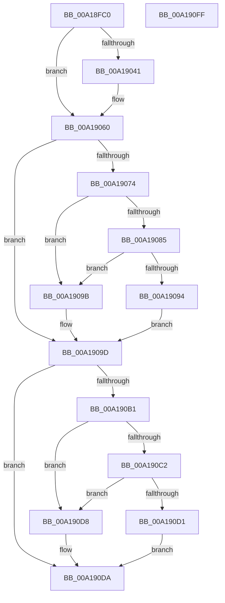

# SdbpMatchOsVersion

- RVA: `0x00A18FC0`–`0x00A19100` (길이 `320` bytes)
- VA: `0x0000000140A18FC0`
- 실행 섹션: `PAGE`
- PDB 이름 있음: `예`; PDB Function 태그: `아니요`
- unwind 정보 RVA: `0x000AA240`
- 디코드: `93`개 명령, `320/320` bytes 표시
- 미해석 바이트: `0` (있으면 어셈블리에 `.byte`로 보존)

> 이 문서는 커널 이미지의 기계어와 PDB 기호를 분석해 생성했습니다. 4번과 5번은 함수 원형과 자료형을 바이너리 사용 방식에서 추정한 C 해석이며 원본 소스 복구 결과는 아닙니다.

## 1. Dependencies

- 직접 호출 지점: **12**; 고유 호출 대상: **8**
- 직접 호출자로 확인된 함수: **1**
- RIP 상대 이미지 참조: **1**

### Outgoing calls
- `0x00A18FF8` → [memset](../../text/6C/memset_function_006C6C40.md) (function, `0x006C6C40`)
- `0x00A1900A` → [RtlGetVersion](RtlGetVersion_function_00A19110.md) (function, `0x00A19110`)
- `0x00A19038` → [SdbFindFirstTag](../95/SdbFindFirstTag_function_0095E34C.md) (function, `0x0095E34C`)
- `0x00A19049` → [SdbReadQWORDTag](../81/SdbReadQWORDTag_function_0081706C.md) (function, `0x0081706C`)
- `0x00A19054` → [SdbpCheckVersion](../81/SdbpCheckVersion_function_00819118.md) (function, `0x00819118`)
- `0x00A1906B` → [SdbFindFirstTag](../95/SdbFindFirstTag_function_0095E34C.md) (function, `0x0095E34C`)
- `0x00A1907C` → [SdbReadQWORDTag](../81/SdbReadQWORDTag_function_0081706C.md) (function, `0x0081706C`)
- `0x00A1908B` → [SdbpCheckFromVersion](../81/SdbpCheckFromVersion_function_00818F14.md) (function, `0x00818F14`)
- `0x00A190A8` → [SdbFindFirstTag](../95/SdbFindFirstTag_function_0095E34C.md) (function, `0x0095E34C`)
- `0x00A190B9` → [SdbReadQWORDTag](../81/SdbReadQWORDTag_function_0081706C.md) (function, `0x0081706C`)
- `0x00A190C8` → [SdbpCheckUptoVersion](../81/SdbpCheckUptoVersion_function_008190D0.md) (function, `0x008190D0`)
- `0x00A190E7` → [_security_check_cookie](../../text/6A/_security_check_cookie_function_006AC640.md) (function, `0x006AC640`)

### Direct callers
- [SdbpCheckForMatch](../AB/SdbpCheckForMatch_function_00AB37BC.md) at `0x00AB380C`

### Static image references
- `0x00A18FCF` → RVA `0x00E0A740` (`.data`; read)

## 2. Other-region calls and transfers

- 다른 실행 섹션으로 향하는 call: **2**
  - `0x00A18FF8` → [memset](../../text/6C/memset_function_006C6C40.md) (`PAGE` → `.text`)
  - `0x00A190E7` → [_security_check_cookie](../../text/6A/_security_check_cookie_function_006AC640.md) (`PAGE` → `.text`)
- 별도 외부 분기/꼬리 이동을 확인하지 못했습니다.

## 3. Assembly (complete function range)

```asm
00A18FC0  48 89 5C 24 18                  mov qword ptr [rsp + 0x18], rbx
00A18FC5  55                              push rbp
00A18FC6  56                              push rsi
00A18FC7  57                              push rdi
00A18FC8  48 81 EC 50 01 00 00            sub rsp, 0x150
00A18FCF  48 8B 05 6A 17 3F 00            mov rax, qword ptr [rip + 0x3f176a]
00A18FD6  48 33 C4                        xor rax, rsp
00A18FD9  48 89 84 24 40 01 00 00         mov qword ptr [rsp + 0x140], rax
00A18FE1  8B EA                           mov ebp, edx
00A18FE3  48 8B F9                        mov rdi, rcx
00A18FE6  33 D2                           xor edx, edx
00A18FE8  48 8D 4C 24 24                  lea rcx, [rsp + 0x24]
00A18FED  41 B8 18 01 00 00               mov r8d, 0x118
00A18FF3  BB 01 00 00 00                  mov ebx, 1
00A18FF8  E8 43 DC CA FF                  call 0x1406c6c40
00A18FFD  48 8D 4C 24 20                  lea rcx, [rsp + 0x20]
00A19002  C7 44 24 20 1C 01 00 00         mov dword ptr [rsp + 0x20], 0x11c
00A1900A  E8 01 01 00 00                  call 0x140a19110
00A1900F  8B 44 24 28                     mov eax, dword ptr [rsp + 0x28]
00A19013  41 B8 1D 50 00 00               mov r8d, 0x501d
00A19019  8B 74 24 24                     mov esi, dword ptr [rsp + 0x24]
00A1901D  8B D5                           mov edx, ebp
00A1901F  48 C1 E6 10                     shl rsi, 0x10
00A19023  48 8B CF                        mov rcx, rdi
00A19026  48 0B F0                        or rsi, rax
00A19029  8B 44 24 2C                     mov eax, dword ptr [rsp + 0x2c]
00A1902D  48 C1 E6 10                     shl rsi, 0x10
00A19031  48 0B F0                        or rsi, rax
00A19034  48 C1 E6 10                     shl rsi, 0x10
00A19038  E8 0F 53 F4 FF                  call 0x14095e34c
00A1903D  85 C0                           test eax, eax
00A1903F  74 1F                           je 0x140a19060
00A19041  45 33 C0                        xor r8d, r8d
00A19044  8B D0                           mov edx, eax
00A19046  48 8B CF                        mov rcx, rdi
00A19049  E8 1E E0 DF FF                  call 0x14081706c
00A1904E  48 8B D6                        mov rdx, rsi
00A19051  48 8B C8                        mov rcx, rax
00A19054  E8 BF 00 E0 FF                  call 0x140819118
00A19059  33 DB                           xor ebx, ebx
00A1905B  85 C0                           test eax, eax
00A1905D  0F 95 C3                        setne bl
00A19060  41 B8 1F 50 00 00               mov r8d, 0x501f
00A19066  8B D5                           mov edx, ebp
00A19068  48 8B CF                        mov rcx, rdi
00A1906B  E8 DC 52 F4 FF                  call 0x14095e34c
00A19070  85 C0                           test eax, eax
00A19072  74 29                           je 0x140a1909d
00A19074  45 33 C0                        xor r8d, r8d
00A19077  8B D0                           mov edx, eax
00A19079  48 8B CF                        mov rcx, rdi
00A1907C  E8 EB DF DF FF                  call 0x14081706c
00A19081  85 DB                           test ebx, ebx
00A19083  74 16                           je 0x140a1909b
00A19085  48 8B D6                        mov rdx, rsi
00A19088  48 8B C8                        mov rcx, rax
00A1908B  E8 84 FE DF FF                  call 0x140818f14
00A19090  85 C0                           test eax, eax
00A19092  74 07                           je 0x140a1909b
00A19094  BB 01 00 00 00                  mov ebx, 1
00A19099  EB 02                           jmp 0x140a1909d
00A1909B  33 DB                           xor ebx, ebx
00A1909D  41 B8 1E 50 00 00               mov r8d, 0x501e
00A190A3  8B D5                           mov edx, ebp
00A190A5  48 8B CF                        mov rcx, rdi
00A190A8  E8 9F 52 F4 FF                  call 0x14095e34c
00A190AD  85 C0                           test eax, eax
00A190AF  74 29                           je 0x140a190da
00A190B1  45 33 C0                        xor r8d, r8d
00A190B4  8B D0                           mov edx, eax
00A190B6  48 8B CF                        mov rcx, rdi
00A190B9  E8 AE DF DF FF                  call 0x14081706c
00A190BE  85 DB                           test ebx, ebx
00A190C0  74 16                           je 0x140a190d8
00A190C2  48 8B D6                        mov rdx, rsi
00A190C5  48 8B C8                        mov rcx, rax
00A190C8  E8 03 00 E0 FF                  call 0x1408190d0
00A190CD  85 C0                           test eax, eax
00A190CF  74 07                           je 0x140a190d8
00A190D1  BB 01 00 00 00                  mov ebx, 1
00A190D6  EB 02                           jmp 0x140a190da
00A190D8  33 DB                           xor ebx, ebx
00A190DA  8B C3                           mov eax, ebx
00A190DC  48 8B 8C 24 40 01 00 00         mov rcx, qword ptr [rsp + 0x140]
00A190E4  48 33 CC                        xor rcx, rsp
00A190E7  E8 54 35 C9 FF                  call 0x1406ac640
00A190EC  48 8B 9C 24 80 01 00 00         mov rbx, qword ptr [rsp + 0x180]
00A190F4  48 81 C4 50 01 00 00            add rsp, 0x150
00A190FB  5F                              pop rdi
00A190FC  5E                              pop rsi
00A190FD  5D                              pop rbp
00A190FE  C3                              ret
00A190FF  CC                              int3
```

## 4. C-style interpretation (structured pseudocode)

```c
__int64 __fastcall SdbpMatchOsVersion(__int64 a1, int a2)
{
    __int64 result;
    __int64 v_rbx;
    __int64 v_rsi;
    __int64 v_rsp;
    unsigned int v_stack_m13C;
    unsigned int v_stack_m140;
    unsigned __int64 v_stack_m144;
    unsigned __int64 v_stack_m148;
    unsigned __int64 v_stack_m28;
    unsigned __int64 v_stack_p18;

    v_stack_p18 = v_rbx;
    v_rsp = (v_rsp) - (336);
    result = (*(unsigned __int64 *)(v_rip + 4134762)) ^ (v_rsp);
    v_stack_m28 = result;
    a2 = 0;
    result = memset(v_stack_m144, a2, 280, a4);
    v_stack_m148 = 284;
    result = RtlGetVersion(v_stack_m148, a2, 280, a4);
    v_rsi = ((unsigned int)(v_stack_m144)) << (16);
    v_rsi = (v_rsi) | ((unsigned int)(v_stack_m140));
    v_rsi = (v_rsi) << (16);
    v_rsi = (v_rsi) | ((unsigned int)(v_stack_m13C));
    v_rsi = (v_rsi) << (16);
    result = SdbFindFirstTag(a1, (unsigned int)((unsigned int)((unsigned int)(a2))), (unsigned int)(0x501DULL), a4);
    v_rbx = 1;
    if ((unsigned int)(result) != 0) {
        a3 = 0;
        a2 = (unsigned int)(result);
        a1 = a1;
        result = SdbReadQWORDTag(a1, a2, a3, a4);
        a2 = v_rsi;
        a1 = result;
        result = SdbpCheckVersion(a1, a2, a3, a4);
        v_rbx = 0;
        v_rbx = ((unsigned int)(result) != 0) ? 1 : 0;
    }
    result = SdbFindFirstTag(a1, (unsigned int)((unsigned int)((unsigned int)(a2))), (unsigned int)(0x501FULL), a4);
    if ((unsigned int)(result) == 0) goto loc_00A1909D;
    a3 = 0;
    result = SdbReadQWORDTag(a1, (unsigned int)((unsigned int)(result)), a3, a4);
    if ((unsigned int)(v_rbx) == 0) goto loc_00A1909B;
    result = SdbpCheckFromVersion(result, v_rsi, a3, a4);
    if ((unsigned int)(result) == 0) goto loc_00A1909B;
    goto loc_00A1909D;
loc_00A1909B:
    v_rbx = 0;
loc_00A1909D:
    result = SdbFindFirstTag(a1, (unsigned int)((unsigned int)((unsigned int)(a2))), (unsigned int)(0x501EULL), a4);
    if ((unsigned int)(result) == 0) goto loc_00A190DA;
    a3 = 0;
    result = SdbReadQWORDTag(a1, (unsigned int)((unsigned int)(result)), a3, a4);
    if (0 == 0) goto loc_00A190D8;
    result = SdbpCheckUptoVersion(result, v_rsi, a3, a4);
    if ((unsigned int)(result) == 0) goto loc_00A190D8;
    goto loc_00A190DA;
loc_00A190D8:
    v_rbx = 0;
loc_00A190DA:
    a1 = (v_stack_m28) ^ (v_rsp);
    result = _security_check_cookie(a1, v_rsi, a3, a4);
    v_rsp = (v_rsp) + (336);
    return result;
}
```

## 5. (Beta) C Style

```c
int64_t SdbpMatchOsVersion(int64_t Arg1, int32_t Arg2)
{
    int64_t result;
    int64_t local_rbx;
    int64_t local_rsi;
    int64_t local_rsp;
    uint32_t v_stack_m13C;
    uint32_t v_stack_m140;
    uint64_t v_stack_m144;
    uint64_t v_stack_m148;
    uint64_t v_stack_m28;
    uint64_t v_stack_p18;

    v_stack_p18 = local_rbx;
    local_rsp = (local_rsp) - (336);
    result = (*(uint64_t *)(v_rip + 0x3F176A)) ^ (local_rsp);
    v_stack_m28 = result;
    Arg2 = 0;
    result = memset(v_stack_m144, Arg2, 280, a4);
    v_stack_m148 = 284;
    result = RtlGetVersion(v_stack_m148, Arg2, 280, a4);
    local_rsi = ((uint32_t)(v_stack_m144)) << (16);
    local_rsi = (local_rsi) | ((uint32_t)(v_stack_m140));
    local_rsi = (local_rsi) << (16);
    local_rsi = (local_rsi) | ((uint32_t)(v_stack_m13C));
    local_rsi = (local_rsi) << (16);
    result = SdbFindFirstTag(Arg1, (uint32_t)((uint32_t)((uint32_t)(Arg2))), (uint32_t)(0x501DULL), a4);
    local_rbx = 1;
    if ((uint32_t)(result) != 0) {
        a3 = 0;
        Arg2 = (uint32_t)(result);
        Arg1 = Arg1;
        result = SdbReadQWORDTag(Arg1, Arg2, a3, a4);
        Arg2 = local_rsi;
        Arg1 = result;
        result = SdbpCheckVersion(Arg1, Arg2, a3, a4);
        local_rbx = 0;
        local_rbx = ((uint32_t)(result) != 0) ? 1 : 0;
    }
    result = SdbFindFirstTag(Arg1, (uint32_t)((uint32_t)((uint32_t)(Arg2))), (uint32_t)(0x501FULL), a4);
    if ((uint32_t)(result) == 0) goto loc_00A1909D;
    a3 = 0;
    result = SdbReadQWORDTag(Arg1, (uint32_t)((uint32_t)(result)), a3, a4);
    if ((uint32_t)(local_rbx) == 0) goto loc_00A1909B;
    result = SdbpCheckFromVersion(result, local_rsi, a3, a4);
    if ((uint32_t)(result) == 0) goto loc_00A1909B;
    goto loc_00A1909D;
loc_00A1909B:
    local_rbx = 0;
loc_00A1909D:
    result = SdbFindFirstTag(Arg1, (uint32_t)((uint32_t)((uint32_t)(Arg2))), (uint32_t)(0x501EULL), a4);
    if ((uint32_t)(result) == 0) goto loc_00A190DA;
    a3 = 0;
    result = SdbReadQWORDTag(Arg1, (uint32_t)((uint32_t)(result)), a3, a4);
    if (0 == 0) goto loc_00A190D8;
    result = SdbpCheckUptoVersion(result, local_rsi, a3, a4);
    if ((uint32_t)(result) == 0) goto loc_00A190D8;
    goto loc_00A190DA;
loc_00A190D8:
    local_rbx = 0;
loc_00A190DA:
    Arg1 = (v_stack_m28) ^ (local_rsp);
    result = _security_check_cookie(Arg1, local_rsi, a3, a4);
    local_rsp = (local_rsp) + (336);
    return result;
}
```

## 6. Execution-region graph

[열기: 2D/3D 그래프와 함수 탐색 컨트롤 패널](../../../control-panel.html?section=page&rva=0x00A18FC0&view=graph)

- 2D 그래프는 위에서 아래로 흐르고, 3D 그래프는 빈 공간을 드래그해 회전합니다. Shift+드래그는 이동, 휠은 확대·축소, 함수 노드 선택은 대상 보고서 이동입니다.

### Static fallback


