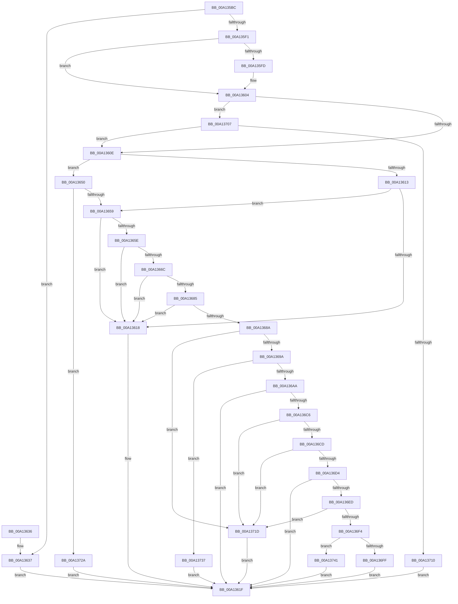

# SeGetImageRequiredSigningLevel

- RVA: `0x00A135BC`–`0x00A13750` (길이 `404` bytes)
- VA: `0x0000000140A135BC`
- 실행 섹션: `PAGE`
- PDB 이름 있음: `예`; PDB Function 태그: `아니요`
- unwind 정보 RVA: `0x000A9A4C`
- 디코드: `104`개 명령, `404/404` bytes 표시
- 미해석 바이트: `0` (있으면 어셈블리에 `.byte`로 보존)

> 이 문서는 커널 이미지의 기계어와 PDB 기호를 분석해 생성했습니다. 4번과 5번은 함수 원형과 자료형을 바이너리 사용 방식에서 추정한 C 해석이며 원본 소스 복구 결과는 아닙니다.

## 1. Dependencies

- 직접 호출 지점: **4**; 고유 호출 대상: **3**
- 직접 호출자로 확인된 함수: **2**
- RIP 상대 이미지 참조: **4**

### Outgoing calls
- `0x00A13647` → [guard_dispatch_icall](../../text/6B/guard_dispatch_icall_function_006BAAD0.md) (function, `0x006BAAD0`)
- `0x00A13663` → [SeCompareSigningLevels](SeCompareSigningLevels_function_00A13760.md) (function, `0x00A13760`)
- `0x00A136B7` → [guard_dispatch_icall](../../text/6B/guard_dispatch_icall_function_006BAAD0.md) (function, `0x006BAAD0`)
- `0x00A136DE` → [RtlIsUntrustedObject](../../text/49/RtlIsUntrustedObject_function_0049BC50.md) (function, `0x0049BC50`)

### Direct callers
- [MiCreateNewSection](../98/MiCreateNewSection_function_00985DB0.md) at `0x0098609E`
- [MiValidateExistingImage](../98/MiValidateExistingImage_function_009864B4.md) at `0x0098658A`

### Static image references
- `0x00A135D0` → RVA `0x00F04EB0` (`.data`; read)
- `0x00A135F1` → RVA `0x00170000` (`PROTDATA`; read)
- `0x00A135FD` → RVA `0x00E67D70` (`.data`; read)
- `0x00A1369A` → RVA `0x00F04E78` (`.data`; read)

## 2. Other-region calls and transfers

- 다른 실행 섹션으로 향하는 call: **3**
  - `0x00A13647` → [guard_dispatch_icall](../../text/6B/guard_dispatch_icall_function_006BAAD0.md) (`PAGE` → `.text`)
  - `0x00A136B7` → [guard_dispatch_icall](../../text/6B/guard_dispatch_icall_function_006BAAD0.md) (`PAGE` → `.text`)
  - `0x00A136DE` → [RtlIsUntrustedObject](../../text/49/RtlIsUntrustedObject_function_0049BC50.md) (`PAGE` → `.text`)
- 별도 외부 분기/꼬리 이동을 확인하지 못했습니다.

## 3. Assembly (complete function range)

```asm
00A135BC  48 8B C4                        mov rax, rsp
00A135BF  48 89 58 08                     mov qword ptr [rax + 8], rbx
00A135C3  48 89 68 10                     mov qword ptr [rax + 0x10], rbp
00A135C7  48 89 70 18                     mov qword ptr [rax + 0x18], rsi
00A135CB  57                              push rdi
00A135CC  48 83 EC 40                     sub rsp, 0x40
00A135D0  4C 8B 15 D9 18 4F 00            mov r10, qword ptr [rip + 0x4f18d9]
00A135D7  33 F6                           xor esi, esi
00A135D9  41 0F B6 D8                     movzx ebx, r8b
00A135DD  48 8B E9                        mov rbp, rcx
00A135E0  40 88 70 E8                     mov byte ptr [rax - 0x18], sil
00A135E4  40 88 70 E9                     mov byte ptr [rax - 0x17], sil
00A135E8  40 88 70 EA                     mov byte ptr [rax - 0x16], sil
00A135EC  4D 85 D2                        test r10, r10
00A135EF  75 46                           jne 0x140a13637
00A135F1  40 8A 3D 08 CA 75 FF            mov dil, byte ptr [rip - 0x8a35f8]
00A135F8  40 84 FF                        test dil, dil
00A135FB  75 07                           jne 0x140a13604
00A135FD  40 8A 3D 6C 47 45 00            mov dil, byte ptr [rip + 0x45476c]
00A13604  40 80 FF 02                     cmp dil, 2
00A13608  0F 84 F9 00 00 00               je 0x140a13707
00A1360E  80 FB 02                        cmp bl, 2
00A13611  74 3D                           je 0x140a13650
00A13613  45 84 C0                        test r8b, r8b
00A13616  75 41                           jne 0x140a13659
00A13618  48 8B 44 24 70                  mov rax, qword ptr [rsp + 0x70]
00A1361D  88 18                           mov byte ptr [rax], bl
00A1361F  48 8B 5C 24 50                  mov rbx, qword ptr [rsp + 0x50]
00A13624  8B C6                           mov eax, esi
00A13626  48 8B 74 24 60                  mov rsi, qword ptr [rsp + 0x60]
00A1362B  48 8B 6C 24 58                  mov rbp, qword ptr [rsp + 0x58]
00A13630  48 83 C4 40                     add rsp, 0x40
00A13634  5F                              pop rdi
00A13635  C3                              ret
00A13636  CC                              int3
00A13637  48 8B 44 24 70                  mov rax, qword ptr [rsp + 0x70]
00A1363C  44 8A C3                        mov r8b, bl
00A1363F  48 89 44 24 20                  mov qword ptr [rsp + 0x20], rax
00A13644  49 8B C2                        mov rax, r10
00A13647  E8 84 74 CA FF                  call 0x1406baad0
00A1364C  8B F0                           mov esi, eax
00A1364E  EB CF                           jmp 0x140a1361f
00A13650  40 84 FF                        test dil, dil
00A13653  0F 84 D1 00 00 00               je 0x140a1372a
00A13659  F6 C2 10                        test dl, 0x10
00A1365C  75 BA                           jne 0x140a13618
00A1365E  8A D3                           mov dl, bl
00A13660  41 8A C9                        mov cl, r9b
00A13663  E8 F8 00 00 00                  call 0x140a13760
00A13668  85 C0                           test eax, eax
00A1366A  75 AC                           jne 0x140a13618
00A1366C  65 48 8B 04 25 88 01 00 00      mov rax, qword ptr gs:[0x188]
00A13675  48 8B 88 B8 00 00 00            mov rcx, qword ptr [rax + 0xb8]
00A1367C  F6 81 FA 05 00 00 07            test byte ptr [rcx + 0x5fa], 7
00A13683  77 93                           ja 0x140a13618
00A13685  80 FB 06                        cmp bl, 6
00A13688  75 8E                           jne 0x140a13618
00A1368A  F7 81 50 07 00 00 00 00 80 00   test dword ptr [rcx + 0x750], 0x800000
00A13694  0F 85 83 00 00 00               jne 0x140a1371d
00A1369A  48 8B 05 D7 17 4F 00            mov rax, qword ptr [rip + 0x4f17d7]
00A136A1  48 85 C0                        test rax, rax
00A136A4  0F 84 8D 00 00 00               je 0x140a13737
00A136AA  4C 8D 44 24 31                  lea r8, [rsp + 0x31]
00A136AF  48 8B CD                        mov rcx, rbp
00A136B2  48 8D 54 24 30                  lea rdx, [rsp + 0x30]
00A136B7  E8 14 74 CA FF                  call 0x1406baad0
00A136BC  8B F0                           mov esi, eax
00A136BE  85 C0                           test eax, eax
00A136C0  0F 88 59 FF FF FF               js 0x140a1361f
00A136C6  80 7C 24 31 00                  cmp byte ptr [rsp + 0x31], 0
00A136CB  75 50                           jne 0x140a1371d
00A136CD  80 7C 24 30 00                  cmp byte ptr [rsp + 0x30], 0
00A136D2  75 49                           jne 0x140a1371d
00A136D4  4C 8D 44 24 32                  lea r8, [rsp + 0x32]
00A136D9  48 8B D5                        mov rdx, rbp
00A136DC  33 C9                           xor ecx, ecx
00A136DE  E8 6D 85 A8 FF                  call 0x14049bc50
00A136E3  8B F0                           mov esi, eax
00A136E5  85 C0                           test eax, eax
00A136E7  0F 88 32 FF FF FF               js 0x140a1361f
00A136ED  80 7C 24 32 00                  cmp byte ptr [rsp + 0x32], 0
00A136F2  75 29                           jne 0x140a1371d
00A136F4  48 8B 44 24 70                  mov rax, qword ptr [rsp + 0x70]
00A136F9  40 80 FF 02                     cmp dil, 2
00A136FD  73 42                           jae 0x140a13741
00A136FF  C6 00 00                        mov byte ptr [rax], 0
00A13702  E9 18 FF FF FF                  jmp 0x140a1361f
00A13707  45 84 C0                        test r8b, r8b
00A1370A  0F 85 FE FE FF FF               jne 0x140a1360e
00A13710  48 8B 44 24 70                  mov rax, qword ptr [rsp + 0x70]
00A13715  C6 00 02                        mov byte ptr [rax], 2
00A13718  E9 02 FF FF FF                  jmp 0x140a1361f
00A1371D  48 8B 44 24 70                  mov rax, qword ptr [rsp + 0x70]
00A13722  C6 00 06                        mov byte ptr [rax], 6
00A13725  E9 F5 FE FF FF                  jmp 0x140a1361f
00A1372A  48 8B 44 24 70                  mov rax, qword ptr [rsp + 0x70]
00A1372F  40 88 30                        mov byte ptr [rax], sil
00A13732  E9 E8 FE FF FF                  jmp 0x140a1361f
00A13737  BE 01 00 00 C0                  mov esi, 0xc0000001
00A1373C  E9 DE FE FF FF                  jmp 0x140a1361f
00A13741  B9 09 00 00 00                  mov ecx, 9
00A13746  0F 45 CB                        cmovne ecx, ebx
00A13749  88 08                           mov byte ptr [rax], cl
00A1374B  E9 CF FE FF FF                  jmp 0x140a1361f
```

## 4. C-style interpretation (structured pseudocode)

```c
__int64 __fastcall SeGetImageRequiredSigningLevel(__int64 a1, unsigned __int8 a2, unsigned __int8 a3, unsigned __int8 a4, __int64 a5)
{
    __int64 result;
    __int64 v_rdi;
    __int64 v_rsi;
    __int64 v_rsp;
    unsigned __int64 v_stack_p10;
    unsigned __int64 v_stack_p18;
    unsigned __int64 v_stack_p20;
    unsigned __int64 v_stack_p30;
    unsigned __int64 v_stack_p31;
    unsigned __int64 v_stack_p32;
    unsigned __int64 v_stack_p8;

    *(unsigned __int64 *)(v_rsp + 8) = v_rbx;
    *(unsigned __int64 *)(v_rsp + 16) = v_rbp;
    *(unsigned __int64 *)(v_rsp + 24) = v_rsi;
    v_rsp = (v_rsp) - (64);
    v_rsi = 0;
    *(unsigned __int8 *)(v_rsp - 24) = 0;
    *(unsigned __int8 *)(v_rsp - 23) = 0;
    *(unsigned __int8 *)(v_rsp - 22) = 0;
    if (*(unsigned __int64 *)(v_rip + 5183705) != 0) goto loc_00A13637;
    v_rdi = *(unsigned __int8 *)(v_rip - 9057784);
    if ((unsigned __int8)(*(unsigned __int8 *)(v_rip - 9057784)) == 0) {
        v_rdi = *(unsigned __int8 *)(v_rip + 4540268);
    }
    if (((unsigned __int8)(v_rdi)) == 2) goto loc_00A13707;
loc_00A1360E:
    if (a3 == 2) goto loc_00A13650;
    if (a3 != 0) goto loc_00A13659;
loc_00A13618:
    *(unsigned __int8 *)(a5) = a3;
loc_00A1361F:
    v_rsp = (v_rsp) + (64);
    return 0;
loc_00A13637:
    v_stack_p20 = a5;
    result = guard_dispatch_icall(a1, a2, (unsigned __int8)(v_stack_p8), a4);
    goto loc_00A1361F;
loc_00A13650:
    if ((unsigned __int8)(v_rdi) == 0) goto loc_00A1372A;
loc_00A13659:
    if (((a2) & (16)) != 0) goto loc_00A13618;
    result = SeCompareSigningLevels(a4, (unsigned __int8)(v_stack_p8), (unsigned __int8)(v_stack_p8), a4);
    if ((unsigned int)(result) != 0) goto loc_00A13618;
    if (condition_is_above) goto loc_00A13618;
    if (((unsigned __int8)(v_stack_p8)) != 6) goto loc_00A13618;
    if (((*(unsigned int *)(*(unsigned __int64 *)(*(unsigned __int64 *)(gs_base + (0 + 392)) + 184) + 1872)) & (0x800000ULL)) != 0) goto loc_00A1371D;
    if (*(unsigned __int64 *)(v_rip + 5183447) == 0) goto loc_00A13737;
    result = guard_dispatch_icall(v_stack_p10, v_stack_p30, v_stack_p31, a4);
    if (sign_flag) goto loc_00A1361F;
    if (v_stack_p31 != 0) goto loc_00A1371D;
    if (v_stack_p30 != 0) goto loc_00A1371D;
    a1 = 0;
    result = RtlIsUntrustedObject(a1, v_stack_p10, v_stack_p32, a4);
    if (sign_flag) goto loc_00A1361F;
    if (v_stack_p32 != 0) goto loc_00A1371D;
    if (((unsigned __int8)(v_rdi)) >= 2) goto loc_00A13741;
    *(unsigned __int8 *)(a5) = 0;
    goto loc_00A1361F;
loc_00A13707:
    if ((unsigned __int8)(v_stack_p32) != 0) goto loc_00A1360E;
    *(unsigned __int8 *)(a5) = 2;
    goto loc_00A1361F;
loc_00A1371D:
    *(unsigned __int8 *)(a5) = 6;
    goto loc_00A1361F;
loc_00A1372A:
    *(unsigned __int8 *)(a5) = (unsigned __int8)((unsigned int)((unsigned int)(result)));
    goto loc_00A1361F;
loc_00A13737:
    goto loc_00A1361F;
loc_00A13741:
    a1 = 9;
    if ((unsigned __int8)(v_stack_p32) != 0) { a1 = (unsigned int)(v_stack_p8); }
    *(unsigned __int8 *)(a5) = (unsigned __int8)(a1);
    goto loc_00A1361F;
}
```

## 5. (Beta) C Style

```c
int64_t SeGetImageRequiredSigningLevel(int64_t Arg1, uint8_t Arg2, uint8_t Arg3, uint8_t Arg4, void *Arg5)
{
    uint8_t *arg5 = (uint8_t *)Arg5;

    int64_t result;
    int64_t local_rdi;
    int64_t local_rsi;
    int64_t local_rsp;
    uint64_t v_stack_p10;
    uint64_t v_stack_p18;
    uint64_t v_stack_p20;
    uint64_t v_stack_p30;
    uint64_t v_stack_p31;
    uint64_t v_stack_p32;
    uint64_t v_stack_p8;

    *(uint64_t *)(local_rsp + 0x8) = local_rbx;
    *(uint64_t *)(local_rsp + 0x10) = local_rbp;
    *(uint64_t *)(local_rsp + 0x18) = local_rsi;
    local_rsp = (local_rsp) - (64);
    local_rsi = 0;
    *(uint8_t *)(local_rsp - 0x18) = 0;
    *(uint8_t *)(local_rsp - 0x17) = 0;
    *(uint8_t *)(local_rsp - 0x16) = 0;
    if (*(uint64_t *)(v_rip + 0x4F18D9) != 0) goto loc_00A13637;
    local_rdi = *(uint8_t *)(v_rip - 0x8A35F8);
    if ((uint8_t)(*(uint8_t *)(v_rip - 0x8A35F8)) == 0) {
        local_rdi = *(uint8_t *)(v_rip + 0x45476C);
    }
    if (((uint8_t)(local_rdi)) == 2) goto loc_00A13707;
loc_00A1360E:
    if (Arg3 == 2) goto loc_00A13650;
    if (Arg3 != 0) goto loc_00A13659;
loc_00A13618:
    *(uint8_t *)(arg5) = Arg3;
loc_00A1361F:
    local_rsp = (local_rsp) + (64);
    return 0;
loc_00A13637:
    v_stack_p20 = Arg5;
    result = guard_dispatch_icall(Arg1, Arg2, (uint8_t)(v_stack_p8), Arg4);
    goto loc_00A1361F;
loc_00A13650:
    if ((uint8_t)(local_rdi) == 0) goto loc_00A1372A;
loc_00A13659:
    if (((Arg2) & (16)) != 0) goto loc_00A13618;
    result = SeCompareSigningLevels(Arg4, (uint8_t)(v_stack_p8), (uint8_t)(v_stack_p8), Arg4);
    if ((uint32_t)(result) != 0) goto loc_00A13618;
    if (condition_is_above) goto loc_00A13618;
    if (((uint8_t)(v_stack_p8)) != 6) goto loc_00A13618;
    if (((*(uint32_t *)(*(uint64_t *)(*(uint64_t *)(gs_base + (0 + 0x188)) + 0xB8) + 0x750)) & (0x800000ULL)) != 0) goto loc_00A1371D;
    if (*(uint64_t *)(v_rip + 0x4F17D7) == 0) goto loc_00A13737;
    result = guard_dispatch_icall(v_stack_p10, v_stack_p30, v_stack_p31, Arg4);
    if (sign_flag) goto loc_00A1361F;
    if (v_stack_p31 != 0) goto loc_00A1371D;
    if (v_stack_p30 != 0) goto loc_00A1371D;
    Arg1 = 0;
    result = RtlIsUntrustedObject(Arg1, v_stack_p10, v_stack_p32, Arg4);
    if (sign_flag) goto loc_00A1361F;
    if (v_stack_p32 != 0) goto loc_00A1371D;
    if (((uint8_t)(local_rdi)) >= 2) goto loc_00A13741;
    *(uint8_t *)(arg5) = 0;
    goto loc_00A1361F;
loc_00A13707:
    if ((uint8_t)(v_stack_p32) != 0) goto loc_00A1360E;
    *(uint8_t *)(arg5) = 2;
    goto loc_00A1361F;
loc_00A1371D:
    *(uint8_t *)(arg5) = 6;
    goto loc_00A1361F;
loc_00A1372A:
    *(uint8_t *)(arg5) = (uint8_t)((uint32_t)((uint32_t)(result)));
    goto loc_00A1361F;
loc_00A13737:
    goto loc_00A1361F;
loc_00A13741:
    Arg1 = 9;
    if ((uint8_t)(v_stack_p32) != 0) { Arg1 = (uint32_t)(v_stack_p8); }
    *(uint8_t *)(arg5) = (uint8_t)(Arg1);
    goto loc_00A1361F;
}
```

### 관측된 메모리 오프셋

구조체 형식이 확인되지 않은 접근은 인자 기준의 오프셋으로만 기록했습니다.

| 기준 인자 | 오프셋 표현 | 폭 (bit) | 접근 |
|---|---:|---:|---|
| `Arg5` | `+ 0x0` | `8` | `W` |

## 6. Execution-region graph

[열기: 2D/3D 그래프와 함수 탐색 컨트롤 패널](../../../control-panel.html?section=page&rva=0x00A135BC&view=graph)

- 2D 그래프는 위에서 아래로 흐르고, 3D 그래프는 빈 공간을 드래그해 회전합니다. Shift+드래그는 이동, 휠은 확대·축소, 함수 노드 선택은 대상 보고서 이동입니다.

### Static fallback


