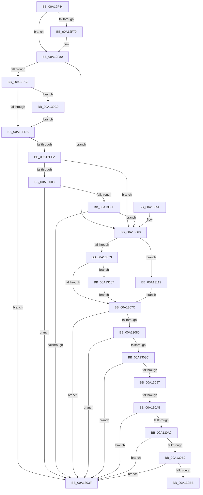

# SeQuerySigningPolicy

- RVA: `0x00A12F44`–`0x00A1311A` (길이 `470` bytes)
- VA: `0x0000000140A12F44`
- 실행 섹션: `PAGE`
- PDB 이름 있음: `예`; PDB Function 태그: `예`
- unwind 정보 RVA: `0x000A99AC`
- 디코드: `125`개 명령, `470/470` bytes 표시
- 미해석 바이트: `0` (있으면 어셈블리에 `.byte`로 보존)

> 이 문서는 커널 이미지의 기계어와 PDB 기호를 분석해 생성했습니다. 4번과 5번은 함수 원형과 자료형을 바이너리 사용 방식에서 추정한 C 해석이며 원본 소스 복구 결과는 아닙니다.

## 1. Dependencies

- 직접 호출 지점: **6**; 고유 호출 대상: **6**
- 직접 호출자로 확인된 함수: **2**
- RIP 상대 이미지 참조: **7**

### Outgoing calls
- `0x00A12FB3` → [SepIsMinTCB](SepIsMinTCB_function_00A13120.md) (function, `0x00A13120`)
- `0x00A12FFD` → [SepIsSystemAppTCB](SepIsSystemAppTCB_function_00A13434.md) (function, `0x00A13434`)
- `0x00A13034` → [SeQuerySigningPolicyWorker](SeQuerySigningPolicyWorker_function_00A13788.md) (function, `0x00A13788`)
- `0x00A1308E` → [SeCompareSigningLevels](SeCompareSigningLevels_function_00A13760.md) (function, `0x00A13760`)
- `0x00A130E7` → [wil_details_FeatureReporting_ReportUsageToService](../../text/53/wil_details_FeatureReporting_ReportUsageToService_function_0053E6E4.md) (function, `0x0053E6E4`)
- `0x00A130FD` → [wil_details_FeatureStateCache_TryEnableDeviceUsageFastPath](../../text/53/wil_details_FeatureStateCache_TryEnableDeviceUsageFastPath_function_0053E774.md) (function, `0x0053E774`)

### Direct callers
- [PspCreateProcess](PspCreateProcess_function_00A12758.md) at `0x00A12A7B`
- [NtCreateUserProcess](../AE/NtCreateUserProcess_function_00AEA680.md) at `0x00AEAB59`
- [NtCreateUserProcess](../AE/NtCreateUserProcess_function_00AEA680.md) at `0x00AEAFB1`

### Static image references
- `0x00A12F64` → RVA `0x00170000` (`PROTDATA`; read)
- `0x00A12F79` → RVA `0x00E67D70` (`.data`; read)
- `0x00A12FC8` → RVA `0x00FC4B40` (`.data`; read)
- `0x00A13097` → RVA `0x00E67D6C` (`.data`; read)
- `0x00A130A9` → RVA `0x00F475F8` (`.data`; read)
- `0x00A130B2` → RVA `0x00F475DC` (`.data`; read)
- `0x00A130D7` → RVA `0x000DF0A8` (`.rdata`; read)

## 2. Other-region calls and transfers

- 다른 실행 섹션으로 향하는 call: **2**
  - `0x00A130E7` → [wil_details_FeatureReporting_ReportUsageToService](../../text/53/wil_details_FeatureReporting_ReportUsageToService_function_0053E6E4.md) (`PAGE` → `.text`)
  - `0x00A130FD` → [wil_details_FeatureStateCache_TryEnableDeviceUsageFastPath](../../text/53/wil_details_FeatureStateCache_TryEnableDeviceUsageFastPath_function_0053E774.md) (`PAGE` → `.text`)
- call이 아닌 외부 분기/꼬리 이동: **2**
  - `0x00A1309F` → [sub_00B36D9A](../B3/Unknown_function_00B36D9A.md) (`tail-transfer`)
  - `0x00A130BB` → [sub_00B36D9A](../B3/Unknown_function_00B36D9A.md) (`tail-transfer`)

## 3. Assembly (complete function range)

```asm
00A12F44  48 8B C4                        mov rax, rsp
00A12F47  48 89 58 10                     mov qword ptr [rax + 0x10], rbx
00A12F4B  48 89 68 18                     mov qword ptr [rax + 0x18], rbp
00A12F4F  48 89 70 20                     mov qword ptr [rax + 0x20], rsi
00A12F53  48 89 48 08                     mov qword ptr [rax + 8], rcx
00A12F57  57                              push rdi
00A12F58  41 54                           push r12
00A12F5A  41 55                           push r13
00A12F5C  41 56                           push r14
00A12F5E  41 57                           push r15
00A12F60  48 83 EC 50                     sub rsp, 0x50
00A12F64  44 8A 35 95 D0 75 FF            mov r14b, byte ptr [rip - 0x8a2f6b]
00A12F6B  41 8A D9                        mov bl, r9b
00A12F6E  45 8B E0                        mov r12d, r8d
00A12F71  4C 8B EA                        mov r13, rdx
00A12F74  45 84 F6                        test r14b, r14b
00A12F77  75 07                           jne 0x140a12f80
00A12F79  44 8A 35 F0 4D 45 00            mov r14b, byte ptr [rip + 0x454df0]
00A12F80  4C 8B BC 24 B0 00 00 00         mov r15, qword ptr [rsp + 0xb0]
00A12F88  45 8A CE                        mov r9b, r14b
00A12F8B  48 8B B4 24 A8 00 00 00         mov rsi, qword ptr [rsp + 0xa8]
00A12F93  44 8A C3                        mov r8b, bl
00A12F96  48 8B BC 24 A0 00 00 00         mov rdi, qword ptr [rsp + 0xa0]
00A12F9E  41 8B D4                        mov edx, r12d
00A12FA1  4C 89 7C 24 30                  mov qword ptr [rsp + 0x30], r15
00A12FA6  49 8B CD                        mov rcx, r13
00A12FA9  48 89 74 24 28                  mov qword ptr [rsp + 0x28], rsi
00A12FAE  48 89 7C 24 20                  mov qword ptr [rsp + 0x20], rdi
00A12FB3  E8 68 01 00 00                  call 0x140a13120
00A12FB8  8B E8                           mov ebp, eax
00A12FBA  85 C0                           test eax, eax
00A12FBC  0F 89 9E 00 00 00               jns 0x140a13060
00A12FC2  48 83 64 24 40 00               and qword ptr [rsp + 0x40], 0
00A12FC8  8B 05 72 1B 5B 00               mov eax, dword ptr [rip + 0x5b1b72]
00A12FCE  89 44 24 40                     mov dword ptr [rsp + 0x40], eax
00A12FD2  A8 10                           test al, 0x10
00A12FD4  0F 84 E6 00 00 00               je 0x140a130c0
00A12FDA  81 FD 25 02 00 C0               cmp ebp, 0xc0000225
00A12FE0  75 5D                           jne 0x140a1303f
00A12FE2  4C 89 7C 24 30                  mov qword ptr [rsp + 0x30], r15
00A12FE7  45 8A CE                        mov r9b, r14b
00A12FEA  48 89 74 24 28                  mov qword ptr [rsp + 0x28], rsi
00A12FEF  44 8A C3                        mov r8b, bl
00A12FF2  41 8B D4                        mov edx, r12d
00A12FF5  48 89 7C 24 20                  mov qword ptr [rsp + 0x20], rdi
00A12FFA  49 8B CD                        mov rcx, r13
00A12FFD  E8 32 04 00 00                  call 0x140a13434
00A13002  8B E8                           mov ebp, eax
00A13004  85 C0                           test eax, eax
00A13006  79 58                           jns 0x140a13060
00A13008  3D 25 02 00 C0                  cmp eax, 0xc0000225
00A1300D  75 30                           jne 0x140a1303f
00A1300F  48 8B 8C 24 80 00 00 00         mov rcx, qword ptr [rsp + 0x80]
00A13017  44 8A CB                        mov r9b, bl
00A1301A  4C 89 7C 24 38                  mov qword ptr [rsp + 0x38], r15
00A1301F  45 8B C4                        mov r8d, r12d
00A13022  48 89 74 24 30                  mov qword ptr [rsp + 0x30], rsi
00A13027  49 8B D5                        mov rdx, r13
00A1302A  48 89 7C 24 28                  mov qword ptr [rsp + 0x28], rdi
00A1302F  44 88 74 24 20                  mov byte ptr [rsp + 0x20], r14b
00A13034  E8 4F 07 00 00                  call 0x140a13788
00A13039  8B E8                           mov ebp, eax
00A1303B  85 C0                           test eax, eax
00A1303D  79 21                           jns 0x140a13060
00A1303F  4C 8D 5C 24 50                  lea r11, [rsp + 0x50]
00A13044  8B C5                           mov eax, ebp
00A13046  49 8B 5B 38                     mov rbx, qword ptr [r11 + 0x38]
00A1304A  49 8B 6B 40                     mov rbp, qword ptr [r11 + 0x40]
00A1304E  49 8B 73 48                     mov rsi, qword ptr [r11 + 0x48]
00A13052  49 8B E3                        mov rsp, r11
00A13055  41 5F                           pop r15
00A13057  41 5E                           pop r14
00A13059  41 5D                           pop r13
00A1305B  41 5C                           pop r12
00A1305D  5F                              pop rdi
00A1305E  C3                              ret
00A1305F  CC                              int3
00A13060  41 0F B6 0F                     movzx ecx, byte ptr [r15]
00A13064  41 B4 30                        mov r12b, 0x30
00A13067  83 E1 07                        and ecx, 7
00A1306A  83 E9 01                        sub ecx, 1
00A1306D  0F 84 9F 00 00 00               je 0x140a13112
00A13073  83 F9 01                        cmp ecx, 1
00A13076  0F 84 8B 00 00 00               je 0x140a13107
00A1307C  85 ED                           test ebp, ebp
00A1307E  78 BF                           js 0x140a1303f
00A13080  8A 0F                           mov cl, byte ptr [rdi]
00A13082  B3 08                           mov bl, 8
00A13084  8A C1                           mov al, cl
00A13086  24 0F                           and al, 0xf
00A13088  3A C3                           cmp al, bl
00A1308A  74 B3                           je 0x140a1303f
00A1308C  8A D3                           mov dl, bl
00A1308E  E8 CD 06 00 00                  call 0x140a13760
00A13093  85 C0                           test eax, eax
00A13095  74 A8                           je 0x140a1303f
00A13097  8B 05 CF 4C 45 00               mov eax, dword ptr [rip + 0x454ccf]
00A1309D  A8 04                           test al, 4
00A1309F  0F 85 F5 3C 12 00               jne 0x140b36d9a
00A130A5  A8 02                           test al, 2
00A130A7  74 96                           je 0x140a1303f
00A130A9  80 3D 48 45 53 00 00            cmp byte ptr [rip + 0x534548], 0
00A130B0  74 8D                           je 0x140a1303f
00A130B2  80 3D 23 45 53 00 00            cmp byte ptr [rip + 0x534523], 0
00A130B9  75 84                           jne 0x140a1303f
00A130BB  E9 DA 3C 12 00                  jmp 0x140b36d9a
00A130C0  48 8B 4C 24 40                  mov rcx, qword ptr [rsp + 0x40]
00A130C5  41 B9 01 00 00 00               mov r9d, 1
00A130CB  48 89 4C 24 40                  mov qword ptr [rsp + 0x40], rcx
00A130D0  41 0B C1                        or eax, r9d
00A130D3  89 44 24 40                     mov dword ptr [rsp + 0x40], eax
00A130D7  48 8D 0D CA BF 6C FF            lea rcx, [rip - 0x934036]
00A130DE  48 8B 54 24 40                  mov rdx, qword ptr [rsp + 0x40]
00A130E3  45 8D 41 02                     lea r8d, [r9 + 2]
00A130E7  E8 F8 B5 B2 FF                  call 0x14053e6e4
00A130EC  48 8B 4C 24 40                  mov rcx, qword ptr [rsp + 0x40]
00A130F1  4C 8D 05 B0 BF 6C FF            lea r8, [rip - 0x934050]
00A130F8  BA 03 00 00 00                  mov edx, 3
00A130FD  E8 72 B6 B2 FF                  call 0x14053e774
00A13102  E9 D3 FE FF FF                  jmp 0x140a12fda
00A13107  80 0F 10                        or byte ptr [rdi], 0x10
00A1310A  80 0E 10                        or byte ptr [rsi], 0x10
00A1310D  E9 6A FF FF FF                  jmp 0x140a1307c
00A13112  44 08 27                        or byte ptr [rdi], r12b
00A13115  E9 62 FF FF FF                  jmp 0x140a1307c
```

## 4. C-style interpretation (structured pseudocode)

```c
__int64 __fastcall SeQuerySigningPolicy(__int64 a1, __int64 a2, int a3, unsigned __int8 a4, __int64 a5, __int64 a6, __int64 a7)
{
    __int64 result;
    __int64 v_r14;
    __int64 v_rsp;
    unsigned __int64 v_stack_m10;
    unsigned __int64 v_stack_m28;
    unsigned __int64 v_stack_m38;
    unsigned __int64 v_stack_m40;
    unsigned __int64 v_stack_m48;
    unsigned __int64 v_stack_m50;
    unsigned __int64 v_stack_m58;
    unsigned __int64 v_stack_p8;

    *(unsigned __int64 *)(v_rsp + 16) = v_rbx;
    *(unsigned __int64 *)(v_rsp + 24) = v_rbp;
    *(unsigned __int64 *)(v_rsp + 32) = v_rsi;
    *(unsigned __int64 *)(v_rsp + 8) = a1;
    v_rsp = (v_rsp) - (80);
    v_r14 = *(unsigned __int8 *)(v_rip - 9056107);
    if ((unsigned __int8)(*(unsigned __int8 *)(v_rip - 9056107)) == 0) {
        v_r14 = *(unsigned __int8 *)(v_rip + 4541936);
    }
    v_stack_m48 = a7;
    v_stack_m50 = a6;
    v_stack_m58 = a5;
    result = SepIsMinTCB(a2, (unsigned int)((unsigned int)((unsigned int)(a3))), a4, (unsigned __int8)(v_r14));
    if (!sign_flag) goto loc_00A13060;
    v_stack_m38 = (unsigned int)((unsigned int)(*(unsigned int *)(v_rip + 5970802)));
    if ((((unsigned __int8)((unsigned int)(*(unsigned int *)(v_rip + 5970802)))) & (16)) == 0) goto loc_00A130C0;
loc_00A12FDA:
    if (((unsigned int)((unsigned int)((unsigned int)(result)))) != 0xC0000225ULL) goto loc_00A1303F;
    v_stack_m48 = a7;
    v_stack_m50 = a6;
    v_stack_m58 = a5;
    result = SepIsSystemAppTCB(a2, (unsigned int)((unsigned int)((unsigned int)(a3))), a4, (unsigned __int8)(v_r14));
    if (!sign_flag) goto loc_00A13060;
    if (((unsigned int)(result)) != 0xC0000225ULL) goto loc_00A1303F;
    v_stack_m40 = a7;
    v_stack_m48 = a6;
    v_stack_m50 = a5;
    v_stack_m58 = (unsigned __int8)(v_r14);
    result = SeQuerySigningPolicyWorker(v_stack_p8, a2, (unsigned int)((unsigned int)((unsigned int)(a3))), a4);
    if (!sign_flag) goto loc_00A13060;
loc_00A1303F:
    return (unsigned int)((unsigned int)((unsigned int)((unsigned int)(result))));
loc_00A13060:
    a1 = (unsigned int)((*(unsigned __int8 *)(a7)) & (7));
    a1 = (unsigned int)((a1) - (1));
    if (condition_is_equal) goto loc_00A13112;
    if (((unsigned int)(a1)) == 1) goto loc_00A13107;
loc_00A1307C:
    if (sign_flag) goto loc_00A1303F;
    result = (unsigned __int8)(((unsigned __int8)(*(unsigned __int8 *)(a5))) & (15));
    if (((unsigned __int8)(result)) == 8) goto loc_00A1303F;
    result = SeCompareSigningLevels(*(unsigned __int8 *)(a5), 8, (unsigned int)((unsigned int)((unsigned int)(a3))), a4);
    if ((unsigned int)(result) == 0) goto loc_00A1303F;
    if ((((unsigned __int8)((unsigned int)(*(unsigned int *)(v_rip + 4541647)))) & (2)) == 0) goto loc_00A1303F;
    if ((*(unsigned __int8 *)(v_rip + 5457224)) == 0) goto loc_00A1303F;
    if ((*(unsigned __int8 *)(v_rip + 5457187)) != 0) goto loc_00A1303F;
loc_00A130C0:
    v_stack_m10 = v_stack_m10;
    result = (unsigned int)(((unsigned int)(*(unsigned int *)(v_rip + 4541647))) | (1));
    v_stack_m10 = (unsigned int)(result);
    result = wil_details_FeatureReporting_ReportUsageToService(v_rip - 9650230, v_stack_m10, 1 + 2, 1);
    result = wil_details_FeatureStateCache_TryEnableDeviceUsageFastPath(v_stack_m10, 3, v_rip - 9650256, 1);
    goto loc_00A12FDA;
loc_00A13107:
    goto loc_00A1307C;
loc_00A13112:
    goto loc_00A1307C;
}
```

## 5. (Beta) C Style

```c
int64_t SeQuerySigningPolicy(int64_t Arg1, int64_t Arg2, int32_t Arg3, uint8_t Arg4, void *Arg5, void *Arg6, void *Arg7)
{
    uint8_t *arg5 = (uint8_t *)Arg5;
    uint8_t *arg6 = (uint8_t *)Arg6;
    uint8_t *arg7 = (uint8_t *)Arg7;

    int64_t result;
    int64_t local_r14;
    int64_t local_rsp;
    uint64_t v_stack_m10;
    uint64_t v_stack_m28;
    uint64_t v_stack_m38;
    uint64_t v_stack_m40;
    uint64_t v_stack_m48;
    uint64_t v_stack_m50;
    uint64_t v_stack_m58;
    uint64_t v_stack_p8;

    *(uint64_t *)(local_rsp + 0x10) = local_rbx;
    *(uint64_t *)(local_rsp + 0x18) = local_rbp;
    *(uint64_t *)(local_rsp + 0x20) = local_rsi;
    *(uint64_t *)(local_rsp + 0x8) = Arg1;
    local_rsp = (local_rsp) - (80);
    local_r14 = *(uint8_t *)(v_rip - 0x8A2F6B);
    if ((uint8_t)(*(uint8_t *)(v_rip - 0x8A2F6B)) == 0) {
        local_r14 = *(uint8_t *)(v_rip + 0x454DF0);
    }
    v_stack_m48 = Arg7;
    v_stack_m50 = Arg6;
    v_stack_m58 = Arg5;
    result = SepIsMinTCB(Arg2, (uint32_t)((uint32_t)((uint32_t)(Arg3))), Arg4, (uint8_t)(local_r14));
    if (!sign_flag) goto loc_00A13060;
    v_stack_m38 = (uint32_t)((uint32_t)(*(uint32_t *)(v_rip + 0x5B1B72)));
    if ((((uint8_t)((uint32_t)(*(uint32_t *)(v_rip + 0x5B1B72)))) & (16)) == 0) goto loc_00A130C0;
loc_00A12FDA:
    if (((uint32_t)((uint32_t)((uint32_t)(result)))) != 0xC0000225ULL) goto loc_00A1303F;
    v_stack_m48 = Arg7;
    v_stack_m50 = Arg6;
    v_stack_m58 = Arg5;
    result = SepIsSystemAppTCB(Arg2, (uint32_t)((uint32_t)((uint32_t)(Arg3))), Arg4, (uint8_t)(local_r14));
    if (!sign_flag) goto loc_00A13060;
    if (((uint32_t)(result)) != 0xC0000225ULL) goto loc_00A1303F;
    v_stack_m40 = Arg7;
    v_stack_m48 = Arg6;
    v_stack_m50 = Arg5;
    v_stack_m58 = (uint8_t)(local_r14);
    result = SeQuerySigningPolicyWorker(v_stack_p8, Arg2, (uint32_t)((uint32_t)((uint32_t)(Arg3))), Arg4);
    if (!sign_flag) goto loc_00A13060;
loc_00A1303F:
    return (uint32_t)((uint32_t)((uint32_t)((uint32_t)(result))));
loc_00A13060:
    Arg1 = (uint32_t)((*(uint8_t *)(arg7)) & (7));
    Arg1 = (uint32_t)((Arg1) - (1));
    if (condition_is_equal) goto loc_00A13112;
    if (((uint32_t)(Arg1)) == 1) goto loc_00A13107;
loc_00A1307C:
    if (sign_flag) goto loc_00A1303F;
    result = (uint8_t)(((uint8_t)(*(uint8_t *)(arg5))) & (15));
    if (((uint8_t)(result)) == 8) goto loc_00A1303F;
    result = SeCompareSigningLevels(*(uint8_t *)(arg5), 8, (uint32_t)((uint32_t)((uint32_t)(Arg3))), Arg4);
    if ((uint32_t)(result) == 0) goto loc_00A1303F;
    if ((((uint8_t)((uint32_t)(*(uint32_t *)(v_rip + 0x454CCF)))) & (2)) == 0) goto loc_00A1303F;
    if ((*(uint8_t *)(v_rip + 0x534548)) == 0) goto loc_00A1303F;
    if ((*(uint8_t *)(v_rip + 0x534523)) != 0) goto loc_00A1303F;
loc_00A130C0:
    v_stack_m10 = v_stack_m10;
    result = (uint32_t)(((uint32_t)(*(uint32_t *)(v_rip + 0x454CCF))) | (1));
    v_stack_m10 = (uint32_t)(result);
    result = wil_details_FeatureReporting_ReportUsageToService(v_rip - 9650230, v_stack_m10, 1 + 2, 1);
    result = wil_details_FeatureStateCache_TryEnableDeviceUsageFastPath(v_stack_m10, 3, v_rip - 9650256, 1);
    goto loc_00A12FDA;
loc_00A13107:
    goto loc_00A1307C;
loc_00A13112:
    goto loc_00A1307C;
}
```

### 관측된 메모리 오프셋

구조체 형식이 확인되지 않은 접근은 인자 기준의 오프셋으로만 기록했습니다.

| 기준 인자 | 오프셋 표현 | 폭 (bit) | 접근 |
|---|---:|---:|---|
| `Arg5` | `+ 0x0` | `8` | `R` |
| `Arg5` | `+ 0x0` | `8` | `R/W` |
| `Arg6` | `+ 0x0` | `8` | `R/W` |
| `Arg7` | `+ 0x0` | `8` | `R` |

## 6. Execution-region graph

[열기: 2D/3D 그래프와 함수 탐색 컨트롤 패널](../../../control-panel.html?section=page&rva=0x00A12F44&view=graph)

- 2D 그래프는 위에서 아래로 흐르고, 3D 그래프는 빈 공간을 드래그해 회전합니다. Shift+드래그는 이동, 휠은 확대·축소, 함수 노드 선택은 대상 보고서 이동입니다.

### Static fallback


