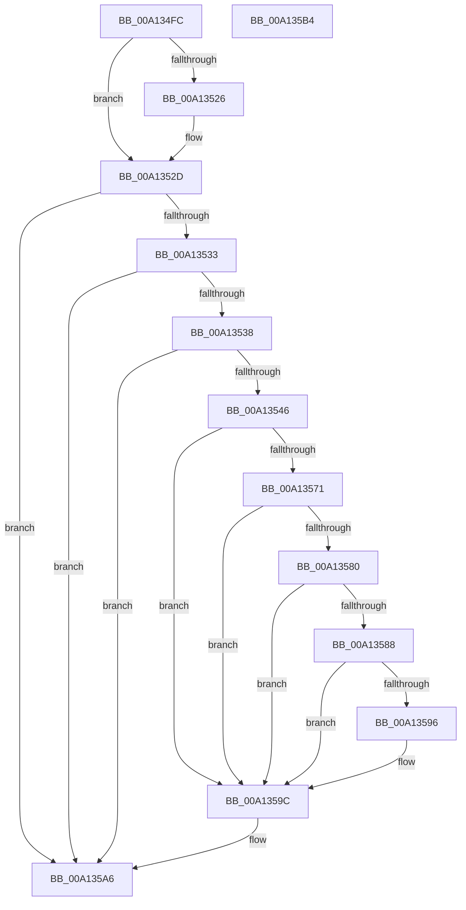

# SepCheckAndSetAuditModeForProcess

- RVA: `0x00A134FC`–`0x00A135B5` (길이 `185` bytes)
- VA: `0x0000000140A134FC`
- 실행 섹션: `PAGE`
- PDB 이름 있음: `예`; PDB Function 태그: `아니요`
- unwind 정보 RVA: `0x000A9A38`
- 디코드: `54`개 명령, `185/185` bytes 표시
- 미해석 바이트: `0` (있으면 어셈블리에 `.byte`로 보존)

> 이 문서는 커널 이미지의 기계어와 PDB 기호를 분석해 생성했습니다. 4번과 5번은 함수 원형과 자료형을 바이너리 사용 방식에서 추정한 C 해석이며 원본 소스 복구 결과는 아닙니다.

## 1. Dependencies

- 직접 호출 지점: **4**; 고유 호출 대상: **4**
- 직접 호출자로 확인된 함수: **2**
- RIP 상대 이미지 참조: **3**

### Outgoing calls
- `0x00A1353D` → [RtlpOpenImageFileOptionsKeyEx](../A3/RtlpOpenImageFileOptionsKeyEx_function_00A3B8A8.md) (function, `0x00A3B8A8`)
- `0x00A13568` → [RtlQueryImageFileKeyOption](../A2/RtlQueryImageFileKeyOption_function_00A2D110.md) (function, `0x00A2D110`)
- `0x00A1358D` → [SeCompareSigningLevels](SeCompareSigningLevels_function_00A13760.md) (function, `0x00A13760`)
- `0x00A135A1` → [ZwClose](../../text/6A/ZwClose_function_006AD2B0.md) (function, `0x006AD2B0`)

### Direct callers
- [SepIsImageInMinTcbList](SepIsImageInMinTcbList_function_00A12DE0.md) at `0x00A12EDD`
- [SepIsMinTCB](SepIsMinTCB_function_00A13120.md) at `0x00A13386`

### Static image references
- `0x00A1351A` → RVA `0x00170000` (`PROTDATA`; read)
- `0x00A13526` → RVA `0x00E67D70` (`.data`; read)
- `0x00A13556` → RVA `0x00B05C60` (` ?? ::NNGAKEGL::`string'`; read)

## 2. Other-region calls and transfers

- 다른 실행 섹션으로 향하는 call: **1**
  - `0x00A135A1` → [ZwClose](../../text/6A/ZwClose_function_006AD2B0.md) (`PAGE` → `.text`)
- 별도 외부 분기/꼬리 이동을 확인하지 못했습니다.

## 3. Assembly (complete function range)

```asm
00A134FC  48 89 5C 24 08                  mov qword ptr [rsp + 8], rbx
00A13501  56                              push rsi
00A13502  57                              push rdi
00A13503  41 56                           push r14
00A13505  48 83 EC 30                     sub rsp, 0x30
00A13509  83 64 24 60 00                  and dword ptr [rsp + 0x60], 0
00A1350E  49 8B F0                        mov rsi, r8
00A13511  48 83 64 24 68 00               and qword ptr [rsp + 0x68], 0
00A13517  4C 8B F2                        mov r14, rdx
00A1351A  40 8A 3D DF CA 75 FF            mov dil, byte ptr [rip - 0x8a3521]
00A13521  40 84 FF                        test dil, dil
00A13524  75 07                           jne 0x140a1352d
00A13526  40 8A 3D 43 48 45 00            mov dil, byte ptr [rip + 0x454843]
00A1352D  41 80 38 00                     cmp byte ptr [r8], 0
00A13531  75 73                           jne 0x140a135a6
00A13533  40 38 3A                        cmp byte ptr [rdx], dil
00A13536  75 6E                           jne 0x140a135a6
00A13538  4C 8D 4C 24 68                  lea r9, [rsp + 0x68]
00A1353D  E8 66 83 02 00                  call 0x140a3b8a8
00A13542  85 C0                           test eax, eax
00A13544  78 60                           js 0x140a135a6
00A13546  48 83 64 24 28 00               and qword ptr [rsp + 0x28], 0
00A1354C  4C 8D 4C 24 60                  lea r9, [rsp + 0x60]
00A13551  48 8B 4C 24 68                  mov rcx, qword ptr [rsp + 0x68]
00A13556  48 8D 15 03 27 0F 00            lea rdx, [rip + 0xf2703]
00A1355D  41 B8 04 00 00 00               mov r8d, 4
00A13563  44 89 44 24 20                  mov dword ptr [rsp + 0x20], r8d
00A13568  E8 A3 9B 01 00                  call 0x140a2d110
00A1356D  85 C0                           test eax, eax
00A1356F  78 2B                           js 0x140a1359c
00A13571  8B 5C 24 60                     mov ebx, dword ptr [rsp + 0x60]
00A13575  83 E3 0F                        and ebx, 0xf
00A13578  8D 43 FE                        lea eax, [rbx - 2]
00A1357B  83 F8 0D                        cmp eax, 0xd
00A1357E  77 1C                           ja 0x140a1359c
00A13580  40 0F B6 C7                     movzx eax, dil
00A13584  3B D8                           cmp ebx, eax
00A13586  74 14                           je 0x140a1359c
00A13588  40 8A D7                        mov dl, dil
00A1358B  8A CB                           mov cl, bl
00A1358D  E8 CE 01 00 00                  call 0x140a13760
00A13592  85 C0                           test eax, eax
00A13594  74 06                           je 0x140a1359c
00A13596  41 88 1E                        mov byte ptr [r14], bl
00A13599  C6 06 08                        mov byte ptr [rsi], 8
00A1359C  48 8B 4C 24 68                  mov rcx, qword ptr [rsp + 0x68]
00A135A1  E8 0A 9D C9 FF                  call 0x1406ad2b0
00A135A6  48 8B 5C 24 50                  mov rbx, qword ptr [rsp + 0x50]
00A135AB  48 83 C4 30                     add rsp, 0x30
00A135AF  41 5E                           pop r14
00A135B1  5F                              pop rdi
00A135B2  5E                              pop rsi
00A135B3  C3                              ret
00A135B4  CC                              int3
```

## 4. C-style interpretation (structured pseudocode)

```c
__int64 __fastcall SepCheckAndSetAuditModeForProcess(__int64 a1, __int64 a2, __int64 a3)
{
    __int64 result;
    __int64 v_rbx;
    __int64 v_rdi;
    __int64 v_rsp;
    unsigned __int64 v_stack_m20;
    unsigned int v_stack_m28;
    unsigned int v_stack_p18;
    unsigned __int64 v_stack_p20;
    unsigned __int64 v_stack_p8;

    v_stack_p8 = v_rbx;
    v_rsp = (v_rsp) - (48);
    v_rdi = *(unsigned __int8 *)(v_rip - 9057569);
    if ((unsigned __int8)(*(unsigned __int8 *)(v_rip - 9057569)) == 0) {
        v_rdi = *(unsigned __int8 *)(v_rip + 4540483);
    }
    if ((*(unsigned __int8 *)(a3)) != 0) goto loc_00A135A6;
    if ((*(unsigned __int8 *)(a2)) != ((unsigned __int8)(v_rdi))) goto loc_00A135A6;
    result = RtlpOpenImageFileOptionsKeyEx(a1, a2, a3, v_stack_p20);
    if (sign_flag) goto loc_00A135A6;
    v_stack_m28 = 4;
    result = RtlQueryImageFileKeyOption(v_stack_p20, v_rip + 993027, 4, v_stack_p18);
    if (sign_flag) goto loc_00A1359C;
    v_rbx = (unsigned int)(((unsigned int)(v_stack_p18)) & (15));
    if (((unsigned int)(v_rbx - 2)) > 13) goto loc_00A1359C;
    if (((unsigned int)(v_rbx)) == ((unsigned int)((unsigned __int8)(v_rdi)))) goto loc_00A1359C;
    result = SeCompareSigningLevels((unsigned __int8)(v_rbx), (unsigned __int8)(v_rdi), 4, v_stack_p18);
    if ((unsigned int)(result) != 0) {
        *(unsigned __int8 *)(a2) = (unsigned __int8)(v_rbx);
        *(unsigned __int8 *)(a3) = 8;
    }
    result = ZwClose(v_stack_p20, (unsigned __int8)(v_rdi), 4, v_stack_p18);
loc_00A135A6:
    v_rsp = (v_rsp) + (48);
    return result;
}
```

## 5. (Beta) C Style

```c
int64_t SepCheckAndSetAuditModeForProcess(int64_t Arg1, void *Arg2, void *Arg3)
{
    uint8_t *arg2 = (uint8_t *)Arg2;
    uint8_t *arg3 = (uint8_t *)Arg3;

    int64_t result;
    int64_t local_rbx;
    int64_t local_rdi;
    int64_t local_rsp;
    uint64_t v_stack_m20;
    uint32_t v_stack_m28;
    uint32_t v_stack_p18;
    uint64_t v_stack_p20;
    uint64_t v_stack_p8;

    v_stack_p8 = local_rbx;
    local_rsp = (local_rsp) - (48);
    local_rdi = *(uint8_t *)(v_rip - 0x8A3521);
    if ((uint8_t)(*(uint8_t *)(v_rip - 0x8A3521)) == 0) {
        local_rdi = *(uint8_t *)(v_rip + 0x454843);
    }
    if ((*(uint8_t *)(arg3)) != 0) goto loc_00A135A6;
    if ((*(uint8_t *)(arg2)) != ((uint8_t)(local_rdi))) goto loc_00A135A6;
    result = RtlpOpenImageFileOptionsKeyEx(Arg1, Arg2, Arg3, v_stack_p20);
    if (sign_flag) goto loc_00A135A6;
    v_stack_m28 = 4;
    result = RtlQueryImageFileKeyOption(v_stack_p20, v_rip + 993027, 4, v_stack_p18);
    if (sign_flag) goto loc_00A1359C;
    local_rbx = (uint32_t)(((uint32_t)(v_stack_p18)) & (15));
    if (((uint32_t)(local_rbx - 2)) > 13) goto loc_00A1359C;
    if (((uint32_t)(local_rbx)) == ((uint32_t)((uint8_t)(local_rdi)))) goto loc_00A1359C;
    result = SeCompareSigningLevels((uint8_t)(local_rbx), (uint8_t)(local_rdi), 4, v_stack_p18);
    if ((uint32_t)(result) != 0) {
        *(uint8_t *)(arg2) = (uint8_t)(local_rbx);
        *(uint8_t *)(arg3) = 8;
    }
    result = ZwClose(v_stack_p20, (uint8_t)(local_rdi), 4, v_stack_p18);
loc_00A135A6:
    local_rsp = (local_rsp) + (48);
    return result;
}
```

### 관측된 메모리 오프셋

구조체 형식이 확인되지 않은 접근은 인자 기준의 오프셋으로만 기록했습니다.

| 기준 인자 | 오프셋 표현 | 폭 (bit) | 접근 |
|---|---:|---:|---|
| `Arg2` | `+ 0x0` | `8` | `R` |
| `Arg2` | `+ 0x0` | `8` | `W` |
| `Arg3` | `+ 0x0` | `8` | `R` |
| `Arg3` | `+ 0x0` | `8` | `W` |

## 6. Execution-region graph

[열기: 2D/3D 그래프와 함수 탐색 컨트롤 패널](../../../control-panel.html?section=page&rva=0x00A134FC&view=graph)

- 2D 그래프는 위에서 아래로 흐르고, 3D 그래프는 빈 공간을 드래그해 회전합니다. Shift+드래그는 이동, 휠은 확대·축소, 함수 노드 선택은 대상 보고서 이동입니다.

### Static fallback


