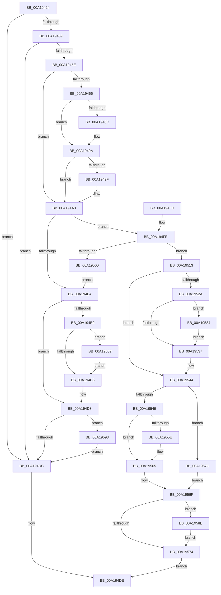

# SepDereferenceCachedHandlesEntryInternal

- RVA: `0x00A19424`–`0x00A1959B` (길이 `375` bytes)
- VA: `0x0000000140A19424`
- 실행 섹션: `PAGE`
- PDB 이름 있음: `예`; PDB Function 태그: `아니요`
- unwind 정보 RVA: `0x000AA304`
- 디코드: `111`개 명령, `375/375` bytes 표시
- 미해석 바이트: `0` (있으면 어셈블리에 `.byte`로 보존)

> 이 문서는 커널 이미지의 기계어와 PDB 기호를 분석해 생성했습니다. 4번과 5번은 함수 원형과 자료형을 바이너리 사용 방식에서 추정한 C 해석이며 원본 소스 복구 결과는 아닙니다.

## 1. Dependencies

- 직접 호출 지점: **12**; 고유 호출 대상: **8**
- 직접 호출자로 확인된 함수: **4**
- RIP 상대 이미지 참조: **0**

### Outgoing calls
- `0x00A1947C` → [KeAbPreAcquire](../../text/21/KeAbPreAcquire_function_00210230.md) (function, `0x00210230`)
- `0x00A19495` → [ExfAcquirePushLockExclusiveEx](../../text/20/ExfAcquirePushLockExclusiveEx_function_0020FC90.md) (function, `0x0020FC90`)
- `0x00A194C9` → [KeAbPostRelease](../../text/2E/KeAbPostRelease_function_002E1600.md) (function, `0x002E1600`)
- `0x00A194CE` → [KeLeaveCriticalRegion](../../text/25/KeLeaveCriticalRegion_function_0025D8B0.md) (function, `0x0025D8B0`)
- `0x00A1950C` → [ExfTryToWakePushLock](../../text/26/ExfTryToWakePushLock_function_00265DD0.md) (function, `0x00265DD0`)
- `0x00A1951D` → [RtlRemoveEntryHashTable](../../text/2E/RtlRemoveEntryHashTable_function_002EEF00.md) (function, `0x002EEF00`)
- `0x00A1953A` → [KeAbPostRelease](../../text/2E/KeAbPostRelease_function_002E1600.md) (function, `0x002E1600`)
- `0x00A1953F` → [KeLeaveCriticalRegion](../../text/25/KeLeaveCriticalRegion_function_0025D8B0.md) (function, `0x0025D8B0`)
- `0x00A19550` → [SepCloseCachedTokenHandles](../../text/4A/SepCloseCachedTokenHandles_function_004A247C.md) (function, `0x004A247C`)
- `0x00A19560` → [ExFreePoolWithTag](../../poolcode/B8/ExFreePoolWithTag_function_00B82870.md) (function, `0x00B82870`)
- `0x00A1956A` → [ExFreePoolWithTag](../../poolcode/B8/ExFreePoolWithTag_function_00B82870.md) (function, `0x00B82870`)
- `0x00A19587` → [ExfTryToWakePushLock](../../text/26/ExfTryToWakePushLock_function_00265DD0.md) (function, `0x00265DD0`)

### Direct callers
- [SepDereferenceCachedHandlesEntry](SepDereferenceCachedHandlesEntry_function_00A19400.md) at `0x00A19410`
- [SepDeleteCachedHandlesTable](../AC/SepDeleteCachedHandlesTable_function_00ACCE28.md) at `0x00ACCEC5`
- [NtSetInformationToken](../AF/NtSetInformationToken_function_00AF0530.md) at `0x00AF178E`
- [NtSetInformationToken](../AF/NtSetInformationToken_function_00AF0530.md) at `0x00AF1D64`
- [NtSetInformationToken](../AF/NtSetInformationToken_function_00AF0530.md) at `0x00AF1E50`
- [SepTokenDeleteMethod](../AF/SepTokenDeleteMethod_function_00AF23D0.md) at `0x00AF24B4`
- [SepTokenDeleteMethod](../AF/SepTokenDeleteMethod_function_00AF23D0.md) at `0x00AF24D1`

### Static image references
- 디코드된 RIP-relative 메모리 참조가 없습니다.

## 2. Other-region calls and transfers

- 다른 실행 섹션으로 향하는 call: **12**
  - `0x00A1947C` → [KeAbPreAcquire](../../text/21/KeAbPreAcquire_function_00210230.md) (`PAGE` → `.text`)
  - `0x00A19495` → [ExfAcquirePushLockExclusiveEx](../../text/20/ExfAcquirePushLockExclusiveEx_function_0020FC90.md) (`PAGE` → `.text`)
  - `0x00A194C9` → [KeAbPostRelease](../../text/2E/KeAbPostRelease_function_002E1600.md) (`PAGE` → `.text`)
  - `0x00A194CE` → [KeLeaveCriticalRegion](../../text/25/KeLeaveCriticalRegion_function_0025D8B0.md) (`PAGE` → `.text`)
  - `0x00A1950C` → [ExfTryToWakePushLock](../../text/26/ExfTryToWakePushLock_function_00265DD0.md) (`PAGE` → `.text`)
  - `0x00A1951D` → [RtlRemoveEntryHashTable](../../text/2E/RtlRemoveEntryHashTable_function_002EEF00.md) (`PAGE` → `.text`)
  - `0x00A1953A` → [KeAbPostRelease](../../text/2E/KeAbPostRelease_function_002E1600.md) (`PAGE` → `.text`)
  - `0x00A1953F` → [KeLeaveCriticalRegion](../../text/25/KeLeaveCriticalRegion_function_0025D8B0.md) (`PAGE` → `.text`)
  - `0x00A19550` → [SepCloseCachedTokenHandles](../../text/4A/SepCloseCachedTokenHandles_function_004A247C.md) (`PAGE` → `.text`)
  - `0x00A19560` → [ExFreePoolWithTag](../../poolcode/B8/ExFreePoolWithTag_function_00B82870.md) (`PAGE` → `POOLCODE`)
  - `0x00A1956A` → [ExFreePoolWithTag](../../poolcode/B8/ExFreePoolWithTag_function_00B82870.md) (`PAGE` → `POOLCODE`)
  - `0x00A19587` → [ExfTryToWakePushLock](../../text/26/ExfTryToWakePushLock_function_00265DD0.md) (`PAGE` → `.text`)
- 별도 외부 분기/꼬리 이동을 확인하지 못했습니다.

## 3. Assembly (complete function range)

```asm
00A19424  48 8B C4                        mov rax, rsp
00A19427  48 89 58 08                     mov qword ptr [rax + 8], rbx
00A1942B  48 89 68 10                     mov qword ptr [rax + 0x10], rbp
00A1942F  48 89 70 18                     mov qword ptr [rax + 0x18], rsi
00A19433  48 89 78 20                     mov qword ptr [rax + 0x20], rdi
00A19437  41 54                           push r12
00A19439  41 56                           push r14
00A1943B  41 57                           push r15
00A1943D  48 83 EC 20                     sub rsp, 0x20
00A19441  45 33 E4                        xor r12d, r12d
00A19444  4D 8B F1                        mov r14, r9
00A19447  49 8B F0                        mov rsi, r8
00A1944A  44 8A FA                        mov r15b, dl
00A1944D  48 8B F9                        mov rdi, rcx
00A19450  48 85 C9                        test rcx, rcx
00A19453  0F 84 83 00 00 00               je 0x140a194dc
00A19459  4D 85 C0                        test r8, r8
00A1945C  74 7E                           je 0x140a194dc
00A1945E  48 83 CB FF                     or rbx, 0xffffffffffffffff
00A19462  84 D2                           test dl, dl
00A19464  75 3D                           jne 0x140a194a3
00A19466  65 48 8B 04 25 88 01 00 00      mov rax, qword ptr gs:[0x188]
00A1946F  45 33 C0                        xor r8d, r8d
00A19472  33 D2                           xor edx, edx
00A19474  66 01 98 E4 01 00 00            add word ptr [rax + 0x1e4], bx
00A1947B  90                              nop
00A1947C  E8 AF 6D 7F FF                  call 0x140210230
00A19481  F0 48 0F BA 2F 00               lock bts qword ptr [rdi], 0
00A19487  48 8B E8                        mov rbp, rax
00A1948A  73 0E                           jae 0x140a1949a
00A1948C  4C 8B C7                        mov r8, rdi
00A1948F  48 8B D0                        mov rdx, rax
00A19492  48 8B CF                        mov rcx, rdi
00A19495  E8 F6 67 7F FF                  call 0x14020fc90
00A1949A  48 85 ED                        test rbp, rbp
00A1949D  74 04                           je 0x140a194a3
00A1949F  C6 45 0A 01                     mov byte ptr [rbp + 0xa], 1
00A194A3  48 8B C3                        mov rax, rbx
00A194A6  F0 48 0F C1 46 18               lock xadd qword ptr [rsi + 0x18], rax
00A194AC  48 03 C3                        add rax, rbx
00A194AF  48 85 C0                        test rax, rax
00A194B2  7E 4A                           jle 0x140a194fe
00A194B4  45 84 FF                        test r15b, r15b
00A194B7  75 1A                           jne 0x140a194d3
00A194B9  F0 48 0F C1 1F                  lock xadd qword ptr [rdi], rbx
00A194BE  80 E3 06                        and bl, 6
00A194C1  80 FB 02                        cmp bl, 2
00A194C4  74 43                           je 0x140a19509
00A194C6  48 8B CF                        mov rcx, rdi
00A194C9  E8 32 81 8C FF                  call 0x1402e1600
00A194CE  E8 DD 43 84 FF                  call 0x14025d8b0
00A194D3  4D 85 F6                        test r14, r14
00A194D6  0F 85 B7 00 00 00               jne 0x140a19593
00A194DC  33 C0                           xor eax, eax
00A194DE  48 8B 5C 24 40                  mov rbx, qword ptr [rsp + 0x40]
00A194E3  48 8B 6C 24 48                  mov rbp, qword ptr [rsp + 0x48]
00A194E8  48 8B 74 24 50                  mov rsi, qword ptr [rsp + 0x50]
00A194ED  48 8B 7C 24 58                  mov rdi, qword ptr [rsp + 0x58]
00A194F2  48 83 C4 20                     add rsp, 0x20
00A194F6  41 5F                           pop r15
00A194F8  41 5E                           pop r14
00A194FA  41 5C                           pop r12
00A194FC  C3                              ret
00A194FD  CC                              int3
00A194FE  74 13                           je 0x140a19513
00A19500  B9 0E 00 00 00                  mov ecx, 0xe
00A19505  CD 29                           int 0x29
00A19507  EB AB                           jmp 0x140a194b4
00A19509  48 8B CF                        mov rcx, rdi
00A1950C  E8 BF C8 84 FF                  call 0x140265dd0
00A19511  EB B3                           jmp 0x140a194c6
00A19513  48 8B 4F 08                     mov rcx, qword ptr [rdi + 8]
00A19517  45 33 C0                        xor r8d, r8d
00A1951A  48 8B D6                        mov rdx, rsi
00A1951D  E8 DE 59 8D FF                  call 0x1402eef00
00A19522  40 8A E8                        mov bpl, al
00A19525  45 84 FF                        test r15b, r15b
00A19528  75 1A                           jne 0x140a19544
00A1952A  F0 48 0F C1 1F                  lock xadd qword ptr [rdi], rbx
00A1952F  80 E3 06                        and bl, 6
00A19532  80 FB 02                        cmp bl, 2
00A19535  74 4D                           je 0x140a19584
00A19537  48 8B CF                        mov rcx, rdi
00A1953A  E8 C1 80 8C FF                  call 0x1402e1600
00A1953F  E8 6C 43 84 FF                  call 0x14025d8b0
00A19544  40 84 ED                        test bpl, bpl
00A19547  74 33                           je 0x140a1957c
00A19549  48 8B 56 40                     mov rdx, qword ptr [rsi + 0x40]
00A1954D  8B 4E 38                        mov ecx, dword ptr [rsi + 0x38]
00A19550  E8 27 8F A8 FF                  call 0x1404a247c
00A19555  48 8B 4E 40                     mov rcx, qword ptr [rsi + 0x40]
00A19559  48 85 C9                        test rcx, rcx
00A1955C  74 07                           je 0x140a19565
00A1955E  33 D2                           xor edx, edx
00A19560  E8 0B 93 16 00                  call 0x140b82870
00A19565  33 D2                           xor edx, edx
00A19567  48 8B CE                        mov rcx, rsi
00A1956A  E8 01 93 16 00                  call 0x140b82870
00A1956F  4D 85 F6                        test r14, r14
00A19572  75 1A                           jne 0x140a1958e
00A19574  41 8B C4                        mov eax, r12d
00A19577  E9 62 FF FF FF                  jmp 0x140a194de
00A1957C  41 BC 01 00 00 C0               mov r12d, 0xc0000001
00A19582  EB EB                           jmp 0x140a1956f
00A19584  48 8B CF                        mov rcx, rdi
00A19587  E8 44 C8 84 FF                  call 0x140265dd0
00A1958C  EB A9                           jmp 0x140a19537
00A1958E  41 88 2E                        mov byte ptr [r14], bpl
00A19591  EB E1                           jmp 0x140a19574
00A19593  45 88 26                        mov byte ptr [r14], r12b
00A19596  E9 41 FF FF FF                  jmp 0x140a194dc
```

## 4. C-style interpretation (structured pseudocode)

```c
__int64 __fastcall SepDereferenceCachedHandlesEntryInternal(__int64 a1, int a2, __int64 a3, __int64 a4)
{
    __int64 result;
    __int64 v_r12;
    __int64 v_rbx;
    __int64 v_rsp;
    unsigned __int64 v_stack_p10;
    unsigned __int64 v_stack_p18;
    unsigned __int64 v_stack_p20;
    unsigned __int64 v_stack_p8;

    *(unsigned __int64 *)(v_rsp + 8) = v_rbx;
    *(unsigned __int64 *)(v_rsp + 16) = v_rbp;
    *(unsigned __int64 *)(v_rsp + 24) = v_rsi;
    *(unsigned __int64 *)(v_rsp + 32) = v_rdi;
    v_rsp = (v_rsp) - (32);
    v_r12 = 0;
    if (a1 == 0) goto loc_00A194DC;
    if (a3 == 0) goto loc_00A194DC;
    v_rbx = (v_rbx) | (-1);
    if ((unsigned __int8)(a2) != 0) goto loc_00A194A3;
    a3 = 0;
    a2 = 0;
    result = KeAbPreAcquire(a1, a2, a3, a4);
    if (!(condition_is_above_or_equal)) {
        a3 = a1;
        a2 = result;
        a1 = a1;
        result = ExfAcquirePushLockExclusiveEx(a1, a2, a3, a4);
    }
    if (result != 0) {
        *(unsigned __int8 *)(result + 10) = 1;
    }
    result = (v_rbx) + (v_rbx);
    if (condition_is_less_or_equal) goto loc_00A194FE;
loc_00A194B4:
    if ((unsigned __int8)((unsigned __int8)(a2)) != 0) goto loc_00A194D3;
    v_rbx = (unsigned __int8)((v_rbx) & (6));
    if (((unsigned __int8)(v_rbx)) == 2) goto loc_00A19509;
loc_00A194C6:
    result = KeAbPostRelease(a1, a2, a3, a4);
    result = KeLeaveCriticalRegion(a1, a2, a3, a4);
loc_00A194D3:
    if (a4 != 0) goto loc_00A19593;
loc_00A194DC:
    result = 0;
loc_00A194DE:
    v_rsp = (v_rsp) + (32);
    return result;
loc_00A194FE:
    if (condition_is_equal) goto loc_00A19513;
    goto loc_00A194B4;
loc_00A19509:
    result = ExfTryToWakePushLock(v_stack_p20, a2, a3, a4);
    goto loc_00A194C6;
loc_00A19513:
    a3 = 0;
    result = RtlRemoveEntryHashTable(*(unsigned __int64 *)(v_stack_p20 + 8), v_stack_p18, a3, a4);
    if ((unsigned __int8)((unsigned __int8)(a2)) != 0) goto loc_00A19544;
    v_rbx = (unsigned __int8)((v_stack_p8) & (6));
    if (((unsigned __int8)(v_rbx)) == 2) goto loc_00A19584;
loc_00A19537:
    result = KeAbPostRelease(v_stack_p20, v_stack_p18, a3, a4);
    result = KeLeaveCriticalRegion(v_stack_p20, v_stack_p18, a3, a4);
loc_00A19544:
    if ((unsigned __int8)((unsigned __int8)(result)) == 0) goto loc_00A1957C;
    result = SepCloseCachedTokenHandles((unsigned int)(*(unsigned int *)(v_stack_p18 + 56)), *(unsigned __int64 *)(v_stack_p18 + 64), a3, a4);
    if (*(unsigned __int64 *)(v_stack_p18 + 64) != 0) {
        a2 = 0;
        result = ExFreePoolWithTag(*(unsigned __int64 *)(v_stack_p18 + 64), a2, a3, a4);
    }
    a2 = 0;
    result = ExFreePoolWithTag(v_stack_p18, a2, a3, a4);
loc_00A1956F:
    if (a4 != 0) goto loc_00A1958E;
loc_00A19574:
    goto loc_00A194DE;
loc_00A1957C:
    goto loc_00A1956F;
loc_00A19584:
    result = ExfTryToWakePushLock(v_stack_p20, a2, a3, a4);
    goto loc_00A19537;
loc_00A1958E:
    *(unsigned __int8 *)(a4) = (unsigned __int8)((unsigned __int8)(result));
    goto loc_00A19574;
loc_00A19593:
    *(unsigned __int8 *)(a4) = (unsigned __int8)((unsigned int)(0xC0000001ULL));
    goto loc_00A194DC;
}
```

## 5. (Beta) C Style

```c
int64_t SepDereferenceCachedHandlesEntryInternal(void *Arg1, int32_t Arg2, void *Arg3, int64_t Arg4)
{
    uint8_t *arg1 = (uint8_t *)Arg1;
    uint8_t *arg3 = (uint8_t *)Arg3;

    int64_t result;
    int64_t local_r12;
    int64_t local_rbx;
    int64_t local_rsp;
    uint64_t v_stack_p10;
    uint64_t v_stack_p18;
    uint64_t v_stack_p20;
    uint64_t v_stack_p8;

    *(uint64_t *)(local_rsp + 0x8) = local_rbx;
    *(uint64_t *)(local_rsp + 0x10) = local_rbp;
    *(uint64_t *)(local_rsp + 0x18) = local_rsi;
    *(uint64_t *)(local_rsp + 0x20) = local_rdi;
    local_rsp = (local_rsp) - (32);
    local_r12 = 0;
    if (Arg1 == NULL) goto loc_00A194DC;
    if (Arg3 == NULL) goto loc_00A194DC;
    local_rbx = (local_rbx) | (-1);
    if ((uint8_t)(Arg2) != 0) goto loc_00A194A3;
    Arg3 = 0;
    Arg2 = 0;
    result = KeAbPreAcquire(Arg1, Arg2, Arg3, Arg4);
    if (!(condition_is_above_or_equal)) {
        Arg3 = Arg1;
        Arg2 = result;
        Arg1 = Arg1;
        result = ExfAcquirePushLockExclusiveEx(Arg1, Arg2, Arg3, Arg4);
    }
    if (result != 0) {
        *(uint8_t *)(result + 0xA) = 1;
    }
    result = (local_rbx) + (local_rbx);
    if (condition_is_less_or_equal) goto loc_00A194FE;
loc_00A194B4:
    if ((uint8_t)((uint8_t)(Arg2)) != 0) goto loc_00A194D3;
    local_rbx = (uint8_t)((local_rbx) & (6));
    if (((uint8_t)(local_rbx)) == 2) goto loc_00A19509;
loc_00A194C6:
    result = KeAbPostRelease(Arg1, Arg2, Arg3, Arg4);
    result = KeLeaveCriticalRegion(Arg1, Arg2, Arg3, Arg4);
loc_00A194D3:
    if (Arg4 != 0) goto loc_00A19593;
loc_00A194DC:
    result = 0;
loc_00A194DE:
    local_rsp = (local_rsp) + (32);
    return result;
loc_00A194FE:
    if (condition_is_equal) goto loc_00A19513;
    goto loc_00A194B4;
loc_00A19509:
    result = ExfTryToWakePushLock(v_stack_p20, Arg2, Arg3, Arg4);
    goto loc_00A194C6;
loc_00A19513:
    Arg3 = 0;
    result = RtlRemoveEntryHashTable(*(uint64_t *)(v_stack_p20 + 0x8), v_stack_p18, Arg3, Arg4);
    if ((uint8_t)((uint8_t)(Arg2)) != 0) goto loc_00A19544;
    local_rbx = (uint8_t)((v_stack_p8) & (6));
    if (((uint8_t)(local_rbx)) == 2) goto loc_00A19584;
loc_00A19537:
    result = KeAbPostRelease(v_stack_p20, v_stack_p18, Arg3, Arg4);
    result = KeLeaveCriticalRegion(v_stack_p20, v_stack_p18, Arg3, Arg4);
loc_00A19544:
    if ((uint8_t)((uint8_t)(result)) == 0) goto loc_00A1957C;
    result = SepCloseCachedTokenHandles((uint32_t)(*(uint32_t *)(v_stack_p18 + 0x38)), *(uint64_t *)(v_stack_p18 + 0x40), Arg3, Arg4);
    if (*(uint64_t *)(v_stack_p18 + 0x40) != 0) {
        Arg2 = 0;
        result = ExFreePoolWithTag(*(uint64_t *)(v_stack_p18 + 0x40), Arg2, Arg3, Arg4);
    }
    Arg2 = 0;
    result = ExFreePoolWithTag(v_stack_p18, Arg2, Arg3, Arg4);
loc_00A1956F:
    if (Arg4 != 0) goto loc_00A1958E;
loc_00A19574:
    goto loc_00A194DE;
loc_00A1957C:
    goto loc_00A1956F;
loc_00A19584:
    result = ExfTryToWakePushLock(v_stack_p20, Arg2, Arg3, Arg4);
    goto loc_00A19537;
loc_00A1958E:
    *(uint8_t *)(Arg4) = (uint8_t)((uint8_t)(result));
    goto loc_00A19574;
loc_00A19593:
    *(uint8_t *)(Arg4) = (uint8_t)((uint32_t)(0xC0000001ULL));
    goto loc_00A194DC;
}
```

### 관측된 메모리 오프셋

구조체 형식이 확인되지 않은 접근은 인자 기준의 오프셋으로만 기록했습니다.

| 기준 인자 | 오프셋 표현 | 폭 (bit) | 접근 |
|---|---:|---:|---|
| `Arg1` | `+ 0x0` | `64` | `R/W` |
| `Arg1` | `+ 0x8` | `64` | `R` |
| `Arg3` | `+ 0x18` | `64` | `R/W` |
| `Arg3` | `+ 0x38` | `32` | `R` |
| `Arg3` | `+ 0x40` | `64` | `R` |

## 6. Execution-region graph

[열기: 2D/3D 그래프와 함수 탐색 컨트롤 패널](../../../control-panel.html?section=page&rva=0x00A19424&view=graph)

- 2D 그래프는 위에서 아래로 흐르고, 3D 그래프는 빈 공간을 드래그해 회전합니다. Shift+드래그는 이동, 휠은 확대·축소, 함수 노드 선택은 대상 보고서 이동입니다.

### Static fallback


