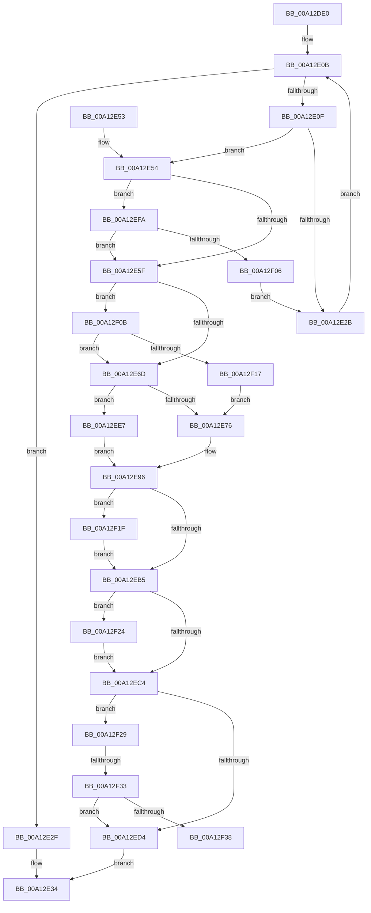

# SepIsImageInMinTcbList

- RVA: `0x00A12DE0`–`0x00A12F3D` (길이 `349` bytes)
- VA: `0x0000000140A12DE0`
- 실행 섹션: `PAGE`
- PDB 이름 있음: `예`; PDB Function 태그: `예`
- unwind 정보 RVA: `0x000A997C`
- 디코드: `103`개 명령, `349/349` bytes 표시
- 미해석 바이트: `0` (있으면 어셈블리에 `.byte`로 보존)

> 이 문서는 커널 이미지의 기계어와 PDB 기호를 분석해 생성했습니다. 4번과 5번은 함수 원형과 자료형을 바이너리 사용 방식에서 추정한 C 해석이며 원본 소스 복구 결과는 아닙니다.

## 1. Dependencies

- 직접 호출 지점: **4**; 고유 호출 대상: **3**
- 직접 호출자로 확인된 함수: **2**
- RIP 상대 이미지 참조: **2**

### Outgoing calls
- `0x00A12E22` → [RtlEqualUnicodeString](../93/RtlEqualUnicodeString_function_00932A20.md) (function, `0x00932A20`)
- `0x00A12EAC` → [SeCompareSigningLevels](SeCompareSigningLevels_function_00A13760.md) (function, `0x00A13760`)
- `0x00A12EBB` → [SeCompareSigningLevels](SeCompareSigningLevels_function_00A13760.md) (function, `0x00A13760`)
- `0x00A12EDD` → [SepCheckAndSetAuditModeForProcess](SepCheckAndSetAuditModeForProcess_function_00A134FC.md) (function, `0x00A134FC`)

### Direct callers
- [SepIsMinTCB](SepIsMinTCB_function_00A13120.md) at `0x00A132E2`
- [sub_00B36E04](../B3/Unknown_function_00B36E04.md) at `0x00B36E71`

### Static image references
- `0x00A12E7E` → RVA `0x00B4AEE8` (`SeProtectedMapping`; read)
- `0x00A12EFA` → RVA `0x00EFF050` (`.data`; read)

## 2. Other-region calls and transfers

- 다른 실행 섹션으로 향하는 call: **0**
- call이 아닌 외부 분기/꼬리 이동: **2**
  - `0x00A12F2D` → [sub_00B36D76](../B3/Unknown_function_00B36D76.md) (`tail-transfer`)
  - `0x00A12F38` → [sub_00B36D76](../B3/Unknown_function_00B36D76.md) (`tail-transfer`)

## 3. Assembly (complete function range)

```asm
00A12DE0  48 89 5C 24 08                  mov qword ptr [rsp + 8], rbx
00A12DE5  48 89 6C 24 10                  mov qword ptr [rsp + 0x10], rbp
00A12DEA  48 89 74 24 18                  mov qword ptr [rsp + 0x18], rsi
00A12DEF  57                              push rdi
00A12DF0  41 54                           push r12
00A12DF2  41 55                           push r13
00A12DF4  41 56                           push r14
00A12DF6  41 57                           push r15
00A12DF8  48 83 EC 20                     sub rsp, 0x20
00A12DFC  33 F6                           xor esi, esi
00A12DFE  45 8B E9                        mov r13d, r9d
00A12E01  8B DE                           mov ebx, esi
00A12E03  4D 8B E0                        mov r12, r8
00A12E06  8B FA                           mov edi, edx
00A12E08  4C 8B F1                        mov r14, rcx
00A12E0B  3B DF                           cmp ebx, edi
00A12E0D  73 20                           jae 0x140a12e2f
00A12E0F  8B C3                           mov eax, ebx
00A12E11  41 B0 01                        mov r8b, 1
00A12E14  49 8B CC                        mov rcx, r12
00A12E17  4C 8D 0C 40                     lea r9, [rax + rax*2]
00A12E1B  4B 8D 2C CE                     lea rbp, [r14 + r9*8]
00A12E1F  48 8B D5                        mov rdx, rbp
00A12E22  E8 F9 FB F1 FF                  call 0x140932a20
00A12E27  84 C0                           test al, al
00A12E29  75 29                           jne 0x140a12e54
00A12E2B  FF C3                           inc ebx
00A12E2D  EB DC                           jmp 0x140a12e0b
00A12E2F  BE 25 02 00 C0                  mov esi, 0xc0000225
00A12E34  48 8B 5C 24 50                  mov rbx, qword ptr [rsp + 0x50]
00A12E39  8B C6                           mov eax, esi
00A12E3B  48 8B 74 24 60                  mov rsi, qword ptr [rsp + 0x60]
00A12E40  48 8B 6C 24 58                  mov rbp, qword ptr [rsp + 0x58]
00A12E45  48 83 C4 20                     add rsp, 0x20
00A12E49  41 5F                           pop r15
00A12E4B  41 5E                           pop r14
00A12E4D  41 5D                           pop r13
00A12E4F  41 5C                           pop r12
00A12E51  5F                              pop rdi
00A12E52  C3                              ret
00A12E53  CC                              int3
00A12E54  8B 45 14                        mov eax, dword ptr [rbp + 0x14]
00A12E57  85 C0                           test eax, eax
00A12E59  0F 85 9B 00 00 00               jne 0x140a12efa
00A12E5F  0F AE E8                        lfence
00A12E62  8A 45 12                        mov al, byte ptr [rbp + 0x12]
00A12E65  84 C0                           test al, al
00A12E67  0F 84 9E 00 00 00               je 0x140a12f0b
00A12E6D  8A D8                           mov bl, al
00A12E6F  40 8A F8                        mov dil, al
00A12E72  84 C0                           test al, al
00A12E74  74 71                           je 0x140a12ee7
00A12E76  4C 8B BC 24 80 00 00 00         mov r15, qword ptr [rsp + 0x80]
00A12E7E  48 8D 15 63 80 13 00            lea rdx, [rip + 0x138063]
00A12E85  0F B6 CB                        movzx ecx, bl
00A12E88  48 C1 E9 04                     shr rcx, 4
00A12E8C  8A 04 4A                        mov al, byte ptr [rdx + rcx*2]
00A12E8F  41 88 07                        mov byte ptr [r15], al
00A12E92  8A 44 4A 01                     mov al, byte ptr [rdx + rcx*2 + 1]
00A12E96  4C 8B B4 24 88 00 00 00         mov r14, qword ptr [rsp + 0x88]
00A12E9E  40 8A 6C 24 78                  mov bpl, byte ptr [rsp + 0x78]
00A12EA3  40 8A D5                        mov dl, bpl
00A12EA6  41 88 06                        mov byte ptr [r14], al
00A12EA9  41 8A 0F                        mov cl, byte ptr [r15]
00A12EAC  E8 AF 08 00 00                  call 0x140a13760
00A12EB1  85 C0                           test eax, eax
00A12EB3  74 6A                           je 0x140a12f1f
00A12EB5  41 8A 0E                        mov cl, byte ptr [r14]
00A12EB8  40 8A D5                        mov dl, bpl
00A12EBB  E8 A0 08 00 00                  call 0x140a13760
00A12EC0  85 C0                           test eax, eax
00A12EC2  74 60                           je 0x140a12f24
00A12EC4  4C 8B 84 24 90 00 00 00         mov r8, qword ptr [rsp + 0x90]
00A12ECC  80 E3 07                        and bl, 7
00A12ECF  80 FB 01                        cmp bl, 1
00A12ED2  75 55                           jne 0x140a12f29
00A12ED4  49 8B D6                        mov rdx, r14
00A12ED7  41 88 38                        mov byte ptr [r8], dil
00A12EDA  49 8B CC                        mov rcx, r12
00A12EDD  E8 1A 06 00 00                  call 0x140a134fc
00A12EE2  E9 4D FF FF FF                  jmp 0x140a12e34
00A12EE7  8A 45 10                        mov al, byte ptr [rbp + 0x10]
00A12EEA  4C 8B BC 24 80 00 00 00         mov r15, qword ptr [rsp + 0x80]
00A12EF2  41 88 07                        mov byte ptr [r15], al
00A12EF5  8A 45 11                        mov al, byte ptr [rbp + 0x11]
00A12EF8  EB 9C                           jmp 0x140a12e96
00A12EFA  3B 05 50 C1 4E 00               cmp eax, dword ptr [rip + 0x4ec150]
00A12F00  0F 84 59 FF FF FF               je 0x140a12e5f
00A12F06  E9 20 FF FF FF                  jmp 0x140a12e2b
00A12F0B  8A 5C 24 70                     mov bl, byte ptr [rsp + 0x70]
00A12F0F  84 DB                           test bl, bl
00A12F11  0F 84 56 FF FF FF               je 0x140a12e6d
00A12F17  40 8A FB                        mov dil, bl
00A12F1A  E9 57 FF FF FF                  jmp 0x140a12e76
00A12F1F  41 88 2F                        mov byte ptr [r15], bpl
00A12F22  EB 91                           jmp 0x140a12eb5
00A12F24  41 88 2E                        mov byte ptr [r14], bpl
00A12F27  EB 9B                           jmp 0x140a12ec4
00A12F29  41 F6 C5 01                     test r13b, 1
00A12F2D  0F 85 43 3E 12 00               jne 0x140b36d76
00A12F33  80 FB 02                        cmp bl, 2
00A12F36  75 9C                           jne 0x140a12ed4
00A12F38  E9 39 3E 12 00                  jmp 0x140b36d76
```

## 4. C-style interpretation (structured pseudocode)

```c
__int64 __fastcall SepIsImageInMinTcbList(__int64 a1, int a2, __int64 a3, int a4, unsigned __int8 a5, unsigned __int8 a6, __int64 a7, __int64 a8, __int64 a9)
{
    __int64 result;
    __int64 v_rbx;
    __int64 v_rsi;
    __int64 v_rsp;
    unsigned __int64 v_stack_p10;
    unsigned __int64 v_stack_p18;
    unsigned __int64 v_stack_p8;

    v_stack_p8 = v_rbx;
    v_stack_p10 = v_rbp;
    v_stack_p18 = v_rsi;
    v_rsp = (v_rsp) - (32);
    v_rsi = 0;
loc_00A12E0B:
    if (0 >= ((unsigned int)((unsigned int)(a2)))) goto loc_00A12E2F;
    result = RtlEqualUnicodeString(a3, a1 + 0 + 0 * 2 * 8, 1, 0 + 0 * 2);
    if ((unsigned __int8)(result) != 0) goto loc_00A12E54;
loc_00A12E2B:
    v_rbx = (unsigned int)((0) + 1);
    goto loc_00A12E0B;
loc_00A12E2F:
loc_00A12E34:
    v_rsp = (v_rsp) + (32);
    return (unsigned int)((unsigned int)((unsigned int)(0xC0000225ULL)));
loc_00A12E54:
    if ((unsigned int)((unsigned int)(*(unsigned int *)(v_stack_p10 + 20))) != 0) goto loc_00A12EFA;
loc_00A12E5F:
    if ((unsigned __int8)(*(unsigned __int8 *)(v_stack_p10 + 18)) == 0) goto loc_00A12F0B;
loc_00A12E6D:
    if ((unsigned __int8)(*(unsigned __int8 *)(v_stack_p10 + 18)) == 0) goto loc_00A12EE7;
loc_00A12E76:
    a1 = ((unsigned __int8)((unsigned __int8)(*(unsigned __int8 *)(v_stack_p10 + 18)))) >> (4);
    *(unsigned __int8 *)(a7) = (unsigned __int8)(*(unsigned __int8 *)(v_rip + 1278051 + a1 * 2));
loc_00A12E96:
    *(unsigned __int8 *)(a8) = (unsigned __int8)(*(unsigned __int8 *)(v_rip + 1278051 + a1 * 2 + 1));
    result = SeCompareSigningLevels(*(unsigned __int8 *)(a7), a6, 1, 0 + 0 * 2);
    if ((unsigned int)(result) == 0) goto loc_00A12F1F;
loc_00A12EB5:
    result = SeCompareSigningLevels(*(unsigned __int8 *)(a8), a6, 1, 0 + 0 * 2);
    if ((unsigned int)(result) == 0) goto loc_00A12F24;
loc_00A12EC4:
    v_rbx = (unsigned __int8)(((unsigned __int8)(*(unsigned __int8 *)(v_stack_p10 + 18))) & (7));
    if (((unsigned __int8)(v_rbx)) != 1) goto loc_00A12F29;
loc_00A12ED4:
    *(unsigned __int8 *)(a9) = (unsigned __int8)((unsigned __int8)(*(unsigned __int8 *)(v_stack_p10 + 18)));
    result = SepCheckAndSetAuditModeForProcess(a3, a8, a9, 0 + 0 * 2);
    goto loc_00A12E34;
loc_00A12EE7:
    *(unsigned __int8 *)(a7) = (unsigned __int8)(*(unsigned __int8 *)(a6 + 16));
    goto loc_00A12E96;
loc_00A12EFA:
    if (((unsigned int)(*(unsigned __int8 *)(a6 + 17))) == (*(unsigned int *)(v_rip + 5161296))) goto loc_00A12E5F;
    goto loc_00A12E2B;
loc_00A12F0B:
    if (a5 == 0) goto loc_00A12E6D;
    goto loc_00A12E76;
loc_00A12F1F:
    *(unsigned __int8 *)(a7) = a6;
    goto loc_00A12EB5;
loc_00A12F24:
    *(unsigned __int8 *)(a8) = a6;
    goto loc_00A12EC4;
loc_00A12F29:
    if (a5 != 2) goto loc_00A12ED4;
}
```

## 5. (Beta) C Style

```c
int64_t SepIsImageInMinTcbList(void *Arg1, int32_t Arg2, int64_t Arg3, int32_t Arg4, uint8_t Arg5, uint8_t Arg6, void *Arg7, void *Arg8, void *Arg9)
{
    uint8_t *arg1 = (uint8_t *)Arg1;
    uint8_t *arg7 = (uint8_t *)Arg7;
    uint8_t *arg8 = (uint8_t *)Arg8;
    uint8_t *arg9 = (uint8_t *)Arg9;

    int64_t result;
    int64_t local_rbx;
    int64_t local_rsi;
    int64_t local_rsp;
    uint64_t v_stack_p10;
    uint64_t v_stack_p18;
    uint64_t v_stack_p8;

    v_stack_p8 = local_rbx;
    v_stack_p10 = local_rbp;
    v_stack_p18 = local_rsi;
    local_rsp = (local_rsp) - (32);
    local_rsi = 0;
loc_00A12E0B:
    if (0 >= ((uint32_t)((uint32_t)(Arg2)))) goto loc_00A12E2F;
    result = RtlEqualUnicodeString(Arg3, Arg1 + 0 + 0 * 2 * 8, 1, 0 + 0 * 2);
    if ((uint8_t)(result) != 0) goto loc_00A12E54;
loc_00A12E2B:
    local_rbx = (uint32_t)((0) + 1);
    goto loc_00A12E0B;
loc_00A12E2F:
loc_00A12E34:
    local_rsp = (local_rsp) + (32);
    return (uint32_t)((uint32_t)((uint32_t)(0xC0000225ULL)));
loc_00A12E54:
    if ((uint32_t)((uint32_t)(*(uint32_t *)(v_stack_p10 + 0x14))) != 0) goto loc_00A12EFA;
loc_00A12E5F:
    if ((uint8_t)(*(uint8_t *)(v_stack_p10 + 0x12)) == 0) goto loc_00A12F0B;
loc_00A12E6D:
    if ((uint8_t)(*(uint8_t *)(v_stack_p10 + 0x12)) == 0) goto loc_00A12EE7;
loc_00A12E76:
    Arg1 = ((uint8_t)((uint8_t)(*(uint8_t *)(v_stack_p10 + 0x12)))) >> (4);
    *(uint8_t *)(arg7) = (uint8_t)(*(uint8_t *)(v_rip + 0x138063 + arg1 * 2));
loc_00A12E96:
    *(uint8_t *)(arg8) = (uint8_t)(*(uint8_t *)(v_rip + 0x138063 + arg1 * 2 + 0x1));
    result = SeCompareSigningLevels(*(uint8_t *)(arg7), Arg6, 1, 0 + 0 * 2);
    if ((uint32_t)(result) == 0) goto loc_00A12F1F;
loc_00A12EB5:
    result = SeCompareSigningLevels(*(uint8_t *)(arg8), Arg6, 1, 0 + 0 * 2);
    if ((uint32_t)(result) == 0) goto loc_00A12F24;
loc_00A12EC4:
    local_rbx = (uint8_t)(((uint8_t)(*(uint8_t *)(v_stack_p10 + 0x12))) & (7));
    if (((uint8_t)(local_rbx)) != 1) goto loc_00A12F29;
loc_00A12ED4:
    *(uint8_t *)(arg9) = (uint8_t)((uint8_t)(*(uint8_t *)(v_stack_p10 + 0x12)));
    result = SepCheckAndSetAuditModeForProcess(Arg3, Arg8, Arg9, 0 + 0 * 2);
    goto loc_00A12E34;
loc_00A12EE7:
    *(uint8_t *)(arg7) = (uint8_t)(*(uint8_t *)(Arg6 + 0x10));
    goto loc_00A12E96;
loc_00A12EFA:
    if (((uint32_t)(*(uint8_t *)(Arg6 + 0x11))) == (*(uint32_t *)(v_rip + 0x4EC150))) goto loc_00A12E5F;
    goto loc_00A12E2B;
loc_00A12F0B:
    if (Arg5 == 0) goto loc_00A12E6D;
    goto loc_00A12E76;
loc_00A12F1F:
    *(uint8_t *)(arg7) = Arg6;
    goto loc_00A12EB5;
loc_00A12F24:
    *(uint8_t *)(arg8) = Arg6;
    goto loc_00A12EC4;
loc_00A12F29:
    if (Arg5 != 2) goto loc_00A12ED4;
}
```

### 관측된 메모리 오프셋

구조체 형식이 확인되지 않은 접근은 인자 기준의 오프셋으로만 기록했습니다.

| 기준 인자 | 오프셋 표현 | 폭 (bit) | 접근 |
|---|---:|---:|---|
| `Arg1` | `+ 0x0 + r9*8` | `64` | `R` |
| `Arg1` | `+ 0x10` | `8` | `R` |
| `Arg1` | `+ 0x11` | `8` | `R` |
| `Arg1` | `+ 0x12` | `8` | `R` |
| `Arg1` | `+ 0x14` | `32` | `R` |
| `Arg7` | `+ 0x0` | `8` | `R` |
| `Arg7` | `+ 0x0` | `8` | `W` |
| `Arg8` | `+ 0x0` | `8` | `R` |
| `Arg8` | `+ 0x0` | `8` | `W` |
| `Arg9` | `+ 0x0` | `8` | `W` |

## 6. Execution-region graph

[열기: 2D/3D 그래프와 함수 탐색 컨트롤 패널](../../../control-panel.html?section=page&rva=0x00A12DE0&view=graph)

- 2D 그래프는 위에서 아래로 흐르고, 3D 그래프는 빈 공간을 드래그해 회전합니다. Shift+드래그는 이동, 휠은 확대·축소, 함수 노드 선택은 대상 보고서 이동입니다.

### Static fallback


