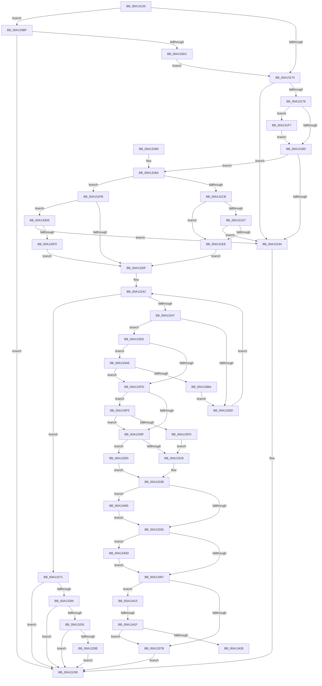

# SepIsMinTCB

- RVA: `0x00A13120`–`0x00A1342D` (길이 `781` bytes)
- VA: `0x0000000140A13120`
- 실행 섹션: `PAGE`
- PDB 이름 있음: `예`; PDB Function 태그: `예`
- unwind 정보 RVA: `0x000A99DC`
- 디코드: `196`개 명령, `781/781` bytes 표시
- 미해석 바이트: `0` (있으면 어셈블리에 `.byte`로 보존)

> 이 문서는 커널 이미지의 기계어와 PDB 기호를 분석해 생성했습니다. 4번과 5번은 함수 원형과 자료형을 바이너리 사용 방식에서 추정한 C 해석이며 원본 소스 복구 결과는 아닙니다.

## 1. Dependencies

- 직접 호출 지점: **12**; 고유 호출 대상: **8**
- 직접 호출자로 확인된 함수: **1**
- RIP 상대 이미지 참조: **8**

### Outgoing calls
- `0x00A1314F` → [PsGetCurrentServerSilo](../../text/22/PsGetCurrentServerSilo_function_00225710.md) (function, `0x00225710`)
- `0x00A13157` → [PsGetServerSiloGlobals](../../text/22/PsGetServerSiloGlobals_function_002250A0.md) (function, `0x002250A0`)
- `0x00A131CE` → [RtlPrefixUnicodeString](../8F/RtlPrefixUnicodeString_function_008F4F70.md) (function, `0x008F4F70`)
- `0x00A131E5` → [RtlPrefixUnicodeString](../8F/RtlPrefixUnicodeString_function_008F4F70.md) (function, `0x008F4F70`)
- `0x00A13202` → [RtlPrefixUnicodeString](../8F/RtlPrefixUnicodeString_function_008F4F70.md) (function, `0x008F4F70`)
- `0x00A13260` → [RtlEqualUnicodeString](../93/RtlEqualUnicodeString_function_00932A20.md) (function, `0x00932A20`)
- `0x00A132E2` → [SepIsImageInMinTcbList](SepIsImageInMinTcbList_function_00A12DE0.md) (function, `0x00A12DE0`)
- `0x00A13348` → [SeCompareSigningLevels](SeCompareSigningLevels_function_00A13760.md) (function, `0x00A13760`)
- `0x00A1335A` → [SeCompareSigningLevels](SeCompareSigningLevels_function_00A13760.md) (function, `0x00A13760`)
- `0x00A13386` → [SepCheckAndSetAuditModeForProcess](SepCheckAndSetAuditModeForProcess_function_00A134FC.md) (function, `0x00A134FC`)
- `0x00A133C2` → [SepSetSystemPaths](../79/SepSetSystemPaths_function_0079C040.md) (function, `0x0079C040`)
- `0x00A133E3` → [RtlPrefixUnicodeString](../8F/RtlPrefixUnicodeString_function_008F4F70.md) (function, `0x008F4F70`)

### Direct callers
- [SeQuerySigningPolicy](SeQuerySigningPolicy_function_00A12F44.md) at `0x00A12FB3`

### Static image references
- `0x00A131FB` → RVA `0x00002F08` (`.rdata`; read)
- `0x00A13218` → RVA `0x00000000` (`image boundary/outside`; read)
- `0x00A13271` → RVA `0x00E67D6C` (`.data`; read)
- `0x00A13284` → RVA `0x00F475F8` (`.data`; read)
- `0x00A13291` → RVA `0x00F475DC` (`.data`; read)
- `0x00A132B0` → RVA `0x00B50AE0` (`SeMsMinTestTCBList`; read)
- `0x00A133AE` → RVA `0x00EFF050` (`.data`; read)
- `0x00A133D9` → RVA `0x0000B7C0` (`.rdata`; read)

## 2. Other-region calls and transfers

- 다른 실행 섹션으로 향하는 call: **2**
  - `0x00A1314F` → [PsGetCurrentServerSilo](../../text/22/PsGetCurrentServerSilo_function_00225710.md) (`PAGE` → `.text`)
  - `0x00A13157` → [PsGetServerSiloGlobals](../../text/22/PsGetServerSiloGlobals_function_002250A0.md) (`PAGE` → `.text`)
- call이 아닌 외부 분기/꼬리 이동: **2**
  - `0x00A13419` → [sub_00B36DE2](../B3/Unknown_function_00B36DE2.md) (`tail-transfer`)
  - `0x00A13428` → [sub_00B36DE2](../B3/Unknown_function_00B36DE2.md) (`tail-transfer`)

## 3. Assembly (complete function range)

```asm
00A13120  48 8B C4                        mov rax, rsp
00A13123  48 89 58 08                     mov qword ptr [rax + 8], rbx
00A13127  48 89 68 10                     mov qword ptr [rax + 0x10], rbp
00A1312B  48 89 70 18                     mov qword ptr [rax + 0x18], rsi
00A1312F  57                              push rdi
00A13130  41 54                           push r12
00A13132  41 55                           push r13
00A13134  41 56                           push r14
00A13136  41 57                           push r15
00A13138  48 83 EC 60                     sub rsp, 0x60
00A1313C  0F 57 C0                        xorps xmm0, xmm0
00A1313F  45 8A F9                        mov r15b, r9b
00A13142  0F 11 40 C8                     movups xmmword ptr [rax - 0x38], xmm0
00A13146  41 8A D8                        mov bl, r8b
00A13149  44 8B E2                        mov r12d, edx
00A1314C  48 8B F9                        mov rdi, rcx
00A1314F  E8 BC 25 81 FF                  call 0x140225710
00A13154  48 8B C8                        mov rcx, rax
00A13157  E8 44 1F 81 FF                  call 0x1402250a0
00A1315C  45 33 ED                        xor r13d, r13d
00A1315F  48 8D B0 E0 02 00 00            lea rsi, [rax + 0x2e0]
00A13166  33 C0                           xor eax, eax
00A13168  F0 4C 0F B1 6E 20               lock cmpxchg qword ptr [rsi + 0x20], r13
00A1316E  0F 84 4B 02 00 00               je 0x140a133bf
00A13174  48 85 FF                        test rdi, rdi
00A13177  74 1B                           je 0x140a13194
00A13179  4C 8B 4E 20                     mov r9, qword ptr [rsi + 0x20]
00A1317D  BD 2A 00 00 00                  mov ebp, 0x2a
00A13182  41 0F B7 01                     movzx eax, word ptr [r9]
00A13186  8B C8                           mov ecx, eax
00A13188  66 3B C5                        cmp ax, bp
00A1318B  73 6A                           jae 0x140a131f7
00A1318D  0F B7 07                        movzx eax, word ptr [rdi]
00A13190  3B C1                           cmp eax, ecx
00A13192  77 26                           ja 0x140a131ba
00A13194  B9 25 02 00 C0                  mov ecx, 0xc0000225
00A13199  4C 8D 5C 24 60                  lea r11, [rsp + 0x60]
00A1319E  8B C1                           mov eax, ecx
00A131A0  49 8B 5B 30                     mov rbx, qword ptr [r11 + 0x30]
00A131A4  49 8B 6B 38                     mov rbp, qword ptr [r11 + 0x38]
00A131A8  49 8B 73 40                     mov rsi, qword ptr [r11 + 0x40]
00A131AC  49 8B E3                        mov rsp, r11
00A131AF  41 5F                           pop r15
00A131B1  41 5E                           pop r14
00A131B3  41 5D                           pop r13
00A131B5  41 5C                           pop r12
00A131B7  5F                              pop rdi
00A131B8  C3                              ret
00A131B9  CC                              int3
00A131BA  48 8B 47 08                     mov rax, qword ptr [rdi + 8]
00A131BE  41 B0 01                        mov r8b, 1
00A131C1  48 8B D7                        mov rdx, rdi
00A131C4  66 83 78 02 3F                  cmp word ptr [rax + 2], 0x3f
00A131C9  75 30                           jne 0x140a131fb
00A131CB  49 8B C9                        mov rcx, r9
00A131CE  E8 9D 1D EE FF                  call 0x1408f4f70
00A131D3  84 C0                           test al, al
00A131D5  75 17                           jne 0x140a131ee
00A131D7  48 8B 4E 20                     mov rcx, qword ptr [rsi + 0x20]
00A131DB  41 B0 01                        mov r8b, 1
00A131DE  48 83 C1 10                     add rcx, 0x10
00A131E2  48 8B D7                        mov rdx, rdi
00A131E5  E8 86 1D EE FF                  call 0x1408f4f70
00A131EA  84 C0                           test al, al
00A131EC  74 A6                           je 0x140a13194
00A131EE  48 8B 46 20                     mov rax, qword ptr [rsi + 0x20]
00A131F2  0F B7 28                        movzx ebp, word ptr [rax]
00A131F5  EB 18                           jmp 0x140a1320f
00A131F7  8B CD                           mov ecx, ebp
00A131F9  EB 92                           jmp 0x140a1318d
00A131FB  48 8D 0D 06 FD 5E FF            lea rcx, [rip - 0xa102fa]
00A13202  E8 69 1D EE FF                  call 0x1408f4f70
00A13207  84 C0                           test al, al
00A13209  0F 84 C7 01 00 00               je 0x140a133d6
00A1320F  0F B7 17                        movzx edx, word ptr [rdi]
00A13212  0F B7 C2                        movzx eax, dx
00A13215  66 2B C5                        sub ax, bp
00A13218  48 8D 2D E1 CD 5E FF            lea rbp, [rip - 0xa1321f]
00A1321F  0F B7 C8                        movzx ecx, ax
00A13222  48 8B 47 08                     mov rax, qword ptr [rdi + 8]
00A13226  48 2B D1                        sub rdx, rcx
00A13229  48 D1 EA                        shr rdx, 1
00A1322C  41 8B FD                        mov edi, r13d
00A1322F  66 89 4C 24 50                  mov word ptr [rsp + 0x50], cx
00A13234  66 89 4C 24 52                  mov word ptr [rsp + 0x52], cx
00A13239  48 8D 0C 50                     lea rcx, [rax + rdx*2]
00A1323D  48 89 4C 24 58                  mov qword ptr [rsp + 0x58], rcx
00A13242  83 FF 11                        cmp edi, 0x11
00A13245  73 2A                           jae 0x140a13271
00A13247  8B C7                           mov eax, edi
00A13249  48 8D 95 70 11 B5 00            lea rdx, [rbp + 0xb51170]
00A13250  41 B0 01                        mov r8b, 1
00A13253  48 8D 4C 24 50                  lea rcx, [rsp + 0x50]
00A13258  48 8D 34 40                     lea rsi, [rax + rax*2]
00A1325C  48 8D 14 F2                     lea rdx, [rdx + rsi*8]
00A13260  E8 BB F7 F1 FF                  call 0x140932a20
00A13265  84 C0                           test al, al
00A13267  0F 85 81 00 00 00               jne 0x140a132ee
00A1326D  FF C7                           inc edi
00A1326F  EB D1                           jmp 0x140a13242
00A13271  8B 05 F5 4A 45 00               mov eax, dword ptr [rip + 0x454af5]
00A13277  B9 25 02 00 C0                  mov ecx, 0xc0000225
00A1327C  A8 01                           test al, 1
00A1327E  0F 85 15 FF FF FF               jne 0x140a13199
00A13284  44 38 2D 6D 43 53 00            cmp byte ptr [rip + 0x53436d], r13b
00A1328B  0F 84 08 FF FF FF               je 0x140a13199
00A13291  44 38 2D 44 43 53 00            cmp byte ptr [rip + 0x534344], r13b
00A13298  0F 85 FB FE FF FF               jne 0x140a13199
00A1329E  48 8B 84 24 C0 00 00 00         mov rax, qword ptr [rsp + 0xc0]
00A132A6  4C 8D 44 24 50                  lea r8, [rsp + 0x50]
00A132AB  48 89 44 24 40                  mov qword ptr [rsp + 0x40], rax
00A132B0  48 8D 0D 29 D8 13 00            lea rcx, [rip + 0x13d829]
00A132B7  48 8B 84 24 B8 00 00 00         mov rax, qword ptr [rsp + 0xb8]
00A132BF  45 8B CC                        mov r9d, r12d
00A132C2  48 89 44 24 38                  mov qword ptr [rsp + 0x38], rax
00A132C7  BA 09 00 00 00                  mov edx, 9
00A132CC  48 8B 84 24 B0 00 00 00         mov rax, qword ptr [rsp + 0xb0]
00A132D4  48 89 44 24 30                  mov qword ptr [rsp + 0x30], rax
00A132D9  44 88 7C 24 28                  mov byte ptr [rsp + 0x28], r15b
00A132DE  88 5C 24 20                     mov byte ptr [rsp + 0x20], bl
00A132E2  E8 F9 FA FF FF                  call 0x140a12de0
00A132E7  8B C8                           mov ecx, eax
00A132E9  E9 AB FE FF FF                  jmp 0x140a13199
00A132EE  8B 84 F5 84 11 B5 00            mov eax, dword ptr [rbp + rsi*8 + 0xb51184]
00A132F5  85 C0                           test eax, eax
00A132F7  0F 85 B1 00 00 00               jne 0x140a133ae
00A132FD  0F AE E8                        lfence
00A13300  8A 84 F5 82 11 B5 00            mov al, byte ptr [rbp + rsi*8 + 0xb51182]
00A13307  84 C0                           test al, al
00A13309  0F 84 E6 00 00 00               je 0x140a133f5
00A1330F  8A D8                           mov bl, al
00A13311  40 8A F8                        mov dil, al
00A13314  84 C0                           test al, al
00A13316  74 7B                           je 0x140a13393
00A13318  4C 8B B4 24 B0 00 00 00         mov r14, qword ptr [rsp + 0xb0]
00A13320  0F B6 CB                        movzx ecx, bl
00A13323  48 C1 E9 04                     shr rcx, 4
00A13327  8A 84 4D E8 AE B4 00            mov al, byte ptr [rbp + rcx*2 + 0xb4aee8]
00A1332E  41 88 06                        mov byte ptr [r14], al
00A13331  8A 84 4D E9 AE B4 00            mov al, byte ptr [rbp + rcx*2 + 0xb4aee9]
00A13338  48 8B B4 24 B8 00 00 00         mov rsi, qword ptr [rsp + 0xb8]
00A13340  41 8A D7                        mov dl, r15b
00A13343  88 06                           mov byte ptr [rsi], al
00A13345  41 8A 0E                        mov cl, byte ptr [r14]
00A13348  E8 13 04 00 00                  call 0x140a13760
00A1334D  85 C0                           test eax, eax
00A1334F  0F 84 B0 00 00 00               je 0x140a13405
00A13355  8A 0E                           mov cl, byte ptr [rsi]
00A13357  41 8A D7                        mov dl, r15b
00A1335A  E8 01 04 00 00                  call 0x140a13760
00A1335F  85 C0                           test eax, eax
00A13361  0F 84 A6 00 00 00               je 0x140a1340d
00A13367  4C 8B 84 24 C0 00 00 00         mov r8, qword ptr [rsp + 0xc0]
00A1336F  80 E3 07                        and bl, 7
00A13372  80 FB 01                        cmp bl, 1
00A13375  0F 85 9A 00 00 00               jne 0x140a13415
00A1337B  48 8B D6                        mov rdx, rsi
00A1337E  41 88 38                        mov byte ptr [r8], dil
00A13381  48 8D 4C 24 50                  lea rcx, [rsp + 0x50]
00A13386  E8 71 01 00 00                  call 0x140a134fc
00A1338B  41 8B CD                        mov ecx, r13d
00A1338E  E9 06 FE FF FF                  jmp 0x140a13199
00A13393  8A 84 F5 80 11 B5 00            mov al, byte ptr [rbp + rsi*8 + 0xb51180]
00A1339A  4C 8B B4 24 B0 00 00 00         mov r14, qword ptr [rsp + 0xb0]
00A133A2  41 88 06                        mov byte ptr [r14], al
00A133A5  8A 84 F5 81 11 B5 00            mov al, byte ptr [rbp + rsi*8 + 0xb51181]
00A133AC  EB 8A                           jmp 0x140a13338
00A133AE  3B 05 9C BC 4E 00               cmp eax, dword ptr [rip + 0x4ebc9c]
00A133B4  0F 84 43 FF FF FF               je 0x140a132fd
00A133BA  E9 AE FE FF FF                  jmp 0x140a1326d
00A133BF  48 8B CE                        mov rcx, rsi
00A133C2  E8 79 8C D8 FF                  call 0x14079c040
00A133C7  8B C8                           mov ecx, eax
00A133C9  85 C0                           test eax, eax
00A133CB  0F 88 C8 FD FF FF               js 0x140a13199
00A133D1  E9 9E FD FF FF                  jmp 0x140a13174
00A133D6  41 B0 01                        mov r8b, 1
00A133D9  48 8D 0D E0 83 5F FF            lea rcx, [rip - 0xa07c20]
00A133E0  48 8B D7                        mov rdx, rdi
00A133E3  E8 88 1B EE FF                  call 0x1408f4f70
00A133E8  84 C0                           test al, al
00A133EA  0F 84 A4 FD FF FF               je 0x140a13194
00A133F0  E9 1A FE FF FF                  jmp 0x140a1320f
00A133F5  84 DB                           test bl, bl
00A133F7  0F 84 12 FF FF FF               je 0x140a1330f
00A133FD  40 8A FB                        mov dil, bl
00A13400  E9 13 FF FF FF                  jmp 0x140a13318
00A13405  45 88 3E                        mov byte ptr [r14], r15b
00A13408  E9 48 FF FF FF                  jmp 0x140a13355
00A1340D  44 88 3E                        mov byte ptr [rsi], r15b
00A13410  E9 52 FF FF FF                  jmp 0x140a13367
00A13415  41 F6 C4 01                     test r12b, 1
00A13419  0F 85 C3 39 12 00               jne 0x140b36de2
00A1341F  80 FB 02                        cmp bl, 2
00A13422  0F 85 53 FF FF FF               jne 0x140a1337b
00A13428  E9 B5 39 12 00                  jmp 0x140b36de2
```

## 4. C-style interpretation (structured pseudocode)

```c
__int64 __fastcall SepIsMinTCB(__int64 a1, int a2, unsigned __int8 a3, unsigned __int8 a4, __int64 a5, __int64 a6, __int64 a7)
{
    __int64 result;
    __int64 v_r13;
    __int64 v_rbx;
    __int64 v_rdi;
    __int64 v_rsp;
    unsigned __int16 v_stack_m10;
    unsigned __int64 v_stack_m20;
    unsigned __int64 v_stack_m28;
    unsigned __int64 v_stack_m30;
    unsigned __int8 v_stack_m38;
    unsigned __int8 v_stack_m40;
    unsigned __int64 v_stack_m8;
    unsigned __int16 v_stack_mE;

    *(unsigned __int64 *)(v_rsp + 8) = v_rbx;
    *(unsigned __int64 *)(v_rsp + 16) = v_rbp;
    *(unsigned __int64 *)(v_rsp + 24) = v_rsi;
    v_rsp = (v_rsp) - (96);
    *(unsigned __int64 *)(v_rsp - 56) = v_xmm0;
    result = PsGetCurrentServerSilo(a1, a2, a3, a4);
    result = PsGetServerSiloGlobals(result, a2, a3, a4);
    v_r13 = 0;
    result = 0;
    if (condition_is_equal) goto loc_00A133BF;
loc_00A13174:
    if (a1 == 0) goto loc_00A13194;
    if (((unsigned __int16)(*(unsigned __int16 *)(*(unsigned __int64 *)(result + 736 + 32)))) >= 42) goto loc_00A131F7;
loc_00A1318D:
    if (((unsigned int)(*(unsigned __int16 *)(a1))) > ((unsigned int)((unsigned int)((unsigned int)(*(unsigned __int16 *)(*(unsigned __int64 *)(result + 736 + 32))))))) goto loc_00A131BA;
loc_00A13194:
loc_00A13199:
    return (unsigned int)((unsigned int)((unsigned int)(0xC0000225ULL)));
loc_00A131BA:
    if ((*(unsigned __int16 *)(*(unsigned __int64 *)(a1 + 8) + 2)) != 63) goto loc_00A131FB;
    result = RtlPrefixUnicodeString(*(unsigned __int64 *)(result + 736 + 32), a1, 1, *(unsigned __int64 *)(result + 736 + 32));
    if ((unsigned __int8)(result) != 0) goto loc_00A131EE;
    a1 = (*(unsigned __int64 *)(*(unsigned __int64 *)(v_stack_m28 + 64) + 32)) + (16);
    result = RtlPrefixUnicodeString(a1, a1, 1, *(unsigned __int64 *)(result + 736 + 32));
    if ((unsigned __int8)(result) == 0) goto loc_00A13194;
loc_00A131EE:
    goto loc_00A1320F;
loc_00A131F7:
    goto loc_00A1318D;
loc_00A131FB:
    result = RtlPrefixUnicodeString(v_rip - 10552058, a1, 1, *(unsigned __int64 *)(result + 736 + 32));
    if ((unsigned __int8)(result) == 0) goto loc_00A133D6;
loc_00A1320F:
    result = (unsigned __int16)(((unsigned __int16)(*(unsigned __int16 *)(a1))) - ((unsigned __int16)(*(unsigned __int16 *)(*(unsigned __int64 *)(*(unsigned __int64 *)(v_stack_m28 + 64) + 32)))));
    a2 = (*(unsigned __int16 *)(a1)) - ((unsigned __int16)(result));
    a2 = (a2) >> (1);
    v_stack_m10 = (unsigned __int16)((unsigned __int16)(result));
    v_stack_mE = (unsigned __int16)((unsigned __int16)(result));
    v_stack_m8 = *(unsigned __int64 *)(a1 + 8) + a2 * 2;
loc_00A13242:
    if (0 >= 17) goto loc_00A13271;
    result = RtlEqualUnicodeString(v_stack_m10, v_rip - 10564127 + 11866480 + 0 + 0 * 2 * 8, 1, *(unsigned __int64 *)(result + 736 + 32));
    if ((unsigned __int8)(result) != 0) goto loc_00A132EE;
loc_00A1326D:
    v_rdi = (unsigned int)((0) + 1);
    goto loc_00A13242;
loc_00A13271:
    if ((((unsigned __int8)((unsigned int)(*(unsigned int *)(v_rip + 4541173)))) & (1)) != 0) goto loc_00A13199;
    if ((*(unsigned __int8 *)(v_rip + 5456749)) == 0) goto loc_00A13199;
    if ((*(unsigned __int8 *)(v_rip + 5456708)) != 0) goto loc_00A13199;
    v_stack_m20 = a7;
    v_stack_m28 = a6;
    v_stack_m30 = a5;
    v_stack_m38 = a4;
    v_stack_m40 = (unsigned __int8)(*(unsigned __int64 *)(v_stack_m28 + 48));
    result = SepIsImageInMinTcbList(v_rip + 1300521, 9, v_stack_m10, (unsigned int)((unsigned int)((unsigned int)(a2))));
    goto loc_00A13199;
loc_00A132EE:
    if ((unsigned int)((unsigned int)(*(unsigned int *)(v_rip - 10564127 + 0 + 0 * 2 * 8 + 11866500))) != 0) goto loc_00A133AE;
loc_00A132FD:
    if ((unsigned __int8)(*(unsigned __int8 *)(v_rip - 10564127 + 0 + 0 * 2 * 8 + 11866498)) == 0) goto loc_00A133F5;
loc_00A1330F:
    if ((unsigned __int8)(*(unsigned __int8 *)(v_rip - 10564127 + 0 + 0 * 2 * 8 + 11866498)) == 0) goto loc_00A13393;
loc_00A13318:
    a1 = ((unsigned __int8)((unsigned __int8)(*(unsigned __int8 *)(v_rip - 10564127 + 0 + 0 * 2 * 8 + 11866498)))) >> (4);
    *(unsigned __int8 *)(a5) = (unsigned __int8)(*(unsigned __int8 *)(v_rip - 10564127 + a1 * 2 + 11841256));
loc_00A13338:
    *(unsigned __int8 *)(a6) = (unsigned __int8)(*(unsigned __int8 *)(v_rip - 10564127 + a1 * 2 + 11841257));
    result = SeCompareSigningLevels(*(unsigned __int8 *)(a5), a4, v_stack_m10, (unsigned int)((unsigned int)((unsigned int)(a2))));
    if ((unsigned int)(result) == 0) goto loc_00A13405;
loc_00A13355:
    result = SeCompareSigningLevels(*(unsigned __int8 *)(a6), a4, v_stack_m10, (unsigned int)((unsigned int)((unsigned int)(a2))));
    if ((unsigned int)(result) == 0) goto loc_00A1340D;
loc_00A13367:
    v_rbx = (unsigned __int8)(((unsigned __int8)(*(unsigned __int8 *)(v_rip - 10564127 + 0 + 0 * 2 * 8 + 11866498))) & (7));
    if (((unsigned __int8)(v_rbx)) != 1) goto loc_00A13415;
loc_00A1337B:
    *(unsigned __int8 *)(a7) = (unsigned __int8)((unsigned __int8)(*(unsigned __int8 *)(v_rip - 10564127 + 0 + 0 * 2 * 8 + 11866498)));
    result = SepCheckAndSetAuditModeForProcess(v_stack_m10, a6, a7, (unsigned int)((unsigned int)((unsigned int)(a2))));
    goto loc_00A13199;
loc_00A13393:
    *(unsigned __int8 *)(a5) = (unsigned __int8)(*(unsigned __int8 *)(v_rip - 10564127 + a6 * 8 + 11866496));
    goto loc_00A13338;
loc_00A133AE:
    if (((unsigned int)(*(unsigned __int8 *)(v_rip - 10564127 + a6 * 8 + 11866497))) == (*(unsigned int *)(v_rip + 5160092))) goto loc_00A132FD;
    goto loc_00A1326D;
loc_00A133BF:
    result = SepSetSystemPaths(a6, a6, a7, (unsigned int)((unsigned int)((unsigned int)(a2))));
    if (sign_flag) goto loc_00A13199;
    goto loc_00A13174;
loc_00A133D6:
    result = RtlPrefixUnicodeString(v_rip - 10517536, (unsigned __int8)(*(unsigned __int8 *)(v_rip - 10564127 + 0 + 0 * 2 * 8 + 11866498)), 1, (unsigned int)((unsigned int)((unsigned int)(a2))));
    if ((unsigned __int8)(result) == 0) goto loc_00A13194;
    goto loc_00A1320F;
loc_00A133F5:
    if ((unsigned __int8)(v_rbx) == 0) goto loc_00A1330F;
    goto loc_00A13318;
loc_00A13405:
    *(unsigned __int8 *)(a5) = a4;
    goto loc_00A13355;
loc_00A1340D:
    *(unsigned __int8 *)(a6) = a4;
    goto loc_00A13367;
loc_00A13415:
    if (((unsigned __int8)(v_rbx)) != 2) goto loc_00A1337B;
}
```

## 5. (Beta) C Style

```c
int64_t SepIsMinTCB(int64_t Arg1, int32_t Arg2, uint8_t Arg3, uint8_t Arg4, void *Arg5, void *Arg6, void *Arg7)
{
    uint8_t *arg5 = (uint8_t *)Arg5;
    uint8_t *arg6 = (uint8_t *)Arg6;
    uint8_t *arg7 = (uint8_t *)Arg7;

    int64_t result;
    int64_t local_r13;
    int64_t local_rbx;
    int64_t local_rdi;
    int64_t local_rsp;
    uint16_t v_stack_m10;
    uint64_t v_stack_m20;
    uint64_t v_stack_m28;
    uint64_t v_stack_m30;
    uint8_t v_stack_m38;
    uint8_t v_stack_m40;
    uint64_t v_stack_m8;
    uint16_t v_stack_mE;

    *(uint64_t *)(local_rsp + 0x8) = local_rbx;
    *(uint64_t *)(local_rsp + 0x10) = local_rbp;
    *(uint64_t *)(local_rsp + 0x18) = local_rsi;
    local_rsp = (local_rsp) - (96);
    *(uint64_t *)(local_rsp - 0x38) = v_xmm0;
    result = PsGetCurrentServerSilo(Arg1, Arg2, Arg3, Arg4);
    result = PsGetServerSiloGlobals(result, Arg2, Arg3, Arg4);
    local_r13 = 0;
    result = 0;
    if (condition_is_equal) goto loc_00A133BF;
loc_00A13174:
    if (Arg1 == 0) goto loc_00A13194;
    if (((uint16_t)(*(uint16_t *)(*(uint64_t *)(result + 0x2E0 + 0x20)))) >= 42) goto loc_00A131F7;
loc_00A1318D:
    if (((uint32_t)(*(uint16_t *)(Arg1))) > ((uint32_t)((uint32_t)((uint32_t)(*(uint16_t *)(*(uint64_t *)(result + 0x2E0 + 0x20))))))) goto loc_00A131BA;
loc_00A13194:
loc_00A13199:
    return (uint32_t)((uint32_t)((uint32_t)(0xC0000225ULL)));
loc_00A131BA:
    if ((*(uint16_t *)(*(uint64_t *)(Arg1 + 0x8) + 0x2)) != 63) goto loc_00A131FB;
    result = RtlPrefixUnicodeString(*(uint64_t *)(result + 0x2E0 + 0x20), Arg1, 1, *(uint64_t *)(result + 0x2E0 + 0x20));
    if ((uint8_t)(result) != 0) goto loc_00A131EE;
    Arg1 = (*(uint64_t *)(*(uint64_t *)(v_stack_m28 + 0x40) + 0x20)) + (16);
    result = RtlPrefixUnicodeString(Arg1, Arg1, 1, *(uint64_t *)(result + 0x2E0 + 0x20));
    if ((uint8_t)(result) == 0) goto loc_00A13194;
loc_00A131EE:
    goto loc_00A1320F;
loc_00A131F7:
    goto loc_00A1318D;
loc_00A131FB:
    result = RtlPrefixUnicodeString(v_rip - 10552058, Arg1, 1, *(uint64_t *)(result + 0x2E0 + 0x20));
    if ((uint8_t)(result) == 0) goto loc_00A133D6;
loc_00A1320F:
    result = (uint16_t)(((uint16_t)(*(uint16_t *)(Arg1))) - ((uint16_t)(*(uint16_t *)(*(uint64_t *)(*(uint64_t *)(v_stack_m28 + 0x40) + 0x20)))));
    Arg2 = (*(uint16_t *)(Arg1)) - ((uint16_t)(result));
    Arg2 = (Arg2) >> (1);
    v_stack_m10 = (uint16_t)((uint16_t)(result));
    v_stack_mE = (uint16_t)((uint16_t)(result));
    v_stack_m8 = *(uint64_t *)(Arg1 + 0x8) + Arg2 * 2;
loc_00A13242:
    if (0 >= 17) goto loc_00A13271;
    result = RtlEqualUnicodeString(v_stack_m10, v_rip - 10564127 + 11866480 + 0 + 0 * 2 * 8, 1, *(uint64_t *)(result + 0x2E0 + 0x20));
    if ((uint8_t)(result) != 0) goto loc_00A132EE;
loc_00A1326D:
    local_rdi = (uint32_t)((0) + 1);
    goto loc_00A13242;
loc_00A13271:
    if ((((uint8_t)((uint32_t)(*(uint32_t *)(v_rip + 0x454AF5)))) & (1)) != 0) goto loc_00A13199;
    if ((*(uint8_t *)(v_rip + 0x53436D)) == 0) goto loc_00A13199;
    if ((*(uint8_t *)(v_rip + 0x534344)) != 0) goto loc_00A13199;
    v_stack_m20 = Arg7;
    v_stack_m28 = Arg6;
    v_stack_m30 = Arg5;
    v_stack_m38 = Arg4;
    v_stack_m40 = (uint8_t)(*(uint64_t *)(v_stack_m28 + 0x30));
    result = SepIsImageInMinTcbList(v_rip + 1300521, 9, v_stack_m10, (uint32_t)((uint32_t)((uint32_t)(Arg2))));
    goto loc_00A13199;
loc_00A132EE:
    if ((uint32_t)((uint32_t)(*(uint32_t *)(v_rip - 0xA1321F + 0x0 + 0x0 * 2 * 8 + 0xB51184))) != 0) goto loc_00A133AE;
loc_00A132FD:
    if ((uint8_t)(*(uint8_t *)(v_rip - 0xA1321F + 0x0 + 0x0 * 2 * 8 + 0xB51182)) == 0) goto loc_00A133F5;
loc_00A1330F:
    if ((uint8_t)(*(uint8_t *)(v_rip - 0xA1321F + 0x0 + 0x0 * 2 * 8 + 0xB51182)) == 0) goto loc_00A13393;
loc_00A13318:
    Arg1 = ((uint8_t)((uint8_t)(*(uint8_t *)(v_rip - 0xA1321F + 0x0 + 0x0 * 2 * 8 + 0xB51182)))) >> (4);
    *(uint8_t *)(arg5) = (uint8_t)(*(uint8_t *)(v_rip - 0xA1321F + Arg1 * 2 + 0xB4AEE8));
loc_00A13338:
    *(uint8_t *)(arg6) = (uint8_t)(*(uint8_t *)(v_rip - 0xA1321F + Arg1 * 2 + 0xB4AEE9));
    result = SeCompareSigningLevels(*(uint8_t *)(arg5), Arg4, v_stack_m10, (uint32_t)((uint32_t)((uint32_t)(Arg2))));
    if ((uint32_t)(result) == 0) goto loc_00A13405;
loc_00A13355:
    result = SeCompareSigningLevels(*(uint8_t *)(arg6), Arg4, v_stack_m10, (uint32_t)((uint32_t)((uint32_t)(Arg2))));
    if ((uint32_t)(result) == 0) goto loc_00A1340D;
loc_00A13367:
    local_rbx = (uint8_t)(((uint8_t)(*(uint8_t *)(v_rip - 0xA1321F + 0x0 + 0x0 * 2 * 8 + 0xB51182))) & (7));
    if (((uint8_t)(local_rbx)) != 1) goto loc_00A13415;
loc_00A1337B:
    *(uint8_t *)(arg7) = (uint8_t)((uint8_t)(*(uint8_t *)(v_rip - 0xA1321F + 0x0 + 0x0 * 2 * 8 + 0xB51182)));
    result = SepCheckAndSetAuditModeForProcess(v_stack_m10, Arg6, Arg7, (uint32_t)((uint32_t)((uint32_t)(Arg2))));
    goto loc_00A13199;
loc_00A13393:
    *(uint8_t *)(arg5) = (uint8_t)(*(uint8_t *)(v_rip - 0xA1321F + arg6 * 8 + 0xB51180));
    goto loc_00A13338;
loc_00A133AE:
    if (((uint32_t)(*(uint8_t *)(v_rip - 0xA1321F + arg6 * 8 + 0xB51181))) == (*(uint32_t *)(v_rip + 0x4EBC9C))) goto loc_00A132FD;
    goto loc_00A1326D;
loc_00A133BF:
    result = SepSetSystemPaths(Arg6, Arg6, Arg7, (uint32_t)((uint32_t)((uint32_t)(Arg2))));
    if (sign_flag) goto loc_00A13199;
    goto loc_00A13174;
loc_00A133D6:
    result = RtlPrefixUnicodeString(v_rip - 10517536, (uint8_t)(*(uint8_t *)(v_rip - 0xA1321F + 0x0 + 0x0 * 2 * 8 + 0xB51182)), 1, (uint32_t)((uint32_t)((uint32_t)(Arg2))));
    if ((uint8_t)(result) == 0) goto loc_00A13194;
    goto loc_00A1320F;
loc_00A133F5:
    if ((uint8_t)(local_rbx) == 0) goto loc_00A1330F;
    goto loc_00A13318;
loc_00A13405:
    *(uint8_t *)(arg5) = Arg4;
    goto loc_00A13355;
loc_00A1340D:
    *(uint8_t *)(arg6) = Arg4;
    goto loc_00A13367;
loc_00A13415:
    if (((uint8_t)(local_rbx)) != 2) goto loc_00A1337B;
}
```

### 관측된 메모리 오프셋

구조체 형식이 확인되지 않은 접근은 인자 기준의 오프셋으로만 기록했습니다.

| 기준 인자 | 오프셋 표현 | 폭 (bit) | 접근 |
|---|---:|---:|---|
| `Arg5` | `+ 0x0` | `8` | `R` |
| `Arg5` | `+ 0x0` | `8` | `W` |
| `Arg6` | `+ 0x0` | `8` | `R` |
| `Arg6` | `+ 0x0` | `8` | `W` |
| `Arg7` | `+ 0x0` | `8` | `W` |

## 6. Execution-region graph

[열기: 2D/3D 그래프와 함수 탐색 컨트롤 패널](../../../control-panel.html?section=page&rva=0x00A13120&view=graph)

- 2D 그래프는 위에서 아래로 흐르고, 3D 그래프는 빈 공간을 드래그해 회전합니다. Shift+드래그는 이동, 휠은 확대·축소, 함수 노드 선택은 대상 보고서 이동입니다.

### Static fallback


