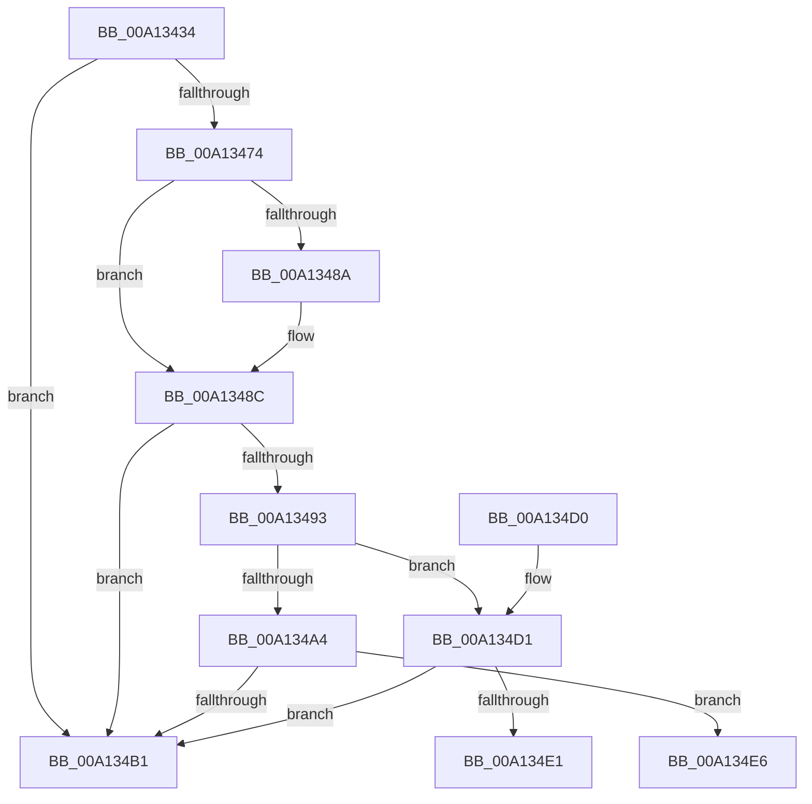

# SepIsSystemAppTCB

- RVA: `0x00A13434`–`0x00A134F6` (길이 `194` bytes)
- VA: `0x0000000140A13434`
- 실행 섹션: `PAGE`
- PDB 이름 있음: `예`; PDB Function 태그: `예`
- unwind 정보 RVA: `0x000A9A0C`
- 디코드: `57`개 명령, `194/194` bytes 표시
- 미해석 바이트: `0` (있으면 어셈블리에 `.byte`로 보존)

> 이 문서는 커널 이미지의 기계어와 PDB 기호를 분석해 생성했습니다. 4번과 5번은 함수 원형과 자료형을 바이너리 사용 방식에서 추정한 C 해석이며 원본 소스 복구 결과는 아닙니다.

## 1. Dependencies

- 직접 호출 지점: **4**; 고유 호출 대상: **3**
- 직접 호출자로 확인된 함수: **1**
- RIP 상대 이미지 참조: **1**

### Outgoing calls
- `0x00A1345F` → [PsGetCurrentServerSilo](../../text/22/PsGetCurrentServerSilo_function_00225710.md) (function, `0x00225710`)
- `0x00A13467` → [PsGetServerSiloGlobals](../../text/22/PsGetServerSiloGlobals_function_002250A0.md) (function, `0x002250A0`)
- `0x00A134A8` → [RtlPrefixUnicodeString](../8F/RtlPrefixUnicodeString_function_008F4F70.md) (function, `0x008F4F70`)
- `0x00A134D8` → [RtlPrefixUnicodeString](../8F/RtlPrefixUnicodeString_function_008F4F70.md) (function, `0x008F4F70`)

### Direct callers
- [SeQuerySigningPolicy](SeQuerySigningPolicy_function_00A12F44.md) at `0x00A12FFD`

### Static image references
- `0x00A134D1` → RVA `0x00002F18` (`.rdata`; read)

## 2. Other-region calls and transfers

- 다른 실행 섹션으로 향하는 call: **2**
  - `0x00A1345F` → [PsGetCurrentServerSilo](../../text/22/PsGetCurrentServerSilo_function_00225710.md) (`PAGE` → `.text`)
  - `0x00A13467` → [PsGetServerSiloGlobals](../../text/22/PsGetServerSiloGlobals_function_002250A0.md) (`PAGE` → `.text`)
- call이 아닌 외부 분기/꼬리 이동: **2**
  - `0x00A134E1` → [sub_00B36E04](../B3/Unknown_function_00B36E04.md) (`tail-transfer`)
  - `0x00A134F1` → [sub_00B36E04](../B3/Unknown_function_00B36E04.md) (`tail-transfer`)

## 3. Assembly (complete function range)

```asm
00A13434  48 8B C4                        mov rax, rsp
00A13437  48 89 58 08                     mov qword ptr [rax + 8], rbx
00A1343B  48 89 68 10                     mov qword ptr [rax + 0x10], rbp
00A1343F  48 89 70 18                     mov qword ptr [rax + 0x18], rsi
00A13443  57                              push rdi
00A13444  41 56                           push r14
00A13446  41 57                           push r15
00A13448  48 83 EC 60                     sub rsp, 0x60
00A1344C  0F 57 C0                        xorps xmm0, xmm0
00A1344F  45 8A F1                        mov r14b, r9b
00A13452  0F 11 40 D8                     movups xmmword ptr [rax - 0x28], xmm0
00A13456  41 8A D8                        mov bl, r8b
00A13459  44 8B FA                        mov r15d, edx
00A1345C  48 8B F9                        mov rdi, rcx
00A1345F  E8 AC 22 81 FF                  call 0x140225710
00A13464  48 8B C8                        mov rcx, rax
00A13467  E8 34 1C 81 FF                  call 0x1402250a0
00A1346C  48 8B E8                        mov rbp, rax
00A1346F  48 85 FF                        test rdi, rdi
00A13472  74 3D                           je 0x140a134b1
00A13474  4C 8B 88 00 03 00 00            mov r9, qword ptr [rax + 0x300]
00A1347B  BE 2E 00 00 00                  mov esi, 0x2e
00A13480  41 0F B7 49 30                  movzx ecx, word ptr [r9 + 0x30]
00A13485  66 3B CE                        cmp cx, si
00A13488  72 02                           jb 0x140a1348c
00A1348A  8B CE                           mov ecx, esi
00A1348C  0F B7 07                        movzx eax, word ptr [rdi]
00A1348F  3B C1                           cmp eax, ecx
00A13491  76 1E                           jbe 0x140a134b1
00A13493  48 8B 47 08                     mov rax, qword ptr [rdi + 8]
00A13497  41 B0 01                        mov r8b, 1
00A1349A  48 8B D7                        mov rdx, rdi
00A1349D  66 83 78 02 3F                  cmp word ptr [rax + 2], 0x3f
00A134A2  75 2D                           jne 0x140a134d1
00A134A4  49 8D 49 30                     lea rcx, [r9 + 0x30]
00A134A8  E8 C3 1A EE FF                  call 0x1408f4f70
00A134AD  84 C0                           test al, al
00A134AF  75 35                           jne 0x140a134e6
00A134B1  B8 25 02 00 C0                  mov eax, 0xc0000225
00A134B6  4C 8D 5C 24 60                  lea r11, [rsp + 0x60]
00A134BB  49 8B 5B 20                     mov rbx, qword ptr [r11 + 0x20]
00A134BF  49 8B 6B 28                     mov rbp, qword ptr [r11 + 0x28]
00A134C3  49 8B 73 30                     mov rsi, qword ptr [r11 + 0x30]
00A134C7  49 8B E3                        mov rsp, r11
00A134CA  41 5F                           pop r15
00A134CC  41 5E                           pop r14
00A134CE  5F                              pop rdi
00A134CF  C3                              ret
00A134D0  CC                              int3
00A134D1  48 8D 0D 40 FA 5E FF            lea rcx, [rip - 0xa105c0]
00A134D8  E8 93 1A EE FF                  call 0x1408f4f70
00A134DD  84 C0                           test al, al
00A134DF  74 D0                           je 0x140a134b1
00A134E1  E9 1E 39 12 00                  jmp 0x140b36e04
00A134E6  48 8B 85 00 03 00 00            mov rax, qword ptr [rbp + 0x300]
00A134ED  0F B7 70 30                     movzx esi, word ptr [rax + 0x30]
00A134F1  E9 0E 39 12 00                  jmp 0x140b36e04
```

## 4. C-style interpretation (structured pseudocode)

```c
__int64 __fastcall SepIsSystemAppTCB(__int64 a1, int a2, unsigned __int8 a3, unsigned __int8 a4)
{
    __int64 result;
    __int64 v_rsp;
    unsigned __int64 v_stack_m18;

    *(unsigned __int64 *)(v_rsp + 8) = v_rbx;
    *(unsigned __int64 *)(v_rsp + 16) = v_rbp;
    *(unsigned __int64 *)(v_rsp + 24) = v_rsi;
    v_rsp = (v_rsp) - (96);
    *(unsigned __int64 *)(v_rsp - 40) = v_xmm0;
    result = PsGetCurrentServerSilo(a1, a2, a3, a4);
    result = PsGetServerSiloGlobals(result, a2, a3, a4);
    if (a1 == 0) goto loc_00A134B1;
    if (((unsigned __int16)(*(unsigned __int16 *)(*(unsigned __int64 *)(result + 768) + 48))) >= 46) {
        a1 = 46;
    }
    if (((unsigned int)(*(unsigned __int16 *)(a1))) <= ((unsigned int)(a1))) goto loc_00A134B1;
    if ((*(unsigned __int16 *)(*(unsigned __int64 *)(a1 + 8) + 2)) != 63) goto loc_00A134D1;
    result = RtlPrefixUnicodeString(*(unsigned __int64 *)(result + 768) + 48, a1, 1, *(unsigned __int64 *)(result + 768));
    if ((unsigned __int8)(result) != 0) goto loc_00A134E6;
loc_00A134B1:
    return (unsigned int)(0xC0000225ULL);
loc_00A134D1:
    result = RtlPrefixUnicodeString(v_rip - 10552768, a1, 1, *(unsigned __int64 *)(result + 768));
    if ((unsigned __int8)(result) == 0) goto loc_00A134B1;
loc_00A134E6:
}
```

## 5. (Beta) C Style

```c
int64_t SepIsSystemAppTCB(int64_t Arg1, int32_t Arg2, uint8_t Arg3, uint8_t Arg4)
{
    int64_t result;
    int64_t local_rsp;
    uint64_t v_stack_m18;

    *(uint64_t *)(local_rsp + 0x8) = local_rbx;
    *(uint64_t *)(local_rsp + 0x10) = local_rbp;
    *(uint64_t *)(local_rsp + 0x18) = local_rsi;
    local_rsp = (local_rsp) - (96);
    *(uint64_t *)(local_rsp - 0x28) = v_xmm0;
    result = PsGetCurrentServerSilo(Arg1, Arg2, Arg3, Arg4);
    result = PsGetServerSiloGlobals(result, Arg2, Arg3, Arg4);
    if (Arg1 == 0) goto loc_00A134B1;
    if (((uint16_t)(*(uint16_t *)(*(uint64_t *)(result + 0x300) + 0x30))) >= 46) {
        Arg1 = 46;
    }
    if (((uint32_t)(*(uint16_t *)(Arg1))) <= ((uint32_t)(Arg1))) goto loc_00A134B1;
    if ((*(uint16_t *)(*(uint64_t *)(Arg1 + 0x8) + 0x2)) != 63) goto loc_00A134D1;
    result = RtlPrefixUnicodeString(*(uint64_t *)(result + 0x300) + 48, Arg1, 1, *(uint64_t *)(result + 0x300));
    if ((uint8_t)(result) != 0) goto loc_00A134E6;
loc_00A134B1:
    return (uint32_t)(0xC0000225ULL);
loc_00A134D1:
    result = RtlPrefixUnicodeString(v_rip - 10552768, Arg1, 1, *(uint64_t *)(result + 0x300));
    if ((uint8_t)(result) == 0) goto loc_00A134B1;
loc_00A134E6:
}
```

## 6. Execution-region graph

[열기: 2D/3D 그래프와 함수 탐색 컨트롤 패널](../../../control-panel.html?section=page&rva=0x00A13434&view=graph)

- 2D 그래프는 위에서 아래로 흐르고, 3D 그래프는 빈 공간을 드래그해 회전합니다. Shift+드래그는 이동, 휠은 확대·축소, 함수 노드 선택은 대상 보고서 이동입니다.

### Static fallback


