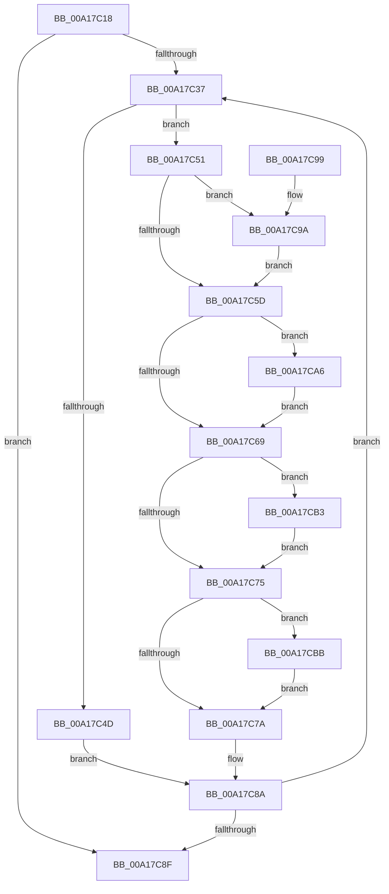

# SepMakeTokenEffectiveOnly

- RVA: `0x00A17C18`–`0x00A17CC3` (길이 `171` bytes)
- VA: `0x0000000140A17C18`
- 실행 섹션: `PAGE`
- PDB 이름 있음: `예`; PDB Function 태그: `아니요`
- unwind 정보 RVA: `0x000AA074`
- 디코드: `48`개 명령, `171/171` bytes 표시
- 미해석 바이트: `0` (있으면 어셈블리에 `.byte`로 보존)

> 이 문서는 커널 이미지의 기계어와 PDB 기호를 분석해 생성했습니다. 4번과 5번은 함수 원형과 자료형을 바이너리 사용 방식에서 추정한 C 해석이며 원본 소스 복구 결과는 아닙니다.

## 1. Dependencies

- 직접 호출 지점: **0**; 고유 호출 대상: **0**
- 직접 호출자로 확인된 함수: **1**
- RIP 상대 이미지 참조: **0**

### Outgoing calls
- 직접 디코드된 call 명령이 없습니다.

### Direct callers
- [SepDuplicateToken](../8B/SepDuplicateToken_function_008B87EC.md) at `0x008B8FF1`

### Static image references
- 디코드된 RIP-relative 메모리 참조가 없습니다.

## 2. Other-region calls and transfers

- 다른 실행 섹션으로 향하는 call: **0**
- 별도 외부 분기/꼬리 이동을 확인하지 못했습니다.

## 3. Assembly (complete function range)

```asm
00A17C18  48 89 5C 24 08                  mov qword ptr [rsp + 8], rbx
00A17C1D  48 8B 41 48                     mov rax, qword ptr [rcx + 0x48]
00A17C21  BA 01 00 00 00                  mov edx, 1
00A17C26  48 21 41 40                     and qword ptr [rcx + 0x40], rax
00A17C2A  48 21 41 50                     and qword ptr [rcx + 0x50], rax
00A17C2E  44 8B 41 7C                     mov r8d, dword ptr [rcx + 0x7c]
00A17C32  44 3B C2                        cmp r8d, edx
00A17C35  76 58                           jbe 0x140a17c8f
00A17C37  48 8B 99 98 00 00 00            mov rbx, qword ptr [rcx + 0x98]
00A17C3E  44 8B CA                        mov r9d, edx
00A17C41  4D 03 C9                        add r9, r9
00A17C44  42 8B 44 CB 08                  mov eax, dword ptr [rbx + r9*8 + 8]
00A17C49  A8 34                           test al, 0x34
00A17C4B  74 04                           je 0x140a17c51
00A17C4D  FF C2                           inc edx
00A17C4F  EB 39                           jmp 0x140a17c8a
00A17C51  44 8B 91 90 00 00 00            mov r10d, dword ptr [rcx + 0x90]
00A17C58  41 3B D2                        cmp edx, r10d
00A17C5B  74 3D                           je 0x140a17c9a
00A17C5D  44 8B 99 D0 00 00 00            mov r11d, dword ptr [rcx + 0xd0]
00A17C64  41 3B D3                        cmp edx, r11d
00A17C67  74 3D                           je 0x140a17ca6
00A17C69  41 8D 40 FF                     lea eax, [r8 - 1]
00A17C6D  44 8B C0                        mov r8d, eax
00A17C70  41 3B C3                        cmp eax, r11d
00A17C73  74 3E                           je 0x140a17cb3
00A17C75  45 3B C2                        cmp r8d, r10d
00A17C78  74 41                           je 0x140a17cbb
00A17C7A  49 8B C0                        mov rax, r8
00A17C7D  48 03 C0                        add rax, rax
00A17C80  0F 10 04 C3                     movups xmm0, xmmword ptr [rbx + rax*8]
00A17C84  F3 42 0F 7F 04 CB               movdqu xmmword ptr [rbx + r9*8], xmm0
00A17C8A  41 3B D0                        cmp edx, r8d
00A17C8D  72 A8                           jb 0x140a17c37
00A17C8F  48 8B 5C 24 08                  mov rbx, qword ptr [rsp + 8]
00A17C94  44 89 41 7C                     mov dword ptr [rcx + 0x7c], r8d
00A17C98  C3                              ret
00A17C99  CC                              int3
00A17C9A  83 A1 90 00 00 00 00            and dword ptr [rcx + 0x90], 0
00A17CA1  45 33 D2                        xor r10d, r10d
00A17CA4  EB B7                           jmp 0x140a17c5d
00A17CA6  83 89 D0 00 00 00 FF            or dword ptr [rcx + 0xd0], 0xffffffff
00A17CAD  41 83 CB FF                     or r11d, 0xffffffff
00A17CB1  EB B6                           jmp 0x140a17c69
00A17CB3  89 91 D0 00 00 00               mov dword ptr [rcx + 0xd0], edx
00A17CB9  EB BA                           jmp 0x140a17c75
00A17CBB  89 91 90 00 00 00               mov dword ptr [rcx + 0x90], edx
00A17CC1  EB B7                           jmp 0x140a17c7a
```

## 4. C-style interpretation (structured pseudocode)

```c
__int64 __fastcall SepMakeTokenEffectiveOnly(__int64 a1)
{
    __int64 result;
    __int64 v_r10;
    __int64 v_r11;
    unsigned __int64 v_stack_p8;

    v_stack_p8 = v_rbx;
    if (((unsigned int)((unsigned int)(*(unsigned int *)(a1 + 124)))) <= 1) goto loc_00A17C8F;
loc_00A17C37:
    a4 = (1) + (1);
    if ((((unsigned __int8)((unsigned int)(*(unsigned int *)(*(unsigned __int64 *)(a1 + 152) + a4 * 8 + 8)))) & (52)) == 0) goto loc_00A17C51;
    a2 = (unsigned int)((1) + 1);
    goto loc_00A17C8A;
loc_00A17C51:
    if (((unsigned int)(a2)) == ((unsigned int)((unsigned int)(*(unsigned int *)(a1 + 144))))) goto loc_00A17C9A;
loc_00A17C5D:
    if (((unsigned int)(a2)) == ((unsigned int)((unsigned int)(*(unsigned int *)(a1 + 208))))) goto loc_00A17CA6;
loc_00A17C69:
    if (((unsigned int)((unsigned int)(*(unsigned int *)(a1 + 124)) - 1)) == ((unsigned int)((unsigned int)(*(unsigned int *)(a1 + 208))))) goto loc_00A17CB3;
loc_00A17C75:
    if (((unsigned int)((unsigned int)((unsigned int)((unsigned int)(*(unsigned int *)(a1 + 124)) - 1)))) == ((unsigned int)((unsigned int)(*(unsigned int *)(a1 + 144))))) goto loc_00A17CBB;
loc_00A17C7A:
    result = ((unsigned int)((unsigned int)((unsigned int)(*(unsigned int *)(a1 + 124)) - 1))) + ((unsigned int)((unsigned int)((unsigned int)(*(unsigned int *)(a1 + 124)) - 1)));
    *(unsigned __int64 *)(*(unsigned __int64 *)(a1 + 152) + a4 * 8) = v_xmm0;
loc_00A17C8A:
    if (((unsigned int)(a2)) < ((unsigned int)((unsigned int)((unsigned int)((unsigned int)(*(unsigned int *)(a1 + 124)) - 1))))) goto loc_00A17C37;
loc_00A17C8F:
    *(unsigned int *)(a1 + 124) = (unsigned int)((unsigned int)((unsigned int)((unsigned int)(*(unsigned int *)(a1 + 124)) - 1)));
    return result;
loc_00A17C9A:
    v_r10 = 0;
    goto loc_00A17C5D;
loc_00A17CA6:
    v_r11 = (unsigned int)(((unsigned int)(*(unsigned int *)(a1 + 208))) | (0xFFFFFFFFULL));
    goto loc_00A17C69;
loc_00A17CB3:
    *(unsigned int *)(a1 + 208) = (unsigned int)(a2);
    goto loc_00A17C75;
loc_00A17CBB:
    *(unsigned int *)(a1 + 144) = (unsigned int)(a2);
    goto loc_00A17C7A;
}
```

## 5. (Beta) C Style

```c
int64_t SepMakeTokenEffectiveOnly(void *Arg1)
{
    uint8_t *arg1 = (uint8_t *)Arg1;

    int64_t result;
    int64_t local_r10;
    int64_t local_r11;
    uint64_t v_stack_p8;

    v_stack_p8 = local_rbx;
    if (((uint32_t)((uint32_t)(*(uint32_t *)(arg1 + 0x7C)))) <= 1) goto loc_00A17C8F;
loc_00A17C37:
    a4 = (1) + (1);
    if ((((uint8_t)((uint32_t)(*(uint32_t *)(*(uint64_t *)(arg1 + 0x98) + a4 * 8 + 0x8)))) & (52)) == 0) goto loc_00A17C51;
    a2 = (uint32_t)((1) + 1);
    goto loc_00A17C8A;
loc_00A17C51:
    if (((uint32_t)(a2)) == ((uint32_t)((uint32_t)(*(uint32_t *)(arg1 + 0x90))))) goto loc_00A17C9A;
loc_00A17C5D:
    if (((uint32_t)(a2)) == ((uint32_t)((uint32_t)(*(uint32_t *)(arg1 + 0xD0))))) goto loc_00A17CA6;
loc_00A17C69:
    if (((uint32_t)((uint32_t)(*(uint32_t *)(arg1 + 0x7C)) - 1)) == ((uint32_t)((uint32_t)(*(uint32_t *)(arg1 + 0xD0))))) goto loc_00A17CB3;
loc_00A17C75:
    if (((uint32_t)((uint32_t)((uint32_t)((uint32_t)(*(uint32_t *)(arg1 + 0x7C)) - 1)))) == ((uint32_t)((uint32_t)(*(uint32_t *)(arg1 + 0x90))))) goto loc_00A17CBB;
loc_00A17C7A:
    result = ((uint32_t)((uint32_t)((uint32_t)(*(uint32_t *)(arg1 + 0x7C)) - 1))) + ((uint32_t)((uint32_t)((uint32_t)(*(uint32_t *)(arg1 + 0x7C)) - 1)));
    *(uint64_t *)(*(uint64_t *)(arg1 + 0x98) + a4 * 8) = v_xmm0;
loc_00A17C8A:
    if (((uint32_t)(a2)) < ((uint32_t)((uint32_t)((uint32_t)((uint32_t)(*(uint32_t *)(arg1 + 0x7C)) - 1))))) goto loc_00A17C37;
loc_00A17C8F:
    *(uint32_t *)(arg1 + 0x7C) = (uint32_t)((uint32_t)((uint32_t)((uint32_t)(*(uint32_t *)(arg1 + 0x7C)) - 1)));
    return result;
loc_00A17C9A:
    local_r10 = 0;
    goto loc_00A17C5D;
loc_00A17CA6:
    local_r11 = (uint32_t)(((uint32_t)(*(uint32_t *)(arg1 + 0xD0))) | (0xFFFFFFFFULL));
    goto loc_00A17C69;
loc_00A17CB3:
    *(uint32_t *)(arg1 + 0xD0) = (uint32_t)(a2);
    goto loc_00A17C75;
loc_00A17CBB:
    *(uint32_t *)(arg1 + 0x90) = (uint32_t)(a2);
    goto loc_00A17C7A;
}
```

### 관측된 메모리 오프셋

구조체 형식이 확인되지 않은 접근은 인자 기준의 오프셋으로만 기록했습니다.

| 기준 인자 | 오프셋 표현 | 폭 (bit) | 접근 |
|---|---:|---:|---|
| `Arg1` | `+ 0x40` | `64` | `R/W` |
| `Arg1` | `+ 0x48` | `64` | `R` |
| `Arg1` | `+ 0x50` | `64` | `R/W` |
| `Arg1` | `+ 0x7C` | `32` | `R` |
| `Arg1` | `+ 0x7C` | `32` | `W` |
| `Arg1` | `+ 0x90` | `32` | `R` |
| `Arg1` | `+ 0x90` | `32` | `R/W` |
| `Arg1` | `+ 0x90` | `32` | `W` |
| `Arg1` | `+ 0x98` | `64` | `R` |
| `Arg1` | `+ 0xD0` | `32` | `R` |
| `Arg1` | `+ 0xD0` | `32` | `R/W` |
| `Arg1` | `+ 0xD0` | `32` | `W` |

## 6. Execution-region graph

[열기: 2D/3D 그래프와 함수 탐색 컨트롤 패널](../../../control-panel.html?section=page&rva=0x00A17C18&view=graph)

- 2D 그래프는 위에서 아래로 흐르고, 3D 그래프는 빈 공간을 드래그해 회전합니다. Shift+드래그는 이동, 휠은 확대·축소, 함수 노드 선택은 대상 보고서 이동입니다.

### Static fallback


