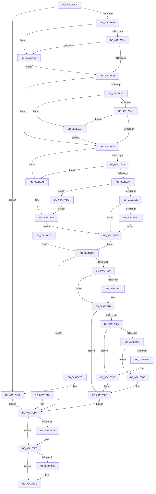

# sub_00A179B0

- RVA: `0x00A179B0`–`0x00A17C0F` (길이 `607` bytes)
- VA: `0x0000000140A179B0`
- 실행 섹션: `PAGE`
- PDB 이름 있음: `아니요`; PDB Function 태그: `아니요`
- unwind 정보 RVA: `0x000AA030`
- 디코드: `162`개 명령, `607/607` bytes 표시
- 미해석 바이트: `0` (있으면 어셈블리에 `.byte`로 보존)

> 이 문서는 커널 이미지의 기계어와 PDB 기호를 분석해 생성했습니다. 4번과 5번은 함수 원형과 자료형을 바이너리 사용 방식에서 추정한 C 해석이며 원본 소스 복구 결과는 아닙니다.

## 1. Dependencies

- 직접 호출 지점: **7**; 고유 호출 대상: **5**
- 직접 호출자로 확인된 함수: **2**
- RIP 상대 이미지 참조: **1**

### Outgoing calls
- `0x00A17A70` → [ExAllocatePool2](../../poolcode/B8/ExAllocatePool2_function_00B820F0.md) (function, `0x00B820F0`)
- `0x00A17A8D` → [memcpy](../../text/6C/memcpy_function_006C6840.md) (function, `0x006C6840`)
- `0x00A17B56` → [KeExpandKernelStackAndCalloutEx](../../text/2F/KeExpandKernelStackAndCalloutEx_function_002F85B0.md) (function, `0x002F85B0`)
- `0x00A17B9D` → [ProbeForWrite](../8E/ProbeForWrite_function_008E91C0.md) (function, `0x008E91C0`)
- `0x00A17BAB` → [memcpy](../../text/6C/memcpy_function_006C6840.md) (function, `0x006C6840`)
- `0x00A17BDE` → [ExFreePoolWithTag](../../poolcode/B8/ExFreePoolWithTag_function_00B82870.md) (function, `0x00B82870`)
- `0x00A17BED` → [ExFreePoolWithTag](../../poolcode/B8/ExFreePoolWithTag_function_00B82870.md) (function, `0x00B82870`)

### Direct callers
- [ExpQuerySystemInformation](../A5/ExpQuerySystemInformation_function_00A57858.md) at `0x00A59CB8`
- [NtSetSystemInformation](../AF/NtSetSystemInformation_function_00AF4A60.md) at `0x00AF5FFE`

### Static image references
- `0x00A17B4F` → RVA `0x00A3A820` (`PAGE`; read)

## 2. Other-region calls and transfers

- 다른 실행 섹션으로 향하는 call: **6**
  - `0x00A17A70` → [ExAllocatePool2](../../poolcode/B8/ExAllocatePool2_function_00B820F0.md) (`PAGE` → `POOLCODE`)
  - `0x00A17A8D` → [memcpy](../../text/6C/memcpy_function_006C6840.md) (`PAGE` → `.text`)
  - `0x00A17B56` → [KeExpandKernelStackAndCalloutEx](../../text/2F/KeExpandKernelStackAndCalloutEx_function_002F85B0.md) (`PAGE` → `.text`)
  - `0x00A17BAB` → [memcpy](../../text/6C/memcpy_function_006C6840.md) (`PAGE` → `.text`)
  - `0x00A17BDE` → [ExFreePoolWithTag](../../poolcode/B8/ExFreePoolWithTag_function_00B82870.md) (`PAGE` → `POOLCODE`)
  - `0x00A17BED` → [ExFreePoolWithTag](../../poolcode/B8/ExFreePoolWithTag_function_00B82870.md) (`PAGE` → `POOLCODE`)
- 별도 외부 분기/꼬리 이동을 확인하지 못했습니다.

## 3. Assembly (complete function range)

```asm
00A179B0  48 89 54 24 10                  mov qword ptr [rsp + 0x10], rdx
00A179B5  53                              push rbx
00A179B6  56                              push rsi
00A179B7  57                              push rdi
00A179B8  41 54                           push r12
00A179BA  41 55                           push r13
00A179BC  41 56                           push r14
00A179BE  41 57                           push r15
00A179C0  48 81 EC 90 00 00 00            sub rsp, 0x90
00A179C7  4C 8B F2                        mov r14, rdx
00A179CA  33 FF                           xor edi, edi
00A179CC  89 7C 24 30                     mov dword ptr [rsp + 0x30], edi
00A179D0  0F 57 C0                        xorps xmm0, xmm0
00A179D3  0F 11 44 24 48                  movups xmmword ptr [rsp + 0x48], xmm0
00A179D8  0F 11 44 24 58                  movups xmmword ptr [rsp + 0x58], xmm0
00A179DD  33 F6                           xor esi, esi
00A179DF  48 89 74 24 40                  mov qword ptr [rsp + 0x40], rsi
00A179E4  21 74 24 34                     and dword ptr [rsp + 0x34], esi
00A179E8  45 33 FF                        xor r15d, r15d
00A179EB  4C 89 BC 24 E0 00 00 00         mov qword ptr [rsp + 0xe0], r15
00A179F3  45 33 ED                        xor r13d, r13d
00A179F6  21 74 24 38                     and dword ptr [rsp + 0x38], esi
00A179FA  48 85 D2                        test rdx, rdx
00A179FD  0F 84 05 02 00 00               je 0x140a17c08
00A17A03  48 8D 42 20                     lea rax, [rdx + 0x20]
00A17A07  49 B9 00 00 FF FF FF 7F 00 00   movabs r9, 0x7fffffff0000
00A17A11  49 3B C1                        cmp rax, r9
00A17A14  0F 87 9C 00 00 00               ja 0x140a17ab6
00A17A1A  48 3B C2                        cmp rax, rdx
00A17A1D  0F 82 93 00 00 00               jb 0x140a17ab6
00A17A23  0F 10 02                        movups xmm0, xmmword ptr [rdx]
00A17A26  0F 11 44 24 48                  movups xmmword ptr [rsp + 0x48], xmm0
00A17A2B  0F 10 4A 10                     movups xmm1, xmmword ptr [rdx + 0x10]
00A17A2F  0F 11 4C 24 58                  movups xmmword ptr [rsp + 0x58], xmm1
00A17A34  66 0F 7E C9                     movd ecx, xmm1
00A17A38  85 C9                           test ecx, ecx
00A17A3A  74 15                           je 0x140a17a51
00A17A3C  44 8B C1                        mov r8d, ecx
00A17A3F  48 8B 54 24 48                  mov rdx, qword ptr [rsp + 0x48]
00A17A44  4C 03 C2                        add r8, rdx
00A17A47  4D 3B C1                        cmp r8, r9
00A17A4A  77 7B                           ja 0x140a17ac7
00A17A4C  4C 3B C2                        cmp r8, rdx
00A17A4F  72 76                           jb 0x140a17ac7
00A17A51  48 83 7C 24 48 00               cmp qword ptr [rsp + 0x48], 0
00A17A57  74 4D                           je 0x140a17aa6
00A17A59  85 C9                           test ecx, ecx
00A17A5B  74 49                           je 0x140a17aa6
00A17A5D  89 4C 24 34                     mov dword ptr [rsp + 0x34], ecx
00A17A61  8B D9                           mov ebx, ecx
00A17A63  41 B8 53 4C 53 20               mov r8d, 0x20534c53
00A17A69  8B D1                           mov edx, ecx
00A17A6B  B9 00 01 00 00                  mov ecx, 0x100
00A17A70  E8 7B A6 16 00                  call 0x140b820f0
00A17A75  48 8B F0                        mov rsi, rax
00A17A78  48 89 44 24 40                  mov qword ptr [rsp + 0x40], rax
00A17A7D  48 85 C0                        test rax, rax
00A17A80  74 5A                           je 0x140a17adc
00A17A82  44 8B C3                        mov r8d, ebx
00A17A85  48 8B 54 24 48                  mov rdx, qword ptr [rsp + 0x48]
00A17A8A  48 8B C8                        mov rcx, rax
00A17A8D  E8 AE ED CA FF                  call 0x1406c6840
00A17A92  4C 8B 64 24 50                  mov r12, qword ptr [rsp + 0x50]
00A17A97  4D 85 E4                        test r12, r12
00A17A9A  74 47                           je 0x140a17ae3
00A17A9C  8B 44 24 5C                     mov eax, dword ptr [rsp + 0x5c]
00A17AA0  89 44 24 38                     mov dword ptr [rsp + 0x38], eax
00A17AA4  EB 3D                           jmp 0x140a17ae3
00A17AA6  BF 23 00 00 C0                  mov edi, 0xc0000023
00A17AAB  89 7C 24 30                     mov dword ptr [rsp + 0x30], edi
00A17AAF  4C 8B 64 24 50                  mov r12, qword ptr [rsp + 0x50]
00A17AB4  EB 2D                           jmp 0x140a17ae3
00A17AB6  41 8A 01                        mov al, byte ptr [r9]
00A17AB9  8B 7C 24 30                     mov edi, dword ptr [rsp + 0x30]
00A17ABD  48 8B 74 24 40                  mov rsi, qword ptr [rsp + 0x40]
00A17AC2  E9 5C FF FF FF                  jmp 0x140a17a23
00A17AC7  41 8A 01                        mov al, byte ptr [r9]
00A17ACA  8B 7C 24 30                     mov edi, dword ptr [rsp + 0x30]
00A17ACE  8B 4C 24 58                     mov ecx, dword ptr [rsp + 0x58]
00A17AD2  48 8B 74 24 40                  mov rsi, qword ptr [rsp + 0x40]
00A17AD7  E9 75 FF FF FF                  jmp 0x140a17a51
00A17ADC  BF 17 00 00 C0                  mov edi, 0xc0000017
00A17AE1  EB C8                           jmp 0x140a17aab
00A17AE3  EB 23                           jmp 0x140a17b08
00A17AE5  8B F8                           mov edi, eax
00A17AE7  89 44 24 30                     mov dword ptr [rsp + 0x30], eax
00A17AEB  4C 8B B4 24 D8 00 00 00         mov r14, qword ptr [rsp + 0xd8]
00A17AF3  4C 8B 64 24 50                  mov r12, qword ptr [rsp + 0x50]
00A17AF8  48 8B 74 24 40                  mov rsi, qword ptr [rsp + 0x40]
00A17AFD  4C 8B BC 24 E0 00 00 00         mov r15, qword ptr [rsp + 0xe0]
00A17B05  45 8B EF                        mov r13d, r15d
00A17B08  85 FF                           test edi, edi
00A17B0A  0F 88 C4 00 00 00               js 0x140a17bd4
00A17B10  48 89 74 24 68                  mov qword ptr [rsp + 0x68], rsi
00A17B15  8B 44 24 34                     mov eax, dword ptr [rsp + 0x34]
00A17B19  89 44 24 70                     mov dword ptr [rsp + 0x70], eax
00A17B1D  8B 44 24 38                     mov eax, dword ptr [rsp + 0x38]
00A17B21  89 44 24 74                     mov dword ptr [rsp + 0x74], eax
00A17B25  48 83 64 24 78 00               and qword ptr [rsp + 0x78], 0
00A17B2B  83 A4 24 80 00 00 00 00         and dword ptr [rsp + 0x80], 0
00A17B33  33 C0                           xor eax, eax
00A17B35  89 84 24 84 00 00 00            mov dword ptr [rsp + 0x84], eax
00A17B3C  48 21 44 24 20                  and qword ptr [rsp + 0x20], rax
00A17B41  45 33 C9                        xor r9d, r9d
00A17B44  41 B8 00 4C 00 00               mov r8d, 0x4c00
00A17B4A  48 8D 54 24 68                  lea rdx, [rsp + 0x68]
00A17B4F  48 8D 0D CA 2C 02 00            lea rcx, [rip + 0x22cca]
00A17B56  E8 55 0A 8E FF                  call 0x1402f85b0
00A17B5B  8B F8                           mov edi, eax
00A17B5D  85 C0                           test eax, eax
00A17B5F  78 1C                           js 0x140a17b7d
00A17B61  4C 8B 7C 24 78                  mov r15, qword ptr [rsp + 0x78]
00A17B66  4C 89 BC 24 E0 00 00 00         mov qword ptr [rsp + 0xe0], r15
00A17B6E  44 8B AC 24 80 00 00 00         mov r13d, dword ptr [rsp + 0x80]
00A17B76  8B BC 24 84 00 00 00            mov edi, dword ptr [rsp + 0x84]
00A17B7D  89 7C 24 30                     mov dword ptr [rsp + 0x30], edi
00A17B81  85 FF                           test edi, edi
00A17B83  78 3A                           js 0x140a17bbf
00A17B85  4D 85 E4                        test r12, r12
00A17B88  74 26                           je 0x140a17bb0
00A17B8A  44 39 6C 24 5C                  cmp dword ptr [rsp + 0x5c], r13d
00A17B8F  72 25                           jb 0x140a17bb6
00A17B91  41 B8 01 00 00 00               mov r8d, 1
00A17B97  41 8B D5                        mov edx, r13d
00A17B9A  49 8B CC                        mov rcx, r12
00A17B9D  E8 1E 16 ED FF                  call 0x1408e91c0
00A17BA2  45 8B C5                        mov r8d, r13d
00A17BA5  49 8B D7                        mov rdx, r15
00A17BA8  49 8B CC                        mov rcx, r12
00A17BAB  E8 90 EC CA FF                  call 0x1406c6840
00A17BB0  45 89 6E 14                     mov dword ptr [r14 + 0x14], r13d
00A17BB4  EB 09                           jmp 0x140a17bbf
00A17BB6  BF 23 00 00 C0                  mov edi, 0xc0000023
00A17BBB  89 7C 24 30                     mov dword ptr [rsp + 0x30], edi
00A17BBF  EB 13                           jmp 0x140a17bd4
00A17BC1  8B F8                           mov edi, eax
00A17BC3  89 44 24 30                     mov dword ptr [rsp + 0x30], eax
00A17BC7  48 8B 74 24 40                  mov rsi, qword ptr [rsp + 0x40]
00A17BCC  4C 8B BC 24 E0 00 00 00         mov r15, qword ptr [rsp + 0xe0]
00A17BD4  48 85 F6                        test rsi, rsi
00A17BD7  74 0A                           je 0x140a17be3
00A17BD9  33 D2                           xor edx, edx
00A17BDB  48 8B CE                        mov rcx, rsi
00A17BDE  E8 8D AC 16 00                  call 0x140b82870
00A17BE3  4D 85 FF                        test r15, r15
00A17BE6  74 0A                           je 0x140a17bf2
00A17BE8  33 D2                           xor edx, edx
00A17BEA  49 8B CF                        mov rcx, r15
00A17BED  E8 7E AC 16 00                  call 0x140b82870
00A17BF2  8B C7                           mov eax, edi
00A17BF4  48 81 C4 90 00 00 00            add rsp, 0x90
00A17BFB  41 5F                           pop r15
00A17BFD  41 5E                           pop r14
00A17BFF  41 5D                           pop r13
00A17C01  41 5C                           pop r12
00A17C03  5F                              pop rdi
00A17C04  5E                              pop rsi
00A17C05  5B                              pop rbx
00A17C06  C3                              ret
00A17C07  CC                              int3
00A17C08  BF 23 00 00 C0                  mov edi, 0xc0000023
00A17C0D  EB C5                           jmp 0x140a17bd4
```

## 4. C-style interpretation (structured pseudocode)

```c
__int64 __fastcall sub_00A179B0(__int64 a1, __int64 a2)
{
    __int64 result;
    __int64 v_r13;
    __int64 v_r15;
    __int64 v_rdi;
    __int64 v_rsi;
    __int64 v_rsp;
    unsigned int v_stack_m44;
    unsigned int v_stack_m48;
    unsigned __int64 v_stack_m50;
    unsigned int v_stack_m54;
    unsigned int v_stack_m58;
    unsigned __int64 v_stack_m60;
    unsigned int v_stack_m6C;
    unsigned __int64 v_stack_m70;
    unsigned __int64 v_stack_m78;
    unsigned __int64 v_stack_m80;
    unsigned __int64 v_stack_m88;
    unsigned int v_stack_m90;
    unsigned int v_stack_m94;
    unsigned int v_stack_m98;
    unsigned __int64 v_stack_mA8;
    unsigned __int64 v_stack_p10;
    unsigned __int64 v_stack_p18;

    v_stack_p10 = a2;
    v_rsp = (v_rsp) - (144);
    v_rdi = 0;
    v_stack_m98 = 0;
    v_stack_m80 = v_xmm0;
    v_stack_m70 = v_xmm0;
    v_rsi = 0;
    v_stack_m88 = 0;
    v_r15 = 0;
    v_stack_p18 = 0;
    v_r13 = 0;
    if (a2 == 0) goto loc_00A17C08;
    if ((a2 + 32) > a4) goto loc_00A17AB6;
    if ((a2 + 32) < a2) goto loc_00A17AB6;
loc_00A17A23:
    v_stack_m80 = v_xmm0;
    v_stack_m70 = v_xmm1;
    if ((unsigned int)(a1) == 0) goto loc_00A17A51;
    a3 = ((unsigned int)((unsigned int)(a1))) + (v_stack_m80);
    if (a3 > a4) goto loc_00A17AC7;
    if (a3 < v_stack_m80) goto loc_00A17AC7;
loc_00A17A51:
    if (v_stack_m80 == 0) goto loc_00A17AA6;
    if ((unsigned int)(a1) == 0) goto loc_00A17AA6;
    v_stack_m94 = (unsigned int)(a1);
    result = ExAllocatePool2(256, (unsigned int)((unsigned int)(a1)), (unsigned int)(0x20534C53ULL), a4);
    v_stack_m88 = result;
    if (result == 0) goto loc_00A17ADC;
    result = memcpy(result, v_stack_m80, (unsigned int)((unsigned int)((unsigned int)((unsigned int)(a1)))), a4);
    if (v_stack_m78 == 0) goto loc_00A17AE3;
    v_stack_m90 = (unsigned int)((unsigned int)(v_stack_m6C));
    goto loc_00A17AE3;
loc_00A17AA6:
loc_00A17AAB:
    v_stack_m98 = (unsigned int)((unsigned int)(0xC0000023ULL));
    goto loc_00A17AE3;
loc_00A17AB6:
    goto loc_00A17A23;
loc_00A17AC7:
    goto loc_00A17A51;
loc_00A17ADC:
    goto loc_00A17AAB;
loc_00A17AE3:
    goto loc_00A17B08;
loc_00A17B08:
    if (sign_flag) goto loc_00A17BD4;
    v_stack_m60 = v_stack_m88;
    v_stack_m58 = (unsigned int)((unsigned int)(v_stack_m94));
    v_stack_m54 = (unsigned int)((unsigned int)(v_stack_m90));
    result = 0;
    v_stack_m44 = 0;
    a4 = 0;
    result = KeExpandKernelStackAndCalloutEx(v_rip + 142538, v_stack_m60, (unsigned int)(0x4C00ULL), a4);
    v_rdi = (unsigned int)((unsigned int)(result));
    if (!(sign_flag)) {
        v_r15 = v_stack_m50;
        v_stack_p18 = v_r15;
        v_r13 = v_stack_m48;
        v_rdi = v_stack_m44;
    }
    v_stack_m98 = (unsigned int)(v_rdi);
    if (sign_flag) goto loc_00A17BBF;
    if (v_stack_m78 == 0) goto loc_00A17BB0;
    if (v_stack_m6C < ((unsigned int)(v_r13))) goto loc_00A17BB6;
    result = ProbeForWrite(v_stack_m78, (unsigned int)((unsigned int)(v_r13)), 1, a4);
    result = memcpy(v_stack_m78, v_r15, (unsigned int)((unsigned int)(v_r13)), a4);
loc_00A17BB0:
    *(unsigned int *)(a2 + 20) = (unsigned int)(v_r13);
    goto loc_00A17BBF;
loc_00A17BB6:
    v_stack_m98 = (unsigned int)((unsigned int)(0xC0000023ULL));
loc_00A17BBF:
    goto loc_00A17BD4;
loc_00A17BD4:
    if (v_stack_m88 != 0) {
        a2 = 0;
        a1 = v_stack_m88;
        result = ExFreePoolWithTag(a1, a2, (unsigned int)((unsigned int)(v_r13)), a4);
    }
    if (v_r15 != 0) {
        a2 = 0;
        a1 = v_r15;
        result = ExFreePoolWithTag(a1, a2, (unsigned int)((unsigned int)(v_r13)), a4);
    }
    v_rsp = (v_rsp) + (144);
    return (unsigned int)((unsigned int)((unsigned int)(0xC0000023ULL)));
loc_00A17C08:
    goto loc_00A17BD4;
}
```

## 5. (Beta) C Style

```c
int64_t sub_00A179B0(int64_t Arg1, void *Arg2)
{
    uint8_t *arg2 = (uint8_t *)Arg2;

    int64_t result;
    int64_t local_r13;
    int64_t local_r15;
    int64_t local_rdi;
    int64_t local_rsi;
    int64_t local_rsp;
    uint32_t v_stack_m44;
    uint32_t v_stack_m48;
    uint64_t v_stack_m50;
    uint32_t v_stack_m54;
    uint32_t v_stack_m58;
    uint64_t v_stack_m60;
    uint32_t v_stack_m6C;
    uint64_t v_stack_m70;
    uint64_t v_stack_m78;
    uint64_t v_stack_m80;
    uint64_t v_stack_m88;
    uint32_t v_stack_m90;
    uint32_t v_stack_m94;
    uint32_t v_stack_m98;
    uint64_t v_stack_mA8;
    uint64_t v_stack_p10;
    uint64_t v_stack_p18;

    v_stack_p10 = Arg2;
    local_rsp = (local_rsp) - (144);
    local_rdi = 0;
    v_stack_m98 = 0;
    v_stack_m80 = v_xmm0;
    v_stack_m70 = v_xmm0;
    local_rsi = 0;
    v_stack_m88 = 0;
    local_r15 = 0;
    v_stack_p18 = 0;
    local_r13 = 0;
    if (Arg2 == NULL) goto loc_00A17C08;
    if ((Arg2 + 32) > a4) goto loc_00A17AB6;
    if ((Arg2 + 32) < Arg2) goto loc_00A17AB6;
loc_00A17A23:
    v_stack_m80 = v_xmm0;
    v_stack_m70 = v_xmm1;
    if ((uint32_t)(Arg1) == 0) goto loc_00A17A51;
    a3 = ((uint32_t)((uint32_t)(Arg1))) + (v_stack_m80);
    if (a3 > a4) goto loc_00A17AC7;
    if (a3 < v_stack_m80) goto loc_00A17AC7;
loc_00A17A51:
    if (v_stack_m80 == 0) goto loc_00A17AA6;
    if ((uint32_t)(Arg1) == 0) goto loc_00A17AA6;
    v_stack_m94 = (uint32_t)(Arg1);
    result = ExAllocatePool2(256, (uint32_t)((uint32_t)(Arg1)), (uint32_t)(0x20534C53ULL), a4);
    v_stack_m88 = result;
    if (result == 0) goto loc_00A17ADC;
    result = memcpy(result, v_stack_m80, (uint32_t)((uint32_t)((uint32_t)((uint32_t)(Arg1)))), a4);
    if (v_stack_m78 == 0) goto loc_00A17AE3;
    v_stack_m90 = (uint32_t)((uint32_t)(v_stack_m6C));
    goto loc_00A17AE3;
loc_00A17AA6:
loc_00A17AAB:
    v_stack_m98 = (uint32_t)((uint32_t)(0xC0000023ULL));
    goto loc_00A17AE3;
loc_00A17AB6:
    goto loc_00A17A23;
loc_00A17AC7:
    goto loc_00A17A51;
loc_00A17ADC:
    goto loc_00A17AAB;
loc_00A17AE3:
    goto loc_00A17B08;
loc_00A17B08:
    if (sign_flag) goto loc_00A17BD4;
    v_stack_m60 = v_stack_m88;
    v_stack_m58 = (uint32_t)((uint32_t)(v_stack_m94));
    v_stack_m54 = (uint32_t)((uint32_t)(v_stack_m90));
    result = 0;
    v_stack_m44 = 0;
    a4 = 0;
    result = KeExpandKernelStackAndCalloutEx(v_rip + 142538, v_stack_m60, (uint32_t)(0x4C00ULL), a4);
    local_rdi = (uint32_t)((uint32_t)(result));
    if (!(sign_flag)) {
        local_r15 = v_stack_m50;
        v_stack_p18 = local_r15;
        local_r13 = v_stack_m48;
        local_rdi = v_stack_m44;
    }
    v_stack_m98 = (uint32_t)(local_rdi);
    if (sign_flag) goto loc_00A17BBF;
    if (v_stack_m78 == 0) goto loc_00A17BB0;
    if (v_stack_m6C < ((uint32_t)(local_r13))) goto loc_00A17BB6;
    result = ProbeForWrite(v_stack_m78, (uint32_t)((uint32_t)(local_r13)), 1, a4);
    result = memcpy(v_stack_m78, local_r15, (uint32_t)((uint32_t)(local_r13)), a4);
loc_00A17BB0:
    *(uint32_t *)(arg2 + 0x14) = (uint32_t)(local_r13);
    goto loc_00A17BBF;
loc_00A17BB6:
    v_stack_m98 = (uint32_t)((uint32_t)(0xC0000023ULL));
loc_00A17BBF:
    goto loc_00A17BD4;
loc_00A17BD4:
    if (v_stack_m88 != 0) {
        Arg2 = 0;
        Arg1 = v_stack_m88;
        result = ExFreePoolWithTag(Arg1, Arg2, (uint32_t)((uint32_t)(local_r13)), a4);
    }
    if (local_r15 != 0) {
        Arg2 = 0;
        Arg1 = local_r15;
        result = ExFreePoolWithTag(Arg1, Arg2, (uint32_t)((uint32_t)(local_r13)), a4);
    }
    local_rsp = (local_rsp) + (144);
    return (uint32_t)((uint32_t)((uint32_t)(0xC0000023ULL)));
loc_00A17C08:
    goto loc_00A17BD4;
}
```

### 관측된 메모리 오프셋

구조체 형식이 확인되지 않은 접근은 인자 기준의 오프셋으로만 기록했습니다.

| 기준 인자 | 오프셋 표현 | 폭 (bit) | 접근 |
|---|---:|---:|---|
| `Arg2` | `+ 0x14` | `32` | `W` |

## 6. Execution-region graph

[열기: 2D/3D 그래프와 함수 탐색 컨트롤 패널](../../../control-panel.html?section=page&rva=0x00A179B0&view=graph)

- 2D 그래프는 위에서 아래로 흐르고, 3D 그래프는 빈 공간을 드래그해 회전합니다. Shift+드래그는 이동, 휠은 확대·축소, 함수 노드 선택은 대상 보고서 이동입니다.

### Static fallback


