# VmAccessFault

- RVA: `0x00A18BF0`–`0x00A18FB9` (길이 `969` bytes)
- VA: `0x0000000140A18BF0`
- 실행 섹션: `PAGE`
- PDB 이름 있음: `예`; PDB Function 태그: `예`
- unwind 정보 RVA: `0x000AA20C`
- 디코드: `227`개 명령, `969/969` bytes 표시
- 미해석 바이트: `0` (있으면 어셈블리에 `.byte`로 보존)

> 이 문서는 커널 이미지의 기계어와 PDB 기호를 분석해 생성했습니다. 4번과 5번은 함수 원형과 자료형을 바이너리 사용 방식에서 추정한 C 해석이며 원본 소스 복구 결과는 아닙니다.

## 1. Dependencies

- 직접 호출 지점: **9**; 고유 호출 대상: **7**
- 직접 호출자로 확인된 함수: **1**
- RIP 상대 이미지 참조: **3**

### Outgoing calls
- `0x00A18DB2` → [VmpAccessFaultBatch](../../text/42/VmpAccessFaultBatch_function_00429398.md) (function, `0x00429398`)
- `0x00A18DF4` → [_security_check_cookie](../../text/6A/_security_check_cookie_function_006AC640.md) (function, `0x006AC640`)
- `0x00A18E38` → [KeQueryUnbiasedInterruptTimePrecise](../../text/37/KeQueryUnbiasedInterruptTimePrecise_function_0037AC20.md) (function, `0x0037AC20`)
- `0x00A18E90` → [VmpAccessFaultBatch](../../text/42/VmpAccessFaultBatch_function_00429398.md) (function, `0x00429398`)
- `0x00A18F0C` → [VmpLogAccessFaultRange](../7A/VmpLogAccessFaultRange_function_007AE28C.md) (function, `0x007AE28C`)
- `0x00A18F3D` → [VmpPrefetchForVirtualFault](../7A/VmpPrefetchForVirtualFault_function_007ADC3C.md) (function, `0x007ADC3C`)
- `0x00A18F4E` → [ExAllocateFromLookasideListEx](../../text/3C/ExAllocateFromLookasideListEx_function_003CD390.md) (function, `0x003CD390`)
- `0x00A18F93` → [ExFreeToLookasideListEx](../../text/38/ExFreeToLookasideListEx_function_0038ACC0.md) (function, `0x0038ACC0`)
- `0x00A18FA2` → [KeQueryUnbiasedInterruptTimePrecise](../../text/37/KeQueryUnbiasedInterruptTimePrecise_function_0037AC20.md) (function, `0x0037AC20`)

### Direct callers
- [VmpPinMemoryRange](../../text/64/VmpPinMemoryRange_function_0064CCD0.md) at `0x0064D092`

### Static image references
- `0x00A18C04` → RVA `0x00E0A740` (`.data`; read)
- `0x00A18C25` → RVA `0x00F02458` (`.data`; read)
- `0x00A18F47` → RVA `0x00E28C00` (`.data`; read)

## 2. Other-region calls and transfers

- 다른 실행 섹션으로 향하는 call: **7**
  - `0x00A18DB2` → [VmpAccessFaultBatch](../../text/42/VmpAccessFaultBatch_function_00429398.md) (`PAGE` → `.text`)
  - `0x00A18DF4` → [_security_check_cookie](../../text/6A/_security_check_cookie_function_006AC640.md) (`PAGE` → `.text`)
  - `0x00A18E38` → [KeQueryUnbiasedInterruptTimePrecise](../../text/37/KeQueryUnbiasedInterruptTimePrecise_function_0037AC20.md) (`PAGE` → `.text`)
  - `0x00A18E90` → [VmpAccessFaultBatch](../../text/42/VmpAccessFaultBatch_function_00429398.md) (`PAGE` → `.text`)
  - `0x00A18F4E` → [ExAllocateFromLookasideListEx](../../text/3C/ExAllocateFromLookasideListEx_function_003CD390.md) (`PAGE` → `.text`)
  - `0x00A18F93` → [ExFreeToLookasideListEx](../../text/38/ExFreeToLookasideListEx_function_0038ACC0.md) (`PAGE` → `.text`)
  - `0x00A18FA2` → [KeQueryUnbiasedInterruptTimePrecise](../../text/37/KeQueryUnbiasedInterruptTimePrecise_function_0037AC20.md) (`PAGE` → `.text`)
- call이 아닌 외부 분기/꼬리 이동: **1**
  - `0x00A18FB4` → [sub_00B37256 + 0x8](../B3/Unknown_function_00B37256.md) (`tail-transfer`)

## 3. Assembly (complete function range)

```asm
00A18BF0  40 53                           push rbx
00A18BF2  55                              push rbp
00A18BF3  56                              push rsi
00A18BF4  57                              push rdi
00A18BF5  41 54                           push r12
00A18BF7  41 55                           push r13
00A18BF9  41 56                           push r14
00A18BFB  41 57                           push r15
00A18BFD  48 81 EC A8 03 00 00            sub rsp, 0x3a8
00A18C04  48 8B 05 35 1B 3F 00            mov rax, qword ptr [rip + 0x3f1b35]
00A18C0B  48 33 C4                        xor rax, rsp
00A18C0E  48 89 84 24 90 03 00 00         mov qword ptr [rsp + 0x390], rax
00A18C16  33 FF                           xor edi, edi
00A18C18  4C 89 44 24 70                  mov qword ptr [rsp + 0x70], r8
00A18C1D  48 8B F1                        mov rsi, rcx
00A18C20  48 89 54 24 68                  mov qword ptr [rsp + 0x68], rdx
00A18C25  48 8B 0D 2C 98 4E 00            mov rcx, qword ptr [rip + 0x4e982c]
00A18C2C  45 8B E1                        mov r12d, r9d
00A18C2F  4D 8B F8                        mov r15, r8
00A18C32  48 8B DA                        mov rbx, rdx
00A18C35  44 8D 6F 10                     lea r13d, [rdi + 0x10]
00A18C39  44 89 6C 24 50                  mov dword ptr [rsp + 0x50], r13d
00A18C3E  48 85 C9                        test rcx, rcx
00A18C41  0F 85 C7 01 00 00               jne 0x140a18e0e
00A18C47  48 21 7C 24 58                  and qword ptr [rsp + 0x58], rdi
00A18C4C  41 F7 C4 00 FF FF FF            test r12d, 0xffffff00
00A18C53  74 02                           je 0x140a18c57
00A18C55  CD 2C                           int 0x2c
00A18C57  8B AC 24 10 04 00 00            mov ebp, dword ptr [rsp + 0x410]
00A18C5E  F7 C5 FD FF FF FF               test ebp, 0xfffffffd
00A18C64  74 02                           je 0x140a18c68
00A18C66  CD 2C                           int 0x2c
00A18C68  65 48 8B 04 25 88 01 00 00      mov rax, qword ptr gs:[0x188]
00A18C71  48 8B 88 B8 00 00 00            mov rcx, qword ptr [rax + 0xb8]
00A18C78  48 8B 81 70 06 00 00            mov rax, qword ptr [rcx + 0x670]
00A18C7F  48 89 84 24 80 00 00 00         mov qword ptr [rsp + 0x80], rax
00A18C87  48 85 C0                        test rax, rax
00A18C8A  0F 84 B7 01 00 00               je 0x140a18e47
00A18C90  41 F6 C4 20                     test r12b, 0x20
00A18C94  0F 85 90 02 00 00               jne 0x140a18f2a
00A18C9A  33 DB                           xor ebx, ebx
00A18C9C  48 8D AC 24 90 00 00 00         lea rbp, [rsp + 0x90]
00A18CA4  4D 3B FD                        cmp r15, r13
00A18CA7  0F 87 9A 02 00 00               ja 0x140a18f47
00A18CAD  4C 39 6E 08                     cmp qword ptr [rsi + 8], r13
00A18CB1  0F 87 90 02 00 00               ja 0x140a18f47
00A18CB7  48 8B 44 24 68                  mov rax, qword ptr [rsp + 0x68]
00A18CBC  4D 8B F7                        mov r14, r15
00A18CBF  49 C1 E6 04                     shl r14, 4
00A18CC3  4C 8B EE                        mov r13, rsi
00A18CC6  49 BA FF FF FF FF FF FF 0F 00   movabs r10, 0xfffffffffffff
00A18CD0  49 8D 0C 36                     lea rcx, [r14 + rsi]
00A18CD4  4C 3B E9                        cmp r13, rcx
00A18CD7  0F 83 98 00 00 00               jae 0x140a18d75
00A18CDD  4D 8B 7D 00                     mov r15, qword ptr [r13]
00A18CE1  4D 8B 4D 08                     mov r9, qword ptr [r13 + 8]
00A18CE5  48 8B 0D 6C 97 4E 00            mov rcx, qword ptr [rip + 0x4e976c]
00A18CEC  48 8B 10                        mov rdx, qword ptr [rax]
00A18CEF  48 89 54 24 60                  mov qword ptr [rsp + 0x60], rdx
00A18CF4  4F 8D 04 39                     lea r8, [r9 + r15]
00A18CF8  4C 89 44 24 78                  mov qword ptr [rsp + 0x78], r8
00A18CFD  48 85 C9                        test rcx, rcx
00A18D00  74 09                           je 0x140a18d0b
00A18D02  83 39 00                        cmp dword ptr [rcx], 0
00A18D05  0F 87 AF 01 00 00               ja 0x140a18eba
00A18D0B  4D 3B F8                        cmp r15, r8
00A18D0E  73 4E                           jae 0x140a18d5e
00A18D10  48 8B C2                        mov rax, rdx
00A18D13  48 B9 FF FF FE FF FF 7F 00 00   movabs rcx, 0x7ffffffeffff
00A18D1D  48 C1 E0 0C                     shl rax, 0xc
00A18D21  48 3B C1                        cmp rax, rcx
00A18D24  76 02                           jbe 0x140a18d28
00A18D26  CD 2C                           int 0x2c
00A18D28  48 8D 0C 5B                     lea rcx, [rbx + rbx*2]
00A18D2C  48 8B C2                        mov rax, rdx
00A18D2F  49 23 C2                        and rax, r10
00A18D32  48 03 C9                        add rcx, rcx
00A18D35  FF C3                           inc ebx
00A18D37  48 89 44 CD 18                  mov qword ptr [rbp + rcx*8 + 0x18], rax
00A18D3C  49 8B C7                        mov rax, r15
00A18D3F  49 23 C2                        and rax, r10
00A18D42  48 89 44 CD 20                  mov qword ptr [rbp + rcx*8 + 0x20], rax
00A18D47  3B 5C 24 50                     cmp ebx, dword ptr [rsp + 0x50]
00A18D4B  0F 84 06 01 00 00               je 0x140a18e57
00A18D51  49 FF C7                        inc r15
00A18D54  48 FF C2                        inc rdx
00A18D57  48 89 54 24 60                  mov qword ptr [rsp + 0x60], rdx
00A18D5C  EB AD                           jmp 0x140a18d0b
00A18D5E  48 8B 44 24 68                  mov rax, qword ptr [rsp + 0x68]
00A18D63  49 83 C5 10                     add r13, 0x10
00A18D67  48 83 C0 08                     add rax, 8
00A18D6B  48 89 44 24 68                  mov qword ptr [rsp + 0x68], rax
00A18D70  E9 5B FF FF FF                  jmp 0x140a18cd0
00A18D75  85 DB                           test ebx, ebx
00A18D77  74 44                           je 0x140a18dbd
00A18D79  48 8B 84 24 20 04 00 00         mov rax, qword ptr [rsp + 0x420]
00A18D81  4C 8B CF                        mov r9, rdi
00A18D84  48 8B 8C 24 80 00 00 00         mov rcx, qword ptr [rsp + 0x80]
00A18D8C  44 8B C3                        mov r8d, ebx
00A18D8F  48 89 44 24 38                  mov qword ptr [rsp + 0x38], rax
00A18D94  48 8B D5                        mov rdx, rbp
00A18D97  8B 84 24 18 04 00 00            mov eax, dword ptr [rsp + 0x418]
00A18D9E  89 44 24 30                     mov dword ptr [rsp + 0x30], eax
00A18DA2  8B 84 24 10 04 00 00            mov eax, dword ptr [rsp + 0x410]
00A18DA9  89 44 24 28                     mov dword ptr [rsp + 0x28], eax
00A18DAD  44 89 64 24 20                  mov dword ptr [rsp + 0x20], r12d
00A18DB2  E8 E1 05 A1 FF                  call 0x140429398
00A18DB7  8B D8                           mov ebx, eax
00A18DB9  85 C0                           test eax, eax
00A18DBB  78 02                           js 0x140a18dbf
00A18DBD  33 DB                           xor ebx, ebx
00A18DBF  48 85 FF                        test rdi, rdi
00A18DC2  0F 85 C1 01 00 00               jne 0x140a18f89
00A18DC8  44 8B 6C 24 50                  mov r13d, dword ptr [rsp + 0x50]
00A18DCD  8B AC 24 10 04 00 00            mov ebp, dword ptr [rsp + 0x410]
00A18DD4  4C 8B 7C 24 70                  mov r15, qword ptr [rsp + 0x70]
00A18DD9  48 8B 7C 24 58                  mov rdi, qword ptr [rsp + 0x58]
00A18DDE  48 85 FF                        test rdi, rdi
00A18DE1  0F 85 B6 01 00 00               jne 0x140a18f9d
00A18DE7  8B C3                           mov eax, ebx
00A18DE9  48 8B 8C 24 90 03 00 00         mov rcx, qword ptr [rsp + 0x390]
00A18DF1  48 33 CC                        xor rcx, rsp
00A18DF4  E8 47 38 C9 FF                  call 0x1406ac640
00A18DF9  48 81 C4 A8 03 00 00            add rsp, 0x3a8
00A18E00  41 5F                           pop r15
00A18E02  41 5E                           pop r14
00A18E04  41 5D                           pop r13
00A18E06  41 5C                           pop r12
00A18E08  5F                              pop rdi
00A18E09  5E                              pop rsi
00A18E0A  5D                              pop rbp
00A18E0B  5B                              pop rbx
00A18E0C  C3                              ret
00A18E0D  CC                              int3
00A18E0E  39 39                           cmp dword ptr [rcx], edi
00A18E10  0F 86 31 FE FF FF               jbe 0x140a18c47
00A18E16  F6 41 10 08                     test byte ptr [rcx + 0x10], 8
00A18E1A  0F 84 27 FE FF FF               je 0x140a18c47
00A18E20  48 8B 49 18                     mov rcx, qword ptr [rcx + 0x18]
00A18E24  48 8B C1                        mov rax, rcx
00A18E27  83 E0 08                        and eax, 8
00A18E2A  48 3B C1                        cmp rax, rcx
00A18E2D  0F 85 14 FE FF FF               jne 0x140a18c47
00A18E33  48 8D 4C 24 58                  lea rcx, [rsp + 0x58]
00A18E38  E8 E3 1D 96 FF                  call 0x14037ac20
00A18E3D  48 89 44 24 58                  mov qword ptr [rsp + 0x58], rax
00A18E42  E9 05 FE FF FF                  jmp 0x140a18c4c
00A18E47  CD 2C                           int 0x2c
00A18E49  4D 8B F7                        mov r14, r15
00A18E4C  BB 88 00 00 C0                  mov ebx, 0xc0000088
00A18E51  49 C1 E6 04                     shl r14, 4
00A18E55  EB 82                           jmp 0x140a18dd9
00A18E57  48 8B 84 24 20 04 00 00         mov rax, qword ptr [rsp + 0x420]
00A18E5F  4C 8B CF                        mov r9, rdi
00A18E62  48 8B 8C 24 80 00 00 00         mov rcx, qword ptr [rsp + 0x80]
00A18E6A  44 8B C3                        mov r8d, ebx
00A18E6D  48 89 44 24 38                  mov qword ptr [rsp + 0x38], rax
00A18E72  48 8B D5                        mov rdx, rbp
00A18E75  8B 84 24 18 04 00 00            mov eax, dword ptr [rsp + 0x418]
00A18E7C  89 44 24 30                     mov dword ptr [rsp + 0x30], eax
00A18E80  8B 84 24 10 04 00 00            mov eax, dword ptr [rsp + 0x410]
00A18E87  89 44 24 28                     mov dword ptr [rsp + 0x28], eax
00A18E8B  44 89 64 24 20                  mov dword ptr [rsp + 0x20], r12d
00A18E90  E8 03 05 A1 FF                  call 0x140429398
00A18E95  8B D8                           mov ebx, eax
00A18E97  85 C0                           test eax, eax
00A18E99  0F 88 20 FF FF FF               js 0x140a18dbf
00A18E9F  48 8B 54 24 60                  mov rdx, qword ptr [rsp + 0x60]
00A18EA4  33 DB                           xor ebx, ebx
00A18EA6  4C 8B 44 24 78                  mov r8, qword ptr [rsp + 0x78]
00A18EAB  49 BA FF FF FF FF FF FF 0F 00   movabs r10, 0xfffffffffffff
00A18EB5  E9 97 FE FF FF                  jmp 0x140a18d51
00A18EBA  F6 41 10 10                     test byte ptr [rcx + 0x10], 0x10
00A18EBE  0F 84 47 FE FF FF               je 0x140a18d0b
00A18EC4  48 8B 49 18                     mov rcx, qword ptr [rcx + 0x18]
00A18EC8  48 8B C1                        mov rax, rcx
00A18ECB  83 E0 10                        and eax, 0x10
00A18ECE  48 3B C1                        cmp rax, rcx
00A18ED1  0F 85 34 FE FF FF               jne 0x140a18d0b
00A18ED7  48 8B 84 24 20 04 00 00         mov rax, qword ptr [rsp + 0x420]
00A18EDF  4D 8B C7                        mov r8, r15
00A18EE2  48 89 44 24 40                  mov qword ptr [rsp + 0x40], rax
00A18EE7  48 8B 44 24 70                  mov rax, qword ptr [rsp + 0x70]
00A18EEC  48 89 44 24 38                  mov qword ptr [rsp + 0x38], rax
00A18EF1  8B 84 24 18 04 00 00            mov eax, dword ptr [rsp + 0x418]
00A18EF8  89 44 24 30                     mov dword ptr [rsp + 0x30], eax
00A18EFC  8B 84 24 10 04 00 00            mov eax, dword ptr [rsp + 0x410]
00A18F03  89 44 24 28                     mov dword ptr [rsp + 0x28], eax
00A18F07  44 89 64 24 20                  mov dword ptr [rsp + 0x20], r12d
00A18F0C  E8 7B 53 D9 FF                  call 0x1407ae28c
00A18F11  48 8B 54 24 60                  mov rdx, qword ptr [rsp + 0x60]
00A18F16  49 BA FF FF FF FF FF FF 0F 00   movabs r10, 0xfffffffffffff
00A18F20  4C 8B 44 24 78                  mov r8, qword ptr [rsp + 0x78]
00A18F25  E9 E1 FD FF FF                  jmp 0x140a18d0b
00A18F2A  41 F6 C4 18                     test r12b, 0x18
00A18F2E  0F 85 66 FD FF FF               jne 0x140a18c9a
00A18F34  4D 8B C7                        mov r8, r15
00A18F37  48 8B D3                        mov rdx, rbx
00A18F3A  48 8B CE                        mov rcx, rsi
00A18F3D  E8 FA 4C D9 FF                  call 0x1407adc3c
00A18F42  E9 53 FD FF FF                  jmp 0x140a18c9a
00A18F47  48 8D 0D B2 FC 40 00            lea rcx, [rip + 0x40fcb2]
00A18F4E  E8 3D 44 9B FF                  call 0x1403cd390
00A18F53  48 8B F8                        mov rdi, rax
00A18F56  48 85 C0                        test rax, rax
00A18F59  0F 84 58 FD FF FF               je 0x140a18cb7
00A18F5F  21 58 04                        and dword ptr [rax + 4], ebx
00A18F62  48 8D 6F 20                     lea rbp, [rdi + 0x20]
00A18F66  B8 00 02 00 00                  mov eax, 0x200
00A18F6B  48 89 6F 08                     mov qword ptr [rdi + 8], rbp
00A18F6F  89 44 24 50                     mov dword ptr [rsp + 0x50], eax
00A18F73  89 07                           mov dword ptr [rdi], eax
00A18F75  48 8D 85 00 60 00 00            lea rax, [rbp + 0x6000]
00A18F7C  48 89 47 10                     mov qword ptr [rdi + 0x10], rax
00A18F80  48 89 47 18                     mov qword ptr [rdi + 0x18], rax
00A18F84  E9 2E FD FF FF                  jmp 0x140a18cb7
00A18F89  48 8B D7                        mov rdx, rdi
00A18F8C  48 8D 0D 6D FC 40 00            lea rcx, [rip + 0x40fc6d]
00A18F93  E8 28 1D 97 FF                  call 0x14038acc0
00A18F98  E9 2B FE FF FF                  jmp 0x140a18dc8
00A18F9D  48 8D 4C 24 58                  lea rcx, [rsp + 0x58]
00A18FA2  E8 79 1C 96 FF                  call 0x14037ac20
00A18FA7  4C 8B D8                        mov r11, rax
00A18FAA  49 8D 04 36                     lea rax, [r14 + rsi]
00A18FAE  4C 2B DF                        sub r11, rdi
00A18FB1  45 33 D2                        xor r10d, r10d
00A18FB4  E9 A5 E2 11 00                  jmp 0x140b3725e
```

## 4. C-style interpretation (structured pseudocode)

```c
__int64 __fastcall VmAccessFault(__int64 a1, __int64 a2, __int64 a3, int a4, unsigned int a5, unsigned int a6, __int64 a7)
{
    __int64 result;
    __int64 v_r10;
    __int64 v_r11;
    __int64 v_r13;
    __int64 v_r14;
    __int64 v_r15;
    __int64 v_rbx;
    __int64 v_rdi;
    __int64 v_rsp;
    unsigned __int64 v_stack_m358;
    unsigned __int64 v_stack_m368;
    unsigned __int64 v_stack_m370;
    unsigned __int64 v_stack_m378;
    unsigned __int64 v_stack_m380;
    unsigned __int64 v_stack_m388;
    unsigned __int64 v_stack_m390;
    unsigned int v_stack_m398;
    unsigned __int64 v_stack_m3B0;
    unsigned int v_stack_m3B8;
    unsigned int v_stack_m3C0;
    unsigned int v_stack_m3C8;
    unsigned __int64 v_stack_m58;
    unsigned int v_stack_p20;
    unsigned int v_stack_p28;
    unsigned int v_stack_p30;
    unsigned __int64 v_stack_p38;
    unsigned __int64 v_stack_p40;
    unsigned int v_stack_p50;
    unsigned __int64 v_stack_p58;
    unsigned __int64 v_stack_p5CA8;
    unsigned __int64 v_stack_p60;
    unsigned __int64 v_stack_p70;
    unsigned __int64 v_stack_p78;
    unsigned __int64 v_stack_p80;

    v_rsp = (v_rsp) - (936);
    result = (*(unsigned __int64 *)(v_rip + 4135733)) ^ (v_rsp);
    v_stack_m58 = result;
    v_rdi = 0;
    v_stack_m378 = a3;
    v_stack_m380 = a2;
    v_stack_m398 = (unsigned int)(v_rdi + 16);
    if (*(unsigned __int64 *)(v_rip + 5150764) != 0) goto loc_00A18E0E;
loc_00A18C47:
loc_00A18C4C:
    if ((((unsigned int)((unsigned int)(a4))) & (0xFFFFFF00ULL)) != 0) {
    }
    if ((((unsigned int)((unsigned int)(a5))) & (0xFFFFFFFDULL)) != 0) {
    }
    v_stack_m368 = *(unsigned __int64 *)(*(unsigned __int64 *)(*(unsigned __int64 *)(gs_base + (0 + 392)) + 184) + 1648);
    if (*(unsigned __int64 *)(*(unsigned __int64 *)(*(unsigned __int64 *)(gs_base + (0 + 392)) + 184) + 1648) == 0) goto loc_00A18E47;
    if ((((unsigned __int8)((unsigned int)(a4))) & (32)) != 0) goto loc_00A18F2A;
loc_00A18C9A:
    v_rbx = 0;
    if (a3 > (v_rdi + 16)) goto loc_00A18F47;
    if ((*(unsigned __int64 *)(a1 + 8)) > (v_rdi + 16)) goto loc_00A18F47;
loc_00A18CB7:
    v_r14 = (a3) << (4);
loc_00A18CD0:
    if (a1 >= (v_r14 + a1 * 1)) goto loc_00A18D75;
    v_stack_m388 = *(unsigned __int64 *)(v_stack_m380);
    v_stack_m370 = *(unsigned __int64 *)(a1 + 8) + *(unsigned __int64 *)(a1) * 1;
    if (*(unsigned __int64 *)(v_rip + 5150572) == 0) goto loc_00A18D0B;
    if ((*(unsigned int *)(*(unsigned __int64 *)(v_rip + 5150572))) > 0) goto loc_00A18EBA;
loc_00A18D0B:
    if ((*(unsigned __int64 *)(a1)) >= (*(unsigned __int64 *)(a1 + 8) + *(unsigned __int64 *)(a1) * 1)) goto loc_00A18D5E;
    result = (*(unsigned __int64 *)(v_stack_m380)) << (12);
    if (result >= = (*(unsigned __int64 *)(v_rip + 5150572))) {
    }
    result = (*(unsigned __int64 *)(v_stack_m380)) & (v_r10);
    a1 = (v_rbx + v_rbx * 2) + (v_rbx + v_rbx * 2);
    v_rbx = (unsigned int)((v_rbx) + 1);
    *(unsigned __int64 *)(v_stack_m358 + a1 * 8 + 24) = result;
    result = (*(unsigned __int64 *)(a1)) & (v_r10);
    *(unsigned __int64 *)(v_stack_m358 + a1 * 8 + 32) = result;
    if (((unsigned int)(v_rbx)) == v_stack_m398) goto loc_00A18E57;
loc_00A18D51:
    v_r15 = (*(unsigned __int64 *)(a1)) + 1;
    a2 = (*(unsigned __int64 *)(v_stack_m380)) + 1;
    v_stack_m388 = a2;
    goto loc_00A18D0B;
loc_00A18D5E:
    v_r13 = (a1) + (16);
    result = (v_stack_m380) + (8);
    v_stack_m380 = result;
    goto loc_00A18CD0;
loc_00A18D75:
    if ((unsigned int)(v_rbx) == 0) goto loc_00A18DBD;
    v_stack_m3B0 = a7;
    v_stack_m3B8 = (unsigned int)((unsigned int)(a6));
    v_stack_m3C0 = (unsigned int)((unsigned int)(a5));
    v_stack_m3C8 = (unsigned int)((unsigned int)(a4));
    result = VmpAccessFaultBatch(v_stack_m368, v_stack_m358, (unsigned int)((unsigned int)(v_rbx)), 0);
    v_rbx = (unsigned int)((unsigned int)(result));
    if (!(sign_flag)) {
        v_rbx = 0;
    }
    if (0 != 0) goto loc_00A18F89;
loc_00A18DC8:
loc_00A18DD9:
    if (v_stack_m390 != 0) goto loc_00A18F9D;
    a1 = (v_stack_m58) ^ (v_rsp);
    result = _security_check_cookie(a1, v_stack_m358, (unsigned int)((unsigned int)(v_rbx)), 0);
    v_rsp = (v_rsp) + (936);
    return result;
loc_00A18E0E:
    if ((*(unsigned int *)(a1)) <= ((unsigned int)(v_stack_m390))) goto loc_00A18C47;
    if (((*(unsigned __int8 *)(a1 + 16)) & (8)) == 0) goto loc_00A18C47;
    result = (unsigned int)((*(unsigned __int64 *)(a1 + 24)) & (8));
    if (result != (*(unsigned __int64 *)(a1 + 24))) goto loc_00A18C47;
    result = KeQueryUnbiasedInterruptTimePrecise(v_stack_p58, v_stack_m358, (unsigned int)((unsigned int)(v_rbx)), 0);
    v_stack_p58 = result;
    goto loc_00A18C4C;
loc_00A18E47:
    v_r14 = (v_stack_m378) << (4);
    goto loc_00A18DD9;
loc_00A18E57:
    v_stack_p38 = a7;
    v_stack_p30 = (unsigned int)((unsigned int)(a6));
    v_stack_p28 = (unsigned int)((unsigned int)(a5));
    v_stack_p20 = (unsigned int)((unsigned int)(a4));
    result = VmpAccessFaultBatch(v_stack_p80, (unsigned int)(a5), (unsigned int)((unsigned int)((unsigned int)(0xC0000088ULL))), v_stack_m390);
    if (sign_flag) goto loc_00A18DBF;
    v_rbx = 0;
    goto loc_00A18D51;
loc_00A18EBA:
    if (((*(unsigned __int8 *)(v_stack_p80 + 16)) & (16)) == 0) goto loc_00A18D0B;
    result = (unsigned int)((*(unsigned __int64 *)(v_stack_p80 + 24)) & (16));
    if (result != (*(unsigned __int64 *)(v_stack_p80 + 24))) goto loc_00A18D0B;
    v_stack_p40 = a7;
    v_stack_p38 = v_stack_p70;
    v_stack_p30 = (unsigned int)((unsigned int)(a6));
    v_stack_p28 = (unsigned int)((unsigned int)(a5));
    v_stack_p20 = (unsigned int)((unsigned int)(a4));
    result = VmpLogAccessFaultRange(*(unsigned __int64 *)(v_stack_p80 + 24), v_stack_p60, v_stack_m378, v_stack_m390);
    goto loc_00A18D0B;
loc_00A18F2A:
    if ((((unsigned __int8)((unsigned int)(a4))) & (24)) != 0) goto loc_00A18C9A;
    result = VmpPrefetchForVirtualFault(a1, 0, v_stack_m378, v_stack_m390);
    goto loc_00A18C9A;
loc_00A18F47:
    result = ExAllocateFromLookasideListEx(v_rip + 4258994, 0, v_stack_m378, v_stack_m390);
    if (result == 0) goto loc_00A18CB7;
    *(unsigned __int64 *)(result + 8) = result + 32;
    v_stack_p50 = 512;
    *(unsigned int *)(result) = 512;
    *(unsigned __int64 *)(result + 16) = v_stack_p5CA8;
    *(unsigned __int64 *)(result + 24) = v_stack_p5CA8;
    goto loc_00A18CB7;
loc_00A18F89:
    result = ExFreeToLookasideListEx(v_rip + 4258925, result, v_stack_m378, v_stack_m390);
    goto loc_00A18DC8;
loc_00A18F9D:
    result = KeQueryUnbiasedInterruptTimePrecise(v_stack_p58, result, v_stack_m378, v_stack_m390);
    v_r11 = (result) - (result);
    v_r10 = 0;
}
```

## 5. (Beta) C Style

```c
int64_t VmAccessFault(void *Arg1, int64_t Arg2, int64_t Arg3, int32_t Arg4, uint32_t Arg5, uint32_t Arg6, int64_t Arg7)
{
    uint8_t *arg1 = (uint8_t *)Arg1;

    int64_t result;
    int64_t local_r10;
    int64_t local_r11;
    int64_t local_r13;
    int64_t local_r14;
    int64_t local_r15;
    int64_t local_rbx;
    int64_t local_rdi;
    int64_t local_rsp;
    uint64_t v_stack_m358;
    uint64_t v_stack_m368;
    uint64_t v_stack_m370;
    uint64_t v_stack_m378;
    uint64_t v_stack_m380;
    uint64_t v_stack_m388;
    uint64_t v_stack_m390;
    uint32_t v_stack_m398;
    uint64_t v_stack_m3B0;
    uint32_t v_stack_m3B8;
    uint32_t v_stack_m3C0;
    uint32_t v_stack_m3C8;
    uint64_t v_stack_m58;
    uint32_t v_stack_p20;
    uint32_t v_stack_p28;
    uint32_t v_stack_p30;
    uint64_t v_stack_p38;
    uint64_t v_stack_p40;
    uint32_t v_stack_p50;
    uint64_t v_stack_p58;
    uint64_t v_stack_p5CA8;
    uint64_t v_stack_p60;
    uint64_t v_stack_p70;
    uint64_t v_stack_p78;
    uint64_t v_stack_p80;

    local_rsp = (local_rsp) - (936);
    result = (*(uint64_t *)(v_rip + 0x3F1B35)) ^ (local_rsp);
    v_stack_m58 = result;
    local_rdi = 0;
    v_stack_m378 = Arg3;
    v_stack_m380 = Arg2;
    v_stack_m398 = (uint32_t)(local_rdi + 16);
    if (*(uint64_t *)(v_rip + 0x4E982C) != 0) goto loc_00A18E0E;
loc_00A18C47:
loc_00A18C4C:
    if ((((uint32_t)((uint32_t)(Arg4))) & (0xFFFFFF00ULL)) != 0) {
    }
    if ((((uint32_t)((uint32_t)(Arg5))) & (0xFFFFFFFDULL)) != 0) {
    }
    v_stack_m368 = *(uint64_t *)(*(uint64_t *)(*(uint64_t *)(gs_base + (0 + 0x188)) + 0xB8) + 0x670);
    if (*(uint64_t *)(*(uint64_t *)(*(uint64_t *)(gs_base + (0 + 0x188)) + 0xB8) + 0x670) == 0) goto loc_00A18E47;
    if ((((uint8_t)((uint32_t)(Arg4))) & (32)) != 0) goto loc_00A18F2A;
loc_00A18C9A:
    local_rbx = 0;
    if (Arg3 > (local_rdi + 16)) goto loc_00A18F47;
    if ((*(uint64_t *)(arg1 + 0x8)) > (local_rdi + 16)) goto loc_00A18F47;
loc_00A18CB7:
    local_r14 = (Arg3) << (4);
loc_00A18CD0:
    if (Arg1 >= (local_r14 + Arg1 * 1)) goto loc_00A18D75;
    v_stack_m388 = *(uint64_t *)(v_stack_m380);
    v_stack_m370 = *(uint64_t *)(arg1 + 0x8) + *(uint64_t *)(arg1) * 1;
    if (*(uint64_t *)(v_rip + 0x4E976C) == 0) goto loc_00A18D0B;
    if ((*(uint32_t *)(*(uint64_t *)(v_rip + 0x4E976C))) > 0) goto loc_00A18EBA;
loc_00A18D0B:
    if ((*(uint64_t *)(arg1)) >= (*(uint64_t *)(arg1 + 0x8) + *(uint64_t *)(arg1) * 1)) goto loc_00A18D5E;
    result = (*(uint64_t *)(v_stack_m380)) << (12);
    if (result >= = (*(uint64_t *)(v_rip + 0x4E976C))) {
    }
    result = (*(uint64_t *)(v_stack_m380)) & (local_r10);
    Arg1 = (local_rbx + local_rbx * 2) + (local_rbx + local_rbx * 2);
    local_rbx = (uint32_t)((local_rbx) + 1);
    *(uint64_t *)(v_stack_m358 + arg1 * 8 + 0x18) = result;
    result = (*(uint64_t *)(arg1)) & (local_r10);
    *(uint64_t *)(v_stack_m358 + arg1 * 8 + 0x20) = result;
    if (((uint32_t)(local_rbx)) == v_stack_m398) goto loc_00A18E57;
loc_00A18D51:
    local_r15 = (*(uint64_t *)(arg1)) + 1;
    Arg2 = (*(uint64_t *)(v_stack_m380)) + 1;
    v_stack_m388 = Arg2;
    goto loc_00A18D0B;
loc_00A18D5E:
    local_r13 = (Arg1) + (16);
    result = (v_stack_m380) + (8);
    v_stack_m380 = result;
    goto loc_00A18CD0;
loc_00A18D75:
    if ((uint32_t)(local_rbx) == 0) goto loc_00A18DBD;
    v_stack_m3B0 = Arg7;
    v_stack_m3B8 = (uint32_t)((uint32_t)(Arg6));
    v_stack_m3C0 = (uint32_t)((uint32_t)(Arg5));
    v_stack_m3C8 = (uint32_t)((uint32_t)(Arg4));
    result = VmpAccessFaultBatch(v_stack_m368, v_stack_m358, (uint32_t)((uint32_t)(local_rbx)), 0);
    local_rbx = (uint32_t)((uint32_t)(result));
    if (!(sign_flag)) {
        local_rbx = 0;
    }
    if (0 != 0) goto loc_00A18F89;
loc_00A18DC8:
loc_00A18DD9:
    if (v_stack_m390 != 0) goto loc_00A18F9D;
    Arg1 = (v_stack_m58) ^ (local_rsp);
    result = _security_check_cookie(Arg1, v_stack_m358, (uint32_t)((uint32_t)(local_rbx)), 0);
    local_rsp = (local_rsp) + (936);
    return result;
loc_00A18E0E:
    if ((*(uint32_t *)(arg1)) <= ((uint32_t)(v_stack_m390))) goto loc_00A18C47;
    if (((*(uint8_t *)(arg1 + 0x10)) & (8)) == 0) goto loc_00A18C47;
    result = (uint32_t)((*(uint64_t *)(arg1 + 0x18)) & (8));
    if (result != (*(uint64_t *)(arg1 + 0x18))) goto loc_00A18C47;
    result = KeQueryUnbiasedInterruptTimePrecise(v_stack_p58, v_stack_m358, (uint32_t)((uint32_t)(local_rbx)), 0);
    v_stack_p58 = result;
    goto loc_00A18C4C;
loc_00A18E47:
    local_r14 = (v_stack_m378) << (4);
    goto loc_00A18DD9;
loc_00A18E57:
    v_stack_p38 = Arg7;
    v_stack_p30 = (uint32_t)((uint32_t)(Arg6));
    v_stack_p28 = (uint32_t)((uint32_t)(Arg5));
    v_stack_p20 = (uint32_t)((uint32_t)(Arg4));
    result = VmpAccessFaultBatch(v_stack_p80, (uint32_t)(Arg5), (uint32_t)((uint32_t)((uint32_t)(0xC0000088ULL))), v_stack_m390);
    if (sign_flag) goto loc_00A18DBF;
    local_rbx = 0;
    goto loc_00A18D51;
loc_00A18EBA:
    if (((*(uint8_t *)(v_stack_p80 + 0x10)) & (16)) == 0) goto loc_00A18D0B;
    result = (uint32_t)((*(uint64_t *)(v_stack_p80 + 0x18)) & (16));
    if (result != (*(uint64_t *)(v_stack_p80 + 0x18))) goto loc_00A18D0B;
    v_stack_p40 = Arg7;
    v_stack_p38 = v_stack_p70;
    v_stack_p30 = (uint32_t)((uint32_t)(Arg6));
    v_stack_p28 = (uint32_t)((uint32_t)(Arg5));
    v_stack_p20 = (uint32_t)((uint32_t)(Arg4));
    result = VmpLogAccessFaultRange(*(uint64_t *)(v_stack_p80 + 0x18), v_stack_p60, v_stack_m378, v_stack_m390);
    goto loc_00A18D0B;
loc_00A18F2A:
    if ((((uint8_t)((uint32_t)(Arg4))) & (24)) != 0) goto loc_00A18C9A;
    result = VmpPrefetchForVirtualFault(Arg1, 0, v_stack_m378, v_stack_m390);
    goto loc_00A18C9A;
loc_00A18F47:
    result = ExAllocateFromLookasideListEx(v_rip + 4258994, 0, v_stack_m378, v_stack_m390);
    if (result == 0) goto loc_00A18CB7;
    *(uint64_t *)(result + 0x8) = result + 32;
    v_stack_p50 = 512;
    *(uint32_t *)(result) = 512;
    *(uint64_t *)(result + 0x10) = v_stack_p5CA8;
    *(uint64_t *)(result + 0x18) = v_stack_p5CA8;
    goto loc_00A18CB7;
loc_00A18F89:
    result = ExFreeToLookasideListEx(v_rip + 4258925, result, v_stack_m378, v_stack_m390);
    goto loc_00A18DC8;
loc_00A18F9D:
    result = KeQueryUnbiasedInterruptTimePrecise(v_stack_p58, result, v_stack_m378, v_stack_m390);
    local_r11 = (result) - (result);
    local_r10 = 0;
}
```

### 관측된 메모리 오프셋

구조체 형식이 확인되지 않은 접근은 인자 기준의 오프셋으로만 기록했습니다.

| 기준 인자 | 오프셋 표현 | 폭 (bit) | 접근 |
|---|---:|---:|---|
| `Arg1` | `+ 0x8` | `64` | `R` |

## 6. Execution-region graph

[열기: 2D/3D 그래프와 함수 탐색 컨트롤 패널](../../../control-panel.html?section=page&rva=0x00A18BF0&view=graph)

- 2D 그래프는 위에서 아래로 흐르고, 3D 그래프는 빈 공간을 드래그해 회전합니다. Shift+드래그는 이동, 휠은 확대·축소, 함수 노드 선택은 대상 보고서 이동입니다.

### Static fallback

```mermaid
flowchart TD
  bb_00A18BF0[BB_00A18BF0]
  bb_00A18C47[BB_00A18C47]
  bb_00A18C4C[BB_00A18C4C]
  bb_00A18C55[BB_00A18C55]
  bb_00A18C57[BB_00A18C57]
  bb_00A18C66[BB_00A18C66]
  bb_00A18C68[BB_00A18C68]
  bb_00A18C90[BB_00A18C90]
  bb_00A18C9A[BB_00A18C9A]
  bb_00A18CAD[BB_00A18CAD]
  bb_00A18CB7[BB_00A18CB7]
  bb_00A18CD0[BB_00A18CD0]
  bb_00A18CDD[BB_00A18CDD]
  bb_00A18D02[BB_00A18D02]
  bb_00A18D0B[BB_00A18D0B]
  bb_00A18D10[BB_00A18D10]
  bb_00A18D26[BB_00A18D26]
  bb_00A18D28[BB_00A18D28]
  bb_00A18D51[BB_00A18D51]
  bb_00A18D5E[BB_00A18D5E]
  bb_00A18D75[BB_00A18D75]
  bb_00A18D79[BB_00A18D79]
  bb_00A18DBD[BB_00A18DBD]
  bb_00A18DBF[BB_00A18DBF]
  bb_00A18DC8[BB_00A18DC8]
  bb_00A18DD9[BB_00A18DD9]
  bb_00A18DE7[BB_00A18DE7]
  bb_00A18E0D[BB_00A18E0D]
  bb_00A18E0E[BB_00A18E0E]
  bb_00A18E16[BB_00A18E16]
  bb_00A18E20[BB_00A18E20]
  bb_00A18E33[BB_00A18E33]
  bb_00A18E47[BB_00A18E47]
  bb_00A18E57[BB_00A18E57]
  bb_00A18E9F[BB_00A18E9F]
  bb_00A18EBA[BB_00A18EBA]
  bb_00A18EC4[BB_00A18EC4]
  bb_00A18ED7[BB_00A18ED7]
  bb_00A18F2A[BB_00A18F2A]
  bb_00A18F34[BB_00A18F34]
  bb_00A18F47[BB_00A18F47]
  bb_00A18F5F[BB_00A18F5F]
  bb_00A18F89[BB_00A18F89]
  bb_00A18F9D[BB_00A18F9D]
  bb_00A18BF0 -->|branch| bb_00A18E0E
  bb_00A18BF0 -->|fallthrough| bb_00A18C47
  bb_00A18C47 -->|flow| bb_00A18C4C
  bb_00A18C4C -->|branch| bb_00A18C57
  bb_00A18C4C -->|fallthrough| bb_00A18C55
  bb_00A18C55 -->|flow| bb_00A18C57
  bb_00A18C57 -->|branch| bb_00A18C68
  bb_00A18C57 -->|fallthrough| bb_00A18C66
  bb_00A18C66 -->|flow| bb_00A18C68
  bb_00A18C68 -->|branch| bb_00A18E47
  bb_00A18C68 -->|fallthrough| bb_00A18C90
  bb_00A18C90 -->|branch| bb_00A18F2A
  bb_00A18C90 -->|fallthrough| bb_00A18C9A
  bb_00A18C9A -->|branch| bb_00A18F47
  bb_00A18C9A -->|fallthrough| bb_00A18CAD
  bb_00A18CAD -->|branch| bb_00A18F47
  bb_00A18CAD -->|fallthrough| bb_00A18CB7
  bb_00A18CB7 -->|flow| bb_00A18CD0
  bb_00A18CD0 -->|branch| bb_00A18D75
  bb_00A18CD0 -->|fallthrough| bb_00A18CDD
  bb_00A18CDD -->|branch| bb_00A18D0B
  bb_00A18CDD -->|fallthrough| bb_00A18D02
  bb_00A18D02 -->|branch| bb_00A18EBA
  bb_00A18D02 -->|fallthrough| bb_00A18D0B
  bb_00A18D0B -->|branch| bb_00A18D5E
  bb_00A18D0B -->|fallthrough| bb_00A18D10
  bb_00A18D10 -->|branch| bb_00A18D28
  bb_00A18D10 -->|fallthrough| bb_00A18D26
  bb_00A18D26 -->|flow| bb_00A18D28
  bb_00A18D28 -->|branch| bb_00A18E57
  bb_00A18D28 -->|fallthrough| bb_00A18D51
  bb_00A18D51 -->|branch| bb_00A18D0B
  bb_00A18D5E -->|branch| bb_00A18CD0
  bb_00A18D75 -->|branch| bb_00A18DBD
  bb_00A18D75 -->|fallthrough| bb_00A18D79
  bb_00A18D79 -->|branch| bb_00A18DBF
  bb_00A18D79 -->|fallthrough| bb_00A18DBD
  bb_00A18DBD -->|flow| bb_00A18DBF
  bb_00A18DBF -->|branch| bb_00A18F89
  bb_00A18DBF -->|fallthrough| bb_00A18DC8
  bb_00A18DC8 -->|flow| bb_00A18DD9
  bb_00A18DD9 -->|branch| bb_00A18F9D
  bb_00A18DD9 -->|fallthrough| bb_00A18DE7
  bb_00A18E0D -->|flow| bb_00A18E0E
  bb_00A18E0E -->|branch| bb_00A18C47
  bb_00A18E0E -->|fallthrough| bb_00A18E16
  bb_00A18E16 -->|branch| bb_00A18C47
  bb_00A18E16 -->|fallthrough| bb_00A18E20
  bb_00A18E20 -->|branch| bb_00A18C47
  bb_00A18E20 -->|fallthrough| bb_00A18E33
  bb_00A18E33 -->|branch| bb_00A18C4C
  bb_00A18E47 -->|branch| bb_00A18DD9
  bb_00A18E57 -->|branch| bb_00A18DBF
  bb_00A18E57 -->|fallthrough| bb_00A18E9F
  bb_00A18E9F -->|branch| bb_00A18D51
  bb_00A18EBA -->|branch| bb_00A18D0B
  bb_00A18EBA -->|fallthrough| bb_00A18EC4
  bb_00A18EC4 -->|branch| bb_00A18D0B
  bb_00A18EC4 -->|fallthrough| bb_00A18ED7
  bb_00A18ED7 -->|branch| bb_00A18D0B
  bb_00A18F2A -->|branch| bb_00A18C9A
  bb_00A18F2A -->|fallthrough| bb_00A18F34
  bb_00A18F34 -->|branch| bb_00A18C9A
  bb_00A18F47 -->|branch| bb_00A18CB7
  bb_00A18F47 -->|fallthrough| bb_00A18F5F
  bb_00A18F5F -->|branch| bb_00A18CB7
  bb_00A18F89 -->|branch| bb_00A18DC8
```


