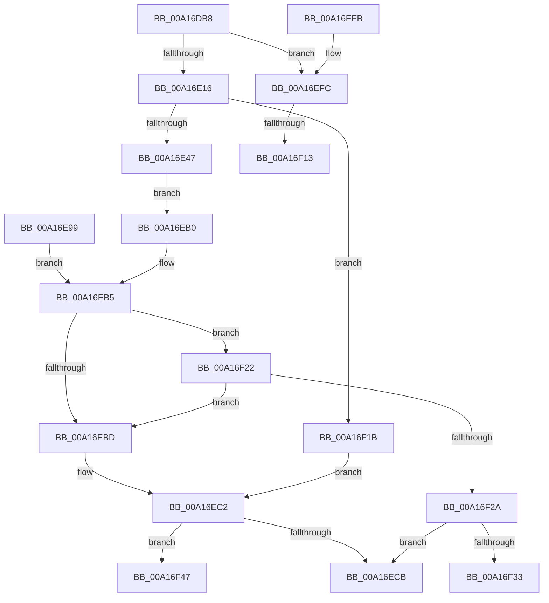

# VrpPreQueryKeyName

- RVA: `0x00A16DB8`–`0x00A16F5B` (길이 `419` bytes)
- VA: `0x0000000140A16DB8`
- 실행 섹션: `PAGE`
- PDB 이름 있음: `예`; PDB Function 태그: `예`
- unwind 정보 RVA: `0x000A9DAC`
- 디코드: `99`개 명령, `419/419` bytes 표시
- 미해석 바이트: `0` (있으면 어셈블리에 `.byte`로 보존)

> 이 문서는 커널 이미지의 기계어와 PDB 기호를 분석해 생성했습니다. 4번과 5번은 함수 원형과 자료형을 바이너리 사용 방식에서 추정한 C 해석이며 원본 소스 복구 결과는 아닙니다.

## 1. Dependencies

- 직접 호출 지점: **3**; 고유 호출 대상: **3**
- 직접 호출자로 확인된 함수: **1**
- RIP 상대 이미지 참조: **5**

### Outgoing calls
- `0x00A16DFB` → [EtwActivityIdControl](../../text/41/EtwActivityIdControl_function_0041E720.md) (function, `0x0041E720`)
- `0x00A16E60` → [memcpy](../../text/6C/memcpy_function_006C6840.md) (function, `0x006C6840`)
- `0x00A16ED8` → [_security_check_cookie](../../text/6A/_security_check_cookie_function_006AC640.md) (function, `0x006AC640`)

### Direct callers
- [VrpRegistryCallback](../86/VrpRegistryCallback_function_00867450.md) at `0x008675FC`

### Static image references
- `0x00A16DD4` → RVA `0x00E0A740` (`.data`; read)
- `0x00A16E09` → RVA `0x00E0A630` (`.data`; read)
- `0x00A16E18` → RVA `0x00002F28` (`.rdata`; read)
- `0x00A16F3B` → RVA `0x0005AA44` (`.rdata`; read)
- `0x00A16F4F` → RVA `0x0005AB18` (`.rdata`; read)

## 2. Other-region calls and transfers

- 다른 실행 섹션으로 향하는 call: **3**
  - `0x00A16DFB` → [EtwActivityIdControl](../../text/41/EtwActivityIdControl_function_0041E720.md) (`PAGE` → `.text`)
  - `0x00A16E60` → [memcpy](../../text/6C/memcpy_function_006C6840.md) (`PAGE` → `.text`)
  - `0x00A16ED8` → [_security_check_cookie](../../text/6A/_security_check_cookie_function_006AC640.md) (`PAGE` → `.text`)
- call이 아닌 외부 분기/꼬리 이동: **4**
  - `0x00A16F0D` → [sub_00B36FD6](../B3/Unknown_function_00B36FD6.md) (`tail-transfer`)
  - `0x00A16F16` → [sub_00B36FD6](../B3/Unknown_function_00B36FD6.md) (`tail-transfer`)
  - `0x00A16F42` → [sub_00B36FD6 + 0x6C](../B3/Unknown_function_00B36FD6.md) (`tail-transfer`)
  - `0x00A16F56` → [sub_00B36FD6 + 0x6C](../B3/Unknown_function_00B36FD6.md) (`tail-transfer`)

## 3. Assembly (complete function range)

```asm
00A16DB8  48 89 5C 24 10                  mov qword ptr [rsp + 0x10], rbx
00A16DBD  48 89 74 24 18                  mov qword ptr [rsp + 0x18], rsi
00A16DC2  48 89 7C 24 20                  mov qword ptr [rsp + 0x20], rdi
00A16DC7  41 54                           push r12
00A16DC9  41 56                           push r14
00A16DCB  41 57                           push r15
00A16DCD  48 81 EC C0 00 00 00            sub rsp, 0xc0
00A16DD4  48 8B 05 65 39 3F 00            mov rax, qword ptr [rip + 0x3f3965]
00A16DDB  48 33 C4                        xor rax, rsp
00A16DDE  48 89 84 24 B0 00 00 00         mov qword ptr [rsp + 0xb0], rax
00A16DE6  48 8B D9                        mov rbx, rcx
00A16DE9  0F 57 C0                        xorps xmm0, xmm0
00A16DEC  0F 11 44 24 50                  movups xmmword ptr [rsp + 0x50], xmm0
00A16DF1  48 8D 54 24 50                  lea rdx, [rsp + 0x50]
00A16DF6  B9 03 00 00 00                  mov ecx, 3
00A16DFB  E8 20 79 A0 FF                  call 0x14041e720
00A16E00  4C 8B 73 28                     mov r14, qword ptr [rbx + 0x28]
00A16E04  4C 89 74 24 40                  mov qword ptr [rsp + 0x40], r14
00A16E09  83 3D 20 38 3F 00 02            cmp dword ptr [rip + 0x3f3820], 2
00A16E10  0F 87 E6 00 00 00               ja 0x140a16efc
00A16E16  33 FF                           xor edi, edi
00A16E18  48 8D 35 09 C1 5E FF            lea rsi, [rip - 0xa13ef7]
00A16E1F  4D 8D 66 10                     lea r12, [r14 + 0x10]
00A16E23  4C 89 64 24 48                  mov qword ptr [rsp + 0x48], r12
00A16E28  49 8B D4                        mov rdx, r12
00A16E2B  48 89 54 24 30                  mov qword ptr [rsp + 0x30], rdx
00A16E30  41 0F B7 0C 24                  movzx ecx, word ptr [r12]
00A16E35  83 C1 12                        add ecx, 0x12
00A16E38  48 8B 43 18                     mov rax, qword ptr [rbx + 0x18]
00A16E3C  89 08                           mov dword ptr [rax], ecx
00A16E3E  39 4B 10                        cmp dword ptr [rbx + 0x10], ecx
00A16E41  0F 82 D4 00 00 00               jb 0x140a16f1b
00A16E47  48 8B 43 08                     mov rax, qword ptr [rbx + 8]
00A16E4B  48 83 C0 10                     add rax, 0x10
00A16E4F  48 89 44 24 38                  mov qword ptr [rsp + 0x38], rax
00A16E54  45 0F B7 04 24                  movzx r8d, word ptr [r12]
00A16E59  49 8B 56 18                     mov rdx, qword ptr [r14 + 0x18]
00A16E5D  48 8B C8                        mov rcx, rax
00A16E60  E8 DB F9 CA FF                  call 0x1406c6840
00A16E65  41 0F B7 04 24                  movzx eax, word ptr [r12]
00A16E6A  48 D1 E8                        shr rax, 1
00A16E6D  48 8B 54 24 38                  mov rdx, qword ptr [rsp + 0x38]
00A16E72  66 89 3C 42                     mov word ptr [rdx + rax*2], di
00A16E76  48 8B 4B 08                     mov rcx, qword ptr [rbx + 8]
00A16E7A  41 0F B7 04 24                  movzx eax, word ptr [r12]
00A16E7F  66 89 01                        mov word ptr [rcx], ax
00A16E82  48 8B 4B 08                     mov rcx, qword ptr [rbx + 8]
00A16E86  41 0F B7 04 24                  movzx eax, word ptr [r12]
00A16E8B  66 89 41 02                     mov word ptr [rcx + 2], ax
00A16E8F  48 8B 43 08                     mov rax, qword ptr [rbx + 8]
00A16E93  48 89 50 08                     mov qword ptr [rax + 8], rdx
00A16E97  EB 17                           jmp 0x140a16eb0
00A16E99  8B D8                           mov ebx, eax
00A16E9B  33 FF                           xor edi, edi
00A16E9D  48 8D 35 84 C0 5E FF            lea rsi, [rip - 0xa13f7c]
00A16EA4  4C 8B 74 24 40                  mov r14, qword ptr [rsp + 0x40]
00A16EA9  4C 8B 64 24 48                  mov r12, qword ptr [rsp + 0x48]
00A16EAE  EB 05                           jmp 0x140a16eb5
00A16EB0  BB 03 05 00 C0                  mov ebx, 0xc0000503
00A16EB5  81 FB 03 05 00 C0               cmp ebx, 0xc0000503
00A16EBB  75 65                           jne 0x140a16f22
00A16EBD  48 8B 54 24 30                  mov rdx, qword ptr [rsp + 0x30]
00A16EC2  83 3D 67 37 3F 00 05            cmp dword ptr [rip + 0x3f3767], 5
00A16EC9  77 7C                           ja 0x140a16f47
00A16ECB  8B C3                           mov eax, ebx
00A16ECD  48 8B 8C 24 B0 00 00 00         mov rcx, qword ptr [rsp + 0xb0]
00A16ED5  48 33 CC                        xor rcx, rsp
00A16ED8  E8 63 57 C9 FF                  call 0x1406ac640
00A16EDD  4C 8D 9C 24 C0 00 00 00         lea r11, [rsp + 0xc0]
00A16EE5  49 8B 5B 28                     mov rbx, qword ptr [r11 + 0x28]
00A16EE9  49 8B 73 30                     mov rsi, qword ptr [r11 + 0x30]
00A16EED  49 8B 7B 38                     mov rdi, qword ptr [r11 + 0x38]
00A16EF1  49 8B E3                        mov rsp, r11
00A16EF4  41 5F                           pop r15
00A16EF6  41 5E                           pop r14
00A16EF8  41 5C                           pop r12
00A16EFA  C3                              ret
00A16EFB  CC                              int3
00A16EFC  33 FF                           xor edi, edi
00A16EFE  48 8D 35 23 C0 5E FF            lea rsi, [rip - 0xa13fdd]
00A16F05  49 39 7E 18                     cmp qword ptr [r14 + 0x18], rdi
00A16F09  49 8D 46 10                     lea rax, [r14 + 0x10]
00A16F0D  0F 85 C3 00 12 00               jne 0x140b36fd6
00A16F13  48 8B C6                        mov rax, rsi
00A16F16  E9 BB 00 12 00                  jmp 0x140b36fd6
00A16F1B  BB 04 00 00 C0                  mov ebx, 0xc0000004
00A16F20  EB A0                           jmp 0x140a16ec2
00A16F22  81 FB 04 00 00 C0               cmp ebx, 0xc0000004
00A16F28  74 93                           je 0x140a16ebd
00A16F2A  83 3D FF 36 3F 00 02            cmp dword ptr [rip + 0x3f36ff], 2
00A16F31  76 98                           jbe 0x140a16ecb
00A16F33  49 39 7E 18                     cmp qword ptr [r14 + 0x18], rdi
00A16F37  49 0F 45 F4                     cmovne rsi, r12
00A16F3B  48 8D 15 02 3B 64 FF            lea rdx, [rip - 0x9bc4fe]
00A16F42  E9 FB 00 12 00                  jmp 0x140b37042
00A16F47  49 39 7E 18                     cmp qword ptr [r14 + 0x18], rdi
00A16F4B  48 0F 45 F2                     cmovne rsi, rdx
00A16F4F  48 8D 15 C2 3B 64 FF            lea rdx, [rip - 0x9bc43e]
00A16F56  E9 E7 00 12 00                  jmp 0x140b37042
```

## 4. C-style interpretation (structured pseudocode)

```c
__int64 __fastcall VrpPreQueryKeyName(__int64 a1)
{
    __int64 result;
    __int64 v_rdi;
    __int64 v_rsi;
    __int64 v_rsp;
    unsigned __int64 v_stack_m18;
    unsigned __int64 v_stack_m28;
    unsigned __int64 v_stack_m88;
    unsigned __int64 v_stack_m90;
    unsigned __int64 v_stack_m98;
    unsigned __int64 v_stack_mA0;
    unsigned __int64 v_stack_mA8;
    unsigned __int64 v_stack_p10;
    unsigned __int64 v_stack_p18;
    unsigned __int64 v_stack_p20;

    v_stack_p10 = v_rbx;
    v_stack_p18 = v_rsi;
    v_stack_p20 = v_rdi;
    v_rsp = (v_rsp) - (192);
    result = (*(unsigned __int64 *)(v_rip + 4143461)) ^ (v_rsp);
    v_stack_m28 = result;
    v_stack_m88 = v_xmm0;
    result = EtwActivityIdControl(3, v_stack_m88, a3, a4);
    v_stack_m98 = *(unsigned __int64 *)(a1 + 40);
    if ((*(unsigned int *)(v_rip + 4143136)) > 2) goto loc_00A16EFC;
    v_rdi = 0;
    v_stack_m90 = *(unsigned __int64 *)(a1 + 40) + 16;
    v_stack_mA8 = *(unsigned __int64 *)(a1 + 40) + 16;
    a1 = (unsigned int)((*(unsigned __int16 *)(*(unsigned __int64 *)(a1 + 40) + 16)) + (18));
    *(unsigned int *)(*(unsigned __int64 *)(a1 + 24)) = (unsigned int)(a1);
    if ((*(unsigned int *)(a1 + 16)) < ((unsigned int)(a1))) goto loc_00A16F1B;
    result = (*(unsigned __int64 *)(a1 + 8)) + (16);
    v_stack_mA0 = result;
    result = memcpy(result, *(unsigned __int64 *)(*(unsigned __int64 *)(a1 + 40) + 24), *(unsigned __int16 *)(*(unsigned __int64 *)(a1 + 40) + 16), a4);
    result = (*(unsigned __int16 *)(*(unsigned __int64 *)(a1 + 40) + 16)) >> (1);
    *(unsigned __int16 *)(v_stack_mA0 + result * 2) = 0;
    *(unsigned __int16 *)(*(unsigned __int64 *)(a1 + 8)) = (unsigned __int16)(*(unsigned __int16 *)(*(unsigned __int64 *)(a1 + 40) + 16));
    *(unsigned __int16 *)(*(unsigned __int64 *)(a1 + 8) + 2) = (unsigned __int16)(*(unsigned __int16 *)(*(unsigned __int64 *)(a1 + 40) + 16));
    *(unsigned __int64 *)(*(unsigned __int64 *)(a1 + 8) + 8) = v_stack_mA0;
    goto loc_00A16EB0;
loc_00A16EB0:
loc_00A16EB5:
    if (((unsigned int)((unsigned int)(0xC0000503ULL))) != 0xC0000503ULL) goto loc_00A16F22;
loc_00A16EBD:
loc_00A16EC2:
    if ((*(unsigned int *)(v_rip + 4142951)) > 5) goto loc_00A16F47;
loc_00A16ECB:
    a1 = (v_stack_m28) ^ (v_rsp);
    result = _security_check_cookie(a1, v_stack_mA8, *(unsigned __int16 *)(*(unsigned __int64 *)(a1 + 40) + 16), a4);
    return result;
loc_00A16EFC:
    v_rdi = 0;
loc_00A16F1B:
    goto loc_00A16EC2;
loc_00A16F22:
    if (((unsigned int)((unsigned int)(0xC0000004ULL))) == 0xC0000004ULL) goto loc_00A16EBD;
    if ((*(unsigned int *)(v_rip + 4142847)) <= 2) goto loc_00A16ECB;
    v_rsi = v_rip - 10567645;
    if ((*(unsigned __int64 *)(*(unsigned __int64 *)(a1 + 40) + 24)) != 0) { v_rsi = *(unsigned __int64 *)(a1 + 40) + 16; }
loc_00A16F47:
    if ((*(unsigned __int64 *)(*(unsigned __int64 *)(a1 + 40) + 24)) != 0) { v_rsi = v_rip - 10208510; }
}
```

## 5. (Beta) C Style

```c
int64_t VrpPreQueryKeyName(void *Arg1)
{
    uint8_t *arg1 = (uint8_t *)Arg1;

    int64_t result;
    int64_t local_rdi;
    int64_t local_rsi;
    int64_t local_rsp;
    uint64_t v_stack_m18;
    uint64_t v_stack_m28;
    uint64_t v_stack_m88;
    uint64_t v_stack_m90;
    uint64_t v_stack_m98;
    uint64_t v_stack_mA0;
    uint64_t v_stack_mA8;
    uint64_t v_stack_p10;
    uint64_t v_stack_p18;
    uint64_t v_stack_p20;

    v_stack_p10 = local_rbx;
    v_stack_p18 = local_rsi;
    v_stack_p20 = local_rdi;
    local_rsp = (local_rsp) - (192);
    result = (*(uint64_t *)(v_rip + 0x3F3965)) ^ (local_rsp);
    v_stack_m28 = result;
    v_stack_m88 = v_xmm0;
    result = EtwActivityIdControl(3, v_stack_m88, a3, a4);
    v_stack_m98 = *(uint64_t *)(arg1 + 0x28);
    if ((*(uint32_t *)(v_rip + 0x3F3820)) > 2) goto loc_00A16EFC;
    local_rdi = 0;
    v_stack_m90 = *(uint64_t *)(arg1 + 0x28) + 16;
    v_stack_mA8 = *(uint64_t *)(arg1 + 0x28) + 16;
    Arg1 = (uint32_t)((*(uint16_t *)(*(uint64_t *)(arg1 + 0x28) + 0x10)) + (18));
    *(uint32_t *)(*(uint64_t *)(arg1 + 0x18)) = (uint32_t)(Arg1);
    if ((*(uint32_t *)(arg1 + 0x10)) < ((uint32_t)(Arg1))) goto loc_00A16F1B;
    result = (*(uint64_t *)(arg1 + 0x8)) + (16);
    v_stack_mA0 = result;
    result = memcpy(result, *(uint64_t *)(*(uint64_t *)(arg1 + 0x28) + 0x18), *(uint16_t *)(*(uint64_t *)(arg1 + 0x28) + 0x10), a4);
    result = (*(uint16_t *)(*(uint64_t *)(arg1 + 0x28) + 0x10)) >> (1);
    *(uint16_t *)(v_stack_mA0 + result * 2) = 0;
    *(uint16_t *)(*(uint64_t *)(arg1 + 0x8)) = (uint16_t)(*(uint16_t *)(*(uint64_t *)(arg1 + 0x28) + 0x10));
    *(uint16_t *)(*(uint64_t *)(arg1 + 0x8) + 0x2) = (uint16_t)(*(uint16_t *)(*(uint64_t *)(arg1 + 0x28) + 0x10));
    *(uint64_t *)(*(uint64_t *)(arg1 + 0x8) + 0x8) = v_stack_mA0;
    goto loc_00A16EB0;
loc_00A16EB0:
loc_00A16EB5:
    if (((uint32_t)((uint32_t)(0xC0000503ULL))) != 0xC0000503ULL) goto loc_00A16F22;
loc_00A16EBD:
loc_00A16EC2:
    if ((*(uint32_t *)(v_rip + 0x3F3767)) > 5) goto loc_00A16F47;
loc_00A16ECB:
    Arg1 = (v_stack_m28) ^ (local_rsp);
    result = _security_check_cookie(Arg1, v_stack_mA8, *(uint16_t *)(*(uint64_t *)(arg1 + 0x28) + 0x10), a4);
    return result;
loc_00A16EFC:
    local_rdi = 0;
loc_00A16F1B:
    goto loc_00A16EC2;
loc_00A16F22:
    if (((uint32_t)((uint32_t)(0xC0000004ULL))) == 0xC0000004ULL) goto loc_00A16EBD;
    if ((*(uint32_t *)(v_rip + 0x3F36FF)) <= 2) goto loc_00A16ECB;
    local_rsi = v_rip - 10567645;
    if ((*(uint64_t *)(*(uint64_t *)(arg1 + 0x28) + 0x18)) != 0) { local_rsi = *(uint64_t *)(arg1 + 0x28) + 16; }
loc_00A16F47:
    if ((*(uint64_t *)(*(uint64_t *)(arg1 + 0x28) + 0x18)) != 0) { local_rsi = v_rip - 10208510; }
}
```

### 관측된 메모리 오프셋

구조체 형식이 확인되지 않은 접근은 인자 기준의 오프셋으로만 기록했습니다.

| 기준 인자 | 오프셋 표현 | 폭 (bit) | 접근 |
|---|---:|---:|---|
| `Arg1` | `+ 0x8` | `64` | `R` |
| `Arg1` | `+ 0x10` | `32` | `R` |
| `Arg1` | `+ 0x18` | `64` | `R` |
| `Arg1` | `+ 0x28` | `64` | `R` |

## 6. Execution-region graph

[열기: 2D/3D 그래프와 함수 탐색 컨트롤 패널](../../../control-panel.html?section=page&rva=0x00A16DB8&view=graph)

- 2D 그래프는 위에서 아래로 흐르고, 3D 그래프는 빈 공간을 드래그해 회전합니다. Shift+드래그는 이동, 휠은 확대·축소, 함수 노드 선택은 대상 보고서 이동입니다.

### Static fallback


