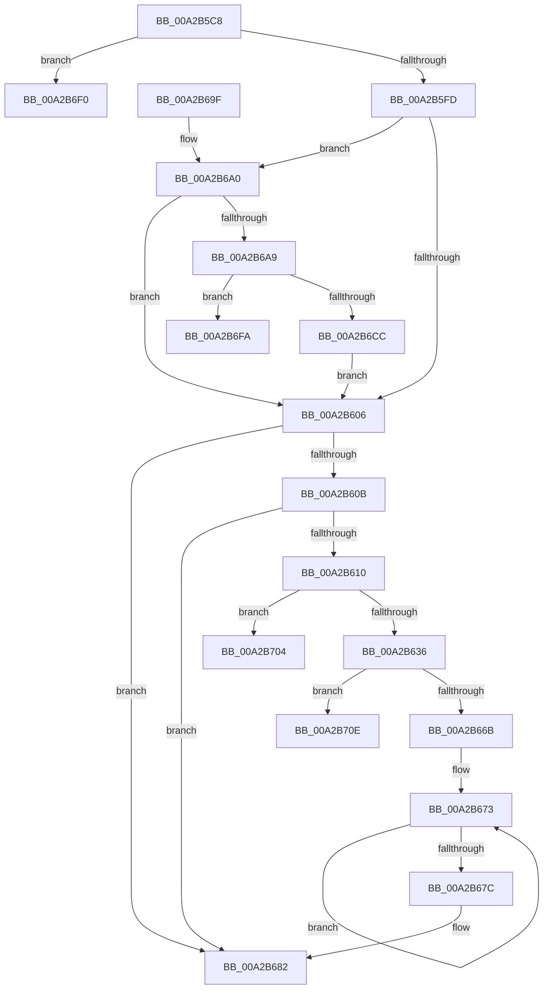

# AdtpBuildIPv4Strings

- RVA: `0x00A2B5C8`–`0x00A2B718` (길이 `336` bytes)
- VA: `0x0000000140A2B5C8`
- 실행 섹션: `PAGE`
- PDB 이름 있음: `예`; PDB Function 태그: `예`
- unwind 정보 RVA: `0x000AC310`
- 디코드: `87`개 명령, `336/336` bytes 표시
- 미해석 바이트: `0` (있으면 어셈블리에 `.byte`로 보존)

> 이 문서는 커널 이미지의 기계어와 PDB 기호를 분석해 생성했습니다. 4번과 5번은 함수 원형과 자료형을 바이너리 사용 방식에서 추정한 C 해석이며 원본 소스 복구 결과는 아닙니다.

## 1. Dependencies

- 직접 호출 지점: **4**; 고유 호출 대상: **3**
- 직접 호출자로 확인된 함수: **1**
- RIP 상대 이미지 참조: **1**

### Outgoing calls
- `0x00A2B624` → [ExAllocatePool2](../../poolcode/B8/ExAllocatePool2_function_00B820F0.md) (function, `0x00B820F0`)
- `0x00A2B65E` → [StringCchPrintfW](../../text/47/StringCchPrintfW_function_0047BAD0.md) (function, `0x0047BAD0`)
- `0x00A2B6BE` → [ExAllocatePool2](../../poolcode/B8/ExAllocatePool2_function_00B820F0.md) (function, `0x00B820F0`)
- `0x00A2B6D8` → [RtlIpv4AddressToStringW](../../text/46/RtlIpv4AddressToStringW_function_00467840.md) (function, `0x00467840`)

### Direct callers
- [AdtpBuildSockAddrString](AdtpBuildSockAddrString_function_00A2B53C.md) at `0x00A2B57D`

### Static image references
- `0x00A2B639` → RVA `0x00019F80` (`.rdata`; read)

## 2. Other-region calls and transfers

- 다른 실행 섹션으로 향하는 call: **4**
  - `0x00A2B624` → [ExAllocatePool2](../../poolcode/B8/ExAllocatePool2_function_00B820F0.md) (`PAGE` → `POOLCODE`)
  - `0x00A2B65E` → [StringCchPrintfW](../../text/47/StringCchPrintfW_function_0047BAD0.md) (`PAGE` → `.text`)
  - `0x00A2B6BE` → [ExAllocatePool2](../../poolcode/B8/ExAllocatePool2_function_00B820F0.md) (`PAGE` → `POOLCODE`)
  - `0x00A2B6D8` → [RtlIpv4AddressToStringW](../../text/46/RtlIpv4AddressToStringW_function_00467840.md) (`PAGE` → `.text`)
- call이 아닌 외부 분기/꼬리 이동: **4**
  - `0x00A2B6F5` → [sub_00B39260](../B3/Unknown_function_00B39260.md) (`tail-transfer`)
  - `0x00A2B6FF` → [sub_00B39260 + 0x5](../B3/Unknown_function_00B39260.md) (`tail-transfer`)
  - `0x00A2B709` → [sub_00B39260](../B3/Unknown_function_00B39260.md) (`tail-transfer`)
  - `0x00A2B713` → [sub_00B39260](../B3/Unknown_function_00B39260.md) (`tail-transfer`)

## 3. Assembly (complete function range)

```asm
00A2B5C8  48 89 5C 24 08                  mov qword ptr [rsp + 8], rbx
00A2B5CD  48 89 6C 24 10                  mov qword ptr [rsp + 0x10], rbp
00A2B5D2  48 89 74 24 18                  mov qword ptr [rsp + 0x18], rsi
00A2B5D7  57                              push rdi
00A2B5D8  41 56                           push r14
00A2B5DA  41 57                           push r15
00A2B5DC  48 83 EC 20                     sub rsp, 0x20
00A2B5E0  48 8B 74 24 60                  mov rsi, qword ptr [rsp + 0x60]
00A2B5E5  33 ED                           xor ebp, ebp
00A2B5E7  66 83 39 02                     cmp word ptr [rcx], 2
00A2B5EB  49 8B F9                        mov rdi, r9
00A2B5EE  4D 8B F0                        mov r14, r8
00A2B5F1  4C 8B FA                        mov r15, rdx
00A2B5F4  48 8B D9                        mov rbx, rcx
00A2B5F7  0F 85 F3 00 00 00               jne 0x140a2b6f0
00A2B5FD  48 85 D2                        test rdx, rdx
00A2B600  0F 85 9A 00 00 00               jne 0x140a2b6a0
00A2B606  48 85 FF                        test rdi, rdi
00A2B609  74 77                           je 0x140a2b682
00A2B60B  48 85 F6                        test rsi, rsi
00A2B60E  74 72                           je 0x140a2b682
00A2B610  BA 10 00 00 00                  mov edx, 0x10
00A2B615  B9 00 01 00 00                  mov ecx, 0x100
00A2B61A  41 B8 53 65 41 6B               mov r8d, 0x6b416553
00A2B620  66 89 57 02                     mov word ptr [rdi + 2], dx
00A2B624  E8 C7 6A 15 00                  call 0x140b820f0
00A2B629  48 89 47 08                     mov qword ptr [rdi + 8], rax
00A2B62D  48 85 C0                        test rax, rax
00A2B630  0F 84 CE 00 00 00               je 0x140a2b704
00A2B636  C6 06 01                        mov byte ptr [rsi], 1
00A2B639  4C 8D 05 40 E9 5E FF            lea r8, [rip - 0xa116c0]
00A2B640  0F B7 43 02                     movzx eax, word ptr [rbx + 2]
00A2B644  BA 08 00 00 00                  mov edx, 8
00A2B649  48 8B 4F 08                     mov rcx, qword ptr [rdi + 8]
00A2B64D  44 8B C8                        mov r9d, eax
00A2B650  66 C1 E0 08                     shl ax, 8
00A2B654  0F B7 C0                        movzx eax, ax
00A2B657  41 C1 E9 08                     shr r9d, 8
00A2B65B  44 0B C8                        or r9d, eax
00A2B65E  E8 6D 04 A5 FF                  call 0x14047bad0
00A2B663  85 C0                           test eax, eax
00A2B665  0F 88 A3 00 00 00               js 0x140a2b70e
00A2B66B  48 8B 4F 08                     mov rcx, qword ptr [rdi + 8]
00A2B66F  48 83 C8 FF                     or rax, 0xffffffffffffffff
00A2B673  48 FF C0                        inc rax
00A2B676  66 39 2C 41                     cmp word ptr [rcx + rax*2], bp
00A2B67A  75 F7                           jne 0x140a2b673
00A2B67C  66 03 C0                        add ax, ax
00A2B67F  66 89 07                        mov word ptr [rdi], ax
00A2B682  8B DD                           mov ebx, ebp
00A2B684  48 8B 6C 24 48                  mov rbp, qword ptr [rsp + 0x48]
00A2B689  8B C3                           mov eax, ebx
00A2B68B  48 8B 5C 24 40                  mov rbx, qword ptr [rsp + 0x40]
00A2B690  48 8B 74 24 50                  mov rsi, qword ptr [rsp + 0x50]
00A2B695  48 83 C4 20                     add rsp, 0x20
00A2B699  41 5F                           pop r15
00A2B69B  41 5E                           pop r14
00A2B69D  5F                              pop rdi
00A2B69E  C3                              ret
00A2B69F  CC                              int3
00A2B6A0  4D 85 F6                        test r14, r14
00A2B6A3  0F 84 5D FF FF FF               je 0x140a2b606
00A2B6A9  BA 20 00 00 00                  mov edx, 0x20
00A2B6AE  B9 00 01 00 00                  mov ecx, 0x100
00A2B6B3  41 B8 53 65 41 6B               mov r8d, 0x6b416553
00A2B6B9  66 41 89 57 02                  mov word ptr [r15 + 2], dx
00A2B6BE  E8 2D 6A 15 00                  call 0x140b820f0
00A2B6C3  49 89 47 08                     mov qword ptr [r15 + 8], rax
00A2B6C7  48 85 C0                        test rax, rax
00A2B6CA  74 2E                           je 0x140a2b6fa
00A2B6CC  41 C6 06 01                     mov byte ptr [r14], 1
00A2B6D0  48 8D 4B 04                     lea rcx, [rbx + 4]
00A2B6D4  49 8B 57 08                     mov rdx, qword ptr [r15 + 8]
00A2B6D8  E8 63 C1 A3 FF                  call 0x140467840
00A2B6DD  41 2B 47 08                     sub eax, dword ptr [r15 + 8]
00A2B6E1  48 D1 F8                        sar rax, 1
00A2B6E4  66 03 C0                        add ax, ax
00A2B6E7  66 41 89 07                     mov word ptr [r15], ax
00A2B6EB  E9 16 FF FF FF                  jmp 0x140a2b606
00A2B6F0  BB 41 01 00 C0                  mov ebx, 0xc0000141
00A2B6F5  E9 66 DB 10 00                  jmp 0x140b39260
00A2B6FA  BB 17 00 00 C0                  mov ebx, 0xc0000017
00A2B6FF  E9 61 DB 10 00                  jmp 0x140b39265
00A2B704  BB 17 00 00 C0                  mov ebx, 0xc0000017
00A2B709  E9 52 DB 10 00                  jmp 0x140b39260
00A2B70E  BB 0D 00 00 C0                  mov ebx, 0xc000000d
00A2B713  E9 48 DB 10 00                  jmp 0x140b39260
```

## 4. C-style interpretation (structured pseudocode)

```c
__int64 __fastcall AdtpBuildIPv4Strings(__int64 a1, __int64 a2, __int64 a3, __int64 a4, __int64 a5)
{
    __int64 result;
    __int64 v_rbp;
    __int64 v_rsp;
    unsigned __int64 v_stack_p10;
    unsigned __int64 v_stack_p18;
    unsigned __int64 v_stack_p8;

    v_stack_p8 = v_rbx;
    v_stack_p10 = v_rbp;
    v_stack_p18 = v_rsi;
    v_rsp = (v_rsp) - (32);
    v_rbp = 0;
    if ((*(unsigned __int16 *)(a1)) != 2) goto loc_00A2B6F0;
    if (a2 != 0) goto loc_00A2B6A0;
loc_00A2B606:
    if (a4 == 0) goto loc_00A2B682;
    if (a5 == 0) goto loc_00A2B682;
    *(unsigned __int16 *)(a4 + 2) = 16;
    result = ExAllocatePool2(256, 16, (unsigned int)(0x6B416553ULL), a4);
    *(unsigned __int64 *)(a4 + 8) = result;
    if (result == 0) goto loc_00A2B704;
    *(unsigned __int8 *)(a5) = 1;
    result = (unsigned __int16)((*(unsigned __int16 *)(a1 + 2)) << (8));
    a4 = (unsigned int)(((unsigned int)((unsigned int)(*(unsigned __int16 *)(a1 + 2)))) >> (8));
    a4 = (unsigned int)((a4) | ((unsigned int)((unsigned __int16)(result))));
    result = StringCchPrintfW(*(unsigned __int64 *)(a4 + 8), 8, v_rip - 10557120, a4);
    if (sign_flag) goto loc_00A2B70E;
    result = (result) | (-1);
loc_00A2B673:
    result = (result) + 1;
    if ((*(unsigned __int16 *)(*(unsigned __int64 *)(a4 + 8) + result * 2)) != 0) goto loc_00A2B673;
    result = (unsigned __int16)((result) + ((unsigned __int16)(result)));
    *(unsigned __int16 *)(a4) = (unsigned __int16)(result);
loc_00A2B682:
    v_rsp = (v_rsp) + (32);
    return 0;
loc_00A2B6A0:
    if (a3 == 0) goto loc_00A2B606;
    *(unsigned __int16 *)(a2 + 2) = 32;
    result = ExAllocatePool2(256, 32, (unsigned int)(0x6B416553ULL), a4);
    *(unsigned __int64 *)(a2 + 8) = result;
    if (result == 0) goto loc_00A2B6FA;
    *(unsigned __int8 *)(a3) = 1;
    result = RtlIpv4AddressToStringW(v_stack_p8 + 4, *(unsigned __int64 *)(a2 + 8), (unsigned int)(0x6B416553ULL), a4);
    result = (unsigned int)((result) - (*(unsigned int *)(a2 + 8)));
    result = (result) >> (1);
    result = (unsigned __int16)((result) + ((unsigned __int16)(result)));
    *(unsigned __int16 *)(a2) = (unsigned __int16)(result);
    goto loc_00A2B606;
loc_00A2B6F0:
loc_00A2B6FA:
loc_00A2B704:
loc_00A2B70E:
}
```

## 5. (Beta) C Style

```c
int64_t AdtpBuildIPv4Strings(void *Arg1, void *Arg2, int64_t Arg3, int64_t Arg4, int64_t Arg5)
{
    uint8_t *arg1 = (uint8_t *)Arg1;
    uint8_t *arg2 = (uint8_t *)Arg2;

    int64_t result;
    int64_t local_rbp;
    int64_t local_rsp;
    uint64_t v_stack_p10;
    uint64_t v_stack_p18;
    uint64_t v_stack_p8;

    v_stack_p8 = local_rbx;
    v_stack_p10 = local_rbp;
    v_stack_p18 = local_rsi;
    local_rsp = (local_rsp) - (32);
    local_rbp = 0;
    if ((*(uint16_t *)(arg1)) != 2) goto loc_00A2B6F0;
    if (Arg2 != NULL) goto loc_00A2B6A0;
loc_00A2B606:
    if (Arg4 == 0) goto loc_00A2B682;
    if (Arg5 == 0) goto loc_00A2B682;
    *(uint16_t *)(Arg4 + 0x2) = 16;
    result = ExAllocatePool2(256, 16, (uint32_t)(0x6B416553ULL), Arg4);
    *(uint64_t *)(Arg4 + 0x8) = result;
    if (result == 0) goto loc_00A2B704;
    *(uint8_t *)(Arg5) = 1;
    result = (uint16_t)((*(uint16_t *)(arg1 + 0x2)) << (8));
    Arg4 = (uint32_t)(((uint32_t)((uint32_t)(*(uint16_t *)(arg1 + 0x2)))) >> (8));
    Arg4 = (uint32_t)((Arg4) | ((uint32_t)((uint16_t)(result))));
    result = StringCchPrintfW(*(uint64_t *)(Arg4 + 0x8), 8, v_rip - 10557120, Arg4);
    if (sign_flag) goto loc_00A2B70E;
    result = (result) | (-1);
loc_00A2B673:
    result = (result) + 1;
    if ((*(uint16_t *)(*(uint64_t *)(Arg4 + 0x8) + result * 2)) != 0) goto loc_00A2B673;
    result = (uint16_t)((result) + ((uint16_t)(result)));
    *(uint16_t *)(Arg4) = (uint16_t)(result);
loc_00A2B682:
    local_rsp = (local_rsp) + (32);
    return 0;
loc_00A2B6A0:
    if (Arg3 == 0) goto loc_00A2B606;
    *(uint16_t *)(arg2 + 0x2) = 32;
    result = ExAllocatePool2(256, 32, (uint32_t)(0x6B416553ULL), Arg4);
    *(uint64_t *)(arg2 + 0x8) = result;
    if (result == 0) goto loc_00A2B6FA;
    *(uint8_t *)(Arg3) = 1;
    result = RtlIpv4AddressToStringW(v_stack_p8 + 4, *(uint64_t *)(arg2 + 0x8), (uint32_t)(0x6B416553ULL), Arg4);
    result = (uint32_t)((result) - (*(uint32_t *)(arg2 + 0x8)));
    result = (result) >> (1);
    result = (uint16_t)((result) + ((uint16_t)(result)));
    *(uint16_t *)(arg2) = (uint16_t)(result);
    goto loc_00A2B606;
loc_00A2B6F0:
loc_00A2B6FA:
loc_00A2B704:
loc_00A2B70E:
}
```

### 관측된 메모리 오프셋

구조체 형식이 확인되지 않은 접근은 인자 기준의 오프셋으로만 기록했습니다.

| 기준 인자 | 오프셋 표현 | 폭 (bit) | 접근 |
|---|---:|---:|---|
| `Arg1` | `+ 0x0` | `16` | `R` |
| `Arg1` | `+ 0x2` | `16` | `R` |
| `Arg1` | `+ 0x4` | `64` | `R` |
| `Arg2` | `+ 0x0` | `16` | `W` |
| `Arg2` | `+ 0x2` | `16` | `W` |
| `Arg2` | `+ 0x8` | `32` | `R` |
| `Arg2` | `+ 0x8` | `64` | `R` |
| `Arg2` | `+ 0x8` | `64` | `W` |

## 6. Execution-region graph

[열기: 2D/3D 그래프와 함수 탐색 컨트롤 패널](../../../control-panel.html?section=page&rva=0x00A2B5C8&view=graph)

- 2D 그래프는 위에서 아래로 흐르고, 3D 그래프는 빈 공간을 드래그해 회전합니다. Shift+드래그는 이동, 휠은 확대·축소, 함수 노드 선택은 대상 보고서 이동입니다.

### Static fallback


