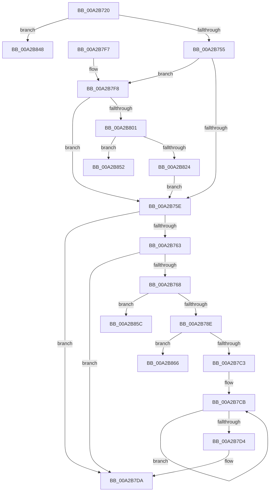

# AdtpBuildIPv6Strings

- RVA: `0x00A2B720`–`0x00A2B870` (길이 `336` bytes)
- VA: `0x0000000140A2B720`
- 실행 섹션: `PAGE`
- PDB 이름 있음: `예`; PDB Function 태그: `예`
- unwind 정보 RVA: `0x000AC310`
- 디코드: `87`개 명령, `336/336` bytes 표시
- 미해석 바이트: `0` (있으면 어셈블리에 `.byte`로 보존)

> 이 문서는 커널 이미지의 기계어와 PDB 기호를 분석해 생성했습니다. 4번과 5번은 함수 원형과 자료형을 바이너리 사용 방식에서 추정한 C 해석이며 원본 소스 복구 결과는 아닙니다.

## 1. Dependencies

- 직접 호출 지점: **4**; 고유 호출 대상: **3**
- 직접 호출자로 확인된 함수: **1**
- RIP 상대 이미지 참조: **1**

### Outgoing calls
- `0x00A2B77C` → [ExAllocatePool2](../../poolcode/B8/ExAllocatePool2_function_00B820F0.md) (function, `0x00B820F0`)
- `0x00A2B7B6` → [StringCchPrintfW](../../text/47/StringCchPrintfW_function_0047BAD0.md) (function, `0x0047BAD0`)
- `0x00A2B816` → [ExAllocatePool2](../../poolcode/B8/ExAllocatePool2_function_00B820F0.md) (function, `0x00B820F0`)
- `0x00A2B830` → [RtlIpv6AddressToStringW](../../text/48/RtlIpv6AddressToStringW_function_00480E40.md) (function, `0x00480E40`)

### Direct callers
- [AdtpBuildSockAddrString](AdtpBuildSockAddrString_function_00A2B53C.md) at `0x00A2B5A7`

### Static image references
- `0x00A2B791` → RVA `0x00019F80` (`.rdata`; read)

## 2. Other-region calls and transfers

- 다른 실행 섹션으로 향하는 call: **4**
  - `0x00A2B77C` → [ExAllocatePool2](../../poolcode/B8/ExAllocatePool2_function_00B820F0.md) (`PAGE` → `POOLCODE`)
  - `0x00A2B7B6` → [StringCchPrintfW](../../text/47/StringCchPrintfW_function_0047BAD0.md) (`PAGE` → `.text`)
  - `0x00A2B816` → [ExAllocatePool2](../../poolcode/B8/ExAllocatePool2_function_00B820F0.md) (`PAGE` → `POOLCODE`)
  - `0x00A2B830` → [RtlIpv6AddressToStringW](../../text/48/RtlIpv6AddressToStringW_function_00480E40.md) (`PAGE` → `.text`)
- call이 아닌 외부 분기/꼬리 이동: **4**
  - `0x00A2B84D` → [sub_00B3929E](../B3/Unknown_function_00B3929E.md) (`tail-transfer`)
  - `0x00A2B857` → [sub_00B3929E + 0x5](../B3/Unknown_function_00B3929E.md) (`tail-transfer`)
  - `0x00A2B861` → [sub_00B3929E](../B3/Unknown_function_00B3929E.md) (`tail-transfer`)
  - `0x00A2B86B` → [sub_00B3929E](../B3/Unknown_function_00B3929E.md) (`tail-transfer`)

## 3. Assembly (complete function range)

```asm
00A2B720  48 89 5C 24 08                  mov qword ptr [rsp + 8], rbx
00A2B725  48 89 6C 24 10                  mov qword ptr [rsp + 0x10], rbp
00A2B72A  48 89 74 24 18                  mov qword ptr [rsp + 0x18], rsi
00A2B72F  57                              push rdi
00A2B730  41 56                           push r14
00A2B732  41 57                           push r15
00A2B734  48 83 EC 20                     sub rsp, 0x20
00A2B738  48 8B 74 24 60                  mov rsi, qword ptr [rsp + 0x60]
00A2B73D  33 ED                           xor ebp, ebp
00A2B73F  66 83 39 17                     cmp word ptr [rcx], 0x17
00A2B743  49 8B F9                        mov rdi, r9
00A2B746  4D 8B F0                        mov r14, r8
00A2B749  4C 8B FA                        mov r15, rdx
00A2B74C  48 8B D9                        mov rbx, rcx
00A2B74F  0F 85 F3 00 00 00               jne 0x140a2b848
00A2B755  48 85 D2                        test rdx, rdx
00A2B758  0F 85 9A 00 00 00               jne 0x140a2b7f8
00A2B75E  48 85 FF                        test rdi, rdi
00A2B761  74 77                           je 0x140a2b7da
00A2B763  48 85 F6                        test rsi, rsi
00A2B766  74 72                           je 0x140a2b7da
00A2B768  BA 10 00 00 00                  mov edx, 0x10
00A2B76D  B9 00 01 00 00                  mov ecx, 0x100
00A2B772  41 B8 53 65 41 6B               mov r8d, 0x6b416553
00A2B778  66 89 57 02                     mov word ptr [rdi + 2], dx
00A2B77C  E8 6F 69 15 00                  call 0x140b820f0
00A2B781  48 89 47 08                     mov qword ptr [rdi + 8], rax
00A2B785  48 85 C0                        test rax, rax
00A2B788  0F 84 CE 00 00 00               je 0x140a2b85c
00A2B78E  C6 06 01                        mov byte ptr [rsi], 1
00A2B791  4C 8D 05 E8 E7 5E FF            lea r8, [rip - 0xa11818]
00A2B798  0F B7 43 02                     movzx eax, word ptr [rbx + 2]
00A2B79C  BA 08 00 00 00                  mov edx, 8
00A2B7A1  48 8B 4F 08                     mov rcx, qword ptr [rdi + 8]
00A2B7A5  44 8B C8                        mov r9d, eax
00A2B7A8  66 C1 E0 08                     shl ax, 8
00A2B7AC  0F B7 C0                        movzx eax, ax
00A2B7AF  41 C1 E9 08                     shr r9d, 8
00A2B7B3  44 0B C8                        or r9d, eax
00A2B7B6  E8 15 03 A5 FF                  call 0x14047bad0
00A2B7BB  85 C0                           test eax, eax
00A2B7BD  0F 88 A3 00 00 00               js 0x140a2b866
00A2B7C3  48 8B 4F 08                     mov rcx, qword ptr [rdi + 8]
00A2B7C7  48 83 C8 FF                     or rax, 0xffffffffffffffff
00A2B7CB  48 FF C0                        inc rax
00A2B7CE  66 39 2C 41                     cmp word ptr [rcx + rax*2], bp
00A2B7D2  75 F7                           jne 0x140a2b7cb
00A2B7D4  66 03 C0                        add ax, ax
00A2B7D7  66 89 07                        mov word ptr [rdi], ax
00A2B7DA  8B DD                           mov ebx, ebp
00A2B7DC  48 8B 6C 24 48                  mov rbp, qword ptr [rsp + 0x48]
00A2B7E1  8B C3                           mov eax, ebx
00A2B7E3  48 8B 5C 24 40                  mov rbx, qword ptr [rsp + 0x40]
00A2B7E8  48 8B 74 24 50                  mov rsi, qword ptr [rsp + 0x50]
00A2B7ED  48 83 C4 20                     add rsp, 0x20
00A2B7F1  41 5F                           pop r15
00A2B7F3  41 5E                           pop r14
00A2B7F5  5F                              pop rdi
00A2B7F6  C3                              ret
00A2B7F7  CC                              int3
00A2B7F8  4D 85 F6                        test r14, r14
00A2B7FB  0F 84 5D FF FF FF               je 0x140a2b75e
00A2B801  BA 6E 00 00 00                  mov edx, 0x6e
00A2B806  B9 00 01 00 00                  mov ecx, 0x100
00A2B80B  41 B8 53 65 41 6B               mov r8d, 0x6b416553
00A2B811  66 41 89 57 02                  mov word ptr [r15 + 2], dx
00A2B816  E8 D5 68 15 00                  call 0x140b820f0
00A2B81B  49 89 47 08                     mov qword ptr [r15 + 8], rax
00A2B81F  48 85 C0                        test rax, rax
00A2B822  74 2E                           je 0x140a2b852
00A2B824  41 C6 06 01                     mov byte ptr [r14], 1
00A2B828  48 8D 4B 08                     lea rcx, [rbx + 8]
00A2B82C  49 8B 57 08                     mov rdx, qword ptr [r15 + 8]
00A2B830  E8 0B 56 A5 FF                  call 0x140480e40
00A2B835  41 2B 47 08                     sub eax, dword ptr [r15 + 8]
00A2B839  48 D1 F8                        sar rax, 1
00A2B83C  66 03 C0                        add ax, ax
00A2B83F  66 41 89 07                     mov word ptr [r15], ax
00A2B843  E9 16 FF FF FF                  jmp 0x140a2b75e
00A2B848  BB 41 01 00 C0                  mov ebx, 0xc0000141
00A2B84D  E9 4C DA 10 00                  jmp 0x140b3929e
00A2B852  BB 17 00 00 C0                  mov ebx, 0xc0000017
00A2B857  E9 47 DA 10 00                  jmp 0x140b392a3
00A2B85C  BB 17 00 00 C0                  mov ebx, 0xc0000017
00A2B861  E9 38 DA 10 00                  jmp 0x140b3929e
00A2B866  BB 0D 00 00 C0                  mov ebx, 0xc000000d
00A2B86B  E9 2E DA 10 00                  jmp 0x140b3929e
```

## 4. C-style interpretation (structured pseudocode)

```c
__int64 __fastcall AdtpBuildIPv6Strings(__int64 a1, __int64 a2, __int64 a3, __int64 a4, __int64 a5)
{
    __int64 result;
    __int64 v_rbp;
    __int64 v_rsp;
    unsigned __int64 v_stack_p10;
    unsigned __int64 v_stack_p18;
    unsigned __int64 v_stack_p8;

    v_stack_p8 = v_rbx;
    v_stack_p10 = v_rbp;
    v_stack_p18 = v_rsi;
    v_rsp = (v_rsp) - (32);
    v_rbp = 0;
    if ((*(unsigned __int16 *)(a1)) != 23) goto loc_00A2B848;
    if (a2 != 0) goto loc_00A2B7F8;
loc_00A2B75E:
    if (a4 == 0) goto loc_00A2B7DA;
    if (a5 == 0) goto loc_00A2B7DA;
    *(unsigned __int16 *)(a4 + 2) = 16;
    result = ExAllocatePool2(256, 16, (unsigned int)(0x6B416553ULL), a4);
    *(unsigned __int64 *)(a4 + 8) = result;
    if (result == 0) goto loc_00A2B85C;
    *(unsigned __int8 *)(a5) = 1;
    result = (unsigned __int16)((*(unsigned __int16 *)(a1 + 2)) << (8));
    a4 = (unsigned int)(((unsigned int)((unsigned int)(*(unsigned __int16 *)(a1 + 2)))) >> (8));
    a4 = (unsigned int)((a4) | ((unsigned int)((unsigned __int16)(result))));
    result = StringCchPrintfW(*(unsigned __int64 *)(a4 + 8), 8, v_rip - 10557464, a4);
    if (sign_flag) goto loc_00A2B866;
    result = (result) | (-1);
loc_00A2B7CB:
    result = (result) + 1;
    if ((*(unsigned __int16 *)(*(unsigned __int64 *)(a4 + 8) + result * 2)) != 0) goto loc_00A2B7CB;
    result = (unsigned __int16)((result) + ((unsigned __int16)(result)));
    *(unsigned __int16 *)(a4) = (unsigned __int16)(result);
loc_00A2B7DA:
    v_rsp = (v_rsp) + (32);
    return 0;
loc_00A2B7F8:
    if (a3 == 0) goto loc_00A2B75E;
    *(unsigned __int16 *)(a2 + 2) = 110;
    result = ExAllocatePool2(256, 110, (unsigned int)(0x6B416553ULL), a4);
    *(unsigned __int64 *)(a2 + 8) = result;
    if (result == 0) goto loc_00A2B852;
    *(unsigned __int8 *)(a3) = 1;
    result = RtlIpv6AddressToStringW(v_stack_p8 + 8, *(unsigned __int64 *)(a2 + 8), (unsigned int)(0x6B416553ULL), a4);
    result = (unsigned int)((result) - (*(unsigned int *)(a2 + 8)));
    result = (result) >> (1);
    result = (unsigned __int16)((result) + ((unsigned __int16)(result)));
    *(unsigned __int16 *)(a2) = (unsigned __int16)(result);
    goto loc_00A2B75E;
loc_00A2B848:
loc_00A2B852:
loc_00A2B85C:
loc_00A2B866:
}
```

## 5. (Beta) C Style

```c
int64_t AdtpBuildIPv6Strings(void *Arg1, void *Arg2, int64_t Arg3, int64_t Arg4, int64_t Arg5)
{
    uint8_t *arg1 = (uint8_t *)Arg1;
    uint8_t *arg2 = (uint8_t *)Arg2;

    int64_t result;
    int64_t local_rbp;
    int64_t local_rsp;
    uint64_t v_stack_p10;
    uint64_t v_stack_p18;
    uint64_t v_stack_p8;

    v_stack_p8 = local_rbx;
    v_stack_p10 = local_rbp;
    v_stack_p18 = local_rsi;
    local_rsp = (local_rsp) - (32);
    local_rbp = 0;
    if ((*(uint16_t *)(arg1)) != 23) goto loc_00A2B848;
    if (Arg2 != NULL) goto loc_00A2B7F8;
loc_00A2B75E:
    if (Arg4 == 0) goto loc_00A2B7DA;
    if (Arg5 == 0) goto loc_00A2B7DA;
    *(uint16_t *)(Arg4 + 0x2) = 16;
    result = ExAllocatePool2(256, 16, (uint32_t)(0x6B416553ULL), Arg4);
    *(uint64_t *)(Arg4 + 0x8) = result;
    if (result == 0) goto loc_00A2B85C;
    *(uint8_t *)(Arg5) = 1;
    result = (uint16_t)((*(uint16_t *)(arg1 + 0x2)) << (8));
    Arg4 = (uint32_t)(((uint32_t)((uint32_t)(*(uint16_t *)(arg1 + 0x2)))) >> (8));
    Arg4 = (uint32_t)((Arg4) | ((uint32_t)((uint16_t)(result))));
    result = StringCchPrintfW(*(uint64_t *)(Arg4 + 0x8), 8, v_rip - 10557464, Arg4);
    if (sign_flag) goto loc_00A2B866;
    result = (result) | (-1);
loc_00A2B7CB:
    result = (result) + 1;
    if ((*(uint16_t *)(*(uint64_t *)(Arg4 + 0x8) + result * 2)) != 0) goto loc_00A2B7CB;
    result = (uint16_t)((result) + ((uint16_t)(result)));
    *(uint16_t *)(Arg4) = (uint16_t)(result);
loc_00A2B7DA:
    local_rsp = (local_rsp) + (32);
    return 0;
loc_00A2B7F8:
    if (Arg3 == 0) goto loc_00A2B75E;
    *(uint16_t *)(arg2 + 0x2) = 110;
    result = ExAllocatePool2(256, 110, (uint32_t)(0x6B416553ULL), Arg4);
    *(uint64_t *)(arg2 + 0x8) = result;
    if (result == 0) goto loc_00A2B852;
    *(uint8_t *)(Arg3) = 1;
    result = RtlIpv6AddressToStringW(v_stack_p8 + 8, *(uint64_t *)(arg2 + 0x8), (uint32_t)(0x6B416553ULL), Arg4);
    result = (uint32_t)((result) - (*(uint32_t *)(arg2 + 0x8)));
    result = (result) >> (1);
    result = (uint16_t)((result) + ((uint16_t)(result)));
    *(uint16_t *)(arg2) = (uint16_t)(result);
    goto loc_00A2B75E;
loc_00A2B848:
loc_00A2B852:
loc_00A2B85C:
loc_00A2B866:
}
```

### 관측된 메모리 오프셋

구조체 형식이 확인되지 않은 접근은 인자 기준의 오프셋으로만 기록했습니다.

| 기준 인자 | 오프셋 표현 | 폭 (bit) | 접근 |
|---|---:|---:|---|
| `Arg1` | `+ 0x0` | `16` | `R` |
| `Arg1` | `+ 0x2` | `16` | `R` |
| `Arg1` | `+ 0x8` | `64` | `R` |
| `Arg2` | `+ 0x0` | `16` | `W` |
| `Arg2` | `+ 0x2` | `16` | `W` |
| `Arg2` | `+ 0x8` | `32` | `R` |
| `Arg2` | `+ 0x8` | `64` | `R` |
| `Arg2` | `+ 0x8` | `64` | `W` |

## 6. Execution-region graph

[열기: 2D/3D 그래프와 함수 탐색 컨트롤 패널](../../../control-panel.html?section=page&rva=0x00A2B720&view=graph)

- 2D 그래프는 위에서 아래로 흐르고, 3D 그래프는 빈 공간을 드래그해 회전합니다. Shift+드래그는 이동, 휠은 확대·축소, 함수 노드 선택은 대상 보고서 이동입니다.

### Static fallback


