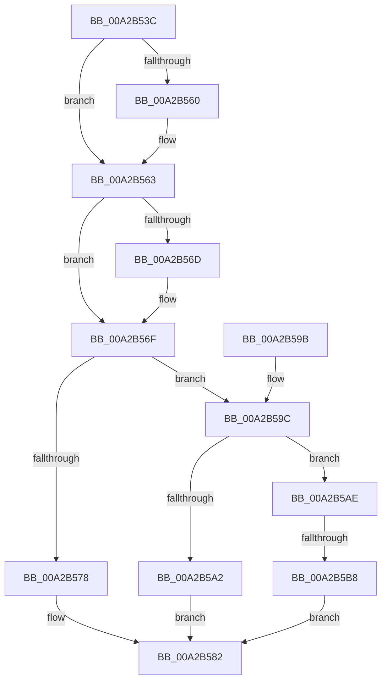

# AdtpBuildSockAddrString

- RVA: `0x00A2B53C`–`0x00A2B5BF` (길이 `131` bytes)
- VA: `0x0000000140A2B53C`
- 실행 섹션: `PAGE`
- PDB 이름 있음: `예`; PDB Function 태그: `예`
- unwind 정보 RVA: `0x00071640`
- 디코드: `39`개 명령, `131/131` bytes 표시
- 미해석 바이트: `0` (있으면 어셈블리에 `.byte`로 보존)

> 이 문서는 커널 이미지의 기계어와 PDB 기호를 분석해 생성했습니다. 4번과 5번은 함수 원형과 자료형을 바이너리 사용 방식에서 추정한 C 해석이며 원본 소스 복구 결과는 아닙니다.

## 1. Dependencies

- 직접 호출 지점: **3**; 고유 호출 대상: **3**
- 직접 호출자로 확인된 함수: **2**
- RIP 상대 이미지 참조: **0**

### Outgoing calls
- `0x00A2B57D` → [AdtpBuildIPv4Strings](AdtpBuildIPv4Strings_function_00A2B5C8.md) (function, `0x00A2B5C8`)
- `0x00A2B5A7` → [AdtpBuildIPv6Strings](AdtpBuildIPv6Strings_function_00A2B720.md) (function, `0x00A2B720`)
- `0x00A2B5B8` → [AdtpBuildMacStrings](../82/AdtpBuildMacStrings_function_008220DC.md) (function, `0x008220DC`)

### Direct callers
- [AdtpPackageParameters](../../text/45/AdtpPackageParameters_function_00459964.md) at `0x00459B80`
- [sub_006F1C3C](../../text/6F/Unknown_function_006F1C3C.md) at `0x006F1DB6`

### Static image references
- 디코드된 RIP-relative 메모리 참조가 없습니다.

## 2. Other-region calls and transfers

- 다른 실행 섹션으로 향하는 call: **0**
- call이 아닌 외부 분기/꼬리 이동: **1**
  - `0x00A2B5B2` → [sub_00B3921C](../B3/Unknown_function_00B3921C.md) (`tail-transfer`)

## 3. Assembly (complete function range)

```asm
00A2B53C  48 89 5C 24 08                  mov qword ptr [rsp + 8], rbx
00A2B541  48 89 6C 24 10                  mov qword ptr [rsp + 0x10], rbp
00A2B546  48 89 74 24 18                  mov qword ptr [rsp + 0x18], rsi
00A2B54B  57                              push rdi
00A2B54C  48 83 EC 30                     sub rsp, 0x30
00A2B550  33 DB                           xor ebx, ebx
00A2B552  49 8B E9                        mov rbp, r9
00A2B555  49 8B F0                        mov rsi, r8
00A2B558  4C 8B D2                        mov r10, rdx
00A2B55B  4D 85 C0                        test r8, r8
00A2B55E  74 03                           je 0x140a2b563
00A2B560  41 88 18                        mov byte ptr [r8], bl
00A2B563  48 8B 7C 24 60                  mov rdi, qword ptr [rsp + 0x60]
00A2B568  48 85 FF                        test rdi, rdi
00A2B56B  74 02                           je 0x140a2b56f
00A2B56D  88 1F                           mov byte ptr [rdi], bl
00A2B56F  0F B7 01                        movzx eax, word ptr [rcx]
00A2B572  66 83 F8 02                     cmp ax, 2
00A2B576  75 24                           jne 0x140a2b59c
00A2B578  48 89 7C 24 20                  mov qword ptr [rsp + 0x20], rdi
00A2B57D  E8 46 00 00 00                  call 0x140a2b5c8
00A2B582  8B D8                           mov ebx, eax
00A2B584  48 8B 6C 24 48                  mov rbp, qword ptr [rsp + 0x48]
00A2B589  8B C3                           mov eax, ebx
00A2B58B  48 8B 5C 24 40                  mov rbx, qword ptr [rsp + 0x40]
00A2B590  48 8B 74 24 50                  mov rsi, qword ptr [rsp + 0x50]
00A2B595  48 83 C4 30                     add rsp, 0x30
00A2B599  5F                              pop rdi
00A2B59A  C3                              ret
00A2B59B  CC                              int3
00A2B59C  66 83 F8 17                     cmp ax, 0x17
00A2B5A0  75 0C                           jne 0x140a2b5ae
00A2B5A2  48 89 7C 24 20                  mov qword ptr [rsp + 0x20], rdi
00A2B5A7  E8 74 01 00 00                  call 0x140a2b720
00A2B5AC  EB D4                           jmp 0x140a2b582
00A2B5AE  66 83 F8 21                     cmp ax, 0x21
00A2B5B2  0F 85 64 DC 10 00               jne 0x140b3921c
00A2B5B8  E8 1F 6B DF FF                  call 0x1408220dc
00A2B5BD  EB C3                           jmp 0x140a2b582
```

## 4. C-style interpretation (structured pseudocode)

```c
__int64 __fastcall AdtpBuildSockAddrString(__int64 a1, __int64 a2, __int64 a3, __int64 a4, __int64 a5)
{
    __int64 result;
    __int64 v_rbx;
    __int64 v_rsp;
    unsigned __int64 v_stack_m18;
    unsigned __int64 v_stack_p10;
    unsigned __int64 v_stack_p18;
    unsigned __int64 v_stack_p20;
    unsigned __int64 v_stack_p8;

    v_stack_p8 = v_rbx;
    v_stack_p10 = v_rbp;
    v_stack_p18 = v_rsi;
    v_rsp = (v_rsp) - (48);
    v_rbx = 0;
    if (a3 != 0) {
        *(unsigned __int8 *)(a3) = 0;
    }
    if (a5 != 0) {
        *(unsigned __int8 *)(a5) = 0;
    }
    if (((unsigned __int16)(*(unsigned __int16 *)(a1))) != 2) goto loc_00A2B59C;
    v_stack_m18 = a5;
    result = AdtpBuildIPv4Strings(a1, a2, a3, a4);
loc_00A2B582:
    v_rsp = (v_rsp) + (48);
    return (unsigned int)((unsigned int)((unsigned int)((unsigned int)(result))));
loc_00A2B59C:
    if (((unsigned __int16)((unsigned int)((unsigned int)((unsigned int)((unsigned int)(result)))))) != 23) goto loc_00A2B5AE;
    v_stack_p20 = a5;
    result = AdtpBuildIPv6Strings(a1, a2, a3, a4);
    goto loc_00A2B582;
loc_00A2B5AE:
    result = AdtpBuildMacStrings(a1, a2, a3, a4);
    goto loc_00A2B582;
}
```

## 5. (Beta) C Style

```c
int64_t AdtpBuildSockAddrString(void *Arg1, int64_t Arg2, int64_t Arg3, int64_t Arg4, int64_t Arg5)
{
    uint8_t *arg1 = (uint8_t *)Arg1;

    int64_t result;
    int64_t local_rbx;
    int64_t local_rsp;
    uint64_t v_stack_m18;
    uint64_t v_stack_p10;
    uint64_t v_stack_p18;
    uint64_t v_stack_p20;
    uint64_t v_stack_p8;

    v_stack_p8 = local_rbx;
    v_stack_p10 = local_rbp;
    v_stack_p18 = local_rsi;
    local_rsp = (local_rsp) - (48);
    local_rbx = 0;
    if (Arg3 != 0) {
        *(uint8_t *)(Arg3) = 0;
    }
    if (Arg5 != 0) {
        *(uint8_t *)(Arg5) = 0;
    }
    if (((uint16_t)(*(uint16_t *)(arg1))) != 2) goto loc_00A2B59C;
    v_stack_m18 = Arg5;
    result = AdtpBuildIPv4Strings(Arg1, Arg2, Arg3, Arg4);
loc_00A2B582:
    local_rsp = (local_rsp) + (48);
    return (uint32_t)((uint32_t)((uint32_t)((uint32_t)(result))));
loc_00A2B59C:
    if (((uint16_t)((uint32_t)((uint32_t)((uint32_t)((uint32_t)(result)))))) != 23) goto loc_00A2B5AE;
    v_stack_p20 = Arg5;
    result = AdtpBuildIPv6Strings(Arg1, Arg2, Arg3, Arg4);
    goto loc_00A2B582;
loc_00A2B5AE:
    result = AdtpBuildMacStrings(Arg1, Arg2, Arg3, Arg4);
    goto loc_00A2B582;
}
```

### 관측된 메모리 오프셋

구조체 형식이 확인되지 않은 접근은 인자 기준의 오프셋으로만 기록했습니다.

| 기준 인자 | 오프셋 표현 | 폭 (bit) | 접근 |
|---|---:|---:|---|
| `Arg1` | `+ 0x0` | `16` | `R` |

## 6. Execution-region graph

[열기: 2D/3D 그래프와 함수 탐색 컨트롤 패널](../../../control-panel.html?section=page&rva=0x00A2B53C&view=graph)

- 2D 그래프는 위에서 아래로 흐르고, 3D 그래프는 빈 공간을 드래그해 회전합니다. Shift+드래그는 이동, 휠은 확대·축소, 함수 노드 선택은 대상 보고서 이동입니다.

### Static fallback


