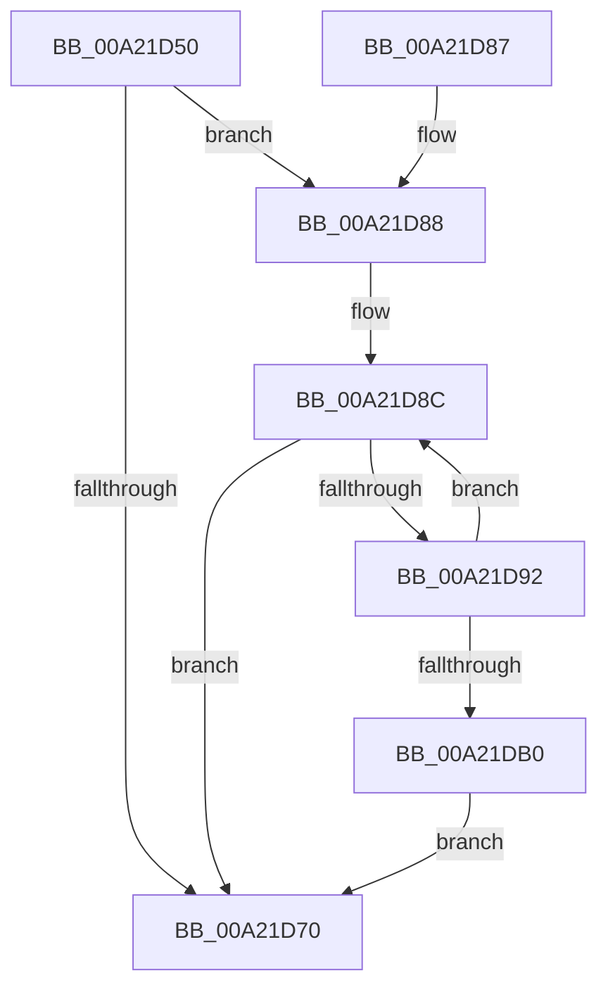

# AlpcHandleDataDestroyProcedure

- RVA: `0x00A21D50`–`0x00A21DB2` (길이 `98` bytes)
- VA: `0x0000000140A21D50`
- 실행 섹션: `PAGE`
- PDB 이름 있음: `예`; PDB Function 태그: `아니요`
- unwind 정보 RVA: `0x0007593C`
- 디코드: `31`개 명령, `98/98` bytes 표시
- 미해석 바이트: `0` (있으면 어셈블리에 `.byte`로 보존)

> 이 문서는 커널 이미지의 기계어와 PDB 기호를 분석해 생성했습니다. 4번과 5번은 함수 원형과 자료형을 바이너리 사용 방식에서 추정한 C 해석이며 원본 소스 복구 결과는 아닙니다.

## 1. Dependencies

- 직접 호출 지점: **1**; 고유 호출 대상: **1**
- 직접 호출자로 확인된 함수: **0**
- RIP 상대 이미지 참조: **0**

### Outgoing calls
- `0x00A21DA1` → [ObReleaseDuplicateInfo](ObReleaseDuplicateInfo_function_00A21DB8.md) (function, `0x00A21DB8`)

### Direct callers
- 이 함수 시작 RVA로 연결되는 직접 call은 확인되지 않았습니다. 간접 호출은 완전히 역산할 수 없습니다.

### Static image references
- 디코드된 RIP-relative 메모리 참조가 없습니다.

## 2. Other-region calls and transfers

- 다른 실행 섹션으로 향하는 call: **0**
- 별도 외부 분기/꼬리 이동을 확인하지 못했습니다.

## 3. Assembly (complete function range)

```asm
00A21D50  48 89 5C 24 08                  mov qword ptr [rsp + 8], rbx
00A21D55  48 89 6C 24 10                  mov qword ptr [rsp + 0x10], rbp
00A21D5A  48 89 74 24 18                  mov qword ptr [rsp + 0x18], rsi
00A21D5F  57                              push rdi
00A21D60  48 83 EC 20                     sub rsp, 0x20
00A21D64  8B 69 04                        mov ebp, dword ptr [rcx + 4]
00A21D67  33 F6                           xor esi, esi
00A21D69  48 8B D9                        mov rbx, rcx
00A21D6C  85 ED                           test ebp, ebp
00A21D6E  75 18                           jne 0x140a21d88
00A21D70  48 8B 5C 24 30                  mov rbx, qword ptr [rsp + 0x30]
00A21D75  33 C0                           xor eax, eax
00A21D77  48 8B 6C 24 38                  mov rbp, qword ptr [rsp + 0x38]
00A21D7C  48 8B 74 24 40                  mov rsi, qword ptr [rsp + 0x40]
00A21D81  48 83 C4 20                     add rsp, 0x20
00A21D85  5F                              pop rdi
00A21D86  C3                              ret
00A21D87  CC                              int3
00A21D88  48 8D 79 18                     lea rdi, [rcx + 0x18]
00A21D8C  48 83 3F 00                     cmp qword ptr [rdi], 0
00A21D90  74 DE                           je 0x140a21d70
00A21D92  48 8D 0C 76                     lea rcx, [rsi + rsi*2]
00A21D96  48 C1 E1 04                     shl rcx, 4
00A21D9A  48 83 C1 08                     add rcx, 8
00A21D9E  48 03 CB                        add rcx, rbx
00A21DA1  E8 12 00 00 00                  call 0x140a21db8
00A21DA6  FF C6                           inc esi
00A21DA8  48 83 C7 30                     add rdi, 0x30
00A21DAC  3B F5                           cmp esi, ebp
00A21DAE  72 DC                           jb 0x140a21d8c
00A21DB0  EB BE                           jmp 0x140a21d70
```

## 4. C-style interpretation (structured pseudocode)

```c
__int64 __fastcall AlpcHandleDataDestroyProcedure(__int64 a1)
{
    __int64 result;
    __int64 v_rdi;
    __int64 v_rsi;
    __int64 v_rsp;
    unsigned __int64 v_stack_p10;
    unsigned __int64 v_stack_p18;
    unsigned __int64 v_stack_p8;

    v_stack_p8 = v_rbx;
    v_stack_p10 = v_rbp;
    v_stack_p18 = v_rsi;
    v_rsp = (v_rsp) - (32);
    v_rsi = 0;
    if ((unsigned int)((unsigned int)(*(unsigned int *)(a1 + 4))) != 0) goto loc_00A21D88;
loc_00A21D70:
    result = 0;
    v_rsp = (v_rsp) + (32);
    return result;
loc_00A21D88:
loc_00A21D8C:
    if ((*(unsigned __int64 *)(a1 + 24)) == 0) goto loc_00A21D70;
    a1 = (v_stack_p18 + v_stack_p18 * 2) << (4);
    a1 = (a1) + (8);
    a1 = (a1) + (v_stack_p8);
    result = ObReleaseDuplicateInfo(a1, a2, a3, a4);
    v_rsi = (unsigned int)((v_stack_p18) + 1);
    v_rdi = (a1 + 24) + (48);
    if (((unsigned int)(v_rsi)) < ((unsigned int)(v_stack_p10))) goto loc_00A21D8C;
    goto loc_00A21D70;
}
```

## 5. (Beta) C Style

```c
int64_t AlpcHandleDataDestroyProcedure(void *Arg1)
{
    uint8_t *arg1 = (uint8_t *)Arg1;

    int64_t result;
    int64_t local_rdi;
    int64_t local_rsi;
    int64_t local_rsp;
    uint64_t v_stack_p10;
    uint64_t v_stack_p18;
    uint64_t v_stack_p8;

    v_stack_p8 = local_rbx;
    v_stack_p10 = local_rbp;
    v_stack_p18 = local_rsi;
    local_rsp = (local_rsp) - (32);
    local_rsi = 0;
    if ((uint32_t)((uint32_t)(*(uint32_t *)(arg1 + 0x4))) != 0) goto loc_00A21D88;
loc_00A21D70:
    result = 0;
    local_rsp = (local_rsp) + (32);
    return result;
loc_00A21D88:
loc_00A21D8C:
    if ((*(uint64_t *)(arg1 + 0x18)) == 0) goto loc_00A21D70;
    Arg1 = (v_stack_p18 + v_stack_p18 * 2) << (4);
    Arg1 = (Arg1) + (8);
    Arg1 = (Arg1) + (v_stack_p8);
    result = ObReleaseDuplicateInfo(Arg1, a2, a3, a4);
    local_rsi = (uint32_t)((v_stack_p18) + 1);
    local_rdi = (Arg1 + 24) + (48);
    if (((uint32_t)(local_rsi)) < ((uint32_t)(v_stack_p10))) goto loc_00A21D8C;
    goto loc_00A21D70;
}
```

### 관측된 메모리 오프셋

구조체 형식이 확인되지 않은 접근은 인자 기준의 오프셋으로만 기록했습니다.

| 기준 인자 | 오프셋 표현 | 폭 (bit) | 접근 |
|---|---:|---:|---|
| `Arg1` | `+ 0x0` | `64` | `R` |
| `Arg1` | `+ 0x4` | `32` | `R` |
| `Arg1` | `+ 0x18` | `64` | `R` |

## 6. Execution-region graph

[열기: 2D/3D 그래프와 함수 탐색 컨트롤 패널](../../../control-panel.html?section=page&rva=0x00A21D50&view=graph)

- 2D 그래프는 위에서 아래로 흐르고, 3D 그래프는 빈 공간을 드래그해 회전합니다. Shift+드래그는 이동, 휠은 확대·축소, 함수 노드 선택은 대상 보고서 이동입니다.

### Static fallback


