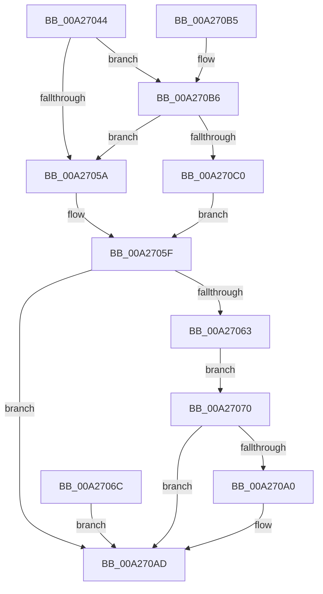

# AlpcpCaptureDirectAttribute32

- RVA: `0x00A27044`–`0x00A270C4` (길이 `128` bytes)
- VA: `0x0000000140A27044`
- 실행 섹션: `PAGE`
- PDB 이름 있음: `예`; PDB Function 태그: `아니요`
- unwind 정보 RVA: `0x000ABF24`
- 디코드: `37`개 명령, `128/128` bytes 표시
- 미해석 바이트: `0` (있으면 어셈블리에 `.byte`로 보존)

> 이 문서는 커널 이미지의 기계어와 PDB 기호를 분석해 생성했습니다. 4번과 5번은 함수 원형과 자료형을 바이너리 사용 방식에서 추정한 C 해석이며 원본 소스 복구 결과는 아닙니다.

## 1. Dependencies

- 직접 호출 지점: **1**; 고유 호출 대상: **1**
- 직접 호출자로 확인된 함수: **1**
- RIP 상대 이미지 참조: **1**

### Outgoing calls
- `0x00A27095` → [ObReferenceObjectByHandle](../86/ObReferenceObjectByHandle_function_00868DB0.md) (function, `0x00868DB0`)

### Direct callers
- [AlpcpCaptureAttributes](../88/AlpcpCaptureAttributes_function_0088CD20.md) at `0x0088D1EF`

### Static image references
- `0x00A27070` → RVA `0x00FC6B80` (`ALMOSTRO`; read)

## 2. Other-region calls and transfers

- 다른 실행 섹션으로 향하는 call: **0**
- 별도 외부 분기/꼬리 이동을 확인하지 못했습니다.

## 3. Assembly (complete function range)

```asm
00A27044  48 89 54 24 10                  mov qword ptr [rsp + 0x10], rdx
00A27049  53                              push rbx
00A2704A  48 83 EC 40                     sub rsp, 0x40
00A2704E  49 8B D8                        mov rbx, r8
00A27051  41 F7 C1 10 00 01 00            test r9d, 0x10010
00A27058  74 5C                           je 0x140a270b6
00A2705A  BA 0D 00 00 C0                  mov edx, 0xc000000d
00A2705F  85 D2                           test edx, edx
00A27061  78 4A                           js 0x140a270ad
00A27063  8B 09                           mov ecx, dword ptr [rcx]
00A27065  48 89 4C 24 30                  mov qword ptr [rsp + 0x30], rcx
00A2706A  EB 04                           jmp 0x140a27070
00A2706C  8B D0                           mov edx, eax
00A2706E  EB 3D                           jmp 0x140a270ad
00A27070  4C 8B 05 09 FB 59 00            mov r8, qword ptr [rip + 0x59fb09]
00A27077  48 83 64 24 58 00               and qword ptr [rsp + 0x58], 0
00A2707D  48 83 64 24 28 00               and qword ptr [rsp + 0x28], 0
00A27083  48 8D 44 24 58                  lea rax, [rsp + 0x58]
00A27088  48 89 44 24 20                  mov qword ptr [rsp + 0x20], rax
00A2708D  41 B1 01                        mov r9b, 1
00A27090  BA 02 00 00 00                  mov edx, 2
00A27095  E8 16 1D E4 FF                  call 0x140868db0
00A2709A  8B D0                           mov edx, eax
00A2709C  85 C0                           test eax, eax
00A2709E  78 0D                           js 0x140a270ad
00A270A0  48 8B 44 24 58                  mov rax, qword ptr [rsp + 0x58]
00A270A5  48 83 C8 03                     or rax, 3
00A270A9  48 89 43 38                     mov qword ptr [rbx + 0x38], rax
00A270AD  8B C2                           mov eax, edx
00A270AF  48 83 C4 40                     add rsp, 0x40
00A270B3  5B                              pop rbx
00A270B4  C3                              ret
00A270B5  CC                              int3
00A270B6  F7 44 24 70 00 00 00 20         test dword ptr [rsp + 0x70], 0x20000000
00A270BE  74 9A                           je 0x140a2705a
00A270C0  33 D2                           xor edx, edx
00A270C2  EB 9B                           jmp 0x140a2705f
```

## 4. C-style interpretation (structured pseudocode)

```c
__int64 __fastcall AlpcpCaptureDirectAttribute32(__int64 a1, __int64 a2, __int64 a3, int a4, unsigned int a5)
{
    __int64 result;
    __int64 v_rsp;
    unsigned __int64 v_stack_m18;
    unsigned __int64 v_stack_m20;
    unsigned __int64 v_stack_m28;
    unsigned __int64 v_stack_p10;

    v_stack_p10 = a2;
    v_rsp = (v_rsp) - (64);
    if (((a4) & (0x10010ULL)) == 0) goto loc_00A270B6;
loc_00A2705A:
loc_00A2705F:
    if (sign_flag) goto loc_00A270AD;
    v_stack_m18 = (unsigned int)(*(unsigned int *)(a1));
    goto loc_00A27070;
loc_00A27070:
    v_stack_m28 = v_stack_p10;
    result = ObReferenceObjectByHandle((unsigned int)(*(unsigned int *)(a1)), 2, *(unsigned __int64 *)(v_rip + 5896969), 1);
    if (!(sign_flag)) {
        result = v_stack_p10;
        result = (result) | (3);
        *(unsigned __int64 *)(a3 + 56) = result;
    }
    v_rsp = (v_rsp) + (64);
    return (unsigned int)((unsigned int)((unsigned int)((unsigned int)(result))));
loc_00A270B6:
    if (((a5) & (0x20000000ULL)) == 0) goto loc_00A2705A;
    a2 = 0;
    goto loc_00A2705F;
}
```

## 5. (Beta) C Style

```c
int64_t AlpcpCaptureDirectAttribute32(void *Arg1, int64_t Arg2, void *Arg3, int32_t Arg4, uint32_t Arg5)
{
    uint8_t *arg1 = (uint8_t *)Arg1;
    uint8_t *arg3 = (uint8_t *)Arg3;

    int64_t result;
    int64_t local_rsp;
    uint64_t v_stack_m18;
    uint64_t v_stack_m20;
    uint64_t v_stack_m28;
    uint64_t v_stack_p10;

    v_stack_p10 = Arg2;
    local_rsp = (local_rsp) - (64);
    if (((Arg4) & (0x10010ULL)) == 0) goto loc_00A270B6;
loc_00A2705A:
loc_00A2705F:
    if (sign_flag) goto loc_00A270AD;
    v_stack_m18 = (uint32_t)(*(uint32_t *)(arg1));
    goto loc_00A27070;
loc_00A27070:
    v_stack_m28 = v_stack_p10;
    result = ObReferenceObjectByHandle((uint32_t)(*(uint32_t *)(arg1)), 2, *(uint64_t *)(v_rip + 0x59FB09), 1);
    if (!(sign_flag)) {
        result = v_stack_p10;
        result = (result) | (3);
        *(uint64_t *)(arg3 + 0x38) = result;
    }
    local_rsp = (local_rsp) + (64);
    return (uint32_t)((uint32_t)((uint32_t)((uint32_t)(result))));
loc_00A270B6:
    if (((Arg5) & (0x20000000ULL)) == 0) goto loc_00A2705A;
    Arg2 = 0;
    goto loc_00A2705F;
}
```

### 관측된 메모리 오프셋

구조체 형식이 확인되지 않은 접근은 인자 기준의 오프셋으로만 기록했습니다.

| 기준 인자 | 오프셋 표현 | 폭 (bit) | 접근 |
|---|---:|---:|---|
| `Arg1` | `+ 0x0` | `32` | `R` |
| `Arg3` | `+ 0x38` | `64` | `W` |

## 6. Execution-region graph

[열기: 2D/3D 그래프와 함수 탐색 컨트롤 패널](../../../control-panel.html?section=page&rva=0x00A27044&view=graph)

- 2D 그래프는 위에서 아래로 흐르고, 3D 그래프는 빈 공간을 드래그해 회전합니다. Shift+드래그는 이동, 휠은 확대·축소, 함수 노드 선택은 대상 보고서 이동입니다.

### Static fallback


