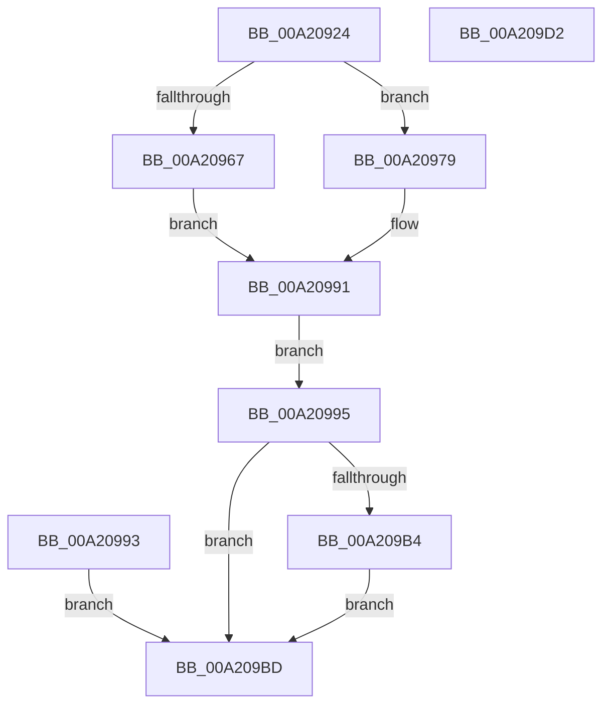

# AlpcpCaptureSecurityAttribute32

- RVA: `0x00A20924`–`0x00A209D3` (길이 `175` bytes)
- VA: `0x0000000140A20924`
- 실행 섹션: `PAGE`
- PDB 이름 있음: `예`; PDB Function 태그: `아니요`
- unwind 정보 RVA: `0x000AAE30`
- 디코드: `51`개 명령, `175/175` bytes 표시
- 미해석 바이트: `0` (있으면 어셈블리에 `.byte`로 보존)

> 이 문서는 커널 이미지의 기계어와 PDB 기호를 분석해 생성했습니다. 4번과 5번은 함수 원형과 자료형을 바이너리 사용 방식에서 추정한 C 해석이며 원본 소스 복구 결과는 아닙니다.

## 1. Dependencies

- 직접 호출 지점: **3**; 고유 호출 대상: **3**
- 직접 호출자로 확인된 함수: **1**
- RIP 상대 이미지 참조: **1**

### Outgoing calls
- `0x00A20972` → [RtlCopyVolatileMemory](../../text/6B/RtlCopyVolatileMemory_function_006BC9D0.md) (function, `0x006BC9D0`)
- `0x00A209AB` → [AlpcpCaptureSecurityAttributeInternal](../89/AlpcpCaptureSecurityAttributeInternal_function_008908C0.md) (function, `0x008908C0`)
- `0x00A209C5` → [_security_check_cookie](../../text/6A/_security_check_cookie_function_006AC640.md) (function, `0x006AC640`)

### Direct callers
- [AlpcpCaptureAttributes](../88/AlpcpCaptureAttributes_function_0088CD20.md) at `0x0088D134`

### Static image references
- `0x00A2092C` → RVA `0x00E0A740` (`.data`; read)

## 2. Other-region calls and transfers

- 다른 실행 섹션으로 향하는 call: **2**
  - `0x00A20972` → [RtlCopyVolatileMemory](../../text/6B/RtlCopyVolatileMemory_function_006BC9D0.md) (`PAGE` → `.text`)
  - `0x00A209C5` → [_security_check_cookie](../../text/6A/_security_check_cookie_function_006AC640.md) (`PAGE` → `.text`)
- 별도 외부 분기/꼬리 이동을 확인하지 못했습니다.

## 3. Assembly (complete function range)

```asm
00A20924  40 53                           push rbx
00A20926  56                              push rsi
00A20927  57                              push rdi
00A20928  48 83 EC 60                     sub rsp, 0x60
00A2092C  48 8B 05 0D 9E 3E 00            mov rax, qword ptr [rip + 0x3e9e0d]
00A20933  48 33 C4                        xor rax, rsp
00A20936  48 89 44 24 50                  mov qword ptr [rsp + 0x50], rax
00A2093B  49 8B F0                        mov rsi, r8
00A2093E  48 8B DA                        mov rbx, rdx
00A20941  48 8B F9                        mov rdi, rcx
00A20944  33 C0                           xor eax, eax
00A20946  48 89 44 24 40                  mov qword ptr [rsp + 0x40], rax
00A2094B  89 44 24 48                     mov dword ptr [rsp + 0x48], eax
00A2094F  8B 02                           mov eax, dword ptr [rdx]
00A20951  89 44 24 30                     mov dword ptr [rsp + 0x30], eax
00A20955  48 63 42 08                     movsxd rax, dword ptr [rdx + 8]
00A20959  48 89 44 24 38                  mov qword ptr [rsp + 0x38], rax
00A2095E  8B 42 04                        mov eax, dword ptr [rdx + 4]
00A20961  8B D0                           mov edx, eax
00A20963  85 C0                           test eax, eax
00A20965  74 12                           je 0x140a20979
00A20967  41 B8 0C 00 00 00               mov r8d, 0xc
00A2096D  48 8D 4C 24 40                  lea rcx, [rsp + 0x40]
00A20972  E8 59 C0 C9 FF                  call 0x1406bc9d0
00A20977  EB 18                           jmp 0x140a20991
00A20979  F2 0F 10 81 04 01 00 00         movsd xmm0, qword ptr [rcx + 0x104]
00A20981  F2 0F 11 44 24 40               movsd qword ptr [rsp + 0x40], xmm0
00A20987  8B 81 0C 01 00 00               mov eax, dword ptr [rcx + 0x10c]
00A2098D  89 44 24 48                     mov dword ptr [rsp + 0x48], eax
00A20991  EB 02                           jmp 0x140a20995
00A20993  EB 28                           jmp 0x140a209bd
00A20995  48 89 74 24 20                  mov qword ptr [rsp + 0x20], rsi
00A2099A  4C 8D 4C 24 38                  lea r9, [rsp + 0x38]
00A2099F  4C 8D 44 24 40                  lea r8, [rsp + 0x40]
00A209A4  8B 54 24 30                     mov edx, dword ptr [rsp + 0x30]
00A209A8  48 8B CF                        mov rcx, rdi
00A209AB  E8 10 FF E6 FF                  call 0x1408908c0
00A209B0  85 C0                           test eax, eax
00A209B2  78 09                           js 0x140a209bd
00A209B4  8B 4C 24 38                     mov ecx, dword ptr [rsp + 0x38]
00A209B8  89 4B 08                        mov dword ptr [rbx + 8], ecx
00A209BB  EB 00                           jmp 0x140a209bd
00A209BD  48 8B 4C 24 50                  mov rcx, qword ptr [rsp + 0x50]
00A209C2  48 33 CC                        xor rcx, rsp
00A209C5  E8 76 BC C8 FF                  call 0x1406ac640
00A209CA  48 83 C4 60                     add rsp, 0x60
00A209CE  5F                              pop rdi
00A209CF  5E                              pop rsi
00A209D0  5B                              pop rbx
00A209D1  C3                              ret
00A209D2  CC                              int3
```

## 4. C-style interpretation (structured pseudocode)

```c
__int64 __fastcall AlpcpCaptureSecurityAttribute32(__int64 a1, __int64 a2, __int64 a3)
{
    __int64 result;
    __int64 v_rsp;
    unsigned __int64 v_stack_m28;
    unsigned int v_stack_m30;
    unsigned __int64 v_stack_m38;
    unsigned __int64 v_stack_m40;
    unsigned int v_stack_m48;
    unsigned __int64 v_stack_m58;

    v_rsp = (v_rsp) - (96);
    result = (*(unsigned __int64 *)(v_rip + 4103693)) ^ (v_rsp);
    v_stack_m28 = result;
    result = 0;
    v_stack_m38 = 0;
    v_stack_m30 = 0;
    v_stack_m48 = (unsigned int)((unsigned int)(*(unsigned int *)(a2)));
    v_stack_m40 = (int)(*(unsigned int *)(a2 + 8));
    if ((unsigned int)((unsigned int)(*(unsigned int *)(a2 + 4))) == 0) goto loc_00A20979;
    result = RtlCopyVolatileMemory(v_stack_m38, (unsigned int)((unsigned int)((unsigned int)(*(unsigned int *)(a2 + 4)))), 12, a4);
    goto loc_00A20991;
loc_00A20979:
    v_stack_m38 = v_xmm0;
    v_stack_m30 = (unsigned int)((unsigned int)(*(unsigned int *)(v_stack_m38 + 268)));
loc_00A20991:
    goto loc_00A20995;
loc_00A20995:
    v_stack_m58 = a3;
    result = AlpcpCaptureSecurityAttributeInternal(a1, (unsigned int)(v_stack_m48), v_stack_m38, v_stack_m40);
    if (sign_flag) goto loc_00A209BD;
    *(unsigned int *)(a2 + 8) = (unsigned int)((unsigned int)(v_stack_m40));
    goto loc_00A209BD;
loc_00A209BD:
    a1 = (v_stack_m28) ^ (v_rsp);
    result = _security_check_cookie(a1, (unsigned int)(v_stack_m48), v_stack_m38, v_stack_m40);
    v_rsp = (v_rsp) + (96);
    return result;
}
```

## 5. (Beta) C Style

```c
int64_t AlpcpCaptureSecurityAttribute32(void *Arg1, void *Arg2, int64_t Arg3)
{
    uint8_t *arg1 = (uint8_t *)Arg1;
    uint8_t *arg2 = (uint8_t *)Arg2;

    int64_t result;
    int64_t local_rsp;
    uint64_t v_stack_m28;
    uint32_t v_stack_m30;
    uint64_t v_stack_m38;
    uint64_t v_stack_m40;
    uint32_t v_stack_m48;
    uint64_t v_stack_m58;

    local_rsp = (local_rsp) - (96);
    result = (*(uint64_t *)(v_rip + 0x3E9E0D)) ^ (local_rsp);
    v_stack_m28 = result;
    result = 0;
    v_stack_m38 = 0;
    v_stack_m30 = 0;
    v_stack_m48 = (uint32_t)((uint32_t)(*(uint32_t *)(arg2)));
    v_stack_m40 = (int32_t)(*(uint32_t *)(arg2 + 0x8));
    if ((uint32_t)((uint32_t)(*(uint32_t *)(arg2 + 0x4))) == 0) goto loc_00A20979;
    result = RtlCopyVolatileMemory(v_stack_m38, (uint32_t)((uint32_t)((uint32_t)(*(uint32_t *)(arg2 + 0x4)))), 12, a4);
    goto loc_00A20991;
loc_00A20979:
    v_stack_m38 = v_xmm0;
    v_stack_m30 = (uint32_t)((uint32_t)(*(uint32_t *)(v_stack_m38 + 0x10C)));
loc_00A20991:
    goto loc_00A20995;
loc_00A20995:
    v_stack_m58 = Arg3;
    result = AlpcpCaptureSecurityAttributeInternal(Arg1, (uint32_t)(v_stack_m48), v_stack_m38, v_stack_m40);
    if (sign_flag) goto loc_00A209BD;
    *(uint32_t *)(arg2 + 0x8) = (uint32_t)((uint32_t)(v_stack_m40));
    goto loc_00A209BD;
loc_00A209BD:
    Arg1 = (v_stack_m28) ^ (local_rsp);
    result = _security_check_cookie(Arg1, (uint32_t)(v_stack_m48), v_stack_m38, v_stack_m40);
    local_rsp = (local_rsp) + (96);
    return result;
}
```

### 관측된 메모리 오프셋

구조체 형식이 확인되지 않은 접근은 인자 기준의 오프셋으로만 기록했습니다.

| 기준 인자 | 오프셋 표현 | 폭 (bit) | 접근 |
|---|---:|---:|---|
| `Arg1` | `+ 0x104` | `64` | `R` |
| `Arg1` | `+ 0x10C` | `32` | `R` |
| `Arg2` | `+ 0x0` | `32` | `R` |
| `Arg2` | `+ 0x4` | `32` | `R` |
| `Arg2` | `+ 0x8` | `32` | `R` |
| `Arg2` | `+ 0x8` | `32` | `W` |

## 6. Execution-region graph

[열기: 2D/3D 그래프와 함수 탐색 컨트롤 패널](../../../control-panel.html?section=page&rva=0x00A20924&view=graph)

- 2D 그래프는 위에서 아래로 흐르고, 3D 그래프는 빈 공간을 드래그해 회전합니다. Shift+드래그는 이동, 휠은 확대·축소, 함수 노드 선택은 대상 보고서 이동입니다.

### Static fallback


