# AlpcpCheckConnectionSecurity

- RVA: `0x00A227A0`–`0x00A22A17` (길이 `631` bytes)
- VA: `0x0000000140A227A0`
- 실행 섹션: `PAGE`
- PDB 이름 있음: `예`; PDB Function 태그: `아니요`
- unwind 정보 RVA: `0x000AB5DC`
- 디코드: `159`개 명령, `631/631` bytes 표시
- 미해석 바이트: `0` (있으면 어셈블리에 `.byte`로 보존)

> 이 문서는 커널 이미지의 기계어와 PDB 기호를 분석해 생성했습니다. 4번과 5번은 함수 원형과 자료형을 바이너리 사용 방식에서 추정한 C 해석이며 원본 소스 복구 결과는 아닙니다.

## 1. Dependencies

- 직접 호출 지점: **13**; 고유 호출 대상: **12**
- 직접 호출자로 확인된 함수: **1**
- RIP 상대 이미지 참조: **4**

### Outgoing calls
- `0x00A227EE` → [memset](../../text/6C/memset_function_006C6C40.md) (function, `0x006C6C40`)
- `0x00A227FB` → [PsReferencePrimaryTokenWithTag](../../text/20/PsReferencePrimaryTokenWithTag_function_0020FF80.md) (function, `0x0020FF80`)
- `0x00A2280F` → [SeQueryInformationToken](../8B/SeQueryInformationToken_function_008B5090.md) (function, `0x008B5090`)
- `0x00A2283D` → [ObFastDereferenceObject](../../text/3E/ObFastDereferenceObject_function_003ED5F0.md) (function, `0x003ED5F0`)
- `0x00A22854` → [RtlEqualSid](../../text/40/RtlEqualSid_function_00400AD0.md) (function, `0x00400AD0`)
- `0x00A2289A` → [PsReferencePrimaryTokenWithTag](../../text/20/PsReferencePrimaryTokenWithTag_function_0020FF80.md) (function, `0x0020FF80`)
- `0x00A228F2` → [SeAccessCheck](../../text/3A/SeAccessCheck_function_003A6BC0.md) (function, `0x003A6BC0`)
- `0x00A2293A` → [SeReleaseSubjectContext](../86/SeReleaseSubjectContext_function_0086B710.md) (function, `0x0086B710`)
- `0x00A2294F` → [_security_check_cookie](../../text/6A/_security_check_cookie_function_006AC640.md) (function, `0x006AC640`)
- `0x00A22987` → [ExAcquireResourceSharedLite](../../text/21/ExAcquireResourceSharedLite_function_00211BC0.md) (function, `0x00211BC0`)
- `0x00A229AD` → [memcpy](../../text/6C/memcpy_function_006C6840.md) (function, `0x006C6840`)
- `0x00A229B6` → [ExReleaseResourceLite](../../text/25/ExReleaseResourceLite_function_0025FA10.md) (function, `0x0025FA10`)
- `0x00A229BB` → [KeLeaveCriticalRegion](../../text/25/KeLeaveCriticalRegion_function_0025D8B0.md) (function, `0x0025D8B0`)

### Direct callers
- [AlpcpCreateClientPort](../92/AlpcpCreateClientPort_function_009270AC.md) at `0x00927206`

### Static image references
- `0x00A227B8` → RVA `0x00E0A740` (`.data`; read)
- `0x00A2289F` → RVA `0x00FD8010` (`PAGEDATA`; read)
- `0x00A228B0` → RVA `0x00FC6C18` (`ALMOSTRO`; read)
- `0x00A229DA` → RVA `0x00E67B90` (`.data`; read)

## 2. Other-region calls and transfers

- 다른 실행 섹션으로 향하는 call: **11**
  - `0x00A227EE` → [memset](../../text/6C/memset_function_006C6C40.md) (`PAGE` → `.text`)
  - `0x00A227FB` → [PsReferencePrimaryTokenWithTag](../../text/20/PsReferencePrimaryTokenWithTag_function_0020FF80.md) (`PAGE` → `.text`)
  - `0x00A2283D` → [ObFastDereferenceObject](../../text/3E/ObFastDereferenceObject_function_003ED5F0.md) (`PAGE` → `.text`)
  - `0x00A22854` → [RtlEqualSid](../../text/40/RtlEqualSid_function_00400AD0.md) (`PAGE` → `.text`)
  - `0x00A2289A` → [PsReferencePrimaryTokenWithTag](../../text/20/PsReferencePrimaryTokenWithTag_function_0020FF80.md) (`PAGE` → `.text`)
  - `0x00A228F2` → [SeAccessCheck](../../text/3A/SeAccessCheck_function_003A6BC0.md) (`PAGE` → `.text`)
  - `0x00A2294F` → [_security_check_cookie](../../text/6A/_security_check_cookie_function_006AC640.md) (`PAGE` → `.text`)
  - `0x00A22987` → [ExAcquireResourceSharedLite](../../text/21/ExAcquireResourceSharedLite_function_00211BC0.md) (`PAGE` → `.text`)
  - `0x00A229AD` → [memcpy](../../text/6C/memcpy_function_006C6840.md) (`PAGE` → `.text`)
  - `0x00A229B6` → [ExReleaseResourceLite](../../text/25/ExReleaseResourceLite_function_0025FA10.md) (`PAGE` → `.text`)
  - `0x00A229BB` → [KeLeaveCriticalRegion](../../text/25/KeLeaveCriticalRegion_function_0025D8B0.md) (`PAGE` → `.text`)
- 별도 외부 분기/꼬리 이동을 확인하지 못했습니다.

## 3. Assembly (complete function range)

```asm
00A227A0  48 89 5C 24 10                  mov qword ptr [rsp + 0x10], rbx
00A227A5  55                              push rbp
00A227A6  56                              push rsi
00A227A7  57                              push rdi
00A227A8  41 56                           push r14
00A227AA  41 57                           push r15
00A227AC  48 8D 6C 24 C9                  lea rbp, [rsp - 0x37]
00A227B1  48 81 EC E0 00 00 00            sub rsp, 0xe0
00A227B8  48 8B 05 81 7F 3E 00            mov rax, qword ptr [rip + 0x3e7f81]
00A227BF  48 33 C4                        xor rax, rsp
00A227C2  48 89 45 27                     mov qword ptr [rbp + 0x27], rax
00A227C6  83 65 A7 00                     and dword ptr [rbp - 0x59], 0
00A227CA  4D 8B F1                        mov r14, r9
00A227CD  49 8B F0                        mov rsi, r8
00A227D0  44 8A FA                        mov r15b, dl
00A227D3  48 8B F9                        mov rdi, rcx
00A227D6  4D 85 C0                        test r8, r8
00A227D9  0F 84 8E 00 00 00               je 0x140a2286d
00A227DF  48 83 65 AF 00                  and qword ptr [rbp - 0x51], 0
00A227E4  48 8D 4D D7                     lea rcx, [rbp - 0x29]
00A227E8  33 D2                           xor edx, edx
00A227EA  44 8D 42 44                     lea r8d, [rdx + 0x44]
00A227EE  E8 4D 44 CA FF                  call 0x1406c6c40
00A227F3  BA 44 66 6C 74                  mov edx, 0x746c6644
00A227F8  48 8B CF                        mov rcx, rdi
00A227FB  E8 80 D7 7E FF                  call 0x14020ff80
00A22800  4C 8D 45 AF                     lea r8, [rbp - 0x51]
00A22804  BA 1D 00 00 00                  mov edx, 0x1d
00A22809  48 8B C8                        mov rcx, rax
00A2280C  48 8B D8                        mov rbx, rax
00A2280F  E8 7C 28 E9 FF                  call 0x1408b5090
00A22814  89 45 A7                        mov dword ptr [rbp - 0x59], eax
00A22817  85 C0                           test eax, eax
00A22819  78 12                           js 0x140a2282d
00A2281B  48 83 7D AF 00                  cmp qword ptr [rbp - 0x51], 0
00A22820  0F 84 4A 01 00 00               je 0x140a22970
00A22826  C7 45 A7 A0 02 00 C0            mov dword ptr [rbp - 0x59], 0xc00002a0
00A2282D  48 8D 8F 48 02 00 00            lea rcx, [rdi + 0x248]
00A22834  41 B8 44 66 6C 74               mov r8d, 0x746c6644
00A2283A  48 8B D3                        mov rdx, rbx
00A2283D  E8 AE AD 9C FF                  call 0x1403ed5f0
00A22842  8B 5D A7                        mov ebx, dword ptr [rbp - 0x59]
00A22845  85 DB                           test ebx, ebx
00A22847  0F 88 1F 01 00 00               js 0x140a2296c
00A2284D  48 8D 55 D7                     lea rdx, [rbp - 0x29]
00A22851  48 8B CE                        mov rcx, rsi
00A22854  E8 77 E2 9D FF                  call 0x140400ad0
00A22859  84 C0                           test al, al
00A2285B  75 08                           jne 0x140a22865
00A2285D  BB A0 02 00 C0                  mov ebx, 0xc00002a0
00A22862  89 5D A7                        mov dword ptr [rbp - 0x59], ebx
00A22865  85 DB                           test ebx, ebx
00A22867  0F 88 FF 00 00 00               js 0x140a2296c
00A2286D  4D 85 F6                        test r14, r14
00A22870  0F 84 D0 00 00 00               je 0x140a22946
00A22876  48 8B 87 D0 01 00 00            mov rax, qword ptr [rdi + 0x1d0]
00A2287D  0F 57 C0                        xorps xmm0, xmm0
00A22880  83 65 AB 00                     and dword ptr [rbp - 0x55], 0
00A22884  BA 53 65 53 75                  mov edx, 0x75536553
00A22889  48 83 65 B7 00                  and qword ptr [rbp - 0x49], 0
00A2288E  48 8B CF                        mov rcx, rdi
00A22891  F3 0F 7F 45 BF                  movdqu xmmword ptr [rbp - 0x41], xmm0
00A22896  48 89 45 CF                     mov qword ptr [rbp - 0x31], rax
00A2289A  E8 E1 D6 7E FF                  call 0x14020ff80
00A2289F  83 3D 6A 57 5B 00 00            cmp dword ptr [rip + 0x5b576a], 0
00A228A6  48 89 45 C7                     mov qword ptr [rbp - 0x39], rax
00A228AA  0F 85 15 01 00 00               jne 0x140a229c5
00A228B0  48 8B 05 61 43 5A 00            mov rax, qword ptr [rip + 0x5a4361]
00A228B7  48 8D 4D A7                     lea rcx, [rbp - 0x59]
00A228BB  48 89 4C 24 48                  mov qword ptr [rsp + 0x48], rcx
00A228C0  48 8D 55 B7                     lea rdx, [rbp - 0x49]
00A228C4  48 8D 4D AB                     lea rcx, [rbp - 0x55]
00A228C8  48 83 C0 4C                     add rax, 0x4c
00A228CC  48 89 4C 24 40                  mov qword ptr [rsp + 0x40], rcx
00A228D1  41 B9 00 00 00 02               mov r9d, 0x2000000
00A228D7  44 88 7C 24 38                  mov byte ptr [rsp + 0x38], r15b
00A228DC  45 33 C0                        xor r8d, r8d
00A228DF  48 89 44 24 30                  mov qword ptr [rsp + 0x30], rax
00A228E4  49 8B CE                        mov rcx, r14
00A228E7  48 83 64 24 28 00               and qword ptr [rsp + 0x28], 0
00A228ED  83 64 24 20 00                  and dword ptr [rsp + 0x20], 0
00A228F2  E8 C9 42 98 FF                  call 0x1403a6bc0
00A228F7  8B 45 AB                        mov eax, dword ptr [rbp - 0x55]
00A228FA  48 8B 0D 17 43 5A 00            mov rcx, qword ptr [rip + 0x5a4317]
00A22901  85 C0                           test eax, eax
00A22903  79 03                           jns 0x140a22908
00A22905  0B 41 4C                        or eax, dword ptr [rcx + 0x4c]
00A22908  0F BA E0 1E                     bt eax, 0x1e
00A2290C  73 03                           jae 0x140a22911
00A2290E  0B 41 50                        or eax, dword ptr [rcx + 0x50]
00A22911  0F BA E0 1D                     bt eax, 0x1d
00A22915  73 03                           jae 0x140a2291a
00A22917  0B 41 54                        or eax, dword ptr [rcx + 0x54]
00A2291A  0F BA E0 1C                     bt eax, 0x1c
00A2291E  73 03                           jae 0x140a22923
00A22920  0B 41 58                        or eax, dword ptr [rcx + 0x58]
00A22923  25 FF FF FF 0F                  and eax, 0xfffffff
00A22928  89 45 AB                        mov dword ptr [rbp - 0x55], eax
00A2292B  A8 01                           test al, 1
00A2292D  75 07                           jne 0x140a22936
00A2292F  C7 45 A7 A0 02 00 C0            mov dword ptr [rbp - 0x59], 0xc00002a0
00A22936  48 8D 4D B7                     lea rcx, [rbp - 0x49]
00A2293A  E8 D1 8D E4 FF                  call 0x14086b710
00A2293F  8B 5D A7                        mov ebx, dword ptr [rbp - 0x59]
00A22942  85 DB                           test ebx, ebx
00A22944  78 26                           js 0x140a2296c
00A22946  33 C0                           xor eax, eax
00A22948  48 8B 4D 27                     mov rcx, qword ptr [rbp + 0x27]
00A2294C  48 33 CC                        xor rcx, rsp
00A2294F  E8 EC 9C C8 FF                  call 0x1406ac640
00A22954  48 8B 9C 24 18 01 00 00         mov rbx, qword ptr [rsp + 0x118]
00A2295C  48 81 C4 E0 00 00 00            add rsp, 0xe0
00A22963  41 5F                           pop r15
00A22965  41 5E                           pop r14
00A22967  5F                              pop rdi
00A22968  5E                              pop rsi
00A22969  5D                              pop rbp
00A2296A  C3                              ret
00A2296B  CC                              int3
00A2296C  8B C3                           mov eax, ebx
00A2296E  EB D8                           jmp 0x140a22948
00A22970  65 48 8B 04 25 88 01 00 00      mov rax, qword ptr gs:[0x188]
00A22979  B2 01                           mov dl, 1
00A2297B  66 FF 88 E4 01 00 00            dec word ptr [rax + 0x1e4]
00A22982  90                              nop
00A22983  48 8B 4B 30                     mov rcx, qword ptr [rbx + 0x30]
00A22987  E8 34 F2 7E FF                  call 0x140211bc0
00A2298C  48 8B 83 98 00 00 00            mov rax, qword ptr [rbx + 0x98]
00A22993  48 8B 10                        mov rdx, qword ptr [rax]
00A22996  0F B6 42 01                     movzx eax, byte ptr [rdx + 1]
00A2299A  8D 04 85 08 00 00 00            lea eax, [rax*4 + 8]
00A229A1  83 F8 44                        cmp eax, 0x44
00A229A4  77 0C                           ja 0x140a229b2
00A229A6  44 8B C0                        mov r8d, eax
00A229A9  48 8D 4D D7                     lea rcx, [rbp - 0x29]
00A229AD  E8 8E 3E CA FF                  call 0x1406c6840
00A229B2  48 8B 4B 30                     mov rcx, qword ptr [rbx + 0x30]
00A229B6  E8 55 D0 83 FF                  call 0x14025fa10
00A229BB  E8 F0 AE 83 FF                  call 0x14025d8b0
00A229C0  E9 68 FE FF FF                  jmp 0x140a2282d
00A229C5  B9 1C 01 00 00                  mov ecx, 0x11c
00A229CA  48 85 C0                        test rax, rax
00A229CD  74 19                           je 0x140a229e8
00A229CF  48 8B 80 78 04 00 00            mov rax, qword ptr [rax + 0x478]
00A229D6  F0 FF 04 08                     lock inc dword ptr [rax + rcx]
00A229DA  48 8B 05 AF 51 44 00            mov rax, qword ptr [rip + 0x4451af]
00A229E1  48 39 45 C7                     cmp qword ptr [rbp - 0x39], rax
00A229E5  75 01                           jne 0x140a229e8
00A229E7  CC                              int3
00A229E8  48 8B 45 B7                     mov rax, qword ptr [rbp - 0x49]
00A229EC  48 85 C0                        test rax, rax
00A229EF  0F 84 BB FE FF FF               je 0x140a228b0
00A229F5  48 8B 80 78 04 00 00            mov rax, qword ptr [rax + 0x478]
00A229FC  F0 FF 04 08                     lock inc dword ptr [rax + rcx]
00A22A00  48 8B 05 89 51 44 00            mov rax, qword ptr [rip + 0x445189]
00A22A07  48 39 45 B7                     cmp qword ptr [rbp - 0x49], rax
00A22A0B  0F 85 9F FE FF FF               jne 0x140a228b0
00A22A11  CC                              int3
00A22A12  E9 99 FE FF FF                  jmp 0x140a228b0
```

## 4. C-style interpretation (structured pseudocode)

```c
__int64 __fastcall AlpcpCheckConnectionSecurity(__int64 a1, int a2, __int64 a3, __int64 a4)
{
    __int64 result;
    __int64 v_rbx;
    __int64 v_rsp;
    unsigned __int64 v_stack_m38;
    unsigned __int64 v_stack_m5F;
    unsigned __int64 v_stack_m88;
    unsigned __int64 v_stack_m90;
    unsigned __int64 v_stack_m98;
    unsigned __int64 v_stack_mA0;
    unsigned __int64 v_stack_mA8;
    unsigned __int64 v_stack_mB0;
    unsigned int v_stack_mB4;
    unsigned int v_stack_mB8;
    unsigned __int64 v_stack_mC0;
    unsigned __int64 v_stack_mC8;
    unsigned __int8 v_stack_mD0;
    unsigned __int64 v_stack_mD8;
    unsigned __int64 v_stack_mE0;
    unsigned int v_stack_mE8;
    unsigned __int64 v_stack_p10;

    v_stack_p10 = v_rbx;
    v_rsp = (v_rsp) - (224);
    result = (*(unsigned __int64 *)(v_rip + 4095873)) ^ (v_rsp);
    v_stack_m38 = result;
    if (a3 == 0) goto loc_00A2286D;
    a2 = 0;
    result = memset(v_stack_m88, a2, a2 + 68, a4);
    result = PsReferencePrimaryTokenWithTag(a1, (unsigned int)(0x746C6644ULL), a2 + 68, a4);
    result = SeQueryInformationToken(result, 29, v_stack_mB0, a4);
    v_stack_mB8 = (unsigned int)(result);
    if (sign_flag) goto loc_00A2282D;
    if (v_stack_mB0 == 0) goto loc_00A22970;
    v_stack_mB8 = 0xC00002A0ULL;
loc_00A2282D:
    result = ObFastDereferenceObject(a1 + 584, result, (unsigned int)(0x746C6644ULL), a4);
    if (sign_flag) goto loc_00A2296C;
    result = RtlEqualSid(a3, v_stack_m88, (unsigned int)(0x746C6644ULL), a4);
    v_rbx = (unsigned int)(v_stack_mB8);
    if ((unsigned __int8)(result) == 0) {
        v_rbx = 0xC00002A0ULL;
        v_stack_mB8 = (unsigned int)(v_rbx);
    }
    if (sign_flag) goto loc_00A2296C;
loc_00A2286D:
    if (a4 == 0) goto loc_00A22946;
    v_stack_mA0 = v_xmm0;
    v_stack_m90 = *(unsigned __int64 *)(a1 + 464);
    result = PsReferencePrimaryTokenWithTag(a1, (unsigned int)(0x75536553ULL), (unsigned int)(0x746C6644ULL), a4);
    v_stack_m98 = result;
    if ((*(unsigned int *)(v_rip + 5986154)) != 0) goto loc_00A229C5;
loc_00A228B0:
    v_stack_mC0 = v_stack_mB8;
    result = (*(unsigned __int64 *)(v_rip + 5915489)) + (76);
    v_stack_mC8 = v_stack_mB4;
    v_stack_mD0 = (unsigned __int8)((unsigned __int8)(a2));
    a3 = 0;
    v_stack_mD8 = result;
    result = SeAccessCheck(a4, v_stack_mA8, a3, (unsigned int)(0x2000000ULL));
    result = (unsigned int)(v_stack_mB4);
    if (sign_flag) {
        result = (unsigned int)(((unsigned int)(v_stack_mB4)) | (*(unsigned int *)(*(unsigned __int64 *)(v_rip + 5915415) + 76)));
    }
    if (!(condition_is_above_or_equal)) {
        result = (unsigned int)((result) | (*(unsigned int *)(*(unsigned __int64 *)(v_rip + 5915415) + 80)));
    }
    if (!(condition_is_above_or_equal)) {
        result = (unsigned int)((result) | (*(unsigned int *)(*(unsigned __int64 *)(v_rip + 5915415) + 84)));
    }
    if (!(condition_is_above_or_equal)) {
        result = (unsigned int)((result) | (*(unsigned int *)(*(unsigned __int64 *)(v_rip + 5915415) + 88)));
    }
    result = (unsigned int)((result) & (0xFFFFFFFULL));
    v_stack_mB4 = (unsigned int)(result);
    if ((((unsigned __int8)(result)) & (1)) == 0) {
        v_stack_mB8 = 0xC00002A0ULL;
    }
    result = SeReleaseSubjectContext(v_stack_mA8, v_stack_mA8, a3, (unsigned int)(0x2000000ULL));
    if (sign_flag) goto loc_00A2296C;
loc_00A22946:
    result = 0;
loc_00A22948:
    a1 = (v_stack_m38) ^ (v_rsp);
    result = _security_check_cookie(a1, v_stack_mA8, a3, (unsigned int)(0x2000000ULL));
    v_rsp = (v_rsp) + (224);
    return result;
loc_00A2296C:
    goto loc_00A22948;
loc_00A22970:
    result = ExAcquireResourceSharedLite(*(unsigned __int64 *)(v_stack_p10 + 48), 1, a3, (unsigned int)(0x2000000ULL));
    result = *(unsigned __int8 *)(*(unsigned __int64 *)(*(unsigned __int64 *)(v_stack_p10 + 152)) + 1) * 4 + 8;
    if (((unsigned int)(*(unsigned __int8 *)(*(unsigned __int64 *)(*(unsigned __int64 *)(v_stack_p10 + 152)) + 1) * 4 + 8)) <= 68) {
        a3 = (unsigned int)(*(unsigned __int8 *)(*(unsigned __int64 *)(*(unsigned __int64 *)(v_stack_p10 + 152)) + 1) * 4 + 8);
        a1 = v_stack_m88;
        result = memcpy(a1, *(unsigned __int64 *)(*(unsigned __int64 *)(v_stack_p10 + 152)), a3, (unsigned int)(0x2000000ULL));
    }
    result = ExReleaseResourceLite(*(unsigned __int64 *)(v_stack_p10 + 48), *(unsigned __int64 *)(*(unsigned __int64 *)(v_stack_p10 + 152)), a3, (unsigned int)(0x2000000ULL));
    result = KeLeaveCriticalRegion(*(unsigned __int64 *)(v_stack_p10 + 48), *(unsigned __int64 *)(*(unsigned __int64 *)(v_stack_p10 + 152)), a3, (unsigned int)(0x2000000ULL));
    goto loc_00A2282D;
loc_00A229C5:
    if (result == 0) goto loc_00A229E8;
    if (v_stack_m98 == (*(unsigned __int64 *)(v_rip + 4477359))) {
    }
    if (v_stack_mA8 == 0) goto loc_00A228B0;
    if (v_stack_mA8 != (*(unsigned __int64 *)(v_rip + 4477321))) goto loc_00A228B0;
    goto loc_00A228B0;
}
```

## 5. (Beta) C Style

```c
int64_t AlpcpCheckConnectionSecurity(void *Arg1, int32_t Arg2, int64_t Arg3, int64_t Arg4)
{
    uint8_t *arg1 = (uint8_t *)Arg1;

    int64_t result;
    int64_t local_rbx;
    int64_t local_rsp;
    uint64_t v_stack_m38;
    uint64_t v_stack_m5F;
    uint64_t v_stack_m88;
    uint64_t v_stack_m90;
    uint64_t v_stack_m98;
    uint64_t v_stack_mA0;
    uint64_t v_stack_mA8;
    uint64_t v_stack_mB0;
    uint32_t v_stack_mB4;
    uint32_t v_stack_mB8;
    uint64_t v_stack_mC0;
    uint64_t v_stack_mC8;
    uint8_t v_stack_mD0;
    uint64_t v_stack_mD8;
    uint64_t v_stack_mE0;
    uint32_t v_stack_mE8;
    uint64_t v_stack_p10;

    v_stack_p10 = local_rbx;
    local_rsp = (local_rsp) - (224);
    result = (*(uint64_t *)(v_rip + 0x3E7F81)) ^ (local_rsp);
    v_stack_m38 = result;
    if (Arg3 == 0) goto loc_00A2286D;
    Arg2 = 0;
    result = memset(v_stack_m88, Arg2, Arg2 + 68, Arg4);
    result = PsReferencePrimaryTokenWithTag(Arg1, (uint32_t)(0x746C6644ULL), Arg2 + 68, Arg4);
    result = SeQueryInformationToken(result, 29, v_stack_mB0, Arg4);
    v_stack_mB8 = (uint32_t)(result);
    if (sign_flag) goto loc_00A2282D;
    if (v_stack_mB0 == 0) goto loc_00A22970;
    v_stack_mB8 = 0xC00002A0ULL;
loc_00A2282D:
    result = ObFastDereferenceObject(Arg1 + 584, result, (uint32_t)(0x746C6644ULL), Arg4);
    if (sign_flag) goto loc_00A2296C;
    result = RtlEqualSid(Arg3, v_stack_m88, (uint32_t)(0x746C6644ULL), Arg4);
    local_rbx = (uint32_t)(v_stack_mB8);
    if ((uint8_t)(result) == 0) {
        local_rbx = 0xC00002A0ULL;
        v_stack_mB8 = (uint32_t)(local_rbx);
    }
    if (sign_flag) goto loc_00A2296C;
loc_00A2286D:
    if (Arg4 == 0) goto loc_00A22946;
    v_stack_mA0 = v_xmm0;
    v_stack_m90 = *(uint64_t *)(arg1 + 0x1D0);
    result = PsReferencePrimaryTokenWithTag(Arg1, (uint32_t)(0x75536553ULL), (uint32_t)(0x746C6644ULL), Arg4);
    v_stack_m98 = result;
    if ((*(uint32_t *)(v_rip + 0x5B576A)) != 0) goto loc_00A229C5;
loc_00A228B0:
    v_stack_mC0 = v_stack_mB8;
    result = (*(uint64_t *)(v_rip + 0x5A4361)) + (76);
    v_stack_mC8 = v_stack_mB4;
    v_stack_mD0 = (uint8_t)((uint8_t)(Arg2));
    Arg3 = 0;
    v_stack_mD8 = result;
    result = SeAccessCheck(Arg4, v_stack_mA8, Arg3, (uint32_t)(0x2000000ULL));
    result = (uint32_t)(v_stack_mB4);
    if (sign_flag) {
        result = (uint32_t)(((uint32_t)(v_stack_mB4)) | (*(uint32_t *)(*(uint64_t *)(v_rip + 0x5A4317) + 0x4C)));
    }
    if (!(condition_is_above_or_equal)) {
        result = (uint32_t)((result) | (*(uint32_t *)(*(uint64_t *)(v_rip + 0x5A4317) + 0x50)));
    }
    if (!(condition_is_above_or_equal)) {
        result = (uint32_t)((result) | (*(uint32_t *)(*(uint64_t *)(v_rip + 0x5A4317) + 0x54)));
    }
    if (!(condition_is_above_or_equal)) {
        result = (uint32_t)((result) | (*(uint32_t *)(*(uint64_t *)(v_rip + 0x5A4317) + 0x58)));
    }
    result = (uint32_t)((result) & (0xFFFFFFFULL));
    v_stack_mB4 = (uint32_t)(result);
    if ((((uint8_t)(result)) & (1)) == 0) {
        v_stack_mB8 = 0xC00002A0ULL;
    }
    result = SeReleaseSubjectContext(v_stack_mA8, v_stack_mA8, Arg3, (uint32_t)(0x2000000ULL));
    if (sign_flag) goto loc_00A2296C;
loc_00A22946:
    result = 0;
loc_00A22948:
    Arg1 = (v_stack_m38) ^ (local_rsp);
    result = _security_check_cookie(Arg1, v_stack_mA8, Arg3, (uint32_t)(0x2000000ULL));
    local_rsp = (local_rsp) + (224);
    return result;
loc_00A2296C:
    goto loc_00A22948;
loc_00A22970:
    result = ExAcquireResourceSharedLite(*(uint64_t *)(v_stack_p10 + 0x30), 1, Arg3, (uint32_t)(0x2000000ULL));
    result = *(uint8_t *)(*(uint64_t *)(*(uint64_t *)(v_stack_p10 + 0x98)) + 0x1) * 4 + 8;
    if (((uint32_t)(*(uint8_t *)(*(uint64_t *)(*(uint64_t *)(v_stack_p10 + 0x98)) + 0x1) * 4 + 8)) <= 68) {
        Arg3 = (uint32_t)(*(uint8_t *)(*(uint64_t *)(*(uint64_t *)(v_stack_p10 + 0x98)) + 0x1) * 4 + 8);
        Arg1 = v_stack_m88;
        result = memcpy(Arg1, *(uint64_t *)(*(uint64_t *)(v_stack_p10 + 0x98)), Arg3, (uint32_t)(0x2000000ULL));
    }
    result = ExReleaseResourceLite(*(uint64_t *)(v_stack_p10 + 0x30), *(uint64_t *)(*(uint64_t *)(v_stack_p10 + 0x98)), Arg3, (uint32_t)(0x2000000ULL));
    result = KeLeaveCriticalRegion(*(uint64_t *)(v_stack_p10 + 0x30), *(uint64_t *)(*(uint64_t *)(v_stack_p10 + 0x98)), Arg3, (uint32_t)(0x2000000ULL));
    goto loc_00A2282D;
loc_00A229C5:
    if (result == 0) goto loc_00A229E8;
    if (v_stack_m98 == (*(uint64_t *)(v_rip + 0x4451AF))) {
    }
    if (v_stack_mA8 == 0) goto loc_00A228B0;
    if (v_stack_mA8 != (*(uint64_t *)(v_rip + 0x445189))) goto loc_00A228B0;
    goto loc_00A228B0;
}
```

### 관측된 메모리 오프셋

구조체 형식이 확인되지 않은 접근은 인자 기준의 오프셋으로만 기록했습니다.

| 기준 인자 | 오프셋 표현 | 폭 (bit) | 접근 |
|---|---:|---:|---|
| `Arg1` | `+ 0x1D0` | `64` | `R` |
| `Arg1` | `+ 0x248` | `64` | `R` |

## 6. Execution-region graph

[열기: 2D/3D 그래프와 함수 탐색 컨트롤 패널](../../../control-panel.html?section=page&rva=0x00A227A0&view=graph)

- 2D 그래프는 위에서 아래로 흐르고, 3D 그래프는 빈 공간을 드래그해 회전합니다. Shift+드래그는 이동, 휠은 확대·축소, 함수 노드 선택은 대상 보고서 이동입니다.

### Static fallback

```mermaid
flowchart TD
  bb_00A227A0[BB_00A227A0]
  bb_00A227DF[BB_00A227DF]
  bb_00A2281B[BB_00A2281B]
  bb_00A22826[BB_00A22826]
  bb_00A2282D[BB_00A2282D]
  bb_00A2284D[BB_00A2284D]
  bb_00A2285D[BB_00A2285D]
  bb_00A22865[BB_00A22865]
  bb_00A2286D[BB_00A2286D]
  bb_00A22876[BB_00A22876]
  bb_00A228B0[BB_00A228B0]
  bb_00A22905[BB_00A22905]
  bb_00A22908[BB_00A22908]
  bb_00A2290E[BB_00A2290E]
  bb_00A22911[BB_00A22911]
  bb_00A22917[BB_00A22917]
  bb_00A2291A[BB_00A2291A]
  bb_00A22920[BB_00A22920]
  bb_00A22923[BB_00A22923]
  bb_00A2292F[BB_00A2292F]
  bb_00A22936[BB_00A22936]
  bb_00A22946[BB_00A22946]
  bb_00A22948[BB_00A22948]
  bb_00A2296B[BB_00A2296B]
  bb_00A2296C[BB_00A2296C]
  bb_00A22970[BB_00A22970]
  bb_00A229A6[BB_00A229A6]
  bb_00A229B2[BB_00A229B2]
  bb_00A229C5[BB_00A229C5]
  bb_00A229CF[BB_00A229CF]
  bb_00A229E7[BB_00A229E7]
  bb_00A229E8[BB_00A229E8]
  bb_00A229F5[BB_00A229F5]
  bb_00A22A11[BB_00A22A11]
  bb_00A227A0 -->|branch| bb_00A2286D
  bb_00A227A0 -->|fallthrough| bb_00A227DF
  bb_00A227DF -->|branch| bb_00A2282D
  bb_00A227DF -->|fallthrough| bb_00A2281B
  bb_00A2281B -->|branch| bb_00A22970
  bb_00A2281B -->|fallthrough| bb_00A22826
  bb_00A22826 -->|flow| bb_00A2282D
  bb_00A2282D -->|branch| bb_00A2296C
  bb_00A2282D -->|fallthrough| bb_00A2284D
  bb_00A2284D -->|branch| bb_00A22865
  bb_00A2284D -->|fallthrough| bb_00A2285D
  bb_00A2285D -->|flow| bb_00A22865
  bb_00A22865 -->|branch| bb_00A2296C
  bb_00A22865 -->|fallthrough| bb_00A2286D
  bb_00A2286D -->|branch| bb_00A22946
  bb_00A2286D -->|fallthrough| bb_00A22876
  bb_00A22876 -->|branch| bb_00A229C5
  bb_00A22876 -->|fallthrough| bb_00A228B0
  bb_00A228B0 -->|branch| bb_00A22908
  bb_00A228B0 -->|fallthrough| bb_00A22905
  bb_00A22905 -->|flow| bb_00A22908
  bb_00A22908 -->|branch| bb_00A22911
  bb_00A22908 -->|fallthrough| bb_00A2290E
  bb_00A2290E -->|flow| bb_00A22911
  bb_00A22911 -->|branch| bb_00A2291A
  bb_00A22911 -->|fallthrough| bb_00A22917
  bb_00A22917 -->|flow| bb_00A2291A
  bb_00A2291A -->|branch| bb_00A22923
  bb_00A2291A -->|fallthrough| bb_00A22920
  bb_00A22920 -->|flow| bb_00A22923
  bb_00A22923 -->|branch| bb_00A22936
  bb_00A22923 -->|fallthrough| bb_00A2292F
  bb_00A2292F -->|flow| bb_00A22936
  bb_00A22936 -->|branch| bb_00A2296C
  bb_00A22936 -->|fallthrough| bb_00A22946
  bb_00A22946 -->|flow| bb_00A22948
  bb_00A2296B -->|flow| bb_00A2296C
  bb_00A2296C -->|branch| bb_00A22948
  bb_00A22970 -->|branch| bb_00A229B2
  bb_00A22970 -->|fallthrough| bb_00A229A6
  bb_00A229A6 -->|flow| bb_00A229B2
  bb_00A229B2 -->|branch| bb_00A2282D
  bb_00A229C5 -->|branch| bb_00A229E8
  bb_00A229C5 -->|fallthrough| bb_00A229CF
  bb_00A229CF -->|branch| bb_00A229E8
  bb_00A229CF -->|fallthrough| bb_00A229E7
  bb_00A229E7 -->|flow| bb_00A229E8
  bb_00A229E8 -->|branch| bb_00A228B0
  bb_00A229E8 -->|fallthrough| bb_00A229F5
  bb_00A229F5 -->|branch| bb_00A228B0
  bb_00A229F5 -->|fallthrough| bb_00A22A11
  bb_00A22A11 -->|branch| bb_00A228B0
```


