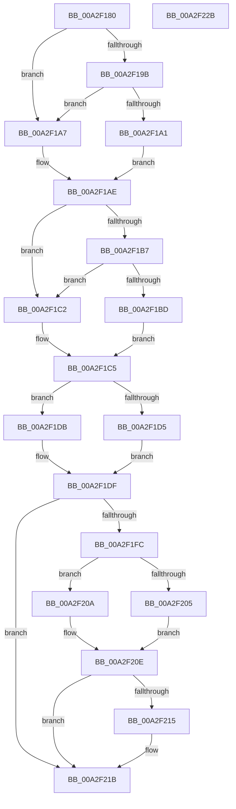

# AlpcpExposeContextAttribute

- RVA: `0x00A2F180`–`0x00A2F22C` (길이 `172` bytes)
- VA: `0x0000000140A2F180`
- 실행 섹션: `PAGE`
- PDB 이름 있음: `예`; PDB Function 태그: `아니요`
- unwind 정보 RVA: `0x00060BC4`
- 디코드: `52`개 명령, `172/172` bytes 표시
- 미해석 바이트: `0` (있으면 어셈블리에 `.byte`로 보존)

> 이 문서는 커널 이미지의 기계어와 PDB 기호를 분석해 생성했습니다. 4번과 5번은 함수 원형과 자료형을 바이너리 사용 방식에서 추정한 C 해석이며 원본 소스 복구 결과는 아닙니다.

## 1. Dependencies

- 직접 호출 지점: **1**; 고유 호출 대상: **1**
- 직접 호출자로 확인된 함수: **2**
- RIP 상대 이미지 참조: **0**

### Outgoing calls
- `0x00A2F1FC` → [Feature_2366787898__private_IsEnabledDeviceUsageNoInline](../../text/5C/Feature_2366787898__private_IsEnabledDeviceUsageNoInline_function_005CD8C0.md) (function, `0x005CD8C0`)

### Direct callers
- [AlpcpExposeAttributes](../89/AlpcpExposeAttributes_function_00897630.md) at `0x00897968`
- [AlpcpReturnMessageOnInsufficientBuffer](AlpcpReturnMessageOnInsufficientBuffer_function_00A2EF7C.md) at `0x00A2F041`

### Static image references
- 디코드된 RIP-relative 메모리 참조가 없습니다.

## 2. Other-region calls and transfers

- 다른 실행 섹션으로 향하는 call: **1**
  - `0x00A2F1FC` → [Feature_2366787898__private_IsEnabledDeviceUsageNoInline](../../text/5C/Feature_2366787898__private_IsEnabledDeviceUsageNoInline_function_005CD8C0.md) (`PAGE` → `.text`)
- 별도 외부 분기/꼬리 이동을 확인하지 못했습니다.

## 3. Assembly (complete function range)

```asm
00A2F180  48 89 5C 24 08                  mov qword ptr [rsp + 8], rbx
00A2F185  48 89 74 24 10                  mov qword ptr [rsp + 0x10], rsi
00A2F18A  57                              push rdi
00A2F18B  48 83 EC 20                     sub rsp, 0x20
00A2F18F  49 8B F9                        mov rdi, r9
00A2F192  49 8B D8                        mov rbx, r8
00A2F195  48 39 4A 38                     cmp qword ptr [rdx + 0x38], rcx
00A2F199  74 0C                           je 0x140a2f1a7
00A2F19B  48 39 4A 40                     cmp qword ptr [rdx + 0x40], rcx
00A2F19F  74 06                           je 0x140a2f1a7
00A2F1A1  48 8B 72 78                     mov rsi, qword ptr [rdx + 0x78]
00A2F1A5  EB 07                           jmp 0x140a2f1ae
00A2F1A7  48 8B B2 80 00 00 00            mov rsi, qword ptr [rdx + 0x80]
00A2F1AE  49 89 30                        mov qword ptr [r8], rsi
00A2F1B1  48 39 4A 38                     cmp qword ptr [rdx + 0x38], rcx
00A2F1B5  74 0B                           je 0x140a2f1c2
00A2F1B7  48 39 4A 40                     cmp qword ptr [rdx + 0x40], rcx
00A2F1BB  74 05                           je 0x140a2f1c2
00A2F1BD  8B 42 2C                        mov eax, dword ptr [rdx + 0x2c]
00A2F1C0  EB 03                           jmp 0x140a2f1c5
00A2F1C2  8B 42 48                        mov eax, dword ptr [rdx + 0x48]
00A2F1C5  41 89 40 10                     mov dword ptr [r8 + 0x10], eax
00A2F1C9  8B 81 A0 01 00 00               mov eax, dword ptr [rcx + 0x1a0]
00A2F1CF  24 06                           and al, 6
00A2F1D1  3C 04                           cmp al, 4
00A2F1D3  75 06                           jne 0x140a2f1db
00A2F1D5  48 8B 42 68                     mov rax, qword ptr [rdx + 0x68]
00A2F1D9  EB 04                           jmp 0x140a2f1df
00A2F1DB  48 8B 42 70                     mov rax, qword ptr [rdx + 0x70]
00A2F1DF  49 89 40 08                     mov qword ptr [r8 + 8], rax
00A2F1E3  8B 82 08 01 00 00               mov eax, dword ptr [rdx + 0x108]
00A2F1E9  41 89 40 14                     mov dword ptr [r8 + 0x14], eax
00A2F1ED  8B 82 10 01 00 00               mov eax, dword ptr [rdx + 0x110]
00A2F1F3  41 89 40 18                     mov dword ptr [r8 + 0x18], eax
00A2F1F7  48 85 FF                        test rdi, rdi
00A2F1FA  74 1F                           je 0x140a2f21b
00A2F1FC  E8 BF E6 B9 FF                  call 0x1405cd8c0
00A2F201  85 C0                           test eax, eax
00A2F203  74 05                           je 0x140a2f20a
00A2F205  48 85 F6                        test rsi, rsi
00A2F208  EB 04                           jmp 0x140a2f20e
00A2F20A  48 83 3B 00                     cmp qword ptr [rbx], 0
00A2F20E  0F 95 C0                        setne al
00A2F211  84 C0                           test al, al
00A2F213  74 06                           je 0x140a2f21b
00A2F215  81 0F 00 00 00 20               or dword ptr [rdi], 0x20000000
00A2F21B  48 8B 5C 24 30                  mov rbx, qword ptr [rsp + 0x30]
00A2F220  48 8B 74 24 38                  mov rsi, qword ptr [rsp + 0x38]
00A2F225  48 83 C4 20                     add rsp, 0x20
00A2F229  5F                              pop rdi
00A2F22A  C3                              ret
00A2F22B  CC                              int3
```

## 4. C-style interpretation (structured pseudocode)

```c
__int64 __fastcall AlpcpExposeContextAttribute(__int64 a1, __int64 a2, __int64 a3, __int64 a4)
{
    __int64 result;
    __int64 v_rsp;
    unsigned __int64 v_stack_p10;
    unsigned __int64 v_stack_p8;

    v_stack_p8 = v_rbx;
    v_stack_p10 = v_rsi;
    v_rsp = (v_rsp) - (32);
    if ((*(unsigned __int64 *)(a2 + 56)) == a1) goto loc_00A2F1A7;
    if ((*(unsigned __int64 *)(a2 + 64)) == a1) goto loc_00A2F1A7;
    goto loc_00A2F1AE;
loc_00A2F1A7:
loc_00A2F1AE:
    *(unsigned __int64 *)(a3) = *(unsigned __int64 *)(a2 + 128);
    if ((*(unsigned __int64 *)(a2 + 56)) == a1) goto loc_00A2F1C2;
    if ((*(unsigned __int64 *)(a2 + 64)) == a1) goto loc_00A2F1C2;
    goto loc_00A2F1C5;
loc_00A2F1C2:
loc_00A2F1C5:
    *(unsigned int *)(a3 + 16) = (unsigned int)((unsigned int)(*(unsigned int *)(a2 + 72)));
    result = (unsigned __int8)(((unsigned int)(*(unsigned int *)(a1 + 416))) & (6));
    if (((unsigned __int8)(result)) != 4) goto loc_00A2F1DB;
    goto loc_00A2F1DF;
loc_00A2F1DB:
loc_00A2F1DF:
    *(unsigned __int64 *)(a3 + 8) = *(unsigned __int64 *)(a2 + 112);
    *(unsigned int *)(a3 + 20) = (unsigned int)((unsigned int)(*(unsigned int *)(a2 + 264)));
    *(unsigned int *)(a3 + 24) = (unsigned int)((unsigned int)(*(unsigned int *)(a2 + 272)));
    if (a4 == 0) goto loc_00A2F21B;
    result = Feature_2366787898__private_IsEnabledDeviceUsageNoInline(a1, a2, a3, a4);
    if ((unsigned int)(result) == 0) goto loc_00A2F20A;
    goto loc_00A2F20E;
loc_00A2F20A:
loc_00A2F20E:
    result = ((*(unsigned __int64 *)(a3)) != 0) ? 1 : 0;
    if ((unsigned __int8)(result) != 0) {
    }
    v_rsp = (v_rsp) + (32);
    return result;
}
```

## 5. (Beta) C Style

```c
int64_t AlpcpExposeContextAttribute(void *Arg1, void *Arg2, void *Arg3, int64_t Arg4)
{
    uint8_t *arg1 = (uint8_t *)Arg1;
    uint8_t *arg2 = (uint8_t *)Arg2;
    uint8_t *arg3 = (uint8_t *)Arg3;

    int64_t result;
    int64_t local_rsp;
    uint64_t v_stack_p10;
    uint64_t v_stack_p8;

    v_stack_p8 = local_rbx;
    v_stack_p10 = local_rsi;
    local_rsp = (local_rsp) - (32);
    if ((*(uint64_t *)(arg2 + 0x38)) == Arg1) goto loc_00A2F1A7;
    if ((*(uint64_t *)(arg2 + 0x40)) == Arg1) goto loc_00A2F1A7;
    goto loc_00A2F1AE;
loc_00A2F1A7:
loc_00A2F1AE:
    *(uint64_t *)(arg3) = *(uint64_t *)(arg2 + 0x80);
    if ((*(uint64_t *)(arg2 + 0x38)) == Arg1) goto loc_00A2F1C2;
    if ((*(uint64_t *)(arg2 + 0x40)) == Arg1) goto loc_00A2F1C2;
    goto loc_00A2F1C5;
loc_00A2F1C2:
loc_00A2F1C5:
    *(uint32_t *)(arg3 + 0x10) = (uint32_t)((uint32_t)(*(uint32_t *)(arg2 + 0x48)));
    result = (uint8_t)(((uint32_t)(*(uint32_t *)(arg1 + 0x1A0))) & (6));
    if (((uint8_t)(result)) != 4) goto loc_00A2F1DB;
    goto loc_00A2F1DF;
loc_00A2F1DB:
loc_00A2F1DF:
    *(uint64_t *)(arg3 + 0x8) = *(uint64_t *)(arg2 + 0x70);
    *(uint32_t *)(arg3 + 0x14) = (uint32_t)((uint32_t)(*(uint32_t *)(arg2 + 0x108)));
    *(uint32_t *)(arg3 + 0x18) = (uint32_t)((uint32_t)(*(uint32_t *)(arg2 + 0x110)));
    if (Arg4 == 0) goto loc_00A2F21B;
    result = Feature_2366787898__private_IsEnabledDeviceUsageNoInline(Arg1, Arg2, Arg3, Arg4);
    if ((uint32_t)(result) == 0) goto loc_00A2F20A;
    goto loc_00A2F20E;
loc_00A2F20A:
loc_00A2F20E:
    result = ((*(uint64_t *)(arg3)) != 0) ? 1 : 0;
    if ((uint8_t)(result) != 0) {
    }
    local_rsp = (local_rsp) + (32);
    return result;
}
```

### 관측된 메모리 오프셋

구조체 형식이 확인되지 않은 접근은 인자 기준의 오프셋으로만 기록했습니다.

| 기준 인자 | 오프셋 표현 | 폭 (bit) | 접근 |
|---|---:|---:|---|
| `Arg1` | `+ 0x1A0` | `32` | `R` |
| `Arg2` | `+ 0x2C` | `32` | `R` |
| `Arg2` | `+ 0x38` | `64` | `R` |
| `Arg2` | `+ 0x40` | `64` | `R` |
| `Arg2` | `+ 0x48` | `32` | `R` |
| `Arg2` | `+ 0x68` | `64` | `R` |
| `Arg2` | `+ 0x70` | `64` | `R` |
| `Arg2` | `+ 0x78` | `64` | `R` |
| `Arg2` | `+ 0x80` | `64` | `R` |
| `Arg2` | `+ 0x108` | `32` | `R` |
| `Arg2` | `+ 0x110` | `32` | `R` |
| `Arg3` | `+ 0x0` | `64` | `R` |
| `Arg3` | `+ 0x0` | `64` | `W` |
| `Arg3` | `+ 0x8` | `64` | `W` |
| `Arg3` | `+ 0x10` | `32` | `W` |
| `Arg3` | `+ 0x14` | `32` | `W` |
| `Arg3` | `+ 0x18` | `32` | `W` |

## 6. Execution-region graph

[열기: 2D/3D 그래프와 함수 탐색 컨트롤 패널](../../../control-panel.html?section=page&rva=0x00A2F180&view=graph)

- 2D 그래프는 위에서 아래로 흐르고, 3D 그래프는 빈 공간을 드래그해 회전합니다. Shift+드래그는 이동, 휠은 확대·축소, 함수 노드 선택은 대상 보고서 이동입니다.

### Static fallback


