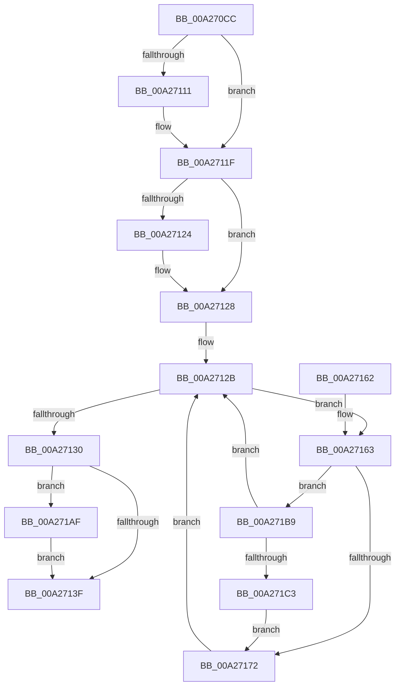

# AlpcpFlushCancelQueue

- RVA: `0x00A270CC`–`0x00A271C5` (길이 `249` bytes)
- VA: `0x0000000140A270CC`
- 실행 섹션: `PAGE`
- PDB 이름 있음: `예`; PDB Function 태그: `아니요`
- unwind 정보 RVA: `0x000ABF84`
- 디코드: `68`개 명령, `249/249` bytes 표시
- 미해석 바이트: `0` (있으면 어셈블리에 `.byte`로 보존)

> 이 문서는 커널 이미지의 기계어와 PDB 기호를 분석해 생성했습니다. 4번과 5번은 함수 원형과 자료형을 바이너리 사용 방식에서 추정한 C 해석이며 원본 소스 복구 결과는 아닙니다.

## 1. Dependencies

- 직접 호출 지점: **5**; 고유 호출 대상: **5**
- 직접 호출자로 확인된 함수: **1**
- RIP 상대 이미지 참조: **0**

### Outgoing calls
- `0x00A27101` → [KeAbPreAcquire](../../text/21/KeAbPreAcquire_function_00210230.md) (function, `0x00210230`)
- `0x00A2711A` → [ExfAcquirePushLockExclusiveEx](../../text/20/ExfAcquirePushLockExclusiveEx_function_0020FC90.md) (function, `0x0020FC90`)
- `0x00A27142` → [KeAbPostRelease](../../text/2E/KeAbPostRelease_function_002E1600.md) (function, `0x002E1600`)
- `0x00A271A5` → [AlpcpDereferenceBlobEx](../88/AlpcpDereferenceBlobEx_function_0088AF00.md) (function, `0x0088AF00`)
- `0x00A271B2` → [ExfTryToWakePushLock](../../text/26/ExfTryToWakePushLock_function_00265DD0.md) (function, `0x00265DD0`)

### Direct callers
- [AlpcpFlushMessagesPort](../92/AlpcpFlushMessagesPort_function_00925554.md) at `0x00925712`
- [AlpcpFlushMessagesPort](../92/AlpcpFlushMessagesPort_function_00925554.md) at `0x00925B21`

### Static image references
- 디코드된 RIP-relative 메모리 참조가 없습니다.

## 2. Other-region calls and transfers

- 다른 실행 섹션으로 향하는 call: **4**
  - `0x00A27101` → [KeAbPreAcquire](../../text/21/KeAbPreAcquire_function_00210230.md) (`PAGE` → `.text`)
  - `0x00A2711A` → [ExfAcquirePushLockExclusiveEx](../../text/20/ExfAcquirePushLockExclusiveEx_function_0020FC90.md) (`PAGE` → `.text`)
  - `0x00A27142` → [KeAbPostRelease](../../text/2E/KeAbPostRelease_function_002E1600.md) (`PAGE` → `.text`)
  - `0x00A271B2` → [ExfTryToWakePushLock](../../text/26/ExfTryToWakePushLock_function_00265DD0.md) (`PAGE` → `.text`)
- 별도 외부 분기/꼬리 이동을 확인하지 못했습니다.

## 3. Assembly (complete function range)

```asm
00A270CC  48 8B C4                        mov rax, rsp
00A270CF  48 89 58 08                     mov qword ptr [rax + 8], rbx
00A270D3  48 89 68 10                     mov qword ptr [rax + 0x10], rbp
00A270D7  48 89 70 18                     mov qword ptr [rax + 0x18], rsi
00A270DB  48 89 78 20                     mov qword ptr [rax + 0x20], rdi
00A270DF  41 56                           push r14
00A270E1  48 83 EC 20                     sub rsp, 0x20
00A270E5  48 8D 99 88 00 00 00            lea rbx, [rcx + 0x88]
00A270EC  4C 8B F2                        mov r14, rdx
00A270EF  48 8B E9                        mov rbp, rcx
00A270F2  48 8D B1 80 01 00 00            lea rsi, [rcx + 0x180]
00A270F9  48 8B CB                        mov rcx, rbx
00A270FC  45 33 C0                        xor r8d, r8d
00A270FF  33 D2                           xor edx, edx
00A27101  E8 2A 91 7E FF                  call 0x140210230
00A27106  F0 48 0F BA 2B 00               lock bts qword ptr [rbx], 0
00A2710C  48 8B F8                        mov rdi, rax
00A2710F  73 0E                           jae 0x140a2711f
00A27111  4C 8B C3                        mov r8, rbx
00A27114  48 8B D0                        mov rdx, rax
00A27117  48 8B CB                        mov rcx, rbx
00A2711A  E8 71 8B 7E FF                  call 0x14020fc90
00A2711F  48 85 FF                        test rdi, rdi
00A27122  74 04                           je 0x140a27128
00A27124  C6 47 0A 01                     mov byte ptr [rdi + 0xa], 1
00A27128  48 8B 3E                        mov rdi, qword ptr [rsi]
00A2712B  48 3B FE                        cmp rdi, rsi
00A2712E  75 33                           jne 0x140a27163
00A27130  48 83 C8 FF                     or rax, 0xffffffffffffffff
00A27134  F0 48 0F C1 03                  lock xadd qword ptr [rbx], rax
00A27139  24 06                           and al, 6
00A2713B  3C 02                           cmp al, 2
00A2713D  74 70                           je 0x140a271af
00A2713F  48 8B CB                        mov rcx, rbx
00A27142  E8 B9 A4 8B FF                  call 0x1402e1600
00A27147  48 8B 5C 24 30                  mov rbx, qword ptr [rsp + 0x30]
00A2714C  48 8B 6C 24 38                  mov rbp, qword ptr [rsp + 0x38]
00A27151  48 8B 74 24 40                  mov rsi, qword ptr [rsp + 0x40]
00A27156  48 8B 7C 24 48                  mov rdi, qword ptr [rsp + 0x48]
00A2715B  48 83 C4 20                     add rsp, 0x20
00A2715F  41 5E                           pop r14
00A27161  C3                              ret
00A27162  CC                              int3
00A27163  4C 8D 0F                        lea r9, [rdi]
00A27166  4C 8D 47 B0                     lea r8, [rdi - 0x50]
00A2716A  48 8B 3F                        mov rdi, qword ptr [rdi]
00A2716D  4D 85 F6                        test r14, r14
00A27170  75 47                           jne 0x140a271b9
00A27172  41 0F BA 70 28 11               btr dword ptr [r8 + 0x28], 0x11
00A27178  49 8B C8                        mov rcx, r8
00A2717B  49 8B 51 08                     mov rdx, qword ptr [r9 + 8]
00A2717F  49 8B 01                        mov rax, qword ptr [r9]
00A27182  48 89 02                        mov qword ptr [rdx], rax
00A27185  49 8B 11                        mov rdx, qword ptr [r9]
00A27188  49 8B 41 08                     mov rax, qword ptr [r9 + 8]
00A2718C  48 89 42 08                     mov qword ptr [rdx + 8], rax
00A27190  BA 01 00 00 00                  mov edx, 1
00A27195  FF 8D D0 01 00 00               dec dword ptr [rbp + 0x1d0]
00A2719B  49 83 60 38 00                  and qword ptr [r8 + 0x38], 0
00A271A0  49 83 60 40 00                  and qword ptr [r8 + 0x40], 0
00A271A5  E8 56 3D E6 FF                  call 0x14088af00
00A271AA  E9 7C FF FF FF                  jmp 0x140a2712b
00A271AF  48 8B CB                        mov rcx, rbx
00A271B2  E8 19 EC 83 FF                  call 0x140265dd0
00A271B7  EB 86                           jmp 0x140a2713f
00A271B9  4D 39 70 38                     cmp qword ptr [r8 + 0x38], r14
00A271BD  0F 85 68 FF FF FF               jne 0x140a2712b
00A271C3  EB AD                           jmp 0x140a27172
```

## 4. C-style interpretation (structured pseudocode)

```c
__int64 __fastcall AlpcpFlushCancelQueue(__int64 a1, __int64 a2, int a3)
{
    __int64 result;
    __int64 v_rsp;
    unsigned __int64 v_stack_p10;
    unsigned __int64 v_stack_p18;
    unsigned __int64 v_stack_p20;
    unsigned __int64 v_stack_p8;

    *(unsigned __int64 *)(v_rsp + 8) = v_rbx;
    *(unsigned __int64 *)(v_rsp + 16) = v_rbp;
    *(unsigned __int64 *)(v_rsp + 24) = v_rsi;
    *(unsigned __int64 *)(v_rsp + 32) = v_rdi;
    v_rsp = (v_rsp) - (32);
    a3 = 0;
    a2 = 0;
    result = KeAbPreAcquire(a1 + 136, a2, a3, a4);
    if (!(condition_is_above_or_equal)) {
        a3 = a1 + 136;
        a2 = result;
        a1 = a1 + 136;
        result = ExfAcquirePushLockExclusiveEx(a1, a2, a3, a4);
    }
    if (result != 0) {
        *(unsigned __int8 *)(result + 10) = 1;
    }
loc_00A2712B:
    if ((*(unsigned __int64 *)(a1 + 384)) != (a1 + 384)) goto loc_00A27163;
    result = (result) | (-1);
    result = (unsigned __int8)((result) & (6));
    if (((unsigned __int8)(result)) == 2) goto loc_00A271AF;
loc_00A2713F:
    result = KeAbPostRelease(a1 + 136, a2, a3, a4);
    v_rsp = (v_rsp) + (32);
    return result;
loc_00A27163:
    if (a2 != 0) goto loc_00A271B9;
loc_00A27172:
    *(unsigned __int64 *)(*(unsigned __int64 *)(v_stack_p20 + 8)) = *(unsigned __int64 *)(v_stack_p20);
    *(unsigned __int64 *)(*(unsigned __int64 *)(v_stack_p20) + 8) = *(unsigned __int64 *)(v_stack_p20 + 8);
    result = AlpcpDereferenceBlobEx(v_stack_p20 - 80, 1, v_stack_p20 - 80, v_stack_p20);
    goto loc_00A2712B;
loc_00A271AF:
    result = ExfTryToWakePushLock(v_stack_p8, 1, v_stack_p20 - 80, v_stack_p20);
    goto loc_00A2713F;
loc_00A271B9:
    if ((*(unsigned __int64 *)(v_stack_p20 - 80 + 56)) != a2) goto loc_00A2712B;
    goto loc_00A27172;
}
```

## 5. (Beta) C Style

```c
int64_t AlpcpFlushCancelQueue(void *Arg1, int64_t Arg2, int32_t Arg3)
{
    uint8_t *arg1 = (uint8_t *)Arg1;

    int64_t result;
    int64_t local_rsp;
    uint64_t v_stack_p10;
    uint64_t v_stack_p18;
    uint64_t v_stack_p20;
    uint64_t v_stack_p8;

    *(uint64_t *)(local_rsp + 0x8) = local_rbx;
    *(uint64_t *)(local_rsp + 0x10) = local_rbp;
    *(uint64_t *)(local_rsp + 0x18) = local_rsi;
    *(uint64_t *)(local_rsp + 0x20) = local_rdi;
    local_rsp = (local_rsp) - (32);
    Arg3 = 0;
    Arg2 = 0;
    result = KeAbPreAcquire(Arg1 + 136, Arg2, Arg3, a4);
    if (!(condition_is_above_or_equal)) {
        Arg3 = Arg1 + 136;
        Arg2 = result;
        Arg1 = Arg1 + 136;
        result = ExfAcquirePushLockExclusiveEx(Arg1, Arg2, Arg3, a4);
    }
    if (result != 0) {
        *(uint8_t *)(result + 0xA) = 1;
    }
loc_00A2712B:
    if ((*(uint64_t *)(arg1 + 0x180)) != (Arg1 + 384)) goto loc_00A27163;
    result = (result) | (-1);
    result = (uint8_t)((result) & (6));
    if (((uint8_t)(result)) == 2) goto loc_00A271AF;
loc_00A2713F:
    result = KeAbPostRelease(Arg1 + 136, Arg2, Arg3, a4);
    local_rsp = (local_rsp) + (32);
    return result;
loc_00A27163:
    if (Arg2 != 0) goto loc_00A271B9;
loc_00A27172:
    *(uint64_t *)(*(uint64_t *)(v_stack_p20 + 0x8)) = *(uint64_t *)(v_stack_p20);
    *(uint64_t *)(*(uint64_t *)(v_stack_p20) + 0x8) = *(uint64_t *)(v_stack_p20 + 0x8);
    result = AlpcpDereferenceBlobEx(v_stack_p20 - 80, 1, v_stack_p20 - 80, v_stack_p20);
    goto loc_00A2712B;
loc_00A271AF:
    result = ExfTryToWakePushLock(v_stack_p8, 1, v_stack_p20 - 80, v_stack_p20);
    goto loc_00A2713F;
loc_00A271B9:
    if ((*(uint64_t *)(v_stack_p20 - 0x50 + 0x38)) != Arg2) goto loc_00A2712B;
    goto loc_00A27172;
}
```

### 관측된 메모리 오프셋

구조체 형식이 확인되지 않은 접근은 인자 기준의 오프셋으로만 기록했습니다.

| 기준 인자 | 오프셋 표현 | 폭 (bit) | 접근 |
|---|---:|---:|---|
| `Arg1` | `+ 0x0` | `64` | `R` |
| `Arg1` | `+ 0x0` | `64` | `R/W` |
| `Arg1` | `+ 0x88` | `64` | `R` |
| `Arg1` | `+ 0x180` | `64` | `R` |
| `Arg1` | `+ 0x1D0` | `32` | `R/W` |

## 6. Execution-region graph

[열기: 2D/3D 그래프와 함수 탐색 컨트롤 패널](../../../control-panel.html?section=page&rva=0x00A270CC&view=graph)

- 2D 그래프는 위에서 아래로 흐르고, 3D 그래프는 빈 공간을 드래그해 회전합니다. Shift+드래그는 이동, 휠은 확대·축소, 함수 노드 선택은 대상 보고서 이동입니다.

### Static fallback


