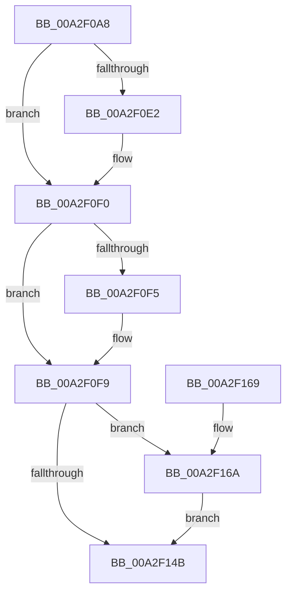

# AlpcpInsertMessageLargeMessageQueue

- RVA: `0x00A2F0A8`–`0x00A2F174` (길이 `204` bytes)
- VA: `0x0000000140A2F0A8`
- 실행 섹션: `PAGE`
- PDB 이름 있음: `예`; PDB Function 태그: `아니요`
- unwind 정보 RVA: `0x0008D180`
- 디코드: `56`개 명령, `204/204` bytes 표시
- 미해석 바이트: `0` (있으면 어셈블리에 `.byte`로 보존)

> 이 문서는 커널 이미지의 기계어와 PDB 기호를 분석해 생성했습니다. 4번과 5번은 함수 원형과 자료형을 바이너리 사용 방식에서 추정한 C 해석이며 원본 소스 복구 결과는 아닙니다.

## 1. Dependencies

- 직접 호출 지점: **4**; 고유 호출 대상: **4**
- 직접 호출자로 확인된 함수: **1**
- RIP 상대 이미지 참조: **0**

### Outgoing calls
- `0x00A2F0D2` → [KeAbPreAcquire](../../text/21/KeAbPreAcquire_function_00210230.md) (function, `0x00210230`)
- `0x00A2F0EB` → [ExfAcquirePushLockExclusiveEx](../../text/20/ExfAcquirePushLockExclusiveEx_function_0020FC90.md) (function, `0x0020FC90`)
- `0x00A2F14E` → [KeAbPostRelease](../../text/2E/KeAbPostRelease_function_002E1600.md) (function, `0x002E1600`)
- `0x00A2F16D` → [ExfTryToWakePushLock](../../text/26/ExfTryToWakePushLock_function_00265DD0.md) (function, `0x00265DD0`)

### Direct callers
- [AlpcpReturnMessageOnInsufficientBuffer](AlpcpReturnMessageOnInsufficientBuffer_function_00A2EF7C.md) at `0x00A2F016`

### Static image references
- 디코드된 RIP-relative 메모리 참조가 없습니다.

## 2. Other-region calls and transfers

- 다른 실행 섹션으로 향하는 call: **4**
  - `0x00A2F0D2` → [KeAbPreAcquire](../../text/21/KeAbPreAcquire_function_00210230.md) (`PAGE` → `.text`)
  - `0x00A2F0EB` → [ExfAcquirePushLockExclusiveEx](../../text/20/ExfAcquirePushLockExclusiveEx_function_0020FC90.md) (`PAGE` → `.text`)
  - `0x00A2F14E` → [KeAbPostRelease](../../text/2E/KeAbPostRelease_function_002E1600.md) (`PAGE` → `.text`)
  - `0x00A2F16D` → [ExfTryToWakePushLock](../../text/26/ExfTryToWakePushLock_function_00265DD0.md) (`PAGE` → `.text`)
- 별도 외부 분기/꼬리 이동을 확인하지 못했습니다.

## 3. Assembly (complete function range)

```asm
00A2F0A8  48 89 5C 24 08                  mov qword ptr [rsp + 8], rbx
00A2F0AD  48 89 74 24 10                  mov qword ptr [rsp + 0x10], rsi
00A2F0B2  48 89 7C 24 18                  mov qword ptr [rsp + 0x18], rdi
00A2F0B7  41 56                           push r14
00A2F0B9  48 83 EC 20                     sub rsp, 0x20
00A2F0BD  48 8D 99 88 00 00 00            lea rbx, [rcx + 0x88]
00A2F0C4  4C 8B F2                        mov r14, rdx
00A2F0C7  48 8B F1                        mov rsi, rcx
00A2F0CA  45 33 C0                        xor r8d, r8d
00A2F0CD  48 8B CB                        mov rcx, rbx
00A2F0D0  33 D2                           xor edx, edx
00A2F0D2  E8 59 11 7E FF                  call 0x140210230
00A2F0D7  F0 48 0F BA 2B 00               lock bts qword ptr [rbx], 0
00A2F0DD  48 8B F8                        mov rdi, rax
00A2F0E0  73 0E                           jae 0x140a2f0f0
00A2F0E2  4C 8B C3                        mov r8, rbx
00A2F0E5  48 8B D0                        mov rdx, rax
00A2F0E8  48 8B CB                        mov rcx, rbx
00A2F0EB  E8 A0 0B 7E FF                  call 0x14020fc90
00A2F0F0  48 85 FF                        test rdi, rdi
00A2F0F3  74 04                           je 0x140a2f0f9
00A2F0F5  C6 47 0A 01                     mov byte ptr [rdi + 0xa], 1
00A2F0F9  41 8B 46 28                     mov eax, dword ptr [r14 + 0x28]
00A2F0FD  49 89 76 10                     mov qword ptr [r14 + 0x10], rsi
00A2F101  83 E0 82                        and eax, 0xffffff82
00A2F104  8B 8E A0 01 00 00               mov ecx, dword ptr [rsi + 0x1a0]
00A2F10A  83 E1 06                        and ecx, 6
00A2F10D  C1 E1 02                        shl ecx, 2
00A2F110  0B C8                           or ecx, eax
00A2F112  83 C9 02                        or ecx, 2
00A2F115  41 89 4E 28                     mov dword ptr [r14 + 0x28], ecx
00A2F119  48 8D 8E A0 00 00 00            lea rcx, [rsi + 0xa0]
00A2F120  48 8B 41 08                     mov rax, qword ptr [rcx + 8]
00A2F124  49 89 46 08                     mov qword ptr [r14 + 8], rax
00A2F128  49 89 0E                        mov qword ptr [r14], rcx
00A2F12B  48 8B 41 08                     mov rax, qword ptr [rcx + 8]
00A2F12F  4C 89 30                        mov qword ptr [rax], r14
00A2F132  4C 89 71 08                     mov qword ptr [rcx + 8], r14
00A2F136  FF 86 C4 01 00 00               inc dword ptr [rsi + 0x1c4]
00A2F13C  48 83 C8 FF                     or rax, 0xffffffffffffffff
00A2F140  F0 48 0F C1 03                  lock xadd qword ptr [rbx], rax
00A2F145  24 06                           and al, 6
00A2F147  3C 02                           cmp al, 2
00A2F149  74 1F                           je 0x140a2f16a
00A2F14B  48 8B CB                        mov rcx, rbx
00A2F14E  E8 AD 24 8B FF                  call 0x1402e1600
00A2F153  48 8B 5C 24 30                  mov rbx, qword ptr [rsp + 0x30]
00A2F158  48 8B 74 24 38                  mov rsi, qword ptr [rsp + 0x38]
00A2F15D  48 8B 7C 24 40                  mov rdi, qword ptr [rsp + 0x40]
00A2F162  48 83 C4 20                     add rsp, 0x20
00A2F166  41 5E                           pop r14
00A2F168  C3                              ret
00A2F169  CC                              int3
00A2F16A  48 8B CB                        mov rcx, rbx
00A2F16D  E8 5E 6C 83 FF                  call 0x140265dd0
00A2F172  EB D7                           jmp 0x140a2f14b
```

## 4. C-style interpretation (structured pseudocode)

```c
__int64 __fastcall AlpcpInsertMessageLargeMessageQueue(__int64 a1, __int64 a2, int a3)
{
    __int64 result;
    __int64 v_rsp;
    unsigned __int64 v_stack_p10;
    unsigned __int64 v_stack_p18;
    unsigned __int64 v_stack_p8;

    v_stack_p8 = v_rbx;
    v_stack_p10 = v_rsi;
    v_stack_p18 = v_rdi;
    v_rsp = (v_rsp) - (32);
    a3 = 0;
    a2 = 0;
    result = KeAbPreAcquire(a1 + 136, a2, a3, a4);
    if (!(condition_is_above_or_equal)) {
        a3 = a1 + 136;
        a2 = result;
        a1 = a1 + 136;
        result = ExfAcquirePushLockExclusiveEx(a1, a2, a3, a4);
    }
    if (result != 0) {
        *(unsigned __int8 *)(result + 10) = 1;
    }
    *(unsigned __int64 *)(a2 + 16) = a1;
    result = (unsigned int)(((unsigned int)(*(unsigned int *)(a2 + 40))) & (0xFFFFFF82ULL));
    a1 = (unsigned int)(((unsigned int)(*(unsigned int *)(a1 + 416))) & (6));
    a1 = (unsigned int)((a1) << (2));
    a1 = (unsigned int)((a1) | ((unsigned int)(result)));
    a1 = (unsigned int)((a1) | (2));
    *(unsigned int *)(a2 + 40) = (unsigned int)(a1);
    *(unsigned __int64 *)(a2 + 8) = *(unsigned __int64 *)(a1 + 160 + 8);
    *(unsigned __int64 *)(a2) = a1 + 160;
    *(unsigned __int64 *)(*(unsigned __int64 *)(a1 + 160 + 8)) = a2;
    *(unsigned __int64 *)(a1 + 160 + 8) = a2;
    result = (*(unsigned __int64 *)(a1 + 160 + 8)) | (-1);
    result = (unsigned __int8)((result) & (6));
    if (((unsigned __int8)(result)) == 2) goto loc_00A2F16A;
loc_00A2F14B:
    result = KeAbPostRelease(a1 + 136, a2, a3, a4);
    v_rsp = (v_rsp) + (32);
    return result;
loc_00A2F16A:
    result = ExfTryToWakePushLock(v_stack_p8, a2, a3, a4);
    goto loc_00A2F14B;
}
```

## 5. (Beta) C Style

```c
int64_t AlpcpInsertMessageLargeMessageQueue(void *Arg1, void *Arg2, int32_t Arg3)
{
    uint8_t *arg1 = (uint8_t *)Arg1;
    uint8_t *arg2 = (uint8_t *)Arg2;

    int64_t result;
    int64_t local_rsp;
    uint64_t v_stack_p10;
    uint64_t v_stack_p18;
    uint64_t v_stack_p8;

    v_stack_p8 = local_rbx;
    v_stack_p10 = local_rsi;
    v_stack_p18 = local_rdi;
    local_rsp = (local_rsp) - (32);
    Arg3 = 0;
    Arg2 = 0;
    result = KeAbPreAcquire(Arg1 + 136, Arg2, Arg3, a4);
    if (!(condition_is_above_or_equal)) {
        Arg3 = Arg1 + 136;
        Arg2 = result;
        Arg1 = Arg1 + 136;
        result = ExfAcquirePushLockExclusiveEx(Arg1, Arg2, Arg3, a4);
    }
    if (result != 0) {
        *(uint8_t *)(result + 0xA) = 1;
    }
    *(void **)(arg2 + 0x10) = Arg1;
    result = (uint32_t)(((uint32_t)(*(uint32_t *)(arg2 + 0x28))) & (0xFFFFFF82ULL));
    Arg1 = (uint32_t)(((uint32_t)(*(uint32_t *)(arg1 + 0x1A0))) & (6));
    Arg1 = (uint32_t)((Arg1) << (2));
    Arg1 = (uint32_t)((Arg1) | ((uint32_t)(result)));
    Arg1 = (uint32_t)((Arg1) | (2));
    *(uint32_t *)(arg2 + 0x28) = (uint32_t)(Arg1);
    *(uint64_t *)(arg2 + 0x8) = *(uint64_t *)(arg1 + 0xA0 + 0x8);
    *(void **)(arg2) = Arg1 + 160;
    *(void **)(*(uint64_t *)(arg1 + 0xA0 + 0x8)) = Arg2;
    *(void **)(arg1 + 0xA0 + 0x8) = Arg2;
    result = (*(uint64_t *)(arg1 + 0xA0 + 0x8)) | (-1);
    result = (uint8_t)((result) & (6));
    if (((uint8_t)(result)) == 2) goto loc_00A2F16A;
loc_00A2F14B:
    result = KeAbPostRelease(Arg1 + 136, Arg2, Arg3, a4);
    local_rsp = (local_rsp) + (32);
    return result;
loc_00A2F16A:
    result = ExfTryToWakePushLock(v_stack_p8, Arg2, Arg3, a4);
    goto loc_00A2F14B;
}
```

### 관측된 메모리 오프셋

구조체 형식이 확인되지 않은 접근은 인자 기준의 오프셋으로만 기록했습니다.

| 기준 인자 | 오프셋 표현 | 폭 (bit) | 접근 |
|---|---:|---:|---|
| `Arg1` | `+ 0x0` | `64` | `R/W` |
| `Arg1` | `+ 0x8` | `64` | `R` |
| `Arg1` | `+ 0x8` | `64` | `W` |
| `Arg1` | `+ 0x88` | `64` | `R` |
| `Arg1` | `+ 0xA0` | `64` | `R` |
| `Arg1` | `+ 0x1A0` | `32` | `R` |
| `Arg1` | `+ 0x1C4` | `32` | `R/W` |
| `Arg2` | `+ 0x0` | `64` | `W` |
| `Arg2` | `+ 0x8` | `64` | `W` |
| `Arg2` | `+ 0x10` | `64` | `W` |
| `Arg2` | `+ 0x28` | `32` | `R` |
| `Arg2` | `+ 0x28` | `32` | `W` |

## 6. Execution-region graph

[열기: 2D/3D 그래프와 함수 탐색 컨트롤 패널](../../../control-panel.html?section=page&rva=0x00A2F0A8&view=graph)

- 2D 그래프는 위에서 아래로 흐르고, 3D 그래프는 빈 공간을 드래그해 회전합니다. Shift+드래그는 이동, 휠은 확대·축소, 함수 노드 선택은 대상 보고서 이동입니다.

### Static fallback


