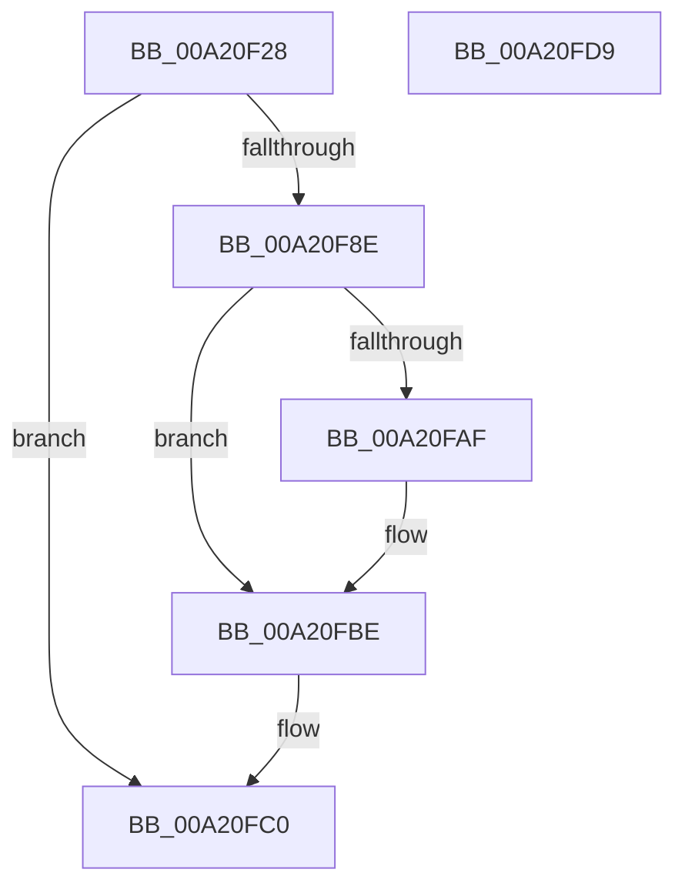

# AlpcpQuerySidMessage

- RVA: `0x00A20F28`–`0x00A20FDA` (길이 `178` bytes)
- VA: `0x0000000140A20F28`
- 실행 섹션: `PAGE`
- PDB 이름 있음: `예`; PDB Function 태그: `아니요`
- unwind 정보 RVA: `0x000AAF70`
- 디코드: `47`개 명령, `178/178` bytes 표시
- 미해석 바이트: `0` (있으면 어셈블리에 `.byte`로 보존)

> 이 문서는 커널 이미지의 기계어와 PDB 기호를 분석해 생성했습니다. 4번과 5번은 함수 원형과 자료형을 바이너리 사용 방식에서 추정한 C 해석이며 원본 소스 복구 결과는 아닙니다.

## 1. Dependencies

- 직접 호출 지점: **4**; 고유 호출 대상: **4**
- 직접 호출자로 확인된 함수: **1**
- RIP 상대 이미지 참조: **0**

### Outgoing calls
- `0x00A20F5B` → [memset](../../text/6C/memset_function_006C6C40.md) (function, `0x006C6C40`)
- `0x00A20F85` → [AlpcpGetEffectiveTokenMessage](../89/AlpcpGetEffectiveTokenMessage_function_00891980.md) (function, `0x00891980`)
- `0x00A20FA1` → [AlpcpQuerySidToken](AlpcpQuerySidToken_function_00A20FE0.md) (function, `0x00A20FE0`)
- `0x00A20FB9` → [ObfDereferenceObjectWithTag](../../text/2F/ObfDereferenceObjectWithTag_function_002F78E0.md) (function, `0x002F78E0`)

### Direct callers
- [NtAlpcQueryInformationMessage](../89/NtAlpcQueryInformationMessage_function_00894700.md) at `0x008949A6`

### Static image references
- 디코드된 RIP-relative 메모리 참조가 없습니다.

## 2. Other-region calls and transfers

- 다른 실행 섹션으로 향하는 call: **2**
  - `0x00A20F5B` → [memset](../../text/6C/memset_function_006C6C40.md) (`PAGE` → `.text`)
  - `0x00A20FB9` → [ObfDereferenceObjectWithTag](../../text/2F/ObfDereferenceObjectWithTag_function_002F78E0.md) (`PAGE` → `.text`)
- 별도 외부 분기/꼬리 이동을 확인하지 못했습니다.

## 3. Assembly (complete function range)

```asm
00A20F28  4C 8B DC                        mov r11, rsp
00A20F2B  49 89 5B 08                     mov qword ptr [r11 + 8], rbx
00A20F2F  49 89 6B 10                     mov qword ptr [r11 + 0x10], rbp
00A20F33  49 89 73 18                     mov qword ptr [r11 + 0x18], rsi
00A20F37  57                              push rdi
00A20F38  48 81 EC 90 00 00 00            sub rsp, 0x90
00A20F3F  33 C0                           xor eax, eax
00A20F41  49 8B E8                        mov rbp, r8
00A20F44  48 8B DA                        mov rbx, rdx
00A20F47  89 44 24 4C                     mov dword ptr [rsp + 0x4c], eax
00A20F4B  48 8B F9                        mov rdi, rcx
00A20F4E  33 D2                           xor edx, edx
00A20F50  49 8D 4B A8                     lea rcx, [r11 - 0x58]
00A20F54  41 8B F1                        mov esi, r9d
00A20F57  44 8D 40 44                     lea r8d, [rax + 0x44]
00A20F5B  E8 E0 5C CA FF                  call 0x1406c6c40
00A20F60  48 83 64 24 38 00               and qword ptr [rsp + 0x38], 0
00A20F66  48 8D 44 24 30                  lea rax, [rsp + 0x30]
00A20F6B  4C 8D 4C 24 40                  lea r9, [rsp + 0x40]
00A20F70  48 89 44 24 20                  mov qword ptr [rsp + 0x20], rax
00A20F75  4C 8D 44 24 38                  lea r8, [rsp + 0x38]
00A20F7A  C6 44 24 30 00                  mov byte ptr [rsp + 0x30], 0
00A20F7F  48 8B D3                        mov rdx, rbx
00A20F82  48 8B CF                        mov rcx, rdi
00A20F85  E8 F6 09 E7 FF                  call 0x140891980
00A20F8A  85 C0                           test eax, eax
00A20F8C  78 32                           js 0x140a20fc0
00A20F8E  4C 8B 8C 24 C0 00 00 00         mov r9, qword ptr [rsp + 0xc0]
00A20F96  44 8B C6                        mov r8d, esi
00A20F99  48 8B 4C 24 38                  mov rcx, qword ptr [rsp + 0x38]
00A20F9E  48 8B D5                        mov rdx, rbp
00A20FA1  E8 3A 00 00 00                  call 0x140a20fe0
00A20FA6  80 7C 24 30 00                  cmp byte ptr [rsp + 0x30], 0
00A20FAB  8B D8                           mov ebx, eax
00A20FAD  74 0F                           je 0x140a20fbe
00A20FAF  48 8B 4C 24 50                  mov rcx, qword ptr [rsp + 0x50]
00A20FB4  BA 53 65 43 63                  mov edx, 0x63436553
00A20FB9  E8 22 69 8D FF                  call 0x1402f78e0
00A20FBE  8B C3                           mov eax, ebx
00A20FC0  4C 8D 9C 24 90 00 00 00         lea r11, [rsp + 0x90]
00A20FC8  49 8B 5B 10                     mov rbx, qword ptr [r11 + 0x10]
00A20FCC  49 8B 6B 18                     mov rbp, qword ptr [r11 + 0x18]
00A20FD0  49 8B 73 20                     mov rsi, qword ptr [r11 + 0x20]
00A20FD4  49 8B E3                        mov rsp, r11
00A20FD7  5F                              pop rdi
00A20FD8  C3                              ret
00A20FD9  CC                              int3
```

## 4. C-style interpretation (structured pseudocode)

```c
__int64 __fastcall AlpcpQuerySidMessage(__int64 a1, __int64 a2, __int64 a3, int a4, __int64 a5)
{
    __int64 result;
    __int64 v_rsp;
    unsigned __int64 v_stack_m48;
    unsigned int v_stack_m4C;
    unsigned __int64 v_stack_m58;
    unsigned __int64 v_stack_m60;
    unsigned __int64 v_stack_m68;
    unsigned __int64 v_stack_m78;
    unsigned __int64 v_stack_m8;

    *(unsigned __int64 *)(v_rsp + 8) = v_rbx;
    *(unsigned __int64 *)(v_rsp + 16) = v_rbp;
    *(unsigned __int64 *)(v_rsp + 24) = v_rsi;
    v_rsp = (v_rsp) - (144);
    result = 0;
    v_stack_m4C = 0;
    a2 = 0;
    result = memset(v_rsp - 88, a2, result + 68, a4);
    v_stack_m78 = v_stack_m68;
    v_stack_m68 = 0;
    result = AlpcpGetEffectiveTokenMessage(a1, 0, v_stack_m60, v_stack_m58);
    if (sign_flag) goto loc_00A20FC0;
    result = AlpcpQuerySidToken(v_stack_m60, a3, (unsigned int)((unsigned int)((unsigned int)(a4))), a5);
    if (v_stack_m68 != 0) {
        a1 = v_stack_m48;
        a2 = 0x63436553ULL;
        result = ObfDereferenceObjectWithTag(a1, a2, (unsigned int)((unsigned int)((unsigned int)(a4))), a5);
    }
loc_00A20FC0:
    return (unsigned int)((unsigned int)((unsigned int)((unsigned int)(result))));
}
```

## 5. (Beta) C Style

```c
int64_t AlpcpQuerySidMessage(int64_t Arg1, int64_t Arg2, int64_t Arg3, int32_t Arg4, int64_t Arg5)
{
    int64_t result;
    int64_t local_rsp;
    uint64_t v_stack_m48;
    uint32_t v_stack_m4C;
    uint64_t v_stack_m58;
    uint64_t v_stack_m60;
    uint64_t v_stack_m68;
    uint64_t v_stack_m78;
    uint64_t v_stack_m8;

    *(uint64_t *)(local_rsp + 0x8) = local_rbx;
    *(uint64_t *)(local_rsp + 0x10) = local_rbp;
    *(uint64_t *)(local_rsp + 0x18) = local_rsi;
    local_rsp = (local_rsp) - (144);
    result = 0;
    v_stack_m4C = 0;
    Arg2 = 0;
    result = memset(local_rsp - 88, Arg2, result + 68, Arg4);
    v_stack_m78 = v_stack_m68;
    v_stack_m68 = 0;
    result = AlpcpGetEffectiveTokenMessage(Arg1, 0, v_stack_m60, v_stack_m58);
    if (sign_flag) goto loc_00A20FC0;
    result = AlpcpQuerySidToken(v_stack_m60, Arg3, (uint32_t)((uint32_t)((uint32_t)(Arg4))), Arg5);
    if (v_stack_m68 != 0) {
        Arg1 = v_stack_m48;
        Arg2 = 0x63436553ULL;
        result = ObfDereferenceObjectWithTag(Arg1, Arg2, (uint32_t)((uint32_t)((uint32_t)(Arg4))), Arg5);
    }
loc_00A20FC0:
    return (uint32_t)((uint32_t)((uint32_t)((uint32_t)(result))));
}
```

## 6. Execution-region graph

[열기: 2D/3D 그래프와 함수 탐색 컨트롤 패널](../../../control-panel.html?section=page&rva=0x00A20F28&view=graph)

- 2D 그래프는 위에서 아래로 흐르고, 3D 그래프는 빈 공간을 드래그해 회전합니다. Shift+드래그는 이동, 휠은 확대·축소, 함수 노드 선택은 대상 보고서 이동입니다.

### Static fallback


