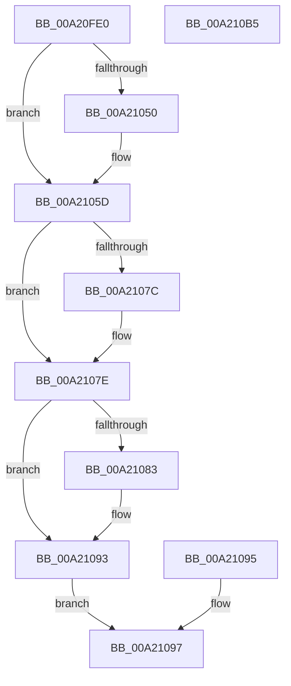

# AlpcpQuerySidToken

- RVA: `0x00A20FE0`–`0x00A210B6` (길이 `214` bytes)
- VA: `0x0000000140A20FE0`
- 실행 섹션: `PAGE`
- PDB 이름 있음: `예`; PDB Function 태그: `아니요`
- unwind 정보 RVA: `0x000AAF8C`
- 디코드: `62`개 명령, `214/214` bytes 표시
- 미해석 바이트: `0` (있으면 어셈블리에 `.byte`로 보존)

> 이 문서는 커널 이미지의 기계어와 PDB 기호를 분석해 생성했습니다. 4번과 5번은 함수 원형과 자료형을 바이너리 사용 방식에서 추정한 C 해석이며 원본 소스 복구 결과는 아닙니다.

## 1. Dependencies

- 직접 호출 지점: **7**; 고유 호출 대상: **6**
- 직접 호출자로 확인된 함수: **1**
- RIP 상대 이미지 참조: **1**

### Outgoing calls
- `0x00A21015` → [memset](../../text/6C/memset_function_006C6C40.md) (function, `0x006C6C40`)
- `0x00A21031` → [ExAcquireResourceSharedLite](../../text/21/ExAcquireResourceSharedLite_function_00211BC0.md) (function, `0x00211BC0`)
- `0x00A21058` → [memcpy](../../text/6C/memcpy_function_006C6840.md) (function, `0x006C6840`)
- `0x00A21061` → [ExReleaseResourceLite](../../text/25/ExReleaseResourceLite_function_0025FA10.md) (function, `0x0025FA10`)
- `0x00A21066` → [KeLeaveCriticalRegion](../../text/25/KeLeaveCriticalRegion_function_0025D8B0.md) (function, `0x0025D8B0`)
- `0x00A2108E` → [memcpy](../../text/6C/memcpy_function_006C6840.md) (function, `0x006C6840`)
- `0x00A210A1` → [_security_check_cookie](../../text/6A/_security_check_cookie_function_006AC640.md) (function, `0x006AC640`)

### Direct callers
- [AlpcpQuerySidMessage](AlpcpQuerySidMessage_function_00A20F28.md) at `0x00A20FA1`

### Static image references
- `0x00A20FEF` → RVA `0x00E0A740` (`.data`; read)

## 2. Other-region calls and transfers

- 다른 실행 섹션으로 향하는 call: **7**
  - `0x00A21015` → [memset](../../text/6C/memset_function_006C6C40.md) (`PAGE` → `.text`)
  - `0x00A21031` → [ExAcquireResourceSharedLite](../../text/21/ExAcquireResourceSharedLite_function_00211BC0.md) (`PAGE` → `.text`)
  - `0x00A21058` → [memcpy](../../text/6C/memcpy_function_006C6840.md) (`PAGE` → `.text`)
  - `0x00A21061` → [ExReleaseResourceLite](../../text/25/ExReleaseResourceLite_function_0025FA10.md) (`PAGE` → `.text`)
  - `0x00A21066` → [KeLeaveCriticalRegion](../../text/25/KeLeaveCriticalRegion_function_0025D8B0.md) (`PAGE` → `.text`)
  - `0x00A2108E` → [memcpy](../../text/6C/memcpy_function_006C6840.md) (`PAGE` → `.text`)
  - `0x00A210A1` → [_security_check_cookie](../../text/6A/_security_check_cookie_function_006AC640.md) (`PAGE` → `.text`)
- 별도 외부 분기/꼬리 이동을 확인하지 못했습니다.

## 3. Assembly (complete function range)

```asm
00A20FE0  40 53                           push rbx
00A20FE2  56                              push rsi
00A20FE3  57                              push rdi
00A20FE4  41 56                           push r14
00A20FE6  41 57                           push r15
00A20FE8  48 81 EC 80 00 00 00            sub rsp, 0x80
00A20FEF  48 8B 05 4A 97 3E 00            mov rax, qword ptr [rip + 0x3e974a]
00A20FF6  48 33 C4                        xor rax, rsp
00A20FF9  48 89 44 24 70                  mov qword ptr [rsp + 0x70], rax
00A20FFE  49 8B F1                        mov rsi, r9
00A21001  45 8B F0                        mov r14d, r8d
00A21004  4C 8B FA                        mov r15, rdx
00A21007  48 8B F9                        mov rdi, rcx
00A2100A  33 D2                           xor edx, edx
00A2100C  44 8D 42 44                     lea r8d, [rdx + 0x44]
00A21010  48 8D 4C 24 20                  lea rcx, [rsp + 0x20]
00A21015  E8 26 5C CA FF                  call 0x1406c6c40
00A2101A  65 48 8B 04 25 88 01 00 00      mov rax, qword ptr gs:[0x188]
00A21023  66 FF 88 E4 01 00 00            dec word ptr [rax + 0x1e4]
00A2102A  90                              nop
00A2102B  B2 01                           mov dl, 1
00A2102D  48 8B 4F 30                     mov rcx, qword ptr [rdi + 0x30]
00A21031  E8 8A 0B 7F FF                  call 0x140211bc0
00A21036  48 8B 87 98 00 00 00            mov rax, qword ptr [rdi + 0x98]
00A2103D  48 8B 10                        mov rdx, qword ptr [rax]
00A21040  0F B6 42 01                     movzx eax, byte ptr [rdx + 1]
00A21044  8D 1C 85 08 00 00 00            lea ebx, [rax*4 + 8]
00A2104B  83 FB 44                        cmp ebx, 0x44
00A2104E  77 0D                           ja 0x140a2105d
00A21050  44 8B C3                        mov r8d, ebx
00A21053  48 8D 4C 24 20                  lea rcx, [rsp + 0x20]
00A21058  E8 E3 57 CA FF                  call 0x1406c6840
00A2105D  48 8B 4F 30                     mov rcx, qword ptr [rdi + 0x30]
00A21061  E8 AA E9 83 FF                  call 0x14025fa10
00A21066  E8 45 C8 83 FF                  call 0x14025d8b0
00A2106B  90                              nop
00A2106C  44 3B F3                        cmp r14d, ebx
00A2106F  1B FF                           sbb edi, edi
00A21071  81 E7 23 00 00 C0               and edi, 0xc0000023
00A21077  48 85 F6                        test rsi, rsi
00A2107A  74 02                           je 0x140a2107e
00A2107C  89 1E                           mov dword ptr [rsi], ebx
00A2107E  41 3B DE                        cmp ebx, r14d
00A21081  77 10                           ja 0x140a21093
00A21083  44 8B C3                        mov r8d, ebx
00A21086  48 8D 54 24 20                  lea rdx, [rsp + 0x20]
00A2108B  49 8B CF                        mov rcx, r15
00A2108E  E8 AD 57 CA FF                  call 0x1406c6840
00A21093  EB 02                           jmp 0x140a21097
00A21095  8B F8                           mov edi, eax
00A21097  8B C7                           mov eax, edi
00A21099  48 8B 4C 24 70                  mov rcx, qword ptr [rsp + 0x70]
00A2109E  48 33 CC                        xor rcx, rsp
00A210A1  E8 9A B5 C8 FF                  call 0x1406ac640
00A210A6  48 81 C4 80 00 00 00            add rsp, 0x80
00A210AD  41 5F                           pop r15
00A210AF  41 5E                           pop r14
00A210B1  5F                              pop rdi
00A210B2  5E                              pop rsi
00A210B3  5B                              pop rbx
00A210B4  C3                              ret
00A210B5  CC                              int3
```

## 4. C-style interpretation (structured pseudocode)

```c
__int64 __fastcall AlpcpQuerySidToken(__int64 a1, __int64 a2, int a3, __int64 a4)
{
    __int64 result;
    __int64 v_rdi;
    __int64 v_rsp;
    unsigned __int64 v_stack_m38;
    unsigned __int64 v_stack_m88;

    v_rsp = (v_rsp) - (128);
    result = (*(unsigned __int64 *)(v_rip + 4101962)) ^ (v_rsp);
    v_stack_m38 = result;
    a2 = 0;
    result = memset(v_stack_m88, a2, a2 + 68, a4);
    result = ExAcquireResourceSharedLite(*(unsigned __int64 *)(a1 + 48), 1, a2 + 68, a4);
    result = *(unsigned __int8 *)(*(unsigned __int64 *)(*(unsigned __int64 *)(a1 + 152)) + 1);
    if (((unsigned int)(*(unsigned __int8 *)(*(unsigned __int64 *)(*(unsigned __int64 *)(a1 + 152)) + 1) * 4 + 8)) <= 68) {
        a3 = (unsigned int)(*(unsigned __int8 *)(*(unsigned __int64 *)(*(unsigned __int64 *)(a1 + 152)) + 1) * 4 + 8);
        a1 = v_stack_m88;
        result = memcpy(a1, *(unsigned __int64 *)(*(unsigned __int64 *)(a1 + 152)), a3, a4);
    }
    result = ExReleaseResourceLite(*(unsigned __int64 *)(a1 + 48), *(unsigned __int64 *)(*(unsigned __int64 *)(a1 + 152)), a3, a4);
    result = KeLeaveCriticalRegion(*(unsigned __int64 *)(a1 + 48), *(unsigned __int64 *)(*(unsigned __int64 *)(a1 + 152)), a3, a4);
    v_rdi = (unsigned int)((a1) & (0xC0000023ULL));
    if (a4 != 0) {
        *(unsigned int *)(a4) = (unsigned int)(*(unsigned __int8 *)(*(unsigned __int64 *)(*(unsigned __int64 *)(a1 + 152)) + 1) * 4 + 8);
    }
    if (((unsigned int)(*(unsigned __int8 *)(*(unsigned __int64 *)(*(unsigned __int64 *)(a1 + 152)) + 1) * 4 + 8)) <= ((unsigned int)((unsigned int)(a3)))) {
        a3 = (unsigned int)(*(unsigned __int8 *)(*(unsigned __int64 *)(*(unsigned __int64 *)(a1 + 152)) + 1) * 4 + 8);
        a2 = v_stack_m88;
        a1 = a2;
        result = memcpy(a1, a2, a3, a4);
    }
    goto loc_00A21097;
loc_00A21097:
    a1 = (v_stack_m38) ^ (v_rsp);
    result = _security_check_cookie(a1, a2, a3, a4);
    v_rsp = (v_rsp) + (128);
    return result;
}
```

## 5. (Beta) C Style

```c
int64_t AlpcpQuerySidToken(void *Arg1, int64_t Arg2, int32_t Arg3, int64_t Arg4)
{
    uint8_t *arg1 = (uint8_t *)Arg1;

    int64_t result;
    int64_t local_rdi;
    int64_t local_rsp;
    uint64_t v_stack_m38;
    uint64_t v_stack_m88;

    local_rsp = (local_rsp) - (128);
    result = (*(uint64_t *)(v_rip + 0x3E974A)) ^ (local_rsp);
    v_stack_m38 = result;
    Arg2 = 0;
    result = memset(v_stack_m88, Arg2, Arg2 + 68, Arg4);
    result = ExAcquireResourceSharedLite(*(uint64_t *)(arg1 + 0x30), 1, Arg2 + 68, Arg4);
    result = *(uint8_t *)(*(uint64_t *)(*(uint64_t *)(arg1 + 0x98)) + 0x1);
    if (((uint32_t)(*(uint8_t *)(*(uint64_t *)(*(uint64_t *)(arg1 + 0x98)) + 0x1) * 4 + 8)) <= 68) {
        Arg3 = (uint32_t)(*(uint8_t *)(*(uint64_t *)(*(uint64_t *)(arg1 + 0x98)) + 0x1) * 4 + 8);
        Arg1 = v_stack_m88;
        result = memcpy(Arg1, *(uint64_t *)(*(uint64_t *)(arg1 + 0x98)), Arg3, Arg4);
    }
    result = ExReleaseResourceLite(*(uint64_t *)(arg1 + 0x30), *(uint64_t *)(*(uint64_t *)(arg1 + 0x98)), Arg3, Arg4);
    result = KeLeaveCriticalRegion(*(uint64_t *)(arg1 + 0x30), *(uint64_t *)(*(uint64_t *)(arg1 + 0x98)), Arg3, Arg4);
    local_rdi = (uint32_t)((Arg1) & (0xC0000023ULL));
    if (Arg4 != 0) {
        *(uint32_t *)(Arg4) = (uint32_t)(*(uint8_t *)(*(uint64_t *)(*(uint64_t *)(arg1 + 0x98)) + 0x1) * 4 + 8);
    }
    if (((uint32_t)(*(uint8_t *)(*(uint64_t *)(*(uint64_t *)(arg1 + 0x98)) + 0x1) * 4 + 8)) <= ((uint32_t)((uint32_t)(Arg3)))) {
        Arg3 = (uint32_t)(*(uint8_t *)(*(uint64_t *)(*(uint64_t *)(arg1 + 0x98)) + 0x1) * 4 + 8);
        Arg2 = v_stack_m88;
        Arg1 = Arg2;
        result = memcpy(Arg1, Arg2, Arg3, Arg4);
    }
    goto loc_00A21097;
loc_00A21097:
    Arg1 = (v_stack_m38) ^ (local_rsp);
    result = _security_check_cookie(Arg1, Arg2, Arg3, Arg4);
    local_rsp = (local_rsp) + (128);
    return result;
}
```

### 관측된 메모리 오프셋

구조체 형식이 확인되지 않은 접근은 인자 기준의 오프셋으로만 기록했습니다.

| 기준 인자 | 오프셋 표현 | 폭 (bit) | 접근 |
|---|---:|---:|---|
| `Arg1` | `+ 0x30` | `64` | `R` |
| `Arg1` | `+ 0x98` | `64` | `R` |

## 6. Execution-region graph

[열기: 2D/3D 그래프와 함수 탐색 컨트롤 패널](../../../control-panel.html?section=page&rva=0x00A20FE0&view=graph)

- 2D 그래프는 위에서 아래로 흐르고, 3D 그래프는 빈 공간을 드래그해 회전합니다. Shift+드래그는 이동, 휠은 확대·축소, 함수 노드 선택은 대상 보고서 이동입니다.

### Static fallback


