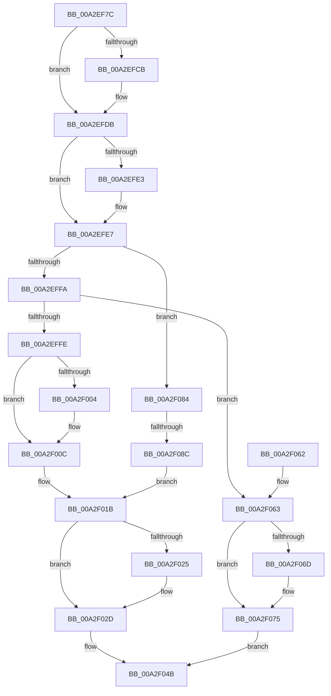

# AlpcpReturnMessageOnInsufficientBuffer

- RVA: `0x00A2EF7C`–`0x00A2F0A0` (길이 `292` bytes)
- VA: `0x0000000140A2EF7C`
- 실행 섹션: `PAGE`
- PDB 이름 있음: `예`; PDB Function 태그: `예`
- unwind 정보 RVA: `0x000ACA48`
- 디코드: `86`개 명령, `292/292` bytes 표시
- 미해석 바이트: `0` (있으면 어셈블리에 `.byte`로 보존)

> 이 문서는 커널 이미지의 기계어와 PDB 기호를 분석해 생성했습니다. 4번과 5번은 함수 원형과 자료형을 바이너리 사용 방식에서 추정한 C 해석이며 원본 소스 복구 결과는 아닙니다.

## 1. Dependencies

- 직접 호출 지점: **10**; 고유 호출 대상: **8**
- 직접 호출자로 확인된 함수: **2**
- RIP 상대 이미지 참조: **0**

### Outgoing calls
- `0x00A2EFB6` → [KeAbPreAcquire](../../text/21/KeAbPreAcquire_function_00210230.md) (function, `0x00210230`)
- `0x00A2EFD6` → [ExfAcquirePushLockSharedEx](../../text/21/ExfAcquirePushLockSharedEx_function_0021044C.md) (function, `0x0021044C`)
- `0x00A2F007` → [AlpcpRemoveMessageFromPendingQueue](../88/AlpcpRemoveMessageFromPendingQueue_function_0088FD70.md) (function, `0x0088FD70`)
- `0x00A2F016` → [AlpcpInsertMessageLargeMessageQueue](AlpcpInsertMessageLargeMessageQueue_function_00A2F0A8.md) (function, `0x00A2F0A8`)
- `0x00A2F028` → [ExfReleasePushLockShared](../../text/26/ExfReleasePushLockShared_function_00263440.md) (function, `0x00263440`)
- `0x00A2F030` → [KeAbPostRelease](../../text/2E/KeAbPostRelease_function_002E1600.md) (function, `0x002E1600`)
- `0x00A2F041` → [AlpcpExposeContextAttribute](AlpcpExposeContextAttribute_function_00A2F180.md) (function, `0x00A2F180`)
- `0x00A2F070` → [ExfReleasePushLockShared](../../text/26/ExfReleasePushLockShared_function_00263440.md) (function, `0x00263440`)
- `0x00A2F078` → [KeAbPostRelease](../../text/2E/KeAbPostRelease_function_002E1600.md) (function, `0x002E1600`)
- `0x00A2F096` → [AlpcpInsertMessageCanceledQueue](../A6/AlpcpInsertMessageCanceledQueue_function_00A6DC38.md) (function, `0x00A6DC38`)

### Direct callers
- [AlpcpReceiveMessage](../89/AlpcpReceiveMessage_function_00897ED0.md) at `0x008983D6`
- [sub_00B226A4](../B2/Unknown_function_00B226A4.md) at `0x00B226E3`

### Static image references
- 디코드된 RIP-relative 메모리 참조가 없습니다.

## 2. Other-region calls and transfers

- 다른 실행 섹션으로 향하는 call: **6**
  - `0x00A2EFB6` → [KeAbPreAcquire](../../text/21/KeAbPreAcquire_function_00210230.md) (`PAGE` → `.text`)
  - `0x00A2EFD6` → [ExfAcquirePushLockSharedEx](../../text/21/ExfAcquirePushLockSharedEx_function_0021044C.md) (`PAGE` → `.text`)
  - `0x00A2F028` → [ExfReleasePushLockShared](../../text/26/ExfReleasePushLockShared_function_00263440.md) (`PAGE` → `.text`)
  - `0x00A2F030` → [KeAbPostRelease](../../text/2E/KeAbPostRelease_function_002E1600.md) (`PAGE` → `.text`)
  - `0x00A2F070` → [ExfReleasePushLockShared](../../text/26/ExfReleasePushLockShared_function_00263440.md) (`PAGE` → `.text`)
  - `0x00A2F078` → [KeAbPostRelease](../../text/2E/KeAbPostRelease_function_002E1600.md) (`PAGE` → `.text`)
- call이 아닌 외부 분기/꼬리 이동: **1**
  - `0x00A2F086` → [sub_00B397D0](../B3/Unknown_function_00B397D0.md) (`tail-transfer`)

## 3. Assembly (complete function range)

```asm
00A2EF7C  48 89 5C 24 10                  mov qword ptr [rsp + 0x10], rbx
00A2EF81  48 89 6C 24 18                  mov qword ptr [rsp + 0x18], rbp
00A2EF86  56                              push rsi
00A2EF87  57                              push rdi
00A2EF88  41 54                           push r12
00A2EF8A  41 56                           push r14
00A2EF8C  41 57                           push r15
00A2EF8E  48 83 EC 20                     sub rsp, 0x20
00A2EF92  0F 57 C0                        xorps xmm0, xmm0
00A2EF95  48 8D B9 60 01 00 00            lea rdi, [rcx + 0x160]
00A2EF9C  41 0F 11 00                     movups xmmword ptr [r8], xmm0
00A2EFA0  4D 8B F0                        mov r14, r8
00A2EFA3  48 8B DA                        mov rbx, rdx
00A2EFA6  41 0F 11 40 10                  movups xmmword ptr [r8 + 0x10], xmm0
00A2EFAB  48 8B F1                        mov rsi, rcx
00A2EFAE  45 33 C0                        xor r8d, r8d
00A2EFB1  33 D2                           xor edx, edx
00A2EFB3  48 8B CF                        mov rcx, rdi
00A2EFB6  E8 75 12 7E FF                  call 0x140210230
00A2EFBB  48 8B E8                        mov rbp, rax
00A2EFBE  33 C0                           xor eax, eax
00A2EFC0  44 8D 60 11                     lea r12d, [rax + 0x11]
00A2EFC4  F0 4C 0F B1 27                  lock cmpxchg qword ptr [rdi], r12
00A2EFC9  74 10                           je 0x140a2efdb
00A2EFCB  4C 8B CF                        mov r9, rdi
00A2EFCE  4C 8B C5                        mov r8, rbp
00A2EFD1  33 D2                           xor edx, edx
00A2EFD3  48 8B CF                        mov rcx, rdi
00A2EFD6  E8 71 14 7E FF                  call 0x14021044c
00A2EFDB  45 33 FF                        xor r15d, r15d
00A2EFDE  48 85 ED                        test rbp, rbp
00A2EFE1  74 04                           je 0x140a2efe7
00A2EFE3  C6 45 0A 01                     mov byte ptr [rbp + 0xa], 1
00A2EFE7  8B 86 A0 01 00 00               mov eax, dword ptr [rsi + 0x1a0]
00A2EFED  83 E0 40                        and eax, 0x40
00A2EFF0  48 39 73 40                     cmp qword ptr [rbx + 0x40], rsi
00A2EFF4  0F 84 8A 00 00 00               je 0x140a2f084
00A2EFFA  85 C0                           test eax, eax
00A2EFFC  75 65                           jne 0x140a2f063
00A2EFFE  4C 39 7B 10                     cmp qword ptr [rbx + 0x10], r15
00A2F002  74 08                           je 0x140a2f00c
00A2F004  48 8B CB                        mov rcx, rbx
00A2F007  E8 64 0D E6 FF                  call 0x14088fd70
00A2F00C  66 FF 43 E2                     inc word ptr [rbx - 0x1e]
00A2F010  48 8B D3                        mov rdx, rbx
00A2F013  48 8B CE                        mov rcx, rsi
00A2F016  E8 8D 00 00 00                  call 0x140a2f0a8
00A2F01B  49 8B C4                        mov rax, r12
00A2F01E  F0 4C 0F B1 3F                  lock cmpxchg qword ptr [rdi], r15
00A2F023  74 08                           je 0x140a2f02d
00A2F025  48 8B CF                        mov rcx, rdi
00A2F028  E8 13 44 83 FF                  call 0x140263440
00A2F02D  48 8B CF                        mov rcx, rdi
00A2F030  E8 CB 25 8B FF                  call 0x1402e1600
00A2F035  45 33 C9                        xor r9d, r9d
00A2F038  4D 8B C6                        mov r8, r14
00A2F03B  48 8B D3                        mov rdx, rbx
00A2F03E  48 8B CE                        mov rcx, rsi
00A2F041  E8 3A 01 00 00                  call 0x140a2f180
00A2F046  B8 23 00 00 C0                  mov eax, 0xc0000023
00A2F04B  48 8B 5C 24 58                  mov rbx, qword ptr [rsp + 0x58]
00A2F050  48 8B 6C 24 60                  mov rbp, qword ptr [rsp + 0x60]
00A2F055  48 83 C4 20                     add rsp, 0x20
00A2F059  41 5F                           pop r15
00A2F05B  41 5E                           pop r14
00A2F05D  41 5C                           pop r12
00A2F05F  5F                              pop rdi
00A2F060  5E                              pop rsi
00A2F061  C3                              ret
00A2F062  CC                              int3
00A2F063  49 8B C4                        mov rax, r12
00A2F066  F0 4C 0F B1 3F                  lock cmpxchg qword ptr [rdi], r15
00A2F06B  74 08                           je 0x140a2f075
00A2F06D  48 8B CF                        mov rcx, rdi
00A2F070  E8 CB 43 83 FF                  call 0x140263440
00A2F075  48 8B CF                        mov rcx, rdi
00A2F078  E8 83 25 8B FF                  call 0x1402e1600
00A2F07D  B8 00 07 00 C0                  mov eax, 0xc0000700
00A2F082  EB C7                           jmp 0x140a2f04b
00A2F084  85 C0                           test eax, eax
00A2F086  0F 85 44 A7 10 00               jne 0x140b397d0
00A2F08C  66 FF 43 E2                     inc word ptr [rbx - 0x1e]
00A2F090  48 8B D3                        mov rdx, rbx
00A2F093  48 8B CE                        mov rcx, rsi
00A2F096  E8 9D EB 03 00                  call 0x140a6dc38
00A2F09B  E9 7B FF FF FF                  jmp 0x140a2f01b
```

## 4. C-style interpretation (structured pseudocode)

```c
__int64 __fastcall AlpcpReturnMessageOnInsufficientBuffer(__int64 a1, __int64 a2, __int64 a3)
{
    __int64 result;
    __int64 v_r15;
    __int64 v_rsp;
    unsigned __int64 v_stack_p10;
    unsigned __int64 v_stack_p18;

    v_stack_p10 = v_rbx;
    v_stack_p18 = v_rbp;
    v_rsp = (v_rsp) - (32);
    *(unsigned __int64 *)(a3) = v_xmm0;
    *(unsigned __int64 *)(a3 + 16) = v_xmm0;
    a3 = 0;
    a2 = 0;
    result = KeAbPreAcquire(a1 + 352, a2, a3, a4);
    result = 0;
    if (!(condition_is_equal)) {
        a4 = a1 + 352;
        a3 = 0;
        a2 = 0;
        a1 = a1 + 352;
        result = ExfAcquirePushLockSharedEx(a1, a2, a3, a4);
    }
    v_r15 = 0;
    if (result != 0) {
        *(unsigned __int8 *)(result + 10) = 1;
    }
    result = (unsigned int)(((unsigned int)(*(unsigned int *)(a1 + 416))) & (64));
    if ((*(unsigned __int64 *)(a2 + 64)) == a1) goto loc_00A2F084;
    if ((unsigned int)(result) != 0) goto loc_00A2F063;
    if ((*(unsigned __int64 *)(a2 + 16)) != 0) {
        a1 = 0;
        result = AlpcpRemoveMessageFromPendingQueue(a1, a2, a3, a4);
    }
    result = AlpcpInsertMessageLargeMessageQueue(a1, 0, a3, a4);
loc_00A2F01B:
    result = result + 17;
    if ((*(unsigned __int64 *)(a2 + 16)) != 0) {
        a1 = a1 + 352;
        result = ExfReleasePushLockShared(a1, 0, a3, a4);
    }
    result = KeAbPostRelease(a1 + 352, 0, a3, a4);
    a4 = 0;
    result = AlpcpExposeContextAttribute(a1, 0, a3, a4);
loc_00A2F04B:
    v_rsp = (v_rsp) + (32);
    return (unsigned int)(0xC0000023ULL);
loc_00A2F063:
    result = result + 17;
    if (!(condition_is_equal)) {
        a1 = a1 + 352;
        result = ExfReleasePushLockShared(a1, 0, a3, a4);
    }
    result = KeAbPostRelease(a1 + 352, 0, a3, a4);
    goto loc_00A2F04B;
loc_00A2F084:
    result = AlpcpInsertMessageCanceledQueue(a1, v_stack_p10, a3, a4);
    goto loc_00A2F01B;
}
```

## 5. (Beta) C Style

```c
int64_t AlpcpReturnMessageOnInsufficientBuffer(void *Arg1, void *Arg2, void *Arg3)
{
    uint8_t *arg1 = (uint8_t *)Arg1;
    uint8_t *arg2 = (uint8_t *)Arg2;
    uint8_t *arg3 = (uint8_t *)Arg3;

    int64_t result;
    int64_t local_r15;
    int64_t local_rsp;
    uint64_t v_stack_p10;
    uint64_t v_stack_p18;

    v_stack_p10 = local_rbx;
    v_stack_p18 = local_rbp;
    local_rsp = (local_rsp) - (32);
    *(uint64_t *)(arg3) = v_xmm0;
    *(uint64_t *)(arg3 + 0x10) = v_xmm0;
    Arg3 = 0;
    Arg2 = 0;
    result = KeAbPreAcquire(Arg1 + 352, Arg2, Arg3, a4);
    result = 0;
    if (!(condition_is_equal)) {
        a4 = Arg1 + 352;
        Arg3 = 0;
        Arg2 = 0;
        Arg1 = Arg1 + 352;
        result = ExfAcquirePushLockSharedEx(Arg1, Arg2, Arg3, a4);
    }
    local_r15 = 0;
    if (result != 0) {
        *(uint8_t *)(result + 0xA) = 1;
    }
    result = (uint32_t)(((uint32_t)(*(uint32_t *)(arg1 + 0x1A0))) & (64));
    if ((*(uint64_t *)(arg2 + 0x40)) == Arg1) goto loc_00A2F084;
    if ((uint32_t)(result) != 0) goto loc_00A2F063;
    if ((*(uint64_t *)(arg2 + 0x10)) != 0) {
        Arg1 = 0;
        result = AlpcpRemoveMessageFromPendingQueue(Arg1, Arg2, Arg3, a4);
    }
    result = AlpcpInsertMessageLargeMessageQueue(Arg1, 0, Arg3, a4);
loc_00A2F01B:
    result = result + 17;
    if ((*(uint64_t *)(arg2 + 0x10)) != 0) {
        Arg1 = Arg1 + 352;
        result = ExfReleasePushLockShared(Arg1, 0, Arg3, a4);
    }
    result = KeAbPostRelease(Arg1 + 352, 0, Arg3, a4);
    a4 = 0;
    result = AlpcpExposeContextAttribute(Arg1, 0, Arg3, a4);
loc_00A2F04B:
    local_rsp = (local_rsp) + (32);
    return (uint32_t)(0xC0000023ULL);
loc_00A2F063:
    result = result + 17;
    if (!(condition_is_equal)) {
        Arg1 = Arg1 + 352;
        result = ExfReleasePushLockShared(Arg1, 0, Arg3, a4);
    }
    result = KeAbPostRelease(Arg1 + 352, 0, Arg3, a4);
    goto loc_00A2F04B;
loc_00A2F084:
    result = AlpcpInsertMessageCanceledQueue(Arg1, v_stack_p10, Arg3, a4);
    goto loc_00A2F01B;
}
```

### 관측된 메모리 오프셋

구조체 형식이 확인되지 않은 접근은 인자 기준의 오프셋으로만 기록했습니다.

| 기준 인자 | 오프셋 표현 | 폭 (bit) | 접근 |
|---|---:|---:|---|
| `Arg1` | `+ 0x0` | `64` | `R` |
| `Arg1` | `+ 0x160` | `64` | `R` |
| `Arg1` | `+ 0x1A0` | `32` | `R` |
| `Arg2` | `- 0x1E` | `16` | `R/W` |
| `Arg2` | `+ 0x10` | `64` | `R` |
| `Arg2` | `+ 0x40` | `64` | `R` |
| `Arg3` | `+ 0x0` | `128` | `R` |
| `Arg3` | `+ 0x10` | `128` | `R` |

## 6. Execution-region graph

[열기: 2D/3D 그래프와 함수 탐색 컨트롤 패널](../../../control-panel.html?section=page&rva=0x00A2EF7C&view=graph)

- 2D 그래프는 위에서 아래로 흐르고, 3D 그래프는 빈 공간을 드래그해 회전합니다. Shift+드래그는 이동, 휠은 확대·축소, 함수 노드 선택은 대상 보고서 이동입니다.

### Static fallback


