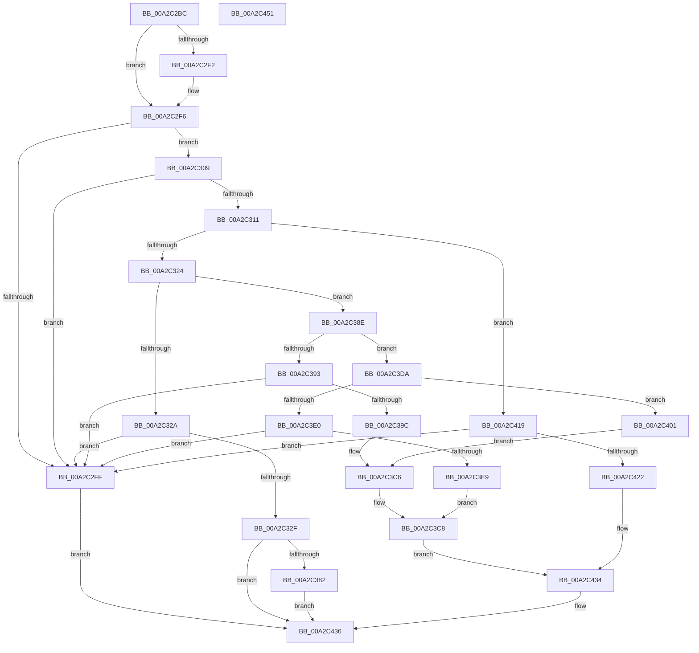

# CmGetMatchingFilteredDeviceListWorker

- RVA: `0x00A2C2BC`–`0x00A2C452` (길이 `406` bytes)
- VA: `0x0000000140A2C2BC`
- 실행 섹션: `PAGE`
- PDB 이름 있음: `예`; PDB Function 태그: `아니요`
- unwind 정보 RVA: `0x000AC428`
- 디코드: `106`개 명령, `406/406` bytes 표시
- 미해석 바이트: `0` (있으면 어셈블리에 `.byte`로 보존)

> 이 문서는 커널 이미지의 기계어와 PDB 기호를 분석해 생성했습니다. 4번과 5번은 함수 원형과 자료형을 바이너리 사용 방식에서 추정한 C 해석이며 원본 소스 복구 결과는 아닙니다.

## 1. Dependencies

- 직접 호출 지점: **4**; 고유 호출 대상: **3**
- 직접 호출자로 확인된 함수: **1**
- RIP 상대 이미지 참조: **2**

### Outgoing calls
- `0x00A2C36E` → [CmGetMatchingDeviceListForSubkey](../82/CmGetMatchingDeviceListForSubkey_function_0082D5A0.md) (function, `0x0082D5A0`)
- `0x00A2C384` → [ExFreePoolWithTag](../../poolcode/B8/ExFreePoolWithTag_function_00B82870.md) (function, `0x00B82870`)
- `0x00A2C3D3` → [CmGetMatchingDeviceListForSubkey](../82/CmGetMatchingDeviceListForSubkey_function_0082D5A0.md) (function, `0x0082D5A0`)
- `0x00A2C42F` → [CmGetDeviceRelationsList](../9D/CmGetDeviceRelationsList_function_009D0660.md) (function, `0x009D0660`)

### Direct callers
- [CmGetMatchingFilteredDeviceList](CmGetMatchingFilteredDeviceList_function_00A2C11C.md) at `0x00A2C249`

### Static image references
- `0x00A2C348` → RVA `0x0082D7A0` (`CmServiceFilterCallback`; read)
- `0x00A2C3B7` → RVA `0x0082C6F0` (`CmClassFilterCallback`; read)

## 2. Other-region calls and transfers

- 다른 실행 섹션으로 향하는 call: **1**
  - `0x00A2C384` → [ExFreePoolWithTag](../../poolcode/B8/ExFreePoolWithTag_function_00B82870.md) (`PAGE` → `POOLCODE`)
- 별도 외부 분기/꼬리 이동을 확인하지 못했습니다.

## 3. Assembly (complete function range)

```asm
00A2C2BC  48 89 5C 24 08                  mov qword ptr [rsp + 8], rbx
00A2C2C1  48 89 74 24 10                  mov qword ptr [rsp + 0x10], rsi
00A2C2C6  48 89 7C 24 18                  mov qword ptr [rsp + 0x18], rdi
00A2C2CB  55                              push rbp
00A2C2CC  48 8B EC                        mov rbp, rsp
00A2C2CF  48 81 EC 80 00 00 00            sub rsp, 0x80
00A2C2D6  4C 8B 55 48                     mov r10, qword ptr [rbp + 0x48]
00A2C2DA  33 F6                           xor esi, esi
00A2C2DC  44 8B 5D 40                     mov r11d, dword ptr [rbp + 0x40]
00A2C2E0  49 8B F9                        mov rdi, r9
00A2C2E3  4C 8B 4D 38                     mov r9, qword ptr [rbp + 0x38]
00A2C2E7  48 8B D9                        mov rbx, rcx
00A2C2EA  41 89 32                        mov dword ptr [r10], esi
00A2C2ED  45 85 DB                        test r11d, r11d
00A2C2F0  74 04                           je 0x140a2c2f6
00A2C2F2  66 41 89 31                     mov word ptr [r9], si
00A2C2F6  41 F7 C0 00 FE FF FF            test r8d, 0xfffffe00
00A2C2FD  74 0A                           je 0x140a2c309
00A2C2FF  BB 0D 00 00 C0                  mov ebx, 0xc000000d
00A2C304  E9 2D 01 00 00                  jmp 0x140a2c436
00A2C309  0F B7 45 50                     movzx eax, word ptr [rbp + 0x50]
00A2C30D  85 C0                           test eax, eax
00A2C30F  75 EE                           jne 0x140a2c2ff
00A2C311  41 8B C8                        mov ecx, r8d
00A2C314  C1 E9 08                        shr ecx, 8
00A2C317  80 E1 01                        and cl, 1
00A2C31A  41 F6 C0 7C                     test r8b, 0x7c
00A2C31E  0F 85 F5 00 00 00               jne 0x140a2c419
00A2C324  41 F6 C0 02                     test r8b, 2
00A2C328  74 64                           je 0x140a2c38e
00A2C32A  48 85 D2                        test rdx, rdx
00A2C32D  74 D0                           je 0x140a2c2ff
00A2C32F  48 8B 45 30                     mov rax, qword ptr [rbp + 0x30]
00A2C333  44 8A C1                        mov r8b, cl
00A2C336  4C 89 54 24 38                  mov qword ptr [rsp + 0x38], r10
00A2C33B  48 8B CB                        mov rcx, rbx
00A2C33E  44 89 5C 24 30                  mov dword ptr [rsp + 0x30], r11d
00A2C343  4C 89 4C 24 28                  mov qword ptr [rsp + 0x28], r9
00A2C348  4C 8D 0D 51 14 E0 FF            lea r9, [rip - 0x1febaf]
00A2C34F  48 89 45 F8                     mov qword ptr [rbp - 8], rax
00A2C353  48 8D 45 D8                     lea rax, [rbp - 0x28]
00A2C357  48 89 55 D8                     mov qword ptr [rbp - 0x28], rdx
00A2C35B  33 D2                           xor edx, edx
00A2C35D  48 89 44 24 20                  mov qword ptr [rsp + 0x20], rax
00A2C362  48 89 75 E8                     mov qword ptr [rbp - 0x18], rsi
00A2C366  48 89 75 E0                     mov qword ptr [rbp - 0x20], rsi
00A2C36A  48 89 7D F0                     mov qword ptr [rbp - 0x10], rdi
00A2C36E  E8 2D 12 E0 FF                  call 0x14082d5a0
00A2C373  48 8B 4D E0                     mov rcx, qword ptr [rbp - 0x20]
00A2C377  8B D8                           mov ebx, eax
00A2C379  48 85 C9                        test rcx, rcx
00A2C37C  0F 84 B4 00 00 00               je 0x140a2c436
00A2C382  33 D2                           xor edx, edx
00A2C384  E8 E7 64 15 00                  call 0x140b82870
00A2C389  E9 A8 00 00 00                  jmp 0x140a2c436
00A2C38E  45 84 C0                        test r8b, r8b
00A2C391  79 47                           jns 0x140a2c3da
00A2C393  48 85 D2                        test rdx, rdx
00A2C396  0F 84 63 FF FF FF               je 0x140a2c2ff
00A2C39C  48 8B 45 30                     mov rax, qword ptr [rbp + 0x30]
00A2C3A0  4C 89 54 24 38                  mov qword ptr [rsp + 0x38], r10
00A2C3A5  44 89 5C 24 30                  mov dword ptr [rsp + 0x30], r11d
00A2C3AA  48 89 45 D0                     mov qword ptr [rbp - 0x30], rax
00A2C3AE  48 8D 45 C0                     lea rax, [rbp - 0x40]
00A2C3B2  4C 89 4C 24 28                  mov qword ptr [rsp + 0x28], r9
00A2C3B7  4C 8D 0D 32 03 E0 FF            lea r9, [rip - 0x1ffcce]
00A2C3BE  48 89 55 C0                     mov qword ptr [rbp - 0x40], rdx
00A2C3C2  48 89 7D C8                     mov qword ptr [rbp - 0x38], rdi
00A2C3C6  33 D2                           xor edx, edx
00A2C3C8  44 8A C1                        mov r8b, cl
00A2C3CB  48 89 44 24 20                  mov qword ptr [rsp + 0x20], rax
00A2C3D0  48 8B CB                        mov rcx, rbx
00A2C3D3  E8 C8 11 E0 FF                  call 0x14082d5a0
00A2C3D8  EB 5A                           jmp 0x140a2c434
00A2C3DA  41 F6 C0 01                     test r8b, 1
00A2C3DE  74 21                           je 0x140a2c401
00A2C3E0  48 85 D2                        test rdx, rdx
00A2C3E3  0F 84 16 FF FF FF               je 0x140a2c2ff
00A2C3E9  48 8B 45 30                     mov rax, qword ptr [rbp + 0x30]
00A2C3ED  4C 89 54 24 38                  mov qword ptr [rsp + 0x38], r10
00A2C3F2  44 89 5C 24 30                  mov dword ptr [rsp + 0x30], r11d
00A2C3F7  4C 89 4C 24 28                  mov qword ptr [rsp + 0x28], r9
00A2C3FC  4C 8B CF                        mov r9, rdi
00A2C3FF  EB C7                           jmp 0x140a2c3c8
00A2C401  48 8B 45 30                     mov rax, qword ptr [rbp + 0x30]
00A2C405  4C 89 54 24 38                  mov qword ptr [rsp + 0x38], r10
00A2C40A  44 89 5C 24 30                  mov dword ptr [rsp + 0x30], r11d
00A2C40F  4C 89 4C 24 28                  mov qword ptr [rsp + 0x28], r9
00A2C414  4C 8B CF                        mov r9, rdi
00A2C417  EB AD                           jmp 0x140a2c3c6
00A2C419  48 85 D2                        test rdx, rdx
00A2C41C  0F 84 DD FE FF FF               je 0x140a2c2ff
00A2C422  4C 89 54 24 28                  mov qword ptr [rsp + 0x28], r10
00A2C427  48 8B CB                        mov rcx, rbx
00A2C42A  44 89 5C 24 20                  mov dword ptr [rsp + 0x20], r11d
00A2C42F  E8 2C 42 FA FF                  call 0x1409d0660
00A2C434  8B D8                           mov ebx, eax
00A2C436  4C 8D 9C 24 80 00 00 00         lea r11, [rsp + 0x80]
00A2C43E  8B C3                           mov eax, ebx
00A2C440  49 8B 5B 10                     mov rbx, qword ptr [r11 + 0x10]
00A2C444  49 8B 73 18                     mov rsi, qword ptr [r11 + 0x18]
00A2C448  49 8B 7B 20                     mov rdi, qword ptr [r11 + 0x20]
00A2C44C  49 8B E3                        mov rsp, r11
00A2C44F  5D                              pop rbp
00A2C450  C3                              ret
00A2C451  CC                              int3
```

## 4. C-style interpretation (structured pseudocode)

```c
__int64 __fastcall CmGetMatchingFilteredDeviceListWorker(__int64 a1, __int64 a2, int a3, __int64 a4, __int64 a5, __int64 a6, unsigned int a7, __int64 a8, unsigned __int16 a9)
{
    __int64 result;
    __int64 v_rsi;
    __int64 v_rsp;
    unsigned __int64 v_stack_m10;
    unsigned __int64 v_stack_m18;
    unsigned __int64 v_stack_m20;
    unsigned __int64 v_stack_m28;
    unsigned __int64 v_stack_m30;
    unsigned __int64 v_stack_m38;
    unsigned __int64 v_stack_m40;
    unsigned __int64 v_stack_m48;
    unsigned __int64 v_stack_m50;
    unsigned int v_stack_m58;
    unsigned __int64 v_stack_m60;
    unsigned __int64 v_stack_m68;
    unsigned __int64 v_stack_m8;
    unsigned __int64 v_stack_p10;
    unsigned __int64 v_stack_p18;
    unsigned __int64 v_stack_p8;

    v_stack_p8 = v_rbx;
    v_stack_p10 = v_rsi;
    v_stack_p18 = v_rdi;
    v_rsp = (v_rsp) - (128);
    v_rsi = 0;
    *(unsigned int *)(a8) = 0;
    if ((unsigned int)((unsigned int)(a7)) != 0) {
        *(unsigned __int16 *)(a6) = 0;
    }
    if (((a3) & (0xFFFFFE00ULL)) == 0) goto loc_00A2C309;
loc_00A2C2FF:
    goto loc_00A2C436;
loc_00A2C309:
    if (a9 != 0) goto loc_00A2C2FF;
    a1 = (unsigned int)(((unsigned int)(a3)) >> (8));
    a1 = (unsigned __int8)((a1) & (1));
    if ((((unsigned __int8)(a3)) & (124)) != 0) goto loc_00A2C419;
    if ((((unsigned __int8)(a3)) & (2)) == 0) goto loc_00A2C38E;
    if (a2 == 0) goto loc_00A2C2FF;
    v_stack_m50 = a8;
    v_stack_m58 = (unsigned int)((unsigned int)(a7));
    v_stack_m60 = a6;
    v_stack_m10 = a5;
    v_stack_m30 = a2;
    a2 = 0;
    v_stack_m68 = v_stack_m30;
    v_stack_m20 = 0;
    v_stack_m28 = 0;
    v_stack_m18 = a4;
    result = CmGetMatchingDeviceListForSubkey((unsigned int)(0xC000000DULL), a2, (unsigned __int8)(a1), v_rip - 2091951);
    if (v_stack_m28 == 0) goto loc_00A2C436;
    a2 = 0;
    result = ExFreePoolWithTag(v_stack_m28, a2, (unsigned __int8)(a1), v_rip - 2091951);
    goto loc_00A2C436;
loc_00A2C38E:
    if (!sign_flag) goto loc_00A2C3DA;
    if (0 == 0) goto loc_00A2C2FF;
    v_stack_m50 = a8;
    v_stack_m58 = (unsigned int)((unsigned int)(a7));
    v_stack_m38 = a5;
    v_stack_m60 = v_rip - 2091951;
    v_stack_m48 = 0;
    v_stack_m40 = a4;
loc_00A2C3C6:
    a2 = 0;
loc_00A2C3C8:
    v_stack_m68 = v_stack_m48;
    result = CmGetMatchingDeviceListForSubkey((unsigned int)((unsigned int)(result)), a2, (unsigned __int8)(v_stack_m28), v_rip - 2096334);
    goto loc_00A2C434;
loc_00A2C3DA:
    if ((((unsigned __int8)((unsigned __int8)(v_stack_m28))) & (1)) == 0) goto loc_00A2C401;
    if (0 == 0) goto loc_00A2C2FF;
    v_stack_m50 = a8;
    v_stack_m58 = (unsigned int)((unsigned int)(a7));
    v_stack_m60 = v_rip - 2096334;
    goto loc_00A2C3C8;
loc_00A2C401:
    v_stack_m50 = a8;
    v_stack_m58 = (unsigned int)((unsigned int)(a7));
    v_stack_m60 = a4;
    goto loc_00A2C3C6;
loc_00A2C419:
    if (0 == 0) goto loc_00A2C2FF;
    v_stack_m60 = a8;
    v_stack_m68 = (unsigned int)((unsigned int)(a7));
    result = CmGetDeviceRelationsList((unsigned int)((unsigned int)(result)), a2, (unsigned __int8)(v_stack_m28), a4);
loc_00A2C434:
loc_00A2C436:
    return (unsigned int)((unsigned int)((unsigned int)((unsigned int)(result))));
}
```

## 5. (Beta) C Style

```c
int64_t CmGetMatchingFilteredDeviceListWorker(int64_t Arg1, int64_t Arg2, int32_t Arg3, int64_t Arg4, int64_t Arg5, void *Arg6, uint32_t Arg7, void *Arg8, uint16_t Arg9)
{
    uint8_t *arg6 = (uint8_t *)Arg6;
    uint8_t *arg8 = (uint8_t *)Arg8;

    int64_t result;
    int64_t local_rsi;
    int64_t local_rsp;
    uint64_t v_stack_m10;
    uint64_t v_stack_m18;
    uint64_t v_stack_m20;
    uint64_t v_stack_m28;
    uint64_t v_stack_m30;
    uint64_t v_stack_m38;
    uint64_t v_stack_m40;
    uint64_t v_stack_m48;
    uint64_t v_stack_m50;
    uint32_t v_stack_m58;
    uint64_t v_stack_m60;
    uint64_t v_stack_m68;
    uint64_t v_stack_m8;
    uint64_t v_stack_p10;
    uint64_t v_stack_p18;
    uint64_t v_stack_p8;

    v_stack_p8 = local_rbx;
    v_stack_p10 = local_rsi;
    v_stack_p18 = local_rdi;
    local_rsp = (local_rsp) - (128);
    local_rsi = 0;
    *(uint32_t *)(arg8) = 0;
    if ((uint32_t)((uint32_t)(Arg7)) != 0) {
        *(uint16_t *)(arg6) = 0;
    }
    if (((Arg3) & (0xFFFFFE00ULL)) == 0) goto loc_00A2C309;
loc_00A2C2FF:
    goto loc_00A2C436;
loc_00A2C309:
    if (Arg9 != 0) goto loc_00A2C2FF;
    Arg1 = (uint32_t)(((uint32_t)(Arg3)) >> (8));
    Arg1 = (uint8_t)((Arg1) & (1));
    if ((((uint8_t)(Arg3)) & (124)) != 0) goto loc_00A2C419;
    if ((((uint8_t)(Arg3)) & (2)) == 0) goto loc_00A2C38E;
    if (Arg2 == 0) goto loc_00A2C2FF;
    v_stack_m50 = Arg8;
    v_stack_m58 = (uint32_t)((uint32_t)(Arg7));
    v_stack_m60 = Arg6;
    v_stack_m10 = Arg5;
    v_stack_m30 = Arg2;
    Arg2 = 0;
    v_stack_m68 = v_stack_m30;
    v_stack_m20 = 0;
    v_stack_m28 = 0;
    v_stack_m18 = Arg4;
    result = CmGetMatchingDeviceListForSubkey((uint32_t)(0xC000000DULL), Arg2, (uint8_t)(Arg1), v_rip - 2091951);
    if (v_stack_m28 == 0) goto loc_00A2C436;
    Arg2 = 0;
    result = ExFreePoolWithTag(v_stack_m28, Arg2, (uint8_t)(Arg1), v_rip - 2091951);
    goto loc_00A2C436;
loc_00A2C38E:
    if (!sign_flag) goto loc_00A2C3DA;
    if (0 == 0) goto loc_00A2C2FF;
    v_stack_m50 = Arg8;
    v_stack_m58 = (uint32_t)((uint32_t)(Arg7));
    v_stack_m38 = Arg5;
    v_stack_m60 = v_rip - 2091951;
    v_stack_m48 = 0;
    v_stack_m40 = Arg4;
loc_00A2C3C6:
    Arg2 = 0;
loc_00A2C3C8:
    v_stack_m68 = v_stack_m48;
    result = CmGetMatchingDeviceListForSubkey((uint32_t)((uint32_t)(result)), Arg2, (uint8_t)(v_stack_m28), v_rip - 2096334);
    goto loc_00A2C434;
loc_00A2C3DA:
    if ((((uint8_t)((uint8_t)(v_stack_m28))) & (1)) == 0) goto loc_00A2C401;
    if (0 == 0) goto loc_00A2C2FF;
    v_stack_m50 = Arg8;
    v_stack_m58 = (uint32_t)((uint32_t)(Arg7));
    v_stack_m60 = v_rip - 2096334;
    goto loc_00A2C3C8;
loc_00A2C401:
    v_stack_m50 = Arg8;
    v_stack_m58 = (uint32_t)((uint32_t)(Arg7));
    v_stack_m60 = Arg4;
    goto loc_00A2C3C6;
loc_00A2C419:
    if (0 == 0) goto loc_00A2C2FF;
    v_stack_m60 = Arg8;
    v_stack_m68 = (uint32_t)((uint32_t)(Arg7));
    result = CmGetDeviceRelationsList((uint32_t)((uint32_t)(result)), Arg2, (uint8_t)(v_stack_m28), Arg4);
loc_00A2C434:
loc_00A2C436:
    return (uint32_t)((uint32_t)((uint32_t)((uint32_t)(result))));
}
```

### 관측된 메모리 오프셋

구조체 형식이 확인되지 않은 접근은 인자 기준의 오프셋으로만 기록했습니다.

| 기준 인자 | 오프셋 표현 | 폭 (bit) | 접근 |
|---|---:|---:|---|
| `Arg6` | `+ 0x0` | `16` | `W` |
| `Arg8` | `+ 0x0` | `32` | `W` |

## 6. Execution-region graph

[열기: 2D/3D 그래프와 함수 탐색 컨트롤 패널](../../../control-panel.html?section=page&rva=0x00A2C2BC&view=graph)

- 2D 그래프는 위에서 아래로 흐르고, 3D 그래프는 빈 공간을 드래그해 회전합니다. Shift+드래그는 이동, 휠은 확대·축소, 함수 노드 선택은 대상 보고서 이동입니다.

### Static fallback


