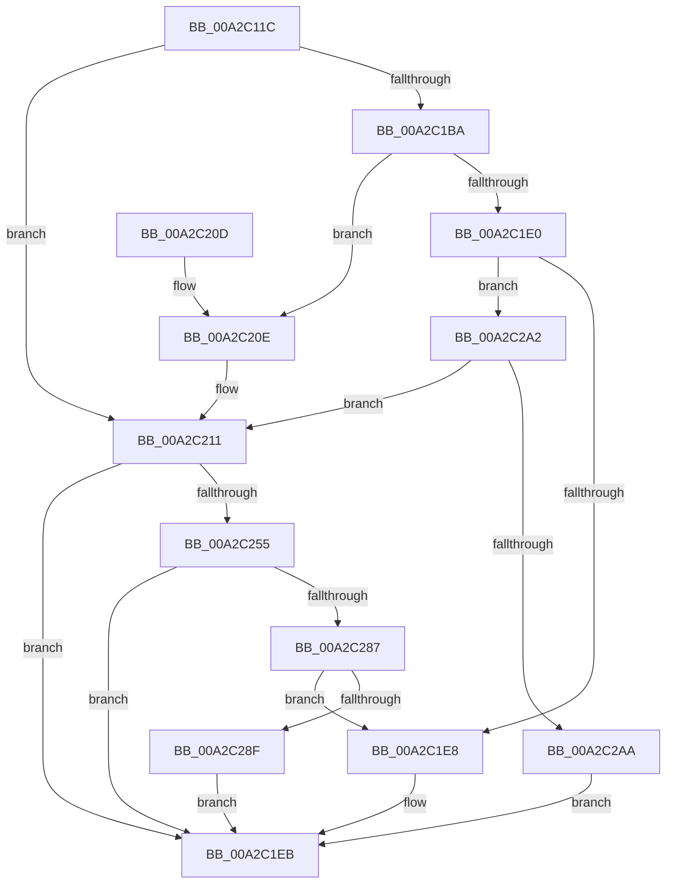

# CmGetMatchingFilteredDeviceList

- RVA: `0x00A2C11C`–`0x00A2C2B4` (길이 `408` bytes)
- VA: `0x0000000140A2C11C`
- 실행 섹션: `PAGE`
- PDB 이름 있음: `예`; PDB Function 태그: `아니요`
- unwind 정보 RVA: `0x000AC404`
- 디코드: `115`개 명령, `408/408` bytes 표시
- 미해석 바이트: `0` (있으면 어셈블리에 `.byte`로 보존)

> 이 문서는 커널 이미지의 기계어와 PDB 기호를 분석해 생성했습니다. 4번과 5번은 함수 원형과 자료형을 바이너리 사용 방식에서 추정한 C 해석이며 원본 소스 복구 결과는 아닙니다.

## 1. Dependencies

- 직접 호출 지점: **5**; 고유 호출 대상: **4**
- 직접 호출자로 확인된 함수: **5**
- RIP 상대 이미지 참조: **1**

### Outgoing calls
- `0x00A2C16D` → [memset](../../text/6C/memset_function_006C6C40.md) (function, `0x006C6C40`)
- `0x00A2C1D6` → [guard_dispatch_icall](../../text/6B/guard_dispatch_icall_function_006BAAD0.md) (function, `0x006BAAD0`)
- `0x00A2C1F4` → [_security_check_cookie](../../text/6A/_security_check_cookie_function_006AC640.md) (function, `0x006AC640`)
- `0x00A2C249` → [CmGetMatchingFilteredDeviceListWorker](CmGetMatchingFilteredDeviceListWorker_function_00A2C2BC.md) (function, `0x00A2C2BC`)
- `0x00A2C277` → [guard_dispatch_icall](../../text/6B/guard_dispatch_icall_function_006BAAD0.md) (function, `0x006BAAD0`)

### Direct callers
- [PiDevCfgInitDriverDatabaseCallback](../73/PiDevCfgInitDriverDatabaseCallback_function_00733958.md) at `0x00733A50`
- [CmDeleteInstallerClassWorker](../82/CmDeleteInstallerClassWorker_function_0082A490.md) at `0x0082A4ED`
- [PiCMGetDeviceIdList](PiCMGetDeviceIdList_function_00A2BAAC.md) at `0x00A2BC0A`
- [sub_00B4200E](../B4/Unknown_function_00B4200E.md) at `0x00B42058`
- [PipResetMatchingFilteredDevices](../../init/C3/PipResetMatchingFilteredDevices_function_00C32260.md) at `0x00C32409`
- [PipResetMatchingFilteredDevices](../../init/C3/PipResetMatchingFilteredDevices_function_00C32260.md) at `0x00C3246F`

### Static image references
- `0x00A2C135` → RVA `0x00E0A740` (`.data`; read)

## 2. Other-region calls and transfers

- 다른 실행 섹션으로 향하는 call: **4**
  - `0x00A2C16D` → [memset](../../text/6C/memset_function_006C6C40.md) (`PAGE` → `.text`)
  - `0x00A2C1D6` → [guard_dispatch_icall](../../text/6B/guard_dispatch_icall_function_006BAAD0.md) (`PAGE` → `.text`)
  - `0x00A2C1F4` → [_security_check_cookie](../../text/6A/_security_check_cookie_function_006AC640.md) (`PAGE` → `.text`)
  - `0x00A2C277` → [guard_dispatch_icall](../../text/6B/guard_dispatch_icall_function_006BAAD0.md) (`PAGE` → `.text`)
- 별도 외부 분기/꼬리 이동을 확인하지 못했습니다.

## 3. Assembly (complete function range)

```asm
00A2C11C  40 55                           push rbp
00A2C11E  53                              push rbx
00A2C11F  56                              push rsi
00A2C120  57                              push rdi
00A2C121  41 54                           push r12
00A2C123  41 55                           push r13
00A2C125  41 56                           push r14
00A2C127  41 57                           push r15
00A2C129  48 8D 6C 24 F9                  lea rbp, [rsp - 7]
00A2C12E  48 81 EC D8 00 00 00            sub rsp, 0xd8
00A2C135  48 8B 05 04 E6 3D 00            mov rax, qword ptr [rip + 0x3de604]
00A2C13C  48 33 C4                        xor rax, rsp
00A2C13F  48 89 45 EF                     mov qword ptr [rbp - 0x11], rax
00A2C143  48 8B 5D 6F                     mov rbx, qword ptr [rbp + 0x6f]
00A2C147  4C 8B F2                        mov r14, rdx
00A2C14A  48 8B 7D 77                     mov rdi, qword ptr [rbp + 0x77]
00A2C14E  33 D2                           xor edx, edx
00A2C150  48 8B B5 87 00 00 00            mov rsi, qword ptr [rbp + 0x87]
00A2C157  45 8B F8                        mov r15d, r8d
00A2C15A  4C 8B E9                        mov r13, rcx
00A2C15D  48 89 4C 24 50                  mov qword ptr [rsp + 0x50], rcx
00A2C162  48 8D 4D 8F                     lea rcx, [rbp - 0x71]
00A2C166  4D 8B E1                        mov r12, r9
00A2C169  44 8D 42 58                     lea r8d, [rdx + 0x58]
00A2C16D  E8 CE AA C9 FF                  call 0x1406c6c40
00A2C172  4D 8B AD F8 01 00 00            mov r13, qword ptr [r13 + 0x1f8]
00A2C179  83 65 D7 00                     and dword ptr [rbp - 0x29], 0
00A2C17D  8B 45 7F                        mov eax, dword ptr [rbp + 0x7f]
00A2C180  4C 89 75 9F                     mov qword ptr [rbp - 0x61], r14
00A2C184  41 BE 01 00 00 00               mov r14d, 1
00A2C18A  44 89 7D A7                     mov dword ptr [rbp - 0x59], r15d
00A2C18E  4C 89 65 AF                     mov qword ptr [rbp - 0x51], r12
00A2C192  41 BC 02 00 00 C0               mov r12d, 0xc0000002
00A2C198  48 89 7D BF                     mov qword ptr [rbp - 0x41], rdi
00A2C19C  48 8B 7C 24 50                  mov rdi, qword ptr [rsp + 0x50]
00A2C1A1  45 8D 7E 0F                     lea r15d, [r14 + 0xf]
00A2C1A5  48 89 75 CF                     mov qword ptr [rbp - 0x31], rsi
00A2C1A9  BE 20 01 00 C0                  mov esi, 0xc0000120
00A2C1AE  48 89 5D B7                     mov qword ptr [rbp - 0x49], rbx
00A2C1B2  89 45 C7                        mov dword ptr [rbp - 0x39], eax
00A2C1B5  4D 85 ED                        test r13, r13
00A2C1B8  74 57                           je 0x140a2c211
00A2C1BA  48 8D 45 8F                     lea rax, [rbp - 0x71]
00A2C1BE  45 8B CF                        mov r9d, r15d
00A2C1C1  48 89 44 24 28                  mov qword ptr [rsp + 0x28], rax
00A2C1C6  45 8B C6                        mov r8d, r14d
00A2C1C9  49 8B C5                        mov rax, r13
00A2C1CC  44 89 74 24 20                  mov dword ptr [rsp + 0x20], r14d
00A2C1D1  33 D2                           xor edx, edx
00A2C1D3  48 8B CF                        mov rcx, rdi
00A2C1D6  E8 F5 E8 C8 FF                  call 0x1406baad0
00A2C1DB  41 3B C4                        cmp eax, r12d
00A2C1DE  74 2E                           je 0x140a2c20e
00A2C1E0  3B C6                           cmp eax, esi
00A2C1E2  0F 85 BA 00 00 00               jne 0x140a2c2a2
00A2C1E8  8B 5D 8F                        mov ebx, dword ptr [rbp - 0x71]
00A2C1EB  8B C3                           mov eax, ebx
00A2C1ED  48 8B 4D EF                     mov rcx, qword ptr [rbp - 0x11]
00A2C1F1  48 33 CC                        xor rcx, rsp
00A2C1F4  E8 47 04 C8 FF                  call 0x1406ac640
00A2C1F9  48 81 C4 D8 00 00 00            add rsp, 0xd8
00A2C200  41 5F                           pop r15
00A2C202  41 5E                           pop r14
00A2C204  41 5D                           pop r13
00A2C206  41 5C                           pop r12
00A2C208  5F                              pop rdi
00A2C209  5E                              pop rsi
00A2C20A  5B                              pop rbx
00A2C20B  5D                              pop rbp
00A2C20C  C3                              ret
00A2C20D  CC                              int3
00A2C20E  45 33 ED                        xor r13d, r13d
00A2C211  8B 45 D7                        mov eax, dword ptr [rbp - 0x29]
00A2C214  48 8B CF                        mov rcx, rdi
00A2C217  4C 8B 4D AF                     mov r9, qword ptr [rbp - 0x51]
00A2C21B  44 8B 45 A7                     mov r8d, dword ptr [rbp - 0x59]
00A2C21F  48 8B 55 9F                     mov rdx, qword ptr [rbp - 0x61]
00A2C223  89 44 24 40                     mov dword ptr [rsp + 0x40], eax
00A2C227  48 8B 45 CF                     mov rax, qword ptr [rbp - 0x31]
00A2C22B  48 89 44 24 38                  mov qword ptr [rsp + 0x38], rax
00A2C230  8B 45 C7                        mov eax, dword ptr [rbp - 0x39]
00A2C233  89 44 24 30                     mov dword ptr [rsp + 0x30], eax
00A2C237  48 8B 45 BF                     mov rax, qword ptr [rbp - 0x41]
00A2C23B  48 89 44 24 28                  mov qword ptr [rsp + 0x28], rax
00A2C240  48 8B 45 B7                     mov rax, qword ptr [rbp - 0x49]
00A2C244  48 89 44 24 20                  mov qword ptr [rsp + 0x20], rax
00A2C249  E8 6E 00 00 00                  call 0x140a2c2bc
00A2C24E  8B D8                           mov ebx, eax
00A2C250  4D 85 ED                        test r13, r13
00A2C253  74 96                           je 0x140a2c1eb
00A2C255  89 45 8F                        mov dword ptr [rbp - 0x71], eax
00A2C258  45 8B CF                        mov r9d, r15d
00A2C25B  48 8D 45 8F                     lea rax, [rbp - 0x71]
00A2C25F  45 8B C6                        mov r8d, r14d
00A2C262  48 89 44 24 28                  mov qword ptr [rsp + 0x28], rax
00A2C267  33 D2                           xor edx, edx
00A2C269  49 8B C5                        mov rax, r13
00A2C26C  C7 44 24 20 02 00 00 00         mov dword ptr [rsp + 0x20], 2
00A2C274  48 8B CF                        mov rcx, rdi
00A2C277  E8 54 E8 C8 FF                  call 0x1406baad0
00A2C27C  8B C8                           mov ecx, eax
00A2C27E  41 3B C4                        cmp eax, r12d
00A2C281  0F 84 64 FF FF FF               je 0x140a2c1eb
00A2C287  3B C6                           cmp eax, esi
00A2C289  0F 84 59 FF FF FF               je 0x140a2c1e8
00A2C28F  8B C3                           mov eax, ebx
00A2C291  85 C9                           test ecx, ecx
00A2C293  BB E5 00 00 C0                  mov ebx, 0xc00000e5
00A2C298  0F 45 C3                        cmovne eax, ebx
00A2C29B  8B D8                           mov ebx, eax
00A2C29D  E9 49 FF FF FF                  jmp 0x140a2c1eb
00A2C2A2  85 C0                           test eax, eax
00A2C2A4  0F 84 67 FF FF FF               je 0x140a2c211
00A2C2AA  BB E5 00 00 C0                  mov ebx, 0xc00000e5
00A2C2AF  E9 37 FF FF FF                  jmp 0x140a2c1eb
```

## 4. C-style interpretation (structured pseudocode)

```c
__int64 __fastcall CmGetMatchingFilteredDeviceList(__int64 a1, __int64 a2, int a3, __int64 a4, __int64 a5, __int64 a6, unsigned int a7, __int64 a8)
{
    __int64 result;
    __int64 v_r13;
    __int64 v_rsp;
    unsigned __int64 v_stack_m47;
    unsigned __int64 v_stack_m58;
    unsigned int v_stack_m70;
    unsigned __int64 v_stack_m78;
    unsigned int v_stack_m80;
    unsigned __int64 v_stack_m88;
    unsigned __int64 v_stack_m90;
    unsigned __int64 v_stack_m98;
    unsigned int v_stack_mA0;
    unsigned __int64 v_stack_mA8;
    unsigned __int64 v_stack_mB8;
    unsigned __int64 v_stack_mC8;
    unsigned __int64 v_stack_mF0;
    unsigned int v_stack_mF8;
    unsigned __int64 v_stack_p20;
    unsigned __int64 v_stack_p28;
    unsigned int v_stack_p30;
    unsigned __int64 v_stack_p38;
    unsigned int v_stack_p40;

    v_rsp = (v_rsp) - (216);
    result = (*(unsigned __int64 *)(v_rip + 4056580)) ^ (v_rsp);
    v_stack_m58 = result;
    a2 = 0;
    v_stack_mC8 = a1;
    result = memset(v_stack_mB8, a2, a2 + 88, a4);
    v_stack_mA8 = 0;
    v_stack_mA0 = (unsigned int)((unsigned int)(a3));
    v_stack_m98 = a4;
    v_stack_m88 = a6;
    v_stack_m78 = a8;
    v_stack_m90 = a5;
    v_stack_m80 = (unsigned int)((unsigned int)(a7));
    if (*(unsigned __int64 *)(a1 + 504) == 0) goto loc_00A2C211;
    v_stack_mF0 = v_stack_mB8;
    v_stack_mF8 = 1;
    a2 = 0;
    result = guard_dispatch_icall(v_stack_mC8, a2, 1, (unsigned int)((unsigned int)(1 + 15)));
    if (((unsigned int)(result)) == ((unsigned int)((unsigned int)(0xC0000002ULL)))) goto loc_00A2C20E;
    if (((unsigned int)(result)) != ((unsigned int)((unsigned int)(0xC0000120ULL)))) goto loc_00A2C2A2;
loc_00A2C1E8:
loc_00A2C1EB:
    a1 = (v_stack_m58) ^ (v_rsp);
    result = _security_check_cookie(a1, a2, 1, (unsigned int)((unsigned int)(1 + 15)));
    v_rsp = (v_rsp) + (216);
    return result;
loc_00A2C20E:
    v_r13 = 0;
loc_00A2C211:
    v_stack_p40 = (unsigned int)((unsigned int)(v_stack_m70));
    v_stack_p38 = v_stack_m78;
    v_stack_p30 = (unsigned int)((unsigned int)(v_stack_m80));
    v_stack_p28 = v_stack_m88;
    v_stack_p20 = v_stack_m90;
    result = CmGetMatchingFilteredDeviceListWorker(v_stack_mC8, v_stack_mA8, (unsigned int)(v_stack_mA0), v_stack_m98);
    if (0 == 0) goto loc_00A2C1EB;
    v_stack_mB8 = (unsigned int)(result);
    v_stack_p28 = v_stack_mB8;
    a2 = 0;
    v_stack_p20 = 2;
    result = guard_dispatch_icall(v_stack_mC8, a2, 1, (unsigned int)((unsigned int)(1 + 15)));
    if (((unsigned int)(result)) == ((unsigned int)((unsigned int)(0xC0000002ULL)))) goto loc_00A2C1EB;
    if (((unsigned int)(result)) == ((unsigned int)((unsigned int)(0xC0000120ULL)))) goto loc_00A2C1E8;
    result = (unsigned int)((unsigned int)((unsigned int)((unsigned int)(result))));
    if ((unsigned int)((unsigned int)((unsigned int)(result))) != 0) { result = (unsigned int)((unsigned int)(0xC00000E5ULL)); }
    goto loc_00A2C1EB;
loc_00A2C2A2:
    if ((unsigned int)(result) == 0) goto loc_00A2C211;
    goto loc_00A2C1EB;
}
```

## 5. (Beta) C Style

```c
int64_t CmGetMatchingFilteredDeviceList(void *Arg1, int64_t Arg2, int32_t Arg3, int64_t Arg4, int64_t Arg5, int64_t Arg6, uint32_t Arg7, int64_t Arg8)
{
    uint8_t *arg1 = (uint8_t *)Arg1;

    int64_t result;
    int64_t local_r13;
    int64_t local_rsp;
    uint64_t v_stack_m47;
    uint64_t v_stack_m58;
    uint32_t v_stack_m70;
    uint64_t v_stack_m78;
    uint32_t v_stack_m80;
    uint64_t v_stack_m88;
    uint64_t v_stack_m90;
    uint64_t v_stack_m98;
    uint32_t v_stack_mA0;
    uint64_t v_stack_mA8;
    uint64_t v_stack_mB8;
    uint64_t v_stack_mC8;
    uint64_t v_stack_mF0;
    uint32_t v_stack_mF8;
    uint64_t v_stack_p20;
    uint64_t v_stack_p28;
    uint32_t v_stack_p30;
    uint64_t v_stack_p38;
    uint32_t v_stack_p40;

    local_rsp = (local_rsp) - (216);
    result = (*(uint64_t *)(v_rip + 0x3DE604)) ^ (local_rsp);
    v_stack_m58 = result;
    Arg2 = 0;
    v_stack_mC8 = Arg1;
    result = memset(v_stack_mB8, Arg2, Arg2 + 88, Arg4);
    v_stack_mA8 = 0;
    v_stack_mA0 = (uint32_t)((uint32_t)(Arg3));
    v_stack_m98 = Arg4;
    v_stack_m88 = Arg6;
    v_stack_m78 = Arg8;
    v_stack_m90 = Arg5;
    v_stack_m80 = (uint32_t)((uint32_t)(Arg7));
    if (*(uint64_t *)(arg1 + 0x1F8) == 0) goto loc_00A2C211;
    v_stack_mF0 = v_stack_mB8;
    v_stack_mF8 = 1;
    Arg2 = 0;
    result = guard_dispatch_icall(v_stack_mC8, Arg2, 1, (uint32_t)((uint32_t)(1 + 15)));
    if (((uint32_t)(result)) == ((uint32_t)((uint32_t)(0xC0000002ULL)))) goto loc_00A2C20E;
    if (((uint32_t)(result)) != ((uint32_t)((uint32_t)(0xC0000120ULL)))) goto loc_00A2C2A2;
loc_00A2C1E8:
loc_00A2C1EB:
    Arg1 = (v_stack_m58) ^ (local_rsp);
    result = _security_check_cookie(Arg1, Arg2, 1, (uint32_t)((uint32_t)(1 + 15)));
    local_rsp = (local_rsp) + (216);
    return result;
loc_00A2C20E:
    local_r13 = 0;
loc_00A2C211:
    v_stack_p40 = (uint32_t)((uint32_t)(v_stack_m70));
    v_stack_p38 = v_stack_m78;
    v_stack_p30 = (uint32_t)((uint32_t)(v_stack_m80));
    v_stack_p28 = v_stack_m88;
    v_stack_p20 = v_stack_m90;
    result = CmGetMatchingFilteredDeviceListWorker(v_stack_mC8, v_stack_mA8, (uint32_t)(v_stack_mA0), v_stack_m98);
    if (0 == 0) goto loc_00A2C1EB;
    v_stack_mB8 = (uint32_t)(result);
    v_stack_p28 = v_stack_mB8;
    Arg2 = 0;
    v_stack_p20 = 2;
    result = guard_dispatch_icall(v_stack_mC8, Arg2, 1, (uint32_t)((uint32_t)(1 + 15)));
    if (((uint32_t)(result)) == ((uint32_t)((uint32_t)(0xC0000002ULL)))) goto loc_00A2C1EB;
    if (((uint32_t)(result)) == ((uint32_t)((uint32_t)(0xC0000120ULL)))) goto loc_00A2C1E8;
    result = (uint32_t)((uint32_t)((uint32_t)((uint32_t)(result))));
    if ((uint32_t)((uint32_t)((uint32_t)(result))) != 0) { result = (uint32_t)((uint32_t)(0xC00000E5ULL)); }
    goto loc_00A2C1EB;
loc_00A2C2A2:
    if ((uint32_t)(result) == 0) goto loc_00A2C211;
    goto loc_00A2C1EB;
}
```

### 관측된 메모리 오프셋

구조체 형식이 확인되지 않은 접근은 인자 기준의 오프셋으로만 기록했습니다.

| 기준 인자 | 오프셋 표현 | 폭 (bit) | 접근 |
|---|---:|---:|---|
| `Arg1` | `+ 0x1F8` | `64` | `R` |

## 6. Execution-region graph

[열기: 2D/3D 그래프와 함수 탐색 컨트롤 패널](../../../control-panel.html?section=page&rva=0x00A2C11C&view=graph)

- 2D 그래프는 위에서 아래로 흐르고, 3D 그래프는 빈 공간을 드래그해 회전합니다. Shift+드래그는 이동, 휠은 확대·축소, 함수 노드 선택은 대상 보고서 이동입니다.

### Static fallback


