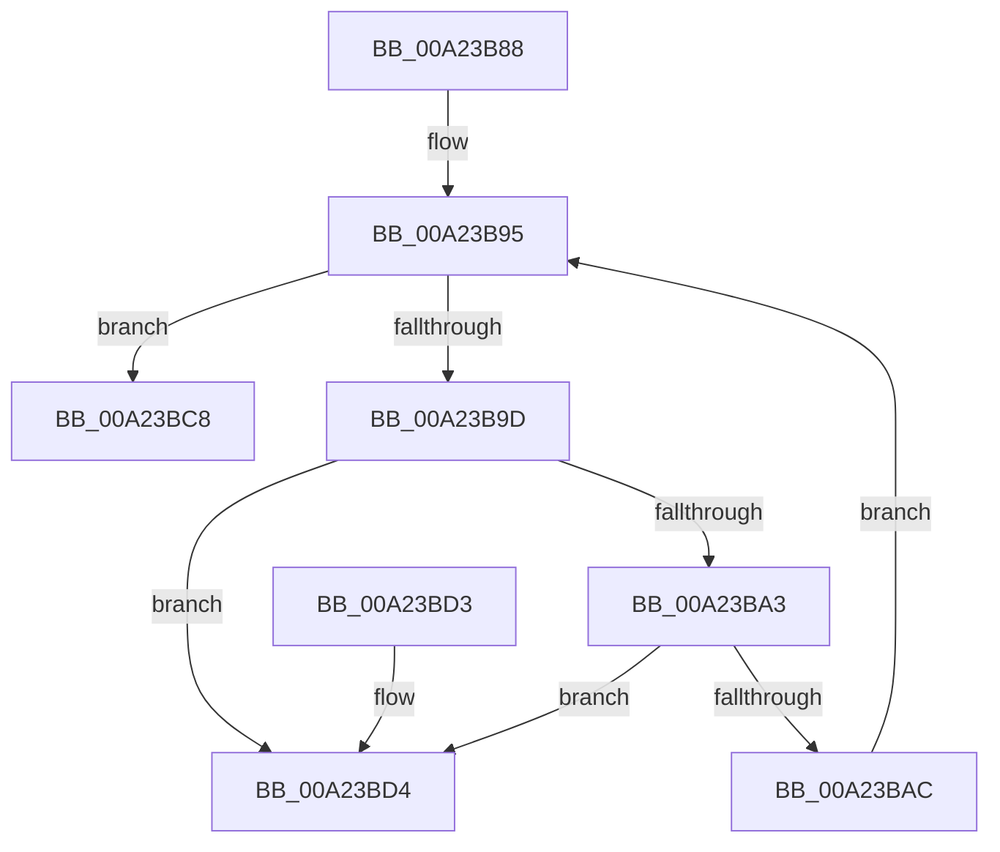

# CmpDelayedDerefKeys

- RVA: `0x00A23B88`–`0x00A23BDB` (길이 `83` bytes)
- VA: `0x0000000140A23B88`
- 실행 섹션: `PAGE`
- PDB 이름 있음: `예`; PDB Function 태그: `아니요`
- unwind 정보 RVA: `0x0006CF28`
- 디코드: `27`개 명령, `83/83` bytes 표시
- 미해석 바이트: `0` (있으면 어셈블리에 `.byte`로 보존)

> 이 문서는 커널 이미지의 기계어와 PDB 기호를 분석해 생성했습니다. 4번과 5번은 함수 원형과 자료형을 바이너리 사용 방식에서 추정한 C 해석이며 원본 소스 복구 결과는 아닙니다.

## 1. Dependencies

- 직접 호출 지점: **2**; 고유 호출 대상: **2**
- 직접 호출자로 확인된 함수: **1**
- RIP 상대 이미지 참조: **0**

### Outgoing calls
- `0x00A23BB7` → [ObDereferenceObjectDeferDelete](../../text/3F/ObDereferenceObjectDeferDelete_function_003FCE40.md) (function, `0x003FCE40`)
- `0x00A23BC1` → [ExFreePoolWithTag](../../poolcode/B8/ExFreePoolWithTag_function_00B82870.md) (function, `0x00B82870`)

### Direct callers
- [CmpPostNotify](../86/CmpPostNotify_function_008645D8.md) at `0x00864978`

### Static image references
- 디코드된 RIP-relative 메모리 참조가 없습니다.

## 2. Other-region calls and transfers

- 다른 실행 섹션으로 향하는 call: **2**
  - `0x00A23BB7` → [ObDereferenceObjectDeferDelete](../../text/3F/ObDereferenceObjectDeferDelete_function_003FCE40.md) (`PAGE` → `.text`)
  - `0x00A23BC1` → [ExFreePoolWithTag](../../poolcode/B8/ExFreePoolWithTag_function_00B82870.md) (`PAGE` → `POOLCODE`)
- 별도 외부 분기/꼬리 이동을 확인하지 못했습니다.

## 3. Assembly (complete function range)

```asm
00A23B88  48 89 5C 24 08                  mov qword ptr [rsp + 8], rbx
00A23B8D  57                              push rdi
00A23B8E  48 83 EC 20                     sub rsp, 0x20
00A23B92  48 8B F9                        mov rdi, rcx
00A23B95  48 8B 1F                        mov rbx, qword ptr [rdi]
00A23B98  48 3B DF                        cmp rbx, rdi
00A23B9B  74 2B                           je 0x140a23bc8
00A23B9D  48 39 7B 08                     cmp qword ptr [rbx + 8], rdi
00A23BA1  75 31                           jne 0x140a23bd4
00A23BA3  48 8B 03                        mov rax, qword ptr [rbx]
00A23BA6  48 39 58 08                     cmp qword ptr [rax + 8], rbx
00A23BAA  75 28                           jne 0x140a23bd4
00A23BAC  48 89 07                        mov qword ptr [rdi], rax
00A23BAF  48 89 78 08                     mov qword ptr [rax + 8], rdi
00A23BB3  48 8B 4B 10                     mov rcx, qword ptr [rbx + 0x10]
00A23BB7  E8 84 92 9D FF                  call 0x1403fce40
00A23BBC  33 D2                           xor edx, edx
00A23BBE  48 8B CB                        mov rcx, rbx
00A23BC1  E8 AA EC 15 00                  call 0x140b82870
00A23BC6  EB CD                           jmp 0x140a23b95
00A23BC8  48 8B 5C 24 30                  mov rbx, qword ptr [rsp + 0x30]
00A23BCD  48 83 C4 20                     add rsp, 0x20
00A23BD1  5F                              pop rdi
00A23BD2  C3                              ret
00A23BD3  CC                              int3
00A23BD4  B9 03 00 00 00                  mov ecx, 3
00A23BD9  CD 29                           int 0x29
```

## 4. C-style interpretation (structured pseudocode)

```c
__int64 __fastcall CmpDelayedDerefKeys(__int64 a1, int a2)
{
    __int64 result;
    __int64 v_rsp;
    unsigned __int64 v_stack_p8;

    v_stack_p8 = v_rbx;
    v_rsp = (v_rsp) - (32);
loc_00A23B95:
    if ((*(unsigned __int64 *)(a1)) == a1) goto loc_00A23BC8;
    if ((*(unsigned __int64 *)(*(unsigned __int64 *)(a1) + 8)) != a1) goto loc_00A23BD4;
    if ((*(unsigned __int64 *)(*(unsigned __int64 *)(*(unsigned __int64 *)(a1)) + 8)) != (*(unsigned __int64 *)(a1))) goto loc_00A23BD4;
    *(unsigned __int64 *)(a1) = *(unsigned __int64 *)(*(unsigned __int64 *)(a1));
    *(unsigned __int64 *)(*(unsigned __int64 *)(*(unsigned __int64 *)(a1)) + 8) = a1;
    result = ObDereferenceObjectDeferDelete(*(unsigned __int64 *)(*(unsigned __int64 *)(a1) + 16), a2, a3, a4);
    a2 = 0;
    result = ExFreePoolWithTag(*(unsigned __int64 *)(a1), a2, a3, a4);
    goto loc_00A23B95;
loc_00A23BC8:
    v_rsp = (v_rsp) + (32);
    return result;
loc_00A23BD4:
    return result;
}
```

## 5. (Beta) C Style

```c
int64_t CmpDelayedDerefKeys(void *Arg1, int32_t Arg2)
{
    uint8_t *arg1 = (uint8_t *)Arg1;

    int64_t result;
    int64_t local_rsp;
    uint64_t v_stack_p8;

    v_stack_p8 = local_rbx;
    local_rsp = (local_rsp) - (32);
loc_00A23B95:
    if ((*(uint64_t *)(arg1)) == Arg1) goto loc_00A23BC8;
    if ((*(uint64_t *)(*(uint64_t *)(arg1) + 0x8)) != Arg1) goto loc_00A23BD4;
    if ((*(uint64_t *)(*(uint64_t *)(*(uint64_t *)(arg1)) + 0x8)) != (*(uint64_t *)(arg1))) goto loc_00A23BD4;
    *(uint64_t *)(arg1) = *(uint64_t *)(*(uint64_t *)(arg1));
    *(void **)(*(uint64_t *)(*(uint64_t *)(arg1)) + 0x8) = Arg1;
    result = ObDereferenceObjectDeferDelete(*(uint64_t *)(*(uint64_t *)(arg1) + 0x10), Arg2, a3, a4);
    Arg2 = 0;
    result = ExFreePoolWithTag(*(uint64_t *)(arg1), Arg2, a3, a4);
    goto loc_00A23B95;
loc_00A23BC8:
    local_rsp = (local_rsp) + (32);
    return result;
loc_00A23BD4:
    return result;
}
```

### 관측된 메모리 오프셋

구조체 형식이 확인되지 않은 접근은 인자 기준의 오프셋으로만 기록했습니다.

| 기준 인자 | 오프셋 표현 | 폭 (bit) | 접근 |
|---|---:|---:|---|
| `Arg1` | `+ 0x0` | `64` | `R` |
| `Arg1` | `+ 0x0` | `64` | `W` |

## 6. Execution-region graph

[열기: 2D/3D 그래프와 함수 탐색 컨트롤 패널](../../../control-panel.html?section=page&rva=0x00A23B88&view=graph)

- 2D 그래프는 위에서 아래로 흐르고, 3D 그래프는 빈 공간을 드래그해 회전합니다. Shift+드래그는 이동, 휠은 확대·축소, 함수 노드 선택은 대상 보고서 이동입니다.

### Static fallback


