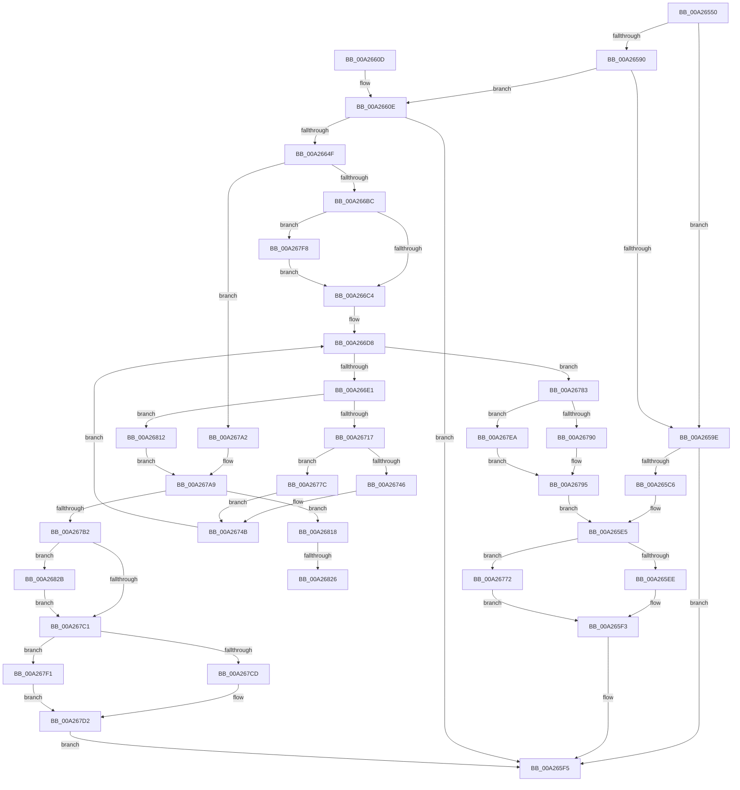

# CmpSetValueDataNew

- RVA: `0x00A26550`–`0x00A26835` (길이 `741` bytes)
- VA: `0x0000000140A26550`
- 실행 섹션: `PAGE`
- PDB 이름 있음: `예`; PDB Function 태그: `예`
- unwind 정보 RVA: `0x000ABE1C`
- 디코드: `201`개 명령, `741/741` bytes 표시
- 미해석 바이트: `0` (있으면 어셈블리에 `.byte`로 보존)

> 이 문서는 커널 이미지의 기계어와 PDB 기호를 분석해 생성했습니다. 4번과 5번은 함수 원형과 자료형을 바이너리 사용 방식에서 추정한 C 해석이며 원본 소스 복구 결과는 아닙니다.

## 1. Dependencies

- 직접 호출 지점: **17**; 고유 호출 대상: **6**
- 직접 호출자로 확인된 함수: **3**
- RIP 상대 이미지 참조: **0**

### Outgoing calls
- `0x00A265BD` → [HvAllocateCell](../85/HvAllocateCell_function_00859C94.md) (function, `0x00859C94`)
- `0x00A265D0` → [memcpy](../../text/6C/memcpy_function_006C6840.md) (function, `0x006C6840`)
- `0x00A265EE` → [HvpReleaseCellPaged](../85/HvpReleaseCellPaged_function_00855F40.md) (function, `0x00855F40`)
- `0x00A26646` → [HvAllocateCell](../85/HvAllocateCell_function_00859C94.md) (function, `0x00859C94`)
- `0x00A266A5` → [HvAllocateCell](../85/HvAllocateCell_function_00859C94.md) (function, `0x00859C94`)
- `0x00A26707` → [HvAllocateCell](../85/HvAllocateCell_function_00859C94.md) (function, `0x00859C94`)
- `0x00A2672D` → [memcpy](../../text/6C/memcpy_function_006C6840.md) (function, `0x006C6840`)
- `0x00A26746` → [HvpReleaseCellPaged](../85/HvpReleaseCellPaged_function_00855F40.md) (function, `0x00855F40`)
- `0x00A26772` → [HvpReleaseCellFlat](../85/HvpReleaseCellFlat_function_0085CC20.md) (function, `0x0085CC20`)
- `0x00A2677C` → [HvpReleaseCellFlat](../85/HvpReleaseCellFlat_function_0085CC20.md) (function, `0x0085CC20`)
- `0x00A26790` → [HvpReleaseCellPaged](../85/HvpReleaseCellPaged_function_00855F40.md) (function, `0x00855F40`)
- `0x00A267CD` → [HvpReleaseCellPaged](../85/HvpReleaseCellPaged_function_00855F40.md) (function, `0x00855F40`)
- `0x00A267D9` → [HvFreeCell](../85/HvFreeCell_function_0085A72C.md) (function, `0x0085A72C`)
- `0x00A267EA` → [HvpReleaseCellFlat](../85/HvpReleaseCellFlat_function_0085CC20.md) (function, `0x0085CC20`)
- `0x00A267F1` → [HvpReleaseCellFlat](../85/HvpReleaseCellFlat_function_0085CC20.md) (function, `0x0085CC20`)
- `0x00A26806` → [memset](../../text/6C/memset_function_006C6C40.md) (function, `0x006C6C40`)
- `0x00A2682E` → [HvFreeCell](../85/HvFreeCell_function_0085A72C.md) (function, `0x0085A72C`)

### Direct callers
- [CmpSetValueKeyExisting](../84/CmpSetValueKeyExisting_function_0084B53C.md) at `0x0084B8CE`
- [CmpAddValueKeyNew](../85/CmpAddValueKeyNew_function_0085AA58.md) at `0x0085AB20`
- [CmpCopyValue](../85/CmpCopyValue_function_0085B798.md) at `0x0085BAA7`

### Static image references
- 디코드된 RIP-relative 메모리 참조가 없습니다.

## 2. Other-region calls and transfers

- 다른 실행 섹션으로 향하는 call: **3**
  - `0x00A265D0` → [memcpy](../../text/6C/memcpy_function_006C6840.md) (`PAGE` → `.text`)
  - `0x00A2672D` → [memcpy](../../text/6C/memcpy_function_006C6840.md) (`PAGE` → `.text`)
  - `0x00A26806` → [memset](../../text/6C/memset_function_006C6C40.md) (`PAGE` → `.text`)
- call이 아닌 외부 분기/꼬리 이동: **2**
  - `0x00A26820` → [sub_00B37E2A](../B3/Unknown_function_00B37E2A.md) (`tail-transfer`)
  - `0x00A26826` → [sub_00B37E2A + 0x26](../B3/Unknown_function_00B37E2A.md) (`tail-transfer`)

## 3. Assembly (complete function range)

```asm
00A26550  48 89 5C 24 10                  mov qword ptr [rsp + 0x10], rbx
00A26555  44 89 4C 24 20                  mov dword ptr [rsp + 0x20], r9d
00A2655A  55                              push rbp
00A2655B  56                              push rsi
00A2655C  57                              push rdi
00A2655D  41 54                           push r12
00A2655F  41 55                           push r13
00A26561  41 56                           push r14
00A26563  41 57                           push r15
00A26565  48 8B EC                        mov rbp, rsp
00A26568  48 83 EC 70                     sub rsp, 0x70
00A2656C  33 F6                           xor esi, esi
00A2656E  45 8B F0                        mov r14d, r8d
00A26571  48 8B D9                        mov rbx, rcx
00A26574  48 89 75 E8                     mov qword ptr [rbp - 0x18], rsi
00A26578  83 C9 FF                        or ecx, 0xffffffff
00A2657B  89 75 CC                        mov dword ptr [rbp - 0x34], esi
00A2657E  41 8B F9                        mov edi, r9d
00A26581  89 4D C8                        mov dword ptr [rbp - 0x38], ecx
00A26584  4C 8B EA                        mov r13, rdx
00A26587  83 BB DC 00 00 00 04            cmp dword ptr [rbx + 0xdc], 4
00A2658E  72 0E                           jb 0x140a2659e
00A26590  41 8D 86 27 C0 FF FF            lea eax, [r14 - 0x3fd9]
00A26597  3D 26 C0 FF 7F                  cmp eax, 0x7fffc026
00A2659C  76 70                           jbe 0x140a2660e
00A2659E  4C 8B 4D 60                     mov r9, qword ptr [rbp + 0x60]
00A265A2  48 8D 45 C8                     lea rax, [rbp - 0x38]
00A265A6  48 89 44 24 28                  mov qword ptr [rsp + 0x28], rax
00A265AB  44 8B C7                        mov r8d, edi
00A265AE  48 8D 45 E8                     lea rax, [rbp - 0x18]
00A265B2  41 8B D6                        mov edx, r14d
00A265B5  48 8B CB                        mov rcx, rbx
00A265B8  48 89 44 24 20                  mov qword ptr [rsp + 0x20], rax
00A265BD  E8 D2 36 E3 FF                  call 0x140859c94
00A265C2  85 C0                           test eax, eax
00A265C4  78 2F                           js 0x140a265f5
00A265C6  48 8B 4D E8                     mov rcx, qword ptr [rbp - 0x18]
00A265CA  4D 8B C6                        mov r8, r14
00A265CD  49 8B D5                        mov rdx, r13
00A265D0  E8 6B 02 CA FF                  call 0x1406c6840
00A265D5  BF 01 00 00 00                  mov edi, 1
00A265DA  48 8D 55 C8                     lea rdx, [rbp - 0x38]
00A265DE  40 84 BB 8C 00 00 00            test byte ptr [rbx + 0x8c], dil
00A265E5  48 8B CB                        mov rcx, rbx
00A265E8  0F 85 84 01 00 00               jne 0x140a26772
00A265EE  E8 4D F9 E2 FF                  call 0x140855f40
00A265F3  33 C0                           xor eax, eax
00A265F5  48 8B 9C 24 B8 00 00 00         mov rbx, qword ptr [rsp + 0xb8]
00A265FD  48 83 C4 70                     add rsp, 0x70
00A26601  41 5F                           pop r15
00A26603  41 5E                           pop r14
00A26605  41 5D                           pop r13
00A26607  41 5C                           pop r12
00A26609  5F                              pop rdi
00A2660A  5E                              pop rsi
00A2660B  5D                              pop rbp
00A2660C  C3                              ret
00A2660D  CC                              int3
00A2660E  4C 8B 65 60                     mov r12, qword ptr [rbp + 0x60]
00A26612  48 8D 45 D8                     lea rax, [rbp - 0x28]
00A26616  48 89 44 24 28                  mov qword ptr [rsp + 0x28], rax
00A2661B  4D 8B CC                        mov r9, r12
00A2661E  48 8D 45 40                     lea rax, [rbp + 0x40]
00A26622  89 4D D8                        mov dword ptr [rbp - 0x28], ecx
00A26625  89 4D D0                        mov dword ptr [rbp - 0x30], ecx
00A26628  44 8B C7                        mov r8d, edi
00A2662B  BA 08 00 00 00                  mov edx, 8
00A26630  48 89 44 24 20                  mov qword ptr [rsp + 0x20], rax
00A26635  48 8B CB                        mov rcx, rbx
00A26638  48 89 75 40                     mov qword ptr [rbp + 0x40], rsi
00A2663C  89 75 DC                        mov dword ptr [rbp - 0x24], esi
00A2663F  48 89 75 E0                     mov qword ptr [rbp - 0x20], rsi
00A26643  89 75 D4                        mov dword ptr [rbp - 0x2c], esi
00A26646  E8 49 36 E3 FF                  call 0x140859c94
00A2664B  85 C0                           test eax, eax
00A2664D  78 A6                           js 0x140a265f5
00A2664F  4C 8B 7D 40                     mov r15, qword ptr [rbp + 0x40]
00A26653  41 8D 8E D7 3F 00 00            lea ecx, [r14 + 0x3fd7]
00A2665A  B8 3F 64 A0 00                  mov eax, 0xa0643f
00A2665F  F7 E1                           mul ecx
00A26661  4D 8D 47 04                     lea r8, [r15 + 4]
00A26665  41 C7 07 64 62 00 00            mov dword ptr [r15], 0x6264
00A2666C  41 83 08 FF                     or dword ptr [r8], 0xffffffff
00A26670  48 8D 45 D0                     lea rax, [rbp - 0x30]
00A26674  2B CA                           sub ecx, edx
00A26676  48 89 44 24 28                  mov qword ptr [rsp + 0x28], rax
00A2667B  D1 E9                           shr ecx, 1
00A2667D  48 8D 45 E0                     lea rax, [rbp - 0x20]
00A26681  03 CA                           add ecx, edx
00A26683  4C 89 45 F0                     mov qword ptr [rbp - 0x10], r8
00A26687  C1 E9 0D                        shr ecx, 0xd
00A2668A  4D 8B C8                        mov r9, r8
00A2668D  0F B7 F1                        movzx esi, cx
00A26690  44 8B C7                        mov r8d, edi
00A26693  48 8B CB                        mov rcx, rbx
00A26696  89 75 C4                        mov dword ptr [rbp - 0x3c], esi
00A26699  48 89 44 24 20                  mov qword ptr [rsp + 0x20], rax
00A2669E  8D 14 B5 00 00 00 00            lea edx, [rsi*4]
00A266A5  E8 EA 35 E3 FF                  call 0x140859c94
00A266AA  33 D2                           xor edx, edx
00A266AC  89 45 C0                        mov dword ptr [rbp - 0x40], eax
00A266AF  BF 01 00 00 00                  mov edi, 1
00A266B4  85 C0                           test eax, eax
00A266B6  0F 88 E6 00 00 00               js 0x140a267a2
00A266BC  85 F6                           test esi, esi
00A266BE  0F 85 34 01 00 00               jne 0x140a267f8
00A266C4  48 8D B3 8C 00 00 00            lea rsi, [rbx + 0x8c]
00A266CB  89 55 40                        mov dword ptr [rbp + 0x40], edx
00A266CE  8B C2                           mov eax, edx
00A266D0  4C 8B E6                        mov r12, rsi
00A266D3  BA D8 3F 00 00                  mov edx, 0x3fd8
00A266D8  3B 45 C4                        cmp eax, dword ptr [rbp - 0x3c]
00A266DB  0F 83 A2 00 00 00               jae 0x140a26783
00A266E1  41 0F B7 47 02                  movzx eax, word ptr [r15 + 2]
00A266E6  48 8B 4D E0                     mov rcx, qword ptr [rbp - 0x20]
00A266EA  44 8B 45 58                     mov r8d, dword ptr [rbp + 0x58]
00A266EE  4C 8D 0C 81                     lea r9, [rcx + rax*4]
00A266F2  48 8B CB                        mov rcx, rbx
00A266F5  48 8D 45 C8                     lea rax, [rbp - 0x38]
00A266F9  48 89 44 24 28                  mov qword ptr [rsp + 0x28], rax
00A266FE  48 8D 45 E8                     lea rax, [rbp - 0x18]
00A26702  48 89 44 24 20                  mov qword ptr [rsp + 0x20], rax
00A26707  E8 88 35 E3 FF                  call 0x140859c94
00A2670C  89 45 C0                        mov dword ptr [rbp - 0x40], eax
00A2670F  85 C0                           test eax, eax
00A26711  0F 88 FB 00 00 00               js 0x140a26812
00A26717  B9 D8 3F 00 00                  mov ecx, 0x3fd8
00A2671C  45 8B C6                        mov r8d, r14d
00A2671F  44 3B F1                        cmp r14d, ecx
00A26722  49 8B D5                        mov rdx, r13
00A26725  44 0F 47 C1                     cmova r8d, ecx
00A26729  48 8B 4D E8                     mov rcx, qword ptr [rbp - 0x18]
00A2672D  E8 0E 01 CA FF                  call 0x1406c6840
00A26732  4C 8D A3 8C 00 00 00            lea r12, [rbx + 0x8c]
00A26739  48 8B CB                        mov rcx, rbx
00A2673C  48 8D 55 C8                     lea rdx, [rbp - 0x38]
00A26740  41 84 3C 24                     test byte ptr [r12], dil
00A26744  75 36                           jne 0x140a2677c
00A26746  E8 F5 F7 E2 FF                  call 0x140855f40
00A2674B  66 41 01 7F 02                  add word ptr [r15 + 2], di
00A26750  33 C0                           xor eax, eax
00A26752  48 89 45 E8                     mov qword ptr [rbp - 0x18], rax
00A26756  BA D8 3F 00 00                  mov edx, 0x3fd8
00A2675B  8B 45 40                        mov eax, dword ptr [rbp + 0x40]
00A2675E  4C 03 EA                        add r13, rdx
00A26761  41 81 C6 28 C0 FF FF            add r14d, 0xffffc028
00A26768  03 C7                           add eax, edi
00A2676A  89 45 40                        mov dword ptr [rbp + 0x40], eax
00A2676D  E9 66 FF FF FF                  jmp 0x140a266d8
00A26772  E8 A9 64 E3 FF                  call 0x14085cc20
00A26777  E9 77 FE FF FF                  jmp 0x140a265f3
00A2677C  E8 9F 64 E3 FF                  call 0x14085cc20
00A26781  EB C8                           jmp 0x140a2674b
00A26783  48 8D 55 D0                     lea rdx, [rbp - 0x30]
00A26787  48 8B CB                        mov rcx, rbx
00A2678A  41 84 3C 24                     test byte ptr [r12], dil
00A2678E  75 5A                           jne 0x140a267ea
00A26790  E8 AB F7 E2 FF                  call 0x140855f40
00A26795  41 84 3C 24                     test byte ptr [r12], dil
00A26799  48 8D 55 D8                     lea rdx, [rbp - 0x28]
00A2679D  E9 43 FE FF FF                  jmp 0x140a265e5
00A267A2  48 8D B3 8C 00 00 00            lea rsi, [rbx + 0x8c]
00A267A9  48 8B 4D E0                     mov rcx, qword ptr [rbp - 0x20]
00A267AD  48 85 C9                        test rcx, rcx
00A267B0  75 66                           jne 0x140a26818
00A267B2  48 8B 55 F0                     mov rdx, qword ptr [rbp - 0x10]
00A267B6  41 83 CE FF                     or r14d, 0xffffffff
00A267BA  8B 12                           mov edx, dword ptr [rdx]
00A267BC  41 3B D6                        cmp edx, r14d
00A267BF  75 6A                           jne 0x140a2682b
00A267C1  48 8D 55 D8                     lea rdx, [rbp - 0x28]
00A267C5  48 8B CB                        mov rcx, rbx
00A267C8  40 84 3E                        test byte ptr [rsi], dil
00A267CB  75 24                           jne 0x140a267f1
00A267CD  E8 6E F7 E2 FF                  call 0x140855f40
00A267D2  41 8B 14 24                     mov edx, dword ptr [r12]
00A267D6  48 8B CB                        mov rcx, rbx
00A267D9  E8 4E 3F E3 FF                  call 0x14085a72c
00A267DE  8B 45 C0                        mov eax, dword ptr [rbp - 0x40]
00A267E1  45 89 34 24                     mov dword ptr [r12], r14d
00A267E5  E9 0B FE FF FF                  jmp 0x140a265f5
00A267EA  E8 31 64 E3 FF                  call 0x14085cc20
00A267EF  EB A4                           jmp 0x140a26795
00A267F1  E8 2A 64 E3 FF                  call 0x14085cc20
00A267F6  EB DA                           jmp 0x140a267d2
00A267F8  48 8B 4D E0                     mov rcx, qword ptr [rbp - 0x20]
00A267FC  4C 8B C6                        mov r8, rsi
00A267FF  49 C1 E0 02                     shl r8, 2
00A26803  83 CA FF                        or edx, 0xffffffff
00A26806  E8 35 04 CA FF                  call 0x1406c6c40
00A2680B  33 D2                           xor edx, edx
00A2680D  E9 B2 FE FF FF                  jmp 0x140a266c4
00A26812  4C 8B 65 60                     mov r12, qword ptr [rbp + 0x60]
00A26816  EB 91                           jmp 0x140a267a9
00A26818  41 0F B7 47 02                  movzx eax, word ptr [r15 + 2]
00A2681D  66 85 C0                        test ax, ax
00A26820  0F 85 04 16 11 00               jne 0x140b37e2a
00A26826  E9 25 16 11 00                  jmp 0x140b37e50
00A2682B  48 8B CB                        mov rcx, rbx
00A2682E  E8 F9 3E E3 FF                  call 0x14085a72c
00A26833  EB 8C                           jmp 0x140a267c1
```

## 4. C-style interpretation (structured pseudocode)

```c
__int64 __fastcall CmpSetValueDataNew(__int64 a1, __int64 a2, int a3, int a4, __int64 a5)
{
    __int64 result;
    __int64 v_r13;
    __int64 v_r14;
    __int64 v_rsi;
    __int64 v_rsp;
    unsigned __int64 v_stack_m48;
    unsigned __int64 v_stack_m50;
    unsigned __int64 v_stack_m58;
    unsigned int v_stack_m5C;
    unsigned __int64 v_stack_m60;
    unsigned int v_stack_m64;
    unsigned int v_stack_m68;
    unsigned int v_stack_m6C;
    unsigned int v_stack_m70;
    unsigned int v_stack_m74;
    unsigned int v_stack_m78;
    unsigned __int64 v_stack_m80;
    unsigned __int64 v_stack_m88;
    unsigned __int64 v_stack_p10;
    unsigned int v_stack_p20;
    unsigned __int64 v_stack_p28;
    unsigned __int64 v_stack_p8;

    v_stack_p10 = v_rbx;
    v_stack_p20 = a4;
    v_rsp = (v_rsp) - (112);
    v_rsi = 0;
    v_stack_m50 = 0;
    a1 = (unsigned int)((a1) | (0xFFFFFFFFULL));
    v_stack_m6C = 0;
    v_stack_m70 = (unsigned int)(a1);
    if ((*(unsigned int *)(a1 + 220)) < 4) goto loc_00A2659E;
    if (((unsigned int)((unsigned int)(a3) - 16345)) <= 0x7FFFC026ULL) goto loc_00A2660E;
loc_00A2659E:
    v_stack_m80 = v_stack_m70;
    v_stack_m88 = v_stack_m50;
    result = HvAllocateCell(a1, (unsigned int)((unsigned int)((unsigned int)(a3))), (unsigned int)((unsigned int)((unsigned int)(a4))), a5);
    if (sign_flag) goto loc_00A265F5;
    result = memcpy(v_stack_m50, a2, (unsigned int)(a3), a5);
loc_00A265E5:
    if (((*(unsigned __int8 *)(a1 + 140)) & (1)) != 0) goto loc_00A26772;
    result = HvpReleaseCellPaged(a1, v_stack_m70, (unsigned int)(a3), a5);
loc_00A265F3:
    result = 0;
loc_00A265F5:
    v_rsp = (v_rsp) + (112);
    return result;
loc_00A2660E:
    v_stack_p28 = v_stack_m60;
    v_stack_m60 = (unsigned int)(a1);
    v_stack_m68 = (unsigned int)(a1);
    v_stack_p20 = v_stack_p8;
    v_stack_p8 = 0;
    v_stack_m5C = 0;
    v_stack_m58 = 0;
    v_stack_m64 = 0;
    result = HvAllocateCell(v_stack_p10, 8, 1, a5);
    if (sign_flag) goto loc_00A265F5;
    *(unsigned int *)(v_stack_p8) = 0x6264ULL;
    a1 = (unsigned int)(((unsigned int)(a3) + 16343) - (8));
    v_stack_p28 = v_stack_m68;
    a1 = (unsigned int)((a1) >> (1));
    a1 = (unsigned int)((a1) + (8));
    v_stack_m48 = v_stack_p8 + 4;
    a1 = (unsigned int)((a1) >> (13));
    v_stack_m74 = (unsigned int)((unsigned __int16)(a1));
    v_stack_p20 = v_stack_m58;
    result = HvAllocateCell(v_stack_p10, (unsigned __int16)(a1) * 4, 1, v_stack_p8 + 4);
    a2 = 0;
    v_stack_m78 = (unsigned int)(result);
    if (sign_flag) goto loc_00A267A2;
    if ((unsigned int)((unsigned __int16)(a1)) != 0) goto loc_00A267F8;
loc_00A266C4:
    v_stack_p8 = 0;
loc_00A266D8:
    if (0 >= v_stack_m74) goto loc_00A26783;
    v_stack_p28 = v_stack_m70;
    v_stack_p20 = v_stack_m50;
    result = HvAllocateCell(v_stack_p10, (unsigned int)(0x3FD8ULL), (unsigned int)(v_stack_p20), v_stack_m58 + *(unsigned __int16 *)(v_stack_p8 + 2) * 4);
    v_stack_m78 = (unsigned int)(result);
    if (sign_flag) goto loc_00A26812;
    a3 = (unsigned int)((unsigned int)((unsigned int)(a3)));
    if (((unsigned int)((unsigned int)(a3))) > ((unsigned int)((unsigned int)(0x3FD8ULL)))) { a3 = (unsigned int)((unsigned int)(0x3FD8ULL)); }
    result = memcpy(v_stack_m50, 0, a3, v_stack_m58 + *(unsigned __int16 *)(v_stack_p8 + 2) * 4);
    if (((*(unsigned __int8 *)(v_stack_p10 + 140)) & (1)) != 0) goto loc_00A2677C;
    result = HvpReleaseCellPaged(v_stack_p10, v_stack_m70, a3, v_stack_m58 + *(unsigned __int16 *)(v_stack_p8 + 2) * 4);
loc_00A2674B:
    result = 0;
    v_stack_m50 = 0;
    v_r13 = (a2) + ((unsigned int)(0x3FD8ULL));
    v_r14 = (unsigned int)(((unsigned int)(a3)) + (0xFFFFC028ULL));
    result = (unsigned int)(((unsigned int)(v_stack_p8)) + (1));
    v_stack_p8 = (unsigned int)(result);
    goto loc_00A266D8;
loc_00A26772:
    result = HvpReleaseCellFlat(v_stack_p10, (unsigned int)(0x3FD8ULL), a3, v_stack_m58 + *(unsigned __int16 *)(v_stack_p8 + 2) * 4);
    goto loc_00A265F3;
loc_00A2677C:
    result = HvpReleaseCellFlat(v_stack_p10, (unsigned int)(0x3FD8ULL), a3, v_stack_m58 + *(unsigned __int16 *)(v_stack_p8 + 2) * 4);
    goto loc_00A2674B;
loc_00A26783:
    if (((*(unsigned __int8 *)(v_stack_p10 + 140)) & (1)) != 0) goto loc_00A267EA;
    result = HvpReleaseCellPaged(v_stack_p10, v_stack_m68, a3, v_stack_m58 + *(unsigned __int16 *)(v_stack_p8 + 2) * 4);
loc_00A26795:
    goto loc_00A265E5;
loc_00A267A2:
loc_00A267A9:
    if (v_stack_m58 != 0) goto loc_00A26818;
    v_r14 = (unsigned int)((v_r14) | (0xFFFFFFFFULL));
    if (((unsigned int)((unsigned int)(*(unsigned int *)(v_stack_m48)))) != ((unsigned int)(v_r14))) goto loc_00A2682B;
loc_00A267C1:
    if (((*(unsigned __int8 *)(v_stack_p10 + 140)) & (1)) != 0) goto loc_00A267F1;
    result = HvpReleaseCellPaged(v_stack_p10, v_stack_m60, a3, v_stack_m58 + *(unsigned __int16 *)(v_stack_p8 + 2) * 4);
loc_00A267D2:
    result = HvFreeCell(v_stack_p10, (unsigned int)(*(unsigned int *)(v_stack_p10 + 140)), a3, v_stack_m58 + *(unsigned __int16 *)(v_stack_p8 + 2) * 4);
    *(unsigned int *)(v_stack_p10 + 140) = (unsigned int)(v_r14);
    goto loc_00A265F5;
loc_00A267EA:
    result = HvpReleaseCellFlat(v_stack_p10, (unsigned int)(*(unsigned int *)(v_stack_p10 + 140)), a3, v_stack_m58 + *(unsigned __int16 *)(v_stack_p8 + 2) * 4);
    goto loc_00A26795;
loc_00A267F1:
    result = HvpReleaseCellFlat(v_stack_p10, (unsigned int)(*(unsigned int *)(v_stack_p10 + 140)), a3, v_stack_m58 + *(unsigned __int16 *)(v_stack_p8 + 2) * 4);
    goto loc_00A267D2;
loc_00A267F8:
    a3 = (v_stack_p10 + 140) << (2);
    a2 = (unsigned int)(((unsigned int)(*(unsigned int *)(v_stack_p10 + 140))) | (0xFFFFFFFFULL));
    result = memset(v_stack_m58, a2, a3, v_stack_m58 + *(unsigned __int16 *)(v_stack_p8 + 2) * 4);
    a2 = 0;
    goto loc_00A266C4;
loc_00A26812:
    goto loc_00A267A9;
loc_00A26818:
loc_00A2682B:
    result = HvFreeCell(v_stack_p10, a2, a3, v_stack_m58 + *(unsigned __int16 *)(v_stack_p8 + 2) * 4);
    goto loc_00A267C1;
}
```

## 5. (Beta) C Style

```c
int64_t CmpSetValueDataNew(void *Arg1, int64_t Arg2, void *Arg3, int32_t Arg4, void *Arg5)
{
    uint8_t *arg1 = (uint8_t *)Arg1;
    uint8_t *arg3 = (uint8_t *)Arg3;
    uint8_t *arg5 = (uint8_t *)Arg5;

    int64_t result;
    int64_t local_r13;
    int64_t local_r14;
    int64_t local_rsi;
    int64_t local_rsp;
    uint64_t v_stack_m48;
    uint64_t v_stack_m50;
    uint64_t v_stack_m58;
    uint32_t v_stack_m5C;
    uint64_t v_stack_m60;
    uint32_t v_stack_m64;
    uint32_t v_stack_m68;
    uint32_t v_stack_m6C;
    uint32_t v_stack_m70;
    uint32_t v_stack_m74;
    uint32_t v_stack_m78;
    uint64_t v_stack_m80;
    uint64_t v_stack_m88;
    uint64_t v_stack_p10;
    uint32_t v_stack_p20;
    uint64_t v_stack_p28;
    uint64_t v_stack_p8;

    v_stack_p10 = local_rbx;
    v_stack_p20 = Arg4;
    local_rsp = (local_rsp) - (112);
    local_rsi = 0;
    v_stack_m50 = 0;
    Arg1 = (uint32_t)((Arg1) | (0xFFFFFFFFULL));
    v_stack_m6C = 0;
    v_stack_m70 = (uint32_t)(Arg1);
    if ((*(uint32_t *)(arg1 + 0xDC)) < 4) goto loc_00A2659E;
    if (((uint32_t)((uint32_t)(Arg3) - 16345)) <= 0x7FFFC026ULL) goto loc_00A2660E;
loc_00A2659E:
    v_stack_m80 = v_stack_m70;
    v_stack_m88 = v_stack_m50;
    result = HvAllocateCell(Arg1, (uint32_t)((uint32_t)((uint32_t)(Arg3))), (uint32_t)((uint32_t)((uint32_t)(Arg4))), Arg5);
    if (sign_flag) goto loc_00A265F5;
    result = memcpy(v_stack_m50, Arg2, (uint32_t)(Arg3), Arg5);
loc_00A265E5:
    if (((*(uint8_t *)(arg1 + 0x8C)) & (1)) != 0) goto loc_00A26772;
    result = HvpReleaseCellPaged(Arg1, v_stack_m70, (uint32_t)(Arg3), Arg5);
loc_00A265F3:
    result = 0;
loc_00A265F5:
    local_rsp = (local_rsp) + (112);
    return result;
loc_00A2660E:
    v_stack_p28 = v_stack_m60;
    v_stack_m60 = (uint32_t)(Arg1);
    v_stack_m68 = (uint32_t)(Arg1);
    v_stack_p20 = v_stack_p8;
    v_stack_p8 = 0;
    v_stack_m5C = 0;
    v_stack_m58 = 0;
    v_stack_m64 = 0;
    result = HvAllocateCell(v_stack_p10, 8, 1, Arg5);
    if (sign_flag) goto loc_00A265F5;
    *(uint32_t *)(v_stack_p8) = 0x6264ULL;
    Arg1 = (uint32_t)(((uint32_t)(Arg3) + 16343) - (8));
    v_stack_p28 = v_stack_m68;
    Arg1 = (uint32_t)((Arg1) >> (1));
    Arg1 = (uint32_t)((Arg1) + (8));
    v_stack_m48 = v_stack_p8 + 4;
    Arg1 = (uint32_t)((Arg1) >> (13));
    v_stack_m74 = (uint32_t)((uint16_t)(Arg1));
    v_stack_p20 = v_stack_m58;
    result = HvAllocateCell(v_stack_p10, (uint16_t)(Arg1) * 4, 1, v_stack_p8 + 4);
    Arg2 = 0;
    v_stack_m78 = (uint32_t)(result);
    if (sign_flag) goto loc_00A267A2;
    if ((uint32_t)((uint16_t)(Arg1)) != 0) goto loc_00A267F8;
loc_00A266C4:
    v_stack_p8 = 0;
loc_00A266D8:
    if (0 >= v_stack_m74) goto loc_00A26783;
    v_stack_p28 = v_stack_m70;
    v_stack_p20 = v_stack_m50;
    result = HvAllocateCell(v_stack_p10, (uint32_t)(0x3FD8ULL), (uint32_t)(v_stack_p20), v_stack_m58 + *(uint16_t *)(v_stack_p8 + 0x2) * 4);
    v_stack_m78 = (uint32_t)(result);
    if (sign_flag) goto loc_00A26812;
    Arg3 = (uint32_t)((uint32_t)((uint32_t)(Arg3)));
    if (((uint32_t)((uint32_t)(Arg3))) > ((uint32_t)((uint32_t)(0x3FD8ULL)))) { Arg3 = (uint32_t)((uint32_t)(0x3FD8ULL)); }
    result = memcpy(v_stack_m50, 0, Arg3, v_stack_m58 + *(uint16_t *)(v_stack_p8 + 0x2) * 4);
    if (((*(uint8_t *)(v_stack_p10 + 0x8C)) & (1)) != 0) goto loc_00A2677C;
    result = HvpReleaseCellPaged(v_stack_p10, v_stack_m70, Arg3, v_stack_m58 + *(uint16_t *)(v_stack_p8 + 0x2) * 4);
loc_00A2674B:
    result = 0;
    v_stack_m50 = 0;
    local_r13 = (Arg2) + ((uint32_t)(0x3FD8ULL));
    local_r14 = (uint32_t)(((uint32_t)(Arg3)) + (0xFFFFC028ULL));
    result = (uint32_t)(((uint32_t)(v_stack_p8)) + (1));
    v_stack_p8 = (uint32_t)(result);
    goto loc_00A266D8;
loc_00A26772:
    result = HvpReleaseCellFlat(v_stack_p10, (uint32_t)(0x3FD8ULL), Arg3, v_stack_m58 + *(uint16_t *)(v_stack_p8 + 0x2) * 4);
    goto loc_00A265F3;
loc_00A2677C:
    result = HvpReleaseCellFlat(v_stack_p10, (uint32_t)(0x3FD8ULL), Arg3, v_stack_m58 + *(uint16_t *)(v_stack_p8 + 0x2) * 4);
    goto loc_00A2674B;
loc_00A26783:
    if (((*(uint8_t *)(v_stack_p10 + 0x8C)) & (1)) != 0) goto loc_00A267EA;
    result = HvpReleaseCellPaged(v_stack_p10, v_stack_m68, Arg3, v_stack_m58 + *(uint16_t *)(v_stack_p8 + 0x2) * 4);
loc_00A26795:
    goto loc_00A265E5;
loc_00A267A2:
loc_00A267A9:
    if (v_stack_m58 != 0) goto loc_00A26818;
    local_r14 = (uint32_t)((local_r14) | (0xFFFFFFFFULL));
    if (((uint32_t)((uint32_t)(*(uint32_t *)(v_stack_m48)))) != ((uint32_t)(local_r14))) goto loc_00A2682B;
loc_00A267C1:
    if (((*(uint8_t *)(v_stack_p10 + 0x8C)) & (1)) != 0) goto loc_00A267F1;
    result = HvpReleaseCellPaged(v_stack_p10, v_stack_m60, Arg3, v_stack_m58 + *(uint16_t *)(v_stack_p8 + 0x2) * 4);
loc_00A267D2:
    result = HvFreeCell(v_stack_p10, (uint32_t)(*(uint32_t *)(v_stack_p10 + 0x8C)), Arg3, v_stack_m58 + *(uint16_t *)(v_stack_p8 + 0x2) * 4);
    *(uint32_t *)(v_stack_p10 + 0x8C) = (uint32_t)(local_r14);
    goto loc_00A265F5;
loc_00A267EA:
    result = HvpReleaseCellFlat(v_stack_p10, (uint32_t)(*(uint32_t *)(v_stack_p10 + 0x8C)), Arg3, v_stack_m58 + *(uint16_t *)(v_stack_p8 + 0x2) * 4);
    goto loc_00A26795;
loc_00A267F1:
    result = HvpReleaseCellFlat(v_stack_p10, (uint32_t)(*(uint32_t *)(v_stack_p10 + 0x8C)), Arg3, v_stack_m58 + *(uint16_t *)(v_stack_p8 + 0x2) * 4);
    goto loc_00A267D2;
loc_00A267F8:
    Arg3 = (v_stack_p10 + 140) << (2);
    Arg2 = (uint32_t)(((uint32_t)(*(uint32_t *)(v_stack_p10 + 0x8C))) | (0xFFFFFFFFULL));
    result = memset(v_stack_m58, Arg2, Arg3, v_stack_m58 + *(uint16_t *)(v_stack_p8 + 0x2) * 4);
    Arg2 = 0;
    goto loc_00A266C4;
loc_00A26812:
    goto loc_00A267A9;
loc_00A26818:
loc_00A2682B:
    result = HvFreeCell(v_stack_p10, Arg2, Arg3, v_stack_m58 + *(uint16_t *)(v_stack_p8 + 0x2) * 4);
    goto loc_00A267C1;
}
```

### 관측된 메모리 오프셋

구조체 형식이 확인되지 않은 접근은 인자 기준의 오프셋으로만 기록했습니다.

| 기준 인자 | 오프셋 표현 | 폭 (bit) | 접근 |
|---|---:|---:|---|
| `Arg1` | `+ 0x0` | `8` | `R` |
| `Arg1` | `+ 0x8C` | `8` | `R` |
| `Arg1` | `+ 0x8C` | `64` | `R` |
| `Arg1` | `+ 0xDC` | `32` | `R` |
| `Arg3` | `- 0x3FD9` | `32` | `R` |
| `Arg3` | `+ 0x3FD7` | `32` | `R` |
| `Arg5` | `+ 0x0` | `32` | `R` |
| `Arg5` | `+ 0x0` | `32` | `W` |

## 6. Execution-region graph

[열기: 2D/3D 그래프와 함수 탐색 컨트롤 패널](../../../control-panel.html?section=page&rva=0x00A26550&view=graph)

- 2D 그래프는 위에서 아래로 흐르고, 3D 그래프는 빈 공간을 드래그해 회전합니다. Shift+드래그는 이동, 휠은 확대·축소, 함수 노드 선택은 대상 보고서 이동입니다.

### Static fallback


