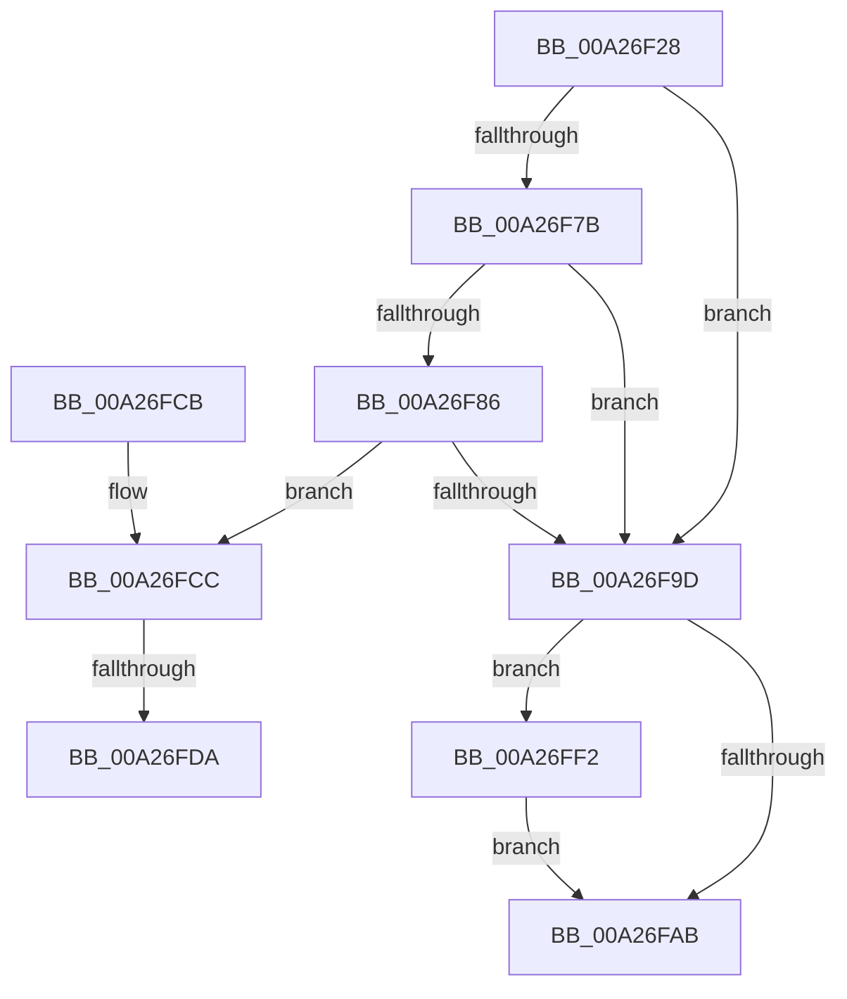

# CmpVEExecuteCreateLogic

- RVA: `0x00A26F28`–`0x00A26FFB` (길이 `211` bytes)
- VA: `0x0000000140A26F28`
- 실행 섹션: `PAGE`
- PDB 이름 있음: `예`; PDB Function 태그: `예`
- unwind 정보 RVA: `0x000ABECC`
- 디코드: `63`개 명령, `211/211` bytes 표시
- 미해석 바이트: `0` (있으면 어셈블리에 `.byte`로 보존)

> 이 문서는 커널 이미지의 기계어와 PDB 기호를 분석해 생성했습니다. 4번과 5번은 함수 원형과 자료형을 바이너리 사용 방식에서 추정한 C 해석이며 원본 소스 복구 결과는 아닙니다.

## 1. Dependencies

- 직접 호출 지점: **4**; 고유 호출 대상: **4**
- 직접 호출자로 확인된 함수: **1**
- RIP 상대 이미지 참조: **0**

### Outgoing calls
- `0x00A26F6F` → [RtlInitUnicodeString](../../text/42/RtlInitUnicodeString_function_0042A780.md) (function, `0x0042A780`)
- `0x00A26F94` → [KCBNeedsVirtualImage](../../text/42/KCBNeedsVirtualImage_function_0042E9FC.md) (function, `0x0042E9FC`)
- `0x00A26FE1` → [CmpAttachToRegistryProcess](../../pagecmrc/BC/CmpAttachToRegistryProcess_function_00BC98E0.md) (function, `0x00BC98E0`)
- `0x00A26FF4` → [ExFreePoolWithTag](../../poolcode/B8/ExFreePoolWithTag_function_00B82870.md) (function, `0x00B82870`)

### Direct callers
- [CmpDoParseKey](../85/CmpDoParseKey_function_0085F750.md) at `0x00861329`

### Static image references
- 디코드된 RIP-relative 메모리 참조가 없습니다.

## 2. Other-region calls and transfers

- 다른 실행 섹션으로 향하는 call: **4**
  - `0x00A26F6F` → [RtlInitUnicodeString](../../text/42/RtlInitUnicodeString_function_0042A780.md) (`PAGE` → `.text`)
  - `0x00A26F94` → [KCBNeedsVirtualImage](../../text/42/KCBNeedsVirtualImage_function_0042E9FC.md) (`PAGE` → `.text`)
  - `0x00A26FE1` → [CmpAttachToRegistryProcess](../../pagecmrc/BC/CmpAttachToRegistryProcess_function_00BC98E0.md) (`PAGE` → `PAGECMRC`)
  - `0x00A26FF4` → [ExFreePoolWithTag](../../poolcode/B8/ExFreePoolWithTag_function_00B82870.md) (`PAGE` → `POOLCODE`)
- call이 아닌 외부 분기/꼬리 이동: **2**
  - `0x00A26FD4` → [sub_00B37F04](../B3/Unknown_function_00B37F04.md) (`tail-transfer`)
  - `0x00A26FED` → [sub_00B37F04](../B3/Unknown_function_00B37F04.md) (`tail-transfer`)

## 3. Assembly (complete function range)

```asm
00A26F28  48 89 5C 24 10                  mov qword ptr [rsp + 0x10], rbx
00A26F2D  48 89 74 24 18                  mov qword ptr [rsp + 0x18], rsi
00A26F32  48 89 7C 24 20                  mov qword ptr [rsp + 0x20], rdi
00A26F37  55                              push rbp
00A26F38  41 54                           push r12
00A26F3A  41 55                           push r13
00A26F3C  41 56                           push r14
00A26F3E  41 57                           push r15
00A26F40  48 8B EC                        mov rbp, rsp
00A26F43  48 83 EC 40                     sub rsp, 0x40
00A26F47  45 33 ED                        xor r13d, r13d
00A26F4A  4C 8B E2                        mov r12, rdx
00A26F4D  48 8B F1                        mov rsi, rcx
00A26F50  44 88 6D 30                     mov byte ptr [rbp + 0x30], r13b
00A26F54  0F 57 C0                        xorps xmm0, xmm0
00A26F57  4C 89 6D E8                     mov qword ptr [rbp - 0x18], r13
00A26F5B  33 D2                           xor edx, edx
00A26F5D  44 88 6D E0                     mov byte ptr [rbp - 0x20], r13b
00A26F61  48 8D 4D F0                     lea rcx, [rbp - 0x10]
00A26F65  4D 8B F1                        mov r14, r9
00A26F68  0F 11 45 F0                     movups xmmword ptr [rbp - 0x10], xmm0
00A26F6C  4D 8B F8                        mov r15, r8
00A26F6F  E8 0C 38 A0 FF                  call 0x14042a780
00A26F74  66 44 39 6E 42                  cmp word ptr [rsi + 0x42], r13w
00A26F79  75 22                           jne 0x140a26f9d
00A26F7B  48 8B 7D 68                     mov rdi, qword ptr [rbp + 0x68]
00A26F7F  8B 47 18                        mov eax, dword ptr [rdi + 0x18]
00A26F82  A8 10                           test al, 0x10
00A26F84  75 17                           jne 0x140a26f9d
00A26F86  49 83 C6 20                     add r14, 0x20
00A26F8A  4C 8D 47 10                     lea r8, [rdi + 0x10]
00A26F8E  49 8B D6                        mov rdx, r14
00A26F91  48 8B CE                        mov rcx, rsi
00A26F94  E8 63 7A A0 FF                  call 0x14042e9fc
00A26F99  84 C0                           test al, al
00A26F9B  75 2F                           jne 0x140a26fcc
00A26F9D  BB 71 02 00 C0                  mov ebx, 0xc0000271
00A26FA2  48 8B 4D F8                     mov rcx, qword ptr [rbp - 8]
00A26FA6  48 85 C9                        test rcx, rcx
00A26FA9  75 47                           jne 0x140a26ff2
00A26FAB  4C 8D 5C 24 40                  lea r11, [rsp + 0x40]
00A26FB0  8B C3                           mov eax, ebx
00A26FB2  49 8B 5B 38                     mov rbx, qword ptr [r11 + 0x38]
00A26FB6  49 8B 73 40                     mov rsi, qword ptr [r11 + 0x40]
00A26FBA  49 8B 7B 48                     mov rdi, qword ptr [r11 + 0x48]
00A26FBE  49 8B E3                        mov rsp, r11
00A26FC1  41 5F                           pop r15
00A26FC3  41 5E                           pop r14
00A26FC5  41 5D                           pop r13
00A26FC7  41 5C                           pop r12
00A26FC9  5D                              pop rbp
00A26FCA  C3                              ret
00A26FCB  CC                              int3
00A26FCC  8B 87 A0 00 00 00               mov eax, dword ptr [rdi + 0xa0]
00A26FD2  A8 01                           test al, 1
00A26FD4  0F 85 2A 0F 11 00               jne 0x140b37f04
00A26FDA  48 8D 8F A8 00 00 00            lea rcx, [rdi + 0xa8]
00A26FE1  E8 FA 28 1A 00                  call 0x140bc98e0
00A26FE6  83 8F A0 00 00 00 01            or dword ptr [rdi + 0xa0], 1
00A26FED  E9 12 0F 11 00                  jmp 0x140b37f04
00A26FF2  33 D2                           xor edx, edx
00A26FF4  E8 77 B8 15 00                  call 0x140b82870
00A26FF9  EB B0                           jmp 0x140a26fab
```

## 4. C-style interpretation (structured pseudocode)

```c
__int64 __fastcall CmpVEExecuteCreateLogic(__int64 a1, __int64 a2, __int64 a3, __int64 a4, __int64 a5, __int64 a6, __int64 a7, __int64 a8)
{
    __int64 result;
    __int64 v_r13;
    __int64 v_r14;
    __int64 v_rsp;
    unsigned __int64 v_stack_m28;
    unsigned __int64 v_stack_m30;
    unsigned __int64 v_stack_m38;
    unsigned __int64 v_stack_m40;
    unsigned __int8 v_stack_m48;
    unsigned __int64 v_stack_p10;
    unsigned __int64 v_stack_p18;
    unsigned __int64 v_stack_p20;
    unsigned __int8 v_stack_p8;

    v_stack_p10 = v_rbx;
    v_stack_p18 = v_rsi;
    v_stack_p20 = v_rdi;
    v_rsp = (v_rsp) - (64);
    v_r13 = 0;
    v_stack_p8 = 0;
    v_stack_m40 = 0;
    a2 = 0;
    v_stack_m48 = 0;
    v_stack_m38 = v_xmm0;
    result = RtlInitUnicodeString(v_stack_m38, a2, a3, a4);
    if ((*(unsigned __int16 *)(a1 + 66)) != 0) goto loc_00A26F9D;
    if ((((unsigned __int8)((unsigned int)(*(unsigned int *)(a8 + 24)))) & (16)) != 0) goto loc_00A26F9D;
    v_r14 = (a4) + (32);
    result = KCBNeedsVirtualImage(a1, v_r14, a8 + 16, a4);
    if ((unsigned __int8)(result) != 0) goto loc_00A26FCC;
loc_00A26F9D:
    if (v_stack_m30 != 0) goto loc_00A26FF2;
loc_00A26FAB:
    return (unsigned int)((unsigned int)((unsigned int)(0xC0000271ULL)));
loc_00A26FCC:
    result = CmpAttachToRegistryProcess(*(unsigned __int64 *)(v_stack_m28 + 72) + 168, v_r14, a8 + 16, a4);
loc_00A26FF2:
    a2 = 0;
    result = ExFreePoolWithTag(*(unsigned __int64 *)(v_stack_m28 + 72) + 168, a2, a8 + 16, a4);
    goto loc_00A26FAB;
}
```

## 5. (Beta) C Style

```c
int64_t CmpVEExecuteCreateLogic(void *Arg1, int64_t Arg2, int64_t Arg3, int64_t Arg4, uint64_t Arg5, uint64_t Arg6, uint64_t Arg7, void *Arg8)
{
    uint8_t *arg1 = (uint8_t *)Arg1;
    uint8_t *arg8 = (uint8_t *)Arg8;

    int64_t result;
    int64_t local_r13;
    int64_t local_r14;
    int64_t local_rsp;
    uint64_t v_stack_m28;
    uint64_t v_stack_m30;
    uint64_t v_stack_m38;
    uint64_t v_stack_m40;
    uint8_t v_stack_m48;
    uint64_t v_stack_p10;
    uint64_t v_stack_p18;
    uint64_t v_stack_p20;
    uint8_t v_stack_p8;

    v_stack_p10 = local_rbx;
    v_stack_p18 = local_rsi;
    v_stack_p20 = local_rdi;
    local_rsp = (local_rsp) - (64);
    local_r13 = 0;
    v_stack_p8 = 0;
    v_stack_m40 = 0;
    Arg2 = 0;
    v_stack_m48 = 0;
    v_stack_m38 = v_xmm0;
    result = RtlInitUnicodeString(v_stack_m38, Arg2, Arg3, Arg4);
    if ((*(uint16_t *)(arg1 + 0x42)) != 0) goto loc_00A26F9D;
    if ((((uint8_t)((uint32_t)(*(uint32_t *)(arg8 + 0x18)))) & (16)) != 0) goto loc_00A26F9D;
    local_r14 = (Arg4) + (32);
    result = KCBNeedsVirtualImage(Arg1, local_r14, Arg8 + 16, Arg4);
    if ((uint8_t)(result) != 0) goto loc_00A26FCC;
loc_00A26F9D:
    if (v_stack_m30 != 0) goto loc_00A26FF2;
loc_00A26FAB:
    return (uint32_t)((uint32_t)((uint32_t)(0xC0000271ULL)));
loc_00A26FCC:
    result = CmpAttachToRegistryProcess(*(uint64_t *)(v_stack_m28 + 0x48) + 168, local_r14, Arg8 + 16, Arg4);
loc_00A26FF2:
    Arg2 = 0;
    result = ExFreePoolWithTag(*(uint64_t *)(v_stack_m28 + 0x48) + 168, Arg2, Arg8 + 16, Arg4);
    goto loc_00A26FAB;
}
```

### 관측된 메모리 오프셋

구조체 형식이 확인되지 않은 접근은 인자 기준의 오프셋으로만 기록했습니다.

| 기준 인자 | 오프셋 표현 | 폭 (bit) | 접근 |
|---|---:|---:|---|
| `Arg1` | `+ 0x42` | `16` | `R` |
| `Arg8` | `+ 0x10` | `64` | `R` |
| `Arg8` | `+ 0x18` | `32` | `R` |
| `Arg8` | `+ 0xA0` | `32` | `R` |
| `Arg8` | `+ 0xA0` | `32` | `R/W` |
| `Arg8` | `+ 0xA8` | `64` | `R` |

## 6. Execution-region graph

[열기: 2D/3D 그래프와 함수 탐색 컨트롤 패널](../../../control-panel.html?section=page&rva=0x00A26F28&view=graph)

- 2D 그래프는 위에서 아래로 흐르고, 3D 그래프는 빈 공간을 드래그해 회전합니다. Shift+드래그는 이동, 휠은 확대·축소, 함수 노드 선택은 대상 보고서 이동입니다.

### Static fallback


