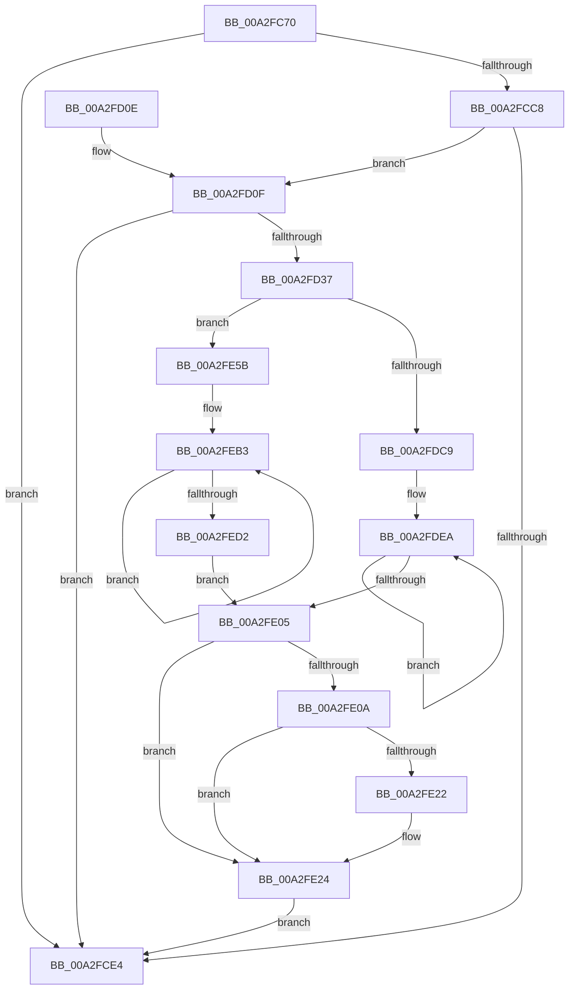

# EtwTiLogSetContextThread

- RVA: `0x00A2FC70`–`0x00A2FED7` (길이 `615` bytes)
- VA: `0x0000000140A2FC70`
- 실행 섹션: `PAGE`
- PDB 이름 있음: `예`; PDB Function 태그: `아니요`
- unwind 정보 RVA: `0x000ACD24`
- 디코드: `147`개 명령, `615/615` bytes 표시
- 미해석 바이트: `0` (있으면 어셈블리에 `.byte`로 보존)

> 이 문서는 커널 이미지의 기계어와 PDB 기호를 분석해 생성했습니다. 4번과 5번은 함수 원형과 자료형을 바이너리 사용 방식에서 추정한 C 해석이며 원본 소스 복구 결과는 아닙니다.

## 1. Dependencies

- 직접 호출 지점: **11**; 고유 호출 대상: **7**
- 직접 호출자로 확인된 함수: **2**
- RIP 상대 이미지 참조: **5**

### Outgoing calls
- `0x00A2FCBD` → [EtwProviderEnabled](../../text/3B/EtwProviderEnabled_function_003BA250.md) (function, `0x003BA250`)
- `0x00A2FCEE` → [_security_check_cookie](../../text/6A/_security_check_cookie_function_006AC640.md) (function, `0x006AC640`)
- `0x00A2FD2E` → [EtwEventEnabled](../../text/39/EtwEventEnabled_function_00392450.md) (function, `0x00392450`)
- `0x00A2FD44` → [EtwpTiFillProcessIdentity](../../text/3B/EtwpTiFillProcessIdentity_function_003B8F30.md) (function, `0x003B8F30`)
- `0x00A2FD63` → [EtwpTiFillThreadIdentity](../../text/47/EtwpTiFillThreadIdentity_function_00471C1C.md) (function, `0x00471C1C`)
- `0x00A2FD82` → [EtwpTiFillProcessIdentity](../../text/3B/EtwpTiFillProcessIdentity_function_003B8F30.md) (function, `0x003B8F30`)
- `0x00A2FD9C` → [EtwpTiFillThreadIdentity](../../text/47/EtwpTiFillThreadIdentity_function_00471C1C.md) (function, `0x00471C1C`)
- `0x00A2FDBC` → [EtwProviderEnabled](../../text/3B/EtwProviderEnabled_function_003BA250.md) (function, `0x003BA250`)
- `0x00A2FE19` → [EtwProviderEnabled](../../text/3B/EtwProviderEnabled_function_003BA250.md) (function, `0x003BA250`)
- `0x00A2FE51` → [EtwpTiVadQueryEventWrite](../../text/3B/EtwpTiVadQueryEventWrite_function_003B9360.md) (function, `0x003B9360`)
- `0x00A2FE6B` → [EtwpTiParseContextRecord](EtwpTiParseContextRecord_function_00A2FEE0.md) (function, `0x00A2FEE0`)

### Direct callers
- [PspWow64SetContextThread](../8C/PspWow64SetContextThread_function_008CCC88.md) at `0x008CCFEA`
- [PspSetContextThreadInternal](../8D/PspSetContextThreadInternal_function_008D4420.md) at `0x008D4754`

### Static image references
- `0x00A2FC94` → RVA `0x00E0A740` (`.data`; read)
- `0x00A2FCB0` → RVA `0x00EFFA30` (`.data`; read)
- `0x00A2FD16` → RVA `0x0001A240` (`.rdata`; read)
- `0x00A2FD20` → RVA `0x0001A250` (`.rdata`; read)
- `0x00A2FDC9` → RVA `0x0001A260` (`.rdata`; read)

## 2. Other-region calls and transfers

- 다른 실행 섹션으로 향하는 call: **10**
  - `0x00A2FCBD` → [EtwProviderEnabled](../../text/3B/EtwProviderEnabled_function_003BA250.md) (`PAGE` → `.text`)
  - `0x00A2FCEE` → [_security_check_cookie](../../text/6A/_security_check_cookie_function_006AC640.md) (`PAGE` → `.text`)
  - `0x00A2FD2E` → [EtwEventEnabled](../../text/39/EtwEventEnabled_function_00392450.md) (`PAGE` → `.text`)
  - `0x00A2FD44` → [EtwpTiFillProcessIdentity](../../text/3B/EtwpTiFillProcessIdentity_function_003B8F30.md) (`PAGE` → `.text`)
  - `0x00A2FD63` → [EtwpTiFillThreadIdentity](../../text/47/EtwpTiFillThreadIdentity_function_00471C1C.md) (`PAGE` → `.text`)
  - `0x00A2FD82` → [EtwpTiFillProcessIdentity](../../text/3B/EtwpTiFillProcessIdentity_function_003B8F30.md) (`PAGE` → `.text`)
  - `0x00A2FD9C` → [EtwpTiFillThreadIdentity](../../text/47/EtwpTiFillThreadIdentity_function_00471C1C.md) (`PAGE` → `.text`)
  - `0x00A2FDBC` → [EtwProviderEnabled](../../text/3B/EtwProviderEnabled_function_003BA250.md) (`PAGE` → `.text`)
  - `0x00A2FE19` → [EtwProviderEnabled](../../text/3B/EtwProviderEnabled_function_003BA250.md) (`PAGE` → `.text`)
  - `0x00A2FE51` → [EtwpTiVadQueryEventWrite](../../text/3B/EtwpTiVadQueryEventWrite_function_003B9360.md) (`PAGE` → `.text`)
- 별도 외부 분기/꼬리 이동을 확인하지 못했습니다.

## 3. Assembly (complete function range)

```asm
00A2FC70  48 89 5C 24 08                  mov qword ptr [rsp + 8], rbx
00A2FC75  44 89 4C 24 20                  mov dword ptr [rsp + 0x20], r9d
00A2FC7A  55                              push rbp
00A2FC7B  56                              push rsi
00A2FC7C  57                              push rdi
00A2FC7D  41 54                           push r12
00A2FC7F  41 55                           push r13
00A2FC81  41 56                           push r14
00A2FC83  41 57                           push r15
00A2FC85  48 8D AC 24 D0 FD FF FF         lea rbp, [rsp - 0x230]
00A2FC8D  48 81 EC 30 03 00 00            sub rsp, 0x330
00A2FC94  48 8B 05 A5 AA 3D 00            mov rax, qword ptr [rip + 0x3daaa5]
00A2FC9B  48 33 C4                        xor rax, rsp
00A2FC9E  48 89 85 20 02 00 00            mov qword ptr [rbp + 0x220], rax
00A2FCA5  4D 8B E8                        mov r13, r8
00A2FCA8  48 8B F2                        mov rsi, rdx
00A2FCAB  44 8A E1                        mov r12b, cl
00A2FCAE  33 D2                           xor edx, edx
00A2FCB0  48 8B 0D 79 FD 4C 00            mov rcx, qword ptr [rip + 0x4cfd79]
00A2FCB7  41 B8 00 C0 00 00               mov r8d, 0xc000
00A2FCBD  E8 8E A5 98 FF                  call 0x1403ba250
00A2FCC2  33 DB                           xor ebx, ebx
00A2FCC4  84 C0                           test al, al
00A2FCC6  74 1C                           je 0x140a2fce4
00A2FCC8  65 48 8B 04 25 88 01 00 00      mov rax, qword ptr gs:[0x188]
00A2FCD1  4C 8B BE 20 02 00 00            mov r15, qword ptr [rsi + 0x220]
00A2FCD8  48 8B B8 B8 00 00 00            mov rdi, qword ptr [rax + 0xb8]
00A2FCDF  49 3B FF                        cmp rdi, r15
00A2FCE2  75 2B                           jne 0x140a2fd0f
00A2FCE4  48 8B 8D 20 02 00 00            mov rcx, qword ptr [rbp + 0x220]
00A2FCEB  48 33 CC                        xor rcx, rsp
00A2FCEE  E8 4D C9 C7 FF                  call 0x1406ac640
00A2FCF3  48 8B 9C 24 70 03 00 00         mov rbx, qword ptr [rsp + 0x370]
00A2FCFB  48 81 C4 30 03 00 00            add rsp, 0x330
00A2FD02  41 5F                           pop r15
00A2FD04  41 5E                           pop r14
00A2FD06  41 5D                           pop r13
00A2FD08  41 5C                           pop r12
00A2FD0A  5F                              pop rdi
00A2FD0B  5E                              pop rsi
00A2FD0C  5D                              pop rbp
00A2FD0D  C3                              ret
00A2FD0E  CC                              int3
00A2FD0F  48 8B 0D 1A FD 4C 00            mov rcx, qword ptr [rip + 0x4cfd1a]
00A2FD16  48 8D 05 23 A5 5E FF            lea rax, [rip - 0xa15add]
00A2FD1D  45 84 E4                        test r12b, r12b
00A2FD20  4C 8D 35 29 A5 5E FF            lea r14, [rip - 0xa15ad7]
00A2FD27  4C 0F 45 F0                     cmovne r14, rax
00A2FD2B  49 8B D6                        mov rdx, r14
00A2FD2E  E8 1D 27 96 FF                  call 0x140392450
00A2FD33  84 C0                           test al, al
00A2FD35  74 AD                           je 0x140a2fce4
00A2FD37  4C 8D 44 24 48                  lea r8, [rsp + 0x48]
00A2FD3C  48 8B D7                        mov rdx, rdi
00A2FD3F  48 8D 4C 24 60                  lea rcx, [rsp + 0x60]
00A2FD44  E8 E7 91 98 FF                  call 0x1403b8f30
00A2FD49  65 48 8B 14 25 88 01 00 00      mov rdx, qword ptr gs:[0x188]
00A2FD52  8B C8                           mov ecx, eax
00A2FD54  44 8B C8                        mov r9d, eax
00A2FD57  48 8D 44 24 60                  lea rax, [rsp + 0x60]
00A2FD5C  48 C1 E1 04                     shl rcx, 4
00A2FD60  48 03 C8                        add rcx, rax
00A2FD63  E8 B4 1E A4 FF                  call 0x140471c1c
00A2FD68  44 03 C8                        add r9d, eax
00A2FD6B  4C 8D 44 24 50                  lea r8, [rsp + 0x50]
00A2FD70  48 8D 44 24 60                  lea rax, [rsp + 0x60]
00A2FD75  41 8B C9                        mov ecx, r9d
00A2FD78  48 C1 E1 04                     shl rcx, 4
00A2FD7C  49 8B D7                        mov rdx, r15
00A2FD7F  48 03 C8                        add rcx, rax
00A2FD82  E8 A9 91 98 FF                  call 0x1403b8f30
00A2FD87  44 03 C8                        add r9d, eax
00A2FD8A  48 8D 4C 24 60                  lea rcx, [rsp + 0x60]
00A2FD8F  41 8B C1                        mov eax, r9d
00A2FD92  48 8B D6                        mov rdx, rsi
00A2FD95  48 C1 E0 04                     shl rax, 4
00A2FD99  48 03 C8                        add rcx, rax
00A2FD9C  E8 7B 1E A4 FF                  call 0x140471c1c
00A2FDA1  33 D2                           xor edx, edx
00A2FDA3  41 B8 00 00 00 04               mov r8d, 0x4000000
00A2FDA9  42 8D 0C 08                     lea ecx, [rax + r9]
00A2FDAD  8B F1                           mov esi, ecx
00A2FDAF  8D 79 01                        lea edi, [rcx + 1]
00A2FDB2  48 8B 0D 77 FC 4C 00            mov rcx, qword ptr [rip + 0x4cfc77]
00A2FDB9  48 03 F6                        add rsi, rsi
00A2FDBC  E8 8F A4 98 FF                  call 0x1403ba250
00A2FDC1  84 C0                           test al, al
00A2FDC3  0F 85 92 00 00 00               jne 0x140a2fe5b
00A2FDC9  4C 8D 05 90 A4 5E FF            lea r8, [rip - 0xa15b70]
00A2FDD0  66 89 5C 24 40                  mov word ptr [rsp + 0x40], bx
00A2FDD5  4C 89 44 F4 60                  mov qword ptr [rsp + rsi*8 + 0x60], r8
00A2FDDA  8B D3                           mov edx, ebx
00A2FDDC  48 C7 44 F4 68 02 00 00 00      mov qword ptr [rsp + rsi*8 + 0x68], 2
00A2FDE5  B9 0C 00 00 00                  mov ecx, 0xc
00A2FDEA  8B C7                           mov eax, edi
00A2FDEC  FF C7                           inc edi
00A2FDEE  48 03 C0                        add rax, rax
00A2FDF1  4C 89 44 C4 60                  mov qword ptr [rsp + rax*8 + 0x60], r8
00A2FDF6  48 C7 44 C4 68 08 00 00 00      mov qword ptr [rsp + rax*8 + 0x68], 8
00A2FDFF  48 83 E9 01                     sub rcx, 1
00A2FE03  75 E5                           jne 0x140a2fdea
00A2FE05  F6 C2 01                        test dl, 1
00A2FE08  74 1A                           je 0x140a2fe24
00A2FE0A  48 8B 0D 1F FC 4C 00            mov rcx, qword ptr [rip + 0x4cfc1f]
00A2FE11  33 D2                           xor edx, edx
00A2FE13  41 B8 00 00 00 08               mov r8d, 0x8000000
00A2FE19  E8 32 A4 98 FF                  call 0x1403ba250
00A2FE1E  84 C0                           test al, al
00A2FE20  74 02                           je 0x140a2fe24
00A2FE22  B3 01                           mov bl, 1
00A2FE24  88 5C 24 38                     mov byte ptr [rsp + 0x38], bl
00A2FE28  48 8D 85 C0 01 00 00            lea rax, [rbp + 0x1c0]
00A2FE2F  4C 89 74 24 30                  mov qword ptr [rsp + 0x30], r14
00A2FE34  48 8D 4C 24 60                  lea rcx, [rsp + 0x60]
00A2FE39  C7 44 24 28 01 00 00 00         mov dword ptr [rsp + 0x28], 1
00A2FE41  4D 8B CF                        mov r9, r15
00A2FE44  44 8B C7                        mov r8d, edi
00A2FE47  48 89 44 24 20                  mov qword ptr [rsp + 0x20], rax
00A2FE4C  BA 26 00 00 00                  mov edx, 0x26
00A2FE51  E8 0A 95 98 FF                  call 0x1403b9360
00A2FE56  E9 89 FE FF FF                  jmp 0x140a2fce4
00A2FE5B  8B 95 88 02 00 00               mov edx, dword ptr [rbp + 0x288]
00A2FE61  48 8D 8D C0 01 00 00            lea rcx, [rbp + 0x1c0]
00A2FE68  4D 8B C5                        mov r8, r13
00A2FE6B  E8 70 00 00 00                  call 0x140a2fee0
00A2FE70  8B CF                           mov ecx, edi
00A2FE72  4C 8D 85 C0 01 00 00            lea r8, [rbp + 0x1c0]
00A2FE79  48 03 C9                        add rcx, rcx
00A2FE7C  66 89 44 24 40                  mov word ptr [rsp + 0x40], ax
00A2FE81  0F B7 D0                        movzx edx, ax
00A2FE84  48 C7 44 F4 68 04 00 00 00      mov qword ptr [rsp + rsi*8 + 0x68], 4
00A2FE8D  48 8D 85 88 02 00 00            lea rax, [rbp + 0x288]
00A2FE94  FF C7                           inc edi
00A2FE96  48 89 44 F4 60                  mov qword ptr [rsp + rsi*8 + 0x60], rax
00A2FE9B  48 8D 44 24 40                  lea rax, [rsp + 0x40]
00A2FEA0  48 89 44 CC 60                  mov qword ptr [rsp + rcx*8 + 0x60], rax
00A2FEA5  48 C7 44 CC 68 02 00 00 00      mov qword ptr [rsp + rcx*8 + 0x68], 2
00A2FEAE  B9 0C 00 00 00                  mov ecx, 0xc
00A2FEB3  8B C7                           mov eax, edi
00A2FEB5  FF C7                           inc edi
00A2FEB7  48 03 C0                        add rax, rax
00A2FEBA  4C 89 44 C4 60                  mov qword ptr [rsp + rax*8 + 0x60], r8
00A2FEBF  49 83 C0 08                     add r8, 8
00A2FEC3  48 C7 44 C4 68 08 00 00 00      mov qword ptr [rsp + rax*8 + 0x68], 8
00A2FECC  48 83 E9 01                     sub rcx, 1
00A2FED0  75 E1                           jne 0x140a2feb3
00A2FED2  E9 2E FF FF FF                  jmp 0x140a2fe05
```

## 4. C-style interpretation (structured pseudocode)

```c
__int64 __fastcall EtwTiLogSetContextThread(unsigned __int8 a1, __int64 a2, __int64 a3, int a4)
{
    __int64 result;
    __int64 v_r14;
    __int64 v_rbx;
    __int64 v_rdi;
    __int64 v_rsi;
    __int64 v_rsp;
    unsigned __int64 v_stack_m268;
    unsigned __int64 v_stack_m48;
    unsigned __int64 v_stack_mA8;
    unsigned int v_stack_p20;
    unsigned int v_stack_p28;
    unsigned __int64 v_stack_p30;
    unsigned __int8 v_stack_p38;
    unsigned __int16 v_stack_p40;
    unsigned __int64 v_stack_p48;
    unsigned __int64 v_stack_p50;
    unsigned __int64 v_stack_p60;
    unsigned __int64 v_stack_p8;

    v_stack_p8 = v_rbx;
    v_stack_p20 = a4;
    v_rsp = (v_rsp) - (816);
    result = (*(unsigned __int64 *)(v_rip + 4041381)) ^ (v_rsp);
    v_stack_m48 = result;
    a2 = 0;
    result = EtwProviderEnabled(*(unsigned __int64 *)(v_rip + 5045625), a2, (unsigned int)(0xC000ULL), a4);
    v_rbx = 0;
    if ((unsigned __int8)(result) == 0) goto loc_00A2FCE4;
    if ((*(unsigned __int64 *)(*(unsigned __int64 *)(gs_base + (0 + 392)) + 184)) != (*(unsigned __int64 *)(a2 + 544))) goto loc_00A2FD0F;
loc_00A2FCE4:
    a1 = (v_stack_m48) ^ (v_rsp);
    result = _security_check_cookie(a1, a2, (unsigned int)(0xC000ULL), a4);
    v_rsp = (v_rsp) + (816);
    return result;
loc_00A2FD0F:
    v_r14 = v_rip - 10574551;
    if (a1 != 0) { v_r14 = v_rip - 10574557; }
    result = EtwEventEnabled(*(unsigned __int64 *)(v_rip + 5045530), v_r14, (unsigned int)(0xC000ULL), a4);
    if ((unsigned __int8)(result) == 0) goto loc_00A2FCE4;
    result = EtwpTiFillProcessIdentity(v_stack_p60, *(unsigned __int64 *)(*(unsigned __int64 *)(gs_base + (0 + 392)) + 184), v_stack_p48, a4);
    a1 = ((unsigned int)((unsigned int)(result))) << (4);
    a1 = (a1) + (v_stack_p60);
    result = EtwpTiFillThreadIdentity(a1, *(unsigned __int64 *)(gs_base + (0 + 392)), v_stack_p48, (unsigned int)((unsigned int)(result)));
    a4 = (unsigned int)(((unsigned int)((unsigned int)(result))) + ((unsigned int)(result)));
    a1 = ((unsigned int)(a4)) << (4);
    a1 = (a1) + (v_stack_p60);
    result = EtwpTiFillProcessIdentity(a1, *(unsigned __int64 *)(a2 + 544), v_stack_p50, a4);
    a4 = (unsigned int)((a4) + ((unsigned int)(result)));
    result = ((unsigned int)(a4)) << (4);
    a1 = (v_stack_p60) + (result);
    result = EtwpTiFillThreadIdentity(a1, 0, v_stack_p50, a4);
    a2 = 0;
    v_rsi = ((unsigned int)((unsigned int)(result + a4 * 1))) + ((unsigned int)((unsigned int)(result + a4 * 1)));
    result = EtwProviderEnabled(*(unsigned __int64 *)(v_rip + 5045367), a2, (unsigned int)(0x4000000ULL), a4);
    if ((unsigned __int8)(result) != 0) goto loc_00A2FE5B;
    v_stack_p40 = (unsigned __int16)(v_stack_p8);
    *(unsigned __int64 *)(v_rsp + v_rsi * 8 + 96) = v_rip - 10574704;
    *(unsigned __int64 *)(v_rsp + v_rsi * 8 + 104) = 2;
loc_00A2FDEA:
    v_rdi = (unsigned int)((result + a4 * 1 + 1) + 1);
    result = ((unsigned int)((unsigned int)(result + a4 * 1 + 1))) + ((unsigned int)((unsigned int)(result + a4 * 1 + 1)));
    *(unsigned __int64 *)(v_rsp + result * 8 + 96) = v_rip - 10574704;
    *(unsigned __int64 *)(v_rsp + result * 8 + 104) = 8;
    a1 = (12) - (1);
    if (condition_is_not_equal) goto loc_00A2FDEA;
loc_00A2FE05:
    if ((((unsigned __int8)((unsigned int)((unsigned int)(v_stack_p8)))) & (1)) == 0) goto loc_00A2FE24;
    a2 = 0;
    result = EtwProviderEnabled(*(unsigned __int64 *)(v_rip + 5045279), a2, (unsigned int)(0x8000000ULL), a4);
    v_rbx = v_stack_p8;
    if ((unsigned __int8)(result) != 0) {
        v_rbx = 1;
    }
    v_stack_p38 = (unsigned __int8)(v_rbx);
    v_stack_p30 = v_r14;
    v_stack_p28 = 1;
    v_stack_p20 = v_stack_mA8;
    result = EtwpTiVadQueryEventWrite(v_stack_p60, 38, (unsigned int)((unsigned int)(v_rdi)), *(unsigned __int64 *)(a2 + 544));
    goto loc_00A2FCE4;
loc_00A2FE5B:
    result = EtwpTiParseContextRecord(v_stack_mA8, (unsigned int)(v_stack_p20), a3, *(unsigned __int64 *)(a2 + 544));
    a1 = ((unsigned int)((unsigned int)(v_rdi))) + ((unsigned int)((unsigned int)(v_rdi)));
    v_stack_p40 = (unsigned __int16)(result);
    *(unsigned __int64 *)(v_rsp + v_rsi * 8 + 104) = 4;
    v_rdi = (unsigned int)((v_rdi) + 1);
    *(unsigned __int64 *)(v_rsp + v_rsi * 8 + 96) = v_stack_p20;
    *(unsigned __int64 *)(v_rsp + a1 * 8 + 96) = v_stack_p40;
    *(unsigned __int64 *)(v_rsp + a1 * 8 + 104) = 2;
loc_00A2FEB3:
    v_rdi = (unsigned int)((v_rdi) + 1);
    result = ((unsigned int)((unsigned int)(v_rdi))) + ((unsigned int)((unsigned int)(v_rdi)));
    *(unsigned __int64 *)(v_rsp + result * 8 + 96) = v_stack_mA8;
    a3 = (v_stack_mA8) + (8);
    *(unsigned __int64 *)(v_rsp + result * 8 + 104) = 8;
    a1 = (12) - (1);
    if (condition_is_not_equal) goto loc_00A2FEB3;
    goto loc_00A2FE05;
}
```

## 5. (Beta) C Style

```c
int64_t EtwTiLogSetContextThread(uint8_t Arg1, void *Arg2, int64_t Arg3, int32_t Arg4)
{
    uint8_t *arg2 = (uint8_t *)Arg2;

    int64_t result;
    int64_t local_r14;
    int64_t local_rbx;
    int64_t local_rdi;
    int64_t local_rsi;
    int64_t local_rsp;
    uint64_t v_stack_m268;
    uint64_t v_stack_m48;
    uint64_t v_stack_mA8;
    uint32_t v_stack_p20;
    uint32_t v_stack_p28;
    uint64_t v_stack_p30;
    uint8_t v_stack_p38;
    uint16_t v_stack_p40;
    uint64_t v_stack_p48;
    uint64_t v_stack_p50;
    uint64_t v_stack_p60;
    uint64_t v_stack_p8;

    v_stack_p8 = local_rbx;
    v_stack_p20 = Arg4;
    local_rsp = (local_rsp) - (816);
    result = (*(uint64_t *)(v_rip + 0x3DAAA5)) ^ (local_rsp);
    v_stack_m48 = result;
    Arg2 = 0;
    result = EtwProviderEnabled(*(uint64_t *)(v_rip + 0x4CFD79), Arg2, (uint32_t)(0xC000ULL), Arg4);
    local_rbx = 0;
    if ((uint8_t)(result) == 0) goto loc_00A2FCE4;
    if ((*(uint64_t *)(*(uint64_t *)(gs_base + (0 + 0x188)) + 0xB8)) != (*(uint64_t *)(arg2 + 0x220))) goto loc_00A2FD0F;
loc_00A2FCE4:
    Arg1 = (v_stack_m48) ^ (local_rsp);
    result = _security_check_cookie(Arg1, Arg2, (uint32_t)(0xC000ULL), Arg4);
    local_rsp = (local_rsp) + (816);
    return result;
loc_00A2FD0F:
    local_r14 = v_rip - 10574551;
    if (Arg1 != 0) { local_r14 = v_rip - 10574557; }
    result = EtwEventEnabled(*(uint64_t *)(v_rip + 0x4CFD1A), local_r14, (uint32_t)(0xC000ULL), Arg4);
    if ((uint8_t)(result) == 0) goto loc_00A2FCE4;
    result = EtwpTiFillProcessIdentity(v_stack_p60, *(uint64_t *)(*(uint64_t *)(gs_base + (0 + 0x188)) + 0xB8), v_stack_p48, Arg4);
    Arg1 = ((uint32_t)((uint32_t)(result))) << (4);
    Arg1 = (Arg1) + (v_stack_p60);
    result = EtwpTiFillThreadIdentity(Arg1, *(uint64_t *)(gs_base + (0 + 0x188)), v_stack_p48, (uint32_t)((uint32_t)(result)));
    Arg4 = (uint32_t)(((uint32_t)((uint32_t)(result))) + ((uint32_t)(result)));
    Arg1 = ((uint32_t)(Arg4)) << (4);
    Arg1 = (Arg1) + (v_stack_p60);
    result = EtwpTiFillProcessIdentity(Arg1, *(uint64_t *)(arg2 + 0x220), v_stack_p50, Arg4);
    Arg4 = (uint32_t)((Arg4) + ((uint32_t)(result)));
    result = ((uint32_t)(Arg4)) << (4);
    Arg1 = (v_stack_p60) + (result);
    result = EtwpTiFillThreadIdentity(Arg1, 0, v_stack_p50, Arg4);
    Arg2 = 0;
    local_rsi = ((uint32_t)((uint32_t)(result + Arg4 * 1))) + ((uint32_t)((uint32_t)(result + Arg4 * 1)));
    result = EtwProviderEnabled(*(uint64_t *)(v_rip + 0x4CFC77), Arg2, (uint32_t)(0x4000000ULL), Arg4);
    if ((uint8_t)(result) != 0) goto loc_00A2FE5B;
    v_stack_p40 = (uint16_t)(v_stack_p8);
    *(uint64_t *)(local_rsp + local_rsi * 8 + 0x60) = v_rip - 10574704;
    *(uint64_t *)(local_rsp + local_rsi * 8 + 0x68) = 2;
loc_00A2FDEA:
    local_rdi = (uint32_t)((result + Arg4 * 1 + 1) + 1);
    result = ((uint32_t)((uint32_t)(result + Arg4 * 1 + 1))) + ((uint32_t)((uint32_t)(result + Arg4 * 1 + 1)));
    *(uint64_t *)(local_rsp + result * 8 + 0x60) = v_rip - 10574704;
    *(uint64_t *)(local_rsp + result * 8 + 0x68) = 8;
    Arg1 = (12) - (1);
    if (condition_is_not_equal) goto loc_00A2FDEA;
loc_00A2FE05:
    if ((((uint8_t)((uint32_t)((uint32_t)(v_stack_p8)))) & (1)) == 0) goto loc_00A2FE24;
    Arg2 = 0;
    result = EtwProviderEnabled(*(uint64_t *)(v_rip + 0x4CFC1F), Arg2, (uint32_t)(0x8000000ULL), Arg4);
    local_rbx = v_stack_p8;
    if ((uint8_t)(result) != 0) {
        local_rbx = 1;
    }
    v_stack_p38 = (uint8_t)(local_rbx);
    v_stack_p30 = local_r14;
    v_stack_p28 = 1;
    v_stack_p20 = v_stack_mA8;
    result = EtwpTiVadQueryEventWrite(v_stack_p60, 38, (uint32_t)((uint32_t)(local_rdi)), *(uint64_t *)(arg2 + 0x220));
    goto loc_00A2FCE4;
loc_00A2FE5B:
    result = EtwpTiParseContextRecord(v_stack_mA8, (uint32_t)(v_stack_p20), Arg3, *(uint64_t *)(arg2 + 0x220));
    Arg1 = ((uint32_t)((uint32_t)(local_rdi))) + ((uint32_t)((uint32_t)(local_rdi)));
    v_stack_p40 = (uint16_t)(result);
    *(uint64_t *)(local_rsp + local_rsi * 8 + 0x68) = 4;
    local_rdi = (uint32_t)((local_rdi) + 1);
    *(uint64_t *)(local_rsp + local_rsi * 8 + 0x60) = v_stack_p20;
    *(uint64_t *)(local_rsp + Arg1 * 8 + 0x60) = v_stack_p40;
    *(uint64_t *)(local_rsp + Arg1 * 8 + 0x68) = 2;
loc_00A2FEB3:
    local_rdi = (uint32_t)((local_rdi) + 1);
    result = ((uint32_t)((uint32_t)(local_rdi))) + ((uint32_t)((uint32_t)(local_rdi)));
    *(uint64_t *)(local_rsp + result * 8 + 0x60) = v_stack_mA8;
    Arg3 = (v_stack_mA8) + (8);
    *(uint64_t *)(local_rsp + result * 8 + 0x68) = 8;
    Arg1 = (12) - (1);
    if (condition_is_not_equal) goto loc_00A2FEB3;
    goto loc_00A2FE05;
}
```

### 관측된 메모리 오프셋

구조체 형식이 확인되지 않은 접근은 인자 기준의 오프셋으로만 기록했습니다.

| 기준 인자 | 오프셋 표현 | 폭 (bit) | 접근 |
|---|---:|---:|---|
| `Arg2` | `+ 0x220` | `64` | `R` |

## 6. Execution-region graph

[열기: 2D/3D 그래프와 함수 탐색 컨트롤 패널](../../../control-panel.html?section=page&rva=0x00A2FC70&view=graph)

- 2D 그래프는 위에서 아래로 흐르고, 3D 그래프는 빈 공간을 드래그해 회전합니다. Shift+드래그는 이동, 휠은 확대·축소, 함수 노드 선택은 대상 보고서 이동입니다.

### Static fallback


