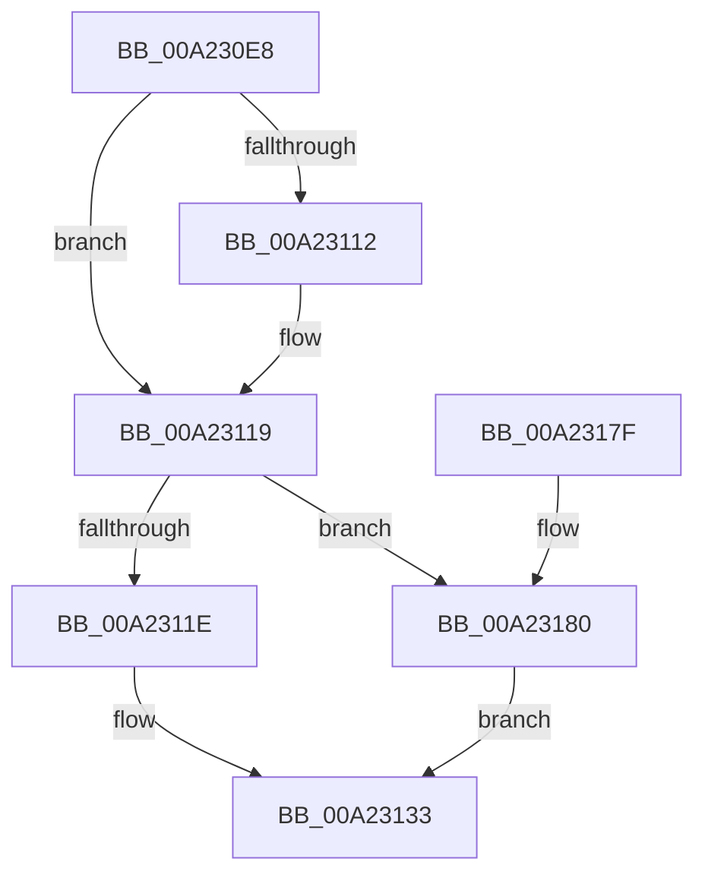

# EtwTraceJobAssignProcess

- RVA: `0x00A230E8`–`0x00A23186` (길이 `158` bytes)
- VA: `0x0000000140A230E8`
- 실행 섹션: `PAGE`
- PDB 이름 있음: `예`; PDB Function 태그: `아니요`
- unwind 정보 RVA: `0x000AB670`
- 디코드: `39`개 명령, `158/158` bytes 표시
- 미해석 바이트: `0` (있으면 어셈블리에 `.byte`로 보존)

> 이 문서는 커널 이미지의 기계어와 PDB 기호를 분석해 생성했습니다. 4번과 5번은 함수 원형과 자료형을 바이너리 사용 방식에서 추정한 C 해석이며 원본 소스 복구 결과는 아닙니다.

## 1. Dependencies

- 직접 호출 지점: **2**; 고유 호출 대상: **2**
- 직접 호출자로 확인된 함수: **2**
- RIP 상대 이미지 참조: **1**

### Outgoing calls
- `0x00A23168` → [EtwTraceKernelEvent](../../text/23/EtwTraceKernelEvent_function_00235350.md) (function, `0x00235350`)
- `0x00A23174` → [_security_check_cookie](../../text/6A/_security_check_cookie_function_006AC640.md) (function, `0x006AC640`)

### Direct callers
- [PspAssignProcessToJobList](PspAssignProcessToJobList_function_00A22F14.md) at `0x00A22F7E`
- [NtAssignProcessToJobObject](NtAssignProcessToJobObject_function_00A22FC0.md) at `0x00A23086`

### Static image references
- `0x00A230F1` → RVA `0x00E0A740` (`.data`; read)

## 2. Other-region calls and transfers

- 다른 실행 섹션으로 향하는 call: **2**
  - `0x00A23168` → [EtwTraceKernelEvent](../../text/23/EtwTraceKernelEvent_function_00235350.md) (`PAGE` → `.text`)
  - `0x00A23174` → [_security_check_cookie](../../text/6A/_security_check_cookie_function_006AC640.md) (`PAGE` → `.text`)
- 별도 외부 분기/꼬리 이동을 확인하지 못했습니다.

## 3. Assembly (complete function range)

```asm
00A230E8  40 55                           push rbp
00A230EA  48 8B EC                        mov rbp, rsp
00A230ED  48 83 EC 70                     sub rsp, 0x70
00A230F1  48 8B 05 48 76 3E 00            mov rax, qword ptr [rip + 0x3e7648]
00A230F8  48 33 C4                        xor rax, rsp
00A230FB  48 89 45 F0                     mov qword ptr [rbp - 0x10], rax
00A230FF  45 33 D2                        xor r10d, r10d
00A23102  4C 89 55 C0                     mov qword ptr [rbp - 0x40], r10
00A23106  45 8B CA                        mov r9d, r10d
00A23109  4C 89 55 C8                     mov qword ptr [rbp - 0x38], r10
00A2310D  48 85 D2                        test rdx, rdx
00A23110  74 07                           je 0x140a23119
00A23112  44 8B 8A D0 01 00 00            mov r9d, dword ptr [rdx + 0x1d0]
00A23119  48 85 C9                        test rcx, rcx
00A2311C  74 62                           je 0x140a23180
00A2311E  0F 10 81 C0 05 00 00            movups xmm0, xmmword ptr [rcx + 0x5c0]
00A23125  8B 81 BC 05 00 00               mov eax, dword ptr [rcx + 0x5bc]
00A2312B  89 45 D0                        mov dword ptr [rbp - 0x30], eax
00A2312E  F3 0F 7F 45 C0                  movdqu xmmword ptr [rbp - 0x40], xmm0
00A23133  44 89 4D D4                     mov dword ptr [rbp - 0x2c], r9d
00A23137  48 8D 45 C0                     lea rax, [rbp - 0x40]
00A2313B  44 89 45 D8                     mov dword ptr [rbp - 0x28], r8d
00A2313F  48 8D 4D E0                     lea rcx, [rbp - 0x20]
00A23143  41 B9 23 07 00 00               mov r9d, 0x723
00A23149  48 89 45 E0                     mov qword ptr [rbp - 0x20], rax
00A2314D  41 B8 00 00 08 00               mov r8d, 0x80000
00A23153  48 C7 45 E8 1C 00 00 00         mov qword ptr [rbp - 0x18], 0x1c
00A2315B  BA 01 00 00 00                  mov edx, 1
00A23160  C7 44 24 20 04 19 60 00         mov dword ptr [rsp + 0x20], 0x601904
00A23168  E8 E3 21 81 FF                  call 0x140235350
00A2316D  48 8B 4D F0                     mov rcx, qword ptr [rbp - 0x10]
00A23171  48 33 CC                        xor rcx, rsp
00A23174  E8 C7 94 C8 FF                  call 0x1406ac640
00A23179  48 83 C4 70                     add rsp, 0x70
00A2317D  5D                              pop rbp
00A2317E  C3                              ret
00A2317F  CC                              int3
00A23180  44 89 55 D0                     mov dword ptr [rbp - 0x30], r10d
00A23184  EB AD                           jmp 0x140a23133
```

## 4. C-style interpretation (structured pseudocode)

```c
__int64 __fastcall EtwTraceJobAssignProcess(__int64 a1, __int64 a2, int a3)
{
    __int64 result;
    __int64 v_r10;
    __int64 v_rsp;
    unsigned __int64 v_stack_m18;
    unsigned __int64 v_stack_m20;
    unsigned __int64 v_stack_m28;
    unsigned int v_stack_m30;
    unsigned int v_stack_m34;
    unsigned int v_stack_m38;
    unsigned __int64 v_stack_m40;
    unsigned __int64 v_stack_m48;
    unsigned int v_stack_m58;

    v_rsp = (v_rsp) - (112);
    result = (*(unsigned __int64 *)(v_rip + 4093512)) ^ (v_rsp);
    v_stack_m18 = result;
    v_r10 = 0;
    v_stack_m48 = 0;
    v_stack_m40 = 0;
    if (a2 != 0) {
        a4 = *(unsigned int *)(a2 + 464);
    }
    if (a1 == 0) goto loc_00A23180;
    v_stack_m38 = (unsigned int)((unsigned int)(*(unsigned int *)(a1 + 1468)));
    v_stack_m48 = v_xmm0;
loc_00A23133:
    v_stack_m34 = (unsigned int)(a4);
    v_stack_m30 = a3;
    v_stack_m28 = v_stack_m48;
    v_stack_m20 = 28;
    v_stack_m58 = 0x601904ULL;
    result = EtwTraceKernelEvent(v_stack_m28, 1, (unsigned int)(0x80000ULL), (unsigned int)(0x723ULL));
    a1 = (v_stack_m18) ^ (v_rsp);
    result = _security_check_cookie(a1, 1, (unsigned int)(0x80000ULL), (unsigned int)(0x723ULL));
    v_rsp = (v_rsp) + (112);
    return result;
loc_00A23180:
    v_stack_m38 = 0;
    goto loc_00A23133;
}
```

## 5. (Beta) C Style

```c
int64_t EtwTraceJobAssignProcess(int64_t Arg1, int64_t Arg2, int32_t Arg3)
{
    int64_t result;
    int64_t local_r10;
    int64_t local_rsp;
    uint64_t v_stack_m18;
    uint64_t v_stack_m20;
    uint64_t v_stack_m28;
    uint32_t v_stack_m30;
    uint32_t v_stack_m34;
    uint32_t v_stack_m38;
    uint64_t v_stack_m40;
    uint64_t v_stack_m48;
    uint32_t v_stack_m58;

    local_rsp = (local_rsp) - (112);
    result = (*(uint64_t *)(v_rip + 0x3E7648)) ^ (local_rsp);
    v_stack_m18 = result;
    local_r10 = 0;
    v_stack_m48 = 0;
    v_stack_m40 = 0;
    if (Arg2 != 0) {
        a4 = *(uint32_t *)(Arg2 + 0x1D0);
    }
    if (Arg1 == 0) goto loc_00A23180;
    v_stack_m38 = (uint32_t)((uint32_t)(*(uint32_t *)(Arg1 + 0x5BC)));
    v_stack_m48 = v_xmm0;
loc_00A23133:
    v_stack_m34 = (uint32_t)(a4);
    v_stack_m30 = Arg3;
    v_stack_m28 = v_stack_m48;
    v_stack_m20 = 28;
    v_stack_m58 = 0x601904ULL;
    result = EtwTraceKernelEvent(v_stack_m28, 1, (uint32_t)(0x80000ULL), (uint32_t)(0x723ULL));
    Arg1 = (v_stack_m18) ^ (local_rsp);
    result = _security_check_cookie(Arg1, 1, (uint32_t)(0x80000ULL), (uint32_t)(0x723ULL));
    local_rsp = (local_rsp) + (112);
    return result;
loc_00A23180:
    v_stack_m38 = 0;
    goto loc_00A23133;
}
```

## 6. Execution-region graph

[열기: 2D/3D 그래프와 함수 탐색 컨트롤 패널](../../../control-panel.html?section=page&rva=0x00A230E8&view=graph)

- 2D 그래프는 위에서 아래로 흐르고, 3D 그래프는 빈 공간을 드래그해 회전합니다. Shift+드래그는 이동, 휠은 확대·축소, 함수 노드 선택은 대상 보고서 이동입니다.

### Static fallback


